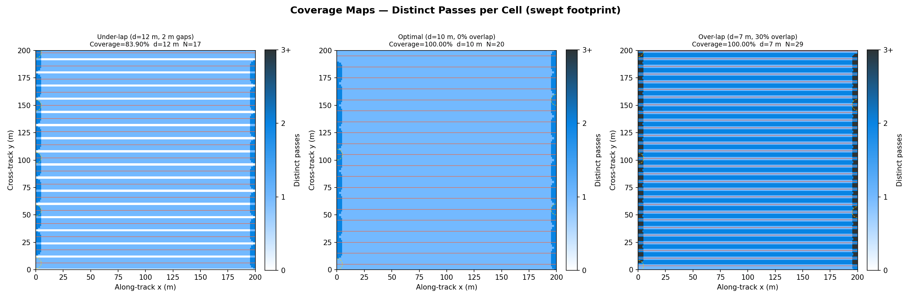
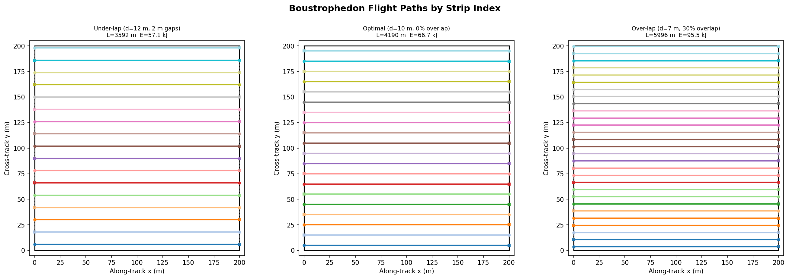
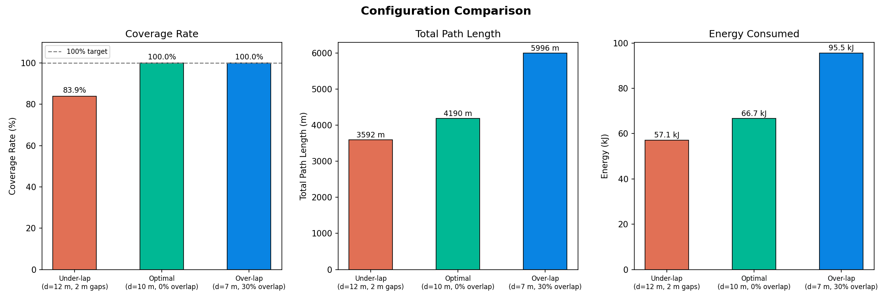
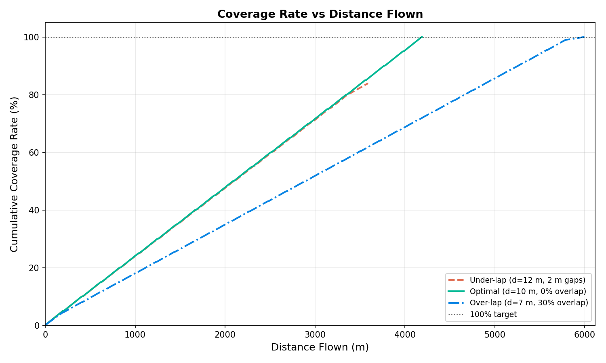
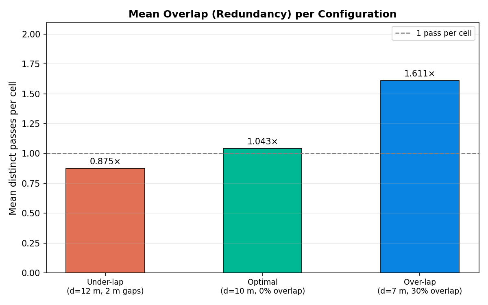
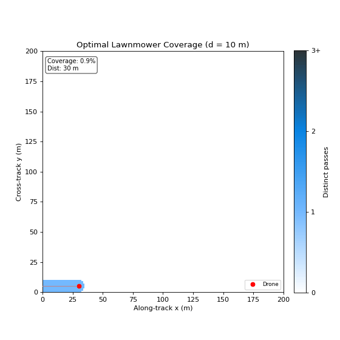

# S048 Full-Area Coverage Scan (Lawnmower)

**Domain**: Environmental Monitoring & SAR | **Difficulty**: ⭐ | **Status**: ✅ Completed

---

## Problem Definition

**Setup**: A single drone must survey a 200 × 200 m rectangular search area from a fixed altitude. The drone carries a nadir-pointing sensor with a circular footprint of radius $r_s = 5$ m. Starting from a corner, the drone flies a **boustrophedon (lawnmower)** pattern — parallel east-west strips traversed alternately left-to-right and right-to-left, connected by 180° heading reversals at each end.

**Objective**: Quantify, for each strip-width configuration, (1) the final coverage rate, (2) the total path length, (3) the energy consumed and (4) the redundancy (how many passes see each cell); identify which configuration achieves 100% coverage at minimum energy.

**Comparison Configurations**:
1. **Under-lap** — strip width $d = 12$ m ($\rho = 1 - d/2r_s = -20\%$, 2 m gap between strip footprints)
2. **Optimal** — strip width $d^* = 10$ m ($\rho = 0$, tangent footprints, exact full coverage)
3. **Over-lap** — strip width $d = 7$ m ($\rho = 30\%$, guaranteed coverage with energy penalty)

---

## Mathematical Model

### Strip Geometry

Effective lateral coverage width per strip (full footprint diameter): $w = 2 r_s = 10$ m.

Strip spacing given overlap ratio $\rho$: $d = w (1 - \rho) = 2 r_s (1 - \rho)$.

Number of strips: $N = \lceil W / d \rceil$, strip centres $y_i = (i + \tfrac12) d$.

### Total Path Length

$$L = \underbrace{N \cdot H}_{\text{scan strips}} + \underbrace{(N-1) \cdot d}_{\text{turn legs}}$$

where $H = 200$ m is the along-track strip length.

### Energy Model

$$E = P_{cruise} \cdot \frac{L}{v} + (P_{hover} - P_{cruise}) \cdot t_{turn} \cdot (N - 1)$$

where $v = 10$ m/s, $P_{cruise} = 150$ W, $P_{hover} = 200$ W, $t_{turn} = 4$ s per reversal.

### Coverage Rate (swept footprint)

A 1 × 1 m cell is scanned if the drone path comes within $r_s$ of its centre, $\min_t \|\mathbf{p}(t) - \mathbf{c}\| \le r_s$. The position is advanced every $\Delta t = 0.5$ s (5 m), and between two consecutive positions the footprint is swept continuously (every cell within $r_s$ of the connecting segment is marked), so the result does not depend on $\Delta t$:

$$C = \frac{\bigl|\{\mathbf{c} : \text{scanned}\}\bigr|}{W \cdot H} \times 100\%$$

### Overlap (distinct passes)

Each straight leg between two waypoints (a scan strip or a turn leg) is one *pass*; $n(\mathbf{c})$ is the number of distinct passes whose swept footprint contains cell $\mathbf{c}$. Reported: $\bar n = \sum n / (W H)$ over all cells (card definition), $\bar n$ over scanned cells only, and the share of cells seen by ≥ 2 passes.

---

## Key Parameters

| Parameter | Value | Notes |
|-----------|-------|-------|
| Search area | 200 × 200 m | |
| Sensor footprint radius $r_s$ | 5 m | |
| Effective strip width (footprint diameter) | 10 m | |
| Drone cruise speed $v$ | 10 m/s | |
| Cruise power $P_{cruise}$ | 150 W | |
| Hover/turn power $P_{hover}$ | 200 W | |
| Turn time per reversal $t_{turn}$ | 4 s | energy model only |
| Grid cell size | 1 × 1 m | 40,000 cells |
| Position update step $\Delta t$ | 0.5 s (5 m) | footprint swept between updates |
| Under-lap strip spacing $d$ | 12 m | $\rho = -20\%$, 2 m gap |
| Optimal strip spacing $d^*$ | 10 m | $\rho = 0$, tangent |
| Over-lap strip spacing $d$ | 7 m | $\rho = 30\%$ |
| Under-lap strip count $N$ | 17 strips | |
| Optimal strip count $N$ | 20 strips | |
| Over-lap strip count $N$ | 29 strips | |
| Animation | 140 frames (every 6th position update, optimal config), 20 fps | |

### Deviations from the scenario card

- **Coverage is computed on the swept footprint.** The card's sample code (and the previous script) marked the footprint only at the discrete positions, 5 m apart ($v \Delta t = r_s$). Between two samples the 10 m-wide band then narrows to slivers, so the tangent-strip (optimal) configuration reached only 96.09 % instead of the card's guaranteed 100 %. Sweeping the footprint along each 5 m step gives the exact coverage (now 100.00 %).
- **Overlap metric counts distinct passes**, not time steps. The old metric added 1 to every cell in the footprint at every 5 m step, so a cell under a strip was counted about twice per strip (old values: 1.372× under-lap, 1.619× optimal, 2.250× over-lap). That measured along-track sampling density, not strip overlap. The card's definition text was clarified accordingly.
- **Turn legs count as passes**: the sensor stays on during the 180° reversals, so the lateral turn legs at x = 0 and x = 200 m also scan cells (they close part of the under-lap gaps near the area edges, and cause the small > 1 overlap of the optimal configuration).
- **Card correction**: the card labelled the under-lap configuration "ρ = 0 %", which contradicts its own formula $d = 2r_s(1-\rho)$; $d = 12$ m corresponds to $\rho = -20\%$. Fixed in the card and in the labels.
- The reversal is simulated kinematically as a straight lateral leg at cruise speed; the extra turn cost appears only in the energy formula ($t_{turn}$ term), as the card prescribes.

---

## Implementation

```
src/03_environmental_sar/s048_lawnmower.py   # Main simulation script
```

```bash
conda activate drones
python src/03_environmental_sar/s048_lawnmower.py
```

Runtime ≈ 21 s. Deterministic (no random sources).

---

## Results

| Configuration | Strips | Path length | Energy | Coverage | Uncovered cells | Mean passes (all cells) | Mean passes (scanned cells) | Cells with ≥ 2 passes |
|---------------|--------|-------------|--------|----------|-----------------|-----------------|-----------------|---------|
| Under-lap ($d=12$ m) | 17 | 3,592 m | **57.08 kJ** | **83.90%** | 6,440 | 0.875 | 1.043 | 3.57% |
| Optimal ($d=10$ m) | 20 | 4,190 m | **66.65 kJ** | **100.00%** | 0 | 1.043 | 1.043 | 4.28% |
| Over-lap ($d=7$ m, 30%) | 29 | 5,996 m | **95.54 kJ** | **100.00%** | 0 | 1.611 | 1.611 | 58.11% |

Energy check ($E = 150 \cdot L/10 + 50 \cdot 4 \cdot (N-1)$): under-lap 53,880 + 3,200 = 57,080 J; optimal 62,850 + 3,800 = 66,650 J; over-lap 89,940 + 5,600 = 95,540 J.

**Optimal** ($d = 10$ m, tangent circles) is the cheapest configuration that covers 100 % of the area; it reaches 100 % at the end of the last strip (4,190 m). Each strip covers exactly 10 cell rows and 20 strips × 10 rows = 200 rows, so the strips alone give exactly one pass per cell; the 19 turn legs add a second pass on 4.28 % of the cells near the two short edges (mean 1.043).

**Under-lap** saves 9.57 kJ (14.4 %, 66.65 − 57.08 = 9.57 kJ) but leaves 6,440 cells (16.10 %) unscanned, visible as white lines in the coverage map: 16 two-metre gaps between strip footprints (2 cell rows each) plus the bottom 1 m row (the first strip centre at y = 6 m covers only y ≥ 1 m). Check: 16 strips × 10 rows + 7 rows of the last strip (centre y = 198 m) = 167 of 200 rows = 33,400 cells; the turn legs close 16 gaps × 2 rows × 5 columns = 160 more cells near the edges, giving 33,560 / 40,000 = 83.90 % (uncovered: 33 rows × 200 − 160 = 6,440 cells).

**Over-lap** also covers 100 % but needs 43.3 % more energy than optimal (95.54 / 66.65 = 1.433) and sees 58.11 % of the cells two or more times (max 4 passes). Its mean of 1.611 passes is above the continuum value $w/d = 10/7 = 1.43$ because the strip centres (y = 3.5 + 7i) lie on cell-centre rows, so the inclusive $\le r_s$ test gives each strip 11 rows instead of 10: (29 × 11 − 7 truncated rows at the two edges) / 200 = 312 / 200 = 1.56, plus ≈ 0.05 from the 28 turn legs. It reaches 100 % at 5,991 m, just before the end of its last strip.

**Coverage Maps** — distinct passes per cell (white = 0, light blue = 1, dark = 2–3+), flight path in orange, representative footprint circles (gold dashed); white stripes = under-lap gaps, dark bands at the left/right edges = turn legs:



**Flight Paths** — boustrophedon waypoint sequence for each configuration, colour-coded by strip index; turn legs dashed:



**Comparison Bars** — coverage rate, total path length and energy per configuration:



**Coverage vs. Distance** — cumulative coverage vs. distance flown; optimal reaches 100 % at 4,190 m and over-lap at 5,991 m, while under-lap ends at 83.90 %. Under-lap and optimal add coverage at almost the same rate per metre (both new strips are disjoint); over-lap adds less per metre because 3 m of every 10 m band was already seen:



**Mean Overlap** — mean distinct passes per cell (over all 40,000 cells, so the under-lap value 0.875 includes its unscanned cells):



**Animation** — optimal configuration: drone position, recent trail and distinct-pass map building up (140 frames):



---

## Extensions

1. **Non-rectangular areas**: replace the rectangular boundary with an arbitrary convex or concave polygon; compute the boustrophedon decomposition using the canonical rotational sweep approach.
2. **Variable altitude and GSD**: model the sensor footprint as a function of flight altitude ($r_s = \tan(\theta_{FOV}/2) \cdot z$); optimise altitude jointly with strip spacing.
3. **Wind drift compensation**: add a constant crosswind that displaces the drone laterally during straight segments; adjust strip spacing to maintain full coverage under worst-case lateral displacement.
4. **Battery-constrained multi-pass**: partition large areas into sub-rectangles; plan a separate lawnmower pass per sub-rectangle; minimise the number of battery swaps.
5. **Adaptive strip width**: use online coverage feedback to dynamically tighten strip spacing in regions where terrain variation reduces the effective footprint radius below $r_s$.
6. **Multi-drone parallel coverage**: assign non-overlapping column bands to $K$ drones; use the Hungarian algorithm to match drones to bands minimising total completion time.

---

## Related Scenarios

- Prerequisites: [S041 Wildfire Boundary Scan](../../../scenarios/03_environmental_sar/S041_wildfire_boundary.md), [S042 Missing Person Localization](../../../scenarios/03_environmental_sar/S042_missing_person.md)
- Follow-ups: [S049 Dynamic Zone Search](../../../scenarios/03_environmental_sar/S049_dynamic_zone.md) (multi-drone parallel coverage), [S050 Swarm Cooperative Mapping (Distributed EKF-SLAM)](../../../scenarios/03_environmental_sar/S050_slam.md) (simultaneous mapping)
- Algorithmic cross-reference: [S032 Charging Queue](../../../scenarios/02_logistics_delivery/S032_charging_queue.md) (battery-constrained multi-pass), [S067 Spray Coverage Overlap Optimization](../../../scenarios/04_industrial_agriculture/S067_spray_overlap.md) (same strip-width trade-off in agriculture)
