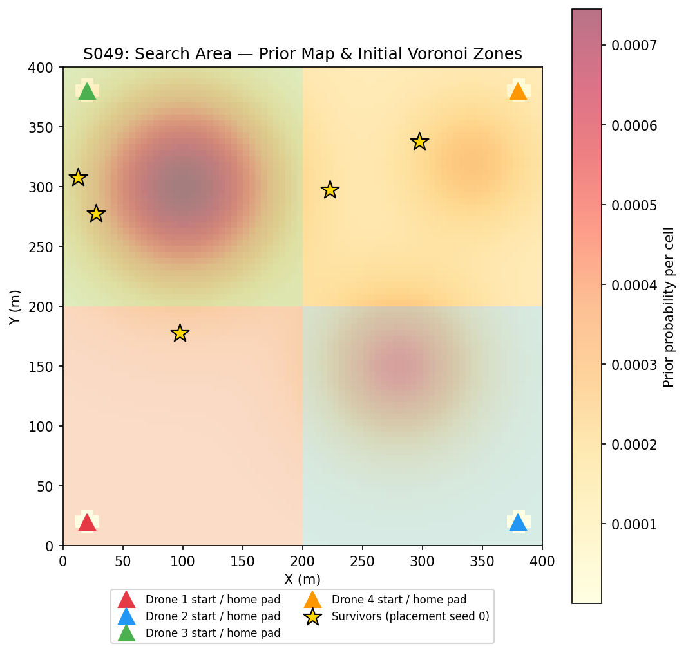
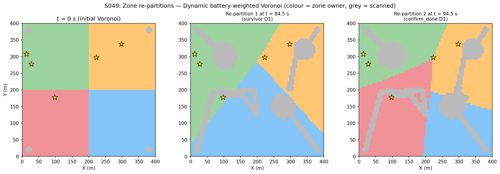
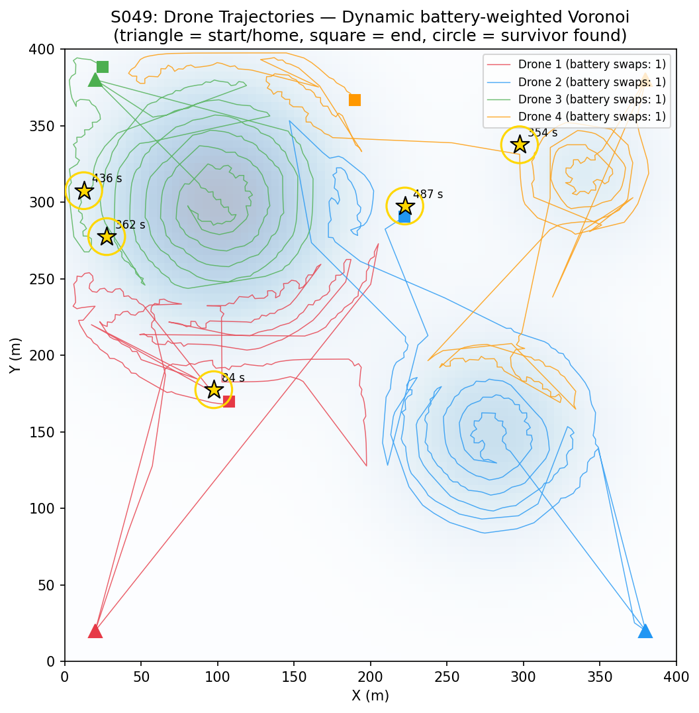
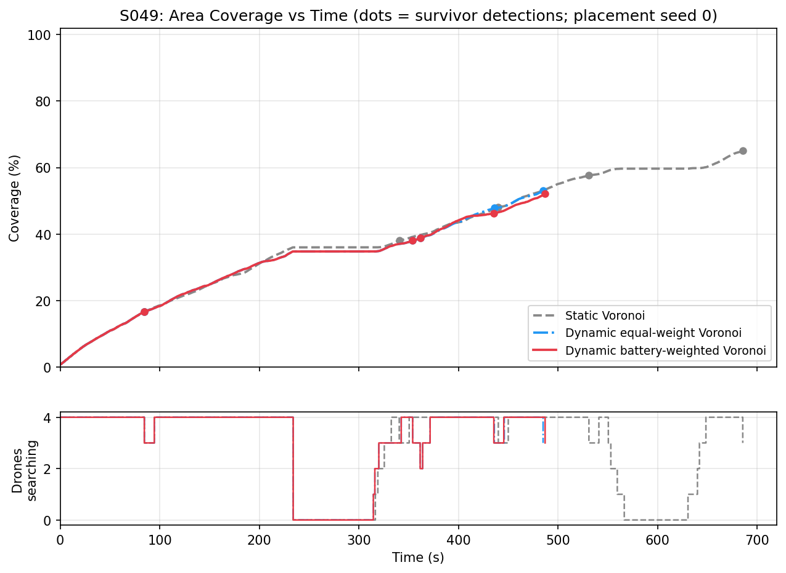
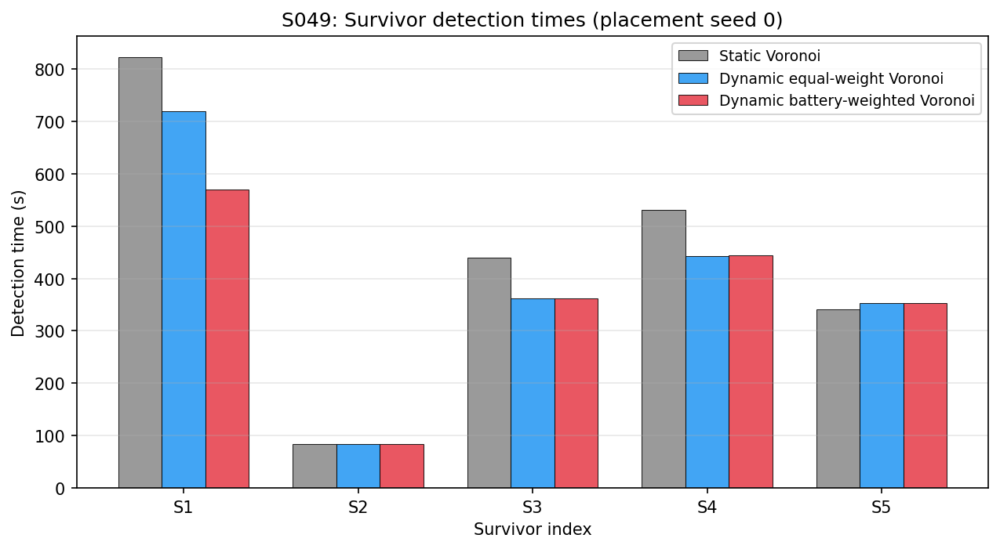
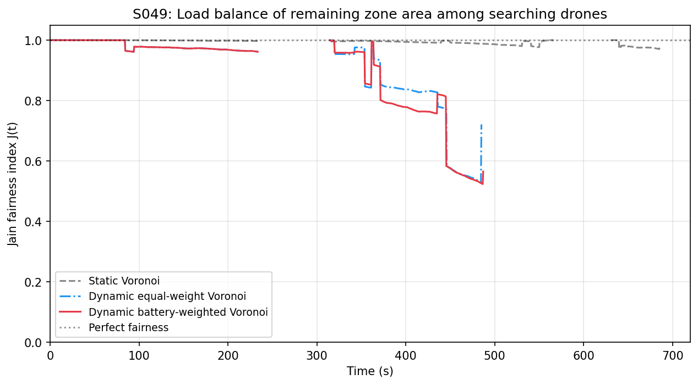
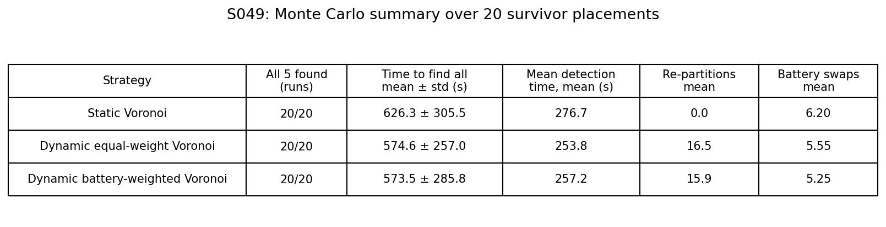
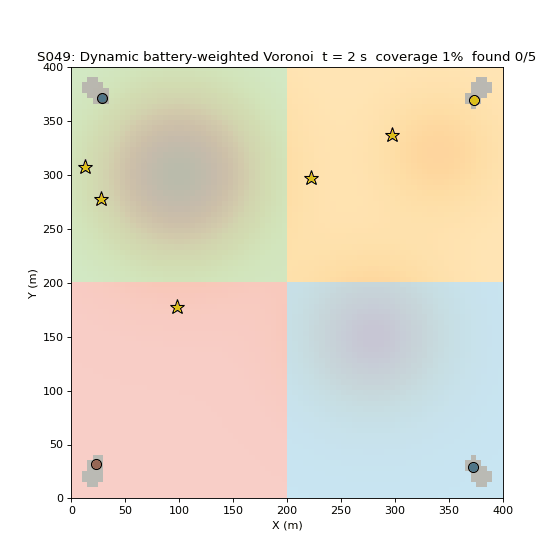

# S049 Dynamic Zone Search

**Domain**: Environmental Monitoring & SAR | **Difficulty**: ⭐⭐⭐ | **Status**: ✅ Completed

---

## Problem Definition

**Setup**: A 400 × 400 m search area contains 5 survivors at unknown positions following a disaster. A prior probability map encodes survivor likelihood at each grid cell (3-component Gaussian mixture); the survivors are drawn from this prior. Four drones start from home pads at the corners of the area. The area is initially partitioned into four Voronoi cells — one per drone — and each drone searches its zone in prior-priority order. Batteries are limited: a drone whose state of charge (SoC) drops below 30 % flies home, swaps its battery and rejoins; a drone that finds a survivor hovers briefly to confirm and then rejoins.

**Objective**: Minimise the total time to find all survivors; secondary metrics are the mean detection time, coverage, and the load balance (Jain fairness) of the remaining zone areas.

**Comparison Strategies** (identical battery, swap, confirmation and search-order model for all three):
1. **Static Voronoi** — the initial partition is never changed; while a drone is away (confirming, flying home, swapping) its zone is unattended, and a drone that has finished its zone stays idle.
2. **Dynamic Voronoi (equal weight)** — whenever the set of available drones changes (a drone leaves or rejoins) or a drone exhausts its zone, all unscanned cells are re-partitioned by a standard Voronoi on the current positions of the available drones.
3. **Dynamic Weighted Voronoi (battery weight)** — same events, but the re-partition uses SoC weights, so drones with more charge left get larger zones.

---

## Mathematical Model

### Prior Map

Normalised Gaussian mixture over the 80 × 80 cell grid ($\delta = 5$ m resolution):

$$P(\mathbf{x}) = \frac{1}{Z} \sum_{m=1}^{3} \alpha_m \, \mathcal{N}\!\left(\mathbf{x};\, \boldsymbol{\mu}_m,\, \sigma_m^2 \mathbf{I}\right)$$

with $\alpha = (0.5, 0.3, 0.2)$, centres (100, 300), (280, 150), (340, 320) m and spreads 60, 50, 40 m.

### (Battery-Weighted) Voronoi Partition

$$V_k^w = \left\{\mathbf{x} \in \mathcal{A}_{uncov} : \frac{\|\mathbf{x} - \mathbf{p}_k\|}{w_k} \leq \frac{\|\mathbf{x} - \mathbf{p}_j\|}{w_j} \;\forall\, j \neq k\right\}, \qquad w_k = \mathrm{SoC}_k \ (\text{weighted}),\ w_k = 1\ (\text{equal})$$

computed over the unscanned cells for the available drones (mode *search* or *idle*). The initial partition (t = 0) is the equal-weight Voronoi of the four start positions for all strategies.

### Search Order Inside a Zone

The next target is the nearest cell among the $M = 20$ highest-prior unscanned cells of the drone's zone (the card's "nearest-unvisited greedy on the sorted priority list"); a new target is chosen as soon as the current one has been scanned. A cell is scanned when its centre lies within $r_s = 8$ m of the drone; a survivor is detected when it lies within $r_s$.

### Battery, Return and Swap

$$\mathrm{SoC}_k(t) = 1 - \frac{d_k(t)}{D_{max}}, \qquad D_{max} = 2000 \text{ m}$$

where $d_k$ is the range used on the current pack: distance flown plus, while hovering to confirm a survivor, $(P_{hover}/P_{cruise})\,v\,\Delta t$ per step with $P_{hover}/P_{cruise} = 1$ (a multirotor needs about the same power to hover as to cruise), so a 10 s hover costs 60 m of range. At $\mathrm{SoC} < 0.30$ the drone flies straight to its home pad (the 600 m reserve exceeds the longest possible return, the 537 m diagonal from a pad at (20, 20) to (400, 400)), swaps the battery in $T_{swap} = 60$ s and resumes searching. Usable range per pack: $0.7 \times 2000 = 1400$ m, i.e. $1400 / 6 = 233$ s of flight. One full sweep needs about $160{,}000\ \text{m}^2 / (2 \times 8\ \text{m}) = 10{,}000$ m of track, i.e. 2,500 m per drone — so every drone must swap at least once if the whole area has to be searched.

### Jain Fairness Index

$$\mathcal{J}(t) = \frac{\left(\sum_{k} A_k^{rem}\right)^2}{K' \cdot \sum_{k} \left(A_k^{rem}\right)^2}$$

over the $K'$ currently available drones, with $A_k^{rem}$ = unscanned cells in drone $k$'s zone.

---

## Key Parameters

| Parameter | Value | Notes |
|-----------|-------|-------|
| Search area | 400 × 400 m | |
| Grid resolution $\delta$ | 5 m | 80 × 80 cells |
| Number of drones $K$ | 4 | Homogeneous |
| Drone cruise speed $v$ | 6 m/s | |
| Sensor footprint radius $r_s$ | 8 m | |
| Full-charge range $D_{max}$ | 2000 m | all strategies |
| Return-for-swap SoC threshold | 30% | all strategies |
| Battery swap time $T_{swap}$ | 60 s | at the drone's home pad |
| Survivor confirmation hover $T_{confirm}$ | 10 s | drains the battery like cruise flight |
| Hover / cruise power ratio | 1.0 | 10 s hover = 60 m of range |
| Target candidates $M$ | 20 highest-prior unscanned zone cells | |
| Number of survivors $N_s$ | 5 | sampled from the prior |
| Prior map components | 3 Gaussian blobs, σ = 60 / 50 / 40 m | |
| Simulation timestep $\Delta t$ | 0.5 s | |
| Safety cutoff | 3600 s | never reached |
| Drone start / home positions | (20,20), (380,20), (20,380), (380,380) m | |
| Monte Carlo | 20 survivor placements (seeds 0–19) × 3 strategies | |
| Showcase run (figures, animation) | survivor placement seed 0 | |
| Animation | 122 frames, 4 s of simulation per frame, 10 fps | |

### Deviations from the scenario card

- **Previous comparison was invalid**: the static strategy ignored the battery and flew ~20 km with $D_{max} = 2$ km, while the dynamic drones were retired permanently at SoC < 30 %; all four hit the threshold on the same step, so no reallocation ever ran and both dynamic runs ended at 12 % coverage with 0/5 survivors (equal and weighted identical because all SoC were equal). The old README's explanation ("frequent reallocation interrupts the sweep") was wrong.
- **Battery swaps added (not in the card)**: with the card's parameters one sortie covers at most 1,400 m, but a full search needs ≈ 2,500 m per drone, so retiring drones at 30 % SoC makes the mission impossible for every strategy. Drones now return home and swap ($T_{swap}$ = 60 s), under the same rule for all strategies.
- **Survivor finders rejoin**: the card retires a drone after it finds a survivor; with 5 survivors and 4 drones this would leave nobody for the last survivor. The finder now hovers 10 s to confirm (draining the battery at cruise-equivalent power; the card's distance-only SoC model would make hovering free) and then rejoins.
- **Idle drones** (static strategy, zone finished) are assumed to land and do not drain the battery; this case does not occur in the showcase run (0 zone-done events).
- **Re-partition events**: the card re-partitions only when a drone leaves. Here the dynamic strategies also re-partition when a drone rejoins (otherwise swapped drones would come back with no zone) and when a drone exhausts its zone while work remains elsewhere. Simultaneous events in one time step trigger one re-partition; no re-partition is made while no drone is available (all away).
- **Search order**: the old code flew to cells strictly in descending-prior order and also flew to cells that were already scanned; the card's nearest-unvisited greedy rule on the priority list is now implemented and scanned cells are skipped.
- **Home pads at the corners**, not one base station at the edge (kept from the previous version so that each drone has its own pad).
- **The sensor is processed only in search mode** (not while confirming, returning or swapping).
- **Monte Carlo over 20 survivor placements** was added because a single placement cannot rank the strategies; the figures show placement seed 0.
- **Reallocation snapshots** now show the scanned cells at the time of each snapshot (the old figure greyed out the cells scanned by the end of the run in every panel).
- **Card expectation not met**: the card expects re-partitioning to keep $\mathcal{J}$ close to 1. It does not (see Results): Voronoi cells around the current positions are not equal in area, and the SoC-weighted cells are unequal by design.

---

## Implementation

```
src/03_environmental_sar/s049_dynamic_zone.py   # Main simulation script
```

```bash
conda activate drones
python src/03_environmental_sar/s049_dynamic_zone.py
```

Runtime ≈ 34 s (3 showcase runs + 60 Monte Carlo runs + figures). Seeded: survivor placement uses `np.random.default_rng(seed)`; there are no other random sources.

---

## Results

### Monte Carlo (20 survivor placements)

| Strategy | All 5 found | Time to find all: mean ± std (median) | Mean detection time | Re-partitions (mean) | Battery swaps (mean) |
|----------|-------------|-------------------------------|---------------------|---------------|------|
| Static Voronoi | 20/20 | 626.3 ± 305.5 s (594.0 s) | 276.7 s | 0.0 | 6.20 |
| Dynamic equal-weight | 20/20 | 574.6 ± 257.0 s (521.5 s) | **253.8 s** | 16.5 | 5.55 |
| Dynamic battery-weighted | 20/20 | **573.5 ± 285.8 s** (**507.0 s**) | 257.2 s | 15.9 | 5.25 |

Paired per placement (time to find all 5):

| Comparison | Mean difference | Faster / slower / tie | Two-sided sign test (computed from these counts) |
|---|---|---|---|
| equal − static | −51.7 s | 13 / 7 / 0 | p = 0.263 (13 of 20) |
| weighted − static | −52.8 s | 12 / 8 / 0 | p = 0.503 (12 of 20) |
| weighted − equal | −1.1 s | 7 / 9 / 4 | p = 0.804 (7 of 16 non-ties) |

Both dynamic strategies find all survivors faster on average than the static partition (−51.7 s and −52.8 s, i.e. 8.3 % and 8.4 % of the static 626.3 s; medians 521.5 and 507.0 s vs 594.0 s), but with 20 placements the advantage is **not statistically significant** (they are faster in only 12–13 of 20 placements). Re-partitioning helps when the static strategy leaves a zone unattended while its drone confirms a find or swaps a battery; it hurts when a re-partition hands a survivor's cell to a drone that reaches it later than the original owner would have. Battery weighting makes no measurable difference against equal weights (−1.1 s; 7 faster, 9 slower, 4 ties): all drones fly (or hover) at the same energy rate and reach 30 % SoC together at t ≈ 233 s, so the SoC weights are equal or nearly equal at most re-partitions. The spread between placements (std ≈ 260–310 s) is much larger than the differences between strategies.

### Showcase run (placement seed 0)

Survivors at (222.5, 297.5), (97.5, 177.5), (27.5, 277.5), (12.5, 307.5), (297.5, 337.5) m.

| Strategy | Detection times S1–S5 (s) | Time to find all | Mean detection time | Coverage at end | Re-partitions | Battery swaps | Distance flown | Mean $\mathcal{J}$ |
|---|---|---|---|---|---|---|---|---|
| Static | 685.5, 84.5, 440.0, 531.0, 340.5 | 685.5 s | 416.3 s | 65.0 % | 0 | 8 | 13,295 m | 0.9941 |
| Dynamic equal | 485.0, 84.5, 361.5, 436.0, 354.0 | **485.0 s** | **344.2 s** | 53.1 % | 13 | 4 | 9,943 m | 0.9069 |
| Dynamic weighted | 487.0, 84.5, 361.5, 435.5, 354.0 | 487.0 s | 344.5 s | 52.1 % | 13 | 4 | 9,991 m | 0.8956 |

- All three runs are identical until the first event: drone 1 finds S2 at 84.5 s. Because hovering drains the battery like flying, all four drones are at the same SoC and reach 30 % together: they fly home at t ≈ 234 s, and the "drones searching" panel drops to 0 between ≈ 235 s and ≈ 315 s while they swap (the static run swaps a second time, ≈ 567–630 s). The weighted and equal partitions therefore coincide at the first re-partitions (84.5 s: the three available drones at SoC 0.746; 94.5 s: all four at 0.717, $\mathcal{J}$ 0.721 → 0.978 in both).
- S1 at (222.5, 297.5), on the boundary between the two upper initial zones in a low-prior region, decides the outcome. Static drone 4 reaches it only at 685.5 s, after sweeping the high-prior parts of its own zone and a second battery swap. With re-partitioning drone 2 is given the cell and finds it at 485.0 s (equal) or 487.0 s (weighted).
- The dynamic runs end with *less* coverage (53.1 % and 52.1 % vs 65.0 %) because they stop earlier; they reach the last survivor sooner. They complete only the first round of swaps (4).
- Physical check (static): 4 drones × 6 m/s × 685.5 s = 16,452 m of possible flight, minus 8 swaps × 60 s × 6 m/s = 2,880 m and 4 confirmation hovers × 10 s × 6 m/s = 240 m, gives 13,332 m, close to the 13,295 m flown (the 37 m remainder: in the step in which a drone switches to returning it does not move, 8 × 3 m = 24 m, the step in which it reaches its pad is shortened, and the fifth detection ends the run).

**Load balance**: the static partition keeps $\mathcal{J}$ near 1 (0.9941) because its four quarters start equal and are swept at the same rate. Re-partitioning lowers it (0.9069 equal, 0.8956 weighted): a Voronoi partition around the current drone positions does not give equal areas (a drone that just rejoined at its corner pad gets a different-sized cell than drones in the middle of the area), and the SoC-weighted partition gives unequal areas on purpose. $\mathcal{J}$ measures equal *area*, not SoC-proportional load, so a lower value here does not mean worse performance.

**Search Area Map** — prior heatmap, initial Voronoi zones (four equal quarters), home pads, survivors of placement seed 0 (the small white squares at the pads are cells already scanned at t = 0):



**Reallocation Snapshots** — battery-weighted run: zones at t = 0, at the first re-partition (drone 1 leaves to confirm S2 at 84.5 s; its quarter is split among the others) and at the second (drone 1 rejoins at 94.5 s); grey = cells scanned by then:



**Trajectories** — battery-weighted run; drones sweep along the prior contours (spirals around the high-prior blobs); straight lines to the corners are battery returns; found survivors circled with detection times:



**Coverage Comparison** — coverage vs time (dots = survivor detections) and number of drones searching (bottom); all strategies share the same coverage curve until the first re-partitions, plateau while all drones swap (≈ 235–315 s; static again ≈ 567–630 s), and end at their last detection:



**Detection Timeline** — detection time of each survivor per strategy (showcase run); S1 decides the mission time:



**Jain Fairness** — $\mathcal{J}(t)$ of the remaining zone areas among the available drones; the static curve stays near 1, the dynamic curves drop after re-partitions:



**Summary Table** — Monte Carlo summary over 20 placements:



**Animation** — battery-weighted showcase run: zones (colour), scanned cells (grey), drones (dots), survivors turn green when found:



---

## Extensions

1. **Heterogeneous sensor ranges**: assign different $r_s$ values per drone; update weighted Voronoi to account for sensor coverage rate $\dot{C}_k = v_k \cdot 2 r_{s,k}$ rather than pure battery weight.
2. **Adaptive prior update (Bayesian)**: after each negative scan of a cell, reduce its posterior probability; drones re-sort waypoint queues dynamically as the posterior evolves.
3. **Communication dropout**: drones cannot broadcast positions or SoC during GPS/radio blackout windows; each drone decides on local reallocation heuristics using last-known peer state.
4. **3D zone search**: extend to a 400 × 400 × 60 m volume; generators become 3D points, Voronoi cells are 3D, and drones sweep horizontal altitude layers within their zone.
5. **RL reallocation policy**: replace the geometric weighted Voronoi rule with a PPO agent that observes all drones' SoC, positions, and coverage map, and outputs zone boundaries directly.
6. **Staggered swaps**: send drones home at different SoC levels so that the fleet never drops to zero searching drones (as happens here at ≈ 235–315 s).

---

## Related Scenarios

- Prerequisites: [S041 Wildfire Boundary Scan](../../../scenarios/03_environmental_sar/S041_wildfire_boundary.md), [S042 Missing Person Localization](../../../scenarios/03_environmental_sar/S042_missing_person.md), [S048 Full-Area Coverage Scan (Lawnmower)](../../../scenarios/03_environmental_sar/S048_lawnmower.md)
- Follow-ups: [S050 Swarm Cooperative Mapping (Distributed EKF-SLAM)](../../../scenarios/03_environmental_sar/S050_slam.md), [S054 Minefield Detection](../../../scenarios/03_environmental_sar/S054_minefield.md)
- Algorithmic cross-reference: [S018 Multi-Target Intercept](../../../scenarios/01_pursuit_evasion/S018_multi_target_intercept.md) (Hungarian assignment), [S040 Fleet Load Balancing](../../../scenarios/02_logistics_delivery/S040_fleet_load_balancing.md) (Jain fairness, load redistribution)
