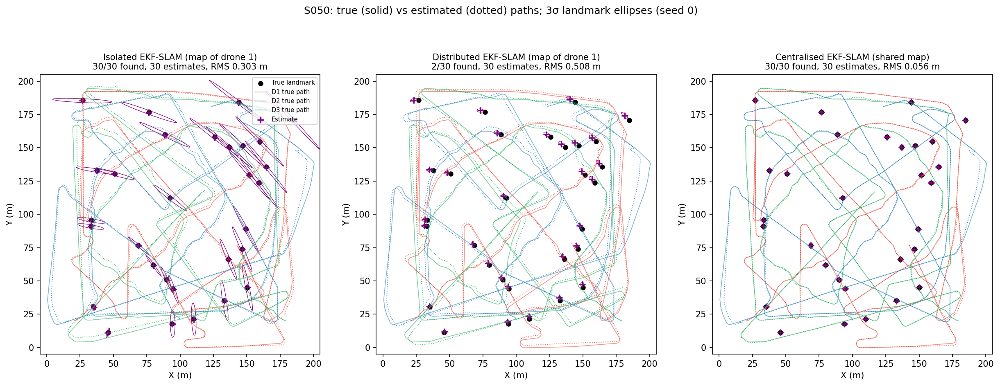
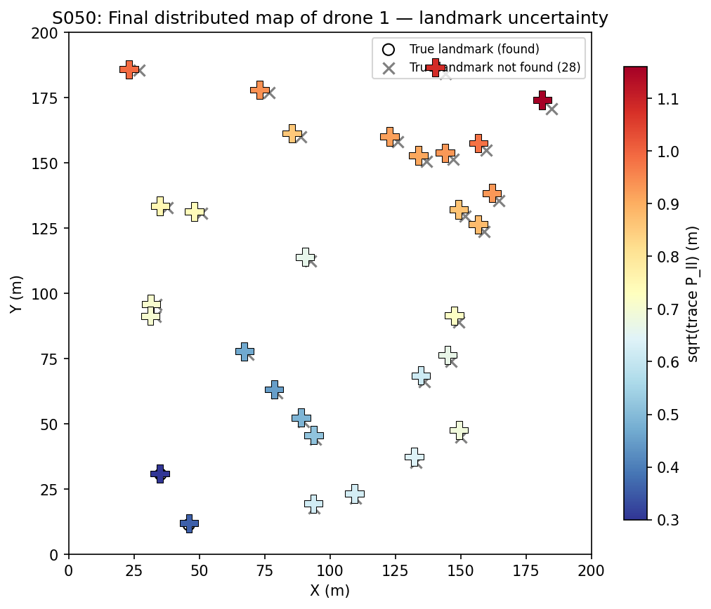
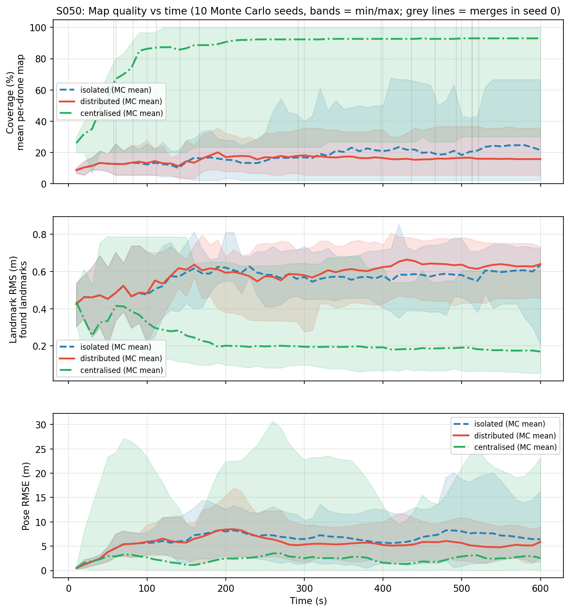
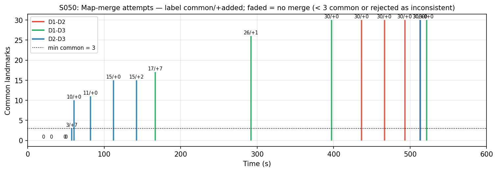
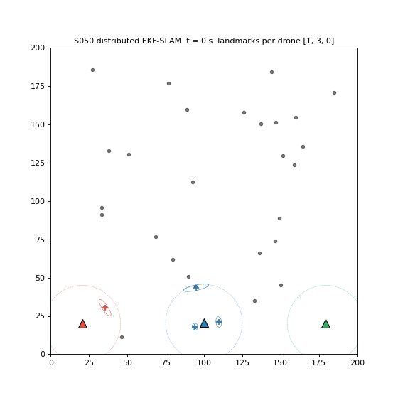

# S050 Swarm Cooperative Mapping (Distributed EKF-SLAM)

**Domain**: Environmental Monitoring & SAR | **Difficulty**: ⭐⭐⭐⭐ | **Status**: ✅ Completed

---

## Problem Definition

**Setup**: A 200 × 200 m environment is unknown at mission start; there is no GPS. It contains $M_{true} = 30$ static landmarks. Three drones start from known poses (20, 20, 0), (100, 20, π/2), (180, 20, π) and fly for 600 s at 3 m/s. Each carries a range-bearing sensor (range $r_{sense} = 25$ m) and runs EKF-SLAM. The true flight differs from the commanded odometry by process noise, so the drones drift. When two drones are within $r_{comm} = 40$ m they can exchange maps.

**Objective**: Maximise the fraction of true landmarks localised within 1.0 m and minimise the map RMS error within 600 s.

**Comparison** (all three estimators process the *same* flight log — true trajectories, odometry commands and measurements):
1. **Isolated EKF-SLAM** — one filter per drone, no communication
2. **Centralised EKF-SLAM** — one joint filter over all three drone poses and all landmarks, fed with every measurement (upper bound; needs perfect communication)
3. **Swarm distributed EKF-SLAM** — one filter per drone plus pairwise map merging on contact

---

## Mathematical Model

### Truth, Odometry and EKF Prediction

True pose: $x_{k+1} = x_k + v\Delta t\cos\theta_k + n_x$, $y_{k+1} = y_k + v\Delta t\sin\theta_k + n_y$, $\theta_{k+1} = \theta_k + \omega\Delta t + n_\theta$ with $n_x, n_y \sim \mathcal N(0, (\sigma_{a}\Delta t)^2)$, $n_\theta \sim \mathcal N(0, (\sigma_\omega\Delta t)^2)$ (the card's $\mathbf Q_{pose}$). The filters predict with the commanded $(v, \omega)$ and the card's Jacobian $\mathbf F$; dead reckoning integrates the same commands without corrections.

### Observation Model (from the true pose)

$$\mathbf z = \begin{bmatrix} \|\mathbf l - \mathbf p\| \\ \mathrm{atan2}(l_y - y, l_x - x) - \theta \end{bmatrix} + \mathcal N(0, \mathrm{diag}(\sigma_\rho^2, \sigma_\phi^2))$$

for every landmark within 25 m of the **true** drone position. EKF update with the card's Jacobian $\mathbf H$, innovation angle-wrapped.

### Data Association and Landmark Initialisation

Nearest landmark by Mahalanobis distance $d_M = \boldsymbol\nu^\top \mathbf S^{-1}\boldsymbol\nu$: update if $d_M \le \chi^2_{2,0.95} = 5.991$; create a new landmark only if $d_M > \chi^2_{2,0.999} = 13.816$ for all landmarks *and* the new position is ≥ 4 m from every existing landmark; otherwise the measurement is discarded as ambiguous. New landmarks are initialised with the full cross-covariance $\mathbf P_{l,x} = \mathbf J_x \mathbf P_{pose,x}$.

### Map Merging (distributed strategy)

When two drones are within 40 m, they merge at first contact and then at most every 30 s while they stay in contact. Each drone merges a snapshot of the other's map:

1. **Alignment** — hypotheses from pairs of correspondences that lie within 20 m of each other and have consistent inter-landmark distances (rotation ≤ 0.5 rad). The hypothesis with most one-to-one inliers (< 2 m) is refined by the card's SVD solution $\mathbf R^* = \mathbf U\mathbf V^\top$, $\mathbf t^* = \bar{\mathbf l}_i - \mathbf R^*\bar{\mathbf l}_j$; at least 3 common landmarks are required.
2. **Consistency check** — every common pair must pass $\chi^2_{2,0.999}$ on $\mathbf P_h + 10\,\mathbf R\mathbf P_v\mathbf R^\top$; if fewer than 3 or fewer than half pass, the merge is rejected.
3. **Transfer of new information only** — visitor landmarks that the host lacks are appended with covariance $10 \times \mathbf R\mathbf P_v\mathbf R^\top$ and no cross-correlation. A landmark is skipped if it is within 4 m of a host landmark, statistically compatible with one ($\chi^2_{2,0.999}$), or lies inside the area the host has already sensed itself (within 22 m of its own estimated path). Common landmarks and the host pose are **not** updated.

### Metrics

Per true landmark: *found* if an estimate lies within 1.0 m (so coverage ≤ 100 % by construction); RMS over found landmarks; "within 5 m" coverage as a secondary measure of map completeness; duplicates = estimates minus distinct true landmarks they are nearest to. **Aggregation is the same for all strategies**: the mean over the three drones' maps (the centralised map is shared by all drones). "Team union" = true landmarks found in at least one drone's map. Pose RMSE = RMS over the three drones of |estimated − true position|.

---

## Key Parameters

| Parameter | Value | Notes |
|-----------|-------|-------|
| Environment size | 200 × 200 m | |
| Number of drones $N$ | 3 | known start poses (20,20,0), (100,20,π/2), (180,20,π) |
| True landmarks $M_{true}$ | 30 | uniform in [10, 190]² m, seed 42; closest pair 4.57 m apart (printed) |
| Drone cruise speed $v$ | 3.0 m/s | turn rate limited to ±1 rad/s |
| Simulation timestep $\Delta t$ | 0.2 s | 3000 steps |
| Mission horizon $T_{max}$ | 600 s | |
| Sensor range $r_{sense}$ | 25.0 m | |
| Communication range $r_{comm}$ | 40.0 m | true inter-drone distance |
| Range noise std $\sigma_\rho$ | 0.3 m | |
| Bearing noise std $\sigma_\phi$ | 0.03 rad | ≈ 1.7 deg |
| Pose process noise $\sigma_{ax}, \sigma_{ay}$ | 0.05 m/s² | per-step std 0.01 m |
| Heading process noise $\sigma_\omega$ | 0.02 rad/s | per-step std 0.004 rad |
| Filter noise inflation | 4 × true Q and R | all three estimators |
| Association / new-landmark gates | 5.991 / 13.816 | $\chi^2_2$ 95 % / 99.9 % |
| Minimum landmark separation | 4.0 m | new landmarks (own and transferred) |
| Map merging minimum common landmarks | 3 | |
| Common landmark correspondence radius | 2.0 m | |
| Alignment search window / max rotation | 20 m / 0.5 rad | |
| Transferred-landmark covariance inflation | 10 | |
| Host "already sensed" radius | 22 m (25 m − 3 m margin) | |
| Merge period while in contact | 30 s | plus every new contact |
| Landmark localisation success radius | 1.0 m | secondary radius 5.0 m |
| Initial pose covariance $\mathbf P_0$ | $0.01 \cdot \mathbf{I}_3$ | |
| Exploration grid / retarget interval | 5 m cells / 2 s | |
| Monte Carlo | 10 noise seeds (0–9) | showcase = seed 0 |
| Animation | 120 frames (every 25th step = 5 s), 5 fps | |

### Deviations from the scenario card

- **Ground truth added (Type A fix)**: the previous script generated measurements from the EKF estimate and never applied motion noise, so there was no real drift and no real SLAM problem. True poses are now simulated with the card's process noise and measurements come from the truth.
- **Centralised baseline implemented**: the old README claimed convergence "toward the centralised upper bound" without implementing it. It is now a joint EKF over all three poses and all landmarks, run on the same data.
- **Same aggregation for all strategies**: the old script scored the distributed strategy with its best drone and the isolated one with the average drone. All strategies now use the mean per-drone map; the team union is reported for all as well.
- **Coverage is computed per true landmark**: the old metric counted estimates within 1 m, so duplicates produced "79/30 landmarks" and 263.3 % coverage.
- **Map merging redesigned**: the old code merged both ways at every time step (306 merges) and created duplicates and non-PSD covariances. The card's correspondence rule (nearest neighbour within 2 m in the raw frames) breaks when maps have drifted apart by several metres: it finds only accidental matches, the alignment is then wrong, and dozens of duplicates are appended. Hence the consensus alignment, the consistency check, the at-most-every-30-s schedule and the rules against duplicates above. The card's covariance-intersection fusion of common landmarks was implemented first but dropped: repeatedly fusing landmarks that both maps already contain double-counts the information exchanged in earlier merges, and the hosts became overconfident (pose errors far larger than their stated σ), which created many duplicates. Only new landmarks are now transferred. Their covariance inflation (10) was chosen to keep maps close to the true landmark count; smaller and larger values produced larger maps in the 10-seed test.
- **Filter tuning for consistency**: with the true Q and R the EKF-SLAM filters were strongly overconfident (well-known EKF-SLAM inconsistency, aggravated by few landmarks in view: on average 30 × π · 25² / 200² = 1.47 landmarks lie within sensor range), causing failed associations and duplicate landmarks. All filters use 4 × the true noise. Landmarks are initialised with full cross-covariance (the card's sample code used zero cross-covariance), and new landmarks require $d_M > 13.816$ and ≥ 4 m separation (the card creates one whenever $d_M > 5.991$, which also fires for 5 % of correct re-observations).
- **Navigation**: the frontier policy (card's IG / distance with suppression near other drones' targets) steers on each drone's own isolated estimate so that one flight log serves all estimators; the target suppression assumes a low-rate target broadcast. When a drone's exploration grid is complete it is reset (second sweep).
- **Start poses** are three different known poses (card: common origin), which defines the common map frame.
- **Monte Carlo**: 10 seeds instead of 20 (runtime); the coverage figure shows min/max bands.
- **Figures**: landmark ellipses are drawn at 3σ (1σ is invisible at the map scale); drones are drawn as upright triangles, not heading-oriented.
- **Card expectation not met**: the card expects the distributed swarm to approach the centralised upper bound. It does not (see Results).

---

## Implementation

```
src/03_environmental_sar/s050_slam.py   # Main simulation script
```

```bash
conda activate drones
python src/03_environmental_sar/s050_slam.py
```

Runtime ≈ 2.5–3 min (10 runs × 3 estimators + figures; the old version took ≈ 390 s). Seeded: landmarks `default_rng(42)`, noise `default_rng(seed)`; two consecutive runs print identical output.

---

## Results

### Monte Carlo (10 noise seeds, final values at t = 600 s: mean [min, max])

| Metric | Isolated | Distributed | Centralised |
|---|---|---|---|
| Coverage, landmarks within 1 m (mean per-drone map) | 21.6 % [2.2, 66.7] | 15.8 % [5.6, 35.6] | **93.0 %** [30.0, 100.0] |
| Coverage within 5 m | 70.7 % [28.9, 98.9] | 70.0 % [48.9, 100.0] | **96.3 %** [63.3, 100.0] |
| Landmark RMS (found landmarks) | 0.634 m [0.210, 0.725] | 0.639 m [0.457, 0.733] | **0.170 m** [0.056, 0.605] |
| Team union (found by any drone) | 46.3 % [6.7, 100.0] | 44.0 % [16.7, 96.7] | **93.0 %** [30.0, 100.0] |
| Pose RMSE | 6.417 m [1.757, 16.270] | 5.861 m [2.574, 8.985] | **2.537 m** [0.093, 23.161] |
| Duplicate estimates (sum over all runs and maps) | 93 | 78 | 51 |
| Largest map (estimates) | 38 | 39 | 81 |

Dead reckoning (odometry only): pose RMSE 21.214 m [11.595, 32.023]. Executed merges: 11.2 per run on average. Smallest covariance eigenvalue in any filter over all runs: 1.494e-04 (all covariances stayed positive definite).

- **Drift is real and large**: the heading noise is a random walk of 0.004 rad per step, i.e. $0.004\sqrt{3000} = 0.22$ rad after 600 s, so odometry alone ends ≈ 21 m off on average. Every SLAM variant reduces this substantially, by 3–8×: 21.214 / 6.417 = 3.3 isolated, 21.214 / 5.861 = 3.6 distributed, 21.214 / 2.537 = 8.4 centralised.
- **Centralised is clearly best** (93.0 % coverage, 0.170 m RMS): all three drones observe the same landmarks in one joint filter, so loop closures by one drone correct the others immediately. It is not infallible — in one of the 10 runs the joint filter diverged (that run is the worst on all three measures: coverage 30.0 %, pose RMSE 23.161 m, 81 estimates), which is why its minimum and the duplicate count are poor.
- **Distributed merging does not approach the centralised bound.** It slightly improves and stabilises the pose estimate (mean 5.861 vs 6.417 m, worst case 8.985 vs 16.270 m) and keeps the maps at about the true size (≤ 39 estimates). However, its 1 m coverage is *lower* than isolated (15.8 % vs 21.6 %). The transferred landmarks are expressed in the receiving drone's drifted frame and carry a 10× inflated covariance, so they are complete (70.0 % within 5 m) but rarely within 1 m of the truth. The 1 m criterion measures absolute accuracy, and merging two drifted maps cannot remove their common drift — only a joint estimate (centralised) does.
- **Variance between runs is large** for isolated drones (1 m coverage 2.2 %–66.7 %) because a drone either closes loops on its own landmarks or drifts away; merging narrows the spread (5.6 %–35.6 %).

### Showcase run (seed 0)

| | Isolated | Distributed | Centralised |
|---|---|---|---|
| Coverage within 1 m (mean per-drone) | 66.7 % | 10.0 % | 100.0 % |
| Coverage within 5 m | 98.9 % | 100.0 % | 100.0 % |
| Landmarks found per map | 30, 30, 0 | 2, 5, 2 | 30 |
| Estimates per map (duplicates) | 30, 30, 30 (0, 0, 1) | 30, 30, 30 (0, 0, 0) | 30 (0) |
| Landmark RMS | 0.210 m | 0.594 m | 0.056 m |
| Pose RMSE final / time-mean | 1.757 / 2.005 m | 2.758 / 2.525 m | 0.187 / 0.422 m |

Dead reckoning: 14.814 m final, 17.337 m time-mean. Merges: 18 attempts, 14 executed (4 skipped at first contacts with < 3 common landmarks, 0 rejected as inconsistent), 17 landmarks transferred in total. In this run two isolated drones mapped all 30 landmarks within 1 m while drone 3 found none; its map is nearly complete within 5 m (3 × 98.9 % − 2 × 100 % = 96.7 %) but offset. The distributed maps of drone 1 contain all 30 landmarks with no duplicates, but the whole map is shifted by roughly 3 m relative to the truth (visible in the trajectory and heatmap figures), so only 2 are within 1 m.

**Trajectories and Map** — true (solid) and estimated (dotted) paths of all drones, and the map of drone 1 (isolated, distributed) or the shared map (centralised) with 3σ ellipses; isolated drone 1 has large, elongated ellipses but accurate estimates, distributed drone 1's map is complete but shifted:



**Final Map Heatmap** — distributed map of drone 1 coloured by $\sqrt{\mathrm{tr}\,\mathbf P_{ll}}$ (0.3–1.2 m); grey crosses are the true landmarks not localised within 1 m (28) — the systematic ≈ 3 m offset is larger than the filter's stated uncertainty:



**Coverage, RMS and Pose Error vs Time** — Monte Carlo mean (lines) and min/max bands for the three estimators; grey vertical lines = executed merges in seed 0:



**Communication Events** — map-merge attempts in seed 0, height = common landmarks, label = common/+transferred; faded = skipped (< 3 common) or rejected:



**Animation** — seed 0, distributed estimator: true drone positions (triangles) with sensor circles, each drone's current landmark estimates with 3σ ellipses (in its colour), gold links at merge events; 120 frames, one per 5 s:



---

## Extensions

1. **Loop closure detection**: when a drone re-visits a previously mapped area after a long excursion, implement a graph-SLAM back-end (pose graph with loop closure constraints solved via Gauss-Newton) to globally correct trajectory and landmark estimates.
2. **3D extension — altitude-varying landmarks**: extend the sensor to range-bearing-elevation ($\rho, \phi, \epsilon$) and landmark state to 3D; altitude variation introduces parallax that improves depth estimation.
3. **Dynamic obstacles as false landmarks**: introduce moving objects that generate spurious observations; implement a landmark persistence model (track age and observation frequency) to prune transient features.
4. **Heterogeneous sensor suite**: equip one drone with a wide-angle low-accuracy sensor and two with narrow high-accuracy sensors; design an adaptive communication policy that prioritises merging the scout's rough map first.
5. **Adversarial spoofing**: a jammer injects false range-bearing measurements; implement an outlier-robust association scheme using Mahalanobis gate combined with RANSAC-style consensus check across multiple timesteps.
6. **Relative-pose measurements at rendezvous**: let drones measure each other's range and bearing when they meet, so that a merge can also correct the drones' common drift (the missing ingredient that keeps the distributed estimator far from the centralised one here).

---

## Related Scenarios

- Prerequisites: [S048 Full-Area Coverage Scan (Lawnmower)](../../../scenarios/03_environmental_sar/S048_lawnmower.md), [S046 Multi-Drone 3D Trilateration](../../../scenarios/03_environmental_sar/S046_trilateration.md), [S049 Dynamic Zone Search](../../../scenarios/03_environmental_sar/S049_dynamic_zone.md)
- Follow-ups: [S051 Post-Disaster Communication Network Restoration](../../../scenarios/03_environmental_sar/S051_post_disaster_comm.md)
- Algorithmic cross-reference: [S008 Stochastic Pursuit — Kalman Filter Tracking](../../../scenarios/01_pursuit_evasion/S008_stochastic_pursuit.md) (Kalman-filter state estimation), [S042 Missing Person Localization](../../../scenarios/03_environmental_sar/S042_missing_person.md) (Bayesian belief maps), [S047 Base Station Signal Relay](../../../scenarios/03_environmental_sar/S047_signal_relay.md) (inter-drone communication topology)
