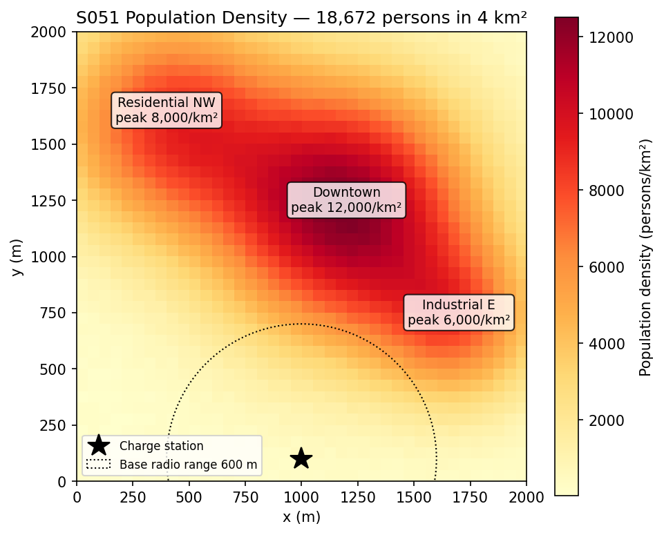
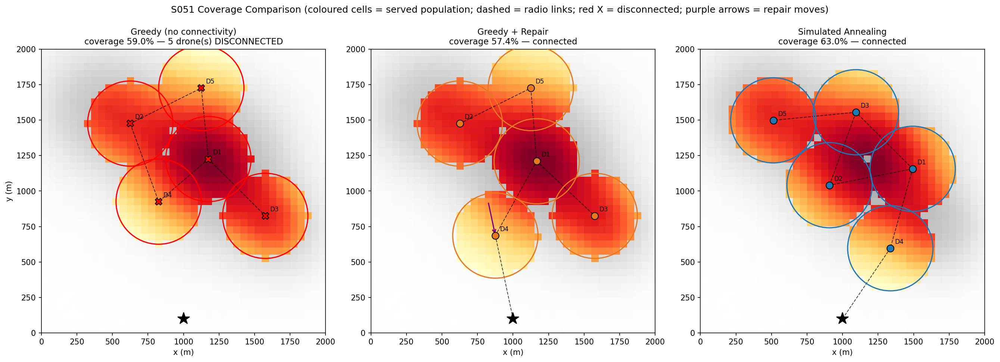
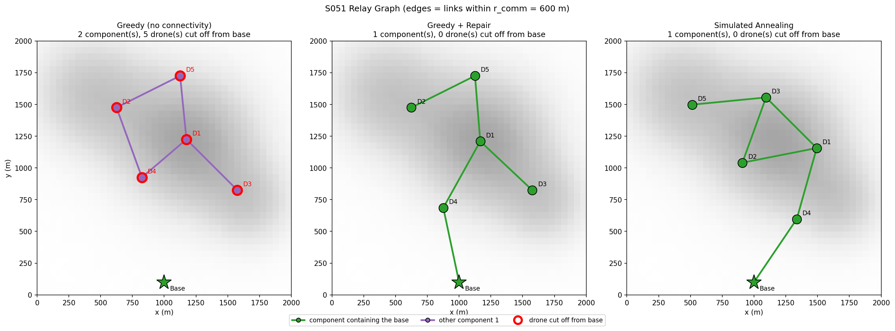
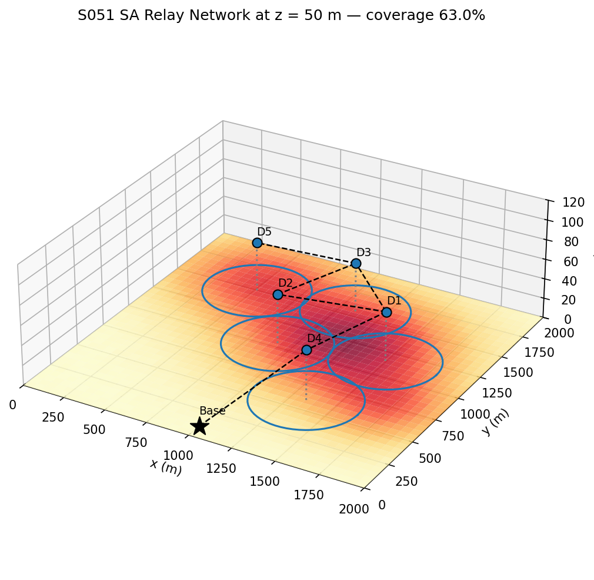
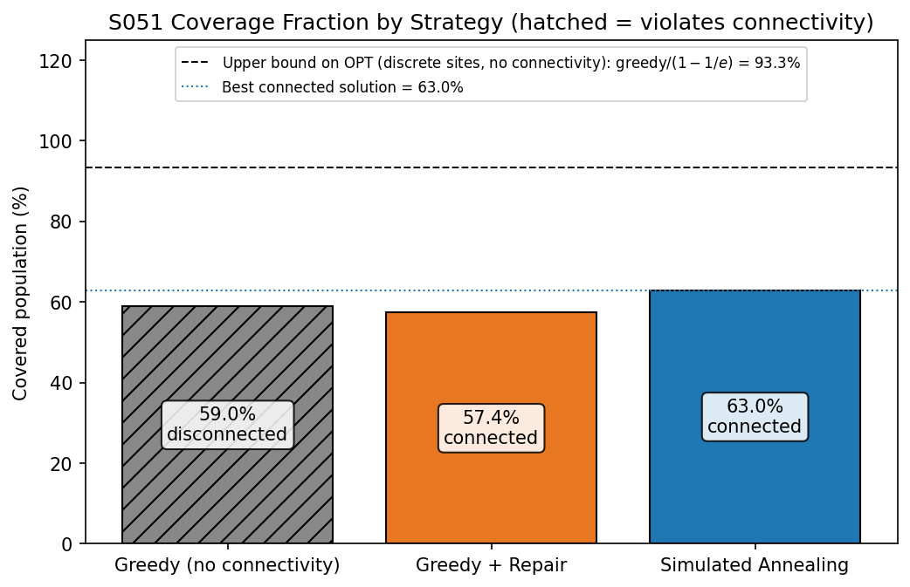
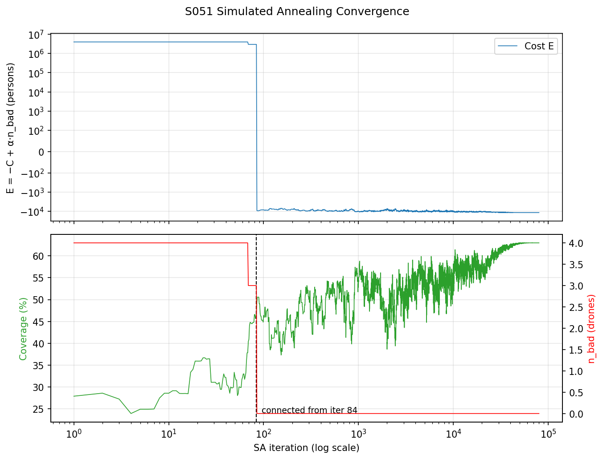
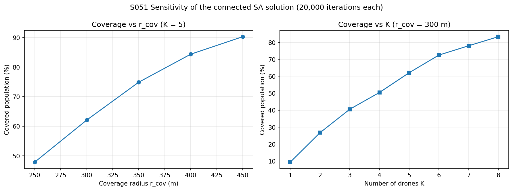
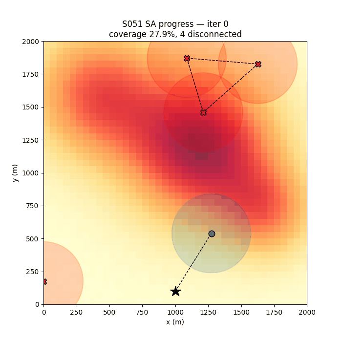

# S051 Post-Disaster Communication Network Restoration

**Domain**: Environmental Monitoring & SAR | **Difficulty**: ⭐⭐⭐ | **Status**: ✅ Completed

---

## Problem Definition

**Setup**: An earthquake has destroyed the cellular towers across a 2000 × 2000 m (4 km²) city. The area is divided into a 40 × 40 grid (50 m cells), and each cell has a known population. Five drones take off from a single charge station at (1000, 100) m and hover at 50 m as temporary airborne cell towers. Each drone serves every cell within a ground radius of 300 m.

**Constraints**:
1. **Connectivity**: the base and the five drones must form a connected radio graph (link range 600 m), so every drone can relay traffic back to the charge station.
2. **Battery range**: each drone must fly out, hover for 1500 s and fly back within an 1800 s battery budget at 15 m/s.

**Objective**: choose the five hover positions that maximise the total population served.

**Comparison Strategies**:
1. **Greedy (no connectivity)**: place each drone in turn at the cell centroid that adds the most uncovered population; connectivity is ignored.
2. **Greedy + Repair**: greedy placement, then move disconnected drones toward the connected network until every drone links back to base. A move is accepted only if it loses at most $\Delta C_{tol}$ of coverage.
3. **Simulated Annealing (SA)**: optimise continuous positions from a random start, with connectivity and range violations as a hard penalty.

---

## Mathematical Model Summary

### Population map

Three Gaussian clusters with peak densities of 8 000, 12 000 and 6 000 persons/km², plus a uniform background of U(0, 200) persons/km². The population of a cell is its density times the cell area (0.0025 km²):

$$\text{pop}_u = 0.0025\ \text{km}^2 \cdot \Bigl(\sum_{c=1}^{3} \rho_c\, e^{-\|\mathbf{c}_u - \boldsymbol{\mu}_c\|^2 / 2\sigma_c^2} + \rho_{bg,u}\Bigr)$$

This gives 18,672 persons in 4 km²: a mean of 4,668 persons/km² and a maximum of 12,508 persons/km² (31.3 persons per cell), which is typical of a dense city district.

### Coverage objective

$$C\left(\{\mathbf{p}_{d_k}\}\right) = \sum_{u \in \mathcal{U}} \text{pop}_u \cdot \mathbf{1}\left[\min_{k} \|\mathbf{c}_u - \mathbf{p}_{d_k}\| \leq r_{cov}\right]$$

### Connectivity constraint

The graph $\mathcal{G}$ has node 0 (base) and nodes $1..K$ (drones), with an edge whenever two nodes are within $r_{comm}$. A breadth-first search from node 0 marks the drones that can relay back to base. All $K$ drones must be reachable (equivalently, $\lambda_2(\mathbf{L}) > 0$ for the graph Laplacian).

### Battery range

$$\frac{2\,\|\mathbf{p}_{d_k} - \mathbf{p}_{base}\|}{v} + T_{hover} \leq T_{max} \;\Rightarrow\; D_{max} = \frac{v\,(T_{max} - T_{hover})}{2} = 2250 \text{ m}$$

Every point in the area is within 2250 m of the base, so the range constraint never binds in this layout.

### Connectivity repair

While some drone is disconnected, rank every (disconnected drone, connected anchor) pair by distance; the base counts as an anchor. The candidate move places the drone $r_{comm} - 1$ m from the anchor, on the line between them. The move is accepted if the coverage it loses is at most

$$\Delta C_{tol} = 2\,\% \text{ of the total population} \;(373 \text{ persons}).$$

If it loses more, the next pair is tried. If no pair passes, repair stops and the remaining drones stay disconnected.

### Simulated annealing

$$E(\mathbf{x}) = -C(\mathbf{x}) + \alpha \cdot n_{bad}(\mathbf{x}), \qquad \alpha = 10^6 \text{ persons}$$

where $n_{bad}$ counts drones that are disconnected from base or out of range. $\alpha$ is 53.6 × the total population, so one bad drone always outweighs any coverage gain. One move displaces a random drone by $\mathcal{U}([-\delta, \delta]^2)$, with $\delta = \max(200 \cdot T/T_0,\, 10)$ m. A move is accepted with probability $\min(1, e^{-\Delta E / T})$. The temperature cools geometrically from $T_0 = 500$ to $T_{end} = 0.25$ persons over 80 000 iterations ($\beta = 0.999905$).

---

## Key Parameters

| Parameter | Value |
|-----------|-------|
| Drone fleet size $K$ | 5 |
| Area | 2000 × 2000 m |
| Population grid | 40 × 40 cells (50 m, 0.0025 km²) |
| Population clusters (centre, peak density, σ) | NW (400, 1600) 8000/km² σ350; Downtown (1200, 1200) 12000/km² σ400; East (1700, 700) 6000/km² σ250 |
| Background density | U(0, 200) persons/km² per cell, seed 42 |
| Total population | 18,672 persons (mean 4,668/km², max 12,508/km²) |
| Coverage radius $r_{cov}$ | 300 m |
| Communication radius $r_{comm}$ | 600 m |
| Hover altitude | 50 m |
| Transit speed $v$ | 15 m/s |
| Battery budget $T_{max}$ / hover time $T_{hover}$ | 1800 s / 1500 s |
| Max reachable distance $D_{max}$ | 2250 m |
| Charge station | (1000, 100) m |
| Repair margin $\epsilon$ | 1 m |
| Repair coverage tolerance $\Delta C_{tol}$ | 2 % of total population per move (373 persons) |
| SA iterations / $T_0$ / $T_{end}$ | 80 000 / 500 / 0.25 persons |
| SA cooling rate $\beta$ | 0.999905 |
| SA perturbation $\delta$ | 200 m at $T_0$, floor 10 m |
| Penalty weight $\alpha$ | $10^6$ persons per bad drone |
| SA seed | 0 |
| Sensitivity runs | 20 000 SA iterations each |

---

## Implementation

```
src/03_environmental_sar/s051_post_disaster_comm.py   # Main simulation script
```

```bash
conda activate drones
python src/03_environmental_sar/s051_post_disaster_comm.py
```

Runtime ≈ 1 min.

---

## Results

| Strategy | Coverage | Connected drones | Max distance to base | Round trip |
|----------|---------:|:----------------:|---------------------:|-----------:|
| Greedy (no connectivity) | 58.97% | 0 / 5 | 1630 m | 217 s |
| Greedy + Repair | 57.37% | 5 / 5 | 1630 m | 217 s |
| **Simulated Annealing** | **62.97%** | **5 / 5** | 1480 m | 197 s |

**Key findings**:
- **Greedy alone is unusable**: none of its five drones can relay to base. The five drones link to each other, but the graph has two components: the base on its own, and the five drones. The nearest drone, D4 at (825, 925) m, is 843 m from the station, beyond the 600 m radio range.
- **Repair is cheap here**: two moves reconnect the network. D4 moves 244 m from (825, 925) to (876, 686), 599 m from the base, and becomes the first relay hop. This costs 1.88 pp (351 persons), which is within $\Delta C_{tol}$ (373 persons). D1 is then just out of range of D4, so it moves 18 m toward D4, to (1166, 1210). This move gains 0.29 pp (53 persons). In total the repair loses 1.60 pp.
- **The tolerance decides whether repair succeeds**. With all five drones disconnected, every first move must link a drone to the base. The nearest one (D4) loses 1.88 pp, and the sweep shows that all five candidate first moves lose more than 1.5 pp. A $\Delta C_{tol}$ of 1.5 % or less therefore rejects all five and leaves the network disconnected:

| $\Delta C_{tol}$ | 0% | 0.5% | 1.0% | 1.5% | **2.0%** | 5.0% |
|---|---|---|---|---|---|---|
| Coverage | 58.97% | 58.97% | 58.97% | 58.97% | **57.37%** | 57.37% |
| Connected drones | 0/5 | 0/5 | 0/5 | 0/5 | **5/5** | 5/5 |
| Moves accepted / rejected | 0 / 5 | 0 / 5 | 0 / 5 | 0 / 5 | **2 / 0** | 2 / 0 |

- **SA beats the unconstrained greedy**, 62.97% vs 58.97%, even though SA must also stay connected. Greedy picks cell centroids one at a time and leaves overlapping circles. SA moves all five drones continuously, so it packs the circles into a chain that starts near the base and spreads across the three clusters.
- **SA connects within 84 iterations** from a random start, because each bad drone costs 53.6 × the city's population. Coverage is 49.5% at that point and climbs to 62.97% as the temperature falls.
- **Upper bound on the optimum**: greedy achieves at least $(1 - 1/e)$ of the optimum, so $\text{OPT} \le C_{greedy}/(1 - 1/e) = 58.97\% / 0.632 = 93.3\%$. This bound holds only for the problem greedy solves: drones restricted to the 1600 cell centroids, with no connectivity constraint. SA places drones continuously, so the bound does not strictly cover it, and the connectivity constraint can only lower the optimum. The best connected solution (SA, 62.97%) is 1.068 × greedy and well below 93.3%, so the bound does not show how close SA is to the optimum.

**Sensitivity of the connected SA solution** (20 000 iterations each, seed 0):

| $r_{cov}$ (m) | 250 | 300 | 350 | 400 | 450 |
|---|---|---|---|---|---|
| Coverage | 47.8% | 62.1% | 74.9% | 84.4% | 90.3% |

| $K$ | 1 | 2 | 3 | 4 | 5 | 6 | 7 | 8 |
|---|---|---|---|---|---|---|---|---|
| Coverage | 9.3% | 26.7% | 40.5% | 50.4% | 62.1% | 72.5% | 78.0% | 83.3% |
| Gain from the added drone | — | +17.4 pp | +13.8 pp | +9.9 pp | +11.7 pp | +10.4 pp | +5.5 pp | +5.4 pp |

With $K = 1$ the single drone must stay within 600 m of the charge station, far from every cluster, so it serves only 9.3%. The second drone adds the most (+17.4 pp). Gains generally shrink after that, but not steadily: +9.9 pp for the 4th drone, +11.7 pp for the 5th and +10.4 pp for the 6th, then about +5.5 pp each for the 7th and 8th. The 3 → 4 step is smaller than 4 → 5, which suggests that a single 20 000-iteration SA run is not exactly optimal. The K = 5 sensitivity run (62.1%) is also slightly below the 80 000-iteration main run (62.97%).

### Population Map

Synthetic population density in persons/km² with the three clusters labelled. The black star is the charge station and the dotted circle its 600 m radio range:



### Coverage Comparison

Coloured cells are served population; dashed lines are radio links (including to the base); red X marks a disconnected drone. The purple arrows in the middle panel are the two repair moves. The 244 m move of D4 is clearly visible; the 18 m move of D1 is too short to see at this scale:



### Relay Graph

The relay graph of each strategy, with edges between nodes within 600 m and each connected component in its own colour. Drones cut off from the base have a red outline. Greedy has two components: the base on its own (green), and all five drones (purple). After repair and in the SA solution, everything is one component:



### 3D Relay Network

The SA solution in 3D: drones at 50 m above the population surface, coverage circles projected on the ground, and the relay chain back to the base:



### Coverage Fraction

Hatched bar = violates connectivity. Dashed line = the upper bound on the optimum of the discrete, unconstrained problem, greedy/(1 − 1/e) = 93.3%. Dotted line = best connected solution:



### SA Convergence

Top: cost $E$ in persons (symmetric log scale). Bottom: coverage and the number of bad drones, plotted against iteration on a log scale. The number of bad drones drops to zero at iteration 84 and stays there:



### Sensitivity Analysis



### Animation

SA progress: drones start at random positions (red = disconnected), join the network, then spread out to cover the clusters:



### Deviations from the scenario card

| Card | Implementation | Reason |
|------|----------------|--------|
| Cluster peaks "8 000, 12 000, 6 000 persons"; the card's code adds them, plus U(0, 200) noise, directly to each 50 m cell | Peaks and background read as persons/km² and multiplied by the cell area (0.0025 km²) | Read per cell, the map held 7,468,626 people in 4 km² (1.87 M/km²), about 40 × the densest real cities. Read per km², it holds 18,672 people (mean 4,668/km²). Card clarified. Coverage fractions are ratios, and scaling every cell by the same factor does not change the greedy or repair solutions (both 58.97% / 57.37% as before). SA changed slightly (62.98% → 62.97%; connected at iteration 84 instead of 194) because its cost and temperature are now in persons with the card's $\alpha$ and $T_0$ (next row). |
| $\alpha = 10^6$, $T_0 = 500$ | Same, used directly (cost in persons) | The previous version used a normalised cost with $\alpha = 1$, because with 7.47 M people one drone over Downtown covered about 1.2 M persons and the card's $\alpha$ did not dominate. With the realistic population, $\alpha = 10^6$ is 53.6 × the whole city, so the card's values work unchanged. |
| Cooling $\beta = 0.995$ | $\beta = (T_{end}/T_0)^{1/N} = 0.999905$, $T_{end} = 0.25$ persons | With $\beta = 0.995$ the temperature falls below 1 person after 1240 steps, so the remaining 78 760 steps would be pure hill-climbing. |
| $\delta$ "decreases with temperature" ($\delta = 200\,T/T_0$ in the card's code) | $\delta = \max(200\,T/T_0,\ 10)$ m | Without a floor, $\delta$ falls to 0.10 m at $T_{end}$. Moves that small rarely change which 50 m cells lie inside a 300 m circle, so the last iterations would do nothing. |
| Out-of-range positions receive "an additional hard penalty" | Out-of-range drones count in $n_{bad}$ with the same $\alpha$ | One penalty term for both violations. It never applies here, because $D_{max}$ covers the whole area. |
| Repair: anchor is the nearest connected **drone**; move to the midpoint, or step $r_{comm} - \epsilon$ toward it | Anchors include the base; move to $r_{comm} - 1$ m from the anchor | Greedy leaves no drone connected, so a drone-only anchor rule cannot start. Stopping just inside radio range restores the link with the smallest displacement and so the least coverage loss. |
| Accept the repair move if the coverage decrease is below $\Delta C_{tol}$ (no value given; no rule for a rejected move) | $\Delta C_{tol}$ = 2 % of total population per move; on rejection try the next-nearest pair; if none passes, stop and leave the drones disconnected | 2 % is just above the 1.88 pp cost of the first relay hop (D4), so repair succeeds. The tolerance sweep above shows that at 1.5 % or less the repair cannot reconnect any drone. |
| Bar chart reference line "at the $(1-1/e)$ greedy bound" | Line at $C_{greedy}/(1-1/e) = 93.3\%$ | $(1-1/e) \times C_{greedy}$ does not bound anything. The guarantee $C_{greedy} \ge (1-1/e)\,\text{OPT}$ gives an upper bound on OPT, and only for the discrete candidate-site problem without connectivity. |
| Communication graph overlay drawn with networkx | Components found with a NumPy breadth-first search and drawn with Matplotlib (`relay_graph.png`) | Same result without the networkx dependency. |

---

## Extensions

1. **Time-varying population**: daytime crowds in commercial zones and nighttime crowds in residential zones; optimise a hover schedule with at most one repositioning per drone per hour.
2. **Heterogeneous coverage radii**: drones with $r_{cov,k} \in \{200, 300, 400\}$ m antennas; use the per-drone disk model in the SA cost.
3. **Relay bandwidth**: model link throughput $B_{link} \propto r_{comm}^{-2}$ and require the bottleneck link to exceed $B_{min}$.
4. **Rotating recharge**: one drone at a time returns to base while the other $K - 1$ keep coverage; minimise the coverage gap during each swap.
5. **RL placement policy**: train PPO to place drones from the population map, and compare with SA on held-out city layouts.
6. **Building shadowing**: block line of sight with a city height map and adjust the coverage indicator.

---

## Related Scenarios

- Prerequisites: [S047 Base Station Signal Relay](../../../scenarios/03_environmental_sar/S047_signal_relay.md), [S048 Full-Area Coverage Scan (Lawnmower)](../../../scenarios/03_environmental_sar/S048_lawnmower.md), [S049 Dynamic Zone Search](../../../scenarios/03_environmental_sar/S049_dynamic_zone.md)
- Follow-ups: [S052 Glacier Melt Area Measurement](../../../scenarios/03_environmental_sar/S052_glacier.md)
- Cross-reference: [S029 Urban Logistics Scheduling](../../../scenarios/02_logistics_delivery/S029_urban_logistics_scheduling.md), [S015 Relay Tracking](../../../scenarios/01_pursuit_evasion/S015_relay_tracking.md)
