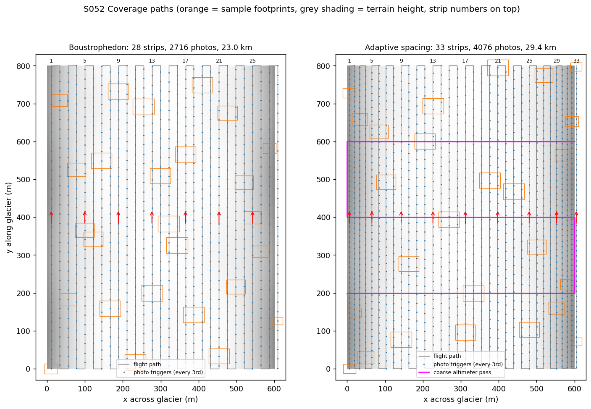
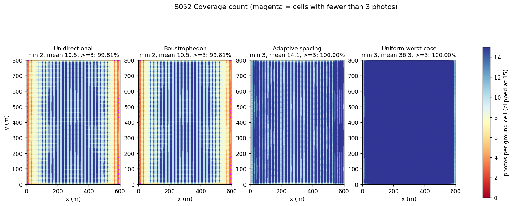
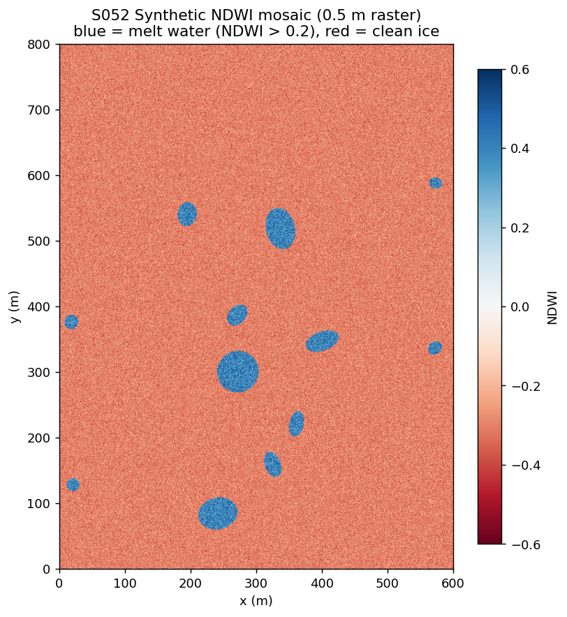
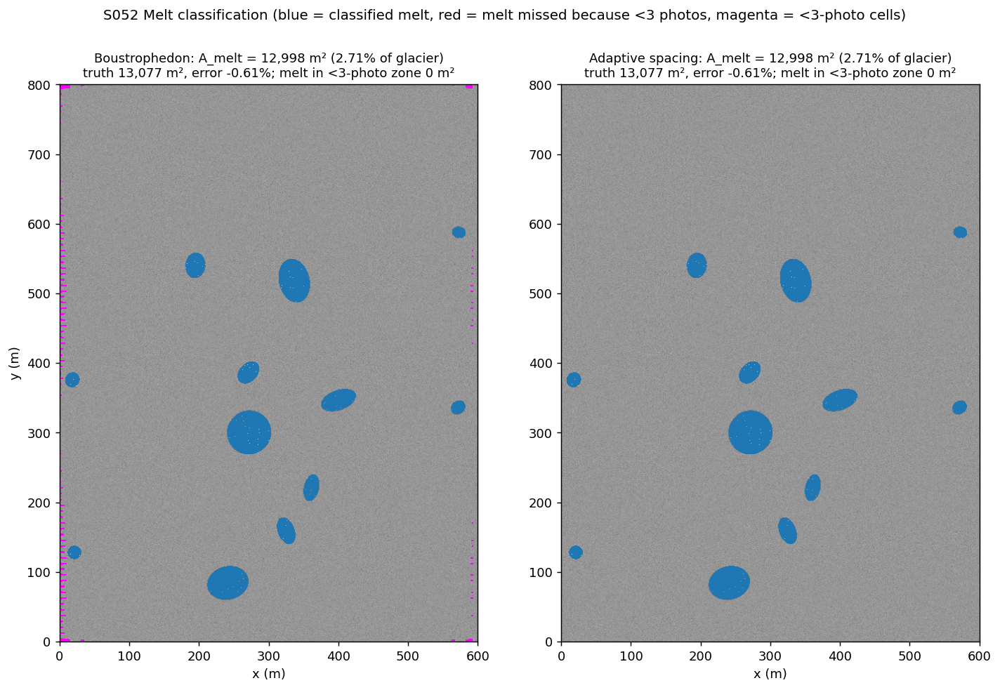
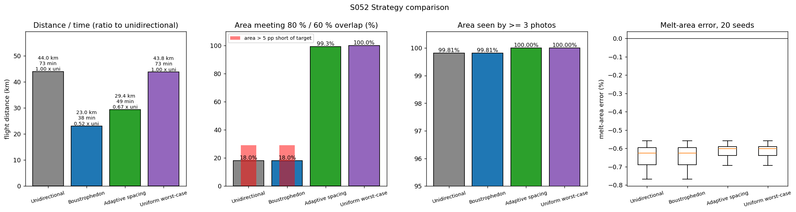
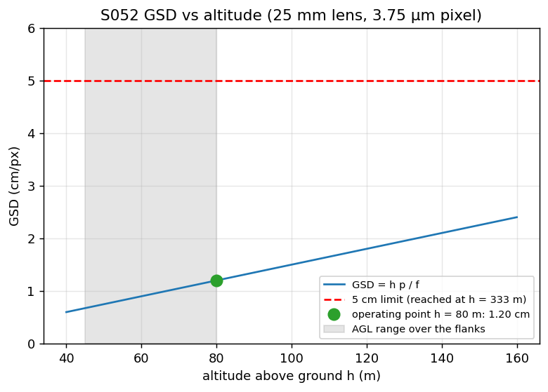
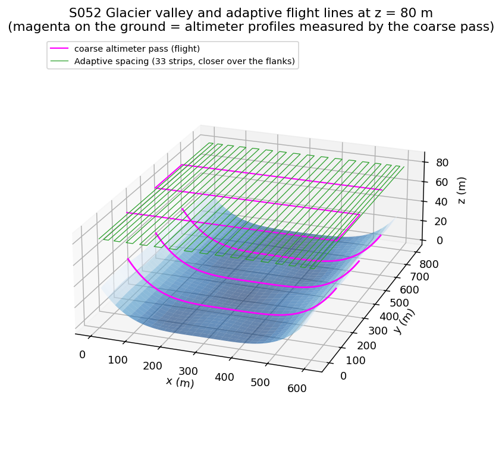
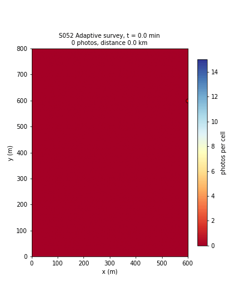

# S052 Glacier Melt Area Measurement

**Domain**: Environmental Monitoring & SAR | **Difficulty**: ⭐⭐ | **Status**: ✅ Completed

---

## Problem Definition

**Setup**: A single survey drone photographs an 800 × 600 m glacier tongue with a nadir RGB+NIR camera (25 mm lens, 17.3 × 13.0 mm sensor, 4608 × 3456 px). The photos are stitched into an orthomosaic, and the melt-pool area $A_{melt}$ is measured by thresholding NDWI. Every ground point must appear in at least 3 photos (the minimum for Structure-from-Motion), and the plan targets 80 % forward and 60 % side overlap.

The flight altitude is fixed at 80 m above the glacier centreline. The 600 m survey width also includes the lateral-moraine flanks, which rise up to 35 m above the centreline (plus a ±2 m surface undulation). Over the flanks the drone is closer to the ground, so each photo covers less ground and the overlap drops.

**Objective**: keep the 80 % / 60 % overlap and the ≥ 3-photo requirement everywhere, minimise flight distance, and measure $A_{melt}$ with GSD ≤ 5 cm/px.

**Comparison strategies** (all on the same terrain and melt-pool layout):
1. **Unidirectional lawnmower**: the card's flat-glacier spacing; every strip is flown south → north with a repositioning leg back.
2. **Boustrophedon lawnmower**: the same strips, flown alternately up and down.
3. **Adaptive strip spacing** (card): a coarse laser-altimeter pass measures three cross-glacier terrain profiles. Strip spacing and trigger interval are then shrunk wherever the ground is higher, so the overlap holds at the local altitude above ground (AGL).
4. **Uniform worst-case spacing** (added baseline): the spacing needed at the highest point is used everywhere. This is the simple way to guarantee overlap without adapting.

---

## Mathematical Model Summary

### Camera geometry

$$\text{GSD} = \frac{h\,p}{f},\quad p = \frac{s_w}{n_w} = 3.754\ \mu\text{m},\qquad W_{fp} = \frac{h\,s_w}{f},\quad L_{fp} = \frac{h\,s_h}{f}$$

At $h = 80$ m: GSD = 1.201 cm/px and footprint 55.36 × 41.60 m. GSD reaches the 5 cm limit only at $h = 333$ m.

### Strip layout and path length

$$B_x = L_{fp}(1 - O_f) = 8.32\ \text{m},\qquad B_y = W_{fp}(1 - O_s) = 22.144\ \text{m},\qquad N_{strips} = \lceil W_{area}/B_y \rceil = 28$$

$$D_{bous} = N L + (N-1) B_y = 22\,998\ \text{m},\qquad D_{uni} = N L + (N-1)(L + B_y) = 44\,598\ \text{m}$$

Strips are placed at $x_i = B_y/2 + i B_y$. Photos are taken exactly every $B_x$ along each strip, starting at the strip's first end (97 per strip, 2716 in total).

### Terrain and terrain-aware footprint

$$z_s(x, y) = 35\left(\frac{x - 300}{300}\right)^4 + 2 \sin\frac{2\pi y}{400}\cos\frac{2\pi x}{300}\ \text{m}$$

A ground point $\mathbf{q}$ is in photo $k$ (taken at $(x_k, y_k, Z)$) if

$$|x_q - x_k| \le \frac{(Z - z_q)\,s_w}{2f},\qquad |y_q - y_k| \le \frac{(Z - z_q)\,s_h}{2f}.$$

The coverage count $C(\mathbf{q})$ is the number of photos that contain $\mathbf{q}$, evaluated on a 1 m grid. The local overlaps are $o_s = 1 - B_{y,local}/W_{fp}(Z - z_q)$ and $o_f = 1 - B_{x,local}/L_{fp}(Z - z_q)$.

### Adaptive spacing

The coarse pass flies three cross-glacier transects at $y$ = 600, 400 and 200 m and samples the terrain every 5 m with an altimeter (noise σ = 0.5 m). The planning profile $\hat z(x)$ is the maximum of the three transects plus a 2 m margin. Strips are placed one after another:

$$x_{i+1} = x_i + (1 - O_s)\,\frac{(Z - \max_{[x_i,\,x_i + 22.1]} \hat z)\,s_w}{f},\qquad B_{x,i} = (1 - O_f)\,\frac{(Z - \max_{[x_i - 22.1,\,x_i + 22.1]} \hat z)\,s_h}{f}$$

The first strip is at half the local spacing, and strips are added until the last half-spacing reaches $x = 600$ m. The uniform worst-case plan uses $\max \hat z$ everywhere.

### NDWI melt area

$$\text{NDWI} \sim \mathcal{N}(-0.3, 0.05^2)\ \text{(ice)},\quad \mathcal{N}(0.4, 0.08^2)\ \text{(melt)},\qquad A_{melt} = \Delta^2 \sum \mathbf{1}[\text{NDWI} > 0.2 \;\wedge\; C(\mathbf{q}) \ge 3]$$

The NDWI raster has $\Delta = 0.5$ m pixels. A pixel is counted only where the ground is seen by at least 3 photos, so melt in a < 3-photo zone is lost. The true melt area is the analytic sum of the pool ellipse areas $\sum \pi a b$. The pools are 8 supraglacial pools in the central glacier plus 4 ice-marginal ponds on the flanks.

---

## Key Parameters

| Parameter | Value |
|-----------|-------|
| Altitude above centreline $h$ | 80 m |
| Camera | $f$ = 25 mm, sensor 17.3 × 13.0 mm, 4608 × 3456 px |
| Overlap $O_f$ / $O_s$ | 80 % / 60 % |
| Glacier area | 800 m (along strips, $y$) × 600 m (across, $x$) |
| Cruise speed / time step | 10 m/s / 0.5 s |
| NDWI threshold $\theta$ | 0.2 |
| NDWI ice / melt | N(−0.3, 0.05²) / N(0.4, 0.08²) |
| Minimum photos per point | 3 |
| Flank rise / undulation (added) | 35 m at $x$ = 0 and 600 m / ±2 m |
| Coarse pass (added) | transects at $y$ = 600, 400, 200 m; 5 m samples; σ = 0.5 m; +2 m margin |
| Coverage grid / NDWI raster (added) | 1 m / 0.5 m |
| Melt pools (added) | 8 central, semi-axes U(10, 35) m; 4 marginal, U(8, 12) m; non-overlapping |
| Monte Carlo (added) | 20 seeds (pool layout, NDWI noise, altimeter noise; same draws for every plan) |

---

## Implementation

```
src/03_environmental_sar/s052_glacier.py   # Main simulation script
```

```bash
conda activate drones
python src/03_environmental_sar/s052_glacier.py
```

Runtime ≈ 40–100 s (measured with up to ten other simulations running in parallel).

---

## Results

### Showcase run (seed 0)

| Plan | Strips | Photos | Distance | Time | Min / mean photos per point | Area ≥ 3 photos | Area meeting 80/60 overlap | Area > 5 pp short | Melt-area error |
|------|-------:|-------:|---------:|-----:|:---------:|------:|------:|------:|------:|
| Unidirectional | 28 | 2716 | 44.0 km | 73.3 min | 2 / 10.48 | 99.81 % | 18.0 % | 29.2 % | −0.61 % |
| **Boustrophedon** | 28 | 2716 | **23.0 km** | **38.3 min** | 2 / 10.48 | 99.81 % | 18.0 % | 29.2 % | −0.61 % |
| **Adaptive spacing** | 33 | 4076 | 29.4 km (incl. 2.4 km coarse pass) | 49.0 min | **3** / 14.07 | **100.00 %** | **99.3 %** | **0.0 %** | −0.61 % |
| Uniform worst-case | 51 | 9180 | 43.8 km (incl. 2.4 km coarse pass) | 73.0 min | 3 / 36.32 | 100.00 % | 100.0 % | 0.0 % | −0.61 % |

Minimum local overlap (side / forward): 26.0 % / 63.0 % for both nominal plans, 56.6 % / 80.1 % for the adaptive plan, and 60.4 % / 80.2 % for the worst-case plan. The adaptive strip spacing ranges from 11.85 to 21.45 m and its trigger interval from 4.45 to 8.04 m. The worst-case plan uses 11.85 m and 4.45 m everywhere. GSD is 0.65–1.23 cm/px for every plan, so the 5 cm limit is met everywhere and does not separate the plans.

The true melt area is 13,077 m² (2.72 % of the glacier). Every plan measures 12,998 m² (−0.61 %). Thresholding the whole NDWI raster without any coverage mask also gives 12,998 m², so the error comes from the NDWI noise and not from the flight plan: a melt pixel falls below 0.2 with probability $P(\mathcal{N}(0.4, 0.08^2) \le 0.2)$ = 0.62 %. Ice pixels never exceed 0.2, because that is 10 σ above the ice mean.

### Monte Carlo (20 seeds)

| Plan | Melt-area error (mean ± std) | Range | Melt lost in < 3-photo zone | Area ≥ 3 photos | Distance |
|------|------:|------:|------:|------:|------:|
| Unidirectional | −0.64 ± 0.06 % | −0.77 to −0.56 % | 2.8 m² mean (> 0 in 10 seeds) | 99.81 % | 44,008 m |
| Boustrophedon | −0.64 ± 0.06 % | −0.77 to −0.56 % | 2.8 m² mean (> 0 in 10 seeds) | 99.81 % | 22,998 m |
| Adaptive spacing | −0.62 ± 0.04 % | −0.69 to −0.56 % | 0.0 m² (0 seeds) | 100.00 % | 29,399 m |
| Uniform worst-case | −0.62 ± 0.04 % | −0.69 to −0.56 % | 0.0 m² (0 seeds) | 100.00 % | 44,354 ± 369 m |

Per seed, the adaptive plan has a smaller |error| than boustrophedon in 10 of 20 seeds and an equal one in the other 10; it is never worse. Unidirectional and boustrophedon give identical melt results in 20/20 seeds, as do adaptive and worst-case. The distance of the adaptive plan does not change across seeds: the altimeter noise never shifts a strip. The worst-case plan's distance does change, because its single spacing depends on the noisy maximum of the profile.

**Key findings**:
- **Boustrophedon halves the distance** (card's expectation holds): 23.0 km against 44.0 km, the same photos and the same coverage. The simulated unidirectional plan is 590 m shorter than the card formula (44,598 m), because its repositioning legs fly diagonally instead of along $L + B_y$.
- **The nominal plan loses overlap over the flanks.** Where the ground rises 35 m the AGL drops to about 45 m, side overlap falls to 26 % and forward overlap to 63 %. Only 18.0 % of the glacier meets 80/60 overlap; 29.2 % misses it by more than 5 pp. The rest of the shortfall is the ±2 m undulation, which pushes the overlap just below 60 % on the raised half of the centre. The ≥ 3-photo requirement still holds on 99.81 % of the area, and the failures (minimum 2 photos) are thin strips along the outer edges (magenta in the heatmap).
- **Adaptive spacing restores the overlap for 28 % more distance than boustrophedon** (29.4 km against 23.0 km, including the 2.4 km coarse pass), while the uniform worst-case plan needs 90 % more (43.8 km) and 2.3 × as many photos (9180 against 4076). The adaptive plan meets 80/60 on 99.3 % of the area. The remaining 0.7 % lies within the first 34 m of the west flank ($x$ = 0.5–33.5 m), where the terrain is steepest. The worst point (side overlap 56.6 %) is at (0.5, 99.5) m, on a +2 m crest of the undulation: the coarse transects at $y$ = 200, 400, 600 m sit on the zero lines of the undulation, so they never sample its crests, and the 2 m margin plus altimeter noise does not quite cover the steep edge.
- **The melt-area estimate does not depend on the plan** (honest negative result). The < 3-photo strips are only a few metres wide at the outermost edge, and the ice-marginal ponds lie 12–30 m from the edge, so on average 2.8 m² of melt is lost in 10 of 20 seeds, a 0.02 pp effect next to the 0.6 % NDWI classification error. The overlap loss matters for SfM quality on the flanks (tie points, DEM accuracy), which this model does not simulate; it does not change the 2D melt area.

### Coverage Paths

Boustrophedon (left) and adaptive plan (right): grey line = flight path, blue dots = photo triggers (every 3rd shown), orange = sample footprints (smaller over the darker, higher flanks), magenta = coarse altimeter pass, red arrows = strip direction:



### Coverage Count

Photos per 1 m cell, clipped at 15. Magenta marks cells with fewer than 3 photos (only along the outer edges of the two nominal plans):



### NDWI Mosaic

Synthetic NDWI (0.5 m raster, shown at 1 m): melt water in blue (NDWI ≈ 0.4), clean ice in red (≈ −0.3):



### Melt Classification

Classified melt (blue) for boustrophedon and adaptive. Both give 12,998 m²; no melt pixel falls into a < 3-photo cell (magenta) in this seed:



### Strategy Comparison

Distance and time (ratio to unidirectional), area meeting 80/60 overlap (red = area more than 5 pp short), area seen by ≥ 3 photos, and the Monte Carlo melt-area error:



### GSD vs Altitude

GSD grows linearly with AGL. At the 80 m operating point it is 1.20 cm/px; the 5 cm limit is reached only at 333 m. The grey band is the AGL range over the flanks:



### Terrain and Flight Lines (3D)

The glacier valley with the adaptive flight lines at $z$ = 80 m. The lines are closer together over the raised flanks; the magenta curves on the ground are the three altimeter profiles:



### Animation

The adaptive survey: three coarse transects, then the strips. The coverage count builds up as photos are taken (149 frames, one every 40 steps of 0.5 s):



### Deviations from the scenario card

| Card | Implementation | Reason |
|------|----------------|--------|
| GSD ≈ 4.8 cm/px; $N_{strips}$ ≈ 27; $N_{total}$ ≈ 2619; 21.7 km; 36 min | 1.201 cm/px; 28; 2716; 23.0 km; 38.3 min | Verified numerically: $80 \times 0.003754 / 25$ m = 1.201 cm (4.8 cm would need $h$ = 320 m); $\lceil 600/22.144 \rceil$ = 28. Card table corrected. |
| $\bar C = \frac{1}{\lvert O_f\rvert}\cdot\frac{1}{\lvert O_s\rvert}$ | $\bar C = 1/((1-O_f)(1-O_s)) = 12.5$ | The first expression gives 2.08. The card's own follow-up sentence already gave the correct form. Card corrected. |
| Card code: GSD `* 1000  # m/px → cm/px` | `* 100` | `* 1000` converts to mm/px. Card code corrected. |
| Glacier at a fixed $h$ = 80 m above the surface | Flight at a fixed 80 m above the centreline over terrain whose flanks rise 35 m (±2 m undulation) | The card's third strategy adapts spacing "on sloped glacier flanks", which only matters if the surface is not flat. A flat glacier would make the adaptive plan identical to boustrophedon. |
| Trigger when along-track distance ≥ $B_x$, checked every 0.5 s step | Exact distance trigger at 0, $B_x$, $2B_x$, … along each strip | At 10 m/s a 0.5 s step is 5 m, so the card's check fires every 10 m instead of every 8.32 m (forward overlap 76 %). |
| Adaptive spacing from "a prior coarse pass" (not specified) | Three altimeter transects across the glacier; max profile + 2 m margin; strip and trigger spacing from the local maximum | Simplest coarse pass that measures the across-glacier profile; its 2.4 km cost is included in the distance. |
| — | Added a uniform worst-case plan | A reasonable non-adaptive way to meet the overlap; it shows what the adaptive plan saves. |
| NDWI raster at the GSD (≈ 1.2 cm, 3.3 × 10⁹ px) | 0.5 m raster | The full-resolution raster does not fit in memory. The NDWI statistics per pixel are the same. |
| Melt area from every mosaic pixel | Counted only where the point is seen by ≥ 3 photos; truth = analytic ellipse areas | Ties the melt measurement to the SfM coverage requirement, so the plans can differ in melt area. |
| `melt_fraction=0.25`, 8 circular pools anywhere | 8 central ellipses + 4 ice-marginal ponds, non-overlapping (2.72 % melt in seed 0) | The card's `melt_fraction` is unused in its own code; marginal ponds test the flank coverage. |
| Single run | Plus a 20-seed Monte Carlo | The melt-area error depends on random NDWI noise and pool placement. |

---

## Extensions

1. **Terrain-following altitude**: vary the flight altitude with the DEM so that AGL (and GSD, footprint and overlap) stays constant; compare its distance with the adaptive-spacing plan.
2. **Multi-temporal change detection**: two surveys 30 days apart; map $\Delta A_{melt}$ and pond drainage events.
3. **SfM quality model**: simulate tie-point matching and DEM error as a function of local overlap, so the flank overlap loss shows up in a reconstruction metric.
4. **Better coarse pass**: choose transect positions (or an along-glacier profile) by expected terrain variability instead of fixed spacing.
5. **Wind drift**: lateral wind displaces the photo centres; find the wind speed at which the adaptive plan's margin no longer protects the overlap.
6. **Battery-limited flights**: split the 38–73 min surveys into battery-sized sorties and include the transit legs.

---

## Related Scenarios

- Prerequisites: [S041 Wildfire Boundary Scan](../../../scenarios/03_environmental_sar/S041_wildfire_boundary.md), [S048 Full-Area Coverage Scan (Lawnmower)](../../../scenarios/03_environmental_sar/S048_lawnmower.md)
- Follow-ups: [S053 Coral Reef 3D Reconstruction](../../../scenarios/03_environmental_sar/S053_coral_reef.md), [S057 Wildlife Population Census](../../../scenarios/03_environmental_sar/S057_wildlife.md)
- Cross-reference: [S049 Dynamic Zone Search](../../../scenarios/03_environmental_sar/S049_dynamic_zone.md), [S065 Building 3D Modeling — Multi-Angle Scan Path](../../../scenarios/04_industrial_agriculture/S065_3d_scan_path.md)
