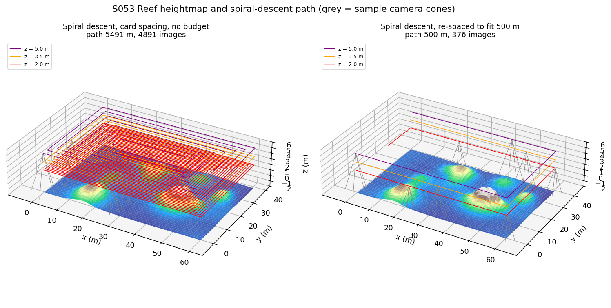
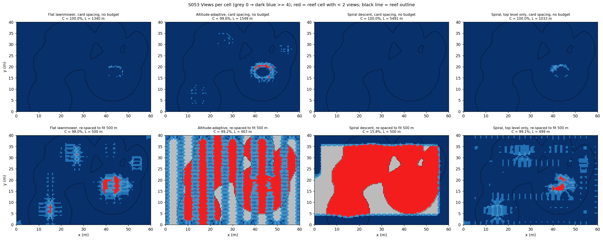
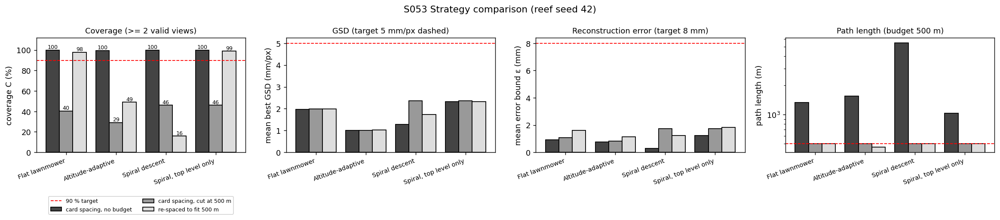
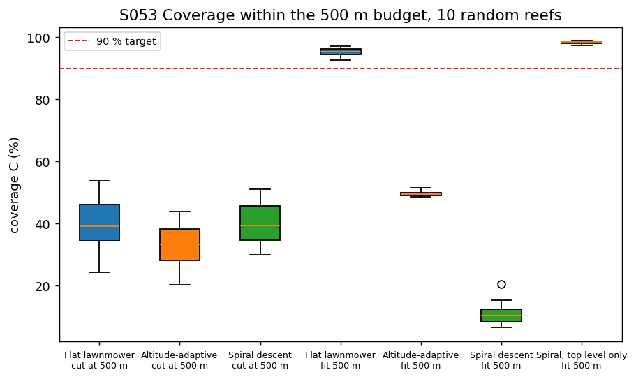
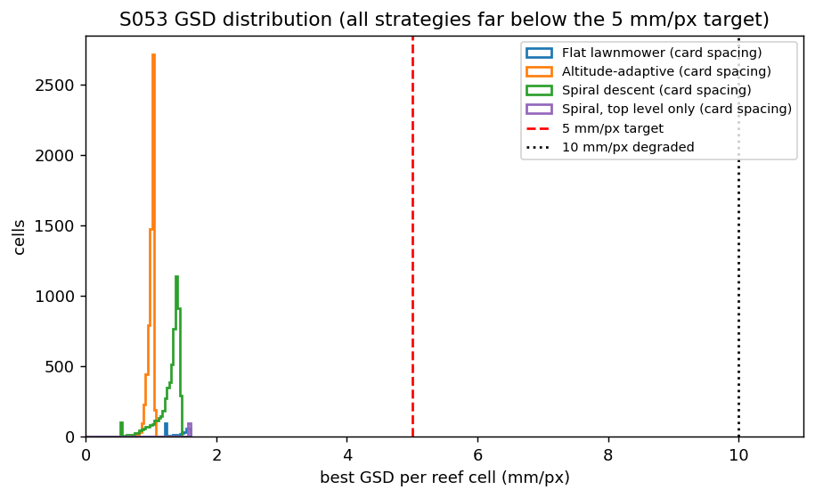
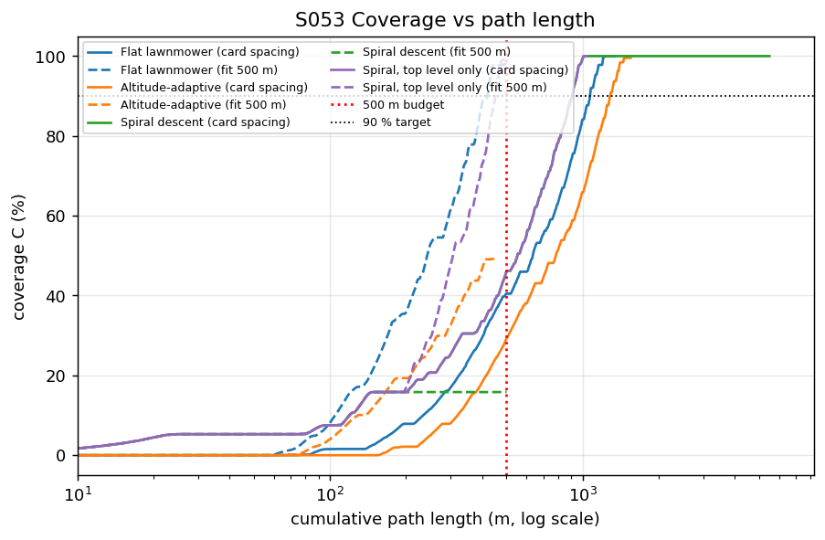
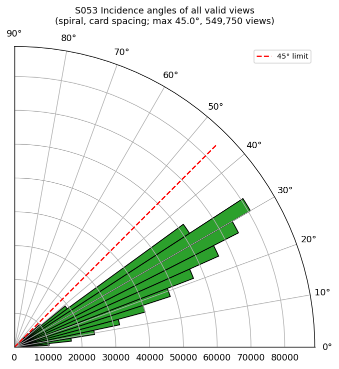
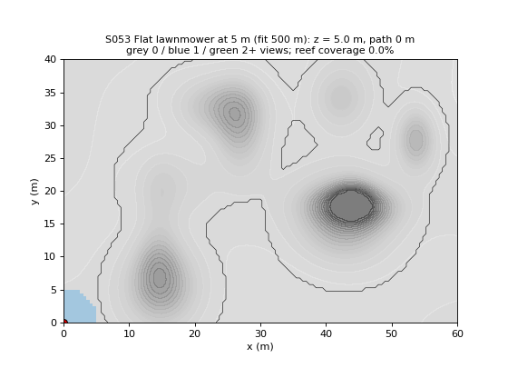

# S053 Coral Reef 3D Reconstruction

**Domain**: Environmental Monitoring & SAR | **Difficulty**: ⭐⭐⭐ | **Status**: ✅ Completed

---

## Problem Definition

**Setup**: A drone (or AUV) with a downward-facing stereo camera (70° cone) photographs a 60 × 40 m coral reef for multi-view-stereo reconstruction. The reef is a heightmap on a 0.5 m grid: 12 Gaussian bommies on a gently undulating substrate. A reef surface cell is reconstructable when at least $N_{min} = 2$ images see it. A view counts only if three conditions hold: the incidence angle to the surface normal is at most 45°, the cell lies inside the camera cone, and the line of sight is not blocked by other reef (ray–heightmap occlusion test). The battery allows a path of at most 500 m (333 s at 1.5 m/s).

**Objective**: maximise the fraction $C$ of reef cells with ≥ 2 valid views (target 90 %) within the 500 m budget, with mean GSD ≤ 5 mm/px and reconstruction error ≤ 8 mm.

**Comparison strategies** (card):
1. **Flat lawnmower** at $z = 4.0$ m.
2. **Altitude-adaptive lawnmower**: 3.0 m standoff above the local reef height.
3. **Spiral descent**: rectangular spirals on three levels, $z$ = 5.0, 3.5, 2.0 m, alternating inward and outward.
4. **Spiral, top level only** (added): the $z$ = 5.0 m level of strategy 3 alone. It separates the effect of the three levels from the spiral shape.

Each strategy is evaluated in three modes:
- **card spacing, no budget**: strip spacing for 60 % overlap at the crest, flown to the end.
- **card spacing, cut at 500 m**: the same pattern, stopped when the battery budget runs out.
- **re-spaced to fit 500 m**: the lateral spacing is widened until the whole pattern fits in 500 m (lawnmowers: the most strips that fit; spirals: one common scale factor on all level spacings, found by bisection).

---

## Mathematical Model Summary

### Reef heightmap

$$h(x, y) = \text{clip}\Bigl(\sum_{k=1}^{12} A_k e^{-\frac{(x - x_k)^2}{2\sigma_{x,k}^2} - \frac{(y - y_k)^2}{2\sigma_{y,k}^2}} - \tfrac{1}{2}\max G + \eta(x, y),\; -3.0,\; 0.5\Bigr)$$

with $A_k \sim U(0.3, 1.5)$ m and $\sigma \sim U(1.5, 5.0)$ m. The background $\eta$ is a bicubic interpolation of a 5 × 5 grid of random offsets in $[-0.3, 0]$ m. A cell counts as reef when its bommie component $G$ exceeds 0.05 m. Normals come from central differences (`np.gradient`).

### Visibility of cell $\mathbf{p}$ from camera $\mathbf{d}$

$$\hat{\mathbf{n}} \cdot \frac{\mathbf{d} - \mathbf{p}}{\|\mathbf{d} - \mathbf{p}\|} \ge \cos 45°,\qquad \|\mathbf{d}_{xy} - \mathbf{p}_{xy}\| \le (d_z - h_{\mathbf{p}}) \tan 35°,\qquad h(\mathbf{r}(t)) < z_{\mathbf{r}}(t) - 0.02\ \forall t$$

The ray $\mathbf{r}(t)$ is sampled every 0.25 m horizontally, starting 0.5 m from the cell, with bilinear interpolation of the heightmap.

### Spacing, GSD and error

$$\Delta_{lat}(z) = 2 (z - h_{max}) \tan 35° (1 - \rho_{ov}),\qquad \Delta_{lon} = \Delta_{lat},\qquad \text{GSD} = \frac{z_{rel}\, s_w}{f\, W_{px}},\qquad \varepsilon = \frac{\text{GSD}_{best}}{\rho_{ov}\sqrt{N_{views}}}$$

$h_{max}$ = 0.5 m is the reef crest and $\rho_{ov}$ = 0.6. The adaptive lawnmower uses $z_{rel}$ = 3.0 m. Images are taken every $\Delta_{lon}$ along the survey legs, with the card spacing in every mode, so a re-spaced pattern keeps 60 % along-track overlap and only widens the gaps between strips or rings. $\overline{\text{GSD}}$ is the mean of the best GSD over all reef cells seen at least once; $\bar\varepsilon$ is the mean over cells with ≥ 2 views.

### Path length

$$L_{path} = \sum_k \|\mathbf{w}_{k+1} - \mathbf{w}_k\|$$

The sum runs over the 3D path sampled every 0.1 m. It includes terrain-following climbs and descents and the transitions between spiral levels. The script asserts at least 0.5 m clearance above the reef and at most 6 m above the crest at every sample.

---

## Key Parameters

| Parameter | Value |
|-----------|-------|
| Reef footprint / grid | 60 × 40 m / 0.5 m (121 × 81 cells) |
| Bommies $N_B$ | 12 (amplitude 0.3–1.5 m, σ 1.5–5.0 m) |
| Height clip | −3.0 to +0.5 m |
| Camera cone $\alpha_{fov}$ / max incidence $\theta_{max}$ | 70° / 45° |
| Sensor width / focal length / image | 6.3 mm / 4.5 mm / 4000 × 3000 px |
| Design overlap $\rho_{ov}$ | 60 % |
| Minimum views $N_{min}$ | 2 |
| Flat altitude / adaptive standoff | 4.0 m / 3.0 m |
| Spiral levels | 5.0, 3.5, 2.0 m |
| Path budget $L_{max}$ / speed | 500 m / 1.5 m/s |
| Max altitude above crest | 6.0 m |
| Targets | $C$ ≥ 90 %, GSD ≤ 5 mm/px, $\varepsilon$ ≤ 8 mm |
| η control grid (added) | 5 × 5, U(−0.3, 0) m, bicubic |
| Reef-cell threshold (added) | bommie height > 0.05 m |
| Occlusion ray step / tolerance (added) | 0.25 m / 0.02 m |
| Minimum clearance (added, asserted) | 0.5 m |
| Showcase reef / Monte Carlo (added) | seed 42 / 10 reefs (seeds 1000–1009), same reef for every strategy |

---

## Implementation

```
src/03_environmental_sar/s053_coral_reef.py   # Main simulation script
```

```bash
conda activate drones
python src/03_environmental_sar/s053_coral_reef.py
```

Runtime ≈ 1.5–2.5 min (measured with up to ten other simulations running in parallel).

---

## Results

Showcase reef (seed 42): heights −2.26 to 0.50 m; 5,999 of 9,801 cells (61.2 %) are reef. The steepest slope is 44.6°, so no cell is steeper than the 45° limit.

### Coverage, GSD and error (seed 42)

| Strategy | Mode | Path | Images | Coverage $C$ | Mean GSD | Mean $\varepsilon$ |
|----------|------|-----:|-------:|------:|------:|------:|
| Flat lawnmower | card spacing, no budget | 1340 m | 704 | 100.0 % | 1.974 mm/px | 0.930 mm |
| Altitude-adaptive | card spacing, no budget | 1549 m | 925 | 99.6 % | 0.997 mm/px | 0.767 mm |
| Spiral descent | card spacing, no budget | 5491 m | 4891 | 100.0 % | 1.274 mm/px | 0.295 mm |
| Spiral, top level only | card spacing, no budget | 1033 m | 417 | 100.0 % | 2.324 mm/px | 1.238 mm |
| Flat lawnmower | cut at 500 m | 500 m | 263 | 40.5 % | 1.995 mm/px | 1.070 mm |
| Altitude-adaptive | cut at 500 m | 500 m | 300 | 29.2 % | 1.011 mm/px | 0.827 mm |
| Spiral descent | cut at 500 m | 500 m | 201 | 46.0 % | 2.352 mm/px | 1.726 mm |
| Flat lawnmower | fit 500 m (11 strips) | 500 m | 272 | 98.0 % | 1.981 mm/px | 1.594 mm |
| Altitude-adaptive | fit 500 m (10 strips) | 463 m | 277 | 49.2 % | 1.031 mm/px | 1.145 mm |
| Spiral descent | fit 500 m (scale 27.38) | 500 m | 376 | 15.8 % | 1.729 mm/px | 1.228 mm |
| **Spiral, top level only** | **fit 500 m (scale 2.46)** | 499 m | 207 | **99.1 %** | 2.326 mm/px | 1.835 mm |

Cut at 500 m, the top-level spiral is identical to the full spiral (same first level), so it is listed once. With the card spacing, the 90 % target is reached after 1069 m (flat), 1284 m (adaptive) and 907 m (spiral, during its first level).

### Monte Carlo (10 reefs, coverage within 500 m)

| Strategy | Card spacing, cut at 500 m | Best | Re-spaced to fit 500 m | Best | Fit runs ≥ 90 % |
|----------|------:|:--:|------:|:--:|:--:|
| Flat lawnmower | 40.0 ± 9.1 % (24.3–53.8) | 6/10 | 95.1 ± 1.4 % (92.6–97.1) | 0/10 | 10/10 |
| Altitude-adaptive | 32.6 ± 7.8 % (20.2–43.9) | 0/10 | 49.6 ± 0.9 % (48.4–51.4) | 0/10 | 0/10 |
| Spiral descent | 39.7 ± 6.8 % (30.0–50.9) | 4/10 | 11.3 ± 3.9 % (6.5–20.5) | 0/10 | 0/10 |
| Spiral, top level only | — | — | **98.2 ± 0.4 %** (97.3–98.6) | **10/10** | 10/10 |

There are no ties for best. In the fit-500 m mode the flat lawnmower beats the three-level spiral and the adaptive lawnmower in 10/10 reefs, and the top-level spiral beats the flat lawnmower in 10/10.

**Key findings**:
- **None of the card's patterns fits the battery.** With 60 % overlap at the crest the flat lawnmower needs 1340 m, the adaptive one 1549 m and the three-level spiral 5491 m, against a 500 m budget. The spiral's lowest level ($z$ = 2 m, 0.84 m spacing) alone is the bulk of its length. Flown until the battery runs out, every pattern covers only 30–46 % of the reef (Monte Carlo 32.6–40.0 %), and no strategy is consistently best (flat 6/10, spiral 4/10).
- **Within the budget, altitude wins, not the descent.** Widening the spacing so the whole pattern fits is far better than stopping early. The flat lawnmower then covers 95.1 ± 1.4 % and the top-level spiral at 5 m covers 98.2 ± 0.4 %; both reach the 90 % target on every reef. The card's three-level spiral is the worst option: to fit its three levels into 500 m, all spacings grow 27× (69, 46 and 23 m), which leaves one ring per level and 11.3 % coverage. Its lower levels only pay off when the budget is about 10× larger. The top-level spiral beats the flat lawnmower on every reef, but it also flies 1 m higher (wider footprint); this run does not separate the spiral shape from the altitude.
- **The altitude-adaptive lawnmower is the worst lawnmower.** At a 3 m standoff the footprint radius over the reef is only 2.1 m. Re-spaced to 10 strips (6.7 m apart), it leaves gaps between strips and covers 49.6 ± 0.9 %. It does give the finest and most uniform GSD (about 1.0 mm/px in every mode).
- **GSD and reconstruction-error targets do not discriminate.** Every configuration has a mean GSD of 1.0–2.4 mm/px (target 5 mm/px) and a mean error bound of 0.3–1.8 mm (target 8 mm). The card's example, a 4 mm GSD at 2.5 m that needs 35 % overlap, is wrong for this camera. Its GSD at 2.5 m is 0.875 mm, so the overlap needed for 8 mm is only 0.077 (card corrected).
- **Occlusion and incidence matter only locally.** The 45° incidence limit is respected by construction (max 45.0°, mean 24.7° over 549,750 valid views of the full spiral). With slopes up to 44.6° it removes oblique views of the bommie flanks. Together with occlusion, this causes the ring of 1-view cells on the flanks of the bommie near $x$ ≈ 45 m, $y$ ≈ 18 m (read from the coverage maps). For the altitude-adaptive plan with the card spacing these are the only reef cells left with < 2 views (coverage 99.6 %); the flat and spiral plans still see them twice.

### Reef and Spiral Path (3D)

Heightmap with the spiral-descent path (purple 5.0 m, orange 3.5 m, red 2.0 m) and sample camera cones (grey). Left: card spacing (5491 m). Right: re-spaced to 500 m, which leaves one ring per level:



### Coverage Maps

Views per cell (grey 0 → dark blue ≥ 4) for every strategy, with the card spacing (top) and re-spaced to 500 m (bottom). Red marks reef cells with fewer than 2 views; the black line is the reef outline:



### Strategy Comparison

Coverage, mean GSD, mean error bound and path length for the three modes (seed 42). The red dashed lines are the targets and the budget:



### Monte Carlo Coverage

Coverage within the 500 m budget on 10 random reefs:



### GSD Distribution

Best GSD per reef cell with the card spacing. Every strategy is far below the 5 mm/px target:



### Coverage vs Path Length

Coverage as images are added along each path (log scale). The red dotted line is the 500 m budget. The full spiral (green, solid) is hidden under the top-level spiral (purple) until 1033 m, where its lower levels begin:



### Incidence Angles

Polar histogram of the incidence angle of every valid view (full spiral, card spacing):



### Animation

The top-level spiral re-spaced to 500 m (the best strategy within the budget). Cells turn from grey (0 views) to blue (1) to green (2+). One frame is rendered every 42 path samples of 0.1 m (121 frames). The last two frames are only 0.1 m apart and look identical, so Pillow merges them and the file has 120 frames:



### Deviations from the scenario card

| Card | Implementation | Reason |
|------|----------------|--------|
| Patterns at 60 % overlap with $L_{path} \le 500$ m | Three modes: card spacing (no budget), card spacing cut at 500 m, re-spaced to fit 500 m | The card spacings give 1033–5491 m, so none fits the budget. Both ways of meeting it are shown. |
| Card code: spiral strategy built as a lawnmower per level | Rectangular spirals, inward at 5.0 m, outward at 3.5 m, inward at 2.0 m, with straight transitions | Follows the card text ("concentric rectangular spirals … alternating inward/outward"). |
| — | Added "Spiral, top level only" | Shows whether the multi-level descent or the higher first level drives the spiral's result. |
| $\Delta_{lon} = \Delta_{lat} \cdot W_{px}/H_{px}$ ("square footprints") | $\Delta_{lon} = \Delta_{lat}$ | The footprint is a circular cone (card code), so the $4/3$ factor would cut the along-track overlap to 47 %. Card corrected. |
| $g$ = 4 mm at $z_{rel}$ = 2.5 m, required overlap 0.354 | $g$ = 0.875 mm, required overlap 0.077 | $2.5 \times 6.3 / (4.5 \times 4000)$ m = 0.875 mm (printed by the script). Card corrected. |
| Point-cloud density $N_{photos}\rho_{ov}^2 W_{px} H_{px} / (A_{reef}\overline{\text{GSD}}^2)$ | Not computed; card formula replaced by $\rho_{pc} \approx 1/\overline{\text{GSD}}^2$ | The card's expression has units of m⁻⁴. With the GSD above, every strategy would give ≈ 10⁵–10⁶ points/m², so it does not discriminate either. |
| Card code: occlusion "simplified" (not tested) | Full ray–heightmap occlusion test | Condition 3 of the card's visibility model. |
| Card code omits $\eta$ | 5 × 5 control grid, bicubic (`scipy.ndimage.zoom`), clipped to $[-0.3, 0]$ | Card text specifies $\eta$. |
| $N_{surf}$: cells with $h > h_{base} + 0.05$ m ($h_{base}$ undefined) | Cells whose bommie component exceeds 0.05 m | The substrate height varies with $\eta$, so a single $h_{base}$ would count undulating sand as reef. |
| Card code: `FOV_DEG = 70  # camera half-angle (full cone)` | 70° full cone, 35° half-angle | Matches the card's footprint formula $r = z_{rel}\tan(\alpha_{fov}/2)$. Card comment corrected. |
| $\rho_{ov}$ in $\varepsilon$ is "the overlap between successive frames" | $\rho_{ov}$ = 0.6 for every cell | Along-track spacing always uses the card overlap. |
| Single reef | Plus a 10-reef Monte Carlo | Coverage depends on the random reef. |
| Heights "in [−3.0, 0.5] m" | −2.26 to 0.50 m for seed 42 | The card's generator rarely reaches −3 m; the clip is kept. |

---

## Extensions

1. **Next-best-view planning**: greedily choose the next waypoint that adds the most newly covered (or previously occluded) cells per metre of path, and compare with the re-spaced patterns at 500 m.
2. **Budget-aware level allocation**: choose how much of the 500 m to spend on each altitude level (for example only the top level, plus low passes over steep bommies).
3. **Oblique views**: tilt the camera on the low passes to see steep flanks inside the 45° incidence limit.
4. **Current disturbance**: add a horizontal drift and a path-following controller; measure the coverage lost to cross-track error.
5. **Multi-vehicle survey**: split the reef between 2–3 vehicles to fit the card's 60 % overlap patterns within each vehicle's 500 m budget.

---

## Related Scenarios

- Prerequisites: [S048 Full-Area Coverage Scan (Lawnmower)](../../../scenarios/03_environmental_sar/S048_lawnmower.md), [S046 Multi-Drone 3D Trilateration](../../../scenarios/03_environmental_sar/S046_trilateration.md)
- Follow-ups: [S054 Minefield Detection](../../../scenarios/03_environmental_sar/S054_minefield.md), [S065 Building 3D Modeling — Multi-Angle Scan Path](../../../scenarios/04_industrial_agriculture/S065_3d_scan_path.md)
- Cross-reference: [S050 Swarm Cooperative Mapping (Distributed EKF-SLAM)](../../../scenarios/03_environmental_sar/S050_slam.md), [S074 Mine 3D Mapping](../../../scenarios/04_industrial_agriculture/S074_mine_mapping.md), [S052 Glacier Melt Area Measurement](../../../scenarios/03_environmental_sar/S052_glacier.md)
