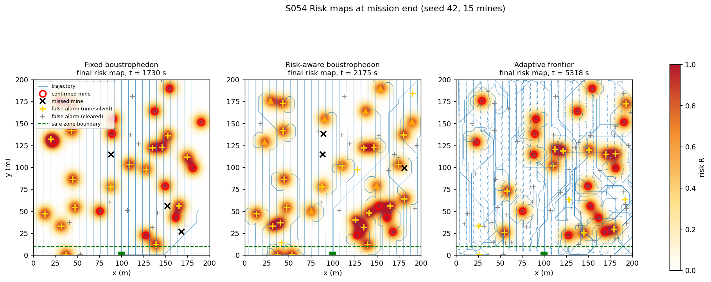
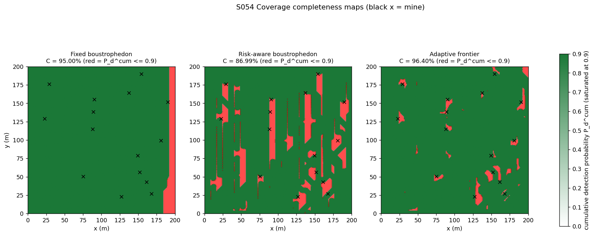
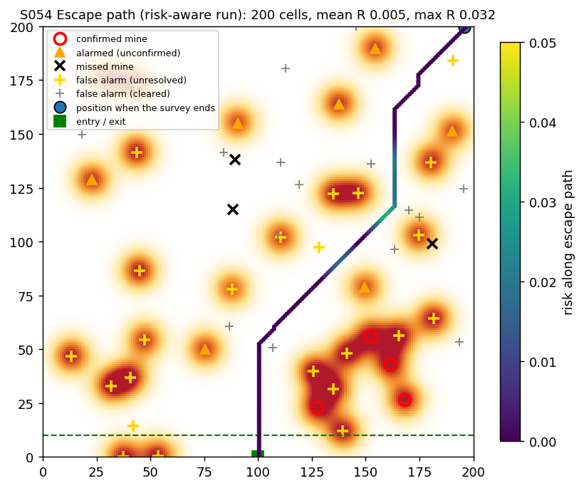
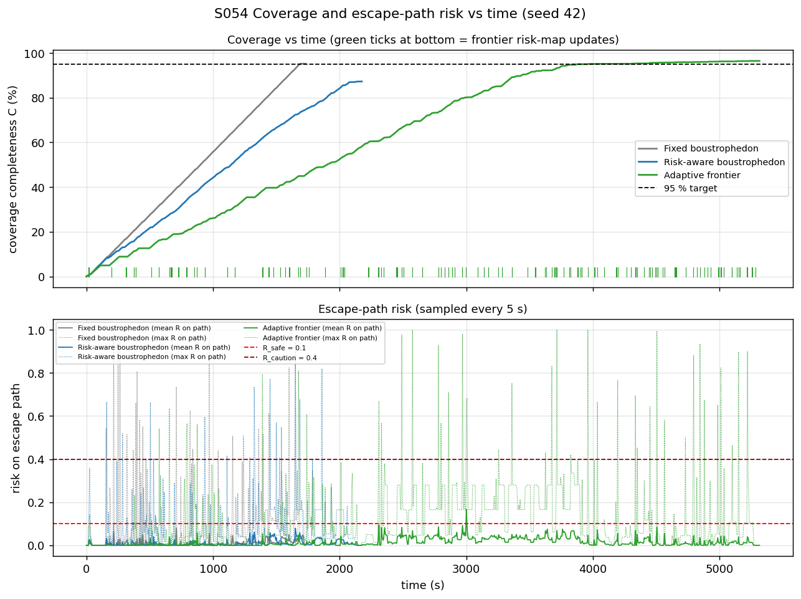
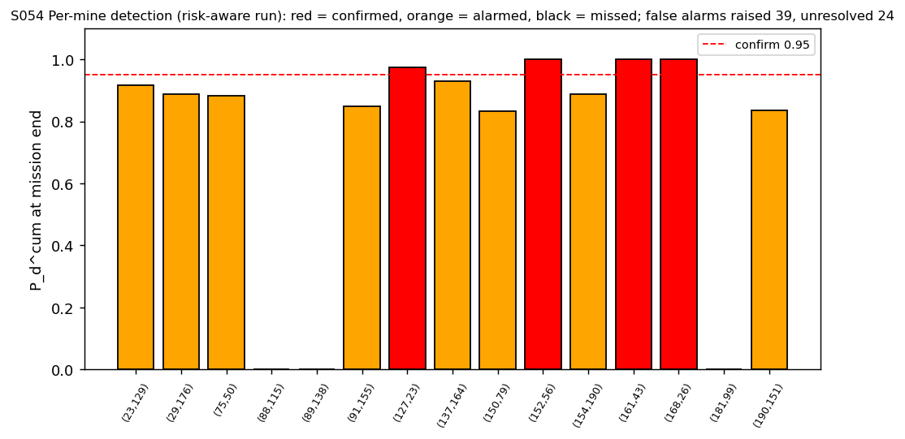
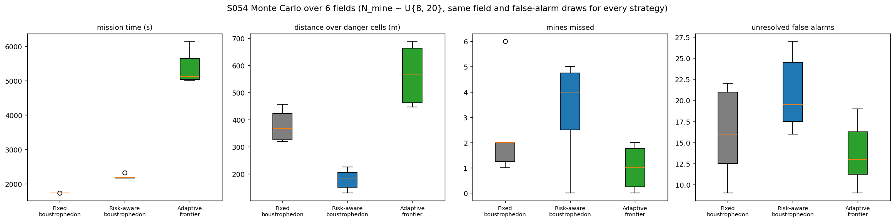
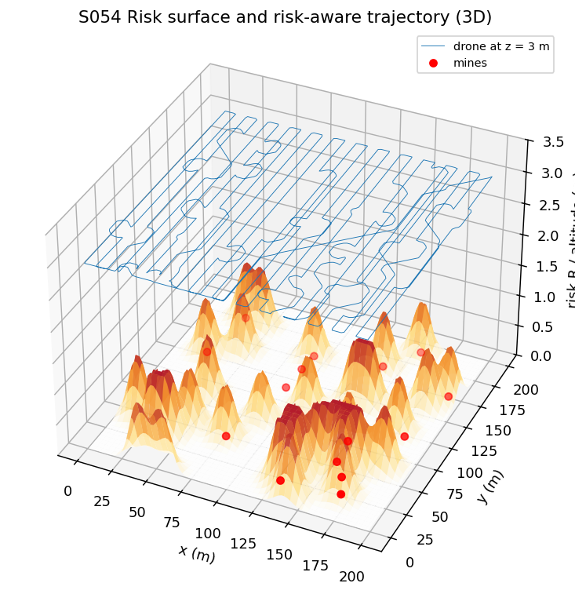
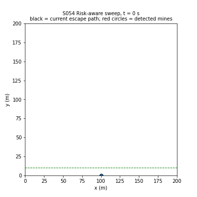

# S054 Minefield Detection

**Domain**: Environmental Monitoring & SAR | **Difficulty**: ⭐⭐⭐ | **Status**: ✅ Completed

---

## Problem Definition

**Setup**: A 200 × 200 m suspected minefield must be surveyed before ground personnel enter. A drone with a downward ground-penetrating radar (GPR, effective radius 4 m) flies at 3 m and 3 m/s from the safe-zone entry point (100, 0) m. The safe zone is the strip $y \le 10$ m. Between 8 and 20 point mines (15 in the showcase field) lie at unknown positions with $y \ge 15$ m. The GPR also raises false alarms. Every detection updates a risk map. After every risk-map change the least-risk **escape path** back to the entry is replanned on the 1 m grid.

**Objective**: reach coverage completeness $C \ge 0.95$ (cells with cumulative detection probability > 0.9), keep the escape path's risk below 0.1, and minimise mission time.

**Comparison strategies** (card):
1. **Fixed boustrophedon**: 25 strips 8 m apart; ignores detections.
2. **Risk-aware boustrophedon**: the same strips, with a local least-risk detour whenever danger cells ($R \ge 0.4$) lie within 15 m ahead.
3. **Adaptive frontier**: flies to the nearest unscanned, non-danger cell and sweeps 8 m bands from west to east. It uses a least-risk path when the straight line would cross danger. After reaching 95 % coverage it revisits every unresolved alarm once to reclassify it.

Every mission ends when $C$ reaches 0.95 (as in the card code) or the pattern is finished, and then returns to the entry along the escape path. Mission time includes the return.

---

## Mathematical Model Summary

### GPR detection

$$P_d(r) = \begin{cases}1 - \exp\!\left(-\dfrac{r_{gpr}^2}{2r^2}\right) & r \le r_{gpr} \\ 0 & r > r_{gpr}\end{cases},\qquad P_d^{cum}(\mathbf{m}) = 1 - \prod_t \bigl(1 - P_d(\|\mathbf{p}_t - \mathbf{m}\|)\bigr)$$

$r$ is the horizontal distance. A mine raises an **alarm** when a single step has $P_d > 0.5$ ($r$ < 3.40 m), and is **confirmed** when $P_d^{cum} > 0.95$. A cell counts as scanned when $P_d^{cum}$ at its centre exceeds 0.9.

Without the cutoff at $r_{gpr}$ (the card's formula), the 1/$r^2$ tail would make one straight pass at 20 m lateral offset reach $P_d^{cum}$ = 0.865, and 0.527 even at 50 m. A 3 m-high GPR would then "see" mines 50 m away.

### False alarms

The field is divided into 8 × 8 m blocks. Each time the GPR footprint reaches a block centre (a new pass over the block), a false alarm is raised with probability $P_{fa}$ = 0.05, at a random point in the block. A false alarm enters the risk map like a real alarm, with weight equal to its $P_d^{cum}$. It is cleared when a later, separate pass brings the GPR within the alarm radius again (the "second overpass"). All strategies use the same per-block, per-pass random draws.

### Risk map and escape path

$$R(i, j) = \min\Bigl(1, \sum_{k \in \mathcal{M}_{active}} P_d^{cum}(\mathbf{m}_k)\,e^{-\|c_{ij} - \mathbf{m}_k\|^2 / 2r_{inf}^2}\Bigr),\qquad w(i, j) = 1 + 50\,R(i, j)^2$$

The escape path is the least-cost 8-connected path to the entry cell, where entering a cell costs the step length times $w$. It is computed with one Dijkstra search from the entry cell on the reversed graph, which gives the escape path from every cell at once. A plain A* search with a Euclidean heuristic gives the same cost: 181.3880 for both from (150, 150) on the final risk map. A mission would abort if the escape cost reached $J_{max} = 3 \times$ the risk-free cost from the farthest corner.

### Path length

The card pattern has 25 strips, 5192 m and 1731 s.

---

## Key Parameters

| Parameter | Value |
|-----------|-------|
| Field / grid | 200 × 200 m / 1 m cells |
| Mines | showcase 15 (seed 42); Monte Carlo U{8, 20}; $y \ge 15$ m |
| Speed / altitude / time step | 3 m/s / 3 m / 0.2 s |
| GPR radius $r_{gpr}$ / influence radius $r_{inf}$ | 4 m / 6 m |
| Strip width | 8 m (25 strips) |
| $\theta_{alarm}$ / $\theta_{confirm}$ | 0.50 / 0.95 |
| $P_{fa}$ | 0.05 per block per pass (8 × 8 m blocks, added) |
| $R_{safe}$ / $R_{caution}$ / $\alpha$ | 0.10 / 0.40 / 50 |
| Coverage target / scanned threshold | 0.95 / $P_d^{cum}$ > 0.9 |
| Entry point / safe zone | (100, 0) m / $y \le 10$ m |
| GPR cutoff (added) | $P_d = 0$ for $r > 4$ m |
| Risk-aware look-ahead / rejoin margin (added) | 15 m / 2 m |
| $J_{max}$ (added) | 3 × risk-free cost from the farthest corner |
| Escape-risk sampling / risk-weight refresh (added) | every 5 s / every 10 s |
| Monte Carlo (added) | 6 fields (seeds 0–5), same field and false-alarm draws for every strategy |

---

## Implementation

```
src/03_environmental_sar/s054_minefield.py   # Main simulation script
```

```bash
conda activate drones
python src/03_environmental_sar/s054_minefield.py
```

Runtime ≈ 2–3 min (measured with other simulations running in parallel).

---

## Results

### Showcase field (seed 42, 15 mines)

| Metric | Fixed | Risk-aware | Frontier |
|--------|------:|------:|------:|
| Mission time (survey end) | **1730 s** (1682 s) | 2175 s (2076 s) | 5318 s (5223 s) |
| Distance flown | **5144 m** | 6066 m | 14091 m |
| Coverage $C$ at survey end | 95.00 % | **86.99 %** (target missed) | 96.40 % |
| Mines detected / confirmed / missed | 12 / 12 / 3 | 12 / 4 / 3 | **15 / 15 / 0** |
| False alarms raised / unresolved | 29 / 17 | 39 / 24 | 73 / **15** |
| Distance over danger cells ($R \ge 0.4$) | 369.2 m | **180.6 m** | 540.3 m |
| Escape-risk samples with a danger cell on the path | 7.2 % | **3.2 %** | 3.9 % |
| Escape-risk samples with mean $R \ge 0.1$ | 0.0 % | 0.0 % | 0.1 % |
| Mean $R$ on the escape path (max over samples) | 0.0089 (0.080) | 0.0081 (0.079) | 0.0147 (0.167) |
| Risk-map updates / detour plans / reclassification visits | 64 / 0 / 0 | 70 / 35 / 0 | 159 / 78 / 29 |
| Aborts ($J \ge J_{max}$) | 0 | 0 | 0 |

The fixed run misses three mines. None of them is in the unflown eastern strip (its strips end at $x \le 188$ m). All three lie in the seams between strips:

| Missed mine | Distance to nearest strip centreline | $P_d^{cum}$ |
|---|---:|---:|
| (152.1, 55.9) | 3.95 m | 0.639 |
| (88.4, 114.8) | 3.61 m | 0.945 |
| (168.1, 26.5) | 3.87 m | 0.794 |

### Monte Carlo (6 fields, N_mine ~ U{8, 20}, 17.0 mines on average)

| Strategy | Mission time | Coverage | Mines missed | Unresolved / raised false alarms | Distance over danger | Unsafe escape samples |
|----------|------:|------:|------:|------:|------:|------:|
| Fixed boustrophedon | **1729 ± 1 s** | 95.00 % | 2.33 ± 1.70 | 16.2 ± 4.9 / 30.3 | 376.7 ± 54.4 m | 1.6 % |
| Risk-aware boustrophedon | 2200 ± 57 s | 86.74 % | 3.33 ± 1.80 | 20.8 ± 4.2 / 36.7 | **179.1 ± 34.4 m** | **0.1 %** |
| Adaptive frontier | 5365 ± 441 s | 96.27 % | **1.00 ± 0.82** | **13.7 ± 3.4** / 85.0 | 564.7 ± 104.8 m | 0.3 % |

The fixed strategy is fastest in 6/6 fields. The risk-aware strategy flies less over danger cells than the fixed one in 6/6 fields and is slower in 6/6 (471 s longer on average). The frontier strategy never flies less over danger than the fixed one (0/6 fields). No mission ever aborts.

**Key findings**:
- **The card's 8 m strips leave seams where mines are missed.** The strip width equals the GPR diameter (8 m), but an alarm needs $r$ < 3.40 m and confirmation needs about 3.5 m. A mine 3.6–4.0 m from both neighbouring strips is never alarmed and accumulates only $P_d^{cum}$ = 0.64–0.95. All three mines missed by the fixed run are such seam mines. The coverage metric still counts their cells as scanned, because every cell centre is at most 3.5 m from a strip centreline, enough to pass 0.9. Strips about 6.8 m apart (twice the alarm radius) would close the seams.
- **Risk-aware detours halve the time over danger cells, but cost coverage, time and confirmations.** Compared with the fixed sweep, the drone flies 179 m instead of 377 m over danger cells, and the escape path almost never has a mean risk ≥ 0.1 (0.1 % vs 1.6 % of samples). However, the zones it detours around stay unscanned. It never reaches the 95 % target (86.74 %), it misses slightly more mines (3.33 vs 2.33), and it confirms only 4 of its 12 detections in the showcase field, because it turns away right after the first alarm. Most avoided zones come from false alarms (39 raised in the showcase run, 24 still unresolved), which look exactly like mines to the planner.
- **The adaptive frontier finds the most mines and resolves the most false alarms, but takes about 3× as long.** It misses 1.00 mine on average and leaves 13.7 unresolved false alarms, against 2.33 and 16.2 for the fixed sweep. The cost is 5365 s against 1729 s and the most flying over danger (565 m), partly because the reclassification visits deliberately pass over alarms. Each extra pass over a block can raise a new false alarm, so it also raises the most (85 on average), which in turn creates more zones to avoid and revisit.
- **The escape-path constraint is rarely violated by any strategy.** The least-risk path almost always finds a corridor: its mean risk stays below 0.1 in ≥ 98.4 % of samples for every strategy. The only real exposure is the first cells when the drone itself is over a fresh detection (maximum cell risk up to 1.0). No mission reached $J_{max}$, so the abort rule never triggered and does not separate the strategies.

### Risk Maps

Final risk map for each strategy, with the trajectory (blue), confirmed mines (red circles), alarmed but unconfirmed mines (orange triangles), missed mines (black ×), unresolved and cleared false alarms (gold and grey +), and the safe-zone boundary (green dashed):



### Coverage Completeness

Cumulative detection probability per cell (saturated at 0.9). Red cells are unscanned: the unflown eastern strip of the fixed run, and the danger zones left out by the risk-aware and frontier runs:



### Escape Path

Least-risk escape path from where the risk-aware survey ends (top right) to the entry, coloured by the risk of each cell. It threads between the risk zones:



### Coverage and Escape Risk vs Time

Top: coverage completeness; green ticks are the frontier's risk-map updates. Bottom: mean (solid) and maximum (dotted) risk along the current escape path, sampled every 5 s:



### Detection Summary

$P_d^{cum}$ of every mine at the end of the risk-aware run. Only 4 of 12 detected mines are confirmed (red), because the drone detours right after the first alarm. The 3 missed mines are the bars of zero height: the detours kept the GPR from ever passing within 4 m of them:



### Monte Carlo



### Risk Surface (3D)

Final risk surface of the risk-aware run with its trajectory at 3 m and the mine positions:



### Animation

Risk-aware sweep: the risk map builds up as mines and false alarms are detected, and the black line is the current escape path. 88 frames, one every 25 s:



### Deviations from the scenario card

| Card | Implementation | Reason |
|------|----------------|--------|
| $P_d(r) = 1 - e^{-r_{gpr}^2/2r^2}$ for all $r$; mines "detectable within GPR range" | $P_d = 0$ for $r > r_{gpr}$ = 4 m | Without the cutoff, one pass detects with 0.865 at 20 m and 0.527 at 50 m (printed by the script), which is not physical for a 3 m-high GPR and would complete the coverage long before the sweep. |
| $r = \|\mathbf{p} - \mathbf{m}\|$ (drone at 3 m) | Horizontal distance, as in the card code | With slant range the effective radius would shrink to 2.6 m. |
| $P_{fa}$ = 0.05 per cell (1 m²) per pass | Per 8 × 8 m block per pass | Per 1 m² cell this would raise about 2000 false alarms per sweep; per block it gives 30–85 per mission. |
| False alarm "must be reclassified by a second overpass" | Weight = its $P_d^{cum}$ (like a real alarm); cleared on a later pass with single-step $P_d > 0.5$; only the frontier plans such passes | The planner cannot tell false from real alarms; the card defines no reclassification strategy. |
| A* on the 200 × 200 grid; card code replans every step (risk-aware) | Dijkstra from the entry on the reversed graph, recomputed only when the risk map changes; equal to A* (181.3880 vs 181.3880) | One search gives the escape path from every cell; replanning every 0.2 s step is unnecessary because the map changes only on detections. |
| Risk-aware detour when $R > R_{threshold}$ (value not given) | Danger ($R \ge 0.4$) within 15 m ahead → least-risk path to 2 m past the danger stretch; strip ends in danger are pulled back along the strip | Defines the card's "local replan". |
| Frontier planner (details not given) | 8 m bands west to east; nearest unscanned non-danger cell outside the footprint; band centreline; least-risk path when the line crosses danger; reclassification visits after 95 % | A plain nearest-cell frontier zig-zagged across the field in development runs; sweeping by bands was the most efficient rule tried. |
| $J_{max}$ not given | 3 × risk-free cost from the farthest corner | Never reached by any mission. |
| Risk weights $P_d^{cum}$ change every step | Risk map rebuilt on each new alarm, confirmation, false alarm or clearance, and every 10 s if a weight changed by > 0.01 | Keeps the runtime reasonable. |
| Single run | Plus a 6-field Monte Carlo | Results depend on the mine and false-alarm layout; 6 fields keep the runtime under 5 min. |

---

## Extensions

1. **Narrower strips**: re-run with a 6.8 m strip width (twice the alarm radius) to close the seams, and compare mission time and missed mines.
2. **Belief over alarm identity**: keep $P(\text{mine} \mid \text{alarms})$ per alarm and lower the risk weight of single unconfirmed returns, so false alarms do not block coverage.
3. **Coverage-aware risk-aware sweep**: after the pattern, revisit unscanned cells at the edges of danger zones from the safe side.
4. **Multi-drone sweep**: split the strips among 3 drones and rebalance when one drone aborts.
5. **Sensor fusion**: combine GPR with a magnetometer to reduce false alarms.

---

## Related Scenarios

- Prerequisites: [S048 Full-Area Coverage Scan (Lawnmower)](../../../scenarios/03_environmental_sar/S048_lawnmower.md), [S049 Dynamic Zone Search](../../../scenarios/03_environmental_sar/S049_dynamic_zone.md)
- Follow-ups: [S056 Nuclear Plant Leak Detection (Radiation Hotspot Localization)](../../../scenarios/03_environmental_sar/S056_radiation.md), [S074 Mine 3D Mapping](../../../scenarios/04_industrial_agriculture/S074_mine_mapping.md)
- Cross-reference: [S034 Weather Rerouting](../../../scenarios/02_logistics_delivery/S034_weather_rerouting.md), [S022 Obstacle Avoidance Delivery](../../../scenarios/02_logistics_delivery/S022_obstacle_avoidance_delivery.md), [S053 Coral Reef 3D Reconstruction](../../../scenarios/03_environmental_sar/S053_coral_reef.md)
