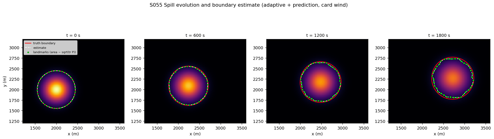
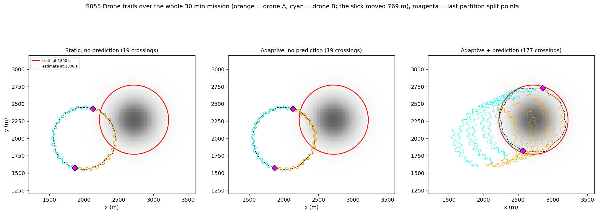
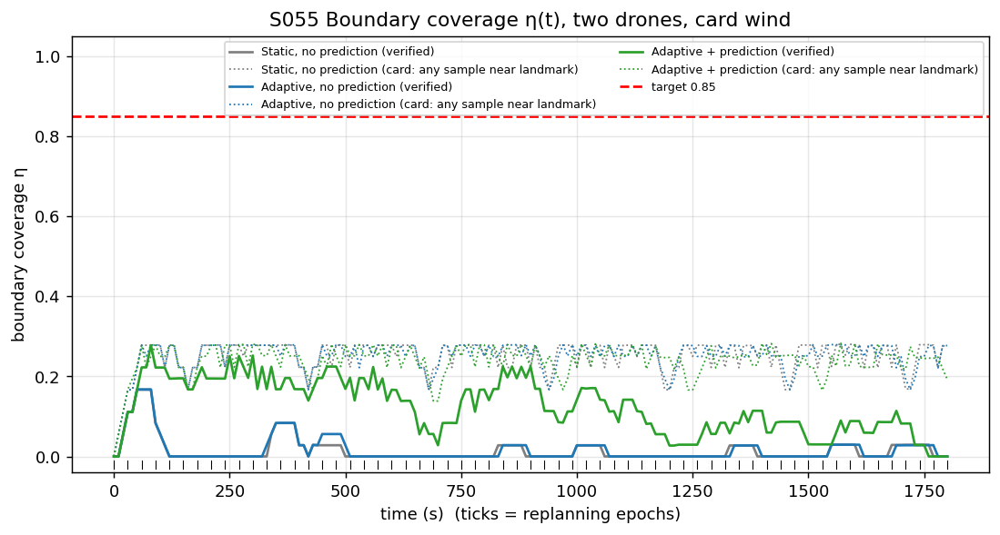
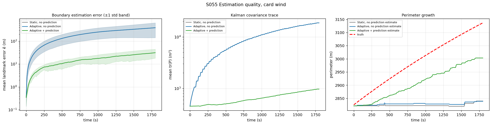
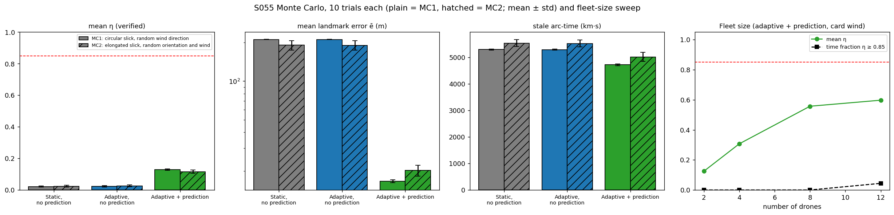
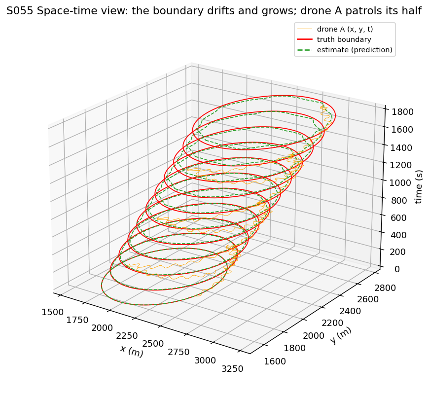
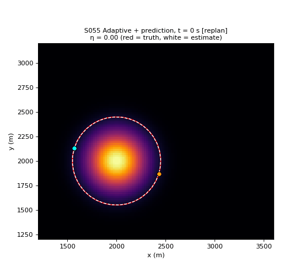

# S055 Coastline Oil Spill Tracking

**Domain**: Environmental Monitoring & SAR | **Difficulty**: ⭐⭐⭐ | **Status**: ✅ Completed

---

## Problem Definition

**Setup**: An oil slick in a 4 × 4 km coastal area drifts with the combined wind and tidal current, $\mathbf{u} = (0.40, 0.15)$ m/s (0.43 m/s), and spreads by diffusion. Its concentration follows the 2D advection–diffusion equation on a 200 × 200 grid (20 m cells). The slick boundary is the contour $C = 0.08$. Two drones at 15 m altitude carry a binary above/below-threshold oil sensor. Each drone patrols its share of the planned boundary, reads the sensor every 20 m of flight, and feeds every boundary crossing into a per-landmark Kalman filter (36 landmarks). The ground station replans every 30 s.

**Objective**: keep the boundary coverage $\eta(t) \ge 0.85$ (fraction of boundary arc length observed within the last 60 s) during the 30 min mission, and keep the boundary estimate accurate.

**Comparison strategies** (card):
1. **Static, no prediction**: both drones patrol their halves of the $t = 0$ boundary for the whole mission; the patrol path is never replanned.
2. **Adaptive, no prediction**: every 30 s the path is replanned on the current estimate, and the partition is rebalanced. The filter has no drift model (random walk).
3. **Adaptive + prediction**: the filter propagates the landmarks with the known drift $\mathbf{u}$, and every 30 s the drones are sent to the boundary predicted one epoch ahead.

---

## Mathematical Model Summary

### Spill dynamics

$$\frac{\partial C}{\partial t} = -\mathbf{u}\cdot\nabla C + D\nabla^2 C,\qquad C(\mathbf{x}, 0) = e^{-\|\mathbf{x} - \mathbf{x}_0\|^2 / 2R_0^2}$$

The equation is solved with forward Euler, central advection and a 5-point Laplacian ($\delta t$ = 2 s). The scheme is stable here: $u\,\delta t/h$ = 0.043, $D\,\delta t/h^2$ = 0.025 and cell Péclet number 1.60 < 2. The script asserts that $C$ never goes negative. Analytically, the boundary radius grows from 450 m to 500 m and the centre drifts 769 m in 30 min.

### Sensing and measurements

Each drone follows a zig-zag around its planned arc, with lateral offset $25 \sin(2\pi s / 100\ \text{m})$ m along the boundary normal, at a constant 8 m/s. The zig-zag lengthens the path by a factor of 1.463, so the drone advances along the boundary at 5.47 m/s. The binary sensor $\mathbf{1}[C(\mathbf{p}) \ge 0.08]$ is read every $\Delta s$ = 20 m. When two consecutive readings differ, the drone has crossed the boundary. The measurement is the midpoint of the two sample positions plus 3 m GPS noise:

$$\mathbf{m} = \tfrac12(\mathbf{p}_{k-1} + \mathbf{p}_k) + \mathcal{N}(0, 3^2 \mathbf{I})$$

It is associated with the nearest landmark within $r_{assoc}$ = 30 m.

### Kalman filter (per landmark)

$$\hat{\mathbf{b}}^- = \hat{\mathbf{b}} + \mathbf{u}_f\,\Delta t,\qquad \mathbf{P}^- = \mathbf{P} + \sigma_q^2\,\Delta t\,\mathbf{I}$$

$$z = \hat{\mathbf{n}}^T(\mathbf{m} - \hat{\mathbf{b}}^-),\quad S = \hat{\mathbf{n}}^T\mathbf{P}^-\hat{\mathbf{n}} + \sigma_r^2,\quad \mathbf{K} = \mathbf{P}^-\hat{\mathbf{n}}/S,\quad \hat{\mathbf{b}} = \hat{\mathbf{b}}^- + \mathbf{K}z,\quad \mathbf{P} = (\mathbf{I} - \mathbf{K}\hat{\mathbf{n}}^T)\mathbf{P}^-$$

The prediction runs continuously (before each update and at each epoch). Strategy 3 uses $\mathbf{u}_f = \mathbf{u}$ and $\sigma_q$ = 0.5 m/s$^{1/2}$ (card). Strategies 1–2 use $\mathbf{u}_f = 0$ and $\sigma_q = |\mathbf{u}|\sqrt{T_{replan}}$ = 2.34 m/s$^{1/2}$. This random walk lets the estimate move one epoch of drift (1σ) every 30 s, so the no-prediction filter is not handicapped by a process noise that is too small.

### Partition, coverage and error

Strategies 2–3 split the 36 landmarks into two contiguous arcs of equal estimated length ($k^* = \arg\min_k |\sum_{i \le k}\ell_i - L/2|$). Each drone flies back and forth along its own arc. Coverage is

$$\eta(t) = \frac{\sum_k \ell_k\,\mathbf{1}[t - t_k^{last} \le 60\ \text{s}]}{\sum_k \ell_k}$$

with $t_k^{last}$ the time of the last **crossing measurement** associated with landmark $k$ ("verified"). The card's version, which counts any sample within 30 m of the estimated landmark, is reported as "nominal". The estimation error $\bar e(t)$ is the mean distance from the estimated landmarks to the true contour. The stale arc-time is $\int (1 - \eta) L_{true}\,dt$, with the true perimeter (so a strategy that underestimates the perimeter gets no credit for it).

---

## Key Parameters

| Parameter | Value |
|-----------|-------|
| Domain / grid | 4000 × 4000 m / 200 × 200 (20 m) |
| $C_0$ / $R_0$ / $\mathbf{x}_0$ / $C_{thr}$ | 1.0 / 200 m / (2000, 2000) m / 0.08 |
| Drift $\mathbf{u}$ / diffusivity $D$ / PDE step | (0.40, 0.15) m/s / 5.0 m²/s / 2.0 s |
| Landmarks $N_b$ | 36 |
| $\sigma_q$ (prediction filter) / $\sigma_r$ | 0.5 m/s$^{1/2}$ / 15 m |
| $r_{assoc}$ | 30 m |
| Drones / speed / altitude | 2 / 8 m/s / 15 m |
| Sampling interval $\Delta s$ | 20 m |
| $T_{replan}$ / $T_{stale}$ / $T_{mission}$ | 30 s / 60 s / 1800 s |
| Simulation step | 0.5 s |
| Zig-zag half-width / wavelength (added) | 25 m / 100 m |
| GPS noise on a crossing (added) | 3 m |
| $\sigma_q$ of the no-prediction filter (added) | $|\mathbf{u}|\sqrt{T_{replan}}$ = 2.34 m/s$^{1/2}$ |
| Monte Carlo (card) | MC1: 10 trials, wind direction uniform in [0, 2π), |u| = 0.427 m/s; same truth for every strategy |
| Second Monte Carlo (added) | MC2: 10 elongated slicks, semi-axes $R_0 f$ and $R_0/f$ with $f$ ~ U(1, 1.5), random orientation and wind direction |
| Fleet-size sweep (added) | 2, 4, 8, 12 drones, prediction strategy, card wind |

---

## Implementation

```
src/03_environmental_sar/s055_oil_spill.py   # Main simulation script
```

```bash
conda activate drones
python src/03_environmental_sar/s055_oil_spill.py
```

Runtime ≈ 45–60 s depending on machine load.

---

## Results

The true perimeter grows from 2826 m to 3137 m.

### Card wind, two drones

| Strategy | Mean η (verified) | Mean η (nominal, card) | Time with η ≥ 0.85 | Mean error ē | Final error | Error > 25 m from | Stale arc-time | Final perimeter error | Crossings |
|----------|------:|------:|------:|------:|------:|------:|------:|------:|------:|
| Static, no prediction | 0.015 | 0.251 | 0.0 % | 211.6 m | 384.7 m | 100 s | 5332 km·s | −297 m | 19 |
| Adaptive, no prediction | 0.017 | 0.251 | 0.0 % | 212.1 m | 385.4 m | 100 s | 5325 km·s | −298 m | 19 |
| **Adaptive + prediction** | **0.125** | 0.239 | 0.0 % | **16.4 m** | **31.2 m** | 1480 s | **4745 km·s** | **−133 m** | **177** |

### Monte Carlo 1 (10 wind directions, circular slick)

Wind directions: 300, 313, 79, 83, 177, 271, 254, 341, 24, 177°.

| Strategy | Mean η (verified) | Nominal η | Mean error ē | Final error | Stale arc-time | Crossings | Error > 25 m |
|----------|------:|------:|------:|------:|------:|------:|------:|
| Static, no prediction | 0.022 ± 0.003 | 0.252 | 210.9 ± 0.8 m | 384.6 ± 0.5 m | 5298 ± 16 km·s | 28 | 10/10 trials, first at 103 s |
| Adaptive, no prediction | 0.023 ± 0.004 | 0.251 | 211.1 ± 0.5 m | 384.7 ± 0.5 m | 5291 ± 21 km·s | 29 | 10/10 trials, first at 101 s |
| **Adaptive + prediction** | **0.129 ± 0.006** | 0.239 | **16.6 ± 0.5 m** | 31.6 ± 1.1 m | **4723 ± 30 km·s** | 182 | 10/10 trials, first at 1436 s |

Adaptive + prediction has the lowest mean error and the highest mean η in 10/10 trials. No strategy reaches a mean η ≥ 0.85 in any trial. The initial slick is circular and isotropic, so rotating the wind is close to a symmetry of the problem; the small spread (± 0.5 m) mostly reflects that, not robustness.

### Monte Carlo 2 (10 elongated slicks, random orientation and wind direction)

| Strategy | Mean η (verified) | Mean error ē | Final error | Stale arc-time | Crossings |
|----------|------:|------:|------:|------:|------:|
| Static, no prediction | 0.024 ± 0.006 | 190.5 ± 15.7 m | 368.3 ± 16.9 m | 5543 ± 130 km·s | 30 |
| Adaptive, no prediction | 0.026 ± 0.006 | 190.2 ± 15.8 m | 368.0 ± 16.8 m | 5530 ± 130 km·s | 33 |
| **Adaptive + prediction** | **0.116 ± 0.010** | **20.2 ± 2.0 m** | 37.8 ± 3.4 m | **5023 ± 168 km·s** | 165 |

Adaptive + prediction again has the lowest mean error in 10/10 trials. On non-circular slicks its error is larger (20.2 m vs 16.6 m) and varies more between trials, but the ranking does not change.

### Fleet-size sweep (adaptive + prediction, card wind)

| Drones | 2 | 4 | 8 | 12 |
|---|---|---|---|---|
| Mean η | 0.125 | 0.307 | 0.557 | 0.597 |
| Time with η ≥ 0.85 | 0.0 % | 0.0 % | 0.0 % | 4.4 % |
| Mean error ē | 16.4 m | 12.0 m | 9.8 m | 10.2 m |

**Key findings**:
- **The 0.85 coverage target is out of reach for two drones** (card objective not met by any strategy). The zig-zag needed to cross the boundary leaves 5.47 m/s of along-boundary speed, so one drone refreshes at most 328 m of boundary within $T_{stale}$ = 60 s, while the boundary is 2826–3137 m long. Even if every pass produced a measurement at every landmark, 7.3 drones (for the 2826 m initial perimeter) to 8.1 drones (3137 m final perimeter) would be needed; without the zig-zag, at the full 8 m/s, the bound would be 5.0–5.6 drones. In the simulation, the best strategy reaches a mean η of 0.125 with 2 drones, 0.557 with 8 and 0.597 with 12, still below 0.85. Not every crossing falls within 30 m of a landmark, and back-and-forth patrols revisit the arc ends only half as often.
- **Without a drift model the boundary is lost within about 100 s**, and replanning on the estimate does not help. The slick moves 12.8 m per epoch, but a drone returns to the same point of its 1413 m arc only every few minutes. By then the boundary has moved further than the ±25 m zig-zag reaches, no crossings occur, and the filter has nothing to correct. After 19 crossings (28–29 in the Monte Carlo), the static and adaptive estimates freeze near the $t = 0$ boundary, and the error grows to 385 m. The two no-prediction strategies are practically identical: their curves overlap in every plot.
- **Prediction is what makes tracking work.** With the known drift, the planned path moves with the slick. The drones keep crossing the boundary (177 crossings), and the mean error stays at 16.4 m (16.6 ± 0.5 m over 10 wind directions, 12.7× lower than without prediction; 20.2 ± 2.0 m on elongated slicks). The remaining error grows slowly (31.2 m at the end), because the filter models drift but not diffusive growth. The estimated perimeter ends 133 m short of the truth (no-prediction: 297 m short).
- **The card's coverage metric is not discriminative.** Counting any sample within 30 m of an estimated landmark gives η ≈ 0.24–0.25 for all three strategies, including the static one whose estimate is 385 m off. The drones always fly over their own estimate, so this metric measures where the drones are, not whether they see the spill. The verified η (crossings only) separates the strategies.

### Spill Evolution

Concentration at $t$ = 0, 600, 1200 and 1800 s with the truth boundary (red), the estimate (white dashed) and the landmarks (size grows with the covariance trace), for adaptive + prediction:



### Drone Trajectories

Trails of drone A (orange) and drone B (cyan) over the whole mission, with the truth and estimated boundaries at 1800 s. The static and no-prediction drones keep circling the initial boundary while the slick drifts away; with prediction the trails follow the slick:



### Boundary Coverage

Verified η (solid) and the card's nominal η (dotted) for the three strategies; ticks mark the 30 s replanning epochs:



### Estimation Quality

Mean landmark error with ±1 std band (log scale), mean Kalman covariance trace, and estimated vs true perimeter. The static curves are hidden under the adaptive (no prediction) curves:



### Monte Carlo and Fleet Size

Mean ± std over the two Monte Carlo sets (plain = MC1 circular slick, hatched = MC2 elongated slick), and the fleet-size sweep:



### Space-Time View (3D)

Truth (red) and estimated (green dashed) boundary every 180 s stacked along the time axis, with drone A's trail. The boundary drifts and grows while drone A patrols its half:



### Animation

Adaptive + prediction: concentration field, truth (red) and estimate (white), the two drones with short trails, and the live η. 91 frames, one every 20 s; "[replan]" marks the frames at a replanning epoch:



### Deviations from the scenario card

| Card | Implementation | Reason |
|------|----------------|--------|
| Drones follow the estimated boundary with $\mathbf{v} = v\hat\tau + k_{lat}(\mathbf{b}^{proj} - \mathbf{p})$ | Drones fly a ±25 m zig-zag along the planned arc at a constant 8 m/s (waypoint following, ping-pong at the arc ends) | A binary point sensor only measures the boundary when the drone crosses it. Flying exactly on the estimate gives no crossings unless the estimate is wrong. Waypoint following also keeps the speed at exactly 8 m/s. |
| Measurement: "a drone crossing the estimated boundary at measured position m" | Crossing of the **true** boundary, detected as a change between consecutive readings; $\mathbf{m}$ = midpoint + 3 m GPS noise | Defines how $\mathbf{m}$ is obtained from a binary sensor. The filter keeps the card's $\sigma_r$ = 15 m, which covers the ±10 m midpoint error. |
| "No prediction" (strategies 1–2) not specified for the filter | Random-walk filter, $\mathbf{u}_f = 0$, $\sigma_q = |\mathbf{u}|\sqrt{T_{replan}}$ = 2.34 | Strategy 3's filter uses the drift; a no-prediction filter must not. The larger $\sigma_q$ keeps it from being overconfident. |
| $\eta$: last time a drone "sampled within $r_{assoc}$ of $\mathbf{b}_k$" | Verified η (crossing measurements only) as the main metric; the card's version reported as "nominal" | The card's version is about 0.25 for every strategy, even when the estimate is 385 m off (X3). |
| Initial freshness | No landmark counts as fresh until a drone has measured it | Counting the $t = 0$ survey as an observation would make η = 1 for the first 60 s for every strategy. |
| Rebalancing to equalise "uncovered arc length"; formula equalises total arc length | Formula as written (total arc length) | The formula is the card's definition; with uniform drift and growth it keeps the halves nearly equal. |
| Static strategy: "patrols its fixed semicircle at constant angular speed" | Back-and-forth patrol of the $t = 0$ half-boundary, same zig-zag | Same patrol model for all strategies, so only planning and prediction differ. |
| Drones deploy from a shore base | Drones start on the boundary at $t = 0$ | The transit is the same for every strategy and is not part of the tracking comparison. |
| Card code: `np.interp(d, ...)` in `extract_boundary_landmarks` | Uses `sample_d` (card corrected); contours from `contourpy`; landmarks ordered counter-clockwise | `d` is undefined in the card code. |
| Monte Carlo of 10 random wind directions | Same (MC1), plus 10 elongated slicks (MC2) and a fleet-size sweep (2–12 drones) | Wind direction alone is nearly a symmetry for a circular slick; MC2 varies the slick shape. The sweep shows how far the target is from reach. |

---

## Extensions

1. **Re-acquisition search**: when a drone sees no crossing for a whole wavelength, widen the zig-zag until it finds the boundary again. This may rescue the no-prediction strategies.
2. **Growth model**: add an outward normal velocity to the landmark motion model (diffusive spreading) and estimate it online; this would remove most of the remaining 31 m error.
3. **Drift estimation**: estimate $\mathbf{u}$ from the landmark innovations instead of assuming it is known.
4. **Circulating patrol**: have both drones circulate in the same direction half a perimeter apart, instead of back and forth, so every point is revisited at the same interval.
5. **Shoreline**: add a no-fly coastline that cuts through the boundary and forces the patrol arcs to end there.
6. **Battery swaps**: a third drone relieves the others in rotation, as in the card's extension list.

---

## Related Scenarios

- Prerequisites: [S041 Wildfire Boundary Scan](../../../scenarios/03_environmental_sar/S041_wildfire_boundary.md), [S048 Full-Area Coverage Scan (Lawnmower)](../../../scenarios/03_environmental_sar/S048_lawnmower.md)
- Follow-ups: [S056 Nuclear Plant Leak Detection (Radiation Hotspot Localization)](../../../scenarios/03_environmental_sar/S056_radiation.md), [S058 Typhoon Eye Probing](../../../scenarios/03_environmental_sar/S058_typhoon.md)
- Cross-reference: [S045 Chemical Plume Tracing](../../../scenarios/03_environmental_sar/S045_plume_tracing.md), [S049 Dynamic Zone Search](../../../scenarios/03_environmental_sar/S049_dynamic_zone.md), [S052 Glacier Melt Area Measurement](../../../scenarios/03_environmental_sar/S052_glacier.md)
