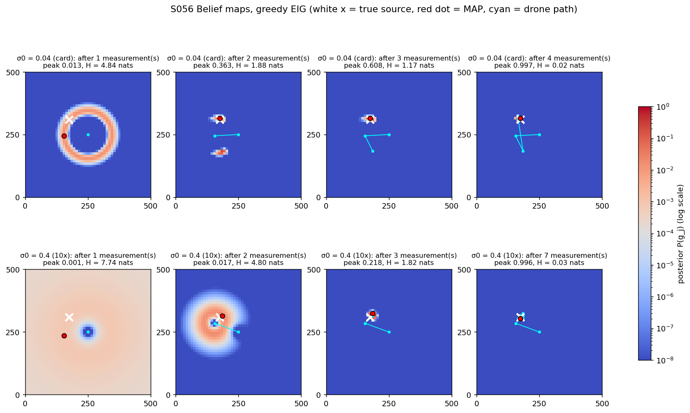
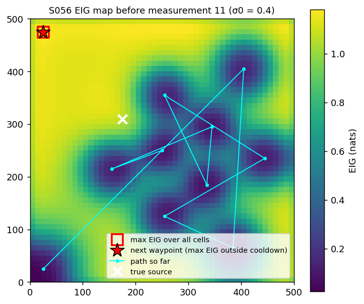
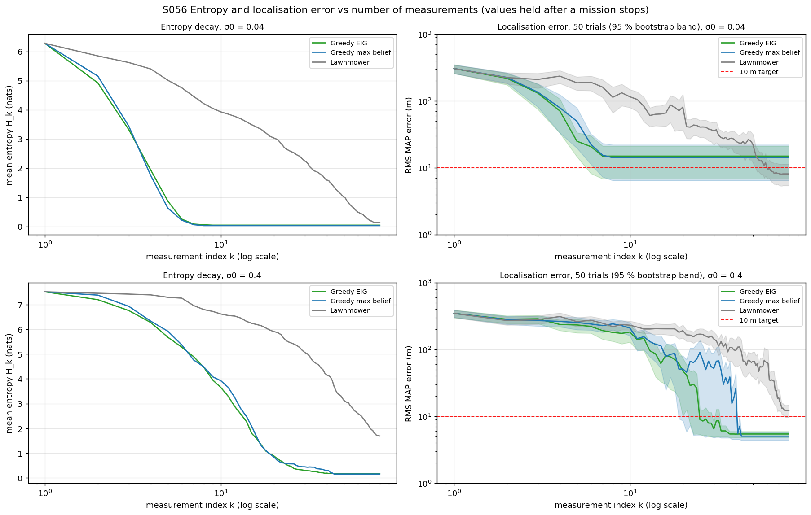
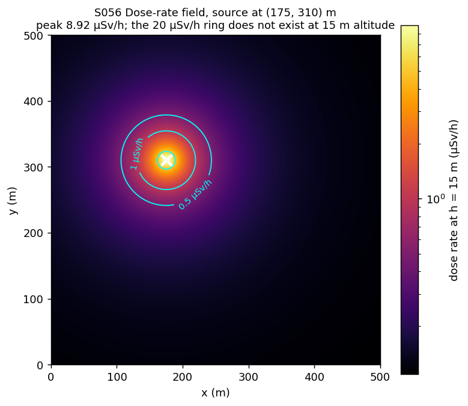
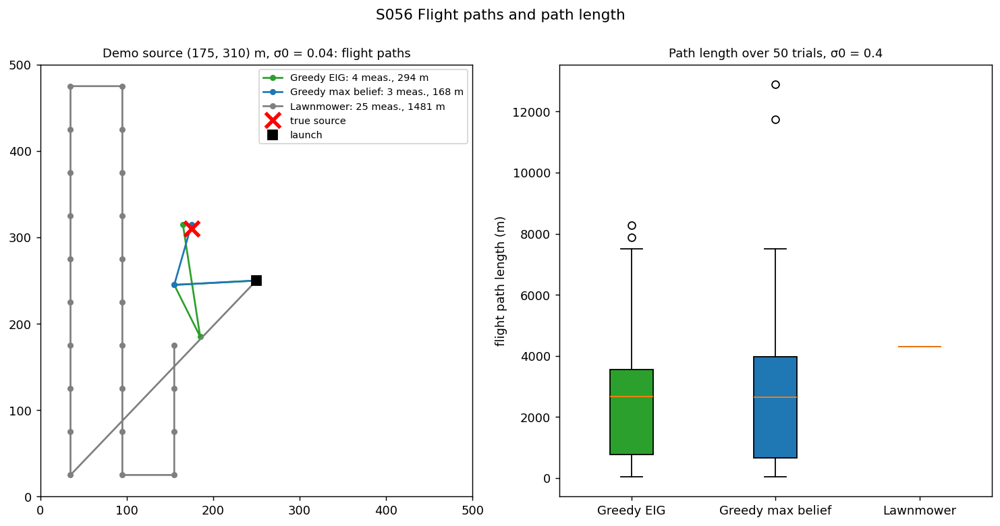
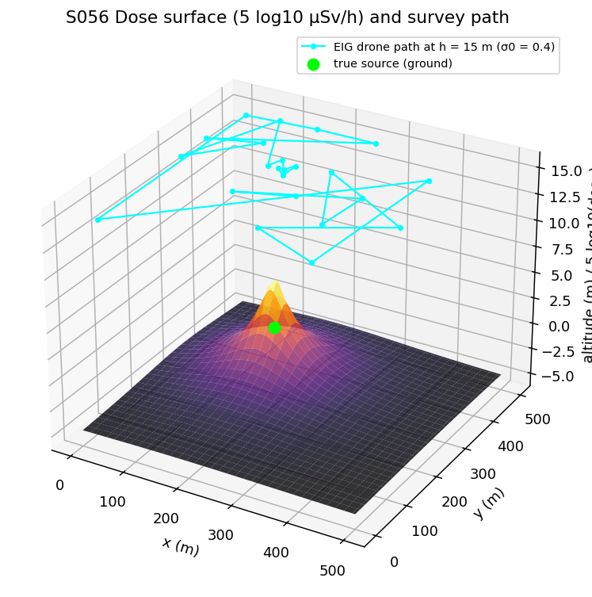
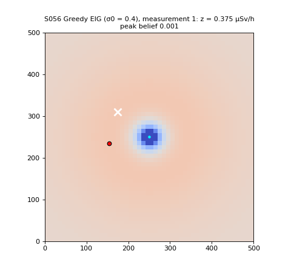

# S056 Nuclear Plant Leak Detection (Radiation Hotspot Localization)

**Domain**: Environmental Monitoring & SAR | **Difficulty**: ⭐⭐⭐ | **Status**: ✅ Completed

---

## Problem Definition

**Setup**: After a suspected leak, a 500 × 500 m exclusion zone is closed to ground teams. A single drone with a dose-rate detector flies at 15 m altitude and must localise one point source. The candidate source positions are the centres of a 50 × 50 grid of 10 m cells. The drone flies to one cell centre at a time, hovers 5 s for a reading, and updates a Bayesian posterior over the 2500 cells. The mission stops when the posterior peak exceeds 0.90 or after 80 readings. The true source is placed uniformly at random in the zone, so it is generally not at a cell centre.

**Objective**: localise the source to an RMS error ≤ 10 m with as few readings and as short a flight as possible.

**Comparison strategies** (card):
1. **Greedy maximum EIG**: fly to the cell with the highest expected information gain.
2. **Greedy maximum belief**: fly to the current MAP cell.
3. **Lawnmower**: a fixed 8 × 10 lattice of cells flown boustrophedon, ignoring the readings.

The two greedy strategies exclude the last 5 visited cells. Every strategy takes its first reading at the launch point (250, 250) m.

---

## Mathematical Model Summary

### Dose rate and measurement

$$D(\mathbf{p}, \mathbf{p}_s) = D_{bg} + \frac{A}{r^2}e^{-\mu r},\quad r = \sqrt{\|\mathbf{p} - \mathbf{p}_s\|^2 + h^2},\qquad z_k = D(\mathbf{p}_k, \mathbf{p}_s^*) + \varepsilon_k,\quad \varepsilon_k \sim \mathcal{N}\bigl(0, \sigma_0^2 D(\mathbf{p}_k, \mathbf{p}_s^*)\bigr)$$

Directly above the source the dose is 8.96 µSv/h (noise σ 0.120 µSv/h). At 250 m horizontal distance it is 0.1303 µSv/h (σ 0.0144 µSv/h). Moving 5 m off-centre already drops the dose to 8.07 µSv/h, and 7.07 m (a cell corner) to 7.35 µSv/h.

### Bayesian update and estimate

$$\log P_k(g_j) = \log P_{k-1}(g_j) - \frac{(z_k - D(\mathbf{p}_k, g_j))^2}{2\sigma_0^2 D(\mathbf{p}_k, g_j)} - \log\bigl(\sigma_0\sqrt{D(\mathbf{p}_k, g_j)}\bigr) + \text{const}$$

The prior is uniform ($H_0 = \ln 2500$ = 7.82 nats). The estimate is the MAP cell; the posterior mean is also reported.

### Expected information gain

$$\bar z(\mathbf{x}) = \sum_j P(g_j) D(\mathbf{x}, g_j),\qquad \text{EIG}(\mathbf{x}) = \tfrac12\log\Bigl(1 + \frac{\sum_j P(g_j)\,[D(\mathbf{x}, g_j) - \bar z]^2}{\sigma_0^2\,\bar z(\mathbf{x})}\Bigr)$$

The 2500 × 2500 matrix $D(\text{cell}_c, g_j)$ is computed once, so one EIG map costs three matrix–vector products.

### Mission cost

$$T = \frac{L_{path}}{v} + N_{meas}\,\Delta t_{int}$$

---

## Key Parameters

| Parameter | Value |
|-----------|-------|
| Zone / grid | 500 × 500 m / 50 × 50 cells (10 m), $N_c$ = 2500 |
| Altitude $h$ / speed $v$ / dwell $\Delta t_{int}$ | 15 m / 8 m/s / 5 s |
| Max readings / stop threshold | 80 / posterior peak ≥ 0.90 |
| Source strength $A$ | 2000 µSv·m²/h |
| Air attenuation $\mu$ / background $D_{bg}$ | 2 × 10⁻⁴ m⁻¹ / 0.10 µSv/h |
| Noise coefficient $\sigma_0$ | 0.04 (card); 0.4 (added 10× case) |
| Cooldown | 5 cells |
| Monte Carlo | 50 trials; source uniform in the zone; same sources and noise draws for every strategy |
| Launch point (added) | (250, 250) m, first reading taken there |
| Lawnmower lattice (added) | 8 columns × 10 rows (62.5 × 50 m), snapped to cell centres |
| Demo source | (175, 310) m (card) |
| Error band (added) | 95 % bootstrap interval of the RMS (1000 resamples) |

---

## Implementation

```
src/03_environmental_sar/s056_radiation.py   # Main simulation script
```

```bash
conda activate drones
python src/03_environmental_sar/s056_radiation.py
```

Runtime ≈ 15–35 s depending on machine load.

---

## Results

### Demo source (175, 310) m, σ0 = 0.04

| Strategy | Readings | Final peak | MAP | Error | Path | Time |
|----------|---:|---:|---|---:|---:|---:|
| Greedy EIG | 4 | 0.997 | (175, 315) | 5.0 m | 294 m | 57 s |
| Greedy max belief | 3 | 1.000 | (175, 315) | 5.0 m | 168 m | 36 s |
| Lawnmower | 25 | 0.925 | (175, 315) | 5.0 m | 1481 m | 310 s |

With σ0 = 0.4, greedy EIG needs 23 readings (peak 0.969, error 5.0 m, path 3821 m). The 5.0 m error is the distance from the source to the nearest cell centre, the best any grid estimate can do.

### Monte Carlo (50 sources)

| σ0 | Strategy | RMS MAP error | Median / max | ≤ 10 m | Error > 20 m | Readings | Converged | Path | Time |
|----|----------|------:|------:|:---:|:---:|------:|:---:|------:|------:|
| 0.04 | Greedy EIG | 16.6 m | 4.4 / 76.1 m | 43/50 | 5 | 5.1 ± 1.5 | 50/50 | 760 ± 544 m | 121 s |
| 0.04 | Greedy max belief | 14.2 m | 4.5 / 76.1 m | 43/50 | 4 | 5.2 ± 1.3 | 50/50 | 740 ± 495 m | 118 s |
| 0.04 | **Lawnmower** | **8.1 m** | 5.0 / 37.9 m | 43/50 | 1 | 41.8 ± 20.2 | 49/50 | 2344 ± 1036 m | 502 s |
| 0.4 | Greedy EIG | 5.3 m | 4.9 / 9.3 m | 50/50 | 0 | 15.6 ± 7.7 | 50/50 | 2700 ± 2132 m | 415 s |
| 0.4 | **Greedy max belief** | **5.0 m** | 4.5 / 11.7 m | 49/50 | 0 | 15.5 ± 8.3 | 50/50 | 2800 ± 2637 m | 428 s |
| 0.4 | Lawnmower | 12.1 m | 8.7 / 36.1 m | 30/50 | 4 | 80.0 ± 0.0 | 0/50 | 4291 m | 936 s |

The posterior-mean RMS errors are 16.4 / 14.1 / 7.9 m (σ0 = 0.04) and 5.1 / 4.9 / 10.7 m (σ0 = 0.4) for EIG / max belief / lawnmower.

Per-trial comparison of EIG against max belief:

| σ0 | EIG fewer readings | Equal | EIG more | Shortest path: EIG / belief / lawnmower / ties |
|----|---:|---:|---:|---|
| 0.04 | 17 | 18 | 15 | 23 / 22 / 2 / 3 |
| 0.4 | 24 | 4 | 22 | 25 / 20 / 5 / 0 |

Mean entropy (nats) after $k$ readings:

| σ0 | Strategy | k = 1 | 2 | 3 | 5 |
|----|----------|---:|---:|---:|---:|
| 0.04 | Greedy EIG | 6.28 | **5.03** | **3.40** | 1.18 |
| 0.04 | Greedy max belief | 6.28 | 5.15 | 3.43 | **0.62** |
| 0.04 | Lawnmower | 6.28 | 5.84 | 5.62 | 5.01 |
| 0.4 | Greedy EIG | 7.51 | **7.33** | **6.82** | **5.64** |
| 0.4 | Greedy max belief | 7.51 | 7.38 | 6.93 | 5.92 |
| 0.4 | Lawnmower | 7.51 | 7.46 | 7.42 | 7.29 |

**Key findings**:
- **With the card's detector noise, the greedy strategies stop too early and miss the 10 m target.** σ0 = 0.04 makes each reading very precise: the noise is 1.3 % of the dose above the source, while moving 5 m changes the dose by 9.9 %. As few as two readings can push the posterior peak over 0.90. Both greedy strategies converge after 5.1–5.2 readings on average, but they end on the wrong cell (error > 20 m) in 5 (EIG) and 4 (max belief) of 50 trials, up to 76.1 m away. The worst case for both is the same trial: it stops after only 2 readings with a peak of 0.996, while the cell that contains the source has posterior 3.89 × 10⁻⁵. The model assumes the source sits at a cell centre; the real source does not, so near-perfect readings rule out the correct cell. As a result the RMS error is 16.6 m (EIG) and 14.2 m (max belief), above the 10 m target, even though the median is below 5 m.
- **The lawnmower is the only strategy that meets the RMS target at σ0 = 0.04 (8.1 m)**, at 8.1× the readings (41.8) and 3.1× the path (2344 m) of the greedy strategies. Its readings are spread over the whole zone, so a few inconsistent readings cannot lock the posterior so early. It still has one trial above 20 m.
- **With a 10× noisier detector the ranking flips.** The greedy strategies need about 15.5 readings, never make a gross error (maximum 9.3 m for EIG, 11.7 m for max belief) and reach 5.3 m and 5.0 m RMS. The lawnmower never reaches the 0.90 peak within 80 readings and ends at 12.1 m RMS.
- **EIG reduces entropy fastest early on, but this does not save readings.** EIG has the lowest entropy after 2 and 3 readings at both noise levels, and after 5 readings at σ0 = 0.4 (card's expectation holds there). At σ0 = 0.04, max belief is lower after 5 readings (0.62 vs 1.18). Per trial, EIG uses fewer readings than max belief in 17 of 50 trials and more in 15 (σ0 = 0.04), and 24 vs 22 at σ0 = 0.4. Neither greedy rule dominates on readings, path length or error.
- **Path length is dominated by the noise level.** The greedy missions fly 740–760 m on average with the card's detector and 2700–2800 m with the noisier one, with a large spread (± 495 m to ± 2637 m), because both rules jump across the zone between hypotheses (see the σ0 = 0.4 demo below, 23 readings and 3821 m). The lawnmower flies its fixed route (2344 m on average until it stops; 4291 m when it uses all 80 points).
- **Ties are common and must be broken deterministically.** After the launch reading the belief is a ring around (250, 250), and the EIG map is exactly symmetric. Without a tie-break, `argmax` picks among equal scores by floating-point rounding, which changed with the BLAS thread count. Scores within 10⁻⁹ (relative) are now ties, broken by distance from the drone and then by cell index; results are identical single- and multi-threaded.

### Belief Maps

Posterior after successive readings for greedy EIG on the demo source; top σ0 = 0.04, bottom σ0 = 0.4. The first reading at the launch point leaves a ring of possible positions; the second reading cuts it to two arcs; one or two more pick the right one. With σ0 = 0.4 a single reading only shows that the source is not close to the drone; that mission needs 23 readings. The card's snapshots at $k$ = 20 and 50 do not exist for the card's noise level (4 readings):



### EIG Map

EIG after 10 readings (before reading 11) of the σ0 = 0.4 demo. Information is lowest near the cells already measured (where the readings already exclude a source) and highest in the unvisited parts of the zone. The red square is the overall maximum; the star is the next waypoint, the best cell outside the 5-cell cooldown (here the same cell):



### Entropy and Error Curves

Mean entropy and RMS MAP error vs number of readings for both noise levels (values are held after a mission stops; shaded = 95 % bootstrap band):



### Dose-Rate Field

True dose rate at 15 m altitude for the demo source, with the 0.5, 1 and 5 µSv/h contours:



### Flight Paths

Left: the three strategies on the demo source. Right: path length over 50 trials at σ0 = 0.4:



### Dose Surface (3D)

Dose surface (5 log₁₀ µSv/h) with the σ0 = 0.4 EIG path at 15 m:



### Animation

Greedy EIG with σ0 = 0.4 on the demo source, one frame per reading (23 frames); the title shows the reading $z_k$:



### Deviations from the scenario card

| Card | Implementation | Reason |
|------|----------------|--------|
| $\sigma_{rad} = \sigma_0\sqrt{D + D_{bg}}$ (also in $\hat\sigma$, $\bar\sigma^2$ and the card's `eig_map` code) | $\sigma_0\sqrt{D}$ | $D$ already contains $D_{bg}$; the card's `measure` code uses $\sigma_0\sqrt{D}$. Card text and `eig_map` code corrected. |
| Next waypoint = `argmax` of the score | Scores within 10⁻⁹ (relative) are ties, broken by distance from the drone, then by cell index | Exact symmetric ties occur (first EIG choice after the launch reading); plain `argmax` settled them by rounding that depended on the BLAS thread count (X1). |
| Card code chooses the first waypoint before any reading (from a uniform belief) | First reading at the launch point (250, 250) m for every strategy | With a uniform belief, max belief would pick cell 0 by index order; a common first reading keeps the comparison fair. |
| Lawnmower: boustrophedon over the grid | 8 × 10 lattice (62.5 × 50 m) flown boustrophedon | A sweep over all 2500 cells would cover only the first 1.6 rows in 80 readings, which would cripple the baseline. |
| Belief maps at $k$ = 1, 5, 20, 50; EIG map at $k$ = 10 | Belief maps at $k$ = 1, 2, 3 and the final reading; EIG map after 10 readings (before reading 11) of the σ0 = 0.4 demo | On the demo source the missions stop after 3 (max belief), 4 (EIG) and 25 (lawnmower) readings at σ0 = 0.04, and after 23 readings for EIG at σ0 = 0.4, so most of the card's snapshots do not exist. |
| Contour rings at 0.5, 1, 5, 20 µSv/h | 0.5, 1, 5 µSv/h | The dose at 15 m never exceeds about 9 µSv/h. Card corrected. |
| "95 % confidence bands" | 95 % bootstrap interval of the RMS | The RMS of 50 errors has no simple closed-form interval. |
| Single noise level | Also σ0 = 0.4 | At the card's noise level the ranking is driven by premature convergence; the second level shows the regime where the greedy strategies work as intended. |
| — | Posterior-mean error and the probability left on the cell containing the source | Diagnose the wrong-cell convergence. |

---

## Extensions

1. **Model mismatch**: use a finer grid or a continuous (particle) posterior, or inflate the likelihood variance by the off-grid dose error, so near-perfect readings do not exclude the true source.
2. **Stricter stopping rule**: require the peak to stay above 0.90 for two consecutive readings, or require at least one reading within 20 m of the MAP cell.
3. **Unknown strength**: marginalise over $A \in \{500, 1000, 2000, 5000\}$ µSv·m²/h; strength and distance trade off, so more readings are needed.
4. **Multiple sources**: a joint hypothesis space, or a mixture model with EM updates.
5. **Dose budget**: penalise waypoints near the source to limit the drone's accumulated dose.
6. **Multi-drone EIG**: several drones choosing different high-EIG cells in the same step.

---

## Related Scenarios

- Prerequisites: [S041 Wildfire Boundary Scan](../../../scenarios/03_environmental_sar/S041_wildfire_boundary.md), [S042 Missing Person Localization](../../../scenarios/03_environmental_sar/S042_missing_person.md)
- Follow-ups: [S057 Wildlife Population Census](../../../scenarios/03_environmental_sar/S057_wildlife.md), [S058 Typhoon Eye Probing](../../../scenarios/03_environmental_sar/S058_typhoon.md)
- Cross-reference: [S044 Wall Crack Inspection](../../../scenarios/03_environmental_sar/S044_wall_crack.md), [S054 Minefield Detection](../../../scenarios/03_environmental_sar/S054_minefield.md), [S055 Coastline Oil Spill Tracking](../../../scenarios/03_environmental_sar/S055_oil_spill.md)
