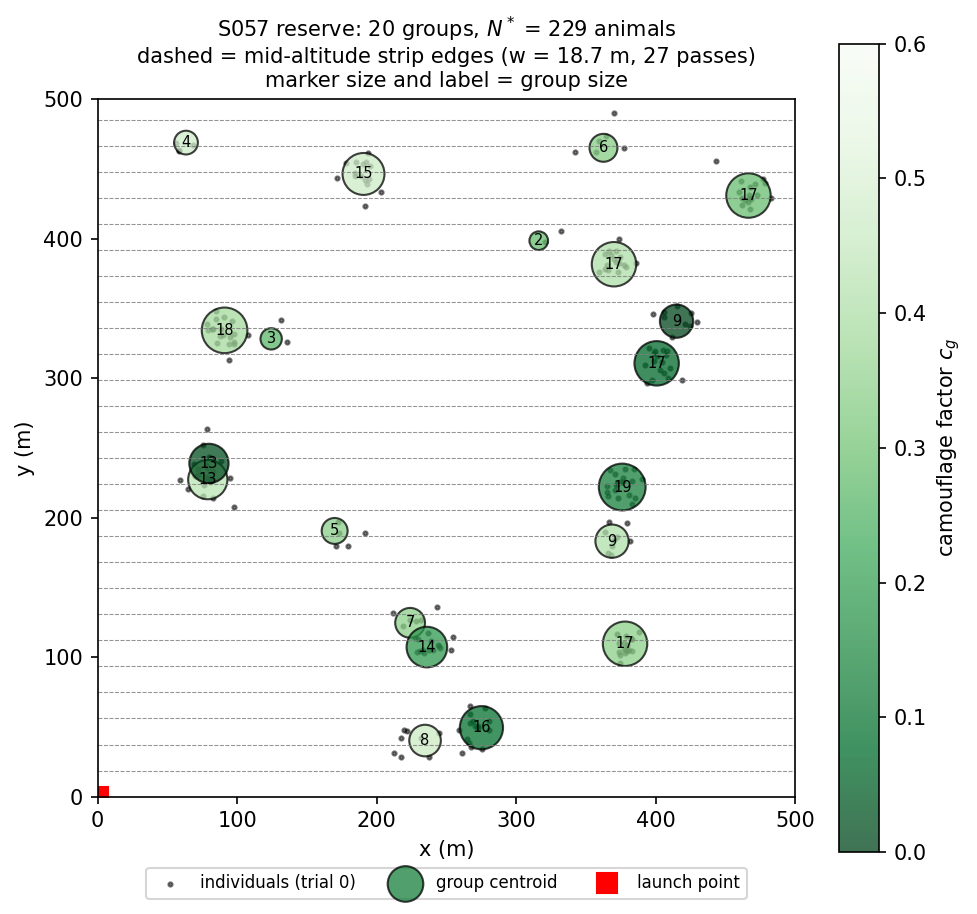
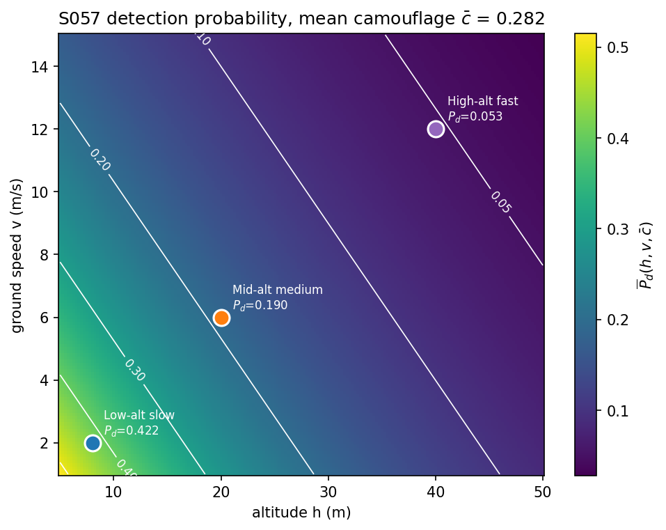
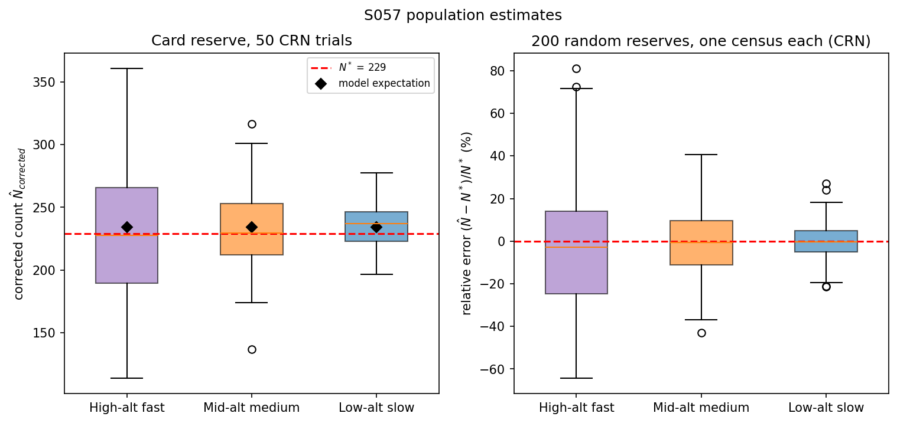
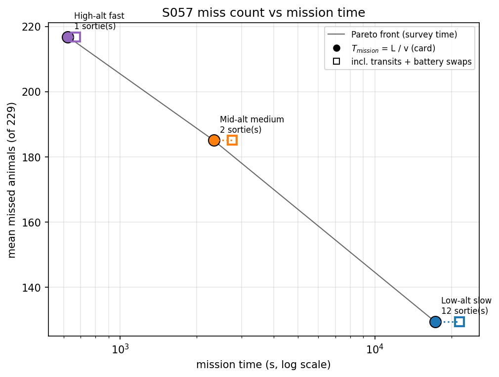
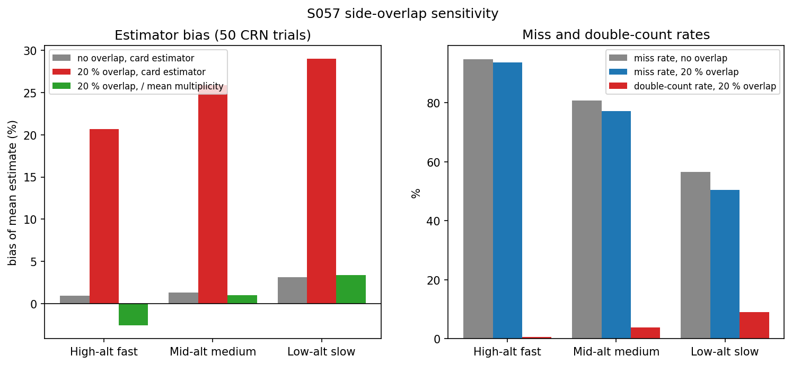
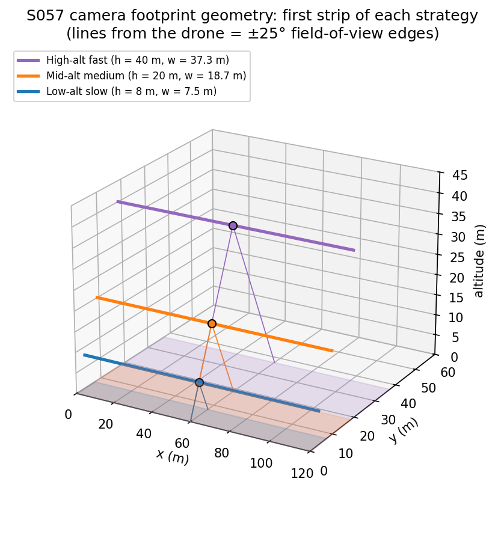
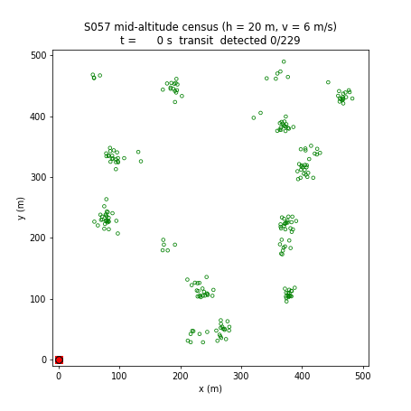

# S057 Wildlife Population Census

**Domain**: Environmental Monitoring & SAR | **Difficulty**: ⭐⭐ | **Status**: ✅ Completed

---

## Problem Definition

**Setup**: A single survey drone photographs a 500 × 500 m wildlife reserve to estimate the size of a ground-dwelling herd. The animals live in G = 20 groups. Each group has a random centroid, a Gaussian spread of σ = 8 m, between 1 and 20 individuals, and a camouflage factor $c_g \in [0, 0.6]$. The drone flies a lawnmower (boustrophedon) pattern at a constant altitude $h$ and ground speed $v$. Its nadir camera (half-angle 25°) sweeps a strip of width $w(h) = 2h\tan 25°$. Every animal inside the strip is detected with a probability that falls with altitude (resolution), speed (motion blur) and camouflage.

**Objective**: estimate the total population $\hat N$ and compare it with the truth $N^*$.

**Comparison strategies** (card):
1. **High-alt fast**: $h = 40$ m, $v = 12$ m/s (wide strip, low $P_d$, short mission).
2. **Mid-alt medium**: $h = 20$ m, $v = 6$ m/s.
3. **Low-alt slow**: $h = 8$ m, $v = 2$ m/s (narrow strip, high $P_d$, long mission).

All three strategies see the same animal positions and the same detection random numbers in every trial (common random numbers).

---

## Mathematical Model Summary

### Strip geometry and mission time

$$w(h) = 2h\tan\theta_{FOV}, \qquad n_{passes} = \lceil W/w \rceil, \qquad L = n_{passes} W + (n_{passes}-1)\,w, \qquad T_{mission} = L/v$$

### Detection

$$P_d(h, v, c_g) = P_{d0}\, e^{-\alpha h}\, e^{-\beta v}\,(1 - c_g)$$

Each individual $i$ of group $g$ sits at $\mathbf{x}_{g,i} = \mathbf{c}_g + \boldsymbol\epsilon$, $\boldsymbol\epsilon \sim \mathcal N(0, \sigma^2 I)$, clipped to the reserve. It lies in exactly one strip and is detected if $u_i < P_d(h, v, c_g)$, where $u_i \sim U(0, 1)$ is shared by all strategies. A lower $P_d$ therefore detects a subset of what a higher $P_d$ detects.

### Estimator (card)

$$\hat N_{corrected} = \frac{N_{raw}}{\overline P_d(h, v)}, \qquad \overline P_d = P_{d0}\, e^{-\alpha h} e^{-\beta v}(1 - \bar c), \quad \bar c = \tfrac{1}{G}\textstyle\sum_g c_g$$

Its expectation is $\sum_g n_g (1 - c_g) / (1 - \bar c)$. This equals $N^*$ only when the population-weighted camouflage equals the group-averaged one; on the card's reserve it is +2.3 % high for every strategy.

### Error metrics

- Card: $\epsilon = |\overline{\hat N} - N^*| / N^*$, the error of the **mean over 50 trials**.
- Added: per-survey mean $|\hat N - N^*| / N^*$, RMS relative error, and per-trial win counts (smallest absolute error). A real census is a single survey, so the per-survey error is the number a survey planner needs.

### Battery (added)

The drone launches from the reserve corner (0, 0). Before every 2 m path step it checks that it can still fly home at 12 m/s and land with a 180 s reserve. Otherwise it returns, swaps the battery (300 s) and flies back to where it left off. Assertions check that the battery never runs empty and never lands below the reserve. After each mission the integrated trajectory (time-stamped positions) is checked as well: time never runs backwards, the drone never moves without elapsed time, no step is faster than the 12 m/s transit speed, survey legs are no faster than the survey speed, and the drone ends at the launch point. The fastest step is 12.00 m/s for all three strategies (printed by the script).

### Side-overlap sensitivity (added)

With pass spacing $s = w(1 - \delta)$ and $\delta = 20\,\%$, a fraction $(w - s)/s$ of the reserve is covered twice. An animal there gets a second, independent detection draw. The card's estimator then over-counts by the mean coverage multiplicity $\bar k$. The multiplicity-corrected estimator is $N_{raw} / (\overline P_d\, \bar k)$.

---

## Key Parameters

| Parameter | Value |
|-----------|-------|
| Reserve | 500 × 500 m |
| Animal groups $G$ | 20 (centroids U(20, 480) m) |
| Animals per group $n_g$ | 1 – 20 inclusive (uniform integers) |
| Intra-group spread $\sigma_g$ | 8 m |
| Camouflage $c_g$ | U(0, 0.6) |
| Reserve seed | 42 ($N^*$ = 229, $\bar c$ = 0.282) |
| Camera half-angle $\theta_{FOV}$ | 25° |
| $P_{d0}$ / $\alpha$ / $\beta$ | 0.95 / 0.04 m⁻¹ / 0.08 s/m |
| High / Mid / Low $(h, v)$ | (40 m, 12 m/s) / (20 m, 6 m/s) / (8 m, 2 m/s) |
| Strip width at 40 / 20 / 8 m | 37.30 / 18.65 / 7.46 m |
| Monte Carlo trials (card reserve) | 50, seed 2024, common random numbers |
| Random-reserve Monte Carlo | 200 reserves, seeds 10 000 – 10 199, one census each |
| Battery endurance / landing reserve / swap time | 1800 s / 180 s / 300 s (added) |
| Transit speed (home and back) | 12 m/s (added) |
| Launch point | (0, 0) m (added) |
| Path discretisation | 2 m (added) |
| Side overlap, sensitivity run | 20 % (added) |

---

## Implementation

```
src/03_environmental_sar/s057_wildlife.py   # Main simulation script
```

```bash
conda activate drones
python src/03_environmental_sar/s057_wildlife.py
```

Runtime ≈ 20–55 s (20 s on an idle machine, 35–53 s measured under load).

---

## Results

Card reserve, 50 trials with common random numbers:

| Strategy | Passes | Path | $T_{mission}$ (card) | Sorties | Total time incl. battery | $\overline P_d$ | Raw count | $\hat N_{corrected}$ (mean ± std) | Missed | Card $\epsilon$ | Per-survey mean $\lvert$error$\rvert$ | RMS error | Wins |
|---|---:|---:|---:|---:|---:|---:|---:|---:|---:|---:|---:|---:|---:|
| High-alt fast | 14 | 7485 m | 624 s (10.4 min) | 1 | 667 s (0.19 h) | 0.0527 | 12.2 ± 3.2 | 231.1 ± 61.4 | 216.8 (94.7 %) | 0.9 % | 21.1 % | 26.8 % | 8 |
| Mid-alt medium | 27 | 13985 m | 2331 s (38.8 min) | 2 | 2755 s (0.77 h) | 0.1895 | 44.0 ± 6.7 | 231.9 ± 35.6 | 185.0 (80.8 %) | 1.3 % | 12.3 % | 15.6 % | 12 |
| **Low-alt slow** | 68 | 34500 m | 17250 s (287.5 min) | 12 | 21498 s (5.97 h) | 0.4218 | 99.6 ± 7.5 | 236.1 ± 17.7 | 129.4 (56.5 %) | 3.1 % | **7.0 %** | **8.4 %** | **30** |

True count $N^*$ = 229. The model expectation of $\hat N_{corrected}$ is 234.2 for every strategy (+2.3 %). The double-count rate is 0.0 % for all three, because the card's strips are contiguous and every animal lies in exactly one strip (see the overlap sensitivity below). There were no tied trials.

**Key findings**:
- **The trade-off the card describes holds.** Low and slow gives the best single survey: per-survey mean error 7.0 % against 12.3 % (mid) and 21.1 % (high), and it wins 30 of 50 trials. It also takes 287.5 min of survey time, 12 battery sorties and 5.97 h in total. High and fast finishes in one 667 s sortie but detects only 12.2 animals on average and scales them up by $1/\overline P_d$ = 19.0, so its single estimates range from 113.9 to 360.6 (low and slow: 196.8 to 277.4).
- **The card's error metric ranks the strategies backwards.** $\epsilon$ measures the error of the mean of 50 surveys: 0.9 % (high), 1.3 % (mid), 3.1 % (low). All three estimators have the same expected bias (+2.3 %), so $\epsilon$ only measures how far 50 random draws happen to land from that bias, and the noisiest strategy can come out best. A census is one survey, so the per-survey error and the win counts are the metrics that separate the strategies.
- **Even the best strategy misses most animals.** With $\overline P_d$ = 0.42, low and slow still misses 56.5 % of individuals. The estimate is good only because the correction $1/\overline P_d$ is applied with the true detection model. Any error in $P_{d0}$, $\alpha$, $\beta$ or $\bar c$ passes straight into $\hat N$.
- **The estimator's only bias comes from camouflage weighting.** $\overline P_d$ uses the group-mean camouflage (0.282). On this reserve, large groups are less camouflaged (population-weighted camouflage 0.266), so every strategy over-estimates by +2.3 % in expectation. Over 200 random reserves this term averages −0.1 % ± 2.8 % (range −8.0 % to +7.1 %), so it is a reserve-specific error, not a systematic one.

**200 random reserves**, one census each, common random numbers:

| Strategy | Relative error (mean ± std) | Mean $\lvert$error$\rvert$ | Wins |
|---|---:|---:|---:|
| High-alt fast | −3.2 % ± 27.7 % | 22.1 % | 36 |
| Mid-alt medium | −0.4 % ± 14.8 % | 12.0 % | 43 |
| **Low-alt slow** | +0.2 % ± 8.3 % | **6.6 %** | **121** |

No ties. The ranking from the card reserve holds across reserves.

**20 % side-overlap sensitivity** (same individuals and random numbers):

| Strategy | Passes | $T_{mission}$ | Sorties / total | Mean multiplicity $\bar k$ | Double-count rate | Miss rate | Bias, card estimator | Bias, $/\bar k$ |
|---|---:|---:|---:|---:|---:|---:|---:|---:|
| High-alt fast | 17 | 748 s | 1 / 808 s | 1.239 | 0.5 % | 93.7 % | +20.7 % | −2.6 % |
| Mid-alt medium | 34 | 2915 s | 2 / 3321 s | 1.246 | 3.9 % | 77.1 % | +25.8 % | +1.0 % |
| Low-alt slow | 84 | 21248 s | 14 / 26248 s | 1.248 | 9.0 % | 50.5 % | +29.0 % | +3.4 % |

With overlap the double-count rate grows with $P_d$, because both passes must detect the same animal ($\propto P_d^2$). The card's estimator then over-counts by 21–29 %. Dividing by $\bar k$ removes this (−2.6 % to +3.4 %, close to the +2.3 % camouflage term). Overlap lowers the miss rate a little (93.7 / 77.1 / 50.5 % instead of 94.7 / 80.8 / 56.5 %) because some animals get a second chance, at the cost of 3 / 7 / 16 extra passes. In this model navigation is perfect, so overlap is not needed to close coverage gaps.

### Reserve Map

Group centroids sized and labelled by group size and coloured by camouflage (darker = more visible); black dots are the individuals of trial 0; dashed lines are the mid-altitude strip edges:



### Detection Probability Surface

$\overline P_d(h, v, \bar c)$ over $h \in [5, 50]$ m and $v \in [1, 15]$ m/s, with the three operating points:



### Count Distribution

Left: corrected counts over the 50 trials on the card reserve; red dashed line = $N^*$, black diamond = model expectation. Right: relative error over 200 random reserves:



### Miss Count vs Mission Time

Filled circles use the card's $T_{mission} = L/v$; open squares add transits and battery swaps. Each strategy trades misses for time, so all three are on the Pareto front:



### Side-Overlap Sensitivity



### Camera Footprint Geometry (3D)

The first strip of each strategy, with the ±25° field-of-view edges from the drone to the ground:



### Animation

Mid-altitude census, trial 0. The red square marks the camera footprint; hollow green circles are animals not yet detected, filled ones have been detected. The drone returns to the launch corner once for a battery swap. 223 frames, one every 32 trajectory points:



### Deviations from the scenario card

| Card | Implementation | Reason |
|------|----------------|--------|
| $n_g \in [1, 20]$, but the card's code uses `rng.integers(1, 20)` | `rng.integers(1, 21)` (1–20 inclusive) | NumPy's upper bound is exclusive, so the card's code never draws 20. Card code fixed. |
| Overlap fraction $\delta = \max(0, 2w - W/n_{passes})/w$, $P_{double} = P_d^2\,\delta$ | Double counts simulated directly; card formula replaced by $\delta = 1 - s/w$ and $P_{double} = P_d^2$ for animals in overlap bands | For the card's contiguous strips $W/n_{passes} \le w$, so the formula gives $\delta$ = 1.043 / 1.007 / 1.014 (printed by the script) although no point is covered twice. Card fixed. |
| Double-count rate as a comparison metric | Reported as 0.0 % for the card layout, plus a 20 % side-overlap sensitivity run | With contiguous strips the double-count rate is zero by construction, so it cannot separate the strategies. The overlap run shows when it matters. |
| $\epsilon = \lvert\overline{\hat N} - N^*\rvert/N^*$ (error of the 50-trial mean) | Reported, plus per-survey mean error, RMS error and win counts | $\epsilon$ ranks the strategies backwards here (see Key findings). |
| One random stream for the reserve and all trials; each strategy draws its own positions and detections | Reserve seed 42; trials from seed 2024; the same positions and uniforms for every strategy | Common random numbers, so the differences come from $(h, v)$ only. |
| No battery model; $T_{mission} = L/v$ | Card $T_{mission}$ reported, plus a 30 min battery with return-to-launch, 180 s reserve and 300 s swaps | Low and slow needs 287.5 min of flying, which no single battery provides. The battery walk reports sorties and total time and asserts that the drone never flies on an empty battery. |
| Single reserve | Also 200 random reserves | Separates the reserve-specific camouflage bias from sampling noise. |
| "Pareto-front curve connecting the strategies" | Line through the three points | No strategy dominates another (fewer misses always cost more time), so the front is the three points themselves. |
| — | 3D footprint geometry figure | Shows the altitude–strip-width relation. |

---

## Extensions

1. **Adaptive altitude**: descend over high-density clusters from a prior map and climb over empty ground; compare the per-survey error at equal flight time.
2. **Multi-drone sweeps**: three drones on interleaved lanes to bring the low-altitude survey into one battery cycle.
3. **Moving animals**: random-walk drift between passes, which creates double counts and misses even without overlap.
4. **Detection-model uncertainty**: estimate $P_d$ from a calibration flight (or double-observer method) instead of using the true model, and propagate its error into $\hat N$.
5. **False positives**: rocks and shadows classified as animals, with a detection threshold that trades $P_d$ against the false-alarm rate.

---

## Related Scenarios

- Prerequisites: [S041 Wildfire Boundary Scan](../../../scenarios/03_environmental_sar/S041_wildfire_boundary.md), [S042 Missing Person Localization](../../../scenarios/03_environmental_sar/S042_missing_person.md)
- Follow-ups: [S058 Typhoon Eye Probing](../../../scenarios/03_environmental_sar/S058_typhoon.md), [S059 Underwater Target Sonar Marking (Surface Cooperative Localization)](../../../scenarios/03_environmental_sar/S059_sonar_relay.md)
- Cross-reference: [S044 Wall Crack Inspection](../../../scenarios/03_environmental_sar/S044_wall_crack.md), [S048 Full-Area Coverage Scan (Lawnmower)](../../../scenarios/03_environmental_sar/S048_lawnmower.md)
