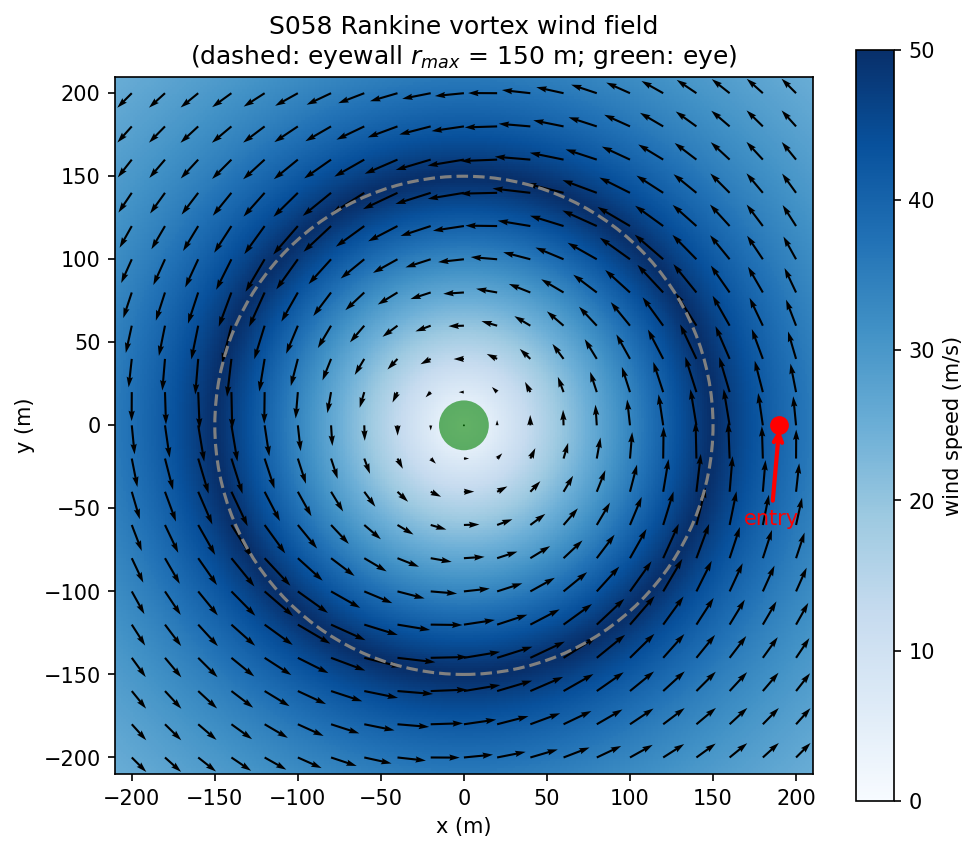
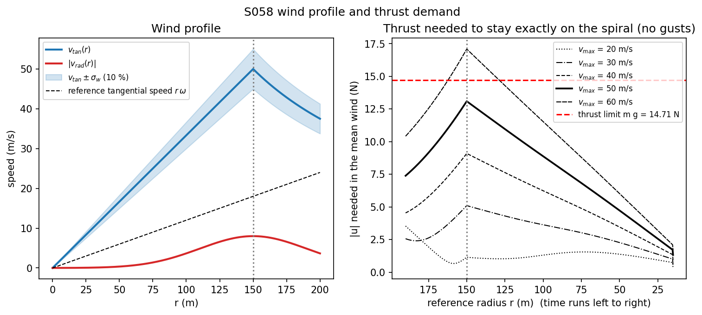
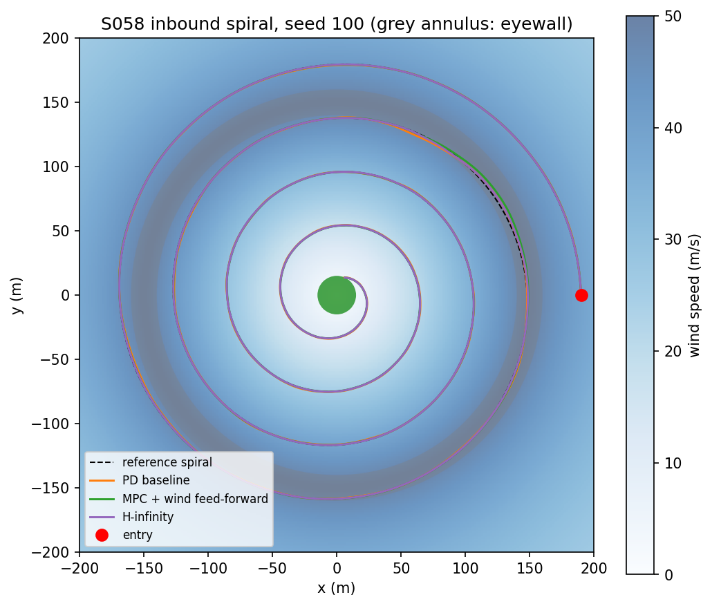
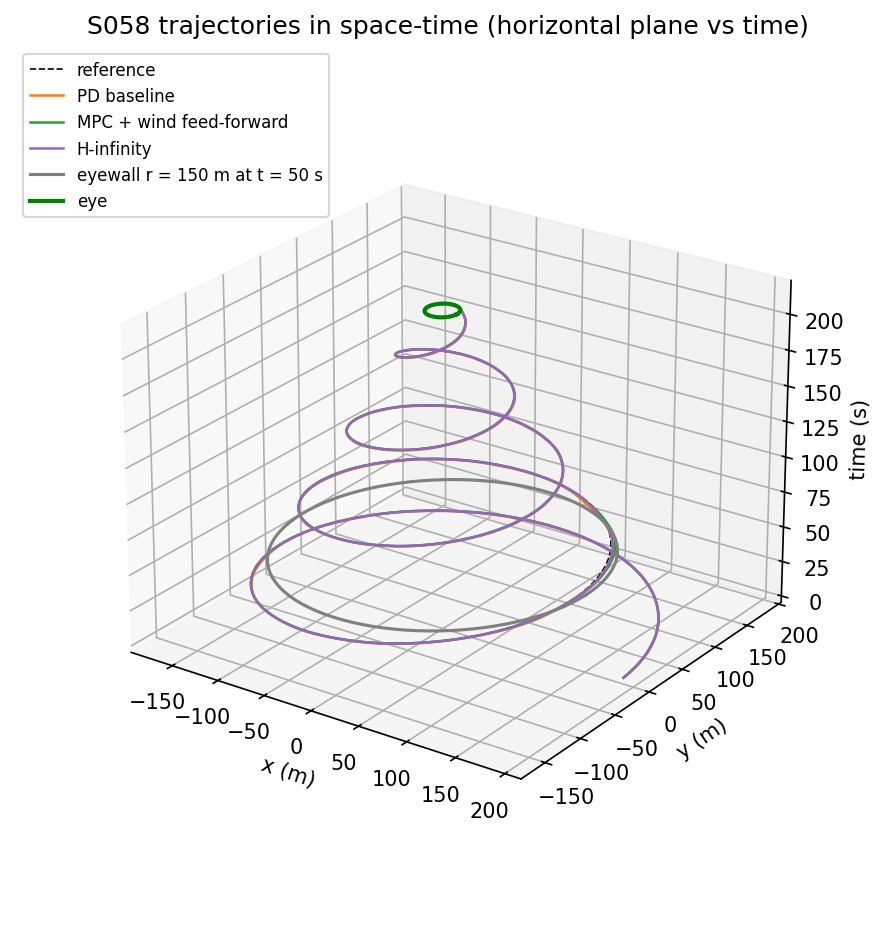
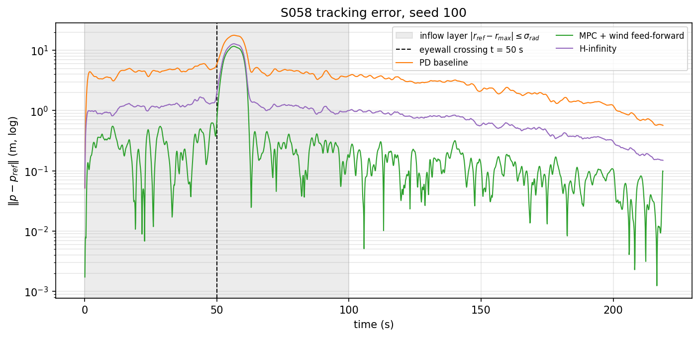
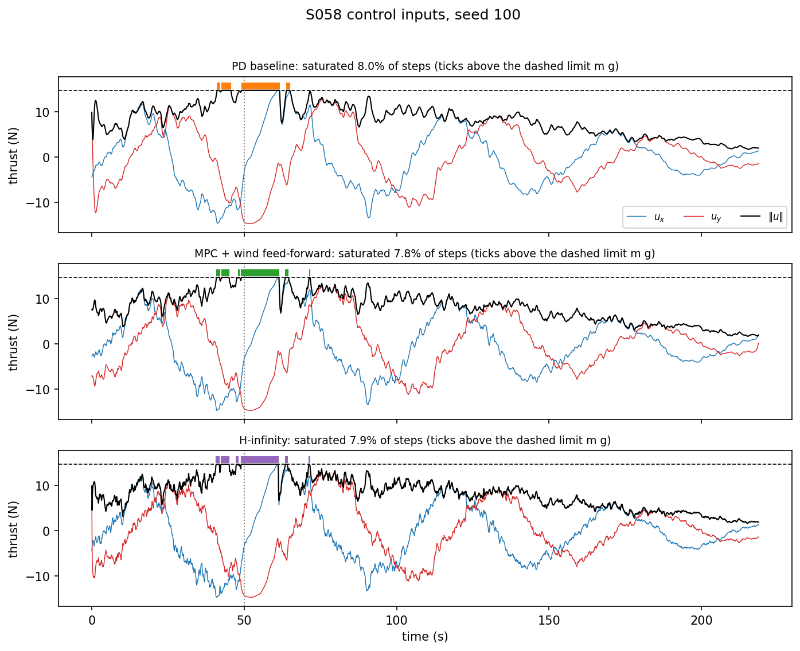
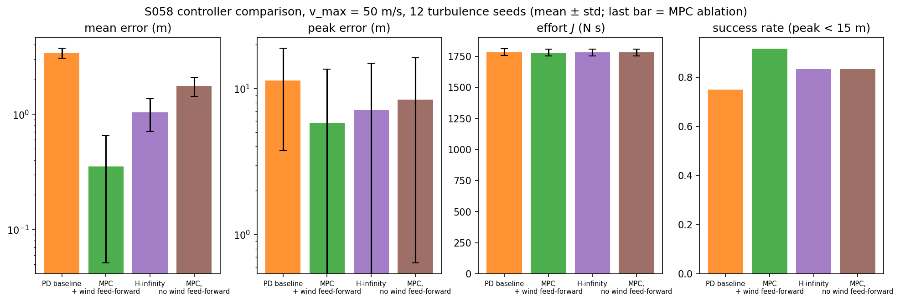
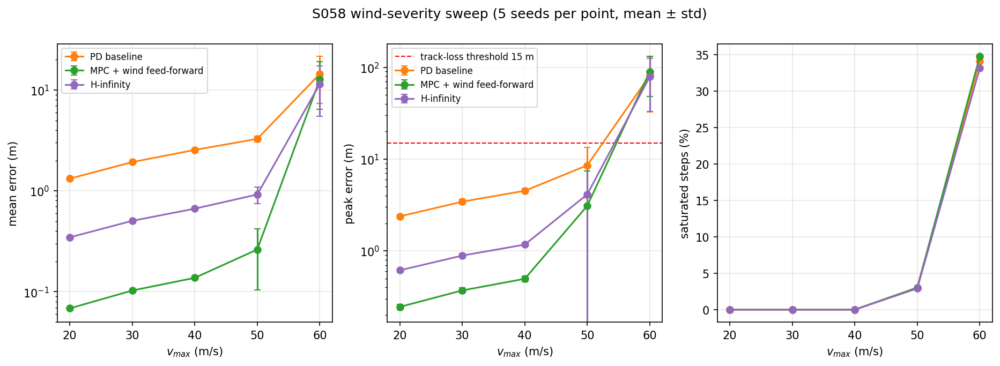
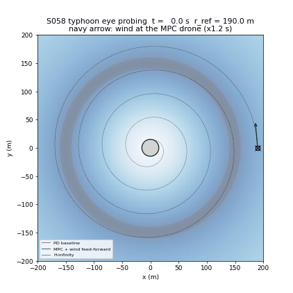

# S058 Typhoon Eye Probing

**Domain**: Environmental Monitoring & SAR | **Difficulty**: ⭐⭐⭐⭐ | **Status**: ✅ Completed

---

## Problem Definition

**Setup**: A 1.5 kg research drone flies from the outer bands of a typhoon to its calm eye. The wind field is an axisymmetric Rankine vortex: tangential wind peaks at 50 m/s at the eyewall ($r_{max}$ = 150 m), with an 8 m/s radial inflow layer around the eyewall and gusts of 10 % of the local tangential wind. The drone must follow an inbound spiral from $r$ = 190 m to the eye radius $r$ = 15 m (0.8 m/s inward, 0.12 rad/s around), which takes 218.75 s. Horizontal thrust is limited to $mg$ = 14.71 N by the 45° tilt limit.

**Comparison strategies** (card):
1. **PD baseline**: proportional-derivative tracking with the card's gains, no wind model.
2. **MPC with wind feed-forward**: model predictive control over a 2 s horizon that knows the Rankine wind field (not the gusts) and enforces the thrust limit.
3. **H-infinity**: state feedback that minimises the worst-case gain from disturbance to tracking error, with no wind model.

Added: an MPC ablation without the wind feed-forward, and a sweep of the peak wind from 20 to 60 m/s. Every controller sees the same gust sequence for a given seed (common random numbers).

---

## Mathematical Model Summary

### Wind field

$$v_{tan}(r) = \begin{cases} v_{max}\, r / r_{max} & r \le r_{max} \\ v_{max}\, r_{max} / r & r > r_{max} \end{cases}, \qquad v_{rad}(r) = -v_{inflow}\, e^{-(r - r_{max})^2 / 2\sigma_{rad}^2}$$

Gusts are a first-order Gauss–Markov (Ornstein–Uhlenbeck) process per axis with correlation time 2 s and standard deviation $0.1\, v_{tan}(r)$.

### Drone dynamics (drag form)

$$m\ddot{\mathbf p} = \mathbf u + b\,\bigl(\mathbf v_{wind}(\mathbf p) + \mathbf v_{gust}(t) - \dot{\mathbf p}\bigr), \qquad \|\mathbf u\| \le \min(F_{max}, mg) = mg$$

The wind pushes the drone through drag on its air-relative velocity. In state-space form $\dot{\mathbf x} = A\mathbf x + B\mathbf u + E\mathbf w$ with $\mathbf w = (b/m)(\mathbf v_{wind} + \mathbf v_{gust})$, discretised exactly (zero-order hold) at $\Delta t$ = 0.1 s. Every controller's output is scaled back onto the thrust disk $\|\mathbf u\| \le mg$ before it is applied.

The thrust needed to stay exactly on the spiral in the mean wind, $m\,\mathbf a_{ref} + b(\mathbf v_{ref} - \mathbf v_{wind})$, peaks at 13.09 N (89 % of $mg$) at the eyewall. Only 1.62 N of thrust is left there (14.71 − 13.09), so even moderate gusts saturate the thrust.

### Reference

$$r_{ref}(t) = 190 - 0.8\,t, \quad \theta_{ref}(t) = 0.12\,t, \quad \mathbf a_{ref} = -r\omega^2\,\hat{\mathbf e}_r - 2 v_{in}\omega\,\hat{\mathbf e}_\theta$$

PD and H-infinity add the nominal feed-forward $m\,\mathbf a_{ref} + b\,\mathbf v_{ref}$ (still air).

### Controllers

- **PD**: $\mathbf u = \mathbf u_{ff} + K_p(\mathbf p_{ref} - \mathbf p) + K_d(\mathbf v_{ref} - \mathbf v)$, $K_p$ = 4 N/m, $K_d$ = 2.5 N·s/m.
- **MPC**: condensed QP over $N_p$ = 20 steps with the card's cost $\sum \|\mathbf x - \mathbf x_{ref}\|_Q^2 + \|\mathbf u\|_R^2$ and terminal weight from the discrete Riccati equation, $Q$ = diag(10, 10, 1, 1), $R$ = 0.1 I. The wind term uses the Rankine field at the positions predicted by the previous solution. If the unconstrained optimum violates $\|\mathbf u_j\| \le mg$, the QP is solved with ADMM (projection onto each thrust disk).
- **H-infinity**: discrete full-information game Riccati equation for $\mathbf z = [C_z(\mathbf x - \mathbf x_{ref});\ R^{1/2}\mathbf u]$, $C_z$ = diag($\sqrt{10}, \sqrt{10}$, 0, 0). Bisection gives $\gamma^*$ = 0.5289; the controller runs at $\gamma = 1.1\,\gamma^*$ = 0.5818.

### Metrics

Mean and peak tracking error $\|\mathbf p - \mathbf p_{ref}\|$, effort $J = \Delta t \sum \|\mathbf u\|$, fraction of saturated steps, and success = the error never exceeds 15 m (the eye radius).

---

## Key Parameters

| Parameter | Value |
|-----------|-------|
| Drone mass $m$ / drag $b$ | 1.5 kg / 0.4 N·s/m |
| Thrust limit | $\min(F_{max} = 30\text{ N},\ mg)$ = 14.71 N |
| $v_{max}$ / $r_{max}$ | 50 m/s / 150 m |
| $v_{inflow}$ / $\sigma_{rad}$ | 8 m/s / 40 m |
| Gust std / correlation time | 10 % of $v_{tan}(r)$ / 2 s (added) |
| Entry / eye radius | 190 m / 15 m |
| $v_{inbound}$ / $\omega_{spiral}$ | 0.8 m/s / 0.12 rad/s |
| Mission time | 218.75 s (2188 steps of 0.1 s) |
| Initial state | on the reference, with the reference velocity (added) |
| PD gains $K_p$ / $K_d$ | 4 N/m / 2.5 N·s/m |
| MPC horizon / $Q$ / $R$ | 20 steps (2 s) / diag(10, 10, 1, 1) / 0.1 I |
| MPC constraint | $\|\mathbf u_j\|_2 \le mg$ (ADMM, ≤ 150 iterations, tolerance 1e-3 N) |
| H-infinity $\gamma$ | 1.1 × $\gamma^*$ |
| Track-loss threshold | 15 m (added) |
| Turbulence seeds | 12 (100–111), common to all controllers |
| Severity sweep | $v_{max}$ = 20, 30, 40, 50, 60 m/s, seeds 100–104 |
| Saturation probe | thrust limit × 2 (29.43 N), seeds 100–111 (added) |

---

## Implementation

```
src/03_environmental_sar/s058_typhoon.py   # Main simulation script
```

```bash
conda activate drones
python src/03_environmental_sar/s058_typhoon.py
```

Runtime ≈ 1.5–2 min on a loaded machine (the MPC runs dominate).

---

## Results

**Model checks**:
- Read literally, the card's dynamics ($m\ddot{\mathbf p} = \mathbf u + m\,\mathbf f_{wind} + \dots$) add a peak wind term of 50.64 m/s² (full wind including the 8 m/s inflow, at r = 150 m), 5.16 × the control authority of 9.81 m/s² (39.77 m/s² already at entry). No controller could follow the spiral, so the wind enters through drag instead (see Deviations).
- With drag, the thrust needed on the spiral in the mean wind is 7.39 N at entry and peaks at 13.09 N at $r$ = 150 m. Its peak is 3.54 / 5.10 / 9.09 / 13.09 / 17.09 N for $v_{max}$ = 20 / 30 / 40 / 50 / 60 m/s, so at 60 m/s (116 % of $mg$) no controller can stay on the spiral through the eyewall.
- Gains: H-infinity 15.22 N/m and 10.60 N·s/m; the LQR gain that the unconstrained MPC reduces to is 8.21 N/m and 5.24 N·s/m; PD 4.0 N/m and 2.5 N·s/m. Closed-loop $\mathcal H_\infty$ norm from $\mathbf w$ to $\mathbf z$: PD 1.3973, LQR 0.7613, H-infinity 0.5709 (below the operating $\gamma$ = 0.5818, as certified).

**$v_{max}$ = 50 m/s, 12 turbulence seeds** (mean ± std):

| Controller | Mean error | Peak error | Effort $J$ | Saturated steps | Success | Final distance to eye centre |
|---|---:|---:|---:|---:|---:|---:|
| PD baseline | 3.392 ± 0.337 m | 11.35 ± 7.58 m | 1784 ± 28 N·s | 4.3 % | 9/12 | 15.00 m |
| **MPC + wind feed-forward** | **0.353 ± 0.302 m** | **5.82 ± 7.78 m** | 1779 ± 27 N·s | 4.3 % | **11/12** | 15.08 m |
| H-infinity | 1.033 ± 0.327 m | 7.12 ± 7.83 m | 1781 ± 27 N·s | 4.3 % | 10/12 | 14.97 m |
| MPC, no wind feed-forward (ablation) | 1.755 ± 0.326 m | 8.42 ± 7.79 m | 1781 ± 27 N·s | 4.3 % | 10/12 | 15.10 m |

MPC has the lowest mean error in all 12 seeds and a lower peak error than H-infinity in 11 of 12. H-infinity beats PD on mean error in 12 of 12. In both MPC variants ADMM was active in 4.3 % of the steps, as often as the thrust saturates.

**Probe: thrust limit × 2** (29.43 N, same 12 seeds; nothing saturates):

| Controller | Mean error | Peak error | Success |
|---|---:|---:|---:|
| PD baseline | 3.184 ± 0.033 m | 5.73 ± 0.28 m | 12/12 |
| MPC + wind feed-forward | 0.170 ± 0.011 m | 0.63 ± 0.07 m | 12/12 |
| H-infinity | 0.833 ± 0.008 m | 1.49 ± 0.07 m | 12/12 |

**Key findings**:
- **Ranking: MPC < H-infinity < PD on mean error** (0.353 / 1.033 / 3.392 m). Without the wind feed-forward the same MPC gets 1.755 m, between H-infinity and PD. Most of MPC's advantage therefore comes from knowing the wind field, not from the optimisation itself. Among the controllers that do not know the wind, the higher-gain H-infinity design (15.22 N/m) beats the unconstrained-LQR-gain MPC (8.21 N/m) and PD (4 N/m).
- **The thrust limit causes the large eyewall excursions; the controller still matters elsewhere.** In seed 100 all three controllers reach their peak at t = 56.5 s, just after the eyewall crossing (t = 50 s): PD 17.79 m, MPC 11.65 m, H-infinity 12.84 m. The mean wind already needs 89 % of the available thrust there, so a sustained gust saturates every controller, and in the most saturated seeds (7–9 % of the steps) all three are blown 11–31 m off the spiral (seed 108: 30.99 / 28.35 / 27.75 m). In seeds that barely saturate (0.2–1.1 % of the steps: seeds 101, 102, 104, 111) the peaks differ by almost a factor of 10: PD 5.31–5.72 m, MPC 0.54–0.73 m, H-infinity 1.38–1.49 m. A probe with twice the thrust limit (29.43 N, no saturation at all) gives the same picture for every seed: peak error PD 5.73 ± 0.28 m, MPC 0.63 ± 0.07 m, H-infinity 1.49 ± 0.07 m, all 12/12 successful. The large spread of the peak error at the real limit (std about 7.6–7.8 m) therefore comes from how hard each seed's gusts hit the saturated eyewall passage.
- **Effort is not a useful comparison metric here.** $J$ is 1779–1784 N·s for every controller (±27–28 N·s across seeds) because almost all of the thrust goes into holding against the wind, which is the same for any controller that stays near the spiral.
- **Severity sweep** (5 seeds per point): below 50 m/s nothing saturates and all controllers succeed in 5/5 seeds, with the same ranking (mean error at 40 m/s: MPC 0.137 m, H-infinity 0.667 m, PD 2.547 m). At 50 m/s saturation appears (about 3 % of the steps) and PD fails one seed (4/5). At 60 m/s the eyewall needs 116 % of the available thrust: every controller saturates in 33–35 % of the steps, peak errors are 79–90 m and all fail 0/5.
- **"Reached the eye"**: the reference reaches $r_{eye}$ = 15 m only at its last instant, so the drone ends about 15 m from the eye centre (14.97–15.10 m mean) in every case. Success is therefore defined by the track-loss threshold, not by entering the eye circle.

| $v_{max}$ | PD mean / peak, success | MPC mean / peak, success | H-infinity mean / peak, success |
|---|---|---|---|
| 20 m/s | 1.323 / 2.38 m, 5/5 | 0.068 / 0.25 m, 5/5 | 0.346 / 0.61 m, 5/5 |
| 30 m/s | 1.930 / 3.44 m, 5/5 | 0.103 / 0.37 m, 5/5 | 0.505 / 0.89 m, 5/5 |
| 40 m/s | 2.547 / 4.52 m, 5/5 | 0.137 / 0.50 m, 5/5 | 0.667 / 1.17 m, 5/5 |
| 50 m/s | 3.278 / 8.56 m, 4/5 | 0.262 / 3.10 m, 5/5 | 0.921 / 4.13 m, 5/5 |
| 60 m/s | 14.413 / 81.63 m, 0/5 | 12.745 / 89.82 m, 0/5 | 11.460 / 79.00 m, 0/5 |

### Wind Field



### Wind Profile and Thrust Demand

Left: tangential and radial wind with the ±10 % gust band. Right: thrust needed to stay exactly on the spiral in the mean wind, for each $v_{max}$ of the sweep, against the $mg$ limit:



### Trajectories

Seed 100. The excursion after the eyewall crossing (upper right, roughly (140, 100) m, read from the plot) is visible for all three controllers:



### Trajectories in Space-Time (3D)

The same runs with time as the vertical axis:



### Tracking Error

Seed 100, log scale. The grey band is the period when the reference is inside the inflow layer ($|r_{ref} - r_{max}| \le \sigma_{rad}$):



### Control Inputs

Thrust components and magnitude for seed 100; coloured ticks mark saturated steps:



### Controller Comparison



### Wind-Severity Sweep



### Animation

Seed 100: the three drones (orange PD, green MPC, purple H-infinity) on the reference spiral (black cross = reference point); the navy arrow is the wind at the MPC drone. The eye turns green at the end because the MPC run succeeded. 111 frames, one every 2 s of simulated time:



### Deviations from the scenario card

| Card | Implementation | Reason |
|------|----------------|--------|
| $m\ddot{\mathbf p} = \mathbf u + m\,\mathbf f_{wind} + \mathbf f_{turb} - b\dot{\mathbf p}$ | $m\ddot{\mathbf p} = \mathbf u + b(\mathbf v_{wind} + \mathbf v_{gust} - \dot{\mathbf p})$ | The card adds a wind velocity as an acceleration. Read literally, the eyewall term is 50.64 m/s², 5.16 × the control authority (printed by the script), and the task is impossible. Card fixed. |
| Gusts "band-limited Gaussian noise", $\sigma_w = 0.1\,v_{tan}$ (card code: white noise each step) | Ornstein–Uhlenbeck gusts, correlation time 2 s, same $\sigma_w$ | Band-limited as the card describes; white noise at 10 Hz would mostly average out through the drone's inertia. |
| MPC constraint $\|\mathbf u\|_\infty \le mg/\sqrt 2$ (box); card code uses a one-step LQR with clipping | Full condensed QP over 20 steps with the true constraint $\|\mathbf u_j\|_2 \le mg$, solved by ADMM | The box is a conservative inner approximation of the thrust disk; PD and H-infinity are saturated on the disk, so MPC uses the same limit. |
| MPC wind "at the predicted positions" (card code: current position, held over the horizon) | Rankine wind at the positions predicted by the previous MPC solution | Follows the card's text. |
| H-infinity: card code is a placeholder (LQR gain, minus the measured gust) | Discrete game Riccati, $\gamma$ bisection, operated at $1.1\gamma^*$; no wind or gust feed-forward | The placeholder cancels the true gust, which no robust controller can measure; the comparison would be unfair. |
| PD clipped per axis to $mg/\sqrt 2$; no feed-forward | PD with the still-air feed-forward $m\mathbf a_{ref} + b\mathbf v_{ref}$, scaled onto the thrust disk | Same feed-forward and saturation as H-infinity, so the two differ only in their feedback gains. |
| Drone starts at rest | Drone starts on the reference with the reference velocity | The reference starts at almost 23 m/s ($r_{start}\,\omega_{spiral}$ = 190 × 0.12). From rest every controller would saturate for the first seconds while accelerating, and that transient would set the peak error. |
| "Did the drone reach the eye?" | Success = tracking error never above 15 m | The reference touches $r_{eye}$ only at its final instant, so "inside the eye" would be decided by a few centimetres of tracking error. |
| One run per controller | 12 seeds with common random numbers, an MPC ablation without wind feed-forward, and a $v_{max}$ sweep | Separates the effect of wind knowledge from that of the controller, and shows where the thrust limit makes the task infeasible. |

---

## Extensions

1. **Wind estimation**: replace the known Rankine field in the MPC by an EKF estimate from the drone's acceleration residuals and measure how much of the 0.353 m → 1.755 m gap it recovers.
2. **Gust preview**: give the MPC a short gust forecast (for example from a forward-looking lidar) and check whether it reduces the peak error at the eyewall, where the thrust limit currently dominates.
3. **Adaptive spiral speed**: slow the angular rate near the eyewall so that the steady thrust stays below 70 % of $mg$, and trade mission time against track-loss risk.
4. **3D sounding**: add altitude and vertical shear, descending from 500 m to 50 m while spiralling inward.
5. **Moving eye**: translate the vortex at 5 m/s and recompute the reference in the eye-fixed frame.

---

## Related Scenarios

- Prerequisites: [S041 Wildfire Boundary Scan](../../../scenarios/03_environmental_sar/S041_wildfire_boundary.md), [S060 Multi-Drone Cooperative Meteorological Measurement](../../../scenarios/03_environmental_sar/S060_meteorological.md)
- Follow-ups: [S059 Underwater Target Sonar Marking (Surface Cooperative Localization)](../../../scenarios/03_environmental_sar/S059_sonar_relay.md), [S055 Coastline Oil Spill Tracking](../../../scenarios/03_environmental_sar/S055_oil_spill.md)
- Cross-reference: [S034 Weather Rerouting](../../../scenarios/02_logistics_delivery/S034_weather_rerouting.md)
