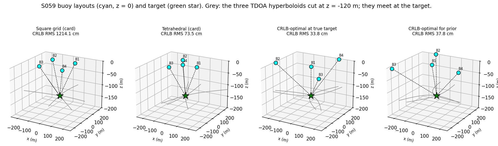
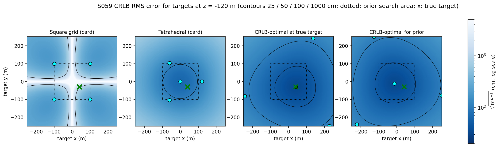
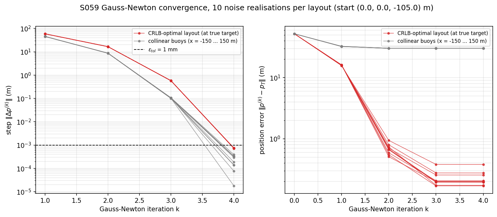
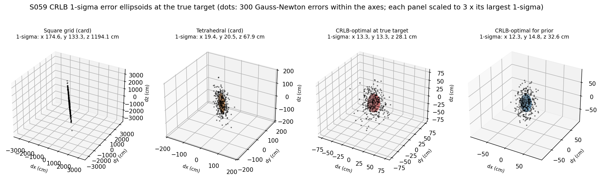
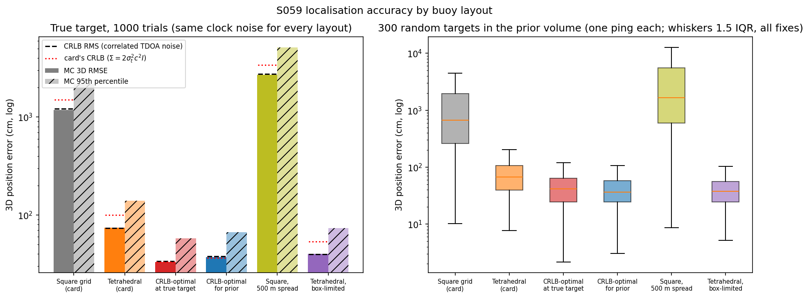
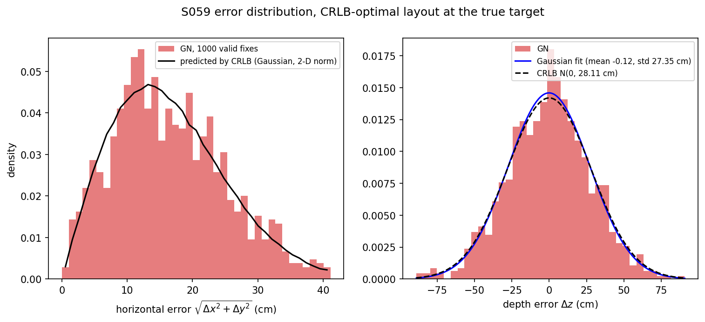
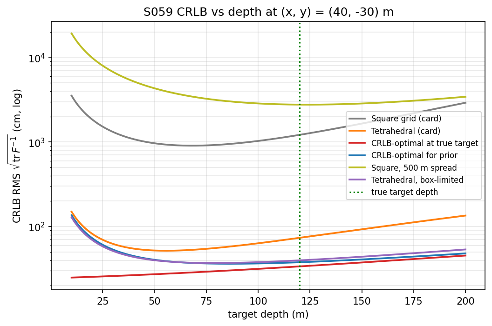
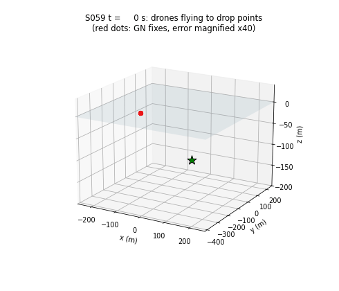

# S059 Underwater Target Sonar Marking (Surface Cooperative Localization)

**Domain**: Environmental Monitoring & SAR | **Difficulty**: ⭐⭐⭐ | **Status**: ✅ Completed

---

## Problem Definition

**Setup**: A silent underwater object pings every 5 s. Four drones each drop a passive sonar buoy on the sea surface ($z$ = 0). Each buoy time-stamps the ping with its own clock error ($\sigma_t$ = 0.1 ms). The three time differences of arrival (TDOA) relative to buoy 1 define three hyperboloids that intersect at the target. A Gauss–Newton solver turns them into a 3D position. The true target is at (40, −30, −120) m.

**Objective**: choose where to drop the buoys so that the Cramér–Rao lower bound (CRLB) on the position error is small, then localise the target.

**Layouts compared**:
1. **Square grid** (card): corners of a 200 × 200 m square centred on the search area.
2. **Tetrahedral** (card): three buoys at 120° on a circle of radius 120 m, plus one at the centre.
3. **CRLB-optimal at the true target** (card): minimise $\text{tr}(\mathbf F^{-1})$ at the true target, with every buoy pair at most 500 m apart and every buoy inside ±250 m.
4. **CRLB-optimal for a prior** (added): the same optimisation, but minimising the mean CRLB RMS over 400 random targets in the search volume. Layout 3 needs the answer before the first ping; layout 4 can be deployed in advance.
5. **Square, 500 m spread** and 6. **Tetrahedral, box-limited** (added): the card layouts scaled up to the spread or box limit, to check whether the optimised layouts win only because they are larger.

All layouts see the same clock-noise draws (common random numbers).

---

## Mathematical Model Summary

### TDOA measurement with per-buoy clock noise

$$\Delta\hat d_{i1} = (r_i - r_1) + c_s(\epsilon_i - \epsilon_1), \qquad \epsilon_i \sim \mathcal N(0, \sigma_t^2), \quad i = 2, 3, 4$$

All three pairs contain $\epsilon_1$, so the measurement covariance in range units is

$$\boldsymbol\Sigma = \sigma_t^2 c_s^2\,(\mathbf I + \mathbf 1\mathbf 1^T)$$

with diagonal $\sigma_d^2$, $\sigma_d = c_s\sqrt 2\,\sigma_t$ = 0.2121 m, and correlation 0.50 between pairs.

### Gauss–Newton

$$\mathbf H_i = \hat{\mathbf u}_1 - \hat{\mathbf u}_i = \frac{\partial (r_i - r_1)}{\partial \mathbf p}, \qquad \Delta\mathbf p = (\mathbf H^T\mathbf H)^{-1}\mathbf H^T \mathbf f, \qquad \mathbf f = \Delta\hat{\mathbf d} - (\mathbf r_{2:4} - r_1)$$

The solver starts at the centre of the search volume (0, 0, −105) m and stops when $\|\Delta\mathbf p\|$ < 1 mm or after 200 iterations. Buoys at $z$ = 0 give the same TDOAs for $(x, y, z)$ and $(x, y, -z)$, so a solution above the surface is mirrored below it. A fix is **valid** if it converged, its residual is below 1 cm and it lies within 1 km horizontally and 1 km deep. The system has three equations and three unknowns, so weighting does not change the solution.

### CRLB

$$\mathbf F = \mathbf H^T\boldsymbol\Sigma^{-1}\mathbf H, \qquad \text{CRLB RMS} = \sqrt{\text{tr}(\mathbf F^{-1})}, \qquad \text{GDOP} = \sqrt{\text{tr}[(\mathbf H^T\mathbf H)^{-1}]}$$

### Layout optimisation

$$\min_{\{(x_i, y_i)\}} \ \text{tr}\,\mathbf F^{-1}(\mathbf p_T) \quad \text{or} \quad \min \ \frac{1}{400}\sum_{k=1}^{400} \sqrt{\text{tr}\,\mathbf F^{-1}(\mathbf p_k)}, \qquad \|\mathbf b_i - \mathbf b_j\| \le 500\text{ m}, \ |x_i|, |y_i| \le 250\text{ m}$$

Solved with SLSQP from 20 random starts. The prior targets are uniform in $x, y \in$ [−100, 100] m and $z \in$ [−200, −10] m. Layouts are compared on 300 different targets from the same prior (one ping each).

---

## Key Parameters

| Parameter | Value |
|-----------|-------|
| Buoys $N$ | 4 (buoy 1 = TDOA reference) |
| Speed of sound $c_s$ | 1500 m/s |
| Clock noise $\sigma_t$ | 0.1 ms per buoy |
| TDOA noise $\sigma_d$ / pair correlation | 0.2121 m / 0.50 |
| Ping interval | 5 s |
| True target | (40, −30, −120) m |
| GN start / tolerance / max iterations | (0, 0, −105) m / 1 mm / 200 |
| Valid fix: residual / plausible volume | < 1 cm / within 1 km (added) |
| Square half-side / tetrahedral radius | 100 m / 120 m |
| Max buoy spread $D_{max}$ / operating box | 500 m / ±250 m |
| Optimiser restarts | 20 (SLSQP, seed 0) |
| FIM regularisation | $10^{-6}$ |
| Prior search volume | $x, y \in$ [−100, 100] m, $z \in$ [−200, −10] m (added) |
| Prior targets: optimiser / test | 400 (seed 11) / 300 (seed 7) (added) |
| Monte Carlo at the true target | 1000 trials, seed 42 |
| Scaled layouts | square half-side 176.8 m (500 m diagonal); tetrahedral R = 250 m (box limit) |

---

## Implementation

```
src/03_environmental_sar/s059_sonar_relay.py   # Main simulation script
```

```bash
conda activate drones
python src/03_environmental_sar/s059_sonar_relay.py
```

Runtime ≈ 1 min.

---

## Results

**True target, 1000 trials** (same clock noise for every layout):

| Layout | Max spread | GDOP | CRLB RMS | Card's CRLB ($\boldsymbol\Sigma = \sigma_d^2\mathbf I$) | MC RMSE | MC p95 | RMSE / CRLB | CRLB 1σ x / y / z | Valid fixes |
|---|---:|---:|---:|---:|---:|---:|---:|---|---:|
| Square grid (card) | 282.8 m | 70.764 | 1214.12 cm | 1504.74 cm | 1176.54 cm | 2193.18 cm | 0.969 | 174.57 / 133.30 / 1194.09 cm | 1000 |
| Tetrahedral (card) | 207.8 m | 4.716 | 73.51 cm | 100.04 cm | 73.83 cm | 140.01 cm | 1.004 | 19.42 / 20.49 / 67.87 cm | 1000 |
| **CRLB-optimal at true target** | 500.0 m | 1.563 | **33.79 cm** | 33.15 cm | **33.17 cm** | 58.03 cm | 0.981 | 13.26 / 13.26 / 28.11 cm | 1000 |
| CRLB-optimal for prior | 500.0 m | 1.720 | 37.84 cm | 36.50 cm | 37.11 cm | 66.83 cm | 0.981 | 12.32 / 14.78 / 32.58 cm | 1000 |
| Square, 500 m spread | 500.0 m | 159.103 | 2764.26 cm | 3416.63 cm | 2699.52 cm | 5157.43 cm | 0.977 | 177.18 / 134.51 / 2755.30 cm | 996 |
| Tetrahedral, box-limited | 433.0 m | 2.531 | 39.83 cm | 53.70 cm | 40.02 cm | 73.12 cm | 1.005 | 12.81 / 14.59 / 34.78 cm | 1000 |

RMSE and p95 are over valid fixes. Gauss–Newton needed 4.00 iterations on average for the tetrahedral and both optimised layouts (maximum 4), 4.75 for the square grid, and up to 83 for the 500 m square.

Optimised layouts (buoy 1 first):
- At the true target: (40.0, −30.0), (−243.9, −82.4), (227.3, −249.6), (136.5, 242.1) m. All 20 restarts reached the same value (within 0.1 %).
- For the prior: (−13.1, −11.1), (−126.9, 250.0), (−223.0, −240.7), (250.0, −78.6) m. 8 of 20 restarts reached the best value (within 0.1 %).

**300 random targets in the prior volume** (one ping each, same targets and clock noise for every layout):

| Layout | Median error (all fixes) | RMSE (valid) | p95 (valid) | Mean CRLB RMS | Valid fixes | Wins (4 main layouts) | Wins (all 6) | Lowest CRLB (all 6) |
|---|---:|---:|---:|---:|---:|---:|---:|---:|
| Square grid (card) | 664.69 cm | 3858.75 cm | 7343.79 cm | 4158.55 cm | 279/300 | 8 | 3 | 0 |
| Tetrahedral (card) | 66.74 cm | 101.61 cm | 191.36 cm | 103.17 cm | 299/300 | 48 | 0 | 0 |
| CRLB-optimal at true target | 41.20 cm | 64.05 cm | 115.89 cm | 57.37 cm | 300/300 | 113 | 82 | 118 |
| **CRLB-optimal for prior** | **36.68 cm** | **56.18 cm** | 106.45 cm | **53.11 cm** | 300/300 | **131** | 87 | **155** |
| Square, 500 m spread | 1651.40 cm | 6687.83 cm | 11237.51 cm | 8296.28 cm | 253/300 | — | 2 | 0 |
| Tetrahedral, box-limited | 37.33 cm | 56.24 cm | 105.83 cm | 56.53 cm | 300/300 | — | 126 | 27 |

**Key findings**:
- **The card's CRLB uses the wrong noise covariance.** Because all three TDOAs share buoy 1's clock error, they are correlated (0.50). With the correlated covariance the CRLB matches the Monte Carlo error of the Gauss–Newton solver for every layout (RMSE / CRLB = 0.969 to 1.005). The card's independent-pair covariance does not: it predicts 100.04 cm for the tetrahedral layout, where the solver achieves 73.83 cm, and 1504.74 cm for the square, where it achieves 1176.54 cm. The difference depends on the layout: for the two optimised layouts the two models agree within 4 %.
- **The estimator is efficient.** RMSE / CRLB is 0.97–1.01 and the bias is below 0.6 cm for every layout except the two squares. The histogram below shows that the depth errors of the CRLB-optimal layout are Gaussian with the CRLB's spread (Monte Carlo std 27.36 cm against the CRLB 28.11 cm). Gauss–Newton converges in 4 iterations from the centre of the search volume, well within the card's expectation of fewer than 20.
- **The card's square layout is almost useless for depth.** Its CRLB RMS is 12.1 m, 1194.09 cm of it in depth. The CRLB map shows why: the square has two mirror planes, $x$ = 0 and $y$ = 0, and the CRLB blows up near them (as the card warns for symmetric layouts). The true target is only 40 m and 30 m from these planes. Breaking the symmetry by moving buoy 3 30 % toward the centre lowers the CRLB from 1214.1 cm to 308.9 cm. Making the square bigger (500 m spread) makes it worse, 2764.26 cm, and 47 of 300 prior fixes are invalid.
- **Most of the optimised layouts' gain comes from size, not from optimisation.** The tetrahedral layout scaled to the box (R = 250 m) gets 39.83 cm at the true target and 56.24 cm RMSE over the prior, almost the same as the prior-optimised layout (37.84 cm, 56.18 cm), and it wins the most individual prior targets (126 of 300 among all six layouts). On the CRLB itself the prior-optimised layout is still best: lowest mean CRLB (53.11 cm) and lowest CRLB for 155 of the 300 test targets. Per-target wins on the actual errors are noisy, because each comes from a single ping.
- **The oracle layout transfers well.** The layout optimised for the true target puts the reference buoy directly above it. Over the prior it is close to the prior-optimised one (mean CRLB 57.37 cm against 53.11 cm). Its gain at the true target, 33.79 cm against 37.84 cm, is the value of knowing the answer in advance.
- **Depth dependence**: at (40, −30) m the CRLB-optimal layout stays between 24.9 cm (10 m deep) and 45.4 cm (200 m deep). The prior-optimised layout is weak for very shallow targets (136.3 cm at 10 m deep) because its reference buoy is not above them. At the depths 10, 50, 120 and 200 m the tetrahedral layout gives 52.1–149.9 cm and the square 965.6–3527.6 cm.
- **Collinear buoys cannot localise.** With all four buoys on the $x$ axis, every TDOA is unchanged by rotating the target about that axis. Gauss–Newton still stops after 4 iterations but at a point 30.2–30.3 m from the target; one of these 10 fixes even passes the residual check, so a small residual does not prove a correct fix.

### Buoy Geometry

Buoys (cyan) at $z$ = 0, target (green star), and the three TDOA hyperboloids cut at $z$ = −120 m (grey); they all pass through the target:



### CRLB Maps

CRLB RMS for targets at $z$ = −120 m, log scale. The square's error is largest along its two mirror planes; dotted square = prior search area:



### Gauss–Newton Convergence

Step size (left) and position error (right) per iteration for 10 noise draws. The collinear layout converges as fast, but to the wrong point:



### Error Ellipsoids

CRLB 1σ ellipsoids at the true target with 300 Gauss–Newton errors. Each panel has its own scale (3 × its largest 1σ); all are elongated in depth:



### Localisation Accuracy

Left: Monte Carlo RMSE and p95 at the true target with the correlated-noise CRLB (black dashes) and the card's CRLB (red dots), log scale. Right: errors over the 300 prior targets:



### Error Histogram

CRLB-optimal layout at the true target. Left: horizontal error against the distribution predicted by the CRLB. Right: depth error with a Gaussian fit and the CRLB normal distribution (parameters in the legend; the CRLB depth σ is 28.11 cm):



### CRLB vs Depth



### Animation

The four drones (red) fly from a launch point at (0, −400, 30) m to the prior-optimised drop points at 15 m/s (44.2 s), drop the buoys (cyan), and then one Gauss–Newton fix appears every 5 s ping (errors magnified 40 × so that they are visible). 56 frames, 3 s each:



### Deviations from the scenario card

| Card | Implementation | Reason |
|------|----------------|--------|
| $\boldsymbol\Sigma = 2\sigma_t^2 c_s^2\,\mathbf I$; card code draws independent noise per pair | Per-buoy clock noise, $\boldsymbol\Sigma = \sigma_t^2 c_s^2(\mathbf I + \mathbf 1\mathbf 1^T)$ | The card defines $\nu_{i1} = \epsilon_i - \epsilon_1$, which makes the pairs correlated. Verified numerically: the card's covariance mispredicts the Monte Carlo error (100.04 cm against 73.83 cm for the tetrahedral layout), the correct one matches it. Card fixed. |
| $H_{ij} = \partial f_i / \partial p_j = (\dots)$ with $\mathbf H_i = \hat{\mathbf u}_1 - \hat{\mathbf u}_i$ | Same $\mathbf H$, labelled $\partial(r_i - r_1)/\partial\mathbf p = -\partial f_i/\partial\mathbf p$ | The card's expression is the derivative of the predicted range difference, not of the residual. The card's update $\Delta\mathbf p = (\mathbf H^T\mathbf H)^{-1}\mathbf H^T\mathbf f$ is correct with this $\mathbf H$. Card fixed. |
| CRLB optimisation with L-BFGS-B, box bounds only | SLSQP with the pairwise $D_{max}$ constraints and the box | L-BFGS-B cannot enforce the inter-buoy spread constraint the card states. |
| Optimise $\text{tr}[(\mathbf H^T\mathbf H)^{-1}]$ at the true target | Optimise $\text{tr}\,\mathbf F^{-1}$ with the correlated $\boldsymbol\Sigma$; also a prior-averaged layout | Same criterion with the correct covariance. The true target is unknown before the first ping, so the card's layout is an oracle; the prior layout is the deployable version. |
| GN start: true target + N(0, 15 m), drawn once | Fixed start at the centre of the search volume (0, 0, −105) m | Starting next to the true target uses the answer. |
| GN with `np.linalg.solve`; no failure check | Least-squares step, surface-mirror correction, validity check (residual, plausible volume) | Near-singular layouts (squares, collinear) produce far-away or wrong fixes, which would otherwise enter the RMSE. Invalid fixes are counted and reported. |
| Three layouts | Two scaled layouts added | Separates the effect of size from that of shape. |
| Target marked with a red star; buoys cyan | Green star; buoys cyan | Project colour convention (target = green). |
| Hyperbola intersection "curves" on the $z$ = −120 m plane | Zero contours of $r_i - r_1 - \Delta d_{i1}$ at $z$ = −120 m | Same thing, computed exactly. |
| One error histogram panel each for horizontal and depth error with a Gaussian fit | Horizontal panel compared with the CRLB-predicted distribution (a 2-D norm is not Gaussian); depth panel with Gaussian fit and CRLB | The horizontal error magnitude is not normally distributed. |

---

## Extensions

1. **Ping averaging**: fuse $K$ pings (every 5 s) of a static target; the error should fall as $1/\sqrt K$ until clock drift dominates.
2. **Moving target**: an EKF on successive TDOA batches to estimate position and velocity.
3. **Adaptive redeployment**: after the first fix, fly the drones to the layout optimised for the estimate (the oracle layout here), which cuts the CRLB from 37.84 cm to 33.79 cm.
4. **Sound-speed profile**: a depth-dependent $c_s(z)$ bends the rays; quantify the bias of the straight-line model.
5. **More buoys**: $N$ = 6 or 8 gives an over-determined system where the weighting by $\boldsymbol\Sigma^{-1}$ starts to matter.

---

## Related Scenarios

- Prerequisites: [S046 Multi-Drone 3D Trilateration](../../../scenarios/03_environmental_sar/S046_trilateration.md), [S047 Base Station Signal Relay](../../../scenarios/03_environmental_sar/S047_signal_relay.md)
- Follow-ups: [S060 Multi-Drone Cooperative Meteorological Measurement](../../../scenarios/03_environmental_sar/S060_meteorological.md)
- Cross-reference: [S008 Stochastic Pursuit — Kalman Filter Tracking](../../../scenarios/01_pursuit_evasion/S008_stochastic_pursuit.md)
