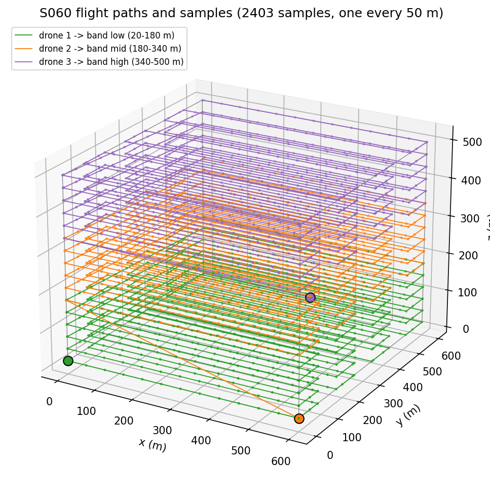
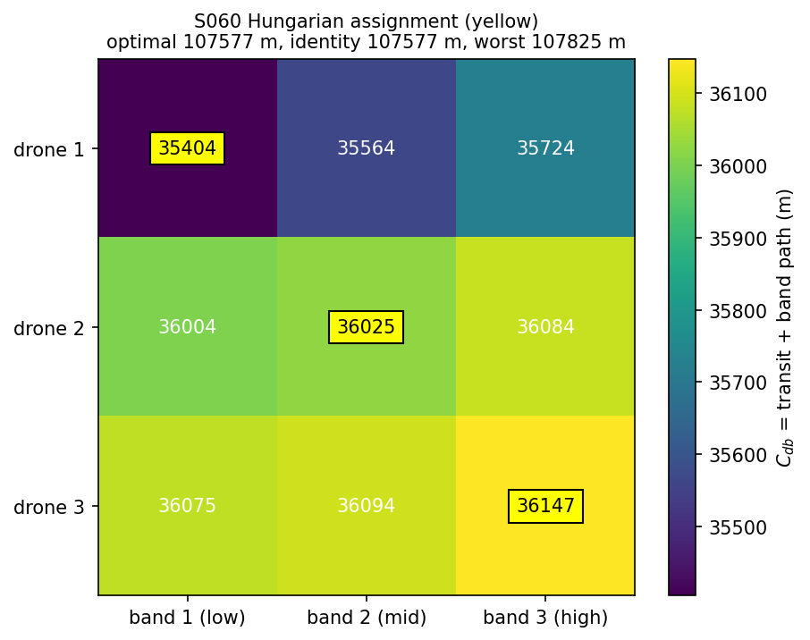
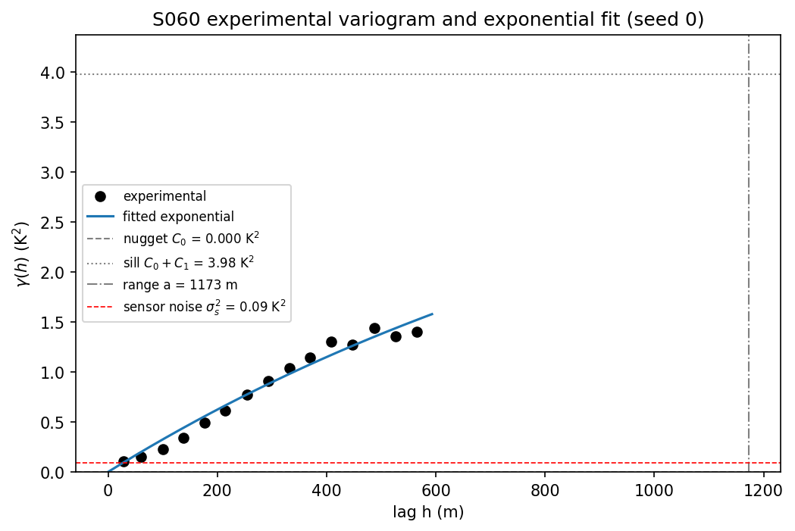
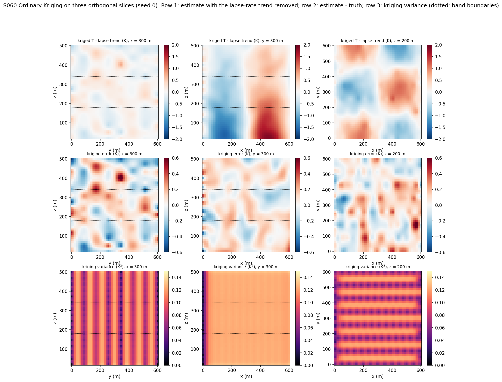
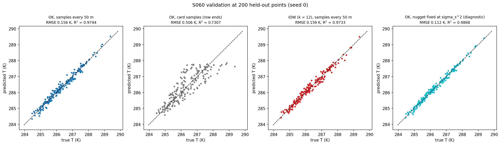
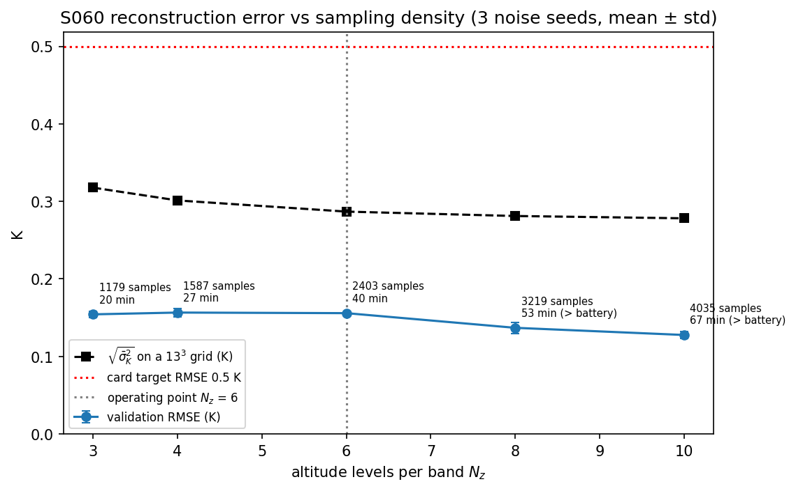
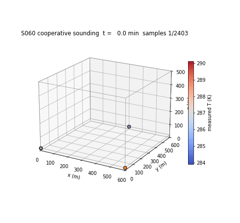

# S060 Multi-Drone Cooperative Meteorological Measurement

**Domain**: Environmental Monitoring & SAR | **Difficulty**: ⭐⭐⭐ | **Status**: ✅ Completed

---

## Problem Definition

**Setup**: Three drones measure the temperature field in a 600 × 600 m area between 20 m and 500 m altitude. The volume is split into three altitude bands (20–180, 180–340 and 340–500 m), one per drone. Each drone flies a boustrophedon pattern through its band: 6 altitude levels, each with 8 rows along $x$. The ground station assigns the bands with the Hungarian algorithm, fits a variogram to the noisy readings, reconstructs the field with Ordinary Kriging, and checks the result at 200 held-out validation points.

**Objective**: minimise the total flight distance through the band assignment, and reconstruct the field with an RMSE below 0.5 K (card expectation).

**Comparisons** (same samples and noise draws, 10 sensor-noise seeds):
1. **Ordinary Kriging, samples every 50 m** along each path (main method).
2. **Ordinary Kriging, card sampling**: only the waypoints, i.e. the row ends at $x$ = 0 and $x$ = 600 m.
3. **Inverse-distance weighting** (12 nearest samples, power 2) on the main samples, as a simple baseline (added).
4. **Ordinary Kriging with the nugget fixed at the sensor noise variance** (added diagnostic).

Also: all six band assignments, and a sweep of the number of levels per band $N_z$.

---

## Mathematical Model Summary

### Synthetic temperature field

$$T(x, y, z) = T_0 - \Gamma z + A_T \sin\frac{2\pi x}{L_x}\cos\frac{2\pi y}{L_y}\, e^{-z/H_T}, \qquad \tilde T_i = T(\mathbf x_i) + \epsilon_i, \ \epsilon_i \sim \mathcal N(0, \sigma_s^2)$$

$\Gamma$ = 6.5 × 10⁻³ K/m is the standard-atmosphere lapse rate (the card called it the dry adiabatic rate, which is 9.8 × 10⁻³ K/m).

### Band assignment

$$C_{db} = \|\mathbf p_d^{(0)} - \mathbf w_b^{(1)}\| + L_b, \qquad \sigma^* = \arg\min_\sigma \sum_d C_{d\sigma(d)}$$

solved with `scipy.optimize.linear_sum_assignment`.

### Variogram and Ordinary Kriging

Experimental semivariogram in 15 lag bins up to 0.6 × the largest pair distance, fitted by least squares to

$$\gamma(h) = C_0 + C_1(1 - e^{-h/a})$$

The nugget $C_0$ is treated as measurement noise: two distinct samples have semivariance $\gamma(h)$ even at $h$ = 0 (both drones sample the band boundaries at 180 m and 340 m), and only the diagonal of $\boldsymbol\Gamma$ is 0. The Kriging system

$$\begin{bmatrix}\boldsymbol\Gamma & \mathbf 1\\ \mathbf 1^T & 0\end{bmatrix}\begin{bmatrix}\boldsymbol\lambda\\ \mu\end{bmatrix} = \begin{bmatrix}\boldsymbol\gamma_0\\ 1\end{bmatrix}, \qquad \hat T(\mathbf x_0) = \boldsymbol\lambda^T\tilde{\mathbf T}, \qquad \sigma_K^2 = \boldsymbol\lambda^T\boldsymbol\gamma_0 + \mu - C_0$$

then estimates the noise-free field, and $\sigma_K^2$ is the error variance of that estimate. The system is LU-factorised once and solved for all prediction points.

### Flight

Point-mass flight at a constant 15 m/s from the start point through the band's waypoints, with assertions on the speed and on staying inside the measurement volume. Each flight must fit in a 50 min battery.

---

## Key Parameters

| Parameter | Value |
|-----------|-------|
| Domain | 600 × 600 m, $z$ = 20–500 m |
| Bands | 20–180, 180–340, 340–500 m |
| Drone starts | (0, 0, 20), (600, 0, 20), (300, 600, 20) m |
| Levels per band $N_z$ / rows per level | 6 / 8 (row spacing 85.7 m) |
| $T_0$ / $\Gamma$ | 288 K / 6.5 × 10⁻³ K/m |
| $A_T$ / $H_T$ / $L_x = L_y$ | 2 K / 300 m / 600 m |
| Sensor noise $\sigma_s$ | 0.3 K |
| Sampling interval along the path | 50 m, plus every waypoint (added) |
| Samples per drone / total | 801 / 2403 (card: 96 / 288 waypoints) |
| Cruise speed / battery endurance | 15 m/s / 50 min (added) |
| Variogram | exponential, 15 lag bins to 0.6 × max distance; bounds $C_0 \ge 10^{-4}$, $a \le 20$ × max distance |
| IDW baseline | 12 nearest samples, power 2 (added) |
| Validation points | 200, uniform in the volume, seed 42 |
| Grid for the mean Kriging variance | 13 × 13 × 13 |
| Sensor-noise seeds | 10 (100–109); $N_z$ sweep 3 (100–102) |
| $N_z$ sweep | 3, 4, 6, 8, 10 |

---

## Implementation

```
src/03_environmental_sar/s060_meteorological.py   # Main simulation script
```

```bash
conda activate drones
python src/03_environmental_sar/s060_meteorological.py
```

Runtime ≈ 1–1.5 min. BLAS is set to one thread at the top of the script; with the default multithreaded BLAS and many processes on the machine the run took over 10 minutes.

---

## Results

**Band assignment** ($C_{db}$ in m):

| | Band 1 (low) | Band 2 (mid) | Band 3 (high) |
|---|---:|---:|---:|
| Drone 1 (0, 0, 20) | **35404.3** | 35564.3 | 35724.3 |
| Drone 2 (600, 0, 20) | 36004.3 | **36025.2** | 36084.3 |
| Drone 3 (300, 600, 20) | 36075.1 | 36093.9 | **36147.5** |

The Hungarian algorithm assigns drone $k$ to band $k$, total 107577.0 m, which is the identity assignment (gain 0.0 m). The worst of the six permutations costs 107824.6 m, only 247.6 m more (0.23 % of the 106213 m of band paths). Every band entry point is the corner (0, 0) at the band floor and every band path has the same length, so only the short transits differ.

**Flights**: drone 1 transit 0.0 m, drone 2 621.0 m, drone 3 743.2 m, each followed by a 35404 m band path: 39.3 / 40.0 / 40.2 min at 15 m/s, within the 50 min battery.

**Reconstruction, 10 sensor-noise seeds** (validation RMSE, mean ± std):

| Method | RMSE | Min / max | Notes |
|---|---:|---|---|
| **OK, samples every 50 m** | **0.1534 ± 0.0070 K** | 0.1342 / 0.1594 K | R² 0.9752; below 0.5 K in 10/10 seeds |
| OK, card samples (row ends) | 0.5130 ± 0.0111 K | 0.4947 / 0.5337 K | 256 distinct points |
| IDW (k = 12), samples every 50 m | 0.1489 ± 0.0077 K | 0.1345 / 0.1592 K | |
| OK, nugget fixed at $\sigma_s^2$ (diagnostic) | 0.1090 ± 0.0053 K | 0.0962 / 0.1167 K | |

OK beats IDW in 4/10 seeds and card-sampling OK in 10/10. The fixed-nugget OK beats both fitted OK and IDW in 10/10 seeds.

**Key findings**:
- **The card's sampling cannot see the horizontal structure.** The card samples only at the waypoints, the row ends at $x$ = 0 and $x$ = 600 m, where $\sin(2\pi x/600) = 0$. The perturbation at all 256 card sample points is at most 7.57 × 10⁻⁹ K. Kriging then reconstructs only the lapse-rate profile: its RMSE (0.5130 K) is the same as that of a pure lapse-rate profile (0.5088 K, the RMS of the perturbation at the validation points), and its mean is above the card's 0.5 K target (best seed 0.4947 K). Sampling every 50 m along the same paths gives 0.1534 K.
- **The card's RMSE target holds with continuous sampling** (0.1534 K, below 0.5 K in 10/10 seeds, R² 0.9752).
- **The fitted nugget collapses, and Kriging is no better than IDW.** The least-squares fit puts the nugget on its lower bound (0.0001 K² against a true noise variance of 0.09 K²) with a range of 1173 m, beyond the domain. With almost no nugget, Kriging nearly interpolates the noisy readings and does not filter the 0.3 K noise. Result: 0.1534 K for OK against 0.1489 K for IDW, which wins 6 of 10 seeds. Fixing the nugget at the known $\sigma_s^2$ (refitted $C_1$ = 10.173 K², $a$ = 3683 m) brings OK to 0.1090 K and makes it the best method in every seed.
- **The cause is the variogram model and the fit, not the lapse-rate trend.** The script fits the same model to four versions of the seed-0 data, and every fit puts the nugget on its lower bound (0.0001 K²):

| Data | First lag bin (28 m) | Fitted $C_0$ | $C_1$ | $a$ |
|---|---:|---:|---:|---:|
| Original (trend + noise) | 0.1058 K² | 0.0001 K² | 3.980 K² | 1173 m |
| Exactly detrended, noisy | 0.0904 K² | 0.0001 K² | 0.330 K² | 112 m |
| Noise-free field | 0.0170 K² | 0.0001 K² | 8.904 K² | 3209 m |
| Detrended, noise-free | 0.0016 K² | 0.0001 K² | 0.250 K² | 157 m |

  Even with the trend removed exactly, the first lag bin sits at the noise level (0.0904 K²) and the fit still returns no nugget. The field is smooth, so its true semivariogram rises like $h^2$ near the origin on top of the 0.09 K² nugget. The exponential model is linear at the origin. An unweighted least-squares fit over 15 bins, most of them at long lags, matches that shape by starting the curve at zero and rising steeply, rather than with a flat nugget. Detrending (universal Kriging) alone would therefore not fix the nugget. A model that is parabolic at the origin (Gaussian or Matérn), a fit weighted toward short lags (pair counts or Cressie weights), or a nugget taken from sensor calibration as in the fixed-nugget run would.
- **The band assignment barely matters here.** The optimum equals the identity assignment and the spread between the best and worst assignment is 0.23 % of the band path length. The Hungarian step is correct but has no effect for this start/entry geometry.
- **Band boundaries do not show higher uncertainty.** The card expects elevated Kriging variance at the band boundaries. Along the vertical line $x = y$ = 300 m the variance within 8 m of a boundary is 0.1232 K² against 0.1241 K² elsewhere, because both neighbouring drones sample the boundary level (180 m and 340 m are the top level of one band and the bottom level of the next). The variance is set by the 85.7 m row spacing instead: it is highest midway between rows (see the slices below).
- **More altitude levels help little.** RMSE for $N_z$ = 3, 4, 6, 8, 10 is 0.1543, 0.1566, 0.1558, 0.1369, 0.1277 K (3 seeds). It does not fall steadily until $N_z$ = 8, although the mean Kriging variance falls monotonically (0.1010 → 0.0774 K²). The vertical structure is smooth, and the error comes mostly from the horizontal gaps between rows, which $N_z$ does not change. $N_z$ = 8 and 10 need 53 and 67 min of flight (3210 s and 4010 s), more than the 50 min battery.

| $N_z$ | Samples | Longest flight | RMSE | Mean $\sigma_K^2$ |
|---|---:|---:|---:|---:|
| 3 | 1179 | 1210 s | 0.1543 ± 0.0043 K | 0.1010 K² |
| 4 | 1587 | 1610 s | 0.1566 ± 0.0053 K | 0.0908 K² |
| **6** | 2403 | 2410 s | 0.1558 ± 0.0003 K | 0.0823 K² |
| 8 | 3219 | 3210 s (exceeds battery) | 0.1369 ± 0.0072 K | 0.0791 K² |
| 10 | 4035 | 4010 s (exceeds battery) | 0.1277 ± 0.0049 K | 0.0774 K² |

Seed 0: fitted variogram $C_0$ = 0.0001 K², $C_1$ = 3.980 K², $a$ = 1173 m; mean Kriging variance on the 13³ grid 0.0824 K² (√ = 0.287 K). At the 200 validation points themselves the mean Kriging variance is 0.0950 K² (√ = 0.308 K), against a mean squared error of 0.0243 K² (RMSE 0.1559 K for seed 0). The Kriging variance therefore over-states the actual error by about a factor of 4 in variance, consistent with the mis-fitted variogram (a sill of 3.98 K² and a 1173 m range describe a much rougher field than the real one).

### Flight Paths

Three drones, coloured by band (low green, mid orange, high purple), with every sample point; filled circles are the start points:



### Assignment Cost Matrix



### Variogram

Experimental semivariogram and the exponential fit (seed 0). The nugget fits to almost zero although the sensor noise variance (red dashed line) is 0.09 K²:



### Kriging Slices

Three orthogonal slices ($x$ = 300 m, $y$ = 300 m, $z$ = 200 m), seed 0. Row 1: Kriging estimate minus the lapse-rate trend (the recovered horizontal structure). Row 2: estimate minus truth. Row 3: Kriging variance. The $y$ = 300 m slice lies midway between two rows, so its variance is high everywhere:



### Validation Scatter

Predicted against true temperature at the 200 validation points for the four methods (seed 0):



### RMSE vs Levels per Band



### Animation

The three drones fly their bands simultaneously; sample points appear coloured by the measured temperature. 82 frames, 30 s each:



### Deviations from the scenario card

| Card | Implementation | Reason |
|------|----------------|--------|
| Samples only at the waypoints (row ends, 96 per drone) | One sample every 50 m of path plus every waypoint (801 per drone); the card's sampling is kept as a comparison | All card samples lie at $x$ = 0 or 600 m, where the horizontal perturbation is zero (at most 7.57 × 10⁻⁹ K, printed). The card's samples cannot see the structure Kriging is meant to reconstruct. |
| "Dry adiabatic lapse rate" $\Gamma_d$ = 6.5 × 10⁻³ K/m | Same value, called the standard-atmosphere lapse rate | The dry adiabatic rate is 9.8 × 10⁻³ K/m; 6.5 × 10⁻³ K/m is the standard environmental rate. Card fixed. |
| $\sigma_K^2 = \boldsymbol\lambda^T\boldsymbol\gamma_0 + \mu$, $\Gamma_{ij} = \gamma(h_{ij})$ with $\gamma(0) = 0$ | Nugget treated as measurement noise: $\gamma = C_0 + \dots$ between distinct samples even at $h$ = 0; $\sigma_K^2 = \boldsymbol\lambda^T\boldsymbol\gamma_0 + \mu - C_0$ | Both drones sample the boundary levels at the same points, which makes the card's matrix singular. The filtered form estimates the noise-free field, which is what the validation compares against. |
| Variogram fit bounds $(0, \infty)$ | $C_0 \ge 10^{-4}$ K², $a \le 20$ × max distance | Keeps the Kriging matrix non-singular. The nugget still sits on its lower bound (see Key findings). |
| Temperature, humidity and wind-speed sensors | Temperature only | The card defines a model only for temperature. |
| No speed or battery | 15 m/s, 50 min battery; each flight asserted to fit | Physical check; $N_z \ge 8$ is flagged as exceeding the battery. |
| One noise realisation | 10 sensor-noise seeds (common to all methods) and 3 seeds per $N_z$ | Mean ± std and per-seed wins. |
| Only Kriging | IDW baseline and a fixed-nugget Kriging diagnostic | Shows that the fitted nugget, not Kriging itself, limits the result. |
| Validation points "from a uniform grid"; card code draws them uniformly at random | Uniform random (card code) | — |
| Experimental variogram plotted at bin centres | Plotted at the mean pair distance of each bin | More accurate lag for wide bins. |

---

## Extensions

1. **Better variogram estimation**: fit a Gaussian or Matérn model (parabolic at the origin) with weights toward short lags, or estimate the parameters by restricted maximum likelihood, and compare with the fixed-nugget result (0.1090 K). Universal Kriging (explicit lapse-rate trend) can be combined with this, but the detrended fits above show that it does not fix the nugget on its own.
2. **Anisotropic variogram**: separate horizontal and vertical ranges, since the field varies over 600 m horizontally but mostly linearly in height.
3. **Row spacing instead of levels**: spend the flight budget on more rows per level, which attacks the error the $N_z$ sweep could not reduce.
4. **Adaptive sampling**: redirect drones to the highest-$\sigma_K^2$ regions after each level.
5. **Co-Kriging** of temperature, humidity and wind speed once the card's other two fields are defined.

---

## Related Scenarios

- Prerequisites: [S048 Full-Area Coverage Scan (Lawnmower)](../../../scenarios/03_environmental_sar/S048_lawnmower.md), [S045 Chemical Plume Tracing](../../../scenarios/03_environmental_sar/S045_plume_tracing.md)
- Follow-ups: [S058 Typhoon Eye Probing](../../../scenarios/03_environmental_sar/S058_typhoon.md)
- Cross-reference: [S046 Multi-Drone 3D Trilateration](../../../scenarios/03_environmental_sar/S046_trilateration.md), [S052 Glacier Melt Area Measurement](../../../scenarios/03_environmental_sar/S052_glacier.md)
