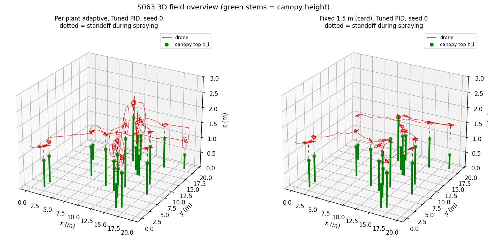
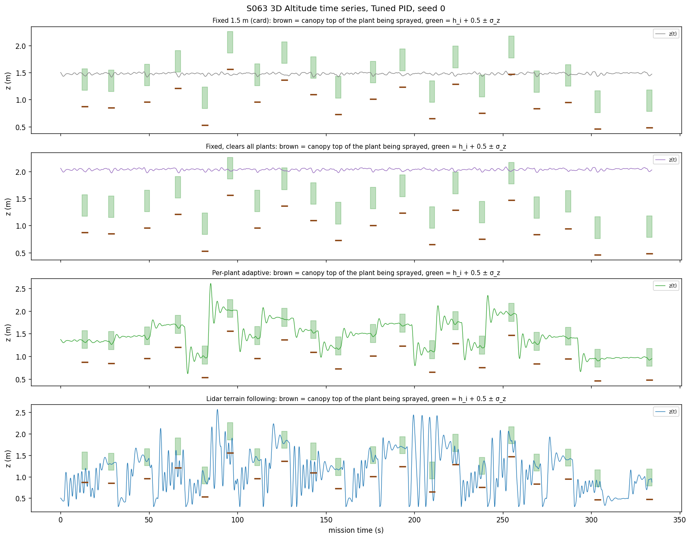
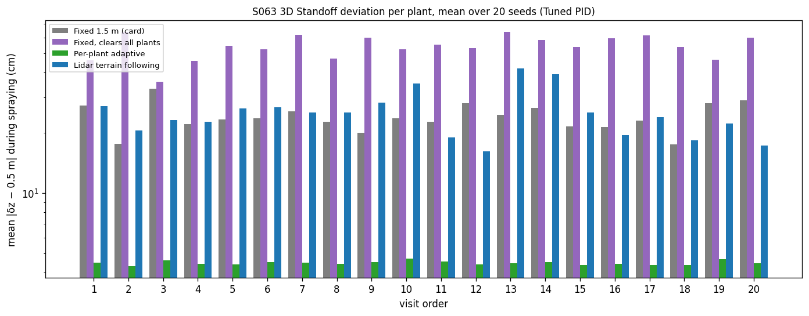
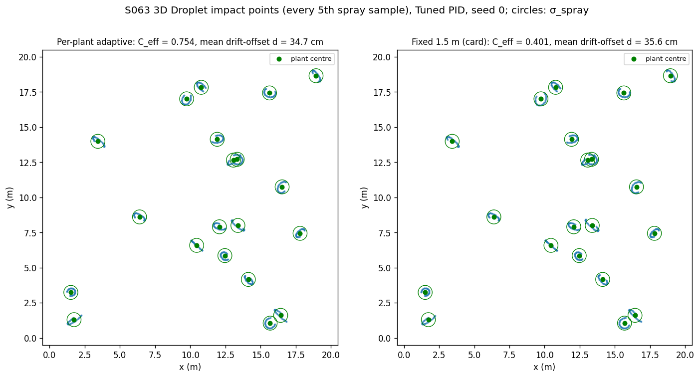
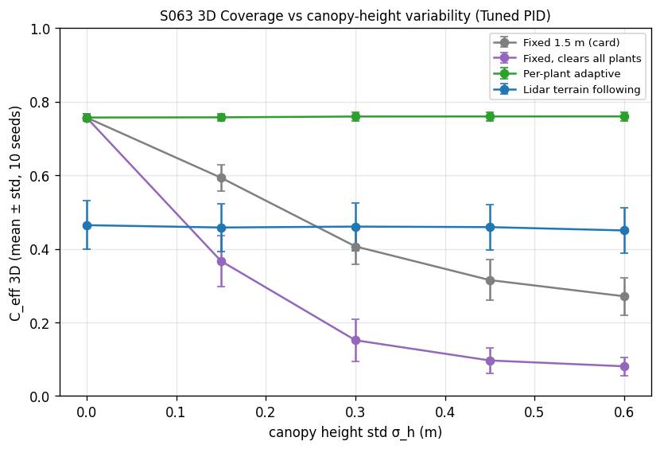
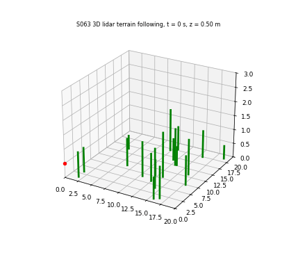

# S063 3D Upgrade — Precision Per-Plant Spraying

**Domain**: Industrial & Agriculture | **Difficulty**: ⭐⭐ | **Status**: ✅ Completed

---

## Problem Definition

**Setup**: The S063 mission is kept:
- 20 plants in a 20 × 20 m field, visited in nearest-neighbour tour order (74.14 m) from the depot;
- reference legs at 1 m/s, a settle test, then a 3 s spray window;
- a PID with GPS noise and a 3 m/s² acceleration limit;
- sinusoidal gust plus turbulence, with the integrator reset per spray window.

It is flown in 3D over plants with canopy heights $h_i \sim \mathcal{TN}(1.0, 0.3^2; 0.3, 2.5)$ m and crowns of radius 0.5 m. A vertical PID loop (1.5 × the horizontal gains) holds altitude against a rotor-downwash disturbance of $-0.15 + \mathcal N(0, 0.05^2)$ m/s². A droplet drift model couples the nozzle standoff to where the spray lands.

**Altitude strategies** (same plants, heights, wind, GPS and altimeter noise per seed, CRN):

| Strategy | Description |
|----------|-------------|
| **Fixed 1.5 m** (card, 2D baseline) | The S063 behaviour: one altitude for every plant |
| **Fixed, clears all plants** (added 2D baseline) | One altitude $\max_i h_i + 0.5$ m that never touches a crown |
| **Per-plant adaptive** (card) | $z_{cmd,i} = h_i + 0.5$ m from a prior height map. On each leg the reference is the higher of the two plant altitudes (climb first), then it descends over the plant |
| **Lidar terrain following** (card) | Continuous: $z_{ref}$ = canopy surface under the drone + 0.5 m, measured by a lidar with 0.05 m noise |

Two horizontal gain sets: the card's **Tuned** (2.0, 0.2, 0.5) and S063's best, **Tight** (5.0, 0.5, 1.0).

**Card questions**:
- Nozzle standoff, 3D hover RMS, droplet offset and $C_{eff}^{3D}$ per strategy.
- The trade-off between canopy-height spread $\sigma_h$ and $C_{eff}^{3D}$.

---

## Mathematical Model

**Vertical loop**: $a_z = K_p^{(z)}e_z + K_i^{(z)}\!\int e_z + K_d^{(z)}(0 - \dot z)$, with $K^{(z)} = 1.5\,K^{(xy)}$ and Euler integration at 50 Hz. The altitude bounds are $z \in [0.3, 6]$ m (clamped, counted). The altitude error is measured with 0.05 m noise. For terrain following, the measured quantity is the standoff to the surface below: $e_z = 0.5 - (z - s(x, y) + \eta)$.

**Droplet drift** (card; fall time corrected):
$$t_{fall} = \frac{\sqrt{w_{dw}^2 + 2g\,\delta z} - w_{dw}}{g},\qquad \mathbf p_{impact} = \mathbf q_{xy} + \mathbf u_w\,t_{fall},\qquad \mathbf u_w = \frac{A_w\sin(2\pi t/T_w + \varphi)}{c_w}$$

**Dose per spray sample** (card), averaged over the 3 s window:
$$D = \exp\Bigl(-\frac{d^2}{2\sigma_{spray}^2}\Bigr)\exp\Bigl(-\frac{(\delta z - 0.5)^2}{2\sigma_z^2}\Bigr),\qquad D = 0\ \text{if}\ \delta z \le 0\ (\text{nozzle inside the crown})$$
$C_{eff}^{3D}$ is the mean over the 20 plants.

**Canopy contact**: the drone is inside a crown cylinder (horizontal distance < 0.5 m) below its top. Each contact is attributed either to the plant being approached or sprayed, or to another plant.

**Hover RMS**: $\varepsilon^{3D}_i$ is measured to $(x_i, y_i, h_i + 0.5)$; the horizontal part is also reported.

---

## Key Parameters

| Parameter | Value |
|-----------|-------|
| Field / plants / layout | 20 × 20 m / 20 / S063 `default_rng(0)`, NN tour 74.14 m |
| Canopy heights | TN(1.0, 0.3²; 0.3, 2.5) m, per seed from `default_rng(3000 + seed)` (inverse CDF) |
| Crown radius (added) | 0.5 m; sweep 0.25, 0.5, 1.0 m (10 seeds) |
| Vertical-damping probe (added) | adaptive with $K_d^{(z)}$ × 2.5 |
| Lidar / altimeter noise | 0.05 m |
| Nominal standoff / $\sigma_z$ / $\sigma_{spray}$ | 0.5 m / 0.2 m / 0.5 m |
| Altitude bounds / fixed altitude | [0.3, 6.0] m / 1.5 m |
| $\alpha_z$ | 1.5 (vertical gains 1.5 × horizontal) |
| Downwash disturbance | −0.15 m/s² mean, 0.05 m/s² std |
| Gust / turbulence | $A_w$ = 0.3 m/s², $T_w$ = 4 s / 0.1 m/s² (S063) |
| Horizontal PID | Tuned (2.0, 0.2, 0.5) (card); Tight (5.0, 0.5, 1.0) (S063 best, added) |
| $\Delta t$ / spray time / transit speed | 0.02 s / 3 s / 1 m/s |
| Settle test | S063 (0.3 m, 0.1 m/s, 0.2 s, 10 s time-out) plus altitude error < 0.15 m (added) |
| Wind drag rate $c_w$ (added) | 0.3 s⁻¹ (wind amplitude 1 m/s); sweep 0.15, 0.3, 0.6 |
| Downwash droplet speed $w_{dw}$ (added) | 2 m/s; sweep 0, 2, 5 m/s |
| Seeds | 20 per strategy and gain set; $\sigma_h$ sweep 0–0.6 m with 10 seeds (Tuned) |

---

## Implementation

```
src/04_industrial_agriculture/3d/s063_3d_precision_spraying.py
```

```bash
conda activate drones
python src/04_industrial_agriculture/3d/s063_3d_precision_spraying.py
```

The script imports the S063 module for the layout, tour, gains and noise streams. Runtime ≈ 4–5 min on a loaded machine, including the crown-radius sweep and the damping probe (267 s and 290 s with `OMP/OPENBLAS/MKL_NUM_THREADS=1`, 225 s with default threading). The three runs printed byte-identical output and wrote byte-identical PNG and GIF files.

---

## Results

**Checks**:
- Heights over 20 seeds × 20 plants: mean 1.011 m, std 0.298 m, range 0.313–1.935 m.
- 23 plants (5.8 %) are taller than the fixed 1.5 m altitude, and 46 more are within 0.2 m below it.
- Fall time at a 0.5 m standoff: 0.319 / 0.175 / 0.092 s for $w_{dw}$ = 0 / 2 / 5 m/s; at 1.5 m: 0.553 / 0.386 / 0.242 s.
- Vertical loop poles:
  - Tuned × 1.5: −0.324 ± 1.682j and −0.102 (damping of the complex pair 0.189);
  - Tight × 1.5: −0.699 ± 2.621j and −0.102 (damping 0.258).

### $\sigma_h$ = 0.3 m, 20 seeds

**Tuned PID (card)**

| Strategy | $C_{eff}^{3D}$ | Hover RMS 3D / horiz. | Standoff deviation | Drift offset $d$ | Canopy contacts per mission (target / other) | Missions with contact | Plants sprayed from inside the crown | Time | Saturated | Altitude clamps | z range |
|---|---:|---:|---:|---:|---:|:---:|---:|---:|---:|---:|---:|
| Fixed 1.5 m | 0.428 ± 0.069 | 49.5 / 40.3 cm | 24.1 cm | 34.8 cm | 1.60 (1.60 / 0.00) | 18/20 | 1.50 | 333.3 s | 0.00 % | 0.0 | 1.40–1.53 m |
| Fixed, clears all | 0.170 ± 0.082 | 70.6 / 40.3 cm | 54.2 cm | 35.6 cm | 0.00 | 0/20 | 0.00 | 333.3 s | 0.00 % | 0.0 | 1.80–2.47 m |
| **Per-plant adaptive** | **0.760 ± 0.011** | 40.6 / 40.3 cm | **4.5 cm** | 33.9 cm | 1.25 (0.65 / 0.60) | 15/20 | 0.00 | 333.5 s | 0.01 % | 0.1 | 0.30–2.91 m |
| Lidar terrain following | 0.448 ± 0.066 | 52.0 / 40.5 cm | 25.1 cm | 35.3 cm | **19.50** (19.35 / 0.15) | 20/20 | 0.70 | 334.3 s | 9.25 % | 21.4 | 0.30–3.42 m |

**Tight PID**

| Strategy | $C_{eff}^{3D}$ | Hover RMS 3D / horiz. | Standoff deviation | Drift offset $d$ | Canopy contacts per mission (target / other) | Missions with contact | Plants sprayed from inside the crown | Time | Saturated | Altitude clamps | z range |
|---|---:|---:|---:|---:|---:|:---:|---:|---:|---:|---:|---:|
| Fixed 1.5 m | 0.483 ± 0.072 | 27.3 / 10.3 cm | 23.8 cm | 23.8 cm | 1.50 (1.50 / 0.00) | 17/20 | 1.30 | 265.3 s | 0.27 % | 0.0 | 1.44–1.54 m |
| Fixed, clears all | 0.165 ± 0.080 | 58.5 / 10.3 cm | 56.7 cm | 36.7 cm | 0.00 | 0/20 | 0.00 | 265.3 s | 0.27 % | 0.0 | 1.84–2.46 m |
| **Per-plant adaptive** | **0.871 ± 0.004** | 10.6 / 10.3 cm | **1.8 cm** | 24.7 cm | 0.75 (0.30 / 0.45) | 13/20 | 0.00 | 275.0 s | 0.98 % | 0.0 | 0.34–2.79 m |
| Lidar terrain following | 0.839 ± 0.016 | 12.3 / 10.6 cm | 3.7 cm | 25.5 cm | **17.50** (16.65 / 0.85) | 20/20 | 0.00 | 287.2 s | 9.70 % | 18.5 | 0.30–3.61 m |

Plants receiving a dose > 0.9: at most 4.0 % (adaptive, Tight). Settle time-outs per mission: Tuned 19.9–20.0 of 20 for every strategy; Tight 4.3 / 4.3 / 5.2 / 6.9. Vertical travel per mission: Tuned 6.5 / 6.5 / 24.9 / 154.0 m; Tight 6.9 / 6.9 / 20.8 / 73.7 m.

**Per-seed comparisons** (higher / equal / lower $C_{eff}^{3D}$, mean difference):

| Gains | Adaptive vs fixed 1.5 m | Adaptive vs fixed clears-all | Adaptive vs terrain following | Terrain following vs fixed 1.5 m |
|---|---|---|---|---|
| Tuned | 20 / 0 / 0, +0.332 | 20 / 0 / 0, +0.590 | 20 / 0 / 0, +0.312 | 11 / 0 / 9, +0.021 |
| Tight | 20 / 0 / 0, +0.388 | 20 / 0 / 0, +0.706 | 19 / 0 / 1, +0.032 | 20 / 0 / 0, +0.356 |

**Crown-radius sweep** ($\sigma_h$ = 0.3 m, 10 seeds; mean $C_{eff}^{3D}$, crown contacts per mission in brackets):

| $R_{crown}$ | Gains | Fixed 1.5 m | Adaptive | Terrain following | TF > fixed 1.5 m | Adaptive > TF |
|---|---|---|---|---|:---:|:---:|
| 0.25 m | Tuned | 0.407 (1.70) | 0.760 (0.70) | 0.021 (18.90) | 0/10 | 10/10 |
| 0.25 m | Tight | 0.458 (1.70) | 0.871 (0.80) | 0.850 (19.60) | 10/10 | 10/10 |
| 0.50 m | Tuned | 0.407 (1.80) | 0.760 (1.20) | 0.461 (19.30) | 7/10 | 10/10 |
| 0.50 m | Tight | 0.458 (1.70) | 0.871 (0.80) | 0.837 (17.50) | 10/10 | 10/10 |
| 1.00 m | Tuned | 0.407 (1.80) | 0.760 (2.20) | 0.709 (16.70) | 10/10 | 10/10 |
| 1.00 m | Tight | 0.458 (1.70) | 0.871 (1.20) | 0.823 (13.00) | 10/10 | 10/10 |

**Vertical-damping probe** (adaptive, $\sigma_h$ = 0.3 m, 20 seeds). Contacts with the target plant are split by whether the leg to it climbs to a taller plant or descends / stays level:

| Gains | $K_d^{(z)}$ scale (damping) | Target-plant contacts (climb leg / descent or level leg) | Other plants | Lowest altitude | $C_{eff}^{3D}$ |
|---|---|---|---:|---:|---:|
| Tuned | × 1 (0.189) | 0.65 (0.10 / 0.55) | 0.60 | 0.30 m | 0.760 |
| Tuned | × 2.5 (0.527) | 0.10 (0.10 / 0.00) | 0.50 | 0.60 m | 0.765 |
| Tight | × 1 (0.258) | 0.30 (0.20 / 0.10) | 0.45 | 0.34 m | 0.871 |
| Tight | × 2.5 (0.683) | 0.20 (0.20 / 0.00) | 0.35 | 0.72 m | 0.874 |

**Probe: dose without the standoff factor** (drift and hover error only):

| Gains | Fixed 1.5 m | Fixed clears-all | Adaptive | Terrain following | Adaptive vs fixed 1.5 m | Adaptive vs clears-all |
|---|---:|---:|---:|---:|:---:|:---:|
| Tuned | 0.718 ± 0.039 | 0.765 ± 0.016 | 0.783 ± 0.011 | 0.667 ± 0.038 | 20 / 0 / 0 | 20 / 0 / 0 |
| Tight | 0.814 ± 0.035 | 0.751 ± 0.028 | 0.876 ± 0.004 | 0.869 ± 0.005 | 18 / 0 / 2 | 20 / 0 / 0 |

**Sensitivity to the added drift parameters** (Tuned, mean $C_{eff}^{3D}$; fixed 1.5 m / clears-all / adaptive / terrain following):

| $c_w$ (wind amplitude) | $w_{dw}$ = 0 m/s | $w_{dw}$ = 2 m/s | $w_{dw}$ = 5 m/s |
|---|---|---|---|
| 0.15 s⁻¹ (2.0 m/s) | 0.310 / 0.106 / 0.561 / 0.352 | 0.409 / 0.154 / 0.738 / 0.438 | 0.427 / 0.170 / 0.760 / 0.448 |
| 0.30 s⁻¹ (1.0 m/s) | 0.417 / 0.162 / 0.745 / 0.444 | 0.428 / 0.170 / 0.760 / 0.448 | 0.420 / 0.169 / 0.744 / 0.439 |
| 0.60 s⁻¹ (0.5 m/s) | 0.428 / 0.171 / 0.759 / 0.448 | 0.419 / 0.169 / 0.743 / 0.438 | 0.412 / 0.165 / 0.729 / 0.430 |

The ranking is adaptive > terrain following > fixed 1.5 m > clears-all in all nine cases. The mean drift offset ranges from 33.9 to 76.5 cm (clears-all at 2 m/s wind and no downwash).

**$C_{eff}^{3D}$ vs canopy-height spread** (Tuned, 10 seeds; canopy contacts per mission in brackets):

| $\sigma_h$ | Fixed 1.5 m | Fixed clears-all | Adaptive | Terrain following |
|---|---|---|---|---|
| 0.00 | 0.757 ± 0.010 (0.00) | 0.757 ± 0.010 (0.00) | 0.757 ± 0.010 (0.00) | 0.464 ± 0.066 (19.90) |
| 0.15 | 0.593 ± 0.036 (0.00) | 0.367 ± 0.070 (0.00) | 0.758 ± 0.009 (0.40) | 0.458 ± 0.065 (19.80) |
| 0.30 | 0.407 ± 0.050 (1.80) | 0.152 ± 0.057 (0.00) | 0.760 ± 0.012 (1.20) | 0.461 ± 0.065 (19.30) |
| 0.45 | 0.315 ± 0.055 (4.50) | 0.097 ± 0.035 (0.00) | 0.760 ± 0.012 (2.30) | 0.459 ± 0.062 (19.10) |
| 0.60 | 0.271 ± 0.051 (5.70) | 0.081 ± 0.025 (0.00) | 0.760 ± 0.012 (3.10) | 0.450 ± 0.062 (19.00) |

**Key findings**:
- **Per-plant adaptive altitude is the clear winner, as the card expects.** At $\sigma_h$ = 0.3 m it holds the standoff within 4.5 cm (Tuned) and 1.8 cm (Tight) of 0.5 m. It reaches $C_{eff}^{3D}$ = 0.760 / 0.871 and beats both fixed-altitude 2D baselines in 20/20 seeds with either gain set (+0.332 to +0.706). It is flat across $\sigma_h$ (0.757–0.760), while fixed 1.5 m falls from 0.757 to 0.271 and the clears-all altitude to 0.081. At $\sigma_h$ = 0 all three planned strategies coincide (0.757), as they must, since they then fly the same altitude.
- **Part of the gap is built into the card's dose model, but not all of it.** The standoff factor $\exp(-(\delta z - 0.5)^2/2\sigma_z^2)$ penalises fixed altitudes directly. Without it, adaptive still wins every seed against the clears-all altitude and 18–20 of 20 against fixed 1.5 m, with smaller margins (0.783 vs 0.718 / 0.765 Tuned; 0.876 vs 0.814 / 0.751 Tight). The remainder comes from drift, which grows with the fall time from a higher nozzle, and from spraying inside the crown at tall plants.
- **A fixed altitude low enough to spray well hits tall plants; one that clears them sprays badly.** At 1.5 m the drone ends up inside the crown of 1.50 plants per mission (Tuned), and 18 of 20 missions touch a crown. These plants get zero dose. Raising the altitude to $\max h_i$ + 0.5 m removes every contact, but $C_{eff}^{3D}$ falls to 0.170 / 0.165 because the mean standoff error grows to 54–57 cm.
- **Card-style lidar terrain following without look-ahead flies into the crowns, at every crown radius tested.** It tracks the ground (0.5 m) between plants and sees each crown only once it is overhead. The drone therefore approaches every plant below its top and touches 19.50 (Tuned) / 17.50 (Tight) crowns per mission, almost all of them the plant it is approaching (19.35 / 16.65). It also hits the 0.3 m floor 21.4 / 18.5 times per mission and saturates 9.25 / 9.70 % of the steps. In the crown-radius sweep (0.25 / 0.5 / 1.0 m) it touches 13.00–19.60 crowns per mission, and adaptive beats it in 10/10 seeds at every radius. With Tight gains its dose is close to adaptive (0.823–0.850 vs 0.871). The look-ahead the card lists as Extension 1 is a safety requirement, not a refinement.
- **Whether Tuned terrain following beats a fixed 1.5 m altitude depends on the crown radius I added.** At 0.5 m it is level with fixed 1.5 m (0.448 vs 0.428 over 20 seeds; 11 / 0 / 9), and even at $\sigma_h$ = 0 it reaches only 0.464 against 0.757. At 0.25 m it collapses to 0.021 (0/10). At 1.0 m it reaches 0.709 and wins 10/10. The 40 cm horizontal hover error of the Tuned gains is comparable to the crown radius, so the drone keeps sliding off small crowns, and each time its lidar reference drops to the ground. *Hypothesis*: this explains the radius dependence; it is consistent with the sweep, but the sliding events were not counted.
- **The adaptive plan also touches crowns occasionally; most target-plant contacts are descent overshoot (probed).** With Tuned gains it touches 1.25 crowns per mission: 0.65 on the plant being approached and 0.60 on other plants. It also hits the 0.3 m floor 0.1 times per mission on average. The vertical loop the card prescribes is lightly damped (damping 0.189 with Tuned × 1.5).
  - Of the 0.65 target-plant contacts, 0.55 happen on descending or level legs and 0.10 on climbs to a taller plant.
  - Raising the vertical derivative gain 2.5× (damping 0.527) removes the descent contacts (0.55 → 0.00) and lifts the lowest altitude from 0.30 to 0.60 m. The climb contacts (0.10) remain: there the drone reaches the crown before it has climbed.
  - With Tight gains: 0.30 target-plant contacts (0.20 climb / 0.10 descent) become 0.20 (0.20 / 0.00).
  - Contacts with other plants barely change (0.60 → 0.50, 0.45 → 0.35). Flying at the endpoints' altitude over a taller plant in between is the likely cause (*not probed*); a 3D path cost (card Extension 5) would avoid it.
- **The horizontal gains still matter more than altitude for the top score.** With the card's Tuned gains, the S063 finding carries over: 40 cm horizontal hover RMS and 19.9 of 20 settle time-outs. That caps adaptive at 0.760; Tight raises it to 0.871.
- **The conclusions do not depend on the added drift parameters.** Over the nine combinations of wind amplitude (0.5–2 m/s) and downwash speed (0–5 m/s) the ranking never changes. Adaptive ranges 0.561–0.760; only the strongest wind with no downwash lowers it noticeably.

### 3D Field Overview

Seed 0, Tuned PID: adaptive (left) and fixed 1.5 m (right). Green stems are canopy heights; dotted lines are the standoff during spraying:



### Altitude Time Series

Seed 0, Tuned PID, all four strategies. Brown marks the canopy top of the plant being sprayed; green bands are $h_i$ + 0.5 ± $\sigma_z$:



### Standoff Deviation per Plant

Mean $|\delta z - 0.5|$ during spraying over 20 seeds, by visit order (log scale):



### Droplet Impacts

Seed 0, Tuned PID: impact points (every 5th spray sample) around each plant, with the $\sigma_{spray}$ circle. The panel titles give this seed's $C_{eff}^{3D}$ and mean offset (figure only, not printed):



### $C_{eff}^{3D}$ vs $\sigma_h$



### Animation

Lidar terrain following, Tuned PID, seed 0: the drone (red) dips to 0.5 m between plants and climbs at each crown. 169 frames, one every 100 steps (2 s):



### Deviations from the scenario card

| Card | Implementation | Reason |
|------|----------------|--------|
| $t_{fall} = \sqrt{2\delta z/(g + w_{dw})}$ | $t_{fall} = (\sqrt{w_{dw}^2 + 2g\delta z} - w_{dw})/g$, $w_{dw}$ = 2 m/s (swept 0–5) | The card adds a speed to an acceleration. Card corrected. |
| Drift uses a wind *velocity* $\mathbf u_w$, but the wind model is an acceleration | $\mathbf u_w$ = sinusoidal gust acceleration / $c_w$, $c_w$ = 0.3 s⁻¹ (swept 0.15–0.6) | No wind speed is defined on the card. Card updated. |
| Hover starts on the plant (card) | S063 continuous flight with settle test; altitude error < 0.15 m added to it | S063 fix (arrival transients matter). |
| Single horizontal gain set (Tuned) | Tuned and Tight | S063 showed Tuned is poorly damped near the gust frequency; Tight shows the altitude effect without that limit. |
| Fixed altitude only at 1.5 m | Also a fixed altitude that clears every plant | 1.5 m is below 5.8 % of the plants; a 2D plan has to choose between collisions and standoff error. |
| Plants as points | Crowns of radius 0.5 m (swept 0.25–1.0 m); contacts counted; dose 0 when the nozzle is inside the crown | Needed for the lidar surface and for physical sanity (X4). The terrain-following vs fixed-altitude result depends on the radius, so it is swept. |
| Adaptive: "climbs to $z_{cmd,i}$ before hovering" | Leg reference at the higher of the two plant altitudes, then descent over the plant | Climb first; a linear ramp would approach tall plants below their top. |
| Altitude bounds enforced | Clamped and counted; an assert checks that no unclamped step would have gone below the ground | The terrain-following strategy reaches the 0.3 m floor; the count is a result, and the assert is a physical invariant that can fail (X4). |
| Single dose model | Also reported without the standoff factor | Separates the built-in standoff penalty from the drift effect (C9). |

---

## Extensions

1. Look-ahead terrain following: command the maximum canopy height within the next 1–2 m of track (card Extension 1). Without it the strategy is unsafe here.
2. Better-damped vertical gains as a design choice: the probe shows that damping 0.53–0.68 removes the descent contacts. Pair this with climb-before-approach timing for the remaining climb contacts.
3. A 3D tour cost that includes the canopy along each leg (card Extension 5), to avoid transit contacts.
4. Wind-aware nozzle offset (card Extension 2): the mean drift offset is 24–37 cm, comparable to the horizontal hover error with Tight gains.

---

## Related Scenarios

- Base 2D version: [S063 Single-Plant Precision Spraying](../../../../scenarios/04_industrial_agriculture/S063_precision_spraying.md)
- 3D card: [S063 3D Upgrade — Precision Per-Plant Spraying](../../../../scenarios/04_industrial_agriculture/3d/S063_3d_precision_spraying.md)
- Spray coverage: [S067 Spray Coverage Overlap Optimization](../../../../scenarios/04_industrial_agriculture/S067_spray_overlap.md)
- Greenhouse flight: [S064 Greenhouse Interior Precision Flight](../../../../scenarios/04_industrial_agriculture/S064_greenhouse.md)
