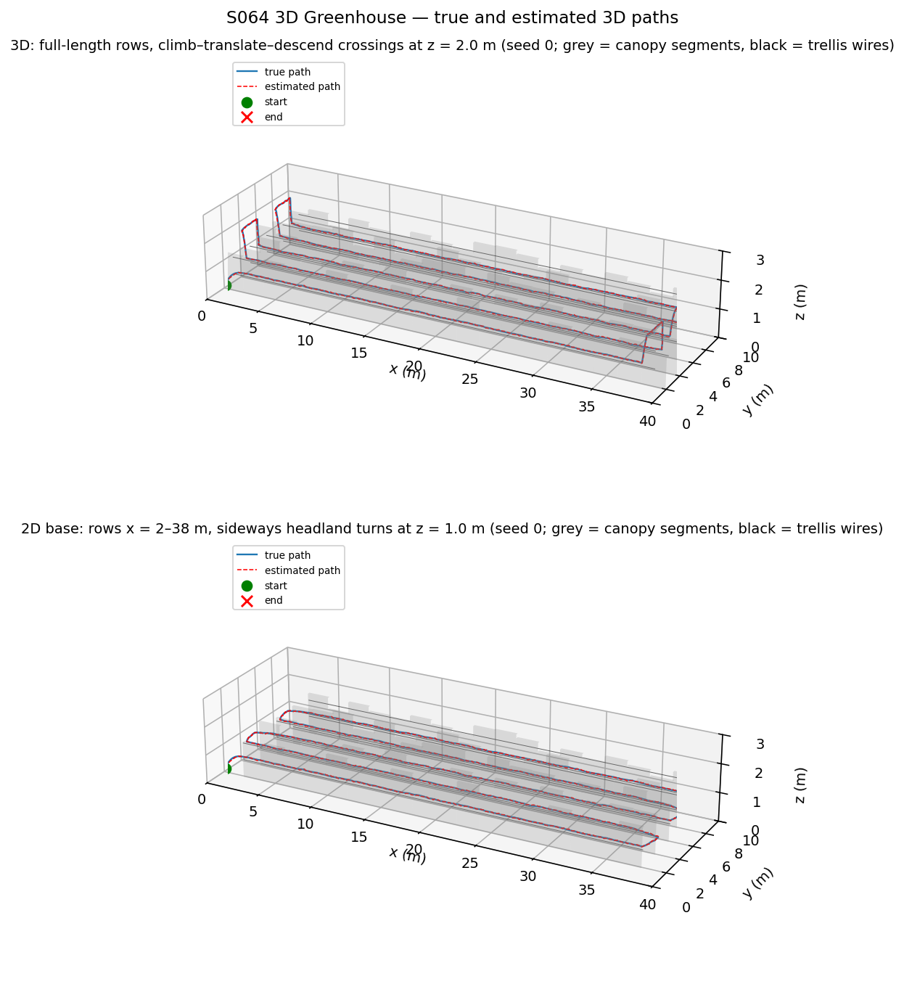
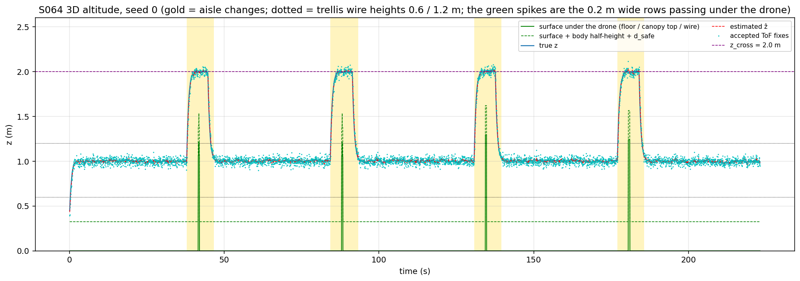
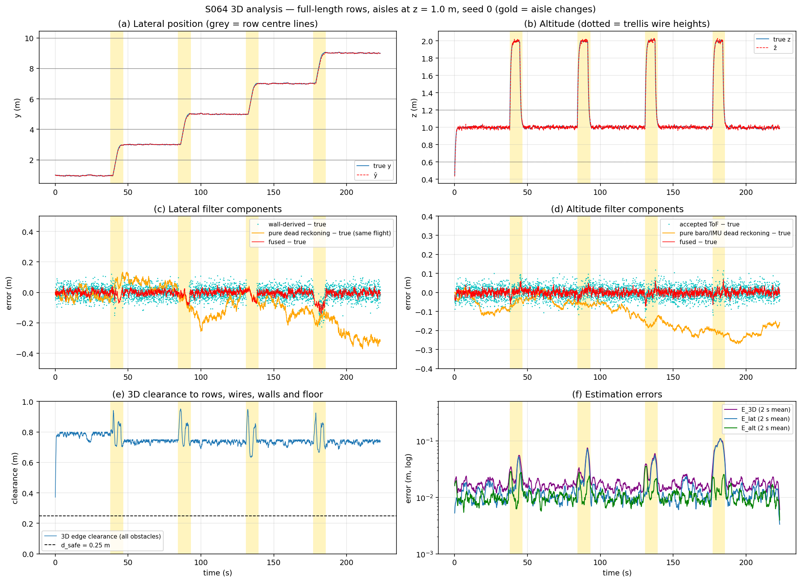
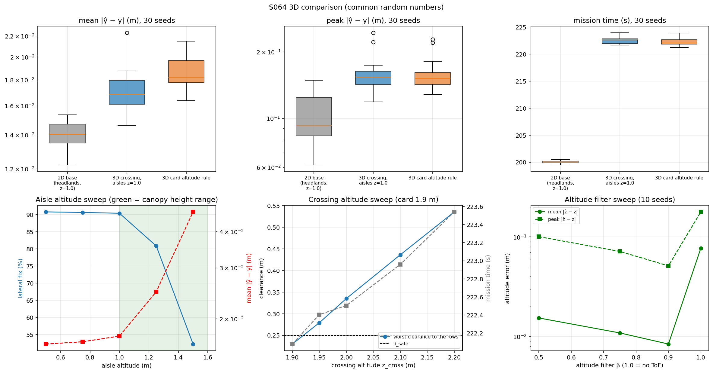
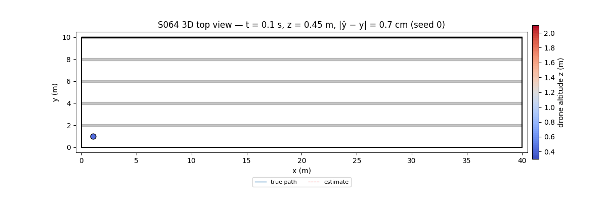

# S064 3D Upgrade — Greenhouse Interior Navigation

**Domain**: Industrial & Agriculture | **Difficulty**: ⭐⭐⭐⭐ | **Status**: ✅ Completed
**Based on**: [S064 Greenhouse Interior Precision Flight](../../s064_greenhouse/README.md) (2D version)

---

## Problem Definition

**Setup**: A 0.3 × 0.3 × 0.15 m drone inspects the five aisles of a 40 × 10 × 3 m greenhouse without GPS, as in the 2D S064: aisle centres at y = 0.95, 3, 5, 7 and 9 m, legs at 1.0 m/s between the turn lines x = 1 m and x = 39 m, start at (1.0, 1.0, 0.4) m. The 2D base holds z at 1.0 m with a P loop, treats z as known, and its rows stop 2 m short of each gable wall so the drone can change aisle sideways in these headlands. The 2D arm here keeps the base's layout and strategy, but uses the 3D variant's altitude estimator and controller. Its differences from the base are listed under Deviations; with the base's settings restored it matches the 2D S064 to within 0.0003 m per seed.

**What is 3D here**:

- **Canopy height varies.** Each of the five rows (y = 2, 4, 6, 8, 10 m, 0.2 m thick) is split into 2 m segments with heights $h \sim \mathcal U(1.0, 1.6)$ m. Two trellis wires (z = 0.6 and 1.2 m, radius 0.01 m) run along each row's centre line on x = 1–39 m.
- **The aisle altitude decides whether the lateral fix exists.** A side-looking ultrasonic beam returns an echo from a row only where the drone is **below the local canopy top**; above it the beam passes over the plants, and the next row is out of the 2 m range.
- **Altitude is estimated, not known.** Barometric/IMU dead reckoning drifts with $\sigma_z = 0.008$ m/√s, and a downward ToF sensor (noise 0.03 m) corrects it. The ToF reads the distance to whatever is below, so over a row it reads the canopy, not the floor.
- **Rows can run to the gable walls.** In the "full-length" greenhouse there are no headlands. The drone changes aisle with the card's three-phase manoeuvre: climb to $z_{cross}$, translate 2 m sideways over the row at 0.5 m/s, then descend into the next aisle.

**Configurations** (same random numbers for all; 30 seeds; every seed also draws its own canopy):

| Key | Layout | Aisle altitude | Aisle change |
|---|---|---|---|
| **2D base** | rows x = 2–38 m (headlands; width swept 2.0 / 1.5 / 1.0 m) | 1.0 m fixed | sideways in the headland at 1.0 m (the base strategy, with the 3D altitude estimator) |
| **3D crossing** | rows x = 0–40 m | 1.0 m | climb to 2.0 m, translate, descend |
| **3D card rule** | rows x = 0–40 m | the card's per-aisle midpoint rule (see Mathematical Model) | climb to 2.0 m, translate, descend |
| Base strategy in the full-length greenhouse | rows x = 0–40 m | 1.0 m fixed | sideways at 1.0 m, through the row (10 seeds) |

Sweeps (10 seeds each) cover the aisle altitude, the crossing altitude, the altitude filter gain β, the ToF gate, the aisle-change speed and the canopy segment length.

---

## Mathematical Model

### Truth and estimators

$$\mathbf p_{t+1} = \mathbf p_t + \mathbf v\,\Delta t + \boldsymbol\eta_t,\qquad \boldsymbol\eta_t \sim \mathcal N\bigl(\mathbf 0, \mathrm{diag}(\sigma_{xy}^2, \sigma_{xy}^2, \sigma_z^2)\,\Delta t\bigr)$$

- **Lateral channel** (unchanged from 2D): $\hat y_{DR} = \hat y + v_y\Delta t + \eta'$. Each valid ultrasonic range gives a wall-derived position from the map (nearest face on each side of $\hat y_{DR}$, 0.5 m gate). Then $\hat y = \alpha\hat y_{DR} + (1-\alpha)\hat y_{wall}$ with $\alpha = 0.85$.
- **Altitude channel** (card): $\hat z_{DR} = \hat z + v_z\Delta t + \eta'_z$. The ToF reading $r = z - z_{surf}(x, y) + w$ is used as an altitude fix (the floor is assumed below) only when $|r - \hat z_{DR}| < 0.3$ m. Then $\hat z = \beta\hat z_{DR} + (1-\beta) r$ with $\beta = 0.75$.
- **Echo condition** (added): a row at the drone's $x$ returns an echo only if $z < h_{seg}(x)$.

### Control

- **Legs**: $v_x = \pm 1$ m/s, $v_y = \mathrm{clip}(-0.8(\hat y - y_c), \pm 1)$ and $v_z = 1.5\,(z_{aisle} - \hat z)$.
- **Three-phase crossing** (card): climb until $\hat z > z_{cross} - 0.05$; translate with $|v_y| \le 0.5$ m/s until $|\hat y - y_{next}| < 0.1$; descend until $|\hat z - z_{aisle}| < 0.05$.
- **Repulsion** ($K_{rep} = 1.5$ m/s, $d_{safe} = 0.25$ m): lateral from the measured ranges (as in 2D), and vertical from the ToF clearance $r - 0.075$ m.
- **Speed limit**: 3 m/s (asserted).

### Card altitude rule (run as given)

$$z_{max}^{aisle} = \min_{\text{bounding rows}} h - d_{safe},\qquad z^{aisle}_{cruise} = \tfrac12\bigl(z_{t2} + \rho + z^{aisle}_{max}\bigr),\quad \rho = 0.19\text{ m}$$

The card meant this as the midpoint of a feasible band. The band is empty: its lower bound is $z_{t2} + \rho = 1.39$ m and its upper bound is at most 1.35 m. The formula still returns 1.070–1.115 m over the 30 seeds, which is above the shortest canopy segments.

### Clearance and metrics

- **Clearance**: the 3D box-to-box distance from the body (half-extents 0.15 / 0.15 / 0.075 m) to every canopy segment, wire, wall, the floor and the ceiling. A clearance ≤ 0 is a collision and ends the flight.
- **Errors**: $E_{lat} = |\hat y - y|$, $E_{alt} = |\hat z - z|$ and $E_{3D} = \sqrt{E_{lat}^2 + E_{alt}^2}$ ($x$ is known, as in the 2D base).
- **Asserted invariants**: speed ≤ 3 m/s, and the body stays between the floor and the ceiling.

---

## Key Parameters

| Parameter | Value | Source |
|---|---|---|
| Greenhouse | 40 × 10 × 3 m | card |
| Rows | y = 2, 4, 6, 8, 10 m; 0.2 m thick; x = 2–38 m (2D base) or 0–40 m (full-length) | card / 2D base |
| Canopy | 2 m segments, $h \sim \mathcal U(1.0, 1.6)$ m, `default_rng(10000 + seed)` | card range; segment length added (swept 1, 2, 4, 40 m) |
| Trellis wires | z = 0.6 and 1.2 m, radius 0.01 m, x = 1–39 m | card |
| Body half-extents | 0.15 / 0.15 / 0.075 m | card dimensions (0.3 × 0.3 × 0.15 m) |
| Start | (1.0, 1.0, 0.4) m | card (x corrected) |
| Aisle centres / turn lines | 0.95, 3, 5, 7, 9 m / x = 1 and 39 m | 2D base |
| Cruise speed / aisle altitude | 1.0 m/s / 1.0 m | card / 2D base (card value corrected; swept 0.5–1.5 m) |
| $z_{cross}$ | 2.0 m | card 1.9 m corrected (swept 1.9–2.2 m) |
| Aisle-change lateral speed | 0.5 m/s in both layouts | card (the 2D base used 1.0 m/s; swept 0.5 / 1.0) |
| $\sigma_{xy}$ / $\sigma_z$ | 0.02 / 0.008 m/√s | card |
| Ultrasonic noise / band / gate | 0.05 m / 0.1–2.0 m / 0.5 m | 2D base |
| ToF noise / range / gate | 0.03 m / 0.02–4 m / 0.3 m | card noise; range and gate added (gate swept 0.15, 0.3, 1.5 m) |
| α / β | 0.85 / 0.75 | card (β swept 0.5, 0.75, 0.9, 1.0) |
| $K_p$ lateral / $K_{alt}$ / headland x gain | 0.8 / 1.5 / 0.8 s⁻¹ | card / card (base 1.2) / 2D base |
| Lateral tracking limit / speed limit | 1.0 / 3.0 m/s | 2D base |
| $K_{rep}$ / $d_{safe}$ / $d_{wp}$ | 1.5 m/s / 0.25 m / 0.5 m | card |
| Capture: climb / translate / descend | 0.05 m / 0.1 m / 0.05 m | card (descend tolerance added) |
| Δt / $T_{max}$ | 0.05 s / 300 s | card |
| Headland width (2D arm) | 2.0 m (base); swept 1.5 and 1.0 m, turn line at the headland centre | 2D base / added |
| Monte Carlo | 30 seeds (0–29) for the three main set-ups, the headland sweep and the base-equivalence check; 10 seeds (0–9) for the other sweeps and the base strategy in the full-length greenhouse | added |

---

## Implementation

```
src/04_industrial_agriculture/3d/s064_3d_greenhouse.py
```

```bash
conda activate drones
python src/04_industrial_agriculture/3d/s064_3d_greenhouse.py
```

Runtime ≈ 1.2 min (6 worker processes; results are collected in job order). Two runs with `OMP/OPENBLAS/MKL_NUM_THREADS=1` and one with default threading printed byte-identical output and wrote byte-identical PNGs and GIF.

---

## Results

### Main comparison (30 seeds, common random numbers)

| Set-up | Complete | Mission time | Aisle-change time | Mean $E_{lat}$ | Peak $E_{lat}$ (worst) | Mean $E_{alt}$ | Peak $E_{alt}$ (worst) | Lateral fix steps | Worst row clearance | Steps < $d_{safe}$ |
|---|:-:|---:|---:|---:|---:|---:|---:|---:|---:|---:|
| 2D base (headlands, z = 1.0) | 30/30 | 200.0 ± 0.3 s | 12.5 s | 0.0140 ± 0.0008 m | 0.1003 m (0.1489) | 0.0098 m | 0.0473 m (0.0605) | 93.1 % | 0.361 m | 0 |
| **3D crossing, aisles z = 1.0** | **30/30** | **222.5 ± 0.6 s** | **34.8 s** | **0.0170 ± 0.0015 m** | **0.1566 m (0.2440)** | **0.0109 m** | **0.0724 m (0.0855)** | **90.4 %** | **0.313 m** | **0** |
| 3D card altitude rule | 30/30 | 222.2 ± 0.6 s | 34.5 s | 0.0185 ± 0.0013 m | 0.1566 m (0.2278) | 0.0108 m | 0.0689 m (0.0816) | 89.4 % | 0.313 m | 0 |

The mean 3D error $E_{3D}$ is 0.0190 m for the 2D base, 0.0226 m for the 3D crossing and 0.0238 m for the card rule. The highest commanded speed is 1.58 m/s, well under the 3 m/s limit. The worst clearance to a trellis wire is 0.464 m (2D base), 0.574 m (3D crossing) and 0.583 m (card rule). The worst wall/floor clearance (0.365 m for the 2D base and the 3D crossing, 0.372 m for the card rule) occurs at take-off from z = 0.4 m, as panel (e) of the analysis figure shows at t = 0.

**Base strategy in the full-length greenhouse** (10 seeds): it completes 0/10 missions. After the first row-end it tries to move sideways through row 1. The lateral repulsion holds it against the row (4707.4 ± 1557.1 of 6000 steps below $d_{safe}$), and in 1/10 runs it touches the row (clearance −0.019 m). Without headlands the 2D strategy cannot change aisle at all; this outcome follows from the geometry and is not a measured trade-off.

**Head-to-head, 3D crossing vs 2D base** (per seed):

- Mean lateral error: the 3D crossing is lower in 0/30 seeds; the ratio of means is 1.215.
- Peak lateral error: lower in 3/30 seeds; the ratio is 1.561.
- Mission time: +22.5 ± 0.6 s (+11.2 %), longer in 30/30 seeds.
- What this buys: the full-length layout has 40 m of plantable row instead of 36 m, +11.1 % against the base's 2 m headlands.

**Headland width of the 2D arm** (30 seeds; the turn line sits at the headland centre). The +11.1 % assumes the base's 2 m headlands, but narrower headlands also work:

| Headland width | Row length | Complete | Runs with steps < $d_{safe}$ (mean steps) | Worst clearance | Mission time | Mean / peak $E_{lat}$ | Full-length gain |
|---|---|---|---|---|---|---|---|
| 2.0 m (base) | 36 m | 30/30 | 0/30 (0.0) | 0.361 m | 200.0 s | 0.0140 / 0.1003 m | +11.1 % |
| **1.5 m** | 37 m | 30/30 | **0/30 (0.0)** | 0.260 m | 202.2 s | 0.0138 / 0.0958 m | **+8.1 %** |
| 1.0 m | 38 m | 30/30 | 30/30 (62.9) — unsafe | 0.152 m | 204.5 s | 0.0135 / 0.0939 m | +5.3 % |

At 1.5 m, the narrowest headland in the sweep that the 2D arm flies without any $d_{safe}$ violation, the full-length layout gains **+8.1 %** row length. Against that arm the 3D crossing takes +20.3 ± 0.6 s longer (longer in 30/30 seeds). Its mean lateral error is lower in 0/30 seeds (ratio 1.235) and its peak in 1/30 (ratio 1.636).

**Equivalence with the 2D S064**: with the base's $K_{alt}$ = 1.2, start z = 1.0 m and 1.0 m/s turns restored, the 2D arm gives a mean $E_{lat}$ of 0.0136 m against 0.0135 m for the base itself. The largest per-seed difference is 0.0003 m. The peak is 0.0967 m in both, the time 195.2 s in both, and both complete 30/30 (z is still estimated in the arm).

**Card rule vs 3D crossing at z = 1.0**: the card rule has a higher mean lateral error in 28/30 seeds (ratio 1.088).

### Sweeps (10 seeds)

| Aisle altitude | 0.50 m | 0.75 m | **1.00 m** | 1.25 m | 1.50 m |
|---|---|---|---|---|---|
| Lateral fix steps | 90.8 % | 90.6 % | 90.4 % | 80.8 % | 52.2 % |
| Mean / peak $E_{lat}$ | 0.0164 / 0.1575 m | 0.0167 / 0.1657 m | 0.0174 / 0.1623 m | 0.0248 / 0.1681 m | 0.0467 / 0.2130 m |

| $z_{cross}$ | 1.90 m (card) | 1.95 m | **2.00 m** | 2.10 m | 2.20 m |
|---|---|---|---|---|---|
| Worst row clearance | 0.230 m | 0.279 m | 0.335 m | 0.436 m | 0.536 m |
| Steps < $d_{safe}$ (mean) | 1.5 | 0 | 0 | 0 | 0 |
| Mission time | 222.1 s | 222.4 s | 222.5 s | 223.0 s | 223.5 s |

| β (1.0 = no ToF) | 0.50 | **0.75** | 0.90 | 1.00 |
|---|---|---|---|---|
| Mean / peak $E_{alt}$ | 0.0154 / 0.1007 m | 0.0109 / 0.0716 m | 0.0084 / 0.0513 m | 0.0771 / 0.1788 m |
| Worst row clearance | 0.326 m | 0.335 m | 0.338 m | 0.081 m |
| Steps < $d_{safe}$ (mean) | 0 | 0 | 0 | 9.8 |

| ToF gate | 0.15 m | **0.30 m** | 1.50 m |
|---|---|---|---|
| Mean / peak $E_{alt}$ | 0.0108 / 0.0712 m | 0.0109 / 0.0716 m | 0.0190 / 1.2928 m |
| ToF fix steps | 99.3 % | 99.3 % | 99.9 % |

| Aisle-change speed | Full-length 0.5 m/s | Full-length 1.0 m/s | Headland 0.5 m/s | Headland 1.0 m/s |
|---|---|---|---|---|
| Mission time / aisle-change time | 222.5 / 34.7 s | 218.2 / 30.5 s | 200.1 / 12.5 s | 195.3 / 7.9 s |
| Peak $E_{lat}$ / peak inside an aisle change | 0.1623 m / 10/10 | 0.1580 m / 10/10 | 0.0946 m / 4/10 | 0.0963 m / 4/10 |

The full-length layout takes +22.4 s at 0.5 m/s and +22.9 s at 1.0 m/s.

| Canopy segment length | 1 m | **2 m** | 4 m | 40 m (one height per row, as in the card) |
|---|---|---|---|---|
| z = 1.0: fix / mean $E_{lat}$ | 90.3 % / 0.0174 m | 90.4 % / 0.0174 m | 90.2 % / 0.0174 m | 90.4 % / 0.0173 m |
| Card rule: fix / mean $E_{lat}$ | 89.4 % / 0.0188 m | 89.5 % / 0.0186 m | 89.1 % / 0.0187 m | 89.9 % / 0.0190 m |
| Card rule worse | 10/10 | 8/10 | 9/10 | 9/10 |
| Card-rule aisle altitudes | 1.070–1.085 m | 1.070–1.104 m | 1.070–1.142 m | 1.072–1.328 m |

**Seed 0, 3D crossing**: row-ends at 37.9, 84.2, 130.8, 177.1 and 223.2 s; mean / peak $E_{lat}$ 0.0158 / 0.1403 m; mean / peak $E_{alt}$ 0.0111 / 0.0727 m; z between 0.446 and 2.018 m. The 2D base on seed 0 has a mean $E_{lat}$ of 0.0122 m, a peak of 0.0685 m and takes 200.5 s.

### Key findings

- **Altitude is now a real control variable, and the useful aisle altitude is "below the lowest canopy".** The lateral fix needs the drone under the canopy top. From 0.5 to 1.0 m nothing changes (90.4–90.8 % fix steps). At 1.25 m the fix rate falls to 80.8 % and the mean lateral error rises from 0.0174 to 0.0248 m; at 1.5 m it falls to 52.2 % and the error reaches 0.0467 m. In this model nothing penalises flying low, so the 2D base's 1.0 m is already a good choice. The 3D gain does not come from the aisle altitude.
- **The card's altitude rule is counter-productive.** Its band is empty (1.39 m lower bound vs ≤ 1.35 m upper bound). The formula returns 1.070–1.115 m, which is above the shortest canopy segments. It lowers the share of steps with a lateral fix from 90.4 % to 89.4 % and raises the mean lateral error in 28/30 seeds (ratio 1.088). The result holds for canopy segments of 1–40 m (card worse in 8–10 of 10 seeds).
- **What 3D buys is the layout, not accuracy.** Climbing over the rows lets them run to the gable walls. That gains **+8.1 % plantable row length against the narrowest headland the 2D strategy can fly safely in the sweep (1.5 m)**, or +11.1 % against the base's 2 m headlands. A 1.0 m headland is not a safe alternative: all 30 runs go below $d_{safe}$. Against the 2 m layout the cost is +22.5 s (+11.2 %) of mission time and a worse peak lateral error (0.1566 vs 0.1003 m, ratio 1.561, 3D lower in only 3/30 seeds). The peak falls inside an aisle change in 30/30 3D runs, against 15/30 for the 2D base. During a crossing the drone is above the canopy, so it has no lateral fix for the whole manoeuvre (34.8 s in total vs 12.5 s). Doubling the lateral crossing speed shortens the aisle changes from 34.7 to 30.5 s but leaves the peak almost unchanged (0.1623 → 0.1580 m). This suggests the climb and descent, which the speed does not change, dominate the no-fix time; this is a hypothesis, since the no-fix duration was not measured on its own. All 3D runs stay collision-free, with a worst clearance of 0.313 m.
- **The card's $z_{cross} = 1.9$ m violates its own $d_{safe}$.** The worst row clearance at 1.9 m is 0.230 m, with 1.5 steps per flight below $d_{safe}$; the ToF repulsion pushes the drone back up. The arithmetic minimum is 1.925 m, 1.95 m was already clean on these seeds, and 2.0 m leaves 0.335 m. The extra altitude is cheap: the mission takes 222.5 s at 2.0 m and 223.0 s at 2.1 m.
- **The ToF fusion is what makes the crossing safe.** Without ToF (β = 1.0) the barometric dead reckoning drifts to a peak of 0.1788 m, the worst row clearance during a crossing drops to 0.081 m, and there are 9.8 steps below $d_{safe}$ per flight. With β = 0.75 there are none. The card's β = 0.75 is not optimal: β = 0.9 gives a lower mean altitude error (0.0084 vs 0.0109 m).
- **The ToF gate is necessary.** Over a row the ToF reads the canopy, not the floor. With a 1.5 m gate those readings are accepted, and the peak altitude error jumps to 1.2928 m. With 0.15 m and 0.3 m gates the peak is 0.0712 / 0.0716 m, and both accept ToF fixes on 99.3 % of the steps.
- **The trellis wires never bind.** They lie inside the rows and below the crossing altitude; the closest approach is 0.574 m (3D crossing). They are modelled and checked, but they do not shape the flight.
- **Card expectations**: aisles 5/5 ✓ (card 4/4, corrected). Mean lateral error 0.0170 m, better than the card's ~0.02–0.05 m. Mean altitude error 0.0109 m, within the card's ~0.01–0.02 m. Clearance > $d_{safe}$ ✓ (worst 0.313 m).

### 3D trajectory

Seed 0. Top: the 3D crossing in the full-length greenhouse, with the climb–translate–descend arcs at x = 1 and 39 m. Bottom: the 2D base with its headland turns. The grey slabs are the canopy segments and the black lines the trellis wires:



### Altitude

Seed 0, 3D crossing. True and estimated z, the accepted ToF fixes (cyan) and the surface under the drone (green): the narrow spikes are the 0.2 m wide rows passing under it during a translate. Gold marks the aisle changes:



### Analysis (six panels)

Seed 0, 3D crossing:

- (a) lateral position;
- (b) altitude;
- (c) lateral filter components: wall fixes, a parallel pure dead-reckoning integrator drifting away, and the fused estimate;
- (d) the same for altitude, with ToF fixes and pure baro/IMU dead reckoning;
- (e) 3D clearance with $d_{safe}$;
- (f) $E_{lat}$, $E_{alt}$ and $E_{3D}$ as 2 s moving averages.

The lateral error rises in every gold aisle-change band:



### Comparison

Top: per-seed mean and peak lateral error and mission time for the three main set-ups. Bottom: the aisle altitude sweep (fix rate and mean error), the crossing altitude sweep (worst row clearance and mission time) and the β sweep:



### Animation

Top view of the 3D crossing on seed 0. The drone marker is coloured by altitude: it turns red during the 2.0 m crossings. 180 frames, 1.25 s of flight per frame:



### Deviations from the scenario card

| Card | Implementation | Reason |
|------|----------------|--------|
| Aisle altitude = midpoint of $[z_{t2} + \rho,\ \min h - d_{safe}]$, "~1.4–1.7 m" | 1.0 m (2D value); the card rule is run as a separate configuration | The band is empty for every draw (1.39 m vs ≤ 1.35 m). Flying above the canopy removes the lateral echoes (see sweep). Card corrected. |
| Trellis wires "require the drone to plan a passage height" | Wires are modelled and checked, but they lie in the row plane and never bind (closest approach 0.574 m) | The aisle flight never approaches the row centre line, and the crossing is above the canopy. Card corrected. |
| $z_{cross} = 1.9$ m | 2.0 m (swept 1.9–2.2 m) | 1.9 − 0.075 − 1.6 = 0.225 m < $d_{safe}$; measured 0.230 m worst with violations. Card corrected. |
| $r_{drone} = 0.18$ m "half-diagonal"; $w_{row}$ = 0.1 m "half-thickness" used as $w_{row}/2$ | Box-to-box clearance with half-extents 0.15 / 0.15 / 0.075 m, row half-thickness 0.1 m | The half-diagonal of 0.3 × 0.3 m is 0.212 m. Card corrected. |
| Start (0, 1, 0.4); four aisles, 4/4 | Start (1, 1, 0.4); five aisles, 5/5 | Same corrections as in the 2D S064 (x = 0 is the wall; the start lies in the wall-side strip). Card corrected. |
| Per-row canopy heights $h_k$, "varying along the row length" | 2 m segments per row; 1, 4 and 40 m (per row) also run | The card text says both; the segment-length sweep shows the conclusions hold for all of them. |
| Rows from x = 0 to 40 with a "row-end crossing zone" | Full-length rows (0–40 m) for the 3D set-ups; the 2D base keeps its headlands (2–38 m) | The 3D benefit is measured as a layout comparison against the base strategy. |
| ToF used for "altitude fusion" | Innovation gate 0.3 m (added; swept) | Over a row the ToF reads the canopy; without the gate the estimate jumps by up to 1.29 m. |
| 3D repulsion from wires, floor, ceiling and canopy | Lateral repulsion from the ultrasonic ranges, vertical repulsion from the ToF clearance | There is no sensor for the wires or the ceiling; neither is ever approached (asserted for the ceiling). |
| Translate "at 0.5 m/s" | $v_y = \mathrm{clip}(-0.8(\hat y - y_{next}), \pm 0.5)$; the same limit is used for the 2D headland turn | Same envelope for both layouts; the 1.0 m/s variant is also run (+22.9 s difference). |
| Ultrasonic echo independent of altitude | Echo only where $z <$ local canopy top | This is the physical effect that makes the aisle altitude matter. |
| $K_{alt} = 1.5$ (base 1.2) | 1.5 for every set-up, including the 2D arm | Same envelope. |
| 2D base: z known, start z = 1.0 m, $K_{alt}$ = 1.2, vertical drift σ = 0.02 m/√s, turn speed ≤ 1.0 m/s | The 2D arm uses the 3D variant's settings: z estimated (baro/IMU + ToF), start z = 0.4 m, $K_{alt}$ = 1.5, $\sigma_z$ = 0.008 m/√s, turn speed ≤ 0.5 m/s | Same envelope as the 3D set-ups. With the base's $K_{alt}$, start height and turn speed restored, the arm matches the 2D S064 within 0.0003 m per seed (printed). |
| Base headland width 2 m | 2 m in the main comparison; 1.5 and 1.0 m added | The row-length gain depends on it (+11.1 / +8.1 / +5.3 %). |
| — | 30-seed Monte Carlo with common random numbers; sweeps; base strategy in the full-length greenhouse | X2, X5 |
| Plot file names `s064_3d_gh_*.png`, 25 fps | `trajectory_3d.png`, `altitude.png`, `analysis.png`, `comparison.png`, `animation.gif` (12 fps) | Naming convention of the 3D folders. |

---

## Extensions

1. **Plant protrusions into the aisle** (card extension 3): give the drone a reason not to fly low, and trade lateral fix availability against dodge altitude.
2. **Front-looking ranging during the crossing**: use the gable wall or row ends for a fix while above the canopy, where the peak error builds up.
3. **Adaptive crossing altitude** from a canopy map: climb only to the local top + 0.33 m instead of a global 2.0 m.
4. **EKF on $(z, v_z)$** with baro and ToF, and the optimal β as a function of $\sigma_z$.
5. **Lower crossing time**: start the climb before the row-end (overlap climb and deceleration) and measure the effect on peak lateral error.

---

## Related Scenarios

- 2D card: [S064 Greenhouse Interior Precision Flight](../../../../scenarios/04_industrial_agriculture/S064_greenhouse.md)
- 3D card: [S064 3D Upgrade — Greenhouse Interior Navigation](../../../../scenarios/04_industrial_agriculture/3d/S064_3d_greenhouse.md)
- Indoor dead reckoning: [S069 Automated Warehouse Inventory](../../../../scenarios/04_industrial_agriculture/S069_warehouse_inventory.md)
- Structure avoidance: [S061 Power Line Inspection](../../../../scenarios/04_industrial_agriculture/S061_power_line.md)
- Vertical obstacle planning: [S043 Confined Space Exploration](../../../../scenarios/03_environmental_sar/S043_confined_space.md)
