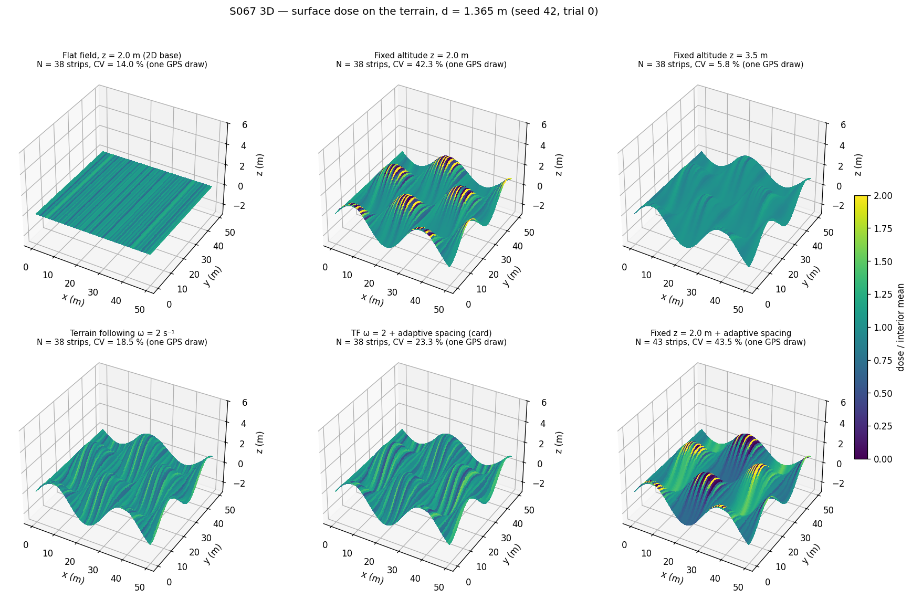
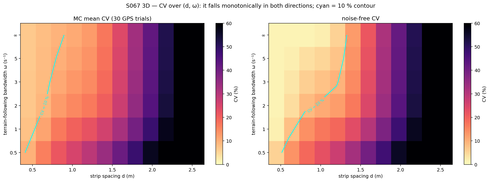
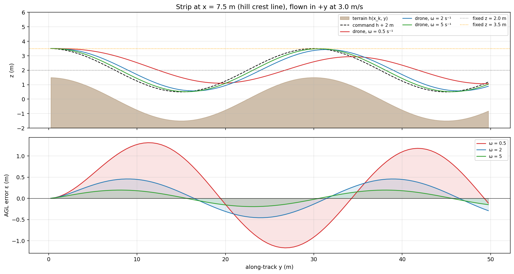
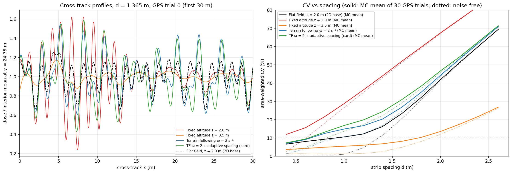
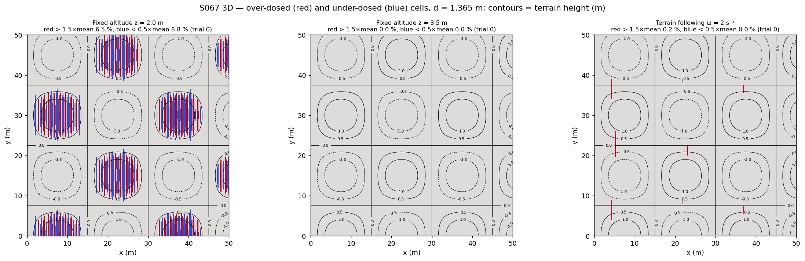
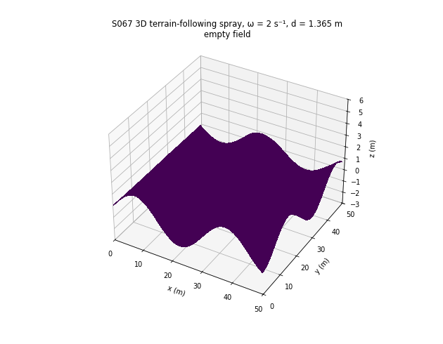

# S067 3D Upgrade — Spray Overlap Optimization on Undulating Terrain

**Domain**: Industrial & Agriculture | **Difficulty**: ⭐⭐⭐ | **Status**: ✅ Completed
**Based on**: [S067 Spray Coverage Overlap Optimization](../../s067_spray_overlap/README.md) (2D version)

---

## Problem Definition

**Setup**: As in the 2D S067, a drone sprays a 50 × 50 m field in parallel strips at 3 m/s. The spray cone has $\tan\theta_c = 0.5$, which gives $\sigma_s = 0.5$ m at 2 m height, and each strip is offset sideways by a GPS error $\mathcal N(0, 0.1^2)$. The 2D base works on a flat field at a fixed 2 m. It shows that CV(d) has no interior minimum, and that the useful design is the widest spacing with CV ≤ 10 %: **1.365 m** noise-free, or **0.662 m** at the 95th percentile under GPS error.

**What is 3D here**: the field is the card's hill $h(x, y) = 1.5\sin(2\pi x/30)\cos(2\pi y/30)$ m (relief ±1.5 m, slopes up to 17.4°). The altitude along every strip is a controlled state, and the spray footprint follows the actual drop height to the ground at every point.

**Configurations** (same GPS draws for all, `default_rng(42)`):

| Key | Altitude | Spacing | Source |
|---|---|---|---|
| **Flat field (2D base)** | z = 2.0 m, no terrain | $d$ | card configuration 1 |
| **Fixed z = 2.0 m** | constant 2.0 m, the same mean height above ground as the 2D plan; AGL 0.5–3.5 m | $d$ | card configuration 2 |
| **Fixed z = 3.5 m** | constant 3.5 m, never below 2 m above ground; AGL 2–5 m | $d$ | added (the safe 2D plan) |
| **Terrain following** | $\dot z = \omega(h + 2 - z)$, ω = 2 s⁻¹ | $d$ | card configuration 3 |
| **TF + adaptive spacing** | as above | $d_k = d\cdot z_{AGL}(x_k, 25)/2$ | card configuration 4 |
| Fixed z = 2.0 m + adaptive spacing | constant 2.0 m | $d_k$ as above | added |
| TF at 3.5 m AGL | ω = 2 s⁻¹, command $h + 3.5$ | $d$ | added ablation |

**Spacings**: 0.662 m (the 2D GPS-robust design), **1.365 m** (the 2D noise-free design) and 1.8 m (the card nominal), each with 100 GPS trials. A (d, ω) map covers d = 0.4–2.6 m and ω ∈ {0.5, 1, 2, 3, 5, ∞} with 30 trials per cell.

---

## Mathematical Model

**Terrain and slope**: $h$ as above; $\cos\phi = (1 + |\nabla h|^2)^{-1/2}$.

**Altitude**: along strip $k$ (odd strips fly −y), the drone follows $\dot z = \omega\,(h(x_k, y) + 2 - z)$ at 3 m/s, integrated exactly over 0.05 m sub-steps. Each strip starts settled on its command. The analytic lag error on the crest line is $1.5\,\Omega/\sqrt{\omega^2 + \Omega^2}$ with $\Omega = 2\pi v/\lambda = 0.628$ rad/s: 1.174 / 0.798 / 0.450 / 0.307 / 0.187 m for ω = 0.5 / 1 / 2 / 3 / 5 s⁻¹.

**Spray (mass-conserving cone)**: each droplet leaves the nozzle at an angle with $u = \tan(\text{angle}) \sim \mathcal N(0, 0.25^2)$ and lands on the ground directly along its path. With drop height $H(x) = z_{drone} - h(x, y)$ and cross-track offset $\Delta x = x - x_k - \varepsilon_k$, the mass per horizontal area is

$$q_h(x, y) = \frac{1}{v}\,p\!\left(\frac{\Delta x}{H(x)}\right)\frac{H(x) + \Delta x\,\partial_x h(x, y)}{H(x)^2}$$

(the Jacobian of $x \mapsto u$). On flat ground this is the 2D Gaussian with $\sigma_s = 0.25H$, normalised. The **dose per unit surface area** is $q_h\cos\phi$. Droplets beyond $|u| = 6\sigma_u$ are ignored, as in the 2D base. A shadowed cone (negative Jacobian inside $6\sigma_u$) is asserted never to happen.

**Uniformity**: the CV over the interior $x \in [1, 49]$ m is weighted by surface area ($1/\cos\phi$), as the card asks. Redundant cells have $D > 1.5\mu$ and under-dosed cells $D < 0.5\mu$, both area-weighted.

**Path length**: the 3D strip lengths, including the drone's climb and descent, plus the turns.

**Invariants (asserted)**: AGL ≥ 0.5 m at every nadir sample, GPS offsets inside the kernel window, and no shadowing.

---

## Key Parameters

| Parameter | Value | Source |
|---|---|---|
| Field | 50 × 50 m, interior x ∈ [1, 49] m | card / 2D base |
| Terrain | $A$ = 1.5 m, λ = 30 m in x and y | card |
| Nominal AGL / $\tan\theta_c$ / $\sigma_s$ | 2.0 m / 0.5 / 0.5 m | card |
| Strips | x = k d, $\lceil 50/d\rceil + 1$ strips (2D base); adaptive: $d_k = d\,z_{AGL}(x_k, 25)/2$, last strip clipped at 50 m | 2D base / card |
| Spacings | 0.662 / 1.365 / 1.8 m; curves 0.4–2.6 m in 0.2 m steps | 2D base designs / card nominal |
| ω | 2 s⁻¹ nominal; sweep 0.5, 1, 2, 3, 5, ∞ | card range 0.5–5 s⁻¹; nominal added |
| Fixed altitudes | 2.0 m and 3.5 m | added |
| GPS error | 0.1 m per strip | card |
| Cruise speed | 3 m/s | card |
| Grid | 0.05 m cross-track × 0.5 m along-track | 0.05 m from the 2D base; 0.5 m added (a 0.25 m grid changes the noise-free CV by < 0.001 percentage points) |
| Monte Carlo | 100 trials at the three spacings; 30 for curves and the (d, ω) map | card 100 / added |
| CV target, redundancy / under-dose thresholds | 10 %, 1.5 μ / 0.5 μ | 2D base |
| AGL floor | 0.5 m | added (card bound z ≥ 1 m conflicts, see Deviations) |

---

## Implementation

```
src/04_industrial_agriculture/3d/s067_3d_spray_overlap.py
```

```bash
conda activate drones
python src/04_industrial_agriculture/3d/s067_3d_spray_overlap.py
```

Runtime ≈ 4 min (6 worker processes; each job is deterministic and the results are re-assembled in job order). Runs with `OMP/OPENBLAS/MKL_NUM_THREADS=1` and with default threading printed byte-identical output and wrote byte-identical files.

---

## Results

**2D-base check**: on the flat field the noise-free CV is 0.01 / 9.99 / 30.72 % at d = 0.662 / 1.365 / 1.8 m, against 0.01 / 10.00 / 30.72 % in the 2D S067.

### Design spacing d = 1.365 m (100 GPS trials)

| Configuration | N | 3D path / time | CV noise-free | CV mean ± std (P95) | CV ≤ 10 % | > 1.5 μ / < 0.5 μ | AGL range | mean \|AGL − 2\| |
|---|---|---|---|---|---|---|---|---|
| Flat field (2D base) | 38 | 1950.5 m / 650.2 s | 9.99 % | 15.21 ± 1.20 % (16.94 %) | 0 % | 0.00 / 0.12 % | 2.00 m | 0.000 m |
| Fixed z = 2.0 m | 38 | 1950.5 m / 650.2 s | 41.59 % | 42.64 ± 0.35 % (43.25 %) | 0 % | 6.50 / 9.16 % | 0.52–3.48 m | 0.605 m |
| Fixed z = 3.5 m | 38 | 1950.5 m / 650.2 s | 2.27 % | **6.50 ± 0.73 %** (7.61 %) | **100 %** | 0.00 / 0.00 % | 2.02–4.98 m | 1.514 m |
| **Terrain following ω = 2** | 38 | 1969.4 m / 656.5 s | 15.76 % | **19.44 ± 0.92 %** (20.74 %) | 0 % | 0.39 / 0.24 % | 1.55–2.45 m | 0.171 m |
| TF + adaptive spacing (card) | 38 | 1968.8 m / 656.3 s | 21.14 % | 23.50 ± 1.50 % (25.72 %) | 0 % | 1.55 / 1.77 % | 1.55–2.45 m | 0.172 m |
| Fixed z = 2.0 m + adaptive | 43 | 2200.0 m / 733.3 s | 42.36 % | 43.75 ± 0.48 % (44.66 %) | 0 % | 6.64 / 10.04 % | 0.50–3.50 m | 0.634 m |
| TF at 3.5 m AGL (ablation) | 38 | 1969.4 m / 656.5 s | 4.75 % | 7.09 ± 0.47 % (7.97 %) | 100 % | 0.00 / 0.00 % | 3.05–3.95 m | 1.502 m |

**Per trial, common random numbers** (d = 1.365 m):

- Terrain following beats fixed z = 2.0 m in 100/100 trials, and fixed z = 3.5 m in 0/100.
- TF + adaptive spacing beats plain TF in 1/100 trials.
- Terrain following costs +4.23 ± 0.28 percentage points of CV against the flat field.
- The adaptive spacings range over 1.063–1.663 m (TF) and 0.853–1.871 m (fixed 2.0 m).
- TF at 3.5 m AGL beats fixed z = 3.5 m in 9/100 trials. Noise-free, its CV is 4.75 % with the ω = 2 lag and 1.41 % with perfect following at 3.5 m AGL.

### Other spacings (100 GPS trials, CV mean ± std)

| Configuration | d = 0.662 m | d = 1.8 m |
|---|---|---|
| Flat field (2D base) | 8.48 ± 0.81 % (96.0 % of trials ≤ 10 %) | 32.09 ± 0.49 % |
| Fixed z = 2.0 m | 17.29 ± 0.85 % | 59.55 ± 0.32 % |
| Fixed z = 3.5 m | 4.46 ± 0.47 % (100 %) | 10.32 ± 0.59 % (36.0 %) |
| Terrain following ω = 2 | 10.16 ± 0.67 % (39.0 %) | 34.93 ± 0.44 % |
| TF + adaptive spacing | 10.47 ± 0.66 % (22.0 %) | 38.17 ± 1.06 % |
| Fixed z = 2.0 m + adaptive | 30.53 ± 0.60 % | 56.47 ± 0.48 % |

Per trial at d = 0.662 m, TF beats fixed z = 2.0 m in 100/100 trials, and TF + adaptive beats TF in 2/100. At d = 1.8 m the figures are 100/100 and 0/100. The penalty for terrain following against the flat field is +1.68 ± 0.16 percentage points at 0.662 m and +2.84 ± 0.06 percentage points at 1.8 m.

### Widest spacing with CV ≤ 10 % (MC mean of 30 trials / noise-free)

| Configuration | MC mean | noise-free |
|---|---|---|
| Flat field (2D base) | 0.918 m | 1.359 m |
| Fixed z = 2.0 m | none ≥ 0.4 m | 0.608 m |
| Fixed z = 3.5 m | 1.775 m | 1.900 m |
| Terrain following ω = 2 | 0.654 m | 0.942 m |
| TF + adaptive spacing | 0.633 m | 0.819 m |

### Terrain-following bandwidth (MC mean CV, 30 trials)

| ω (s⁻¹) | 0.5 | 1 | 2 | 3 | 5 | ∞ | flat field |
|---|---|---|---|---|---|---|---|
| Widest d, MC mean / noise-free | 0.406 / 0.513 m | 0.528 / 0.669 m | 0.654 / 0.942 m | 0.717 / 1.218 m | 0.794 / 1.287 m | 0.895 / 1.329 m | 0.918 / 1.359 m |
| CV at d = 1.0 m | 25.17 % | 19.87 % | 14.84 % | 12.93 % | 11.61 % | 10.67 % | 10.51 % |
| CV at d = 1.4 m | 34.19 % | 25.84 % | 20.33 % | 18.65 % | 17.61 % | 16.91 % | 16.22 % |
| Max AGL error / min AGL (d = 1.4 m) | 1.312 / 0.688 m | 0.818 / 1.182 m | 0.457 / 1.543 m | 0.315 / 1.685 m | 0.195 / 1.805 m | 0 / 2.000 m | — |

Over the whole grid, the noise-free CV never decreases with d (True) and the MC mean CV never increases with ω (True).

### Dose-model ablation (d = 1.365 m; card formula vs this model, noise-free / MC mean of 30 trials)

| Configuration | Card $Q_0/\cos\phi\,e^{-\Delta x^2/2\sigma^2}$ | Mass-conserving cone (this model) |
|---|---|---|
| Flat field | 9.99 / 15.29 % | 9.99 / 15.29 % |
| Fixed z = 2.0 m | 41.11 / 42.19 % | 41.59 / 42.62 % |
| Fixed z = 3.5 m | 20.22 / 20.94 % | 2.27 / 6.62 % |
| Terrain following ω = 2 | 11.61 / 16.31 % | 15.76 / 19.50 % |

**Other checks**:

- **Slope floor.** A perfectly uniform deposit per horizontal area becomes a surface dose proportional to $\cos\phi$, with an area-weighted CV of 1.15 %.
- **Per horizontal area.** Without the $\cos\phi$ factor, the noise-free CV at d = 1.365 m is 9.99 % (flat), 41.41 % (fixed 2.0 m), 1.94 % (fixed 3.5 m), 15.74 % (TF) and 4.61 % (TF at 3.5 m).
- **Path length.** At d = 1.365 m: flat 1950.5 m, terrain following 1969.4 m (+0.97 %). The card's terrain-profile integral gives 50.56 m per 50 m strip (+1.11 %), within its "1–3 %".

### Key findings

- **Terrain following clearly beats a fixed altitude at the same mean height.** At fixed z = 2.0 m the hill tops are only 0.5 m below the nozzle. There the footprint is a quarter of its nominal width, the strips show through, and the over- and under-dosed bands sit exactly on the hill tops (`redundancy_maps.png`). The CV is 42.64 % against 19.44 % with terrain following, and TF wins in 100/100 trials at every spacing tested.
- **Lag matters, and no bandwidth fully recovers the flat field.** CV falls monotonically with ω. At ω = 0.5 s⁻¹ the AGL error reaches 1.312 m and the widest 10 % spacing collapses to 0.406 m; at ω = 5 s⁻¹ it is 0.794 m. Even perfect following (ω = ∞) stays below the flat field: 1.329 vs 1.359 m noise-free, 0.895 vs 0.918 m MC mean. The slope still reshapes the footprint (the Jacobian term), and the surface-dose conversion adds a 1.15 % floor. **There is no joint optimum $(d^*, \omega^*)$**: as in 2D, smaller $d$ and larger ω are always better.
- **The card's adaptive spacing makes things worse.** With terrain following it is worse than constant spacing in 98–100 of 100 trials at all three spacings (23.50 vs 19.44 % at 1.365 m). With fixed z = 2.0 m the mean CV is higher at 0.662 m (30.53 vs 17.29 %) and at 1.365 m (43.75 vs 42.64 %), and lower only at 1.8 m (56.47 vs 59.55 %), where both are far from usable. The rule picks one AGL per strip at y = 25 m, but the AGL varies along the strip. A likely mechanism: with a fixed nozzle flow, the local application rate is proportional to 1/spacing, so spacings ranging over 1.063–1.663 m create bands of different mean dose. This is a hypothesis; it was not isolated by a separate run.
- **The 2D plan flown higher is the most uniform plan here, and this rests on the dose model.** Fixed z = 3.5 m (AGL 2–5 m) gives 6.50 % at d = 1.365 m (100 % of trials ≤ 10 %), and its widest 10 % spacing is 1.775 m. In a mass-conserving model a wider footprint simply smooths more, so what limits uniformity is the lowest AGL relative to $d$. The ablation agrees: terrain following at the same 3.5 m AGL is not better (7.09 %, better in only 9/100 trials). Its noise-free CV falls from 4.75 % with the ω = 2 lag to 1.41 % with perfect following, so the lag-induced AGL ripple, which differs between neighbouring strips flown in opposite directions, is what costs uniformity at that height. **Caveats**: with the card's dose formula the ranking flips (fixed 3.5 m: 20.22 % vs TF 11.61 %), because a constant peak deposits more mass wherever the drone is higher. The model has no wind drift, which grows with release height and is the usual reason to spray low. Under the card's own model and at the card's 2 m height, terrain following is the right choice; whether to fly higher is a drift question this scenario cannot answer.
- **Card checks**: the card's 1.8 m nominal gives 34.93 % CV with terrain following and 30.72 % noise-free on the flat field. Use ≤ 0.654 m (TF, ω = 2, MC mean) to reach 10 %. The path overhead is 0.97–1.11 %, consistent with the card's 1–3 %.

### Figures

**Surface dose on the terrain** at d = 1.365 m for six configurations, GPS trial 0 (colour = dose / interior mean):



**CV over (d, ω)**: MC mean of 30 trials (left) and noise-free (right), with the 10 % contour in cyan:



**Altitude along a strip** on the hill crest line (x = 7.5 m) for ω = 0.5, 2 and 5 s⁻¹, with the fixed-altitude plans, and the AGL error ε below:



**Cross-track profiles** at y = 24.75 m (first 30 m, trial 0; flat field dashed) and **CV against spacing** (solid: MC mean of 30 trials; dotted: noise-free):



**Over-dosed (red, > 1.5 μ) and under-dosed (blue, < 0.5 μ) cells** with terrain contours, trial 0:



**Animation**: the dose builds up strip by strip on the terrain with terrain following (ω = 2 s⁻¹, d = 1.365 m, GPS trial 0). The red line and dot show the drone's 3D path, and the title gives the interior CV so far. 39 frames (empty field plus 38 strips):



### Deviations from the scenario card

| Card | Implementation | Reason |
|------|----------------|--------|
| $q_k = Q_0/\cos\phi\cdot\exp(-\Delta x^2/2\sigma_s^2)$ | Mass-conserving droplet cone with the exact slope Jacobian; surface dose $= q_h\cos\phi$. The card formula runs as an ablation | Vertical spray on a slope spreads the same mass over more surface, so the factor is $\cos\phi$, not $1/\cos\phi$. A fixed peak $Q_0$ adds mass when the footprint widens. Card corrected. |
| Nominal $d^*$ = 1.80 m | 1.365 m (the 2D S067 design); 0.662 and 1.8 m also run | The 2D S067 showed 1.8 m gives CV 30.7 % on the flat field. Card corrected. |
| Joint optimum $(d^*, k_{tf}^*)$ from the heat map | Widest d with CV ≤ 10 % per ω; monotonicity checked | CV is monotone in both d and ω, so the argmin is degenerate (as in 2D). Card corrected. |
| Adaptive spacing $d\cos\phi + \alpha\lvert\nabla h\rvert^{-1}d$ | Not used; the card's second (AGL-ratio) formula is implemented | Singular where $\nabla h = 0$. Card corrected. |
| "Footprint compressed horizontally by $\cos\phi$ on a cross-slope" | Not used | A vertical spray is stretched downhill and shortened uphill (the Jacobian), not compressed. Card corrected. |
| $z_{drone} \in [1.0, 8.0]$ m | AGL ≥ 0.5 m asserted | The terrain-following command reaches 0.5 m in the valleys. Card corrected. |
| "Fixed altitude" height unspecified | 2.0 m (same mean AGL) and 3.5 m (min AGL 2 m) | Both readings matter and lead to opposite conclusions. |
| $\omega_{tf}$ nominal unspecified | ω = 2 s⁻¹; full sweep 0.5–5 s⁻¹ and ∞ | Middle of the card range; every conclusion is printed for all ω. |
| 0.1 × 0.1 m dose grid | 0.05 m cross-track × 0.5 m along-track | The along-track dose varies on the 30 m terrain scale. A 0.25 m check changes the CV by < 0.001 percentage points. |
| Sweep $d$ ∈ [0.5, 4] m | 0.4–2.6 m in 0.2 m steps (30 trials) plus three 100-trial design points | Runtime. Every widest-10 % spacing found lies inside this range. |
| Redundancy threshold only | Under-dose (< 0.5 μ) area added | Shows the gaps on the hill tops. |
| Animation shows dose accumulating | As specified; 4 fps, 39 frames | — |
| Plot list | `dose_surfaces.png`, `cv_heatmap.png`, `altitude_strip.png`, `profiles_cv_curves.png`, `redundancy_maps.png`, `animation.gif` | The CV-vs-spacing curves and the cross-track profiles share one figure. |

---

## Extensions

1. **Spray drift**: add a crosswind and droplet fall time proportional to release height; this is the missing cost of flying higher, which would decide between the 3.5 m fixed plan and 2 m terrain following.
2. **Feed-forward terrain following** (card extension 1): a look-ahead command removes most of the lag, which is what keeps TF short of the flat field.
3. **Flow-rate control** (card extension 4): vary the flow with the local footprint instead of the spacing, so the application rate does not change.
4. **Direction-consistent strips**: fly all strips in the same direction so that neighbouring lag errors match, and test whether this removes the lag ripple seen at 3.5 m AGL.

---

## Related Scenarios

- 2D card: [S067 Spray Coverage Overlap Optimization](../../../../scenarios/04_industrial_agriculture/S067_spray_overlap.md)
- 3D card: [S067 3D Upgrade — Spray Overlap Optimization](../../../../scenarios/04_industrial_agriculture/3d/S067_3d_spray_overlap.md)
- Multi-drone extension: [S068 Large-Scale Farmland Cooperative Spraying](../../../../scenarios/04_industrial_agriculture/S068_large_field_spray.md)
- Terrain-following coverage: [S048 Full-Area Coverage Scan (Lawnmower)](../../../../scenarios/03_environmental_sar/S048_lawnmower.md)
