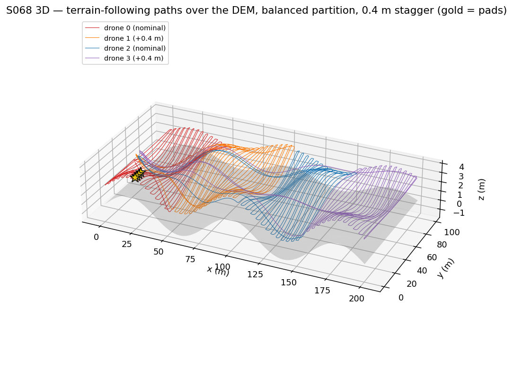
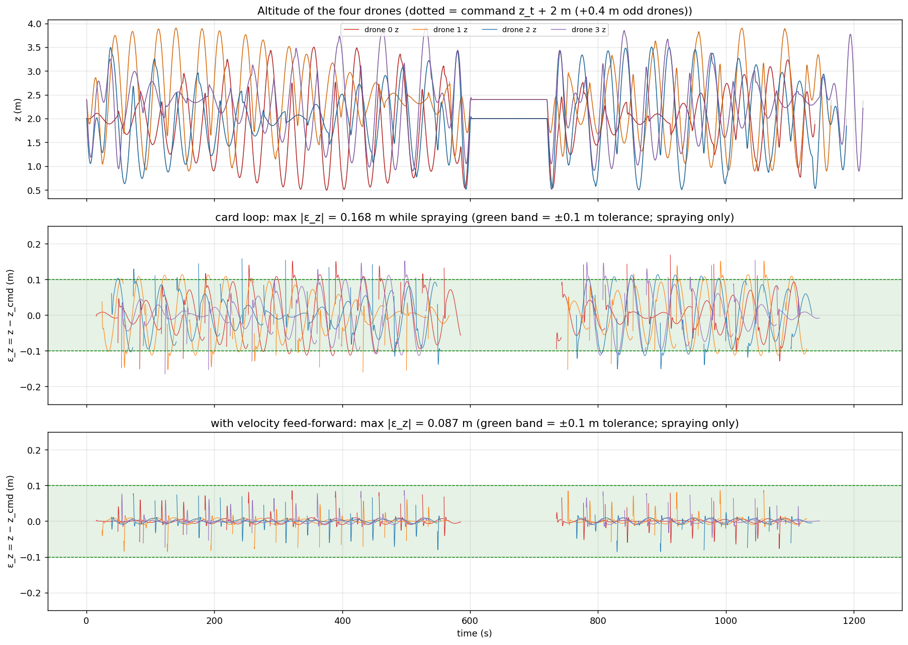
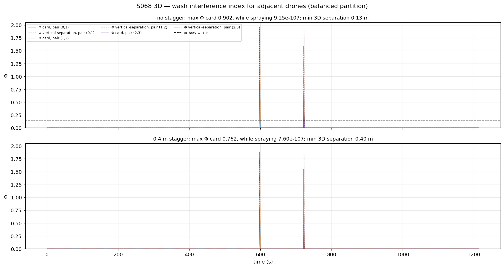
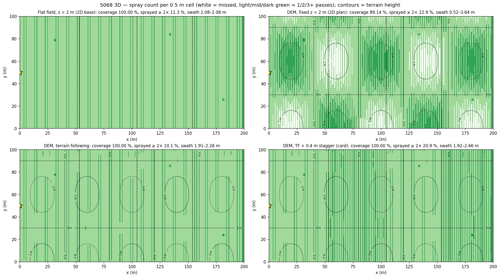
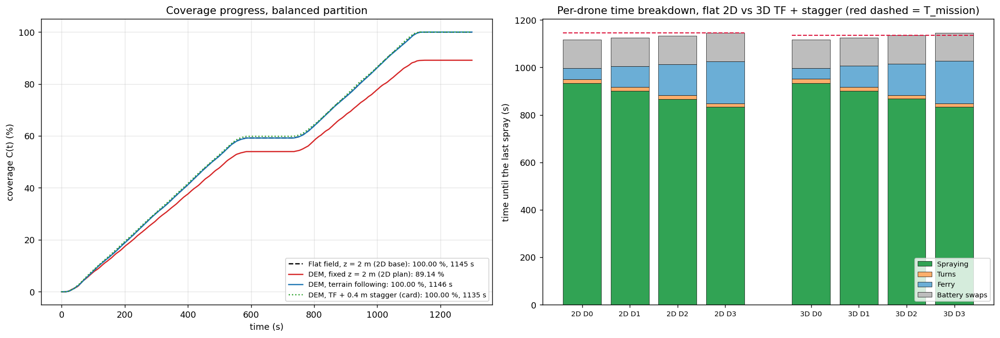
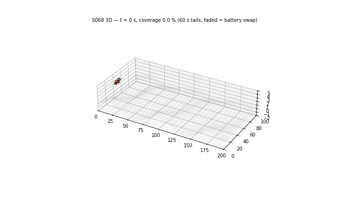

# S068 3D Upgrade — Large-Scale Field Spraying over a DEM

**Domain**: Industrial & Agriculture | **Difficulty**: ⭐⭐⭐⭐ | **Status**: ✅ Completed
**Based on**: [S068 Large-Scale Farmland Cooperative Spraying](../../s068_large_field_spray/README.md) (2D version)

---

## Problem Definition

**Setup** (from the 2D S068): four drones spray a 200 × 100 m field with boustrophedon runs along y (1.9 m run spacing, 106 runs) at 3 m/s. A battery gives 600 s of flight and a swap at the station near (0, 50) takes 120 s. A drone returns when the time flown plus the time home reaches the battery limit; the trigger is solved exactly along the current leg. It then resumes at the exact stopping point. The 2D base's best partition, **B** (contiguous run blocks of 28/27/26/25 runs chosen by a dynamic programme), finishes in 1144.1 s; the equal 50 m partition **E** finishes in 1175.9 s.

**What is 3D here**: the field lies on the card's DEM $z_t = 1.5\sin(2\pi x/80)\cos(2\pi y/120)$ m, and the altitude is a controlled state:

- **Swath follows the nozzle height.** The cone half-angle is 27.5°, so the swath is $w = 2\,(z - z_t)\tan 27.5°$: 2.082 m at 2 m above ground. Neighbouring runs 1.9 m apart touch only while the nozzle is at least 1.825 m above the ground.
- **Altitude plans**: a fixed altitude (the 2D plan), or terrain following at 2 m AGL with the card's second-order loop, with or without velocity feed-forward. Odd-numbered drones optionally fly 0.4 m higher (the card's stagger).
- **3D flight time**: every leg takes its 3D path length / 3 m/s. The battery trigger uses the exact terrain-following path home; the card's straight-line 3D estimate is reported alongside.
- **Wash interference**: the card's index $\Phi$ for adjacent drones, plus a corrected index that uses the vertical separation between the two drones. The minimum 3D separation between any two drones is also tracked.

**Configurations** (each run with partitions E and B; B is the reference):

| Key | DEM | Altitude | Stagger | Loop |
|---|---|---|---|---|
| Flat field (2D base) | none | z = 2 m | — | — |
| **Fixed z = 2 m (2D plan)** | 1.5 m | z = 2 m above the datum (AGL 0.5–3.5 m) | — | — |
| Fixed z = 3.5 m | 1.5 m | z = 3.5 m (AGL ≥ 2 m) | — | — (added) |
| **Terrain following** | 1.5 m | $z_t + 2$ m | 0 | card |
| **TF + stagger (card)** | 1.5 m | $z_t + 2$ m (+0.4 m odd drones) | 0.4 m | card |
| TF + stagger + feed-forward | 1.5 m | as above | 0.4 m | card + $K_{zd}\dot z_{cmd}$ (added) |

The mission is deterministic (no random inputs), so there is no Monte Carlo. Sweeps cover the stagger, the DEM amplitude and the pad spacing.

---

## Mathematical Model

**Altitude loop** (card), sampled at Δt = 0.2 s and integrated with 10 sub-steps:

$$\ddot z = K_z(z_{cmd} - z) - K_{zd}\,\dot z,\qquad K_z = 4\ \text{s}^{-2},\ K_{zd} = 2\ \text{s}^{-1}\ (\omega_n = 2\ \text{rad/s},\ \zeta = 0.5)$$

The feed-forward variant (added) uses $K_{zd}(\dot z_{cmd} - \dot z)$ instead. Along a run the DEM varies at $\Omega = 2\pi v/\lambda_y = 0.157$ rad/s. The card loop therefore has a steady tracking error of $1.5\,|1 - H(j\Omega)| = 0.119$ m on the steepest runs, larger than its own 0.1 m tolerance. Feed-forward reduces this to 0.0093 m.

**Flight**: the 2D base's event-based plan and exact battery trigger, with every leg time equal to the 3D length of the terrain-following path (sampled every 1 m) divided by 3 m/s. Each drone has its own pad at $(0, 50 + 3(i - 1.5))$ m. Charging is modelled as hovering at pad height for 120 s; take-off and landing are not modelled.

**Coverage** (card): a 0.5 m cell counts as sprayed when it lies within $r = (z - z_t)\tan 27.5°$ of a spray run. $r$ is evaluated along the run every 0.25 m from the drone's simulated altitude.

**Wash** (card): $v_{w,i}(\mathbf q) = V_0\exp(-\rho^2/2\sigma_w^2 - \Delta z_i^2/2\sigma_z^2)$ with $V_0$ = 8 m/s, $\sigma_w$ = 0.6 m, $\sigma_z$ = 1.5 m.

- **Card index**: $\Phi_{ij} = (v_{w,i}(\mathbf p_j) + v_{w,j}(\mathbf p_i))/V_0$, where the card's $\Delta z_i$ is the height of drone $i$ above the ground under drone $j$.
- **Corrected index**: uses the vertical separation, $\Phi^{vs}_{ij} = 2\exp(-\rho^2/2\sigma_w^2)\exp(-(z_i - z_j)^2/2\sigma_z^2)$.
- Both indices are evaluated only while both drones are airborne.

**Invariants (asserted)**: battery ≥ 0 and the pad always reachable; nozzle > 0.3 m above the ground on every spray run; any airborne drone > 0.3 m above the ground.

---

## Key Parameters

| Parameter | Value | Source |
|---|---|---|
| Field / runs / run spacing | 200 × 100 m / 106 runs / 1.9 m | 2D base |
| Partitions | E (equal 50 m) and B (blocks of 28/27/26/25 runs, optimised in 2D) | 2D base |
| Speed / battery / swap | 3 m/s (3D airspeed) / 600 s / 120 s | card |
| DEM | $A$ = 1.5 m, $\lambda_x$ = 80 m, $\lambda_y$ = 120 m | card |
| $h_{AGL}$ / stagger $\Delta h$ | 2.0 m / 0.4 m (swept 0, 0.4, 1, 2 m) | card |
| Cone half-angle | 27.5° (swath 2.082 m at 2 m) | card |
| $K_z$ / $K_{zd}$ / $\epsilon_z$ | 4 s⁻² / 2 s⁻¹ / 0.1 m | card |
| $V_0$ / $\sigma_w$ / $\sigma_z$ / $\Phi_{max}$ | 8 m/s / 0.6 m / 1.5 m / 0.15 | card |
| Altitude range | 1.5–5.0 m, read as height above ground | card (see Deviations) |
| Coverage grid / Δt | 0.5 m / 0.2 s | card |
| Pads | one per drone, 3 m apart (swept 0, 1, 3, 6 m) | added |
| Fixed-altitude plans | 2.0 m and 3.5 m | 2D base / added |
| Path sampling / loop sub-steps | 1 m / 10 per Δt | added |

---

## Implementation

```
src/04_industrial_agriculture/3d/s068_3d_large_field_spray.py
```

```bash
conda activate drones
python src/04_industrial_agriculture/3d/s068_3d_large_field_spray.py
```

The script imports the 2D base module for the run grid and the DP partition. Runtime ≈ 30 s. Two runs with `OMP/OPENBLAS/MKL_NUM_THREADS=1` and one with default threading printed byte-identical output; two of them were checked file by file and wrote byte-identical PNGs and GIF.

---

## Results

**2D-base reproduction**: on a flat field, with one shared station point and a 1.0 m swath radius, the script reproduces the 2D S068 exactly. T_mission is 1175.9 s (E) and 1144.1 s (B), and all drones are home at 1244.3 / 1212.5 s.

### Partition B (pads 3 m apart)

| Configuration | T_mission | All home | Coverage | Sprayed ≥ 2× | AGL while spraying | Swath | Max \|ε_z\| (> 5 s into a run) | Spray time with \|ε_z\| > 0.1 m |
|---|---|---|---|---|---|---|---|---|
| Flat field (2D base) | 1145.2 s | 1213.3 s | 100.000 % | 11.30 % | 2.000 m | 2.082 m | n/a (no loop) | n/a |
| **Fixed z = 2 m (2D plan)** | **never** | 1213.3 s | **89.141 %** | 22.85 % | 0.500–3.500 m (22.9 % outside 1.5–5 m) | 0.521–3.644 m | n/a (no loop) | n/a |
| Fixed z = 3.5 m | 1125.4 s | 1213.3 s | 100.000 % | **80.43 %** | 2.000–5.000 m | 2.082–5.206 m | n/a (no loop) | n/a |
| **Terrain following** | 1146.2 s | 1214.5 s | **100.000 %** | 10.12 % | 1.835–2.168 m | 1.911–2.258 m | 0.168 m (0.114 m) | 10.29 % |
| TF + feed-forward (no stagger) | 1146.2 s | 1214.5 s | 100.000 % | 11.29 % | 1.914–2.087 m | 1.993–2.173 m | 0.087 m (0.041 m) | 0 % |
| TF + 0.4 m stagger (card) | 1134.7 s | 1214.5 s | 100.000 % | 20.89 % | 1.849–2.554 m | 1.925–2.659 m | 0.168 m (0.114 m) | 10.29 % |
| TF + stagger + feed-forward | 1134.7 s | 1214.5 s | 100.000 % | 21.54 % | 1.914–2.487 m | 1.993–2.589 m | **0.087 m** (0.041 m) | **0 %** |

The fixed-altitude plans have no altitude loop: their altitude equals the command by construction, so $\varepsilon_z$ does not apply to them. Every configuration needs one swap per drone. With partition E the picture is the same: fixed z = 2 m covers 89.141 %, terrain following covers 100.000 % in 1177.9 s against 1176.9 s on the flat field, and the card loop peaks at 0.174 m (10.21 % of spray time above 0.1 m).

**Last spray per drone (B)**: 1116.3, 1126.0, 1134.8, 1146.3 s with terrain following, both with and without the stagger, against 1116.0, 1125.5, 1133.4, 1145.3 s on the flat field. The stagger's lower T_mission (1134.7 vs 1146.2 s) is therefore a coverage effect, not a faster flight. Drone 3 is odd and gets the 2.5 m swath, which covers the last cells before its final run; all drones are home at 1214.5 s in both cases.

**Overhead of terrain following (B)**: +1.0 s of T_mission without the stagger. The card's straight-line 3D return estimate is 0.103 s (B) or 0.126 s (E) shorter than the actual terrain-following flight home.

### Wash interference and separation (B)

| Configuration | Max Φ card (while spraying) | Samples with Φ card > 0.15 | Max Φ vertical-separation | Min 3D separation | Min horizontal separation while spraying |
|---|---|---|---|---|---|
| Flat field | 0.804 (4.9e-107) | 0.15 % | 1.956 | 0.13 m | 13.3 m |
| Fixed z = 3.5 m | 0.077 (2.7e-107) | 0.00 % | 1.956 | 0.13 m | 13.3 m |
| Terrain following | 0.902 (9.3e-107) | 0.15 % | 1.953 | 0.13 m | 13.3 m |
| **TF + 0.4 m stagger** | **0.762** (7.6e-107) | 0.15 % | 1.891 | **0.40 m** | 13.3 m |

**Where the drones meet**: drones 2 and 3 come closest at t ≈ 597.6 s (TF) or 722.4 s (TF + stagger), near (7.0, 53.3) m. Both are ferrying to or from their adjacent pads around the simultaneous battery swap. The pair-time with horizontal separation below 2 m totals 8.4 s: 6.4 s for drones 2–3 and 2.0 s for drones 0–1. The vertical gap of drones 2–3 at closest approach is 0.01 m without the stagger and 0.38 m with it.

| Stagger Δh (B, TF) | 0 | 0.4 m | 1.0 m | 2.0 m |
|---|---|---|---|---|
| Max Φ card / vertical-separation | 0.902 / 1.953 | 0.762 / 1.891 | 0.607 / 1.577 | 0.483 / 0.817 |
| Min 3D separation | 0.13 m | 0.40 m | 0.99 m | 1.98 m |
| Sprayed ≥ 2× | 10.12 % | 20.89 % | 36.93 % | 54.06 % |
| Coverage | 100.000 % | 100.000 % | 100.000 % | 100.000 % |

| Pad spacing (B, TF + stagger) | 0 m | 1 m | 3 m | 6 m |
|---|---|---|---|---|
| Max Φ card / vertical-separation | 0.733 / 1.930 | 0.783 / 1.915 | 0.762 / 1.891 | 0.716 / 1.863 |
| Min 3D separation | 0.00 m | 0.40 m | 0.40 m | 0.42 m |

### DEM amplitude sweep (B)

One factor changes at a time: altitude mode (fixed → TF), feed-forward (TF → TF + FF), stagger (TF → TF + stagger).

| $A$ | Coverage fixed z = 2 m / TF / TF + FF / TF + stagger / TF + stagger + FF | Max \|ε_z\| TF / TF + FF / TF + stagger / TF + stagger + FF | Sprayed ≥ 2× TF / TF + stagger | Fixed-plan AGL | T_mission TF |
|---|---|---|---|---|---|
| 0.5 m | 98.324 / 100.000 / 100.000 / 100.000 / 100.000 % | 0.0583 / 0.0293 / 0.0583 / 0.0293 m | 11.30 / 21.55 % | 1.50–2.50 m | 1145.3 s |
| 1.0 m | 93.946 / 100.000 / 100.000 / 100.000 / 100.000 % | 0.1176 / 0.0591 / 0.1176 / 0.0591 m | 11.25 / 21.50 % | 1.00–3.00 m | 1145.7 s |
| 1.5 m | 89.141 / 100.000 / 100.000 / 100.000 / 100.000 % | 0.1683 / 0.0867 / 0.1683 / 0.0867 m | 10.12 / 20.89 % | 0.50–3.50 m | 1146.2 s |

### Key findings

- **Terrain following is what keeps the field covered (2D baseline comparison).** Flown at a fixed 2 m over the DEM, the 2D plan covers only 89.141 % of the field, and T_mission is never reached. Over the hills the swath shrinks to 0.521 m, so the runs no longer touch (white streaks in `coverage_maps.png`). In the valleys it widens to 3.644 m and double-sprays. The gap grows with relief: 98.324 / 93.946 / 89.141 % for A = 0.5 / 1.0 / 1.5 m. Terrain following covers 100.000 % at every amplitude and costs only +1.0 s of mission time. Raising the fixed plan to 3.5 m also covers everything, but 80.43 % of the field is then sprayed at least twice, against 10.12 % with terrain following.
- **The card's altitude loop misses its own tolerance.** It damps the absolute vertical speed, so it lags a moving command. The maximum error while spraying is 0.168 m, 10.29 % of spray time is above 0.1 m, and even more than 5 s into a run the error reaches 0.114 m (analytic steady value 0.119 m). Coverage survives only narrowly: the lowest AGL, 1.835 m, is just above the 1.825 m at which neighbouring swaths separate. Velocity feed-forward cuts the maximum to 0.087 m, with 0 % of spray time above 0.1 m, with or without the stagger (0.087 m in both). More than 5 s into a run its error stays at 0.041 m (B), so the remaining peaks are turn transients.
- **The 0.4 m stagger does not do what the card says.** While spraying, adjacent drones are at least 13.3 m apart, so the wash index stays below $10^{-106}$ with or without a stagger. The index exceeds 0.15 only during the simultaneous battery swaps, when drones 2 and 3 converge on neighbouring pads. There the stagger lowers the maximum from 0.902 to 0.762, still far above $\Phi_{max}$ = 0.15. Most of that drop comes from the card's formula, which measures the wash at the ground rather than at the other drone. With the vertical separation between the drones, the drop is only from 1.953 to 1.891.
- **The real 3D conflict is near-collision at the station, not spray interference.** Without a stagger, drones 2 and 3 pass within 0.13 m of each other at the same altitude near the pads. The 0.4 m stagger turns this into a 0.40 m vertical gap, still less than any real airframe size. Spacing the pads 1–6 m apart does not change it (0.40–0.42 m); with one shared pad point the drones coincide (0.00 m). The separation tracks the stagger (0.99 m at 1 m, 1.98 m at 2 m), but each step adds overspray from the higher drones' wider swath (36.93 % and 54.06 % sprayed twice or more). Separating the swap times, or using an approach corridor per pad, would address the cause; this was not simulated.
- **Card checks**: ±0.3 m AGL → ±15.0 % swath ✓. Swath at 2 m: 2.082 m (card "≈ 2.0" ✓). "Tracking error below 0.1 m throughout" ✗ (0.168 m). "Φ below 0.15 once stagger applied" ✗ (0.762). Full coverage ✓ with terrain following. The 3D straight-line battery trigger is optimistic by 0.103–0.126 s.

### Figures

**3D paths** over the DEM: TF + stagger, partition B, with the pads in gold:



**Altitude**: the four drones and their commands (top), and the tracking error while spraying with the card loop (middle) and with feed-forward (bottom), against the ±0.1 m band. The flat stretch at 600–720 s is the battery swap:



**Wash interference index** for adjacent pairs, without (top) and with (bottom) the stagger. Solid lines are the card index and dashed lines the vertical-separation index. Both spike only around the swaps:



**Spray count per cell** (white = missed) for the flat field, the fixed 2 m plan, terrain following and TF + stagger, with terrain contours:



**Coverage progress** (left) and the **per-drone time breakdown** for the flat 2D field and the 3D TF + stagger mission (right):



**Animation**: oblique 3D view of TF + stagger with 60 s trajectory tails. Faded markers are drones swapping batteries. 58 frames, one every 20 s, the last at 1134.8 s:



### Deviations from the scenario card

| Card | Implementation | Reason |
|------|----------------|--------|
| Tracking error "below 0.1 m throughout" with $\ddot z = K_z e - K_{zd}\dot z$ | The card loop is run as given (max 0.168 m), plus a velocity feed-forward variant | The steady lag of the card loop is 0.119 m on this DEM. Card corrected. |
| "Φ < 0.15 for all t once stagger is applied"; Φ uses each drone's height above the ground | Card index computed as written, plus an index based on the vertical separation | The card index does not depend on the separation between the drones, and it exceeds 0.15 at the swaps with or without the stagger. Card corrected. |
| Return trigger $t + d_{3D}/v \ge T_{bat}$ | Exact terrain-following path time home | The straight-line 3D distance underestimates the path, so it is not conservative (0.103–0.126 s here). Card corrected. |
| One charging station at (0, 50) with unlimited capacity | One pad per drone, 3 m apart (swept 0–6 m) | Four drones cannot occupy one point. |
| Altitude range 1.5–5.0 m | Read as AGL; reported, not enforced (the fixed 2 m plan leaves it 22.9 % of the spray time) | The terrain-following command itself goes below 1.5 m above the datum. Card corrected. |
| Partitions from S068 | E and the 2D-optimised B are reused, not re-optimised in 3D | The 3D overhead is +1.0 s, which would not move a DP cut. |
| Fixed time step 0.2 s for the whole simulation | Event-based flight as in the 2D base; 0.2 s (10 sub-steps) for the altitude loop, coverage and wash sampling | Exact battery logic; the altitude loop needs the finer step. |
| Wash zones "rendered as translucent cylinders" in the animation | Trajectory tails only; Φ in its own figure | The interference happens only at the pads, a few seconds out of 1200. |
| "Dose uniformity" heatmap | Spray count per cell (1/2/3+) | Coverage in the card is boolean; the count shows gaps and overspray. |
| — | Fixed 3.5 m plan, feed-forward loop, stagger / amplitude / pad sweeps, separation tracking | Needed to test the card's claims and the 2D baseline fairly. |

---

## Extensions

1. **Staggered swap times** (card extension 4 in spirit): offset the drones' start times so that they do not converge on the station together, then re-check the separation.
2. **Approach corridors per pad**: assign each drone an altitude layer only for the ferry legs, where the conflicts actually occur, instead of while spraying, where the stagger only adds overspray.
3. **Flow-rate modulation with AGL** (card extension 5): keep the dose constant as the swath changes with the loop error.
4. **DEM preview / feed-forward from the map**: compute $\dot z_{cmd}$ from the planned path to remove the turn transients that remain with feed-forward.

---

## Related Scenarios

- 2D card: [S068 Large-Scale Farmland Cooperative Spraying](../../../../scenarios/04_industrial_agriculture/S068_large_field_spray.md)
- 3D card: [S068 3D Upgrade — Large-Scale Field Spraying](../../../../scenarios/04_industrial_agriculture/3d/S068_3d_large_field_spray.md)
- Spray overlap on terrain: [S067 Spray Coverage Overlap Optimization](../../../../scenarios/04_industrial_agriculture/S067_spray_overlap.md)
- Wash and multi-drone background: [S070 Swarm Weeding Task](../../../../scenarios/04_industrial_agriculture/S070_swarm_weeding.md)
