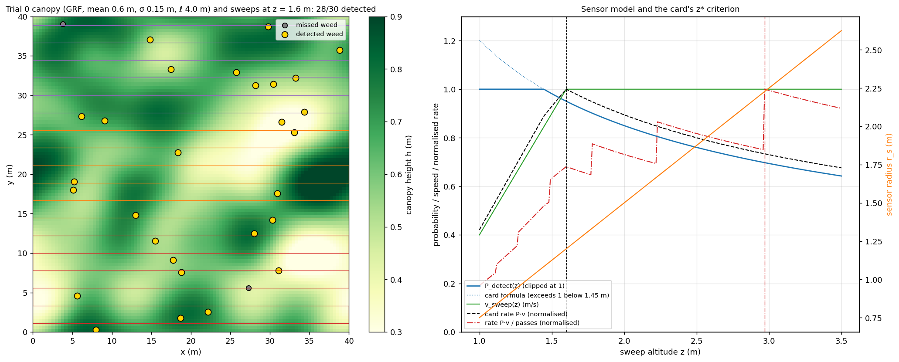
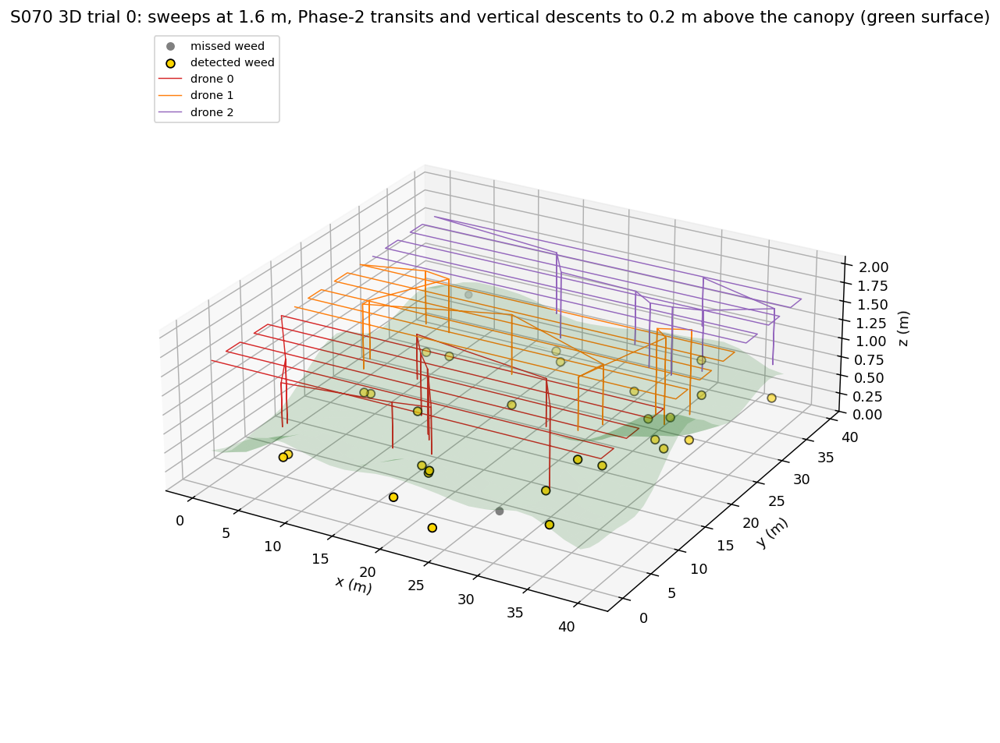
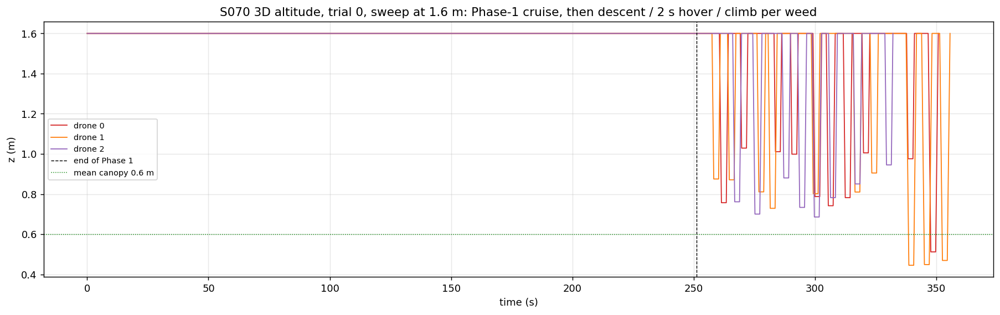
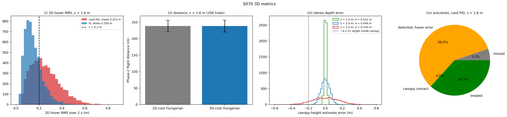
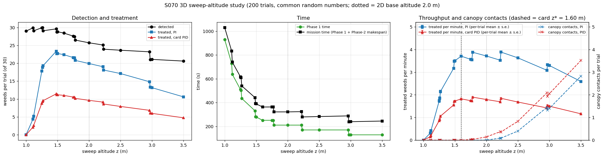
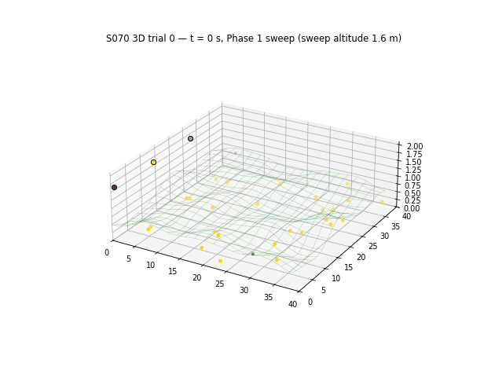

# S070 3D Upgrade — Swarm Weeding with Canopy and Sweep-Altitude Choice

**Domain**: Industrial & Agriculture | **Difficulty**: ⭐⭐⭐⭐ | **Status**: ✅ Completed
**Based on**: [S070 Swarm Weeding Task](../../s070_swarm_weeding/README.md) (2D version)

---

## Problem Definition

**Setup**: the 2D S070 mission with its fixes. Three drones sweep 13.3 m sub-strips of a 40 × 40 m field holding 30 weeds, using evenly spaced passes and one Bernoulli detection draw per pass encounter. The detected weeds are shared out by capacitated Hungarian assignment, each drone visits its weeds in nearest-neighbour order, and it hovers 2 s over each one under the card PID (2, 0.1, 0.5) or a PI loop (Kd = 0). The horizontal arrival offset is 0.3 m and GPS noise is 0.1 m. In the 2D base the altitude is implicit: it is the 2 m reference height of the sensor model.

**What is 3D here**: the crop canopy is a Gaussian random field: mean 0.6 m, std 0.15 m, correlation length 4 m, on a 100 × 100 grid, interpolated bilinearly. Altitude becomes a planned state in both phases:

- **Phase 1 at sweep altitude z.** Sensor radius $r_s = 1.5\,z/2$, so fewer passes are needed when higher. Detection probability per encounter $P(z) = \min(1, 0.85\sqrt{2/z})$. Safe speed $v(z) = \min(1, z - 0.6)$ m/s. The camera needs line of sight, $z > h$. Stereo depth noise $\sigma_z(z) = 0.05\,(z/2)^2$ m on the canopy height above each detected weed.
- **Phase 2.** Each drone transits at z, descends vertically to $\hat z_{treat} = \hat h + 0.2$ m, hovers 2 s under a 3D controller, and climbs back. A treatment succeeds when the 3D RMS error to the *true* point 0.2 m above the canopy is ≤ 0.20 m **and** the drone never touches the canopy. A sweep that clears the highest canopy under its passes by less than 0.2 m makes the whole mission invalid: nothing is treated.
- **Assignment cost**: 3D Euclidean cost (card) compared with the 2D cost of the base.

**2D baseline**: the base plan at its implicit z = 2 m, with everything else identical. The first random draws of every trial are the 2D base's, so at z = 2 m the detections reproduce the base exactly (25.71 ± 1.94).

**Altitudes**: z ∈ {1.0, 1.25, 1.5, 1.6 (the card's z\*), 1.75, 2.0, 2.5, 3.0, 3.5} m, each over 200 trials. Every trial uses common random numbers across altitudes, controllers and assignment costs.

---

## Mathematical Model

- **Canopy**: white noise filtered by a Gaussian of std $\ell/\sqrt2$ (the squared-exponential kernel), scaled to $\sigma_h$ = 0.15 m and clipped at 0.05 m. Trial 0 has mean 0.602 m, std 0.147 m and range 0.194–1.011 m. At the weeds over all trials: mean 0.601 m, std 0.150 m.
- **Passes**: $n(z) = \lceil 13.33 / 2r_s(z)\rceil$, evenly spaced (the base fix of the card's `arange`). Phase-1 time = path length / $v(z)$.
- **Detection** (base + card LOS): weed j is encountered on a pass when the GPS-noisy lateral distance is ≤ $r_s(z)$ and $z > h(\mathbf w_j)$. Each encounter is one Bernoulli(P(z)) draw.
- **Treatment target**: $(x_j, y_j, h_j + 0.2 + \delta z_j)$ with $\delta z_j \sim \mathcal N(0, \sigma_z(z)^2)$. The camera re-acquires the weed horizontally, as in the base.
- **3D hover**: the card PID or PI acts on the GPS-noisy 3D error to the target. The command is saturated at 1 m/s (asserted). Arrival offset: 0.3 m in x and y (base), and 0 in z, because the descent ends on its target (swept 0 / 0.1 / 0.3 m). The success metric is the RMS over 2 s of the distance to the true point $(x_j, y_j, h_j + 0.2)$. A canopy contact is any step with $z_{drone} < h(x, y)$ under the drone.
- **Phase-2 routes**: L-shaped legs (transit at z, vertical descent, 2 s hover, climb) at 1 m/s. Mission time = Phase 1 + Phase-2 makespan.
- **Card's optimal altitude**: $z^* = \arg\max P(z)\,v(z)$ (card), compared with $P(z)\,v(z)/n(z)$, which counts the passes.

---

## Key Parameters

| Parameter | Value | Source |
|---|---|---|
| Field / drones / weeds | 40 × 40 m / 3 / 30 | card |
| Canopy $\bar h$ / $\sigma_h$ / $\ell$ / grid | 0.6 m / 0.15 m / 4 m / 100 × 100 | card |
| $r_{s,0}$ / $z_{ref}$ / $P_0$ / β | 1.5 m / 2.0 m / 0.85 / 0.5 | card ($P$ clipped at 1) |
| $\sigma_{z,0}$ | 0.05 m at 2 m, ∝ $z^2$ | card |
| $v_{max}$ / $\Delta h_{safe}$ | 1 m/s / 1.0 m | card / 2D base speed |
| Sweep altitudes | 1.0–3.5 m (9 values) | card range |
| $\Delta h_{clear}$ / $\epsilon_{pos,3D}$ | 0.20 m / 0.20 m | card |
| $\sigma_{GPS}$ | 0.10 m on all axes | card |
| PID (Kp, Ki, Kd) / PI | (2, 0.1, 0.5) / (2, 0.1, 0) | card / 2D base comparison |
| $T_{treat}$ / Δt | 2 s / 0.05 s | card |
| Arrival offset | 0.3 m in x and y; 0 m in z (swept 0, 0.1, 0.3 m) | 2D base / added |
| Vertical speed in Phase 2 | 1 m/s | added (same as the horizontal speed) |
| Trials | 200 (seeds 42–241); canopy and stereo stream `default_rng(10000 + seed)` | 2D base / added |

---

## Implementation

```
src/04_industrial_agriculture/3d/s070_3d_swarm_weeding.py
```

```bash
conda activate drones
python src/04_industrial_agriculture/3d/s070_3d_swarm_weeding.py
```

The script imports the 2D base module for the Hungarian assignment and the nearest-neighbour order. Runtime ≈ 45 s. Two runs with `OMP/OPENBLAS/MKL_NUM_THREADS=1` and one with default threading printed byte-identical output and wrote byte-identical PNGs and GIF.

---

## Results

### Sweep-altitude study (200 trials, means ± std per trial)

| z (m) | Passes | $P_{detect}$ | v (m/s) | Phase 1 | Detected | $\sigma_z$ | Treated PID / **PI** | Canopy contacts PID / PI | Mission | Treated/min PID / **PI** (per-trial mean) |
|---|---|---|---|---|---|---|---|---|---|---|
| 1.00 | 9 | 1.000 | 0.40 | 929.6 s | 28.98 ± 0.94 | 0.0125 m | 0 / 0 (all missions invalid) | 0 / 0 | 1030.1 s | 0 / 0 |
| 1.25 | 8 | 1.000 | 0.65 | 510.3 s | 29.93 ± 0.26 | 0.0195 m | 8.84 / 17.80 ± 10.44 | 0 / 0 | 616.6 s | 0.860 / 1.730 |
| **1.50** | 6 | 0.981 | 0.90 | 279.0 s | 28.82 ± 1.11 | 0.0281 m | 11.20 / **22.73 ± 2.26** | 0.01 / 0 | 389.1 s | 1.727 / 3.506 |
| 1.60 (card z\*) | 6 | 0.950 | 1.00 | 251.1 s | 28.43 ± 1.21 | 0.0320 m | 11.02 / 22.41 ± 2.28 | 0.01 / 0 | 362.9 s | **1.823** / 3.706 |
| 1.75 | 6 | 0.909 | 1.00 | 251.1 s | 27.58 ± 1.52 | 0.0383 m | 10.55 / 21.58 ± 2.40 | 0.03 / 0 | 363.3 s | 1.742 / 3.565 |
| **2.00 (2D base)** | 5 | 0.850 | 1.00 | 210.7 s | 25.71 ± 1.94 | 0.0500 m | 9.63 / 19.92 ± 2.54 | 0.14 / 0.01 | 321.9 s | 1.794 / **3.713** |
| 2.50 | 4 | 0.760 | 1.00 | 170.0 s | 23.64 ± 2.26 | 0.0781 m | 7.93 / 17.12 ± 2.68 | 0.83 / 0.41 | 282.6 s | 1.682 / 3.631 |
| 3.00 | 3 | 0.694 | 1.00 | 128.9 s | 21.09 ± 2.55 | 0.1125 m | 5.99 / 13.17 ± 2.78 | 2.06 / 1.41 | 239.4 s | 1.499 / 3.293 |
| 3.50 | 3 | 0.643 | 1.00 | 128.9 s | 20.61 ± 2.62 | 0.1531 m | 4.76 / 10.60 ± 2.75 | 3.52 / 2.83 | 244.8 s | 1.163 / 2.588 |

**Sweep clearance** above the highest canopy under the passes (minimum / mean over the trials; trials below 0.2 m / below 0):

| z (m) | 1.00 | 1.25 | 1.50 | 1.60 | 2.00 | 3.50 |
|---|---|---|---|---|---|---|
| Min / mean | −0.244 / +0.010 m | +0.009 / +0.261 m | +0.268 / +0.514 m | +0.368 / +0.614 m | +0.756 / +1.017 m | +2.256 / +2.530 m |
| Trials < 0.2 m / < 0 | 200 / 81 | 50 / 0 | 0 / 0 | 0 / 0 | 0 / 0 | 0 / 0 |

**Throughput against the 2D base altitude (2 m), per trial with CRN** (treated per minute of mission; mean ± s.e.; trials higher / lower than at 2 m; mean difference ± s.e.):

| z (m) | PI | vs 2 m (PI) | card PID | vs 2 m (card PID) |
|---|---|---|---|---|
| 1.50 | 3.506 ± 0.025 | 47 / 153; −0.208 ± 0.022 | 1.727 ± 0.029 | 76 / 124; −0.066 ± 0.016 |
| 1.60 | 3.706 ± 0.026 | **98 / 102; −0.007 ± 0.022** | 1.823 ± 0.030 | 107 / 93; +0.030 ± 0.016 |
| 1.75 | 3.565 ± 0.027 | 61 / 139; −0.148 ± 0.021 | 1.742 ± 0.030 | 71 / 129; −0.052 ± 0.016 |
| 2.00 | 3.713 ± 0.032 | — | 1.794 ± 0.033 | — |
| 2.50 | 3.631 ± 0.037 | 83 / 117; −0.082 ± 0.031 | 1.682 ± 0.036 | 82 / 118; −0.111 ± 0.023 |
| 3.00 | 3.293 ± 0.045 | 52 / 148; −0.420 ± 0.043 | 1.499 ± 0.037 | 46 / 154; −0.295 ± 0.030 |
| 3.50 | 2.588 ± 0.044 | 6 / 194; −1.125 ± 0.044 | 1.163 ± 0.032 | 8 / 192; −0.631 ± 0.030 |

(1.0 m: 0 / 200 and 1.25 m: 0 / 200 with PI, since those missions are invalid or slow.)

**Treated weeds against the 2D base altitude (2 m), per trial with CRN, PI hover:**

- z = 1.5 m: more weeds treated in 183/200 trials, fewer in 5 (+2.81 per trial). Detections are higher in 174 trials and lower in 5. The mission is 67.3 s longer.
- z = 1.6 m (card z\*): more treated in 179/200, fewer in 7 (+2.49). Detections are higher in 171 and lower in 7. The mission is 41.0 s longer.

**Other checks**:

- **Card z\***: the card's rule $\arg\max P\,v$ gives 1.60 m. Counting the passes, $\arg\max P\,v/n$ gives 2.97 m.
- **Card prediction at z\***: $\sigma_{hover,3D}$ = 0.0483 m and $P_{success}$ = 0.9501, i.e. 28.5 weeds treated. The simulation treats 22.41 (PI) and 11.02 (card PID).
- **Hover at z = 1.6 m** (5687 hovers): the 3D RMS is 0.2531 m for the card PID (38.77 % ≤ 0.2 m) and 0.1497 m for PI (78.81 %).
- **Canopy contacts and depth error**: every contact comes from a canopy estimate more than 0.1 m too low. The contacts with that error / all contacts (PI) are 1/1 at 2.0 m, 81/81 at 2.5 m, 281/281 at 3.0 m and 565/565 at 3.5 m.
- **3D vs 2D Hungarian cost**: identical assignments in 196–200 of 200 trials at every altitude, and Phase-2 distances equal within 0.2 m (e.g. 238.1 vs 238.2 m at 1.6 m).
- **Vertical arrival offset** (PI): with a 0.1 / 0.3 m vertical offset, the treated weeds at 1.6 m fall from 22.41 to 21.49 / 14.39, and contacts rise from 0.00 to 0.82 / 6.98. At 2.0 m: 19.92 → 18.92 / 12.68 treated, 0.01 → 0.95 / 6.33 contacts. At 3.5 m: 10.60 → 9.83 / 6.75 treated, 2.83 → 3.86 / 6.80 contacts.
- **Trial 0 at z = 1.6 m**: 28/30 detected, 11 treated with the card PID and 19 with PI; Phase 1 takes 251.1 s and the makespan is 104.5 s.

### Key findings

- **Sweep altitude is a real trade-off, and the 2D base's implicit 2 m is not the best height for weeds treated.** Flying lower finds more weeds: 28.82 at 1.5 m against 25.71 at 2 m, from more passes and $P$ → 1. It also measures the canopy better ($\sigma_z$ 0.028 vs 0.050 m). Treated weeds therefore peak at **1.5 m (22.73 per trial with PI, against 19.92 at 2 m; better in 183/200 trials)**, at the cost of a 67.3 s longer mission. Above 2 m every term gets worse: fewer detections, larger depth error, and canopy contacts appear (2.83 per trial at 3.5 m with PI). Treated weeds fall to 10.60 per trial.
- **Throughput is tied between 1.6 m and 2 m, and the curve is not monotone because the pass count steps.** With PI, 1.6 m against 2 m is higher in 98 and lower in 102 of 200 trials: −0.007 ± 0.022 weeds/min (s.e.; −0.3 s.e.), a tie. With the card PID, 1.6 m is slightly ahead: +0.030 ± 0.016 (+1.8 s.e., 107 / 93 trials), suggestive but not conclusive. 1.75 m sits between the two yet is clearly lower than both (PI −0.148 ± 0.021 against 2 m, −7.0 s.e., higher in 61/200). The pass count explains this: 1.6 and 1.75 m both need 6 passes, so Phase 1 takes the same 251.1 s. At 1.75 m the detection probability per encounter is lower, 0.909 against 0.950, so fewer weeds are found (27.58 vs 28.43). At 2 m the count drops to 5 passes (210.7 s). Throughput therefore jumps at each pass-count step and decays between steps. Elsewhere 2.5 m is slightly lower than 2 m (−0.082 ± 0.031, −2.7 s.e., higher in 83/200), and 1.5 m (−0.208 ± 0.022) and 3.0 m and above are clearly lower. Low sweeps are slow: below 1.6 m the speed limit bites, and 1.0 m takes 929.6 s for Phase 1 alone.
- **The card's z\* criterion has the right answer for the wrong reason.** $\arg\max P\,v$ picks 1.60 m, the kink where the speed limit stops binding. It ignores that the footprint grows with z; counting the passes moves the optimum to 2.97 m. Neither version includes Phase 2 or the depth error. In the full simulation 1.6 m is close to the best on both criteria: 22.41 treated against the best 22.73 (at 1.5 m), and a throughput statistically tied with 2 m (3.706 ± 0.026 vs 3.713 ± 0.032 per minute).
- **The card's search range starts in the crop.** A 1.0 m sweep clears the tallest canopy by less than 0.2 m in all 200 fields and touches it in 81. At 1.25 m, 50 of 200 missions fail the 0.2 m clearance. The card's $P_{detect}$ also exceeds 1 below 1.445 m (1.202 at 1.0 m) and is clipped.
- **Canopy contacts are caused by the stereo depth error.** Every contact coincides with a canopy estimate more than 0.1 m too low (565/565 at 3.5 m). Because $\sigma_z$ grows as $z^2$, contacts appear above 2 m. The zero-contact result at low altitude depends on the assumption that the descent ends exactly on its target. With a 0.3 m vertical arrival scatter, contacts rise to 6.98 / 6.33 / 6.80 per trial at 1.6 / 2.0 / 3.5 m, and treated weeds fall to 14.39 / 12.68 / 6.75 (PI). The ranking of these three altitudes (1.6 > 2.0 > 3.5 m) holds for every offset tested.
- **The 3D Hungarian cost changes nothing.** The vertical legs are nearly the same for every weed (the canopy std is only 0.150 m), so the assignment is identical to the 2D one in 196–200 of 200 trials.
- **Hover accuracy still dominates, as in 2D.** At the card's z\* = 1.6 m only 78.81 % (PI) or 38.77 % (card PID) of the hovers meet the 0.20 m 3D tolerance, because of the 0.3 m horizontal arrival transient (see the 2D S070). The card's closed-form $P_{success}$ = 0.950 (28.5 weeds) is far above the simulated 22.41 (PI) and 11.02 (PID).

### Figures

**Canopy and sensor model**: trial 0's canopy with the detected and missed weeds and the 1.6 m sweep passes (left). $P_{detect}(z)$, $r_s(z)$, $v(z)$ and the two z\* criteria (right):



**3D field overview**, trial 0 at 1.6 m: weeds at their heights (gold = detected), the semi-transparent canopy, the Phase-1 sweeps and the Phase-2 transits with their vertical descents:



**Altitude time series** of the three drones, trial 0: cruise at 1.6 m in Phase 1, then a descent / 2 s hover / climb for each weed:



**Metrics at z = 1.6 m**:

- (i) 3D hover RMS for the card PID and PI;
- (ii) 2D- vs 3D-cost Hungarian distance;
- (iii) the stereo depth-error distribution at 1.0, 2.0 and 3.5 m;
- (iv) outcomes for the card PID.



**Sweep-altitude study**: detection and treatment, time, and throughput with canopy contacts:



**Animation**: trial 0 at 1.6 m, an oblique 3D view of the sweep and the treatment flights. 90 frames, one every 4 s, the last at 355.6 s:



### Deviations from the scenario card

| Card | Implementation | Reason |
|------|----------------|--------|
| $P_{detect}(z) = 0.85(2/z)^{0.5}$ on z ∈ [1, 3.5] m | Clipped at 1 | Exceeds 1 below 1.445 m. Card corrected. |
| $z^* = \arg\max E[N]/T$ with $T \propto 1/v$ | Evaluated (1.60 m), plus the pass-count version (2.97 m) and a full mission simulation over 9 altitudes | The card's rule ignores the footprint and Phase 2. Card corrected. |
| Search range from 1.0 m | Run, but missions with sweep clearance < 0.2 m are counted as invalid | 1.0 m is inside the canopy in 81/200 fields. Card corrected. |
| $z_{treat} = h_{canopy} + \Delta h_{clear}$ described as "just above the weed, under the canopy layer" | Treated from 0.2 m above the estimated canopy height, with the stereo error on that estimate | The formula and the descent constraint both keep the drone above the canopy. Card corrected. |
| Stereo noise on $\hat z_{weed}$; weed under the canopy at $z_{weed} \sim \mathcal U(0, h)$ | Stereo noise applied to the canopy-height estimate that sets $z_{treat}$. The weed height is drawn ($z_{weed}/h$ = 0.496 ± 0.289) but used **only in the 3D plots; no result depends on it** | The card's own $z_{treat}$ is the canopy top + 0.2 m, so the weed's height never enters the target, the detection (line of sight is to the canopy) or the success test. |
| $P_{success}$ via Rayleigh and $\sigma_{hover}^2 = (2\sigma^2 + \sigma_z^2)/(1 + 2K_p/K_d)$ | Simulated 3D hover (RMS over 2 s, canopy contact check) | The formula ignores the arrival transient and uses a 2D distribution; it predicts 28.5 treated against 22.41 / 11.02 simulated. Card corrected. |
| Straight-line descent if clear, else two segments | Always two segments (transit at z, vertical descent) | Conservative; the card's fallback. |
| Single seed 42 | 200 trials with common random numbers across altitudes, controllers and costs; z = 2 m reproduces the 2D base's detections | X2, X5. |
| 3D PID only | Card PID and PI (the 2D S070 comparison) | PI is the 2D finding; both are reported. |
| Vertical arrival offset unspecified | 0 m (descent ends on target), swept 0 / 0.1 / 0.3 m | The contact counts depend on it. |
| Footprint "degrades above $z_{ref}$" | The footprint grows with z | Card wording corrected. |

---

## Extensions

1. **Two-altitude sweep** (card extension 1): a fast survey at 2.5–3 m plus a confirmation pass at 1.5 m over the detections only.
2. **Canopy map from Phase 1** (card extension 3): fuse the stereo returns into a canopy map before Phase 2 and set $z_{treat}$ from the map, removing the contacts at high altitude.
3. **Fix the arrival transient**: start the 2 s treatment only once the error is inside a capture radius, which is the dominant loss in both the 2D and the 3D versions.
4. **Per-strip altitude** (card extension 4) on fields with strongly varying canopy height.

---

## Related Scenarios

- 2D card: [S070 Swarm Weeding Task](../../../../scenarios/04_industrial_agriculture/S070_swarm_weeding.md)
- 3D card: [S070 3D Upgrade — Swarm Weeding](../../../../scenarios/04_industrial_agriculture/3d/S070_3d_swarm_weeding.md)
- 3D hover reference: [S063 Single-Plant Precision Spraying](../../../../scenarios/04_industrial_agriculture/S063_precision_spraying.md)
- Canopy navigation: [S064 Greenhouse Interior Precision Flight](../../../../scenarios/04_industrial_agriculture/S064_greenhouse.md)
- Multi-drone strip division: [S068 Large-Scale Farmland Cooperative Spraying](../../../../scenarios/04_industrial_agriculture/S068_large_field_spray.md)
