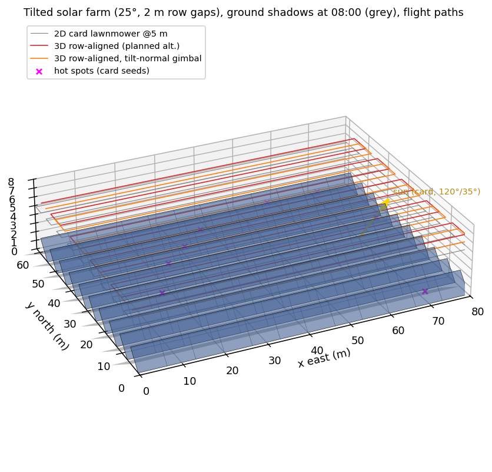
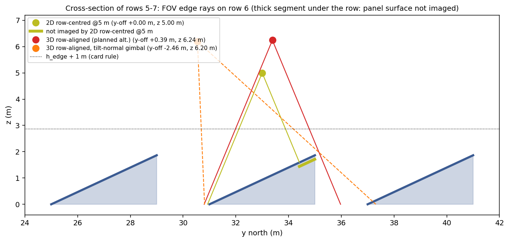
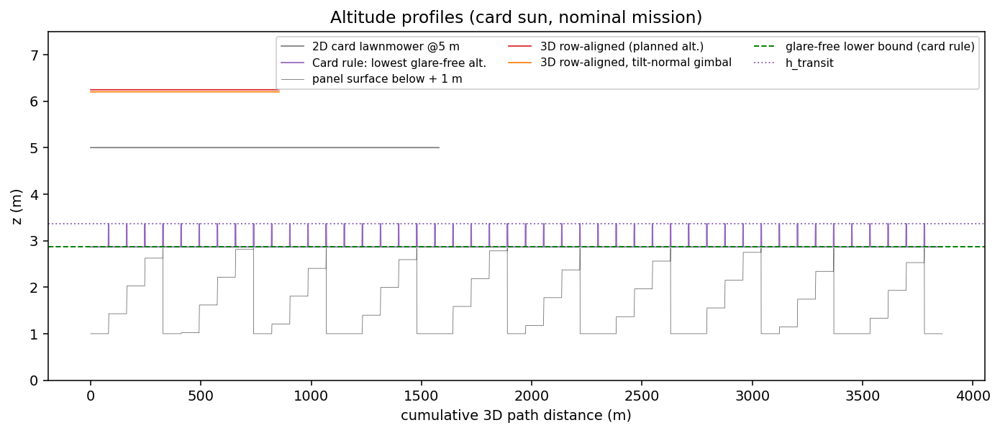
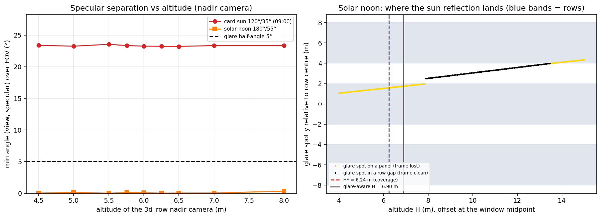
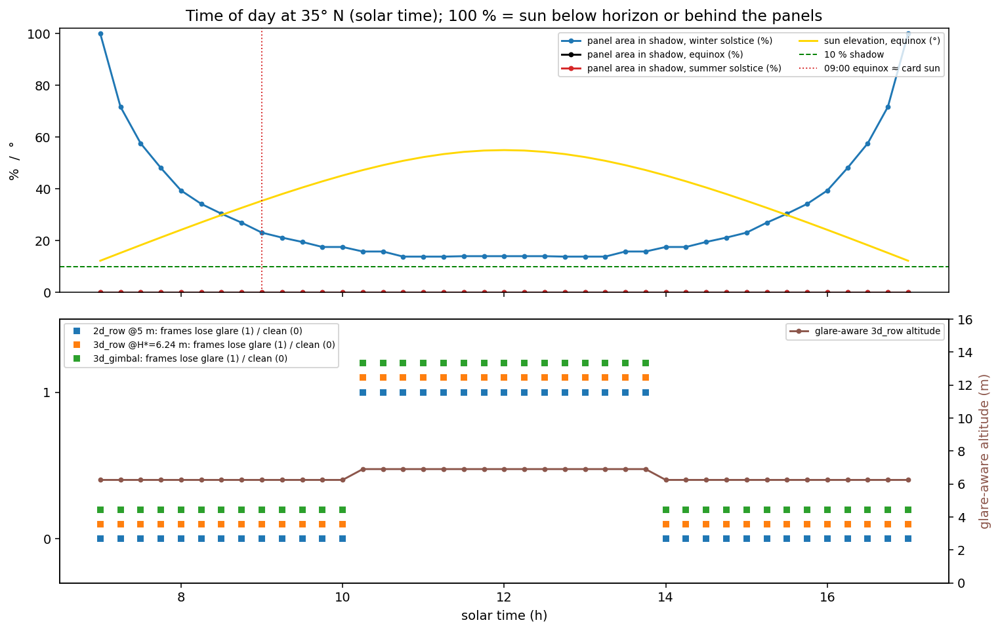
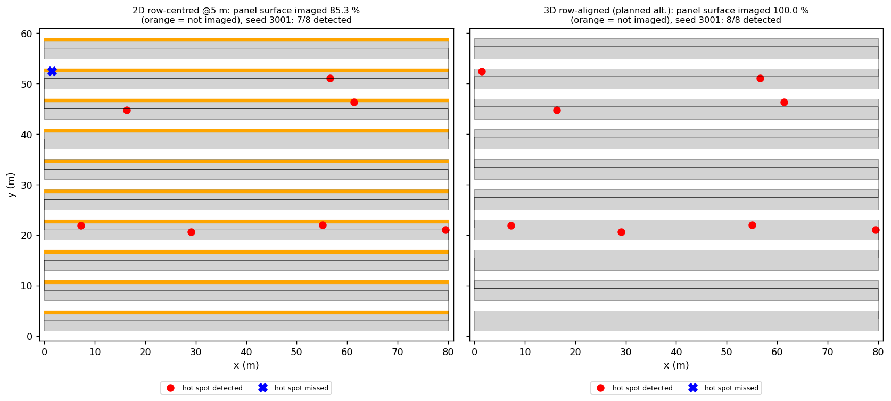
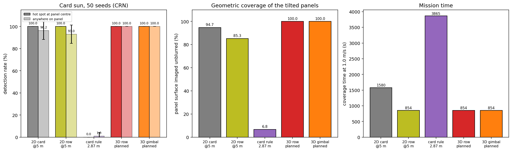
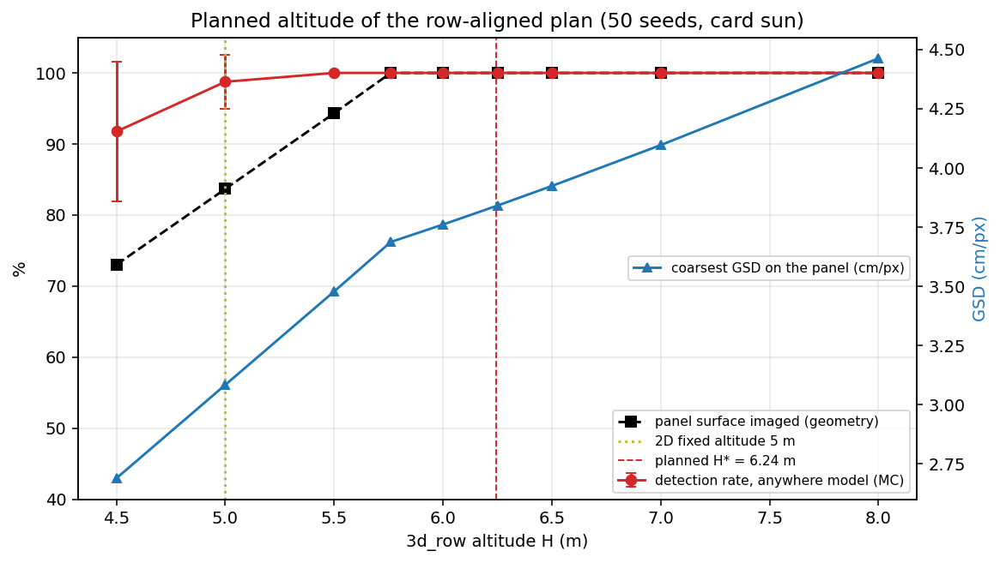
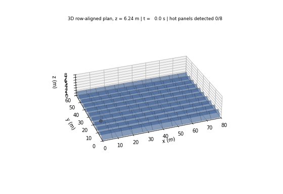

# S073 3D Upgrade — Solar Panel Thermal Inspection

**Domain**: Industrial & Agriculture | **Difficulty**: ⭐⭐ | **Status**: ✅ Completed
**Based on**: [S073 Solar Panel Thermal Imaging Inspection](../../s073_solar_thermal/README.md) (2D version)

---

## Problem Definition

**Setup**: The 2D S073 flies a nadir thermal camera at a fixed 5 m over a flat 80 × 60 m farm. Here the 10 panel rows (12 panels each) are **tilted 25° to the south** with 2 m maintenance gaps between rows: each row is 4.0 m deep on the ground, its panel surface is 4.414 m wide on the slant and rises from z = 0 to its top edge at z = 1.865 m (x = east, y = north). Eight panels carry a Gaussian hot spot 10–20 °C above the 35 °C nominal; a hot spot is detected when a frame (0.1 s, 1.0 m/s) shows it unblurred, unoccluded, glare-free and unshaded above 35 + 8 °C. Every frame is evaluated in 3D: square 45° field of view around the camera boresight, front-face visibility, occlusion by other rows, range-dependent motion blur, specular sun glare and cast shadows.

The planner now chooses **altitude, cross-track offset and camera pointing**. Plans, all at the card's 1.0 m/s:

| Key | Plan | Altitude | Source |
|---|---|---|---|
| `2d_card` | 2D card lawnmower, 19 strips (3.314 m spacing), nadir | fixed 5 m | 2D baseline |
| `2d_row` | 2D row-centred plan, one strip over each row centre, nadir | fixed 5 m | 2D baseline |
| `card_low` | card rule: lowest glare-free altitude ≥ h_edge + 1 m, lawnmower spaced by the footprint at mid-panel height × 0.8, nadir; climb-traverse-descend transits at h_transit | 2.865 m | card |
| `3d_row` | one strip per row, nadir; altitude H* and offset chosen so the footprint covers the whole tilted row plus a 0.2 m margin | 6.244 m | 3D (added) |
| `3d_gimbal` | one strip per row, camera pointed along the panel normal (card's tilt-normal gimbal), stand-off R* on the normal through the row centre | 6.199 m | card gimbal, 3D planned |
| `3d_row_glare` | as `3d_row`, but altitude and offset chosen so the sun's specular reflection lands in a row gap (solar-noon study only) | 6.90 m | added |

**Studies**: (1) card sun (azimuth 120°, elevation 35°) — nominal mission and a 50-seed Monte Carlo with common random numbers, hot spot at the panel centre (card) or anywhere on the panel; (2) planned-altitude sweep and planning-margin sweep; (3) time of day at 35° N (09:00 at the equinox reproduces the card sun) — shadows and glare; (4) solar noon at the equinox (sun 180°/55°), where glare is in view; (5) winter-solstice morning, where shadows appear.

---

## Mathematical Model Summary

**Geometry** (card corrected, see Deviations): row pitch 6 m, row $i$ from $y_i^{bot} = 6i + 1$ to $y_i^{top} = y_i^{bot} + 4$ m, surface $z = (y - y_i^{bot})\tan 25°$, normal $\hat{\mathbf n} = (0, -\sin 25°, \cos 25°)$.

**Camera**: boresight $\hat{\mathbf b}$ = nadir or $-\hat{\mathbf n}$; a point $P$ is in view from $D$ when $d = (P - D)\cdot\hat{\mathbf b} > 0$ and $|(P-D)\cdot\hat{\mathbf e}_{1,2}| \le d\tan 22.5°$, $(D - P)\cdot\hat{\mathbf n} > 0$, and the segment $D \to P$ crosses no other row.

**Blur** (range dependent; the 2D model's $GSD = 0.02$ m/px at 5 m gives IFOV = 0.004 rad):

$$b = \frac{\|\mathbf v \times (P - D)\|}{\|P - D\|^2}\,\frac{t_{exp}}{\text{IFOV}}, \qquad v_{max} = \frac{b_{max}\,\text{IFOV}\,\rho_{min}}{t_{exp}}$$

where $\rho_{min}$ is the smallest cross-track distance to a visible panel point (abeam is the worst case).

**Coverage of the row by a nadir pass at altitude H, offset $\delta$ from the row centre** (FOV edge rays must reach the low south edge and the high north edge, margin $m$):

$$\delta - H\tan 22.5° \le -2 - m, \qquad \delta + (H - h_{edge})\tan 22.5° \ge 2 + m \;\Rightarrow\; H^* = \tfrac12\Bigl(\frac{4 + 2m}{\tan 22.5°} + h_{edge}\Bigr)$$

$H^* = 5.761$ m for $m = 0$ and 6.244 m for $m = 0.2$ m: **the 2D row plan at 5 m cannot see the upper part of each tilted row.** Tilt-normal pointing needs $R^* = (W_{slant}/2 + m)/\tan 22.5° = 5.810$ m.

**Glare** (law of reflection, card sign corrected): $\hat{\mathbf r} = \hat{\mathbf s} - 2(\hat{\mathbf s}\cdot\hat{\mathbf n})\hat{\mathbf n}$. Because all panels are parallel, $\hat{\mathbf r}$ is the same everywhere: whether the reflection can appear in a frame depends only on the camera attitude ($-\hat{\mathbf r}$ inside the FOV widened by $\gamma_{glare} = 5°$). Where it lands — the first panel hit by the ray $D - t\hat{\mathbf r}$ — depends on the drone position and altitude. **Frame rule** (primary): a frame is lost when the reflection lands on a panel inside the FOV (the sun's reflection saturates the thermal frame). **Point rule** (ablation, the card's per-point test): only a hot spot within 5° of the specular direction is masked.

**Shadow**: a panel point is shaded if it faces away from the sun ($\hat{\mathbf s}\cdot\hat{\mathbf n} \ge 0$) or its ray toward the sun crosses another row. **Sun position**: standard solar geometry at latitude 35° N, declination 0° (equinox) or ±23.44°, solar time.

---

## Key Parameters

| Parameter | Value | Notes |
|-----------|-------|-------|
| Farm / panels | 80 × 60 m, 10 rows × 12 panels (6.667 m long) | card |
| Tilt / row gap | 25° south / 2.0 m | card |
| Row pitch / depth / slant width / top edge | 6.0 / 4.0 / 4.414 / 1.865 m | card corrected |
| Defective panels / ΔT / threshold | 8 / U(10, 20) °C / 8 °C | card |
| FOV / glare half-angle | 45° square / 5° | card |
| Safety clearance / transit margin | 1.0 m / 0.5 m → h_scan ≥ 2.865 m, h_transit = 3.365 m | card |
| Overlap (lawnmowers) | 20 % | card |
| Speed / frame interval | 1.0 m/s / 0.1 s | card |
| Exposure / max blur | 0.033 s / 2.5 px | card |
| Card sun | azimuth 120°, elevation 35° | card |
| IFOV | 0.004 rad (0.02 m/px at 5 m) | 2D base |
| Hot-spot σ, thermal noise σ_T, GPS attenuation | 0.4 m, 0.5 °C, 0.9692 (0.1 m) | 2D base |
| Nominal seeds | defects 42, noise 0 | 2D base |
| Planning margin m | 0.2 m (swept 0–0.5 m) | added |
| Planned-altitude sweep | 4.5, 5.0, 5.5, 5.76, 6.0, 6.25, 6.5, 7.0, 8.0 m | added |
| Site / dates | 35° N; equinox, winter and summer solstice; 07:00–17:00 every 15 min | added |
| Glare-aware altitude search | 4–15 m in 0.05 m steps, offsets in 0.02 m steps | added |
| Monte Carlo | 50 seeds (3000–3049), common random numbers | added |
| Animation | `3d_row` nominal mission, every 90th frame, 96 frames | added |

---

## Implementation

```
src/04_industrial_agriculture/3d/s073_3d_solar_thermal.py
```

```bash
conda activate drones
python src/04_industrial_agriculture/3d/s073_3d_solar_thermal.py
```

Runtime 54–59 s over three runs. Two single-threaded runs and one run with default threading printed byte-identical output and produced byte-identical PNG and GIF files.

---

## Results

### Card sun (120°, 35°): glare and shadow do not occur

- The specular direction is $\hat{\mathbf r} = (-0.7094, -0.1761, 0.6824)$, elevation 43.0°, **46.1° from the panel normal**. The closest any FOV ray comes to it is 23.2° (nadir) and 23.0° (tilt-normal), far above the 5° glare half-angle, and 23.2–23.6° at every altitude from 4.5 to 8 m. The card's "lowest glare-free altitude" therefore never binds: it returns h_scan = 2.865 m for all 47 strips.
- The cast shadow is 2.664 m long horizontally and reaches 1.332 m north, less than the 2.0 m gap: **0.00 % of the panel area is shaded** (A_shadow = 0.0 m²).

### Plans at the card sun

| Plan | Strips | 3D path | Time | Min clearance | Panel surface imaged unblurred | Hot-spot region imaged | GSD mean / max | v_max abeam |
|---|---:|---:|---:|---:|---:|---:|---|---:|
| 2D card lawnmower @5 m (footprint 4.142 m, strip spacing 3.314 m) | 19 | 1579.6 m | 1579.6 s | 3.148 m | 94.67 % | 95.76 % | 1.90 / 2.64 cm | 0.951 m/s |
| 2D row-centred @5 m | 10 | 854.0 m | 854.0 s | 3.135 m | 85.26 % | 93.07 % | 2.06 / 3.14 cm | 1.118 m/s |
| Card rule, 2.865 m | 47 | 3864.9 m | 3864.9 s | 1.053 m | 6.76 % | 0.00 % | 1.31 / 1.78 cm | 0.306 m/s |
| 3D row-aligned, H* = 6.244 m | 10 | 854.0 m | 854.0 s | 4.385 m | **100.00 %** | **100.00 %** | 2.58 / 3.84 cm | 1.414 m/s |
| 3D row-aligned, tilt-normal gimbal | 10 | 854.0 m | 854.0 s | 4.359 m | **100.00 %** | **100.00 %** | 2.44 / 2.66 cm | 1.761 m/s |

"Hot-spot region" is the part of the panel where a hot spot can lie in the "anywhere" model: hot-spot centres are drawn at least σ = 0.4 m from the panel's top and bottom edges, so the edge strips a plan misses hold no hot spots. Both coverage columns are computed from the scan strips only (the camera footprint across the rows at each strip's altitude); the Monte Carlo detects from every frame of the flown path, so frames taken during climbs, transits and row changes can add detections that the coverage columns do not count (the card rule images 0.00 % of the region from its scan strips but detects 1.0 %).

**Nominal mission** (card seeds, defective panels 10, 50, 75, 83, 88, 101, 116, 118, hot spots at panel centres): 8/8 detected by both 2D plans (33–34 valid frames per hot spot), `3d_row` (43–44) and `3d_gimbal` (48–49); **0/8 by the card rule** (0 valid frames: every frame is blurred).

### Monte Carlo, card sun (50 seeds, same hot spots and noise for every plan)

| Hot spot | Plan | Detection mean ± std | Seeds 8/8 | Misses: never in view / all frames blurred |
|---|---|---|---:|---|
| centre (card) | 2D card @5 m | 100.0 ± 0.0 % | 50/50 | 0 / 0 |
| centre | 2D row @5 m | 100.0 ± 0.0 % | 50/50 | 0 / 0 |
| centre | Card rule 2.865 m | 0.0 ± 0.0 % | 0/50 | 0 / 400 |
| centre | 3D row-aligned | 100.0 ± 0.0 % | 50/50 | 0 / 0 |
| centre | 3D gimbal | 100.0 ± 0.0 % | 50/50 | 0 / 0 |
| anywhere | 2D card @5 m | 96.2 ± 8.0 % | 39/50 | 15 / 0 |
| anywhere | 2D row @5 m | 93.0 ± 8.4 % | 27/50 | 28 / 0 |
| anywhere | Card rule 2.865 m | 1.0 ± 3.4 % | 0/50 | 15 / 381 |
| anywhere | **3D row-aligned** | **100.0 ± 0.0 %** | **50/50** | 0 / 0 |
| anywhere | **3D gimbal** | **100.0 ± 0.0 %** | **50/50** | 0 / 0 |

Paired, hot spot anywhere: `3d_row` beats `2d_row` on 23 seeds, loses on 0, ties 27 (+7.0 points); beats `2d_card` on 11, loses 0, ties 39 (+3.8 points). `3d_gimbal` and `3d_row` tie on all 50 seeds. With hot spots at panel centres every plan except the card rule ties at 100 % (the centre model cannot discriminate).

**Time**: `3d_row` takes 854.0 s, 725.6 s (45.9 %) less than the 2D card lawnmower, and the same as the 2D row plan. The card rule takes 3864.9 s (2.45 × the 2D card plan). Flown at its own blur limit (0.9 v_max = 0.275 m/s) the card rule images 94.94 % and detects 96.2 ± 6.2 % (8/8 on 36/50 seeds) but needs 14043.5 s, 16.4 × `3d_row`.

### Planned altitude of the row-aligned plan (card sun, hot spot anywhere, 50 seeds)

Every row keeps the cross-track offset at the midpoint of the feasible window, +0.386 m north of the row centre (the same offset as at H*); only the altitude changes.

| H (m) | Offset | Panel surface imaged | Hot-spot region imaged | Coarsest GSD | Detection mean ± std | Seeds 8/8 | Never in view |
|---:|---:|---:|---:|---:|---|---:|---:|
| 4.50 | +0.386 m | 73.02 % | 89.20 % | 2.69 cm | 91.8 ± 9.9 % | 25/50 | 33 |
| 5.00 | +0.386 m | 83.67 % | 99.17 % | 3.08 cm | 98.8 ± 3.7 % | 45/50 | 5 |
| 5.50 | +0.386 m | 94.33 % | 100.00 % | 3.48 cm | 100.0 ± 0.0 % | 50/50 | 0 |
| 5.76 | +0.386 m | 100.00 % | 100.00 % | 3.69 cm | 100.0 ± 0.0 % | 50/50 | 0 |
| 6.00 | +0.386 m | 100.00 % | 100.00 % | 3.76 cm | 100.0 ± 0.0 % | 50/50 | 0 |
| 6.25 | +0.386 m | 100.00 % | 100.00 % | 3.84 cm | 100.0 ± 0.0 % | 50/50 | 0 |
| 6.50 | +0.386 m | 100.00 % | 100.00 % | 3.92 cm | 100.0 ± 0.0 % | 50/50 | 0 |
| 7.00 | +0.386 m | 100.00 % | 100.00 % | 4.10 cm | 100.0 ± 0.0 % | 50/50 | 0 |
| 8.00 | +0.386 m | 100.00 % | 100.00 % | 4.46 cm | 100.0 ± 0.0 % | 50/50 | 0 |

No hot spot in the sweep was lost to blur. Planning margin: H* = 5.761 / 6.002 / 6.244 / 6.485 / 6.968 m and gimbal height 5.761 / 5.980 / 6.199 / 6.417 / 6.855 m for m = 0 / 0.1 / 0.2 / 0.3 / 0.5 m; both image 100.00 % at every margin (the flight has no cross-track error, as in the 2D base).

### Time of day (35° N, solar time)

- **Shadows**: at the equinox and the summer solstice no panel is shaded between 07:00 and 17:00 (the sun rises close to due east, so morning shadows run along the rows). At the winter solstice the shaded panel area is 39.4 % at 08:00, 23.1 % at 09:00, 17.5 % at 10:00, 13.8 % at 11:00 and 14.0 % at noon; it never falls below 10 % (0/41 times). The card's "inspection window with shadow < 10 %" is the whole day at the equinox and does not exist in winter.
- **Glare** at the equinox: the reflection enters the FOV of both the nadir and the tilt-normal camera from 10:15 to 13:45 (15 of 41 times), and then `2d_row`, `3d_row` at H* and `3d_gimbal` lose their frames. A glare-aware altitude ≤ 15 m exists at all 41 times: H* (6.24 m) outside that window, 6.90 m inside it.
- **Winter solstice 09:00** (sun 137.1°/17.7°, 23.10 % = 815.6 m² shaded), hot spot anywhere: 65 of 400 hot spots lie in shadow for every plan; `2d_card` detects 80.0 ± 12.2 % (8/8 on 6/50), `3d_row` 83.8 ± 12.6 % (8/8 on 12/50). Shadows are fixed by the time of day, not by altitude.

### Solar noon at the equinox (sun 180°/55°): altitude moves the reflection into the gap

| Plan | Detection, frame rule | Seeds 8/8 | Frames with glare | Panel imaged glare-free | Detection, point rule |
|---|---|---:|---:|---:|---|
| 2D card @5 m | 20.0 ± 15.6 % | 0/50 | 68.6 % | 22.77 % | 96.2 ± 8.0 % |
| 2D row @5 m | 0.5 ± 2.4 % | 0/50 | 98.4 % | 0.00 % | 93.0 ± 8.4 % |
| 3D row-aligned at H* | 1.8 ± 5.0 % | 0/50 | 98.4 % | 0.00 % | 100.0 ± 0.0 % |
| **3D row-aligned, glare-aware (H = 6.90 m, offset +0.66 m)** | **100.0 ± 0.0 %** | **50/50** | 4.7 % | **100.00 %** | 100.0 ± 0.0 % |
| 3D gimbal | 2.2 ± 5.4 % | 0/50 | 98.4 % | 0.00 % | 100.0 ± 0.0 % |

Paired (frame rule): the glare-aware plan beats `3d_row` at H*, `2d_row` and `2d_card` on 50/50 seeds (+98.2, +99.5 and +80.0 points). All plans take the same time as at the card sun.

- **Ablation — offset alone at the 2D altitude**: at 5 m, 75 of 301 cross-track offsets in [−3, 3] m put the reflection in a gap, but the best of them images only 65.53 % of the panel glare-free and detects 73.2 ± 15.0 % (8/8 on 6/50). Both the altitude and the offset are needed: the higher altitude widens the feasible offset window until one offset puts the reflection in the gap while the footprint still covers the row.
- **Sensitivity**: the glare-aware altitude is 6.65 / 6.80 / 6.90 / 7.05 / 7.40 m for margins 0 / 0.1 / 0.2 / 0.3 / 0.5 m; at noon it is 8.85 m in winter (sun 31.6°) and 6.24 m (= H*, no glare) in summer (sun 78.4°).
- **Glare rule**: with the card's per-point rule, glare almost never hides a hot spot (0 hot spots lost to glare in any plan) and the noon results equal the card-sun results. The noon conclusion therefore holds only if a sun reflection in the frame spoils the frame, which is what the frame rule assumes.

**Key findings**

- **Tilt makes the 2D altitude too low for row-aligned passes.** A 5 m pass over the row centre images 85.26 % of the tilted panel surface and misses 28 of 400 hot spots placed anywhere on the panels. Raising the pass to the planned H* = 6.244 m and shifting it 0.386 m north images 100 % and finds every hot spot on 50/50 seeds, in the same 854.0 s. The altitude sweep shows the threshold: full coverage from 5.76 m. The 3D plans fly **one constant altitude** for the whole mission: the gain is a different fixed altitude plus an offset derived from the tilt geometry, not altitude variation in flight (the vertical moves are the card rule's transits only).
- **Detection follows coverage of the hot-spot region, not of the whole panel, approximately.** The weakest hot spot reads 3.38 σ above the threshold in every frame, so any imaged, unblurred hot spot is detected. Hot spots never lie within σ = 0.4 m of a panel edge, so the edge strips a plan misses do not count: at H = 5.00 m the plan images 83.67 % of the panel but 99.17 % of the hot-spot region and detects 98.8 %; `2d_row` images 85.26 % of the panel, 93.07 % of the region, and detects 93.0 %. The match is not exact because the region coverage counts the scan strips only, while frames from climbs, transits and row changes can add detections: at H = 4.50 m the region coverage is 89.20 % and detection 91.8 %, and the card rule detects 1.0 % with 0.00 % region coverage. Detection is a ceiling effect of coverage: it separates the 3D plans from the 2D plans, but it cannot separate plans that both image 100 %.
- **The 3D plan also beats the 2D card lawnmower**, which images only 94.67 % of the tilted surface (its footprint is narrower at panel height) and takes 45.9 % longer.
- **The card's altitude rule fails.** At the card sun no altitude is glare-limited, so "lowest glare-free altitude" means 2.865 m, 1 m over the top edges. There the image moves 1/ρ times faster: v_max is 0.306 m/s, every frame at 1.0 m/s is blurred, and the card rule detects 1.0 %; flown slowly enough it needs 16.4 × the mission time.
- **The tilt-normal gimbal gives a more uniform resolution.** It images the same 100 % with a more uniform GSD (mean 2.44, max 2.66 cm, against mean 2.58, max 3.84 cm for the nadir pass) and a higher blur limit (1.761 vs 1.414 m/s). Detection is tied on all 50 seeds, but that tie is the coverage ceiling above (both plans image 100 %), not evidence that the gimbal does not matter for detection.
- **Glare and shadow are time-of-day effects.** At 35° N they do not occur at the card's 09:00 sun. Near noon the reflection enters the FOV of both camera modes. **If a frame with the sun's reflection on a panel is lost (the frame-wise rule)**, the glare-aware altitude of 6.90 m with a +0.66 m offset puts the reflection into the row gap (+2.50 m from the row centre) and keeps 100 % detection, while every fixed-altitude plan drops to 0.5–20.0 %. Under the card's per-point glare rule the same fixed plans keep 93.0–100 %, so this result depends on how glare spoils a thermal frame. Winter shadows (65 of 400 hot spots at 09:00) cannot be removed by any flight plan.

### Figures

**3D farm, ground shadows at 08:00 and flight paths** (2D card lawnmower grey, `3d_row` red, `3d_gimbal` orange; card sun arrow):



**Cross-section of rows 5–7**: FOV edge rays on row 6 for the 2D row plan at 5 m, `3d_row` and `3d_gimbal`; the thick olive segment is the part of the row the 2D plan never images:



**Altitude profiles** along the 3D path; the card rule's climb-traverse-descend transits appear as spikes:



**Glare band**: left, the smallest angle between any viewing direction and the specular direction against altitude (card sun: about 23°, never below 5°; noon: 0°); right, where the noon reflection lands for the `3d_row` pass at the window-midpoint offset (dots; yellow = on a panel, black = in a gap) and, as a star, for the glare-aware plan at its actual offset (+0.66 m, reflection in a gap):



**Time of day**: shaded panel area for three dates and the equinox sun elevation (top); glare flags of three plans and the glare-aware altitude (bottom):



**Coverage maps** (seed 3001, the first seed on which the 2D row plan misses a hot spot): orange lines mark panel surface the plan never images:



**Plan comparison** at the card sun: detection (dark = centre model, light = anywhere), imaged panel surface and mission time:



**Planned-altitude sweep** of `3d_row`: detection, imaged surface and the coarsest GSD:



**Animation** (`3d_row`, nominal mission, 96 frames): the drone sweeps the tilted rows; a panel turns red when its hot spot is detected:



### Deviations from the scenario card

| Card | Implementation | Reason |
|------|----------------|--------|
| $W_{panel} = FARM\_W/N_{rows} = 6$ m, $y_i^{bot} = i(W\cos\alpha + g)$, $h_{edge} \approx 1.27$ m | 6 m row pitch: depth 4.0 m, slant 4.414 m, $h_{edge} = 1.865$ m, $y_i^{bot} = 6i + 1$; card corrected | the card's rows need 74.4 m in a 60 m farm, and 1.27 m is the top edge of a 3 m panel |
| Glare if $\angle(\mathbf c - \mathbf p_d, \hat{\mathbf r}) < 5°$ | $\angle(\mathbf p_d - \mathbf c, \hat{\mathbf r}) < 5°$; card corrected | the reflected ray travels from the panel to the drone |
| Shadow tip $\mathbf p_{top} - (h/\sin\varepsilon)\hat{\mathbf s}_{xy}$ | $\mathbf p_{top} + (h/\tan\varepsilon)\hat{\mathbf s}_{xy}$, implemented as a ray test toward the sun; card corrected | sign and length were wrong |
| "South-facing (positive y)", "Snell's law" | south = −y (x east, y north); law of reflection; card corrected | follows from the card's own $\hat{\mathbf s}$ |
| $h_{transit} \approx 2.77$ m, scan range 2.3–5 m, $v_{max,tilt} \approx 1.2$ m/s | 3.365 m, 2.865–5 m, $v_{max} = b_{max}\,\text{IFOV}\,\rho_{min}/t_{exp}$ (0.306 m/s at 2.865 m); card corrected | follow from the corrected $h_{edge}$ and the range-dependent blur |
| Per-strip glare-free altitude band at the card sun | implemented (0.1 m search); it returns 2.865 m for every strip | at the card sun the specular direction is ≥ 23° outside the FOV at every altitude; the band is unbounded below |
| Glare per panel point (card) | frame-wise rule as the primary model; the card's point rule run as an ablation | a sun reflection in a thermal frame spoils the frame; the conclusion at noon depends on this choice and both are printed |
| Gimbal pitch and footprint formulas ($\beta_{cam}$, $b_{foot} = a_{foot}\cos\alpha$) | tilt-normal pointing = boresight $-\hat{\mathbf n}$ from a point on the normal through the row centre; footprint by ray tracing | with the boresight on the normal the footprint on the panel is square, not foreshortened |
| Card rule with the tilt-normal gimbal | card rule flown with a nadir camera | with the gimbal at the same 2.865 m (stand-off 2.132 m from the panel) the blur abeam at 1 m/s is 3.87 px (limit 2.5) and the imaged unblurred surface is 0.00 % (printed), so the rule fails with either camera |
| Strip spacing $d = 2b_{foot}(1-\rho)$ | card rule: spacing 0.8 × footprint at mid-panel height; 3D plans: one strip per row with altitude from the coverage condition | the row gaps need no imaging; one pass per row is enough once the altitude is right |
| Fixed sun, "mission planner schedules the inspection time" | sun from solar geometry at 35° N (09:00 equinox = 119.8°/35.4° ≈ card sun), three dates | needed for the shadow time series; latitude and dates are added parameters |
| Hot spot at the panel centre | centre (card) and anywhere on the panel (2D base's second model) | the centre model cannot discriminate between plans |
| — | `2d_card`, `2d_row`, `3d_row`, `3d_row_glare`, altitude, margin, date and glare-rule sweeps; 50-seed Monte Carlo | 2D baseline at fixed altitude on the same seeds, and sensitivity of every added parameter |
| — | Hot-spot reading as in the 2D base (no pixel-integration or emissivity loss) | a 4.46 cm pixel (the coarsest in the sweep) centred on a σ = 0.4 m hot spot reads 99.90 % of its peak (printed check) |
| GIF `outputs/04_industrial_agriculture/s073_3d_solar_thermal/s073_3d_animation.gif` | `outputs/04_industrial_agriculture/3d/s073_3d_solar_thermal/animation.gif` | 3D variants live under `3d/`; project naming |

---

## Extensions

1. **Glare-aware gimbal pitch**: pitch the camera off the panel normal so the reflection leaves the FOV; compare with the altitude-and-offset solution.
2. **Resolution requirement**: add a maximum GSD (e.g. 3 cm/px) and find the altitude band that satisfies coverage, glare and resolution together.
3. **Cross-track tracking error** in flight, to test the 0.2 m planning margin.
4. **Sloped terrain** under the rows, so H* varies along the strip.
5. **Two drones** on separate row bands with the same planner.

---

## Related Scenarios

- 2D card: [S073 Solar Panel Thermal Imaging Inspection](../../../../scenarios/04_industrial_agriculture/S073_solar_thermal.md)
- 3D card: [S073 3D Upgrade — Solar Panel Thermal Inspection](../../../../scenarios/04_industrial_agriculture/3d/S073_3d_solar_thermal.md)
- Coverage path fundamentals: [S048 Full-Area Coverage Scan (Lawnmower)](../../../../scenarios/03_environmental_sar/S048_lawnmower.md)
- 3D coverage over terrain: [S048 3D Upgrade — Lawnmower Coverage on Terrain](../../../../scenarios/03_environmental_sar/3d/S048_3d_lawnmower.md)
- Curved-surface inspection: [S062 Wind Turbine Blade Inspection](../../../../scenarios/04_industrial_agriculture/S062_wind_turbine.md)
