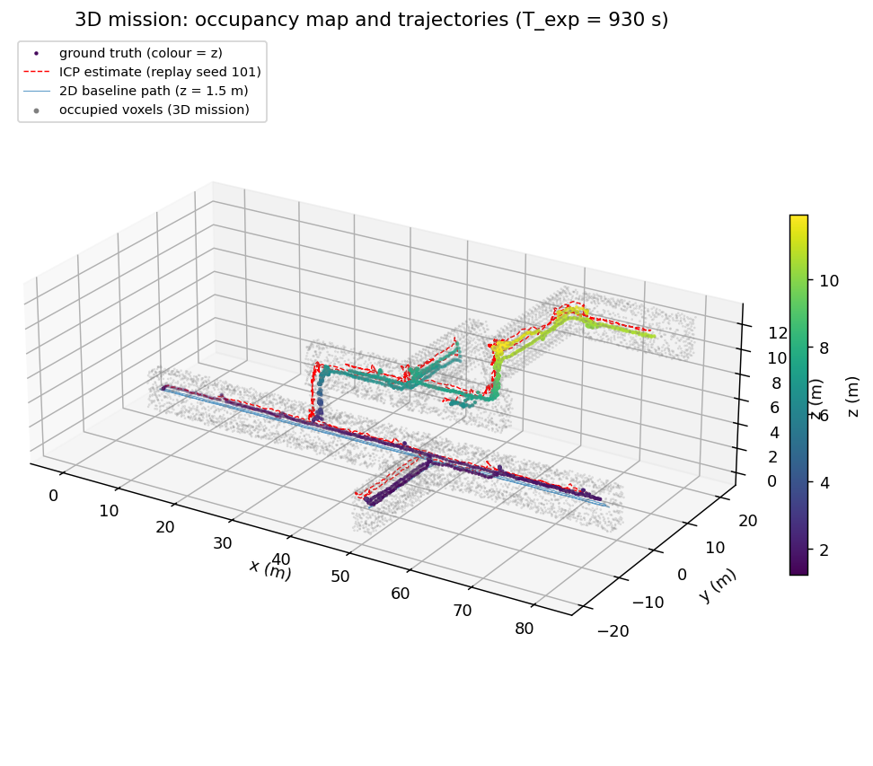
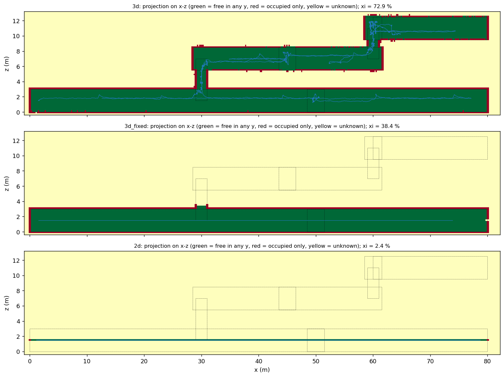
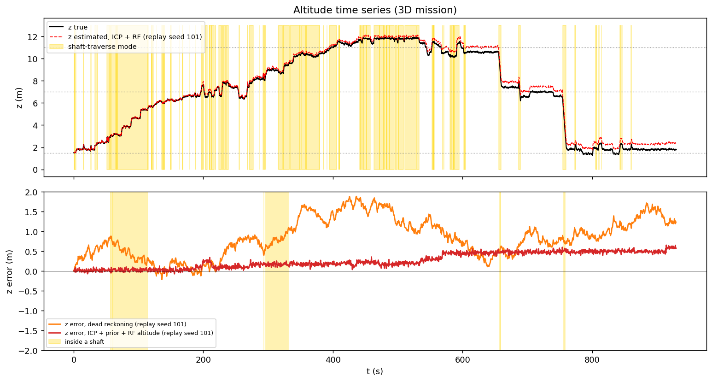
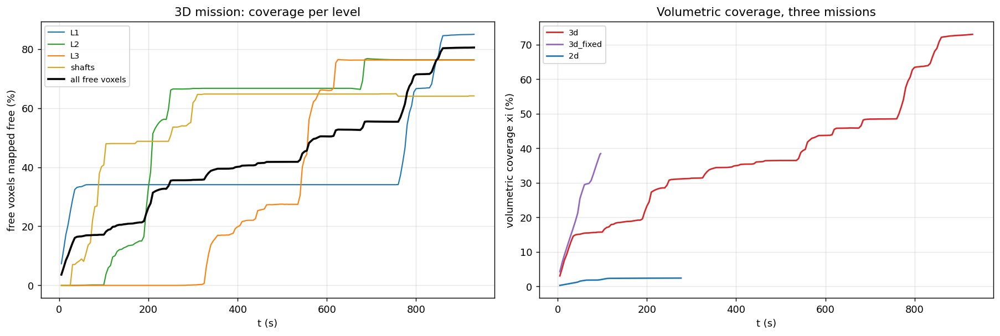
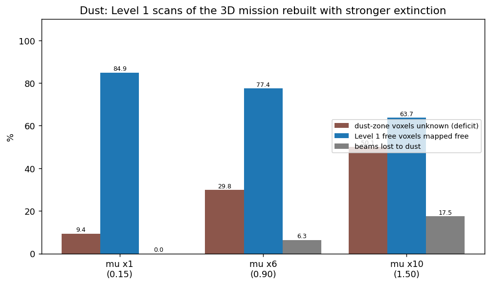
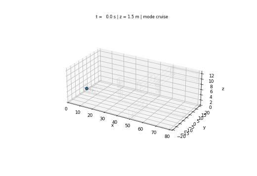

# S074 3D Upgrade — Mine 3D Mapping

**Domain**: Industrial & Agriculture | **Difficulty**: ⭐⭐⭐⭐⭐ | **Status**: ✅ Completed
**Based on**: [S074 Mine 3D Mapping](../../s074_mine_mapping/README.md) (2D version)

---

## Problem Definition

**Setup**: The 2D S074 flies at a fixed 1.5 m with a horizontal 180-beam LiDAR and maps one plane of a single-level mine. Here the mine has **three galleries** (centre heights 1.5, 7.0 and 11.0 m, 3 × 3 m section) joined by **two vertical 2 × 2 m shafts** (x = 30 m from Level 1 to Level 2, x = 60 m from Level 2 to Level 3):

| Element | Extent |
|---|---|
| Level 1 | main drift x 0–80 m at y = 0, branch x = 50 m to y = −20 m |
| Level 2 | drift x 28.5–61.5 m at y = 0, branch x = 45 m to y = +20 m |
| Level 3 | drift x = 60 m from y = −1.5 to 21.5 m, cross drift y = 20 m to x = 80 m |
| Shafts | 2 × 2 m, z 1.5 → 7.0 m (x = 30) and 7.0 → 11.0 m (x = 60) |

The drone (entrance (1.5, 0, 1.5)) carries a **16-layer LiDAR** (360 × 16 beams, ±15°, 10 m, σ = 5 cm) and **up/down single-beam rangefinders** (added, 12 m). It builds a 0.2 m log-odds voxel map and explores by flying to the nearest **3D frontier**: lateral frontiers at a gallery level, and vertical frontiers inside a shaft, which the rangefinders confirm. Altitude is therefore a planned state: the drone climbs and descends the shafts. Dust attenuates the beams (Beer–Lambert).

**Missions** (seed 42), mapped and navigated with the true pose:

| Key | Sensor | Altitude | Role |
|---|---|---|---|
| `3d` | 16-layer LiDAR + rangefinders | planned (shaft traversal) | card |
| `3d_fixed` | 16-layer LiDAR | held at 1.5 m | ablation: sensor without altitude control |
| `2d` | 180-beam planar LiDAR (2D base) | held at 1.5 m | 2D baseline |

**Pose estimation** is evaluated separately on the flown 3D trajectory: dead reckoning against point-to-plane ICP (x, y, z, yaw, odometry prior, degeneracy-aware) with a rangefinder altitude reference, on 3 noise seeds; the map is rebuilt with the ICP poses; and a 200 s closed-loop probe navigates with the estimate.

---

## Mathematical Model Summary

**Free space**: union of axis-aligned boxes; LiDAR ranges by exact ray casting against the union.

**Occupancy**: log-odds per 0.2 m voxel, $+\log 9$ at a hit, $+\log(2/3)$ on every voxel stepped along the beam, clamped to ±10; free if $P < 0.3$, occupied if $P > 0.7$.

**Dust**: $c(z) = 0.8\,e^{-z/4}$; a beam is lost where $\int_0^r \mu_{ext} c\,ds = \ln(1/0.05)$, which has the closed form
$$r_{eff} = \frac{-H\ln\bigl(e^{-z_0/H} - \tau^* \sin\theta/(\mu_{ext} c_0 H)\bigr) - z_0}{\sin\theta}, \qquad \tau^* = \ln 20$$
(infinite when the argument is non-positive). Lost beams mark free space up to $r_{eff}$ only.

**ICP** (scan to previous scan, every 0.5 s): Gauss–Newton on $(t_x, t_y, t_z, \psi)$ minimising $\sum (\mathbf n_i\cdot(R\mathbf s_i + \mathbf t - \mathbf q_i))^2/2\sigma_r^2$ plus the odometry prior (σ = 0.02 m per 0.1 s step, as the 2D base's motion noise). Normals by PCA over 10 neighbours within 0.6 m, kept only for planar neighbourhoods. **Degeneracy-aware update**: eigen-directions of the scan Hessian with eigenvalue below $\lambda_{th}$ = 3·10⁴ keep the prior.

**Rangefinder altitude**: the up and down ranges are compared with the floor/ceiling heights seen before; the same surface (within 0.3 m) gives an absolute altitude, a new surface (opening, shaft, other level) is re-anchored at the predicted altitude.

**Frontier planner** (0.4 m planning grid pooled from the map, Dijkstra on 26-connected traversable cells, goal = traversable cell within 2 cells of the nearest frontier cluster): a cluster is **lateral** if it has cells within 0.6 m of a known gallery level, **vertical** if it reaches more than 1.8 m beyond every level and is at most 3.2 m wide (card: "inside a shaft bounding box"). A vertical cluster opens a candidate shaft box; the box is confirmed when a rangefinder under it measures more than 3.0 m, rejected when both measure less than 2.5 m at its centre. Gallery levels are registered from the rangefinders (ceiling or floor within 2.5 m, gallery half-height measured at the start).

**Volumetric coverage** $\xi$ = (free voxels mapped free + wall voxels mapped occupied) / (free + wall voxels).

---

## Key Parameters

| Parameter | Value | Notes |
|-----------|-------|-------|
| Gallery centre heights / section | 1.5, 7.0, 11.0 m / 3 × 3 m | card |
| Shafts | 2 × 2 m, z 1.5–7.0 and 7.0–11.0 m | card |
| LiDAR | 360 × 16 beams, ±15°, 10 m, σ_r 0.05 m, scan every 0.5 s | card |
| Dust $c_0$ / $H_{dust}$ / $\mu_{ext}$ / $I_{threshold}$ | 0.8 / 4.0 m / 0.15 m⁻¹ppm⁻¹ / 0.05 | card |
| Voxel / log-odds / thresholds | 0.2 m / log 9, log(2/3), ±10 / 0.3, 0.7 | card |
| ICP iterations / tolerance | 20 / 10⁻⁴ m | card |
| Speeds | 1.0 m/s navigation (1.5 m/s cap), 0.8 m/s vertical | card |
| Altitude bounds | 0.3–12.5 m | card |
| Odometry / gyro noise | 0.02 m and 10⁻⁴ rad per 0.1 s step | 2D base |
| Rejection distance, normal radius, stop distance, safety radius | 0.5, 0.6, 0.5, 0.7 m; drone radius 0.25 m | 2D base |
| Up/down rangefinders | 12 m, σ 0.05 m, gate 0.3 m | added |
| ICP points / normals | every 5th azimuth / 10 neighbours, planarity ratios 0.1 and 0.3 | added |
| Degeneracy threshold $\lambda_{th}$ | 3·10⁴ (swept 0, 3·10⁴) | added |
| Planning grid / clearance | 0.4 m, an occupied planning cell needs ≥ 2 occupied voxels; face-neighbour clearance; soft cost ×5 within 2 cells | added |
| Frontier rules | cluster ≥ 8 cells, lateral band 0.6 m, vertical beyond 1.8 m, width ≤ 3.2 m, shaft box margin 0.6 m (±3 m in z), reject radius 0.3 m, gallery detection 2.5 m | added |
| Revisit rule | goal reached 3 times (10 in a confirmed shaft, counted ≥ 1.5 s apart) → frontier cells within 1 m ignored | added (2D base: once) |
| Replan interval / timeout | 2 s / 1500 s | 2D base / added |
| Replay seeds / dust multipliers | 101–103 / ×1, ×6, ×10 | added |
| Closed-loop probe cap | 200 s | added |

---

## Implementation

```
src/04_industrial_agriculture/3d/s074_3d_mine_mapping.py
```

```bash
conda activate drones
python src/04_industrial_agriculture/3d/s074_3d_mine_mapping.py
```

Runtime 456–571 s (7.6–9.5 min) over three runs while other simulations shared the machine; this is above the 8 min target and close to the 10 min limit, so it is flagged as a runtime risk. Two single-threaded runs and one run with default threading printed byte-identical output and produced byte-identical PNG and GIF files.

---

## Results

### Geometry and dust facts

- From the gallery centre the lowest beam (−15°) reaches the floor 5.60 m away; on a shaft wall 1 m away the highest beam is 0.268 m above the drone. A ±15° LiDAR therefore cannot look up a shaft, which is why the rangefinders were added.
- A beam is lost at an optical depth of 2.996, but the largest possible depth over 10 m (at the floor) is 1.200. **With the card's dust values no beam is ever lost** (0 of 10 713 600 beams in the 3D mission; maximum depth 1.030). The card's approximation would have given $r_{eff}$ = 4.38 m at z = 1.5 m.

### Missions (true pose)

| Mission | End | $T_{exp}$ | Path | $\xi$ | Free mapped free | Walls mapped | L1 / L2 / L3 / shafts free | Max altitude |
|---|---|---:|---:|---:|---:|---:|---|---:|
| `3d` | frontiers unreachable | 929.9 s | 623.8 m | **72.95 %** | 80.49 % | 45.72 % | 84.95 / 76.34 / 76.25 / 64.12 % | 11.93 m |
| `3d_fixed` | no frontier left | 96.5 s | 98.6 m | 38.44 % | 41.46 % | 27.53 % | 83.79 / 0.00 / 0.00 / 9.00 % | 1.50 m |
| `2d` (2D baseline) | no frontier left | 276.7 s | 281.5 m | 2.43 % | 2.87 % | 0.86 % | 5.81 / 0.00 / 0.00 / 0.00 % | 1.50 m |

The 3D mission found galleries at z = 1.50, 6.87 and 10.85 m; it confirmed 6 shaft boxes and rejected 30 ceiling patches (66 untested). It spent 32.4 % of its steps in shaft-traverse mode and 71.9 % above z = 4.25 m; minimum wall clearance 0.29 m (asserted ≥ 0.25 m), maximum climb rate 0.80 m/s. $\xi$ reached 25 % at 210 s and 50 % at 770 s.

Against the 2D baseline, $\xi$ rises from 2.43 % to 72.95 % (×30.0): the 16-layer sensor alone, held at 1.5 m, adds 36.01 points, and **altitude control (shaft traversal) adds another 34.51 points**, all of it on Levels 2 and 3, which no fixed-altitude mission can reach. The cost is time: 929.9 s against 96.5 s (+833.4 s). On the scan plane the 2D baseline maps 87.14 % of the Level 1 layer at z = 1.5 m, the same as the 3D mission.

### Pose estimation on the flown 3D trajectory (3 noise seeds, 1859 scan intervals, 197 inside shafts)

| Estimator | 3D RMSE | Horizontal | z | Final error | z error in shafts / galleries |
|---|---|---|---|---|---|
| Dead reckoning | 2.465 ± 0.290 m | 2.235 ± 0.360 m | 1.012 ± 0.097 m | 3.124 ± 0.110 m | 0.782 / 1.031 m |
| ICP + prior + rangefinder altitude | **1.115 ± 0.070 m** | 1.091 ± 0.064 m | **0.221 ± 0.078 m** | 1.309 ± 0.344 m | 0.122 / 0.230 m |

ICP beats dead reckoning on 3/3 seeds (RMSE per seed 1.151, 1.177, 1.017 m vs 2.802, 2.497, 2.095 m). Per-scan horizontal increment errors: 18.3 mm in shafts and 32.6 mm in galleries for ICP, 62.6/62.8 mm for dead reckoning. Before the rangefinder altitude is applied, the ICP vertical increment error is 43.2 mm in shafts and 44.1 mm in galleries (larger in shafts in only 1/3 seeds), essentially the prior's 44.7 mm: the scan barely constrains altitude anywhere. The altitude reference re-anchors 36–38 times per run.

**Degeneracy threshold** (seed 101, first 400 scan intervals): without it ($\lambda_{th}$ = 0) ICP diverges to 8.559 m RMSE (dead reckoning 1.461 m); with 3·10⁴ it gives 1.375 m.

**Map with estimated poses**: rebuilding the map from the same scans with the ICP poses of seed 101 gives $\xi$ = 53.27 % (walls 17.54 %) instead of 72.95 % (walls 45.72 %): drift costs 19.68 points.

**Closed-loop probe** (ICP estimate in the loop, 200 s cap): no wall contact, $\xi$ 37.43 % with Level 1 82.16 % mapped, no shaft climbed yet (maximum altitude 2.41 m), pose RMSE 0.371 m (z 0.078 m). The true-pose mission had $\xi$ = 23.26 % at the same time.

### Dust (Level 1 scans rebuilt with stronger extinction)

| $\mu_{ext}$ | Horizontal reach at 1.5 m | Beams lost | Dust-zone voxels unknown | Level 1 free mapped |
|---|---:|---:|---:|---:|
| 0.15 (card) | 36.32 m | 0.00 % | 9.39 % | 84.92 % |
| 0.90 (×6) | 6.05 m | 6.31 % | 29.81 % | 77.44 % |
| 1.50 (×10) | 3.63 m | 17.48 % | 50.13 % | 63.73 % |

**Key findings**

- **Shaft traversal doubles the mapped volume.** Holding altitude, even with the 16-layer LiDAR, the drone maps only Level 1 ($\xi$ 38.44 %); planning altitude through the shafts maps all three levels ($\xi$ 72.95 %, each level 76–85 % of its free space). The planar 2D baseline maps a single 0.2 m layer ($\xi$ 2.43 %).
- **Card expectations not met**: $\xi$ 72.95 % instead of ≥ 85 % (floors, ceilings and walls seen only at grazing angles stay unknown: walls mapped 45.72 %); 3D RMSE 1.115 ± 0.070 m instead of 0.45–0.65 m; dust deficit 0 instead of 8–15 % (no beam is lost at the card's dust values; the 9.39 % of dust-zone voxels left unknown are a geometric effect, present with or without dust). $T_{exp}$ = 929.9 s is inside the card's 700–950 s.
- **Altitude drift is not largest in shafts.** The card attributes the largest altitude drift to shafts. Here the LiDAR constrains altitude equally little in shafts and galleries (43.2 vs 44.1 mm per scan, against 44.7 mm for the prior alone), because the ±15° beams see floors and ceilings only far away and only shaft walls inside a shaft. With the rangefinder reference the z error is smaller in shafts (0.122 m) than in galleries (0.230 m), because inside a shaft the beams keep seeing the same floor far below.
- **Degenerate geometry needs handling.** Plain point-to-plane ICP diverges in these tunnels (8.559 m RMSE); keeping the prior in the poorly constrained directions brings it to 1.375 m on the same scans.
- **Dust matters only far above the card's values.** It needs about six times the card's extinction before beams are lost (6.31 %) and dust-zone voxels stay unknown (29.81 %).
- **Planner settings are not swept.** The frontier and shaft rules were set on this layout and seed (single mission), so the mission time and the 76 % coverage of Levels 2–3 are specific to these settings. The comparison with the fixed-altitude missions does not depend on them: those cannot reach Levels 2–3 at all (0 % by construction).

### Figures

**3D occupancy map** (occupied voxels grey), true trajectory coloured by altitude, ICP estimate of replay seed 101 (red, dashed) and the 2D baseline path:



**x–z projection** of the final maps of the three missions (green = free in some y, red = only occupied, yellow = unknown), with the mine outline dotted and the flown path:



**Altitude**: true and estimated altitude with the shaft-traverse mode shaded (top); altitude error of dead reckoning and of ICP + rangefinder for replay seed 101, shafts shaded (bottom):



**Coverage against time**: per level for the 3D mission (left), $\xi$ for the three missions (right):



**Dust**: dust-zone voxels left unknown, Level 1 coverage and beams lost for three extinction coefficients:



**Animation** (3D mission, 118 frames, one per 8 s): the trajectory grows while occupied voxels appear; the drone marker is yellow in shaft-traverse mode:



### Deviations from the scenario card

| Card | Implementation | Reason |
|------|----------------|--------|
| $r_{eff} \approx r_{lidar}\exp(-\mu\bar c r_{lidar})$ | closed-form solution of the card's own threshold law; card corrected | the approximation contradicts the stated law; at the card's values the law never cuts a beam |
| $\sigma_{ICP}^{3D}$ = 0.015 m as a parameter | odometry noise 0.02 m per step (2D base); drift measured | the drift is a result of the estimator, not an input; card annotated |
| 100 Hz IMU dead reckoning with bias random walk | odometry prior with random-walk error per 0.1 s step and gyro noise (2D base model) | same role (prior between scans); the bias model was not implemented |
| 3D ICP with full roll-pitch-yaw (SVD) | point-to-plane Gauss–Newton on x, y, z, yaw with the prior and a degeneracy threshold | roll and pitch are stabilised on a multirotor; plain ICP diverges in these tunnels (printed: 8.559 m) |
| Closed-loop exploration with the ICP pose | missions mapped and navigated with the true pose; the estimator is evaluated by replay, by a map rebuild and by a 200 s closed-loop probe | separates the exploration question from the estimation question; the rebuilt map shows what drift costs (−19.68 points); the probe shows the estimate-driven loop running (no wall contact in 200 s) but slower to reach the shafts |
| No altitude sensor | up/down single-beam rangefinders, used for mapping, shaft confirmation, gallery detection and an altitude reference | a ±15° LiDAR sees only 0.268 m up a shaft wall and never the floor near the drone |
| Frontier = vertical if inside a shaft bounding box | shaft boxes detected from frontier clusters and confirmed or rejected by the rangefinders; floor/ceiling patches of a gallery are not pursued | without these rules the drone chased ceiling and floor patches (vertical frontiers that a ±15° LiDAR cannot resolve) |
| Nearest frontier by Euclidean distance | nearest by planned path length (2D base) | Euclidean distance ignores walls between levels |
| Single 10 m-range scan to frontier at any distance | revisit rule as in the 2D base, relaxed for frontier cells above or below the goal | climbing reveals them |
| Expected $\xi \ge 85$ %, RMSE 0.45–0.65 m, dust deficit 8–15 % | 72.95 %, 1.115 m, 0 | reported as simulated |
| Dust-free vs dust scenario | card values (no beam lost) and ×6, ×10 extinction on the Level 1 scans | the card's values cannot produce a dust deficit |
| `s074_3d_occupancy.png`, `s074_3d_animation.gif` | `occupancy_3d.png`, `animation.gif` in `outputs/04_industrial_agriculture/3d/s074_3d_mine_mapping/` | project naming |
| Mine layout beyond the levels and shafts | branches and drifts as in the table above | the card gives only levels and shaft positions |

---

## Extensions

1. **Scan-to-map ICP and loop closure** across levels, to remove the drift that costs 19.68 points of $\xi$.
2. **Wider vertical field of view** (e.g. ±45°) instead of rangefinders, and its effect on shaft climbing.
3. **Robust planner**: a seed and layout sweep of the shaft rules, which this study did not do.
4. **Dust convection** with ventilation, with the dust level as a function of position and time.

---

## Related Scenarios

- 2D card: [S074 Mine 3D Mapping](../../../../scenarios/04_industrial_agriculture/S074_mine_mapping.md)
- 3D card: [S074 3D Upgrade — Mine 3D Mapping](../../../../scenarios/04_industrial_agriculture/3d/S074_3d_mine_mapping.md)
- Collaborative mapping: [S050 Swarm Cooperative Mapping (Distributed EKF-SLAM)](../../../../scenarios/03_environmental_sar/S050_slam.md)
- Confined-space exploration: [S043 Confined Space Exploration](../../../../scenarios/03_environmental_sar/S043_confined_space.md)
