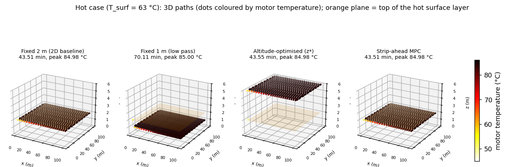
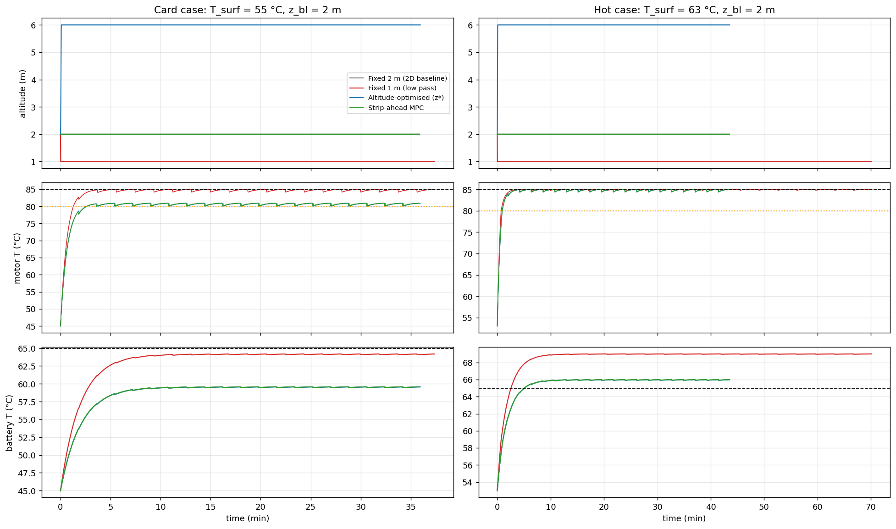
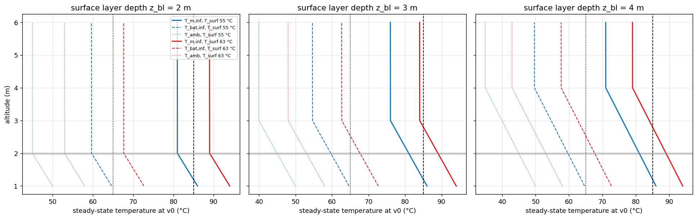
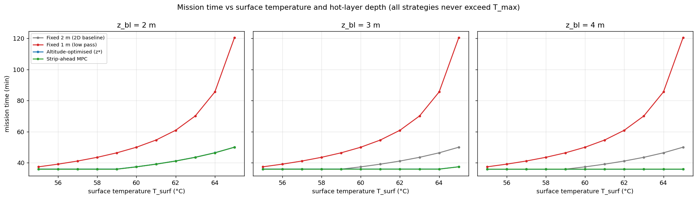
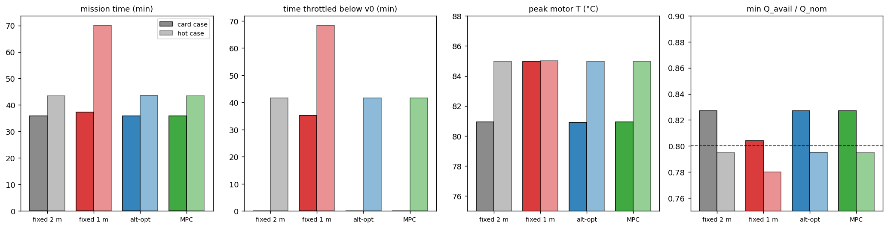
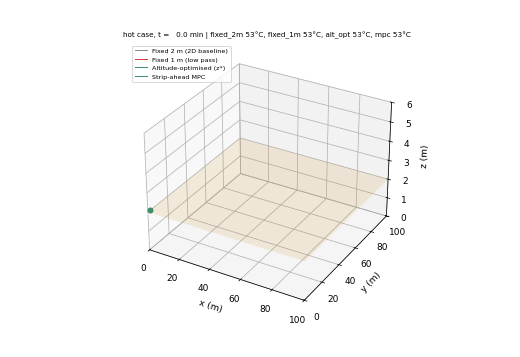

# S076 3D Upgrade — Thermal Management in Hot Environment

**Domain**: Industrial & Agriculture | **Difficulty**: ⭐⭐⭐ | **Status**: ✅ Completed
**Based on**: [S076 Extreme Heat Cooling Strategy](../../s076_thermal_management/README.md) (2D version)

---

## Problem Definition

**Setup**: The 2D S076 flies a 100 × 100 m lawnmower (20 strips, 5 m apart, 1.0 m/s) at one height in a uniform 45 °C ambient. Here the ambient depends on altitude: a superheated surface layer (55 °C at the ground, falling 5 °C/m up to $z_{bl}$ = 2 m, where it is 45 °C) and a weak lapse rate of 0.0065 °C/m above it. The drone may fly between 1 and 6 m; climbs and descents cost $k_z v_z^2$ of extra motor power. Motor and battery temperatures follow first-order models driven by $T_{amb}(z(t))$, and the battery capacity is derated above 25 °C (the card's 80 % capacity floor means $T_{bat} \le 65$ °C).

**Strategies** — all use the 2D base's fastest safe speed law (above $T_{warn}$ = 80 °C, throttle to the speed whose steady state is $T_{max}$ = 85 °C at the current ambient; cooling pause at $T_{max}$), so they differ only in the altitude plan:

| Key | Altitude plan | Source |
|---|---|---|
| `fixed_2m` | 2.0 m throughout (the 2D base: $T_{amb}(2\ \text{m})$ = 45 °C is the base's ambient) | 2D baseline |
| `fixed_1m` | 1.0 m throughout (low inspection pass inside the hot layer) | added |
| `alt_opt` | climb once to $z^* = \arg\min_z T_{m,\infty}(v_0, z)$ | card |
| `mpc` | before each strip, simulate the strip from the current state for each altitude 1.0, 1.5, …, 6.0 m and pick the one minimising strip time + $w\,(T_{m,peak} - T_{warn})^+$ | card ("3D thermal corridor MPC") |

All strategies start at 2.0 m with motor and battery at the ambient there. The model is deterministic, so no Monte Carlo is needed.

**Cases**: the card ($T_{surf}$ = 55 °C, $z_{bl}$ = 2 m); a hot case $T_{surf}$ = 63 °C (ambient 53 °C at 2 m); a sweep of $T_{surf}$ = 55–65 °C for hot-layer depths $z_{bl}$ = 2, 3 and 4 m.

---

## Mathematical Model

$$T_{amb}(z) = \begin{cases} T_{surf} - 5z & z < z_{bl} \\ T_{surf} - 5z_{bl} - 0.0065\,(z - z_{bl}) & z \ge z_{bl}\end{cases}$$

$$P_{motor} = P_{hover} + k_v v_h^2 + k_z v_z^2, \qquad \tau\,\dot T_m = R_{th}P_{motor} - (T_m - T_{amb}(z)), \qquad \tau_{bat}\,\dot T_{bat} = R_{bat}\frac{P_{motor}}{\eta_{esc}} - (T_{bat} - T_{amb}(z))$$

integrated exactly over each 0.1 s step (piecewise-constant power, as in the 2D base). A cooling pause relaxes the motor toward $T_{amb}(z)$ with $\tau_{cool}$ = 20 s (2D base model).

**Speed law** (2D base, throttle to $T_{max}$): above $T_{warn}$, $v = \min\bigl(v_0, \sqrt{((T_{max} - T_{amb}(z))/R_{th} - P_{hover})/k_v}\bigr)$.

**Climbs** (card $f_{trap}$, corrected duration): $z(t) = z_0 + \Delta z\,f_{trap}(t, T)$ with $T = 2|\Delta z|/v_{z,max}$, so the peak vertical speed is exactly 1.5 m/s; the drone hovers horizontally during a climb.

**Battery**: $Q_{avail}/Q_{nom} = 1 - 0.005\max(0, T_{bat} - 25)$; the constraint $Q_{avail}/Q_{nom} \ge 0.8$ is $T_{bat} \le 65$ °C.

---

## Key Parameters

| Parameter | Value | Notes |
|-----------|-------|-------|
| Field / strips / speed | 100 × 100 m / 20 strips 5 m apart / 1.0 m/s | card |
| Altitude range | 1.0–6.0 m | card |
| $T_{surf}$ / layer gradient / $z_{bl}$ / lapse above | 55 °C / −5 °C/m / 2 m / 0.0065 °C/m | card |
| $T_{max}$ / $T_{warn}$ | 85 / 80 °C | card |
| $R_{th}$ / $\tau$ / $\tau_{cool}$ | 0.8 °C/W / 40 s / 20 s | card |
| $P_{hover}$ / $k_v$ / $k_z$ | 30 W / 15 W·s²/m² / 20 W·s²/m² | card |
| $v_{z,max}$ | 1.5 m/s | card |
| $R_{bat}$ / $\tau_{bat}$ / $\beta_{bat}$ / $\eta_{esc}$ | 0.3 °C/W / 120 s / 0.005 °C⁻¹ / 0.92 | card |
| $Q_{min}/Q_{nom}$ → $T_{bat,max}$ | 0.80 → 65 °C | card |
| Pause / time step | 30 s / 0.1 s | card |
| Turn / speed floor | 3 s at hover power / 0.05 m/s | 2D base |
| Low pass altitude | 1.0 m | added |
| MPC candidates / weight $w$ | 1.0–6.0 m in 0.5 m steps / 10 s per °C (swept 0, 10, 100) | added |
| Hot case / sweeps | $T_{surf}$ 63 °C; $T_{surf}$ 55–65 °C × $z_{bl}$ 2, 3, 4 m | added |
| Animation | hot case, one frame per 30 s of mission, 142 frames | added |

---

## Implementation

```
src/04_industrial_agriculture/3d/s076_3d_thermal_management.py
```

```bash
conda activate drones
python src/04_industrial_agriculture/3d/s076_3d_thermal_management.py
```

Runtime 171–205 s over three runs (measured while other simulations shared the machine). Two single-threaded runs and one run with default threading printed byte-identical output and produced byte-identical PNG and GIF files.

---

## Results

### Steady state against altitude (card values)

| Altitude | $T_{amb}$ | $T_{m,\infty}(v_0)$ | $T_{bat,\infty}(v_0)$ |
|---|---:|---:|---:|
| 1 m | 50.00 °C | 86.00 °C | 64.67 °C |
| 2 m | 45.00 °C | 81.00 °C | 59.67 °C |
| 6 m | 44.974 °C | 80.974 °C | 59.648 °C |

From 1 to 6 m the ambient falls 5.026 °C, but from 2 to 6 m only 0.026 °C. The safe corridor starts at $z_{safe,lo}$ = 1.20 m; the card's $z^*$ = 6.00 m. Throttle-to-$T_{max}$ speed: 0.957 m/s at 1 m, 1.155 m/s (above $v_0$) at 2 m. A 2 → 6 m climb takes 5.333 s at a peak motor power of 75 W.

### Card case ($T_{surf}$ = 55 °C, $z_{bl}$ = 2 m) and hot case ($T_{surf}$ = 63 °C)

| Case | Strategy | Mission | Pauses | Peak $T_m$ | Time above $T_{max}$ | Peak $T_{bat}$ | Min $Q/Q_{nom}$ | Throttled | Climbed | Energy | Altitude |
|---|---|---:|---:|---:|---:|---:|---:|---:|---:|---:|---|
| card | Fixed 2 m (2D baseline) | 2152.0 s (35.87 min) | 0 | 80.93 °C | 0.0 s | 59.59 °C | 0.8271 | 0.0 s | 0.00 m | 104.33 kJ | 2.0 m |
| card | Fixed 1 m | 2243.1 s (37.39 min) | 0 | 84.95 °C | 0.0 s | 64.19 °C | 0.8040 | 2109.1 s | 1.00 m | 105.92 kJ | 1.0 m |
| card | Altitude-optimised | 2157.3 s (35.96 min) | 0 | 80.91 °C | 0.0 s | 59.56 °C | 0.8272 | 0.0 s | 4.00 m | 104.59 kJ | 6.0 m |
| card | Strip-ahead MPC | 2152.0 s (35.87 min) | 0 | 80.93 °C | 0.0 s | 59.59 °C | 0.8271 | 0.0 s | 0.00 m | 104.33 kJ | 2.0 m |
| hot | Fixed 2 m (2D baseline) | 2610.4 s (43.51 min) | 0 | 84.98 °C | 0.0 s | **66.00 °C** | **0.7950** | 2497.9 s | 0.00 m | 113.18 kJ | 2.0 m |
| hot | Fixed 1 m | 4206.5 s (70.11 min) | 0 | 85.00 °C | 0.0 s | **69.00 °C** | **0.7800** | 4106.4 s | 1.00 m | 154.61 kJ | 1.0 m |
| hot | Altitude-optimised | 2612.8 s (43.55 min) | 0 | 84.98 °C | 0.0 s | **65.99 °C** | **0.7951** | 2500.2 s | 4.00 m | 113.37 kJ | 6.0 m |
| hot | Strip-ahead MPC | 2610.4 s (43.51 min) | 0 | 84.98 °C | 0.0 s | **66.00 °C** | **0.7950** | 2497.9 s | 0.00 m | 113.18 kJ | 2.0 m |

Bold: battery above 65 °C, i.e. capacity derated below the card's 80 % floor. Against the 2D baseline: in the card case `alt_opt` takes +5.3 s and is −0.03 °C cooler (motor and battery), `mpc` is identical (+0.0 s), `fixed_1m` takes +91.1 s and runs +4.01 °C hotter. In the hot case `alt_opt` takes +2.4 s, `fixed_1m` +1596.2 s. The fixed 2 m run reproduces the 2D base's throttle-to-$T_{max}$ results (35.87 min at 45 °C, 41.11 min at 52 °C in the sweep below).

**MPC weight**: with $w$ = 0, 10 and 100 s/°C the MPC picks 2.0 m for every strip and takes 2152.0 s in every case; the weight does not matter here.

### Sweep: mission time (min) against surface temperature and hot-layer depth

| $z_{bl}$ | Strategy | 55 | 56 | 57 | 58 | 59 | 60 | 61 | 62 | 63 | 64 | 65 °C |
|---|---|---|---|---|---|---|---|---|---|---|---|---|
| 2 m | fixed 2 m | 35.87 | 35.87 | 35.87 | 35.87 | 35.87 | 37.37 | 39.09 | 41.11 | 43.51 | 46.40 | 50.00 |
| 2 m | fixed 1 m | 37.39 | 39.11 | 41.12 | 43.51 | 46.40 | 50.00 | 54.63 | 60.90 | 70.11 | 85.56 | 120.43 |
| 2 m | alt-opt | 35.96 | 35.96 | 35.96 | 35.96 | 35.96 | 37.42 | 39.14 | 41.16 | 43.55 | 46.44 | 50.02 |
| 2 m | MPC | 35.87 | 35.87 | 35.87 | 35.87 | 35.87 | 37.37 | 39.09 | 41.11 | 43.51 | 46.40 | 50.00 |
| 3 m | fixed 2 m | 35.87 | 35.87 | 35.87 | 35.87 | 35.87 | 37.37 | 39.09 | 41.11 | 43.51 | 46.40 | 50.00 |
| 3 m | alt-opt | 35.96 | 35.96 | 35.96 | 35.96 | 35.96 | 35.96 | 35.96 | 35.96 | 35.96 | 35.96 | 37.43 |
| 3 m | MPC | 35.88 | 35.88 | 35.89 | 35.89 | 35.89 | 35.89 | 35.89 | 35.89 | 35.89 | 35.89 | 37.39 |
| 4 m | fixed 2 m | 35.87 | 35.87 | 35.87 | 35.87 | 35.87 | 37.37 | 39.09 | 41.11 | 43.51 | 46.40 | 50.00 |
| 4 m | alt-opt | 35.96 | 35.96 | 35.96 | 35.96 | 35.96 | 35.96 | 35.96 | 35.96 | 35.96 | 35.96 | 35.96 |
| 4 m | MPC | 35.88 | 35.88 | 35.89 | 35.89 | 35.89 | 35.90 | 35.90 | 35.91 | 35.91 | 35.91 | 35.91 |

(fixed 1 m is identical for every $z_{bl}$ because 1 m is inside the layer in all three.) Best 3D plan (alt-opt or MPC) minus the 2D baseline: 0.0 s at every $T_{surf}$ for $z_{bl}$ = 2 m; −0.7 to −1.3 s (slower) up to 59 °C and 88.6 → 756.5 s faster from 60 to 65 °C for $z_{bl}$ = 3 m; 88.0 → 845.4 s faster from 60 to 65 °C for $z_{bl}$ = 4 m. No run in the sweep spent any time above $T_{max}$ (longest 0.0 s).

**Battery**: at 2 m the minimum $Q/Q_{nom}$ falls from 0.827 (55 °C) to 0.789 (65 °C) and breaks the 0.8 floor at 4 of the 11 surface temperatures (62–65 °C) for every hot-layer depth. Flying at $z^*$ does not change this when $z_{bl}$ = 2 m (4/11), but removes all violations when the layer is 3 m (0/11, minimum 0.804) or 4 m deep (0/11, minimum 0.827).

**Key findings**

- **With the card's atmosphere, altitude planning above the 2D height buys nothing.** The 2D base already flies at the top of the hot layer; climbing to $z^*$ = 6 m lowers the steady-state motor temperature by 0.03 °C and costs 5.3 s of climbing (card case). The MPC sees this and stays at 2 m on every strip, tying the 2D baseline exactly at every surface temperature when $z_{bl}$ = 2 m. The card's expectation that the altitude-optimised and MPC strategies keep "larger margins" than the baseline does not hold.
- **The altitude that matters is the one inside the hot layer.** A 1 m inspection pass runs 4.01 °C hotter, has to throttle for 2109.1 s and takes 91.1 s longer at 55 °C; at 63 °C it takes 70.11 min instead of 43.51 min. The safe corridor starts at 1.20 m.
- **If the hot layer is deeper than the 2D height, altitude planning pays.** With $z_{bl}$ = 3 or 4 m the baseline at 2 m sits inside the layer: at $T_{surf}$ = 65 °C the 3D plans are 756.5 s ($z_{bl}$ = 3 m) and 845.4 s ($z_{bl}$ = 4 m) faster and stay above the battery floor, while the baseline derates its battery below 80 % from 62 °C on. Below $T_{surf}$ = 60 °C nothing needs throttling and the 3D plans are 0.7–1.3 s slower because they climb.
- **The battery limit, not the motor limit, decides the hot cases.** The throttle law keeps every run below $T_{max}$, but at 63 °C every strategy's battery reaches 66.0–69.0 °C (capacity 0.780–0.795), which no altitude in [1, 6] m avoids when the layer is 2 m thick.
- **No strategy pauses.** The base's throttle-to-$T_{max}$ law never reaches $T_{max}$, so pause counts are 0 everywhere and are not a discriminating metric; throttled time and mission time are.

### Figures

**3D paths** (hot case), dots coloured by motor temperature; orange plane = top of the hot layer:



**Time series**: altitude, motor temperature (dashed $T_{max}$, dotted $T_{warn}$) and battery temperature (dashed 65 °C) for the card case (left) and the hot case (right):



**Safe corridor**: steady-state motor (solid) and battery (dashed) temperatures and the ambient (dotted) against altitude for three hot-layer depths and two surface temperatures; grey band = the 2D height:



**Sweep**: mission time against surface temperature for three hot-layer depths:



**Metrics**: mission time, time throttled, peak motor temperature and minimum capacity ratio (dark = card case, light = hot case):



**Animation** (hot case, 142 frames, one per 30 s of mission): the four drones over the field with their current motor temperatures:



### Deviations from the scenario card

| Card | Implementation | Reason |
|------|----------------|--------|
| $\Gamma_{atm}$ = 0.0065 °C/m called the dry adiabatic lapse rate | value kept; called the standard lapse rate; card corrected | the dry adiabatic rate is $g/c_p$ = 0.0098 °C/m |
| $t_{climb} = |\Delta z|/v_{z,max}$ with the $f_{trap}$ profile | $T = 2|\Delta z|/v_{z,max}$; card corrected | the profile's peak speed is $2|\Delta z|/T$; the card's duration would need 3.0 m/s |
| $T_{bat,ss} = T_{amb} + R_{bat}P_{total}/\eta_{esc}$ with $P_{total}$ already divided by $\eta_{esc}$ | $T_{amb} + R_{bat}P_{motor}/\eta_{esc}$; card corrected | $\eta_{esc}$ counted twice |
| Baseline "reactive throttle only"; strategies 2 and 3 with their own pause rules | every strategy uses the 2D base's throttle-to-$T_{max}$ law and pause at $T_{max}$ | same speed envelope for all, so the comparison isolates the altitude plan; the 2D base found this law the fastest safe one |
| MPC "minimising the weighted sum of mission time and peak motor temperature" at every step | per-strip receding horizon over 11 candidate altitudes, cost = strip time + $w$ (peak − $T_{warn}$)⁺, weight swept 0–100 s/°C | a full per-step MPC is unnecessary here: the ambient depends on altitude only; the weight does not change any choice |
| Expected: baseline approaches $T_{warn}$, battery near/above 65 °C only for the baseline, ≈ 5 °C gain from altitude | 80.93 °C, battery 59.59 °C for every plan at 2 m or above, 0.03 °C gain above 2 m | reported as simulated; the 5 °C exists only between 1 and 6 m |
| Single card case | plus a hot case, a surface-temperature sweep and hot-layer depths 3 and 4 m | the card case alone cannot show when altitude matters |
| — | `fixed_1m` added | shows the cost of flying inside the hot layer |
| Battery derating as a hard constraint | reported (minimum $Q/Q_{nom}$, violations), not enforced | no strategy can avoid it in the hot $z_{bl}$ = 2 m cases; enforcing it would end those missions |
| Pause model | cooling toward $T_{amb}$ at the current altitude (2D base) | kept from the 2D base; no pause ever occurs |

---

## Extensions

1. **Wind and convective cooling with altitude** ($\tau_{cool}(z)$), which would give the upper altitudes a real benefit above the layer.
2. **Diurnal layer depth**: $z_{bl}$ and $T_{surf}$ through the day, with the altitude plan re-optimised per strip.
3. **Inspection-quality constraint** (e.g. GSD), which would penalise high altitudes and make the trade-off two-sided.
4. **Battery-aware MPC** that includes $T_{bat}$ in the cost.

---

## Related Scenarios

- 2D card: [S076 Extreme Heat Cooling Strategy](../../../../scenarios/04_industrial_agriculture/S076_thermal_management.md)
- 3D card: [S076 3D Upgrade — Thermal Management in Hot Environment](../../../../scenarios/04_industrial_agriculture/3d/S076_3d_thermal_management.md)
- Lawnmower geometry: [S048 Full-Area Coverage Scan (Lawnmower)](../../../../scenarios/03_environmental_sar/S048_lawnmower.md)
- 3D atmospheric environment: [S058 Typhoon Eye Probing](../../../../scenarios/03_environmental_sar/S058_typhoon.md)
