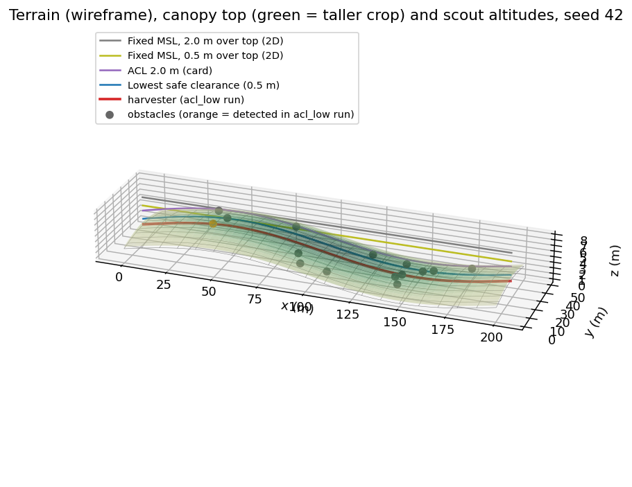
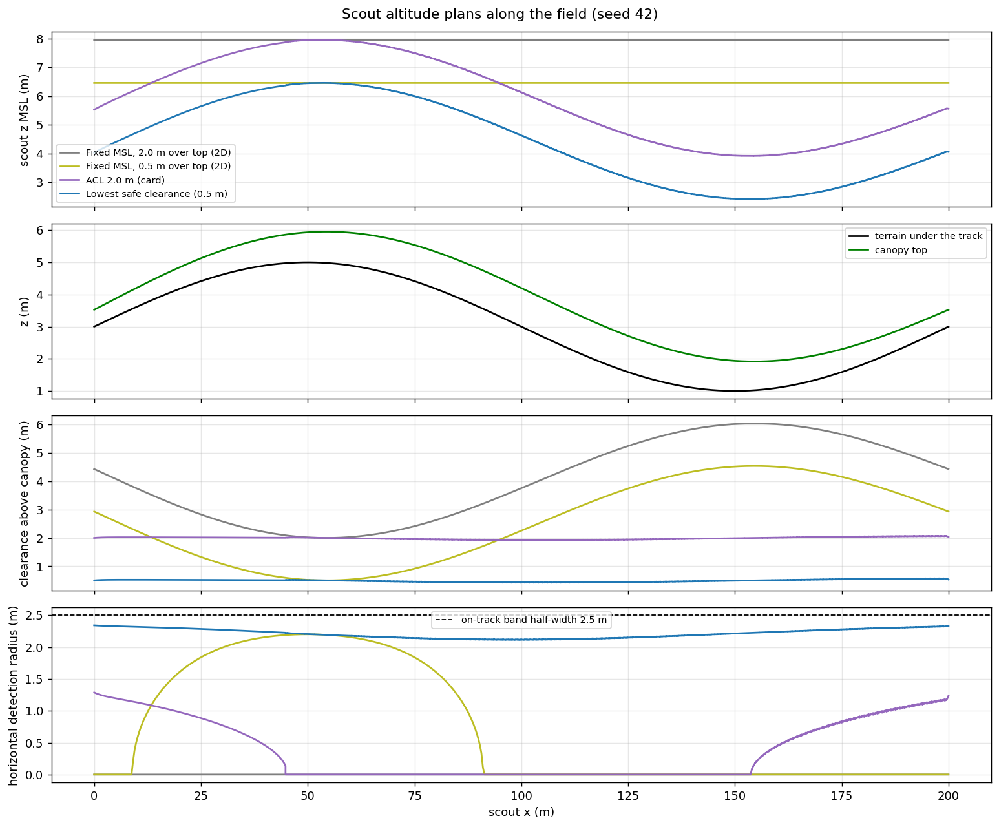
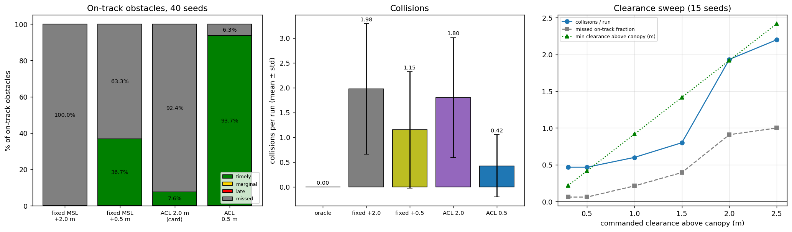
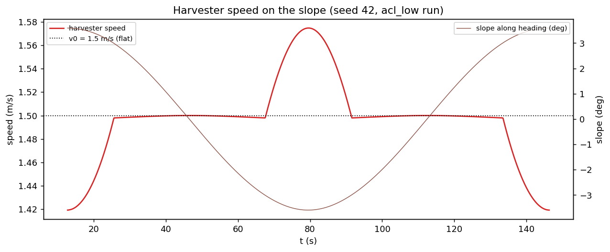
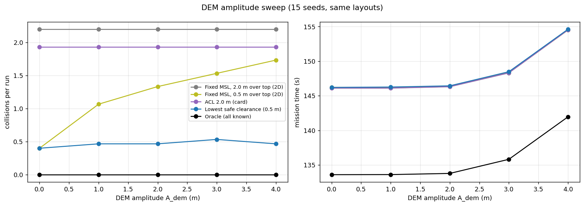
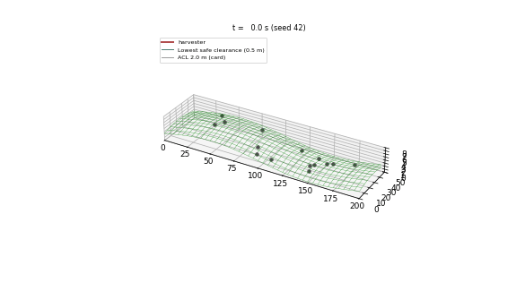

# S078 3D Upgrade — Harvester Guidance

**Domain**: Industrial & Agriculture | **Difficulty**: ⭐⭐⭐ | **Status**: ✅ Completed
**Based on**: [S078 Harvester Cooperative Guidance](../../s078_harvester_guidance/README.md) (2D version)

---

## Problem Definition

**Setup**: As in the 2D S078, a harvester crosses a 200 × 50 m field along y = 25 m toward (200, 25), 15 unknown obstacles (r = 1 m) are scattered over the field, and a scout drone flies up to 45 m ahead along the track and relays each detection after 2 s; the harvester replans with A* (obstacles inflated by 2.5 m) and line-of-sight smoothing. In 3D:

- The field has the card's sinusoidal **DEM** (lifted to 0–5 m, steepest slope 5.08°) and a **crop canopy** 0.36–1.20 m tall, tallest in the field centre.
- Obstacles sit **0.5 m above the ground**, so the scout's sensor is a **3D sphere** (r = 2.5 m, minus the 0.1 m GPS error): the higher it flies above the obstacle tops, the smaller its horizontal detection radius $r_{xy} = \sqrt{2.4^2 - \Delta z^2}$.
- The harvester's speed follows the slope along its heading, and A* edge costs are terrain arc lengths.

**Scout altitude plans** (all fly the 2D base's safer 1-pass centreline route at 3.5 m/s; same obstacle layouts and GPS noise for every plan):

| Key | Altitude | Role |
|---|---|---|
| `fixed_msl` | constant MSL, highest canopy top + 2.0 m (7.96 m) | 2D baseline (the base at one altitude, card clearance) |
| `fixed_low` | constant MSL, highest canopy top + 0.5 m (6.46 m) | 2D baseline with the low clearance (added) |
| `acl_card` | terrain + crop + 2.0 m, tracked | card |
| `acl_low` | terrain + crop + 0.5 m, tracked | added: lowest safe clearance |
| `oracle` | all obstacles known at the start | reference |

**Studies**: seed 42 for the figures; a 40-seed Monte Carlo (common random numbers); a clearance sweep (0.3–2.5 m, 15 seeds); a DEM-amplitude sweep ($A_{dem}$ 0–4 m, 15 seeds).

---

## Mathematical Model Summary

**Terrain and crop** (card): $z = A[\sin(2\pi x/200) + 0.5\sin(2\pi y/100)] + A$; $h_{crop} = 0.3 + 0.9\exp(-(x-100)^2/2\cdot 60^2 - (y-25)^2/2\cdot 15^2)$.

**Harvester speed** (card, corrected to the signed slope along the heading $\hat{\mathbf u}$): $\phi = \arctan(\nabla z\cdot\hat{\mathbf u})$, $v = v_0\cos\phi\,\eta(\phi)$ with $\eta = 1$ for $|\phi| \le 3°$, $\max(0.4, 1 - 5(\phi - 3°))$ uphill, $\min(1.3, 1 - 5(\phi + 3°))$ downhill. At the steepest slope $\eta$ = 0.819 uphill and 1.181 downhill.

**Scout altitude** (card command, corrected tracking law): $\dot z = \mathrm{clip}(\dot z_{cmd} + K_p(z_{cmd} - z), \pm 1.5\ \text{m/s})$, $K_p$ = 2 s⁻¹.

**Detection**: obstacle $j$ is detected when $\|(\mathbf p_{drone} + \boldsymbol\epsilon_{GPS}) - (x_j, y_j, z_{terrain} + 0.5)\| \le 2.5 - 0.1$ m (horizontal GPS noise, as in the 2D base).

**A*** (2D base, 0.5 m grid, 8-connected): edge cost × $\sqrt{1 + |\nabla z|^2}$ = $1/\cos\phi$ (card); octile heuristic (admissible). Classification of on-track obstacles ($|y - 25| < 2.5$ m) as timely / marginal / late / missed and collisions (harvester within 2.5 m of an obstacle centre) as in the 2D base.

---

## Key Parameters

| Parameter | Value | Notes |
|-----------|-------|-------|
| Field / obstacles / track | 200 × 50 m / 15, r = 1 m / y = 25 m | card / 2D base |
| DEM $A_{dem}$, wavelengths | 2.0 m; 200 m, 100 m | card |
| Crop height | 0.3–1.2 m (field minimum 0.36 m) | card |
| $h_{ACL}$ | 2.0 m | card |
| Low clearance $c_{min}$ | 0.5 m (swept 0.3–2.5 m) | added |
| Harvester $v_0$ / $\phi_{ref}$ / $k_{slope}$ / $\eta$ range | 1.5 m/s / 3° / 5 rad⁻¹ / 0.4–1.3 | card |
| Scout speed / max climb rate / $K_p$ | 3.5 m/s / 1.5 m/s / 2.0 s⁻¹ | card |
| Sensor sphere / obstacle height | 2.5 m / 0.5 m | card |
| Lead / inflation / grid / latency / GPS | 45 m / 2.5 m / 0.5 m / 2 s / 0.1 m | card |
| Altitude bounds | 0.5–8.0 m MSL (8 m reported, not enforced) | card |
| Scout route | 1-pass centreline | 2D base's recommended pattern |
| Timely margin / smoothing margin / grid margin | 5 s / 0.05 m / 0.25 m | 2D base |
| DEM offset | $+A_{dem}$ (terrain ≥ 0) | added |
| Monte Carlo / sweeps | 40 seeds (0–39) / 15 seeds | added |
| DEM sweep | $A_{dem}$ = 0, 1, 2, 3, 4 m | card extension 1 |
| Animation | seed 42, every 25th step, 60 frames | |

---

## Implementation

```
src/04_industrial_agriculture/3d/s078_3d_harvester_guidance.py
```

```bash
conda activate drones
python src/04_industrial_agriculture/3d/s078_3d_harvester_guidance.py
```

Runtime 127–143 s over three runs (measured while other simulations shared the machine). Two single-threaded runs and one run with default threading printed byte-identical output and produced byte-identical PNG and GIF files.

---

## Results

### What the scout can see

| Clearance above the canopy | Over 0.3 m crop: $\Delta z$ / $r_{xy}$ | Over 1.2 m crop: $\Delta z$ / $r_{xy}$ |
|---|---|---|
| 0.3 m | 0.10 / 2.40 m | 1.00 / 2.18 m |
| 0.5 m | 0.30 / 2.38 m | 1.20 / 2.08 m |
| 1.0 m | 0.80 / 2.26 m | 1.70 / 1.69 m |
| 2.0 m (card) | 1.80 / 1.59 m | 2.70 / **0.00 m** |

At the card's ACL of 2.0 m the scout is blind over the tall crop in the field centre. A fixed MSL altitude must clear the highest canopy top, which puts it at 7.96 m (or 6.46 m with the low clearance) and several metres above the canopy in the valley (clearance profile in the altitude figure).

### Seed 42

| Plan | Collisions | Detected | Replans | Mission | Min clearance above canopy | Max climb rate |
|---|---:|---:|---:|---:|---:|---:|
| Fixed MSL +2.0 m (2D) | 2 | 0/15 | 0 | 146.3 s | 2.00 m | 0.00 m/s |
| Fixed MSL +0.5 m (2D) | 0 | 1/15 | 1 | 146.3 s | 0.50 m | 0.00 m/s |
| ACL 2.0 m (card) | 2 | 0/15 | 0 | 146.3 s | 1.92 m | 0.29 m/s |
| ACL 0.5 m | 0 | 1/15 | 1 | 146.3 s | 0.42 m | 0.29 m/s |
| Oracle | 0 | — | 0 | 133.6 s | — | — |

### Monte Carlo (40 seeds, 79 on-track obstacles)

| Plan | Collisions / run | Runs with a collision | On-track timely / marginal / late / missed | Detected / run | Mission | Min canopy clearance |
|---|---|---:|---|---:|---:|---:|
| Fixed MSL +2.0 m (2D baseline) | 1.98 ± 1.31 | 35/40 | 0.0 / 0.0 / 0.0 / 100.0 % | 0.00 | 146.3 ± 0.0 s | 2.00 m |
| Fixed MSL +0.5 m (2D baseline) | 1.15 ± 1.17 | 25/40 | 36.7 / 0.0 / 0.0 / 63.3 % | 0.72 | 146.3 ± 0.1 s | 0.50 m |
| ACL 2.0 m (card) | 1.80 ± 1.21 | 34/40 | 7.6 / 0.0 / 0.0 / 92.4 % | 0.15 | 146.3 ± 0.0 s | 1.92 m |
| **ACL 0.5 m** | **0.42 ± 0.63** | **14/40** | **93.7 / 0.0 / 0.0 / 6.3 %** | 1.85 | 146.4 ± 0.2 s | 0.42 m |
| Oracle | 0.00 ± 0.00 | 0/40 | — | — | 133.8 ± 0.4 s | — |

Paired by seed: ACL 0.5 m has fewer collisions than ACL 2.0 m in 33 seeds, equal in 7, more in 0 (−1.38 per run); fewer than fixed MSL +0.5 m in 18, equal in 22, more in 0 (−0.72); ACL 2.0 m vs fixed MSL +2.0 m: fewer in 4, equal in 36 (−0.17); fixed +0.5 m vs fixed +2.0 m: fewer in 22, equal in 18 (−0.82). ACL 0.5 m detected obstacles from 0.60 to 1.26 m above their tops.

### Clearance sweep (ACL plan, 15 seeds)

| Clearance | Collisions / run | Missed on-track | Timely | Min canopy clearance |
|---:|---:|---:|---:|---:|
| 0.3 m | 0.47 (6/15) | 6.1 % | 93.9 % | 0.22 m |
| 0.5 m | 0.47 (6/15) | 6.1 % | 93.9 % | 0.42 m |
| 1.0 m | 0.60 (8/15) | 21.2 % | 78.8 % | 0.92 m |
| 1.5 m | 0.80 (10/15) | 39.4 % | 60.6 % | 1.42 m |
| 2.0 m | 1.93 (14/15) | 90.9 % | 9.1 % | 1.92 m |
| 2.5 m | 2.20 (14/15) | 100.0 % | 0.0 % | 2.42 m |

### DEM amplitude sweep (15 seeds): collisions / run, missed on-track, mission time

| $A_{dem}$ (max slope) | Fixed +2.0 m | Fixed +0.5 m | ACL 2.0 m | ACL 0.5 m | Oracle mission |
|---|---|---|---|---|---:|
| 0 m (0.00°) | 2.20 / 100 % / 146.1 s | 0.40 / 9 % / 146.2 s | 1.93 / 91 % / 146.1 s | 0.40 / 9 % / 146.2 s | 133.6 s |
| 1 m (2.54°) | 2.20 / 100 % / 146.1 s | 1.07 / 58 % / 146.2 s | 1.93 / 91 % / 146.1 s | 0.47 / 6 % / 146.3 s | 133.6 s |
| 2 m (5.08°) | 2.20 / 100 % / 146.3 s | 1.33 / 67 % / 146.4 s | 1.93 / 91 % / 146.3 s | 0.47 / 6 % / 146.4 s | 133.8 s |
| 3 m (7.59°) | 2.20 / 100 % / 148.3 s | 1.53 / 76 % / 148.4 s | 1.93 / 91 % / 148.3 s | 0.53 / 9 % / 148.5 s | 135.8 s |
| 4 m (10.08°) | 2.20 / 100 % / 154.5 s | 1.73 / 79 % / 154.5 s | 1.93 / 91 % / 154.5 s | 0.47 / 6 % / 154.6 s | 141.9 s |

The fixed MSL altitudes exceed the 8 m ceiling from $A_{dem}$ = 3 m (10.45 and 8.95 m).

**Key findings**

- **The scout's height above the obstacles, not the slope, decides safety.** Flying low over the canopy (0.5 m) and following the terrain gives 0.42 collisions per run and 93.7 % timely detections of on-track obstacles; the card's 2.0 m ACL gives 1.80 collisions and misses 92.4 %, because 2 m above a 1.2 m crop the obstacle tops are 2.70 m below the drone, outside the 2.5 m sensor sphere. The 2D base's flat-world assumption (a 2D detection disc) hides this.
- **The card's ACL is the problem even on flat ground.** At $A_{dem}$ = 0 both 2.0 m plans fail (1.93–2.20 collisions, 91–100 % missed), while both 0.5 m plans give 0.40. The clearance sweep shows the threshold: 0.3–0.5 m keeps 93.9 % timely, 1.0 m 78.8 %, 2.0 m 9.1 %.
- **Terrain following matters once the clearance is low.** A fixed altitude low enough to clear the hilltop by 0.5 m is several metres above the valley canopy: its collisions grow with relief (0.40 → 1.07 → 1.33 → 1.53 → 1.73 for $A_{dem}$ = 0–4 m), while terrain-following at 0.5 m stays at 0.40–0.53. On the card's field it has fewer collisions than the fixed low plan in 18 of 40 seeds and more in none.
- **Slope barely changes the mission.** The harvester's speed varies between 0.819 and 1.181 × nominal only where the slope exceeds 3°, and the uphill and downhill halves cancel: the oracle takes 133.8 s on the card's DEM against 133.6 s on flat ground; even at $A_{dem}$ = 4 m (10.08°) it takes 141.9 s. The card's expected degradation from terrain-induced altitude mismatch comes from the vertical sensor offset, not from slope.
- **Safety margin to the crop**: the low terrain-following plan keeps at least 0.42 m above the canopy (0.22 m at 0.3 m commanded).
- **Remaining collisions** of the best plan (0.42 per run) include the 6.3 % of on-track obstacles it misses; its horizontal detection radius (2.08–2.38 m) is smaller than the 2.5 m on-track band, as in the 2D base. Whether the rest come from detours into unscanned ground, as the 2D base found, was not probed here.

### Figures

**3D field**: terrain (wireframe), canopy top (green shading = crop height), the four scout altitude plans, the harvester path and the obstacles (orange = detected in the ACL 0.5 m run), seed 42:



**Altitude profiles** (seed 42): scout altitude, terrain and canopy under the track, clearance above the canopy and the resulting horizontal detection radius:



**Detection comparison**: classes of on-track obstacles (40 seeds), collisions per run, and the clearance sweep:



**Harvester speed** and slope along its heading (seed 42, ACL 0.5 m run; the speed starts when the scout has its 45 m lead):



**DEM amplitude sweep**: collisions and mission time against relief:



**Animation** (seed 42, 60 frames): harvester on the terrain, the ACL 0.5 m scout (blue) and the card's ACL 2.0 m scout (purple) over the canopy:



### Deviations from the scenario card

| Card | Implementation | Reason |
|------|----------------|--------|
| Terrain 0–4 m, slopes up to ≈ 12° | the card's DEM formula: 5 m span (lifted by $A_{dem}$ to 0–5 m), 5.08°; card corrected | the formula gives these values; the lift keeps the MSL altitude bounds positive |
| $\eta_{slope}(\phi)$ with $\phi$ the gradient magnitude | signed slope along the heading; card corrected | the magnitude is never negative, so the downhill branch could not act |
| PD law $K_p(z_{cmd} - z) + K_d(\dot z_{cmd} - \dot z)$ | $\dot z_{cmd} + K_p(z_{cmd} - z)$, clipped at 1.5 m/s; card corrected | the $K_d$ term has units of metres |
| 3-pass boustrophedon sub-pattern | 1-pass centreline for every plan | the 2D base showed the 3-pass scout cannot keep ahead of the harvester (its README: 0.820 m/s maximum advance at 3 m/s); the comparison here is about altitude |
| $h_{ACL}$ = 2.0 m only | plus 0.5 m (and a 0.3–2.5 m sweep), and two fixed-MSL 2D baselines | the card's ACL cannot see under tall crop; the 2 × 2 design separates clearance from terrain following |
| 3D A* on a 400 × 100 × $N_z$ layered grid | 2D grid with $1/\cos\phi$ edge costs (2.5D, as the card itself concludes) | the harvester stays on the ground |
| Altitude bounds 0.5–8 m enforced | lower bound and ground asserted; the 8 m ceiling is reported | the fixed-altitude baselines exceed it at $A_{dem} \ge 3$ m and are still reported |
| Scout airspeed 3.5 m/s, sensor 2.5 m (3D) | as the card (2D base: 3.0 m/s, 2.0 m) | card values for every plan, so the plans share one envelope |
| Strip projection onto the slope | not needed | the 1-pass route has no strip spacing |
| Single run, seed 42 | seed 42 figures, 40-seed Monte Carlo, 15-seed sweeps, common random numbers | results depend on the layout (X2) |

---

## Extensions

1. **Adaptive ACL with a canopy-collision model** (wind gusts, crop height uncertainty) to find the safest low clearance.
2. **Forward-looking sensor** tilted down, whose footprint depends on altitude and slope.
3. **Wider scan band** at low altitude to remove the remaining edge misses.
4. **Real DEM and crop maps**.

---

## Related Scenarios

- 2D card: [S078 Harvester Cooperative Guidance](../../../../scenarios/04_industrial_agriculture/S078_harvester_guidance.md)
- 3D card: [S078 3D Upgrade — Harvester Guidance](../../../../scenarios/04_industrial_agriculture/3d/S078_3d_harvester_guidance.md)
- Terrain scanning: [S065 Building 3D Modeling — Multi-Angle Scan Path](../../../../scenarios/04_industrial_agriculture/S065_3d_scan_path.md)
- Lawnmower geometry: [S048 Full-Area Coverage Scan (Lawnmower)](../../../../scenarios/03_environmental_sar/S048_lawnmower.md)
- Large-field coordination: [S068 Large-Scale Farmland Cooperative Spraying](../../../../scenarios/04_industrial_agriculture/S068_large_field_spray.md)
