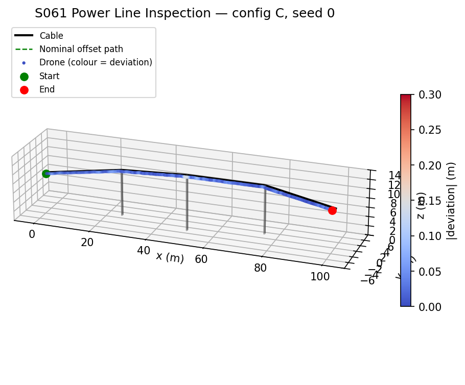
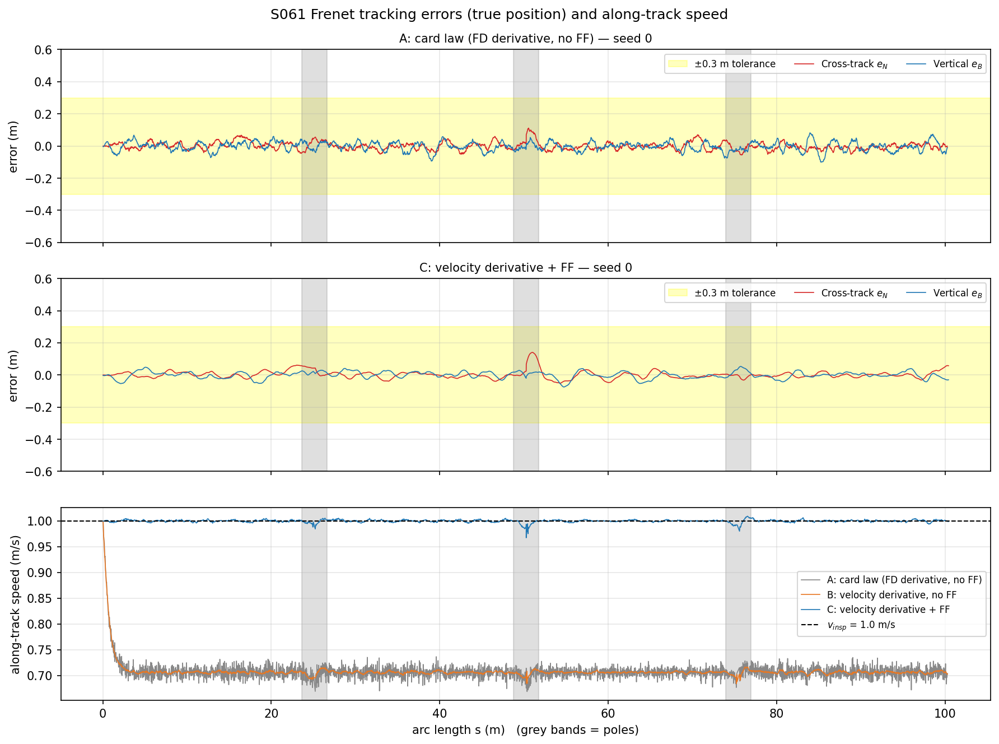
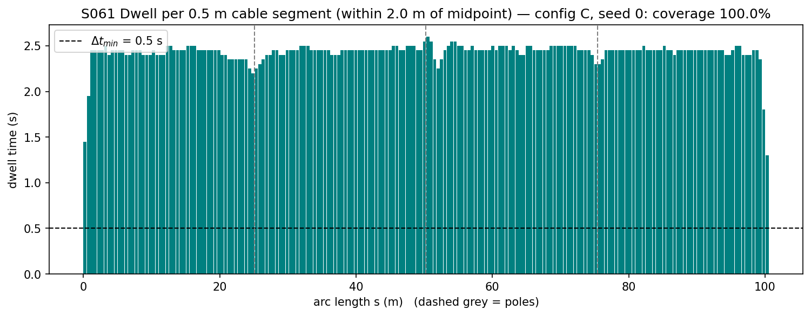
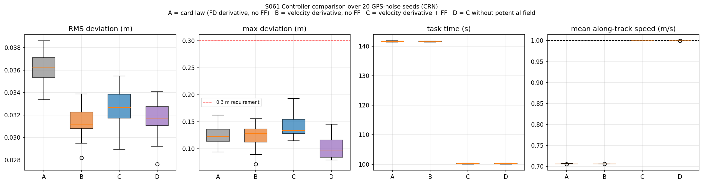
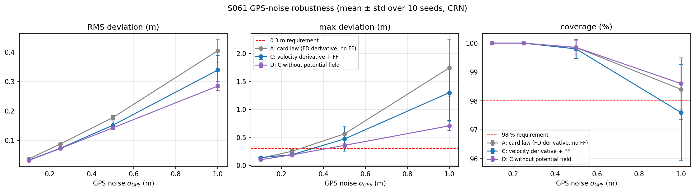
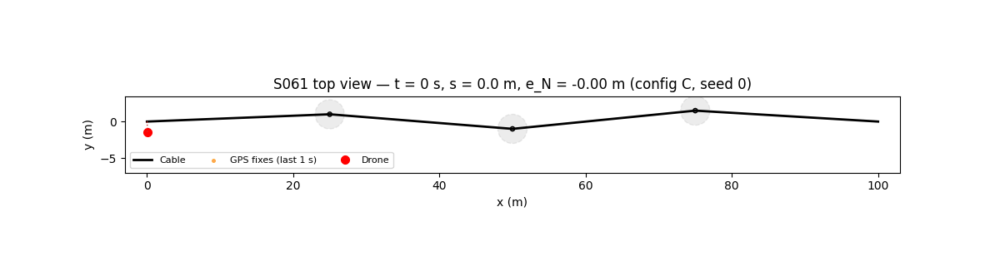

# S061 Power Line Inspection

**Domain**: Industrial & Agriculture | **Difficulty**: ⭐⭐ | **Status**: ✅ Completed

---

## Problem Definition

**Setup**: A drone inspects a high-voltage cable modelled as a 3D polyline with five vertices: the two end attachments and the tops of three support poles (cylinders of radius 0.3 m, rising from the ground to the attachment height of 10–12 m). The drone flies parallel to the cable, 1.5 m to the side and 0.5 m above it, at 1.0 m/s along the cable's arc length. It knows its position only through GPS with σ = 0.1 m noise.

**Controller**: a Frenet-frame controller splits the error into along-track, cross-track ($\hat N$, horizontal) and vertical components, with a speed loop along the cable, a PID loop across it and a PD loop vertically. A repulsive potential field pushes the drone away from each pole when it is within 2 m of the pole axis.

**Objective** (card): fly the whole cable with no collision, path deviation ≤ 0.3 m and coverage ≥ 98 %.

**Comparison** (added; the card defines one controller). Four configurations are flown with the same 20 GPS-noise seeds (common random numbers):

| Config | Error derivatives | Drag feed-forward | Pole potential field |
|---|---|---|---|
| **A** card law | finite difference of the GPS-measured errors (card code) | no | yes |
| **B** | from the velocity estimate | no | yes |
| **C** proposed | from the velocity estimate | $c_{drag} v_{insp} \hat T$ | yes |
| **D** ablation | from the velocity estimate | $c_{drag} v_{insp} \hat T$ | **no** |

A GPS-noise sweep (σ = 0.1, 0.25, 0.5, 1.0 m; 10 seeds each) tests A, C and D for robustness.

---

## Mathematical Model Summary

### Frenet frame and projection

For cable segment $i$ with tangent $\hat T_i$: $\hat N_i = \hat T_i \times \hat z / \|\hat T_i \times \hat z\|$. The drone's (measured) position is projected onto the nearest segment to get the arc length $s$ and reference point $\mathbf p_{ref}$. The nominal path is

$$\mathbf p_{nom}(s) = \mathbf p_{ref}(s) + d_{lat}\hat N_i + \Delta z\,\hat z, \qquad e_N = (\mathbf p - \mathbf p_{nom})\cdot\hat N_i,\quad e_B = (\mathbf p - \mathbf p_{nom})\cdot\hat z$$

### Control law

$$a_T = K_p^{(T)}(v_{insp} - \dot s) - K_d^{(T)}\ddot s,\qquad a_N = -K_p^{(N)}e_N - K_d^{(N)}\dot e_N - K_i^{(N)}\!\int e_N\,dt,\qquad a_B = -K_p^{(B)}e_B - K_d^{(B)}\dot e_B$$

$$\mathbf a_{cmd} = a_T\hat T + a_N\hat N + a_B\hat z\;[+\,c_{drag}v_{insp}\hat T]\;[+\,\mathbf a_{rep}]$$

Config A computes $\dot e_N, \dot e_B$ by finite differences of the GPS-measured errors, as in the card's code. B–D use $\dot e_N = \mathbf v\cdot\hat N$ and $\dot e_B = v_z - \dot s\,T_z$.

### Pole repulsion (card)

$$\mathbf a_{rep} = \sum_k k_{rep}\Bigl(\frac1{d_k} - \frac1{d_0}\Bigr)\frac1{d_k^2}\,\hat{\mathbf r}_k \quad (d_k < d_0 = 2\text{ m})$$

where $d_k$ is the horizontal distance from the measured position to pole axis $k$.

### Dynamics

$$\dot{\mathbf v} = \mathbf a_{cmd} - c_{drag}\mathbf v,\qquad \dot{\mathbf p} = \mathbf v,\qquad \tilde{\mathbf p} = \mathbf p + \boldsymbol\eta_{GPS}$$

Without feed-forward, the along-track loop settles where $K_p^{(T)}(v_{insp} - \dot s) = c_{drag}\dot s$:

$$\dot s_{ss} = \frac{K_p^{(T)}v_{insp}}{K_p^{(T)} + c_{drag}} = \frac{1.2}{1.7} = 0.706\ \text{m/s}$$

### Metrics

- Deviation $\sqrt{e_N^2 + e_B^2}$, computed from the **true** position; RMS and maximum over the flight.
- Coverage: a 0.5 m cable segment counts as inspected when the true drone position stays within $d_{lat} + \epsilon = 2.0$ m of the segment midpoint for at least 0.5 s.
- Pole clearance: 3D distance from the drone to the nearest pole cylinder (ground to pole top).

---

## Key Parameters

| Parameter | Value |
|-----------|-------|
| Cable vertices | (0,0,8), (25,1,10), (50,−1,12), (75,1.5,10.5), (100,0,8.5) m |
| Cable arc length $S$ | 100.55 m |
| Lateral / vertical offset $d_{lat}$, $\Delta z$ | 1.5 m / 0.5 m |
| Inspection speed $v_{insp}$ | 1.0 m/s |
| GPS noise $\sigma_{GPS}$ | 0.1 m (measurement noise) |
| Drag $c_{drag}$ | 0.5 s⁻¹ |
| Speed limit $v_{max}$ (added) | 5 m/s |
| Pole radius / field radius $d_0$ / gain $k_{rep}$ | 0.3 m / 2.0 m / 1.5 |
| Along-track gains $K_p, K_d$ | 1.2, 0.4 |
| Cross-track gains $K_p, K_d, K_i$ | 2.0, 0.8, 0.1 |
| Vertical gains $K_p, K_d$ | 2.5, 1.0 |
| Segments $N_{seg}$ / inspection radius / $\Delta t_{min}$ | 200 (0.503 m) / 2.0 m / 0.5 s |
| Time step $\Delta t$ | 0.05 s |
| End condition | measured $s \geq S - 0.2$ m |
| Monte Carlo | 20 seeds (0–19), common random numbers across configs |
| GPS sweep | σ = 0.1, 0.25, 0.5, 1.0 m; 10 seeds (0–9) |

---

## Implementation

```
src/04_industrial_agriculture/s061_power_line.py
```

```bash
conda activate drones
python src/04_industrial_agriculture/s061_power_line.py
```

Runtime ≈ 1.2 min (measured with other simulations running in parallel).

---

## Results

Mean ± std over 20 seeds (σ_GPS = 0.1 m):

| Config | Task time | Mean speed | RMS deviation | Max deviation | Max \|e_N\| | Max \|e_B\| | Coverage | Min pole clearance |
|---|---:|---:|---:|---:|---:|---:|---:|---:|
| A card law | 141.6 ± 0.1 s | 0.706 m/s | 0.036 ± 0.001 m | 0.125 ± 0.019 m | 0.114 m | 0.088 m | 100.0 % | 1.245 m |
| B vel-deriv | 141.7 ± 0.1 s | 0.706 m/s | 0.031 ± 0.001 m | 0.124 ± 0.022 m | 0.113 m | 0.069 m | 100.0 % | 1.253 m |
| **C vel-deriv + FF** | **100.2 ± 0.1 s** | **1.000 m/s** | 0.033 ± 0.002 m | 0.142 ± 0.021 m | 0.131 m | 0.068 m | 100.0 % | 1.264 m |
| D = C, no field | 100.3 ± 0.1 s | 1.000 m/s | 0.032 ± 0.002 m | 0.103 ± 0.020 m | 0.089 m | 0.068 m | 100.0 % | 1.248 m |

Mean speed excludes the first and last 10 m. Min pole clearance is the minimum over all 20 runs. All 80 runs stay within 0.3 m for 100 % of the time, so the 0.3 m requirement does not separate the configurations at σ = 0.1 m. Coverage is also 100 % for every run: the shortest dwell is 1.55 s for A/B and 1.10 s for C/D, against the 0.5 s threshold.

**Key findings**:

- **The card's controller cannot fly at 1.0 m/s.** With drag and no feed-forward, the along-track loop settles at 0.706 m/s, exactly the predicted $1.2/1.7$. The task takes 141.6 s instead of the card's 103 s. A drag feed-forward ($c_{drag}v_{insp}\hat T$) gives 1.000 m/s and 100.2 s, which is the arc length (100.55 m) minus the 0.2 m end margin at 1 m/s. The card's 103 s also assumed a cable length of about 103 m; the polyline is 100.55 m.
- **Finite-difference derivatives on GPS add noise.** B beats A on RMS deviation in 20/20 seeds (0.031 vs 0.036 m), mostly in the vertical axis (max |e_B| 0.069 vs 0.088 m). The gap grows with GPS noise: at σ = 0.5 m, A's max deviation is 0.561 m against 0.471 m for C. At σ = 1.0 m it is 1.743 m against 1.298 m, and A hits the 5 m/s speed limit in 4 ± 2 steps per flight.
- **The pole potential field is not needed here, and it costs accuracy.** The drone passes each pole 1.2 m from its surface horizontally and 0.5 m above its top. Without the field (D), the closest approach over 20 runs is still 1.248 m, so there is no collision risk. With it (C), the field is active in 153 ± 3 steps. At the nominal 1.5 m it pushes the drone out with 0.111 m/s², and the max deviation grows from 0.103 to 0.142 m. C has a lower RMS than D in only 2/20 seeds. With noisier GPS the field reacts to noisy positions: at σ = 1.0 m, C's max deviation is 1.298 ± 0.496 m against 0.705 ± 0.085 m for D, and C's coverage drops to 97.6 %, below the 98 % target.
- **GPS-noise limit.** C meets the 0.3 m requirement in 10/10 runs at σ = 0.25 m but only 1/10 at σ = 0.5 m. Coverage stays at or above 99.8 % up to σ = 0.5 m. The card's ±0.3 m tolerance therefore needs GPS no worse than about σ = 0.25 m, which in practice means RTK.
- **Card expectations**: zero collisions ✓; coverage ≥ 98 % ✓ (100 %); RMS deviation 0.033 m, smaller than the card's 0.12 m; max |e_N| 0.131 m and max |e_B| 0.068 m, also smaller than the card's 0.28 / 0.19 m; task time 103 s ✗ for the card's own law (141.6 s).

GPS sweep (10 seeds each; runs with max deviation ≤ 0.3 m):

| σ_GPS | A RMS / max | A ok | C RMS / max | C ok | D RMS / max | D ok |
|---|---|---|---|---|---|---|
| 0.10 m | 0.037 / 0.128 m | 10/10 | 0.032 / 0.138 m | 10/10 | 0.031 / 0.101 m | 10/10 |
| 0.25 m | 0.087 / 0.250 m | 9/10 | 0.073 / 0.190 m | 10/10 | 0.072 / 0.186 m | 10/10 |
| 0.50 m | 0.177 / 0.561 m | 0/10 | 0.151 / 0.471 m | 1/10 | 0.142 / 0.356 m | 1/10 |
| 1.00 m | 0.405 / 1.743 m | 0/10 | 0.339 / 1.298 m | 0/10 | 0.284 / 0.705 m | 0/10 |

Coverage at σ = 1.0 m: A 98.4 ± 1.0 %, C 97.6 ± 1.7 %, D 98.6 ± 0.9 %.

### 3D Trajectory

Config C, seed 0: the cable (black), the three poles (grey cylinders) and the drone path coloured by deviation:



### Tracking Errors and Speed

Cross-track and vertical errors (true position) for the card law A and for C, seed 0, with the ±0.3 m band in yellow and the poles as grey bands. The bottom panel shows A and B settling at 0.706 m/s while C holds 1.0 m/s. The cross-track bumps at s ≈ 25, 50 and 75 m are the potential-field push at the poles. The largest, at pole 2 (+0.14 m), is where the cable turns most sharply in the horizontal plane:



### Coverage Dwell

Dwell time per 0.5 m segment for C, seed 0. Every segment is above the 0.5 s threshold (teal); the end segments have the shortest dwell because the drone starts and stops beside them:



### Configuration Comparison

Box plots over the 20 seeds for RMS deviation, max deviation, task time and mean speed:



### GPS-Noise Sweep



### Animation

Top view of config C, seed 0. The red dot is the drone, the orange dots are the last second of GPS fixes, the dotted line links the drone to its reference point on the cable, and the dashed circles are the 2 m activation zones around the poles. 102 frames, 1 s of flight per frame:



### Deviations from the scenario card

| Card | Implementation | Reason |
|------|----------------|--------|
| GPS noise added to $\dot{\mathbf p}$ (and to `pos` every step in the card's code) | GPS noise only corrupts the measured position $\tilde{\mathbf p}$ that the controller uses; the true position integrates $\mathbf v$ | Adding 0.1 m to the true position at every 0.05 s step is a 2 m/s random velocity, not a sensor error. Card corrected. |
| One controller | Four configurations A–D with 20 common-random-number seeds, plus a GPS sweep | The card's law misses the speed target (next row). The comparison isolates the effect of the derivative, the feed-forward and the potential field. |
| $a_T = K_p(v_{insp} - \dot s) - K_d\ddot s$ (card code: $-K_d\dot s$) | Card math ($-K_d\ddot s$) in all configs; C and D add $c_{drag}v_{insp}\hat T$ | The card code's $-K_d\dot s$ would settle at 1.2/2.1 = 0.57 m/s. The math version settles at 0.706 m/s because of drag; the feed-forward removes this steady-state error. A note is added to the card. |
| Cable length ≈ 103 m; task time 103 s | 100.55 m; 141.6 s (A) / 100.2 s (C) | Computed from the card's vertices. Card corrected. |
| Coverage: "within lateral distance $d_{lat} + \epsilon$ of the segment midpoint" ($\epsilon$ not given; card code uses distance to the nominal point with $\epsilon = 0.5$) | Euclidean distance from the true position to the segment midpoint ≤ 2.0 m ($\epsilon = 0.5$ m) for ≥ 0.5 s | The card code's test is nearly always true and only counts time per segment. The midpoint distance makes coverage depend on actually passing close to each segment. |
| No speed limit | 5 m/s speed limit, enforced with an assert | X4 sanity check; it is only reached with GPS noise of σ = 1.0 m. |
| "Collision count: 0 (guaranteed by repulsion)" | Pole and cable clearance asserted > 0 at every step and reported | The drone flies 0.5 m above the pole tops and 1.2 m from them horizontally, so it cannot collide even without repulsion (config D). |
| GIF `s061_inspection.gif` | `animation.gif` | Repository naming convention. |
| Pole cylinders "as grey mesh tubes"; error panel shades the tolerance band yellow | Same | — |

---

## Extensions

1. **Catenary cable**: replace the polyline with $z(x) = a\cosh(x/a) + b$ and use the analytic Frenet frame; check the projection with sag ≥ 2 m.
2. **Wind shear**: add a power-law crosswind $v_w(z)$ and compare PID with an $\mathcal H_\infty$ controller on cross-track variance.
3. **GPS filtering**: put a Kalman filter in front of the controller; the sweep shows that σ_GPS above 0.25 m breaks the 0.3 m tolerance.
4. **Distance-aware potential field**: switch the field on only when the measured clearance falls below a threshold that accounts for GPS uncertainty, so it no longer reacts to noise.
5. **Two-sided pass**: fly out on the left and back on the right, to cover the full cable cross-section.

---

## Related Scenarios

- Prerequisites: [S044 Wall Crack Inspection](../../../scenarios/03_environmental_sar/S044_wall_crack.md), [S048 Full-Area Coverage Scan (Lawnmower)](../../../scenarios/03_environmental_sar/S048_lawnmower.md)
- Follow-ups: [S065 Building 3D Modeling — Multi-Angle Scan Path](../../../scenarios/04_industrial_agriculture/S065_3d_scan_path.md), [S072 Oil Pipeline Leak Detection](../../../scenarios/04_industrial_agriculture/S072_pipeline_leak.md)
- Cross-reference: [S001 Basic Intercept](../../../scenarios/01_pursuit_evasion/S001_basic_intercept.md), [S062 Wind Turbine Blade Inspection](../../../scenarios/04_industrial_agriculture/S062_wind_turbine.md)
