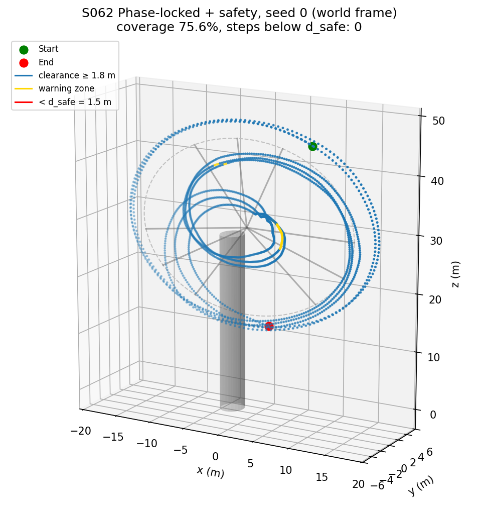
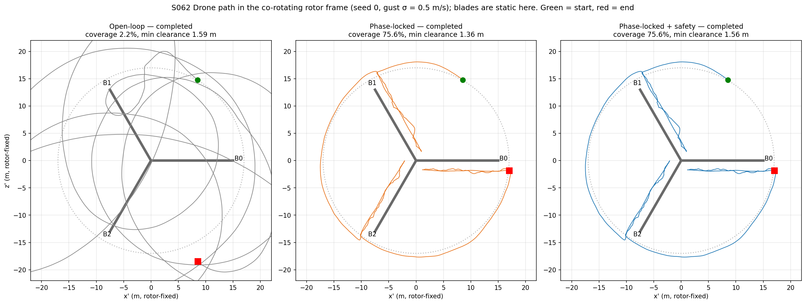
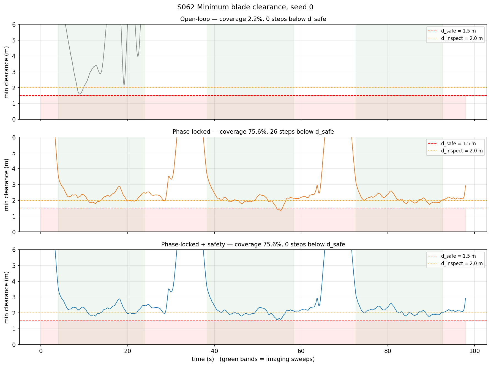
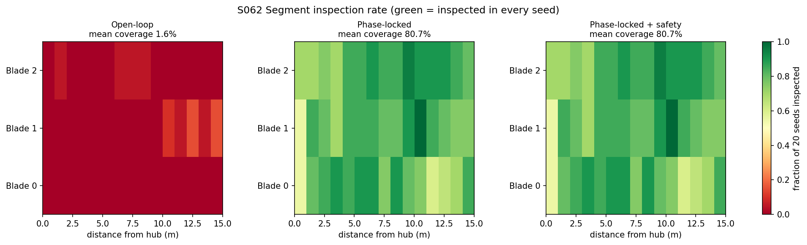
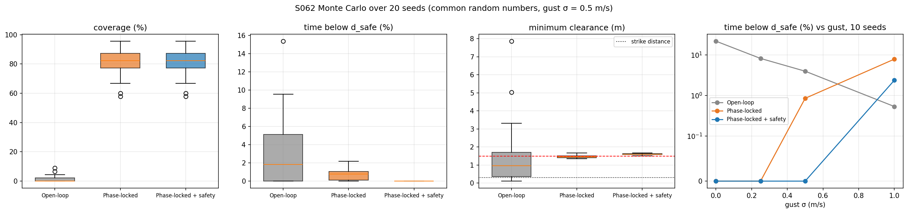
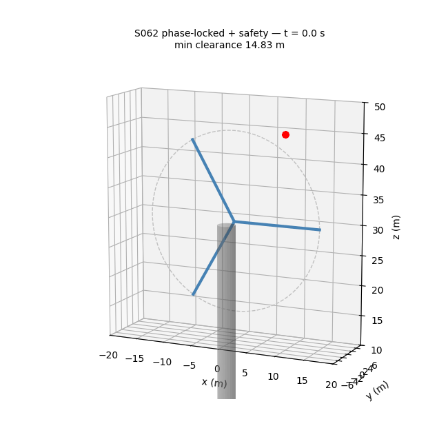

# S062 Wind Turbine Blade Inspection

**Domain**: Industrial & Agriculture | **Difficulty**: ⭐⭐⭐ | **Status**: ✅ Completed

---

## Problem Definition

**Setup**: A three-blade wind turbine keeps turning during the inspection. The hub is at 30 m, the blades are 15 m long and the rotor turns at ω = 0.5 rad/s (one revolution every 12.6 s). The blades are line segments in the rotor plane (the $xz$-plane, $y = 0$), and their angles are known in real time from the turbine's SCADA feed. The drone flies in the plane $y = 1.0$ m in front of the rotor. It must image every 1 m segment of all three blades from within $d_{inspect} + \varepsilon = 2.2$ m, at no more than 1.0 m/s relative to the blade section, with the section inside the camera's 30° half-cone. It must never come closer than $d_{safe} = 1.5$ m to any blade. Its position comes from GPS (σ = 0.1 m), and it is pushed around by wind gusts.

**Mission plan** (same for all controllers). The drone co-rotates with each blade in turn (order B1, B2, B0):

1. Move along the 17 m orbit (outside the blade tips) to a point just behind the blade.
2. Slide from tip ($r = 17$ m) to root ($r = 1$ m) at 0.8 m/s relative to the blade. During this sweep the drone stays 1.732 m behind the trailing edge in the rotor plane and 1.0 m in front of it, which puts it 2.0 m from the blade line.
3. Return to $r = 17$ m at 3 m/s.

The drone starts 60° ahead of blade 0 ($\phi_{offset}$, midway between two blades). The planned mission takes 97.9 s, within $T_{max} = 120$ s.

**Comparison** (card), with common random numbers (the same gust and GPS sequences for every controller, 20 seeds):

1. **Open-loop**: flies the feed-forward velocity of the plan, with no position or phase feedback.
2. **Phase-locked**: feed-forward plus PD feedback on the GPS position against the reference, which moves with the blade phase from SCADA.
3. **Phase-locked + safety** (proposed): phase-locked, plus a repulsive velocity whenever the measured distance to any blade drops below $d_{safe} + 0.3 = 1.8$ m. While it is active, feedback that would push the drone towards that blade is removed.

---

## Mathematical Model Summary

### Blade kinematics and clearance

$$\mathbf p_{blade,i}(s,t) = \mathbf p_{hub} + s\,R\,\hat e_r(\omega t + \phi_i),\quad \hat e_r(a) = (\cos a, 0, \sin a),\quad \phi_i = 2\pi i/3$$

$$d_i(t) = \min_{s\in[0,1]}\|\mathbf p_{drone} - \mathbf p_{blade,i}(s,t)\|$$

### Co-rotating reference

During a sweep of blade $b$ with angle $\varphi = \omega t + \phi_b$ and tangent $\hat e_t = (-\sin\varphi, 0, \cos\varphi)$:

$$\mathbf p_{ref} = \mathbf p_{hub} + a(t)\,\hat e_r - \ell\,\hat e_t + y_{off}\,\hat y,\qquad \ell = \sqrt{d_{inspect}^2 - y_{off}^2} = 1.732\text{ m}$$

$$\mathbf v_{ref} = \dot a\,\hat e_r + a\,\omega\,\hat e_t + \ell\,\omega\,\hat e_r$$

On the transit orbit the drone sits at radius $\sqrt{17^2 + \ell^2}$ and moves at relative angular rate $V_{transfer}/r$.

Error margins at the sweep geometry: an in-plane error of 0.614 m towards the blade reaches $d_{safe}$, and an outward error of 0.228 m takes the drone beyond the 2.2 m imaging distance. While the drone stays exactly 2.0 m from the blade line, it images segment midpoints within ±0.917 m of its own position along the blade.

### Controllers

$$\mathbf v_{ff}(t) = \frac{\mathbf p_{ref}(t + \Delta t) - \mathbf p_{ref}(t)}{\Delta t},\qquad \mathbf v_{cmd} = \mathbf v_{ff} \quad\text{(open-loop)}$$

$$\mathbf v_{cmd} = \mathbf v_{ff} + K_p(\mathbf p_{ref} - \tilde{\mathbf p}) + K_d(\mathbf v_{ref} - \mathbf v) \quad\text{(phase-locked)}$$

The feed-forward is the plan's exact displacement over the next step. Euler integration of it alone reproduces the plan (drift 2.19e-12 m), whereas integrating the analytic $\mathbf v_{ref}$ with Euler at Δt = 0.05 s would drift 0.74 m from the plan along the curved co-rotating path. In the rate term, $\mathbf v$ is the drone's **true** ground velocity, including the wind, and is assumed to be measured without noise.

$$\mathbf v_{cmd} \mathrel{+}= K_{safe}\,(d_{warn} - \tilde d_i)\,\hat n_i \quad\text{for each blade with } \tilde d_i < d_{warn} = 1.8\text{ m (safety)}$$

Here $\tilde{\mathbf p} = \mathbf p + \boldsymbol\eta_{GPS}$, and $\hat n_i$ points from the nearest blade point to the measured position.

### Drone and wind

$$\dot{\mathbf v}_{air} = (\mathbf v_{cmd} - \mathbf v_{air})/\tau,\quad \|\mathbf v_{cmd}\| \le 15\text{ m/s},\quad \dot{\mathbf p} = \mathbf v_{air} + \mathbf w,\quad \mathbf w_{k+1} = e^{-\Delta t/\tau_w}\mathbf w_k + \sigma_w\sqrt{1 - e^{-2\Delta t/\tau_w}}\,\boldsymbol\xi_k$$

### Inspection test (card)

Segment $k$ of blade $i$ is inspected at time $t$ when all three hold:

- $\|\mathbf p - \mathbf m_{ik}\| \le d_{inspect} + \varepsilon$;
- $\|\mathbf v - \omega\,r_k\,\hat e_t\| \le v_{max,inspect}$ (speed relative to the segment);
- the angle between the camera boresight (gimballed onto the nearest point of the target blade) and the direction to the segment is ≤ 30°.

The flight ends at a **crash**: distance to a blade below 0.3 m (blade strike), contact with the tower, or reaching the ground.

---

## Key Parameters

| Parameter | Value |
|-----------|-------|
| Hub height / blade length / ω | 30 m / 15 m / 0.5 rad/s |
| Tower (added) | radius 1.5 m, axis at $y = -3$ m |
| Drone plane $y_{offset}$ | 1.0 m |
| Transit orbit $r_{orbit}$ / start phase $\phi_{offset}$ | 17 m / 60° ahead of blade 0 |
| $d_{safe}$ / warning zone / strike distance | 1.5 m / 1.8 m / 0.3 m |
| $d_{inspect}$ / $\varepsilon$ | 2.0 m / 0.2 m |
| In-plane offset $\ell$ | 1.732 m |
| $v_{max,inspect}$ (relative) / camera half-angle | 1.0 m/s / 30° |
| Sweep / return / transfer relative speed | 0.8 / 3.0 / 4.0 m/s |
| Sweep radii | 17 m → 1 m |
| Blade order | B1, B2, B0 |
| $K_p$ / $K_d$ / $K_{safe}$ | 2.0 s⁻¹ / 0.3 / 3.0 s⁻¹ |
| Velocity lag τ / speed limit | 0.2 s / 15 m/s |
| GPS σ | 0.1 m |
| Gust σ_w / τ_w | 0.5 m/s / 2 s |
| Segments per blade | 15 (1 m) |
| Δt / $T_{max}$ / planned mission | 0.05 s / 120 s / 97.9 s |
| Max planned ground speed | 12.54 m/s |
| Monte Carlo | 20 seeds (0–19), common random numbers |
| Gust sweep | σ_w = 0, 0.25, 0.5, 1.0 m/s; 10 seeds (0–9) |

---

## Implementation

```
src/04_industrial_agriculture/s062_wind_turbine.py
```

```bash
conda activate drones
python src/04_industrial_agriculture/s062_wind_turbine.py
```

Runtime ≈ 2.7 min (measured with other simulations running in parallel).

---

## Results

20 seeds, gust σ = 0.5 m/s:

| Controller | Coverage | Coverage, speed test ignored | Steps below $d_{safe}$ | Runs with 0 violations | Crashes | Min clearance | Mean clearance while imaging |
|---|---:|---:|---:|:-:|:-:|---:|---:|
| Open-loop | 1.6 ± 2.4 % | 9.6 ± 8.5 % | 31.8 ± 43.1 | 7/20 | 14/20 (4 blade, 8 tower, 2 ground) | 1.57 ± 1.86 m (worst 0.11 m) | 6.82 ± 2.86 m |
| Phase-locked | 80.7 ± 10.6 % | 88.8 ± 7.7 % | 14.9 ± 13.0 (0.76 % of flight) | 5/20 | 0/20 | 1.47 ± 0.08 m (worst 1.35 m) | 2.09 ± 0.07 m |
| **Phase-locked + safety** | **80.7 ± 10.6 %** | 88.7 ± 7.6 % | **0.0 ± 0.0** | **20/20** | 0/20 | **1.60 ± 0.04 m** (worst 1.51 m) | 2.11 ± 0.06 m |

Per seed, the safety controller has fewer violation steps than phase-locked in 15 of 20 seeds, the same number in 5 (both zero) and more in none. Coverage is equal in all 20 seeds. The repulsion is active for 167.3 ± 65.6 steps per flight.

**Key findings**:

- **Without feedback the drone cannot inspect a turning rotor.** Open-loop images 1.6 % of the segments. 14 of 20 flights crash (mean end time 57.4 s): 4 by blade strike, 8 into the tower and 2 into the ground.
  - Gusts alone are not the cause. With no wind at all, the open-loop drone still covers only 26.7 % and spends 21.64 % of the flight below $d_{safe}$.
  - The feed-forward is integrated exactly, so this is not a discretisation artefact (an earlier version that integrated the analytic reference velocity lost a further 0.74 m to Euler error).
  - What remains is the 0.2 s velocity lag: each velocity step in the plan leaves a position error of about $\tau\,\Delta v$, and nothing corrects it.
- **Phase-locking does the inspection; the safety layer removes the violations.** Both closed-loop controllers reach 80.7 % coverage. Phase-locked alone dips below $d_{safe}$ in 15 of 20 runs (worst 1.35 m). With the safety layer, every run stays above 1.5 m (worst 1.51 m), and coverage is identical seed by seed.
- **The card's ≥ 90 % coverage target is not met at σ_w = 0.5 m/s.**
  - Ignoring the speed test raises coverage only to 88.7 %. The rest is lost to position errors that carry the drone beyond the 2.2 m imaging distance; an outward error of only 0.228 m is enough.
  - The speed test takes coverage from 88.7 % down to 80.7 %: gusts push the speed relative to the blade above 1.0 m/s, on top of the 0.8 m/s sweep.
  - The gust sweep shows coverage falling with wind for both closed-loop controllers. The 90 % target holds at σ_w = 0.25 m/s (94.2 ± 5.1 %):

| Gust σ_w | Open-loop coverage / below $d_{safe}$ / crashes | Phase-locked | Phase-locked + safety |
|---|---|---|---|
| 0.00 m/s | 26.7 % / 21.64 % / 0/10 | 100.0 % / 0.00 % / 0/10 | 100.0 % / 0.00 % / 0/10 |
| 0.25 m/s | 5.3 % / 8.13 % / 5/10 | 94.2 % / 0.00 % / 0/10 | 94.2 % / 0.00 % / 0/10 |
| 0.50 m/s | 2.2 % / 3.94 % / 5/10 | 82.4 % / 0.85 % / 0/10 | 82.4 % / 0.00 % / 0/10 |
| 1.00 m/s | 0.0 % / 0.53 % / 7/10 | 69.3 % / 7.81 % / 0/10 | 69.1 % / 2.36 % / 0/10 |

  - At σ_w = 1.0 m/s the safety layer no longer prevents every violation (min clearance 1.21 m), but it cuts them from 7.81 % (phase-locked alone, min clearance 0.71 m) to 2.36 %.
  - Open-loop spends less time below $d_{safe}$ at higher wind only because it crashes or drifts away earlier.
- **Card clearance expectations**: mean clearance during transit is 6.16 m, not 2.5–3.5 m, because the transit orbit is outside the tips. While imaging it is 2.11 m, not 1.2 m, because 1.2 m would be inside $d_{safe}$ (see Deviations).

### 3D Trajectory

Phase-locked + safety, seed 0, in the world frame: the tower (grey), the rotor disk (dashed), blade snapshots at three times, and the drone path coloured by clearance (blue = above the warning zone, gold = inside it):



### Paths in the Rotor Frame

The same flights in the co-rotating frame, where the blades are static. The closed-loop drones slide down the trailing side of B1, B2 and B0 and transit around the 17 m orbit. Open-loop (seed 0) drifts across the rotor disc and never follows a blade:



### Clearance over Time

Seed 0, with the imaging sweeps shaded green. Phase-locked dips to 1.36 m during the B2 sweep (26 steps below $d_{safe}$); the safety controller holds the same sweep above 1.5 m (minimum 1.56 m). Open-loop never comes within 1.5 m in this seed (minimum 1.59 m) but images only 2.2 %:



### Coverage Heat Map

Fraction of the 20 seeds in which each segment was imaged:



### Monte Carlo Summary

Coverage, time below $d_{safe}$ and minimum clearance over the 20 seeds (box plots), and time below $d_{safe}$ against gust strength (right):



### Animation

Phase-locked + safety, seed 0: the rotating blades (blue), the drone (red) and its recent trail. 152 frames, 0.65 s of flight per frame:



### Deviations from the scenario card

| Card | Implementation | Reason |
|------|----------------|--------|
| $d_{inspect} = 1.0$ m (code: 0.5 m) with $d_{safe} = 1.5$ m | $d_{inspect} = 2.0$ m | Imaging at 1.0 m would break the hard 1.5 m safety margin every time. Card corrected. |
| Drone circles on $r_{orbit} = 17$ m, 60° ahead of the blades | 17 m orbit used for transit only. Imaging is done by co-rotating with each blade and sliding from tip to root, 2.0 m from the blade line | On the 17 m orbit at $y = 1$ m the drone is never closer than 2.236 m to a blade: no segment can be imaged (needs ≤ 2.2 m) and $d_{safe}$ can never be violated, so the card's comparison could not show anything. Card corrected. |
| Feed-forward along the analytic orbit velocity | Feed-forward = exact plan displacement per step | Euler integration of the analytic velocity drifts 0.74 m off the plan over the mission (beyond the 0.228 m imaging margin); the step displacement drifts 2.19e-12 m. |
| Disturbance: GPS noise only | Adds OU wind gusts ($\sigma_w$ = 0.5 m/s, $\tau_w$ = 2 s) and a 0.2 s velocity lag; gust sweep 0–1 m/s | Without disturbance, the open-loop orbit at $\dot\theta = \omega$ would track the plan exactly and match the phase-locked one. |
| $v_{drone} \le 1.0$ m/s while inspecting | Speed **relative to the segment** ≤ 1.0 m/s | Co-rotating at r = 17 m already means 8.5 m/s over the ground; motion blur depends on relative speed. Card corrected. |
| Phase-lock law $\dot\theta_{cmd} = \omega + K_p e_\theta + K_d \dot e_\theta$ | Cartesian $\mathbf v_{ref} + K_p(\mathbf p_{ref} - \tilde{\mathbf p}) + K_d(\mathbf v_{ref} - \mathbf v)$ with the card's $K_p$, $K_d$ | The reference now has radial motion as well as phase; the angular law is the special case with fixed radius. |
| Safety trigger at $d_{seg} < d_{safe}$; push away from the tip with $K_{safe} = 3$ m/s² | Trigger at $\tilde d < d_{safe} + 0.3$ m (the warning zone in the card's text); velocity push $K_{safe}(d_{warn} - \tilde d)$ away from the **nearest blade point**; inward feedback removed | Triggering only after the violation cannot prevent it. Near the root the tip is 14 m away and the wrong direction to push. |
| Distances use the true position for the safety trigger (card code) | Safety trigger uses the GPS-measured position; violations and coverage use the true position | The drone cannot know its true position. |
| Mission horizon 120 s | Plan takes 97.9 s; the flight ends at mission completion or at a crash (blade < 0.3 m, tower, ground) | X4: no flying through blades or terrain. |
| Coverage ≥ 90 %, zero violations, clearance ≈ 1.2 m imaging / 2.5–3.5 m transit (expected) | 80.7 %, zero violations (20/20), 2.11 m / 6.16 m | See Key findings; reported as measured, not tuned. |
| GIF `inspection_animation.gif`, 10 fps, trail 60 frames | `animation.gif`, 10 fps, trail of the last ≈ 10 s | Repository naming convention. |

---

## Extensions

1. **Variable rotor speed**: $\omega(t) = \omega_0 + \Delta\omega\sin(0.05t)$, with a Kalman filter estimating ω from the SCADA encoder.
2. **Gust-aware sweep speed**: slow the sweep when the measured gust grows, trading mission time for coverage; at σ_w = 0.5 m/s the speed test lowers coverage from 88.7 % to 80.7 %.
3. **Both blade sides**: sweep the leading side too, entering from the root when the next blade is far away.
4. **Tower shadow**: add a velocity disturbance when the drone passes the tower wake.
5. **Wind farm**: assign drones to turbines (Hungarian algorithm) and schedule the inspections.

---

## Related Scenarios

- Prerequisites: [S061 Power Line Inspection](../../../scenarios/04_industrial_agriculture/S061_power_line.md), [S071 Bridge Underside Structural Inspection](../../../scenarios/04_industrial_agriculture/S071_bridge_inspection.md)
- Follow-ups: [S079 Offshore Wind Farm Installation Assistance](../../../scenarios/04_industrial_agriculture/S079_offshore_wind.md)
- Cross-reference: [S005 Stealth Approach](../../../scenarios/01_pursuit_evasion/S005_stealth_approach.md), [S023 Moving Landing Pad](../../../scenarios/02_logistics_delivery/S023_moving_landing_pad.md), [S044 Wall Crack Inspection](../../../scenarios/03_environmental_sar/S044_wall_crack.md)
