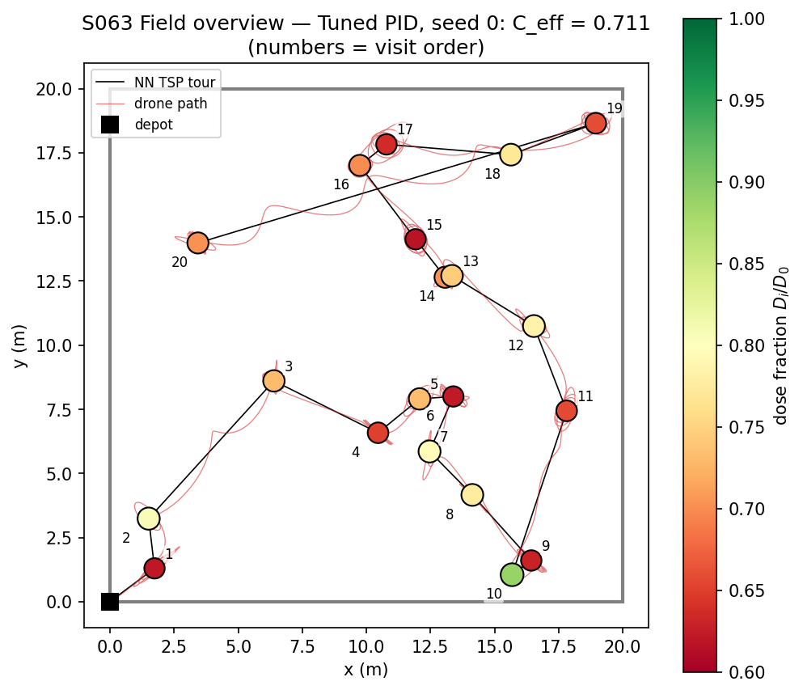
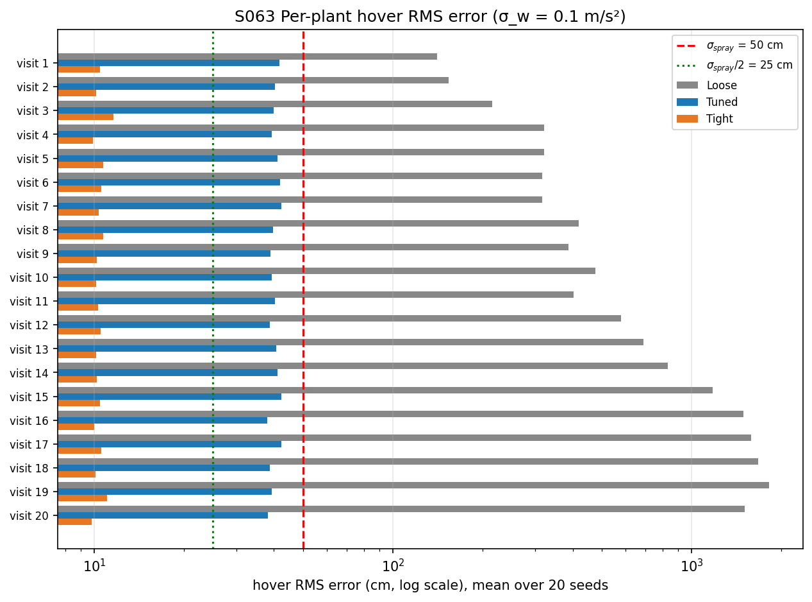
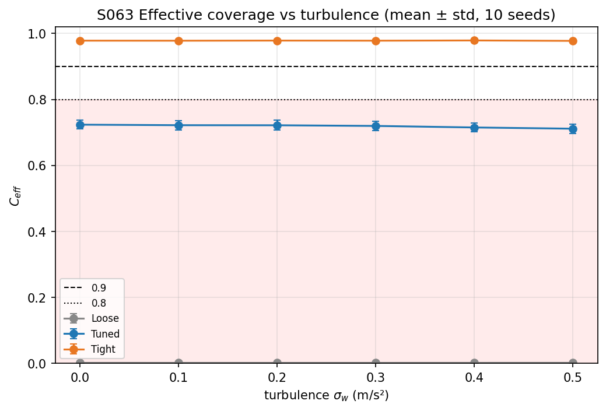
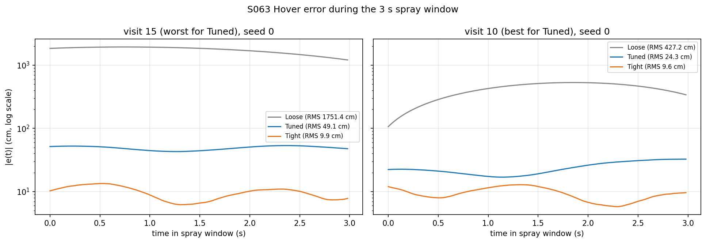
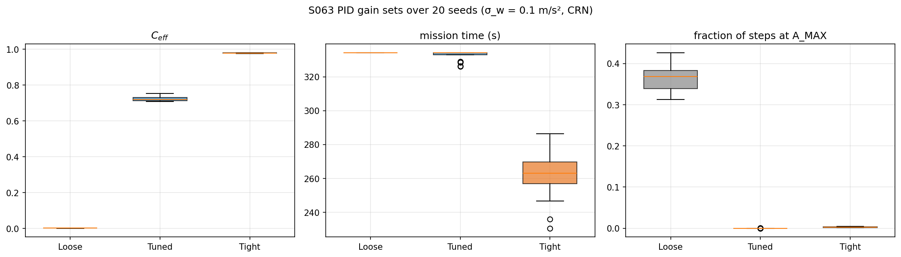
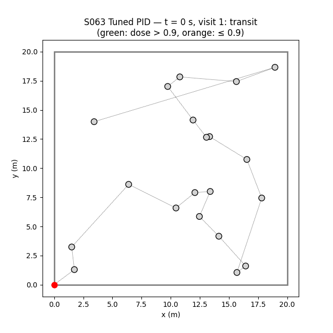

# S063 Single-Plant Precision Spraying

**Domain**: Industrial & Agriculture | **Difficulty**: ⭐ | **Status**: ✅ Completed

---

## Problem Definition

**Setup**: A drone must give a fixed spray dose to each of 20 plants placed at random in a 20 × 20 m field (inside a 1 m margin). It visits them in nearest-neighbour TSP order from the depot at (0, 0). Each leg is flown behind a reference point moving at 1.0 m/s. At each plant the drone waits until it has settled, then hovers and sprays for 3 s. A PID position controller rejects a wind disturbance made of a sinusoidal gust plus Gaussian turbulence. The dose a plant receives falls off with the RMS hover error during its spray window.

**Comparison** (card): three PID gain sets, Loose, Tuned and Tight. They are flown with common random numbers (the same gust phases, turbulence and GPS noise) over 20 seeds at the baseline turbulence $\sigma_w = 0.1$ m/s², and over a turbulence sweep $\sigma_w \in [0, 0.5]$ m/s² with 10 seeds per point.

**Card questions**: the TSP path length; the per-plant hover RMS error; the effective coverage $C_{eff}$; and the trade-off between $\sigma_w$ and $C_{eff}$ for the three gain sets.

---

## Mathematical Model Summary

### Nearest-neighbour tour

$$\pi(k+1) = \arg\min_{j\notin\mathcal V}\|\mathbf p_{\pi(k)} - \mathbf p_j\|,\qquad L_{TSP} = \sum_k\|\mathbf p_{\pi(k+1)} - \mathbf p_{\pi(k)}\|$$

The tour is an open path that starts at the depot. A 2-opt improvement of the same path is computed only as a reference; it is not flown.

### Drone, PID and wind

$$\ddot{\mathbf q} = \mathrm{sat}_{A_{max}}\Bigl(K_p\mathbf e + K_i\!\int\mathbf e\,dt + K_d(\dot{\mathbf r} - \dot{\mathbf q})\Bigr) + \mathbf f_w,\qquad \mathbf e = \mathbf r - (\mathbf q + \boldsymbol\eta_{GPS})$$

$$f_{w}(t) = A_w\sin(2\pi t/T_w + \varphi) + \mathcal N(0, \sigma_w^2)\quad\text{per axis, }\varphi\text{ redrawn per plant}$$

- Integration is Euler at 50 Hz.
- The acceleration is clipped per axis to $A_{max} = 3$ m/s², and speed to $V_{max} = 10$ m/s.
- The integrator is reset at the start of each spray window (card).

### Stability of the gain sets

The error dynamics have the characteristic polynomial $s^3 + K_d s^2 + K_p s + K_i$. By Routh, it is stable only if $K_p K_d > K_i$. The damping of the full PID loop is read from its dominant complex pole pair $\lambda$, as $\zeta = -\mathrm{Re}\,\lambda/|\lambda|$; the PD-only values ($\omega_n = \sqrt{K_p}$, $\zeta = K_d/(2\sqrt{K_p})$, integral ignored) are shown for reference. The steady amplitude of the response to the sinusoidal gust (full PID) is

$$|e| = A_w\left|\frac{j\omega_w}{(j\omega_w)^3 + K_d(j\omega_w)^2 + K_p\,j\omega_w + K_i}\right|,\qquad \omega_w = 2\pi/T_w = 1.571\text{ rad/s}$$

| Gain set | $K_pK_d - K_i$ | PID poles | $\zeta$ (PID) | Gust amplitude (PID) | $\zeta$ / amplitude, PD only |
|---|---:|---|---:|---:|---:|
| Loose (0.5, 0.05, 0.1) | 0.000 (marginal) | ±0.707j, −0.100 | 0.000 | 15.2 cm | 0.071 / 15.2 cm |
| Tuned (2.0, 0.2, 0.5) | 0.800 | −0.199 ± 1.386j, −0.102 | 0.142 | 37.2 cm | 0.177 / 32.8 cm |
| Tight (5.0, 0.5, 1.0) | 4.500 | −0.449 ± 2.170j, −0.102 | 0.203 | 10.6 cm | 0.224 / 10.1 cm |

### Arrival, hover error and dose

Spraying starts once the measured error is below 0.3 m and the speed below 0.1 m/s for 0.2 s, or after a 10 s time-out. Then

$$\varepsilon_i = \sqrt{\tfrac1M\textstyle\sum_k\|\mathbf p_i - \mathbf q_k\|^2},\qquad C_{eff} = \frac1N\sum_i\exp\!\Bigl(-\frac{\varepsilon_i^2}{2\sigma_{spray}^2}\Bigr),\quad \sigma_{spray} = 0.5\text{ m}$$

---

## Key Parameters

| Parameter | Value |
|-----------|-------|
| Field / plants / layout seed | 20 × 20 m / 20 in [1, 19]² / `default_rng(0)` |
| Depot | (0, 0) |
| Spray width / $\sigma_{spray}$ | 2.0 m / 0.5 m |
| Transit reference speed | 1.0 m/s |
| Spray time $T_{spray}$ | 3.0 s (150 samples) |
| Time step | 0.02 s (50 Hz) |
| GPS noise σ | 0.1 m |
| Gust $A_w$ / $T_w$ | 0.3 m/s² / 4.0 s |
| Turbulence $\sigma_w$ | 0.1 m/s² (sweep 0, 0.1, …, 0.5) |
| Loose / Tuned / Tight $(K_p, K_i, K_d)$ | (0.5, 0.05, 0.1) / (2.0, 0.2, 0.5) / (5.0, 0.5, 1.0) |
| Acceleration limit $A_{max}$ (added) | 3 m/s² per axis |
| Speed limit $V_{max}$ (added) | 10 m/s |
| Settle test (added) | measured error < 0.3 m and speed < 0.1 m/s for 0.2 s; time-out 10 s |
| Monte Carlo | 20 seeds (0–19); sweep 10 seeds (0–9); common random numbers |

---

## Implementation

```
src/04_industrial_agriculture/s063_precision_spraying.py
```

```bash
conda activate drones
python src/04_industrial_agriculture/s063_precision_spraying.py
```

Runtime ≈ 3 min (measured with other simulations running in parallel).

---

## Results

**TSP**: the nearest-neighbour path is 74.14 m. 2-opt shortens the same open path to 69.39 m, so NN is 6.8 % longer than 2-opt. 2-opt is not the optimum, so this is only a lower bound on NN's gap to the optimum.

20 seeds, $\sigma_w = 0.1$ m/s²:

| Gain set | $C_{eff}$ | Mean / 95th pct / max hover RMS | Plants with dose > 0.9 | Mission time | Settle wait per plant (time-outs) | Steps at $A_{max}$ |
|---|---:|---:|---:|---:|---:|---:|
| Loose | 0.002 ± 0.001 | 740.6 / 2051.4 / 2227.3 cm | 0.0 % | 334.3 ± 0.0 s | 10.00 s (400/400) | 36.37 % |
| Tuned | 0.722 ± 0.012 | 40.2 / 49.0 / 54.3 cm | 1.0 % | 332.7 ± 2.9 s | 9.92 s (395/400) | 0.00 % |
| **Tight** | **0.978 ± 0.001** | **10.4 / 13.1 / 15.1 cm** | **100.0 %** | **262.4 ± 13.5 s** | 6.41 s (71/400) | 0.26 % |

Per seed, Tight beats Tuned in 20/20 seeds and Tuned beats Loose in 20/20. Loose also reaches the 10 m/s speed limit in 3.46 % of steps and wanders up to 26.5 m outside the field.

$C_{eff}$ against turbulence (10 seeds each):

| $\sigma_w$ (m/s²) | 0.0 | 0.1 | 0.2 | 0.3 | 0.4 | 0.5 |
|---|---|---|---|---|---|---|
| Loose | 0.002 | 0.002 | 0.002 | 0.002 | 0.002 | 0.002 |
| Tuned | 0.724 | 0.722 | 0.722 | 0.720 | 0.715 | 0.711 |
| Tight | 0.978 | 0.978 | 0.978 | 0.978 | 0.979 | 0.977 |

**Key findings**:

- **Tight is the only gain set that sprays accurately.** Every one of its 400 plant visits gets more than 90 % of the dose ($C_{eff}$ = 0.978). It is also the fastest mission, 262.4 s against about 333 s, because it settles within the 10 s window at most plants. The card's "risk of actuator saturation" barely shows: 0.26 % of steps hit the 3 m/s² limit.
- **"Tuned" is not well tuned.** Its closed-loop damping ratio is 0.142, not critical. Its dominant poles (−0.199 ± 1.386j) sit near the 1.571 rad/s gust, so the gust is amplified to 37.2 cm, against 15.2 cm for Loose and 10.6 cm for Tight. That is close to the measured hover RMS of 40.2 cm, and $C_{eff}$ is 0.722, below the 0.8 failure line. The drone almost never meets the settle test (395 of 400 visits time out).
- **"Loose" is unstable in practice.** $K_pK_d = K_i$ puts it exactly on the Routh stability boundary. Its oscillation never decays, and the hover error grows from plant to plant. In seed 0 the hover RMS rises from 1.55–1.91 m at the first three plants to 18.41–22.06 m at the last three. With the acceleration and speed limits removed it still reaches 10.27–14.63 m, so the gains are the cause, not saturation. Mean hover RMS is 740.6 cm and $C_{eff}$ = 0.002. Marginal stability explains the growth but not the whole failure: with $K_i = 0$ (a stable PD loop) Loose still reaches only $C_{eff}$ = 0.225 ± 0.018. Its PD part alone is too soft and too lightly damped ($\zeta$ = 0.071) to hold the drone over the plant.
- **Turbulence hardly matters; the sinusoidal gust dominates.** Raising $\sigma_w$ from 0 to 0.5 m/s² moves Tuned only from 0.724 to 0.711. Tight stays at 0.977–0.979. The white-noise turbulence is drawn independently at every 0.02 s step, so its effect on position averages out. The 0.3 m/s² gust at a 4 s period is what separates the gain sets. The card's trade-off curve is therefore flat for all three, and the ranking Tight > Tuned > Loose holds at every $\sigma_w$.

### Field Overview

Tuned PID, seed 0 ($C_{eff}$ = 0.711): the NN tour (black), the drone's path (red) and the plants coloured by the dose they received; the numbers give the visit order:



### Per-Plant Hover RMS Error

Mean over 20 seeds for each visit (log scale). Loose grows from visit to visit; Tuned stays near 40 cm, just under $\sigma_{spray}$ = 50 cm; Tight stays near 10 cm:



### $C_{eff}$ against Turbulence



### Hover Error Time Series

Seed 0, at Tuned's worst plant (visit 15, 49.1 cm) and best plant (visit 10, 24.3 cm), for all three gain sets (log scale):



### Gain-Set Summary



### Animation

Tuned PID, seed 0. The drone (red) flies the tour; a blue disc of radius $\sigma_{spray}$ shows while it sprays. Plants turn green (dose > 0.9) or orange (≤ 0.9) once sprayed. 330 frames, 1 s of flight per frame:



### Deviations from the scenario card

| Card | Implementation | Reason |
|------|----------------|--------|
| Hover starts exactly on the plant with zero velocity; transit moves the drone kinematically | One continuous closed-loop flight: the PID tracks a reference moving at 1.0 m/s, then holds the plant; spraying starts after a settle test (0.3 m, 0.1 m/s, 0.2 s; 10 s time-out) | Starting each hover at a perfect state hides arrival transients, which are what separates the gain sets. The settle test and time-out are added parameters. |
| GPS error 0.1 m listed but unused | GPS noise on the position the PID sees; the hover error uses the true position | The card lists it as a sensor property. |
| "Tight: risk of actuator saturation" without a limit | 3 m/s² per-axis acceleration limit and 10 m/s speed limit, enforced with asserts | Saturation needs a limit to be measurable (X4). |
| Loose "under-damped, high steady-state error"; Tuned "critically damped" | Loose is marginally stable ($K_pK_d = K_i$); Tuned has closed-loop $\zeta$ = 0.142 (0.177 for the PD part alone) | Derived above and confirmed by the simulation. Card labels corrected. |
| Sweep with 20 $\sigma_w$ values and one run per value | 6 values × 10 seeds, mean ± std, common random numbers | Multi-seed results are needed to separate gain sets from noise (X2); runtime. |
| NN "within 20–25 % of optimum" | NN is 6.8 % longer than 2-opt on this layout | Printed for reference; the true optimum is not computed. |
| Field-overview marker size scaled by dose | Marker colour and size both follow the dose (colour scale 0.6–1.0) | Readability. |
| GIF `s063_animation.gif` | `animation.gif` | Repository naming convention. |

---

## Extensions

1. **Gain design**: place the closed-loop poles away from the gust frequency (for example $\zeta$ = 0.7 at $\omega_n$ = 3 rad/s) and compare with the three card sets.
2. **Wind-aware spray time**: spray until the running RMS falls below 0.1 m instead of a fixed 3 s.
3. **2-opt tour**: fly the 69.39 m 2-opt path and compare mission time.
4. **Gaussian plume dose**: integrate a 2D dose footprint over the hover trajectory instead of using the RMS error.
5. **Feed-forward gust rejection**: estimate the sinusoidal gust online (adaptive notch) and cancel it.

---

## Related Scenarios

- Follow-ups: [S067 Spray Coverage Overlap Optimization](../../../scenarios/04_industrial_agriculture/S067_spray_overlap.md), [S068 Large-Scale Farmland Cooperative Spraying](../../../scenarios/04_industrial_agriculture/S068_large_field_spray.md)
- Cross-reference: [S048 Full-Area Coverage Scan (Lawnmower)](../../../scenarios/03_environmental_sar/S048_lawnmower.md), [S001 Basic Intercept](../../../scenarios/01_pursuit_evasion/S001_basic_intercept.md), [S064 Greenhouse Interior Precision Flight](../../../scenarios/04_industrial_agriculture/S064_greenhouse.md)
