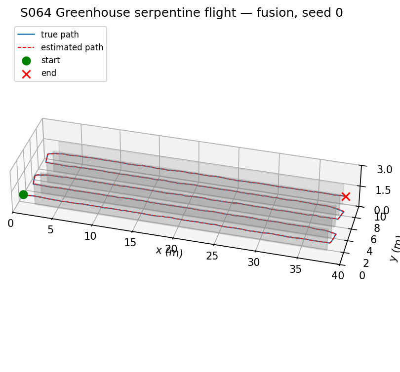
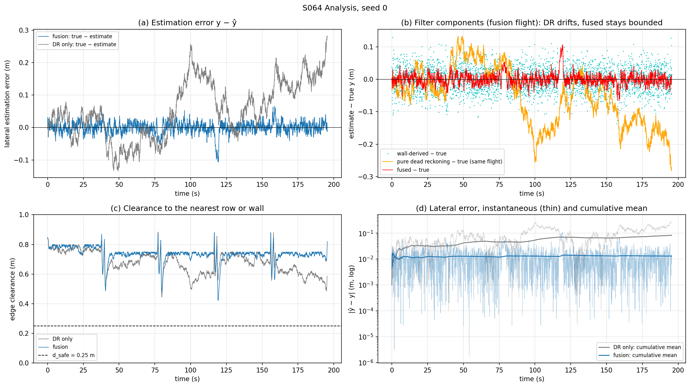
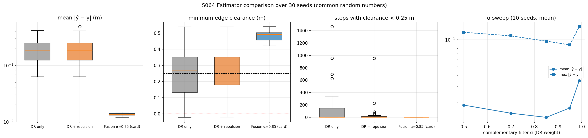
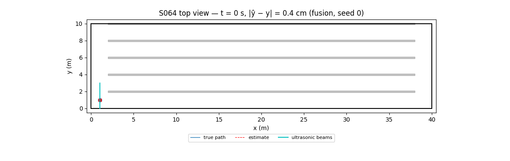

# S064 Greenhouse Interior Precision Flight

**Domain**: Industrial & Agriculture | **Difficulty**: ⭐⭐⭐ | **Status**: ✅ Completed

---

## Problem Definition

**Setup**: A 0.3 × 0.3 m drone inspects the five aisles of a 40 × 10 × 3 m greenhouse, where GPS does not work. The plant rows are 0.2 m thick and 1.5 m tall, at y = 2, 4, 6, 8 and 10 m, and run from x = 2 m to x = 38 m, which leaves 2 m headlands at both gable walls.

The five aisles have centres at y = 0.95 m (between the y = 0 wall and row 1) and 3, 5, 7 and 9 m. The drone flies them as a serpentine at 1.0 m/s and z = 1.0 m, starting at (1, 1, 1) m. In the headlands it moves sideways to the next aisle. The route has 9 waypoints, of which 5 are row-ends. A row-end counts as reached when the estimated position is within 0.5 m of it.

**Sensing**: The lateral position $y$ comes from dead reckoning, which drifts. Two side-looking ultrasonic sensors (range 0.1–2.0 m, noise 0.05 m) can correct it whenever a row or wall is in range; in the headlands there is usually nothing in range. Like the card, the simulation treats $x$ and $z$ as known.

**Objective**: reach all five row-ends within 300 s without collision, keeping at least $d_{safe} = 0.25$ m between the drone's edge and every row or wall, and keep the lateral estimation error small.

**Comparison** (added: the card implements only the fusion case), on common random numbers over 30 seeds:

1. **DR only**: dead reckoning, with no ultrasonic sensing at all.
2. **DR + repulsion**: dead reckoning for navigation, with the ultrasonic ranges used only by the card's repulsive safety layer.
3. **Fusion (card)**: complementary filter (α = 0.85) plus the repulsive safety layer.

A sweep of α ∈ {0.5, 0.7, 0.85, 0.95, 0.99} (10 seeds) tests the filter gain.

---

## Mathematical Model Summary

### Truth and dead reckoning (card)

$$\mathbf p_{t+1} = \mathbf p_t + \mathbf v_{cmd}\Delta t + \boldsymbol\eta_t,\qquad \hat y_{DR} = \hat y_t + v_y\Delta t + \eta'_t,\qquad \boldsymbol\eta, \eta' \sim \mathcal N(0, \sigma_{drift}^2\Delta t)$$

$\boldsymbol\eta$ is unmeasured motion (air currents) and $\eta'$ is the IMU integration error. Each random walk grows as $\sigma_{drift}\sqrt{t} = 0.346$ m after 300 s. The estimation error is the difference of two independent walks, so it grows as $\sigma_{drift}\sqrt{2t} = 0.490$ m.

### Ultrasonic fix and complementary filter

$z_{left} = d_{left} + w$, $z_{right} = d_{right} + w$ with $w \sim \mathcal N(0, 0.05^2)$, valid only inside [0.1, 2.0] m. Using the map, each valid range gives a wall-derived position, $\hat y_{wall} = y_{face,left} + z_{left}$ or $y_{face,right} - z_{right}$. The faces are the nearest map faces on each side of $\hat y_{DR}$ at the current $x$. A fix more than 0.5 m from $\hat y_{DR}$ is rejected, and valid fixes are averaged. Then

$$\hat y_{t+1} = \alpha\,\hat y_{DR} + (1 - \alpha)\,\hat y_{wall}\quad(\text{or }\hat y_{DR}\text{ when there is no fix})$$

### Control

- **In an aisle**: $v_x = \pm 1$ m/s and $v_y = -K_p(\hat y - y_{c})$, with $|v_y| \le 1$ m/s.
- **In a headland**: $v_x = 0.8\,(x_{wp} - x)$, and $v_y$ follows the same law towards the next aisle centre.
- **Repulsion** (card), from the measured ranges, using the edge clearance $c = z - 0.15$ m: $v_y \mathrel{+}= \pm K_{rep}\,(d_{safe} - c)/d_{safe}$ when $c < d_{safe}$.
- **Altitude**: $v_z = 1.2\,(1.0 - z)$.

### Metrics

- $E_{drift} = \overline{|\hat y - y|}$ (mean lateral estimation error) and its peak.
- Edge clearance to the nearest row box or wall, and the number of steps with clearance below $d_{safe}$.
- A clearance of 0 is a collision; it ends the flight as a crash.

The lateral margin before a $d_{safe}$ violation is 0.90 − 0.15 − 0.25 = 0.50 m.

---

## Key Parameters

| Parameter | Value |
|-----------|-------|
| Greenhouse | 40 × 10 × 3 m |
| Rows | y = 2, 4, 6, 8, 10 m; 0.2 m thick; 1.5 m tall; x ∈ [2, 38] m |
| Aisle centres | 0.95, 3, 5, 7, 9 m |
| Drone half-size | 0.15 m |
| Start | (1, 1, 1) m |
| Headland turn line | x = 1 m and x = 39 m |
| Cruise speed / altitude | 1.0 m/s / 1.0 m |
| $\sigma_{drift}$ | 0.02 m/s/√s |
| Ultrasonic noise / band | 0.05 m / [0.1, 2.0] m |
| Fix gate (added) | 0.5 m |
| α | 0.85 (sweep 0.5–0.99) |
| $K_p$ lateral / altitude / headland x | 0.8 / 1.2 / 0.8 s⁻¹ |
| Lateral speed limit of the tracking law / overall speed limit (added) | 1.0 m/s / 3.0 m/s (asserted) |
| $K_{rep}$ / $d_{safe}$ | 1.5 m/s / 0.25 m |
| Waypoint radius $d_{wp}$ | 0.5 m |
| Δt / $T_{max}$ | 0.05 s / 300 s |
| Monte Carlo | 30 seeds (0–29), common random numbers; α sweep 10 seeds |

---

## Implementation

```
src/04_industrial_agriculture/s064_greenhouse.py
```

```bash
conda activate drones
python src/04_industrial_agriculture/s064_greenhouse.py
```

Runtime ≈ 1.7 min (measured with other simulations running in parallel).

---

## Results

30 seeds:

| Set-up | Missions complete | Crashes | Mean $\|\hat y - y\|$ | Peak $\|\hat y - y\|$, mean (worst) | Min edge clearance, mean (worst) | Steps below $d_{safe}$ | Runs with 0 violations |
|---|:-:|:-:|---:|---:|---:|---:|:-:|
| DR only | 27/30 | 3 | 0.1967 ± 0.0974 m | 0.4627 m (0.791 m) | 0.240 m (−0.021 m) | 163.9 ± 334.9 | 16/30 |
| DR + repulsion | 28/30 | 2 | 0.1991 ± 0.1033 m | 0.4695 m (0.988 m) | 0.262 m (−0.019 m) | 49.1 ± 173.3 | 17/30 |
| **Fusion α = 0.85** | **30/30** | **0** | **0.0135 ± 0.0007 m** | **0.0967 m (0.162 m)** | **0.481 m (0.421 m)** | **0.0** | **30/30** |

Completed missions take 195.1–195.2 s (± 0.3 s) in every set-up, well within $T_{max}$ = 300 s. Fusion has a lower mean error than DR + repulsion in 30/30 seeds. A wall fix is available in 94.7 % of the steps; the rest are headland turns, where no row is in range.

α sweep (10 seeds, mean values):

| α | 0.50 | 0.70 | **0.85** | 0.95 | 0.99 |
|---|---|---|---|---|---|
| Mean $\|\hat y - y\|$ | 0.0186 m | 0.0151 m | **0.0135 m** | 0.0172 m | 0.0349 m |
| Peak $\|\hat y - y\|$ | 0.1210 m | 0.1103 m | 0.0963 m | 0.0875 m | 0.1398 m |
| Min clearance (worst) | 0.398 m | 0.400 m | 0.421 m | 0.431 m | 0.378 m |
| Complete | 10/10 | 10/10 | 10/10 | 10/10 | 10/10 |

**Key findings**:

- **Fusion is what makes the flight safe.** Dead reckoning alone drifts by 0.1967 m on average, with peaks up to 0.791 m. That uses up the 0.50 m margin in some runs: 3 of 30 DR-only flights hit a row, and 14 of 30 go below $d_{safe}$. With fusion, the error stays at 1.35 cm and every run keeps at least 0.421 m of clearance.
- **The repulsive layer alone is not enough.** Feeding the ultrasonic ranges only to the safety layer cuts the violation steps from 163.9 to 49.1 per flight, but 2 of 30 flights still crash. The repulsion starts only once the drone is already inside $d_{safe}$. It also does nothing about the estimation error (0.1991 m), so the drone keeps steering towards a wrong aisle centre.
- **The card's α = 0.85 is the best gain in the sweep** for mean error (0.0135 m). Lower α trusts the noisy ranges too much (0.0186 m at α = 0.5). Higher α corrects drift too slowly (0.0349 m at α = 0.99). The peak error is lowest at α = 0.95 (0.0875 m). The peaks come mostly from the headland turns, where no fix is available: with fusion, the peak error falls in a headland in 24/30 runs, although the headlands take only 7.7 % of the flight time. The peak therefore depends on how small the error is when the drone leaves the aisle, more than on the fix noise. Without fusion the drift builds up everywhere, and the peak falls in a headland in only 5/30 runs.
- **Card expectations**: 4/4 row-ends (here 5/5, see Deviations) ✓; mean lateral error ~0.02–0.04 m: measured 0.0135 m, better than expected; peak 0.08–0.12 m ✓ (0.0967 m); collision-free ✓ (fusion). The card's drift estimate of 0.35 m after 300 s is right for one random walk (0.346 m).

### 3D Trajectory

Fusion, seed 0: the plant rows (grey), the true path (blue) and the estimated path (red dashed). The two paths overlap at this scale:



### Analysis

Seed 0. (a) Estimation error for DR only (grey) and fusion (blue). (b) In the fusion flight: the wall-derived fixes (cyan), a parallel pure dead-reckoning integrator over the same flight (orange, drifting away from the truth) and the fused estimate (red). (c) Edge clearance. (d) Absolute error and its cumulative mean. The fused spike near t = 120 s is a headland turn with no fix in range; it sets this seed's peak error of 0.1066 m:



### Strategy Comparison



### Animation

Top view of the fusion flight, seed 0. The true path is blue and the estimate red; the cyan segments are the ultrasonic beams, capped at the 2 m range. 197 frames, 1 s of flight per frame:



### Deviations from the scenario card

| Card | Implementation | Reason |
|------|----------------|--------|
| Rows span x = 0–40 m; the card code moves the drone sideways through the rows at z = 1 m to change aisle | Rows span x = 2–38 m; turns happen in 2 m headlands | Otherwise every aisle change passes through a 1.5 m tall row. Card corrected. |
| Start (0, 1.0, 1.0) | (1.0, 1.0, 1.0) | x = 0 is the gable wall. |
| "All five row-ends ... then return to start", $N_{wp}$ = 10; card code uses 4 aisles and 4 waypoints | 5 aisles (including the strip between the wall and row 1), 9 waypoints, 5 row-ends; the flight ends at the fifth row-end | Matches "five row-ends" and the start in the wall-side strip; returning would mean re-flying an aisle. Card corrected. |
| Repulsion uses true wall distances | Uses the measured ultrasonic ranges and the edge clearance (centre distance − 0.15 m) | The drone cannot know the true distances; $d_{safe}$ is a clearance to the airframe. |
| Wall fix uses the known aisle index | Map association from $\hat y_{DR}$ and $x$, with a 0.5 m gate | Needed in the headlands and after drift; avoids using the true aisle. |
| Only the fusion case | Adds DR-only and DR + repulsion baselines and an α sweep, over 30 / 10 seeds | The card asks to minimise drift error; a baseline shows what fusion buys (X2). |
| Headland motion not specified | $v_x = 0.8(x_{wp} - x)$; lateral tracking speed limited to 1 m/s | Needed for the 2 m sideways moves. |
| No speed limit | Commanded speed limited to 3 m/s and asserted (X4). The repulsion can add to the 1 m/s tracking speed: the highest commanded speed is 1.93 m/s (DR + repulsion, max $\|v_y\|$ 1.65 m/s), so the limit never binds | Physical sanity check. |
| Plot file names `s064_3d_trajectory.png`, `s064_analysis.png`, `s064_animation.gif` (25 fps, ~400 frames) | `trajectory_3d.png`, `analysis.png`, `animation.gif` (12 fps, 197 frames); panel (b) shows errors relative to the truth over the whole flight | Naming convention; panel (b) in absolute $y$ hides the drift behind the 0–10 m axis. |

---

## Extensions

1. **EKF on $(y, v_y)$**: compare with the complementary filter over 100 Monte Carlo runs and several drift levels.
2. **Front/back ranging**: estimate $x$ from the gable walls instead of assuming it known, and see how errors in $x$ affect the headland turns.
3. **Sensor outage**: block one ultrasonic sensor for 10 s and widen the safety buffer when only one side is valid.
4. **Variable row spacing**: infer the aisle width online from both sensors.
5. **Headland fixes**: add a downward camera or beacons in the headlands, where all the peak errors occur.

---

## Related Scenarios

- Prerequisites: [S061 Power Line Inspection](../../../scenarios/04_industrial_agriculture/S061_power_line.md), [S063 Single-Plant Precision Spraying](../../../scenarios/04_industrial_agriculture/S063_precision_spraying.md)
- Follow-ups: [S069 Automated Warehouse Inventory](../../../scenarios/04_industrial_agriculture/S069_warehouse_inventory.md), [S074 Mine 3D Mapping](../../../scenarios/04_industrial_agriculture/S074_mine_mapping.md)
- Cross-reference: [S043 Confined Space Exploration](../../../scenarios/03_environmental_sar/S043_confined_space.md), [S050 Swarm Cooperative Mapping (Distributed EKF-SLAM)](../../../scenarios/03_environmental_sar/S050_slam.md), [S046 Multi-Drone 3D Trilateration](../../../scenarios/03_environmental_sar/S046_trilateration.md)
