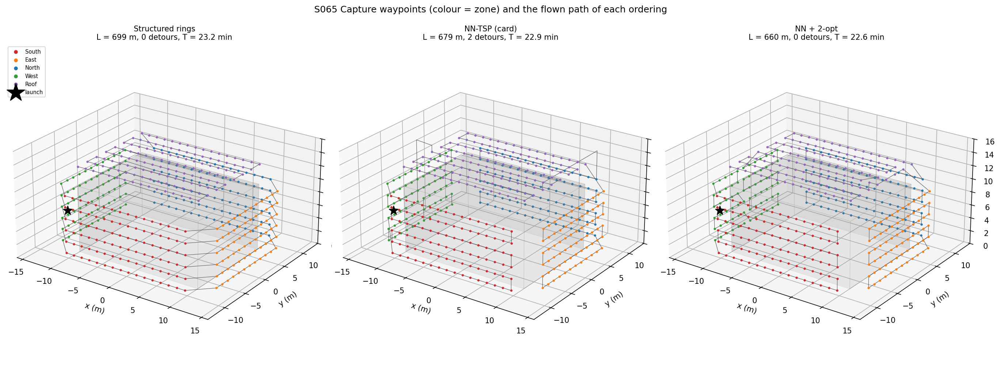
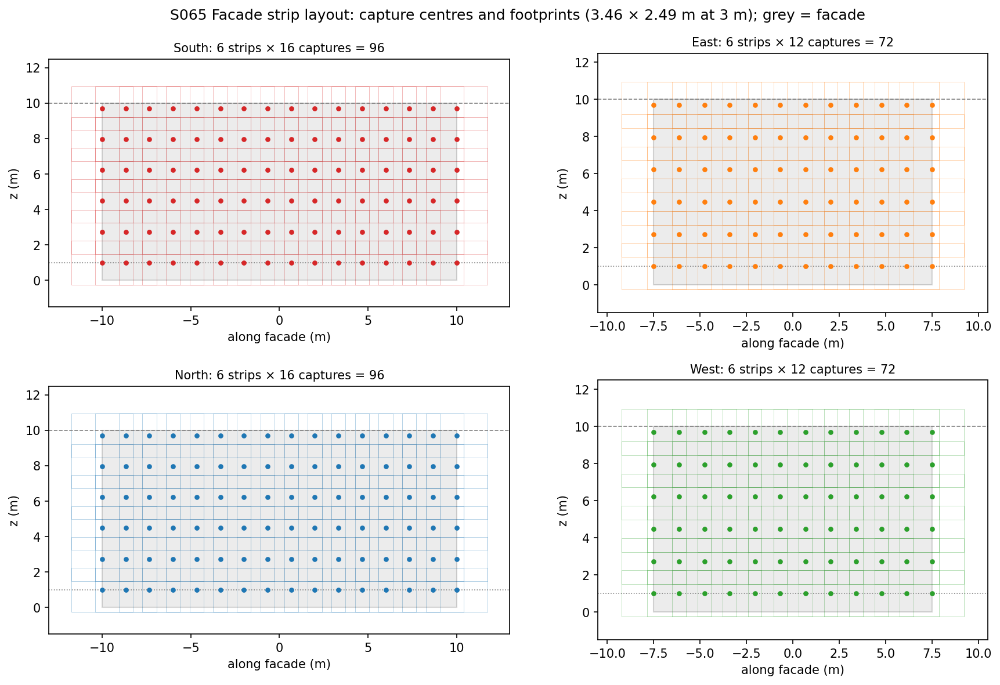
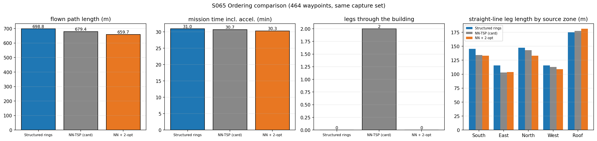
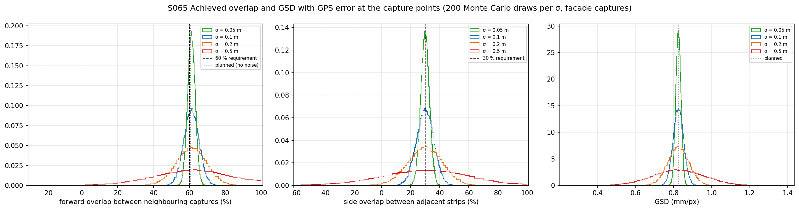
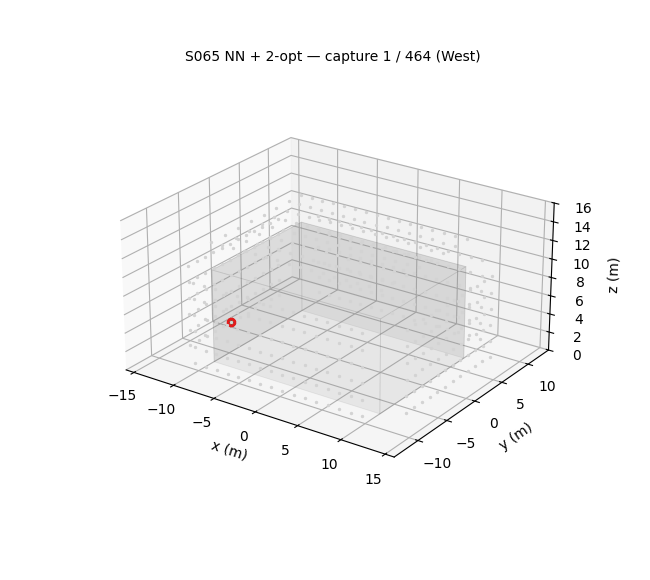

# S065 Building 3D Modeling — Multi-Angle Scan Path

**Domain**: Industrial & Agriculture | **Difficulty**: ⭐⭐ | **Status**: ✅ Completed

---

## Problem Definition

**Setup**: A drone must photograph a 20 × 15 × 10 m building for Structure-from-Motion 3D reconstruction. The building is centred at the origin, and the drone launches from (−18, 0, 1.5) m.

- **Facades**: the drone flies horizontal strips parallel to each of the four facades at a 3 m standoff. Strips run from z = 1 m to the roofline, with 60 % forward and 30 % side overlap between images.
- **Roof**: a nadir grid at 13 m (3 m above the roof) with the same overlaps.
- **Captures**: the drone hovers 1.5 s at each capture point and cruises at 1.0 m/s between them.
- **Camera**: f = 16 mm, 17.6 mm sensor, 4000 px wide, 60° × 45° field of view.

**Comparison questions** (now in the card):

1. **Ordering.** For the same 464 capture points, three orderings are compared:
   - the card's pooled **nearest-neighbour TSP** tour;
   - a **structured ring** pattern: one lap around the building per strip altitude, then a roof boustrophedon;
   - **NN + 2-opt**.

   Metrics: flown length, mission time and the number of legs that enter a 1 m safety margin around the building.
2. **GPS robustness.** The plan puts the overlaps exactly at, or just above, the required 60 % / 30 %. How often does GPS error at the capture points (σ = 0.05–0.5 m) push them below the requirement, and how much does the GSD move?

---

## Mathematical Model Summary

### GSD and footprint

$$\mathrm{GSD} = \frac{s_w\,d}{f\,W_{px}} = \frac{0.0176 \times 3}{0.016 \times 4000} = 0.825\text{ mm/px},\qquad w = 2d\tan\tfrac{\theta_h}{2} = 3.464\text{ m},\quad h = 2d\tan\tfrac{\theta_v}{2} = 2.485\text{ m}$$

The 2 cm GSD limit would allow standoffs up to 72.7 m. The 60° horizontal FOV is the card's value; the focal length and sensor width alone imply 57.6°.

### Strips and captures (card)

$$B_x = w(1 - p_x) = 1.386\text{ m},\qquad \Delta z = h(1 - p_z) = 1.740\text{ m}$$

- **Strip altitudes**: 1.00, 2.74, 4.48, 6.22, 7.96 and 9.70 m (6 strips).
- **Capture positions**: `linspace` over each facade, with $\lceil L/B_x\rceil + 1$ points. This gives 16 captures (spacing 1.333 m) on the 20 m facades and 12 (1.364 m) on the 15 m facades.
- **Roof**: 8 rows × 16 captures.
- **Total**: 4 × 6 strips = 336 facade captures + 128 roof captures = **464 waypoints**.
- **Planned overlap without noise**: forward ≥ 60.6 % and side exactly 30.0 %.

### Orderings

- **NN-TSP** (card): start at the capture nearest the launch point and always fly to the nearest unvisited capture.
- **NN + 2-opt**: open-path 2-opt on the NN tour (first point fixed, Euclidean cost); it converges in 5 passes.
- **Structured rings**: at each strip altitude, fly counter-clockwise around the building (West facade going −y, South +x, East +y, North −x), then climb to the next strip. Finish with the roof as a boustrophedon, starting from the roof corner nearest the last facade capture.

### Collision test and flight time (added)

Every leg is tested against the building inflated by 1 m, using the slab method. A leg that would enter this margin is flown as a detour instead: climb to 14 m, cross over, descend. Detours are counted, and for each flagged leg the script prints its zones and its minimum distance to the real (un-inflated) building.

Mission time is computed two ways:

- **Card formula**: $T = L/v + N\,t_{cap}$.
- **Acceleration-limited**: each straight segment flown rest-to-rest with $a_{max} = 1$ m/s², taking $L/v + v/a$ (or $2\sqrt{L/a}$ for short segments), plus $N\,t_{cap}$.

### GPS Monte Carlo (card extension 4)

Each facade capture is displaced by $\mathcal N(0, \sigma^2)$ on every axis, 200 draws per σ. For neighbouring captures:

- forward overlap $= 1 - |\Delta u| / \bar w(d)$, where $\Delta u$ is the spacing along the facade;
- side overlap between strips $= 1 - |\Delta z| / \bar h(d)$;
- both footprints and the GSD scale with the actual standoff $d$.

A negative overlap is a gap between images.

---

## Key Parameters

| Parameter | Value |
|-----------|-------|
| Building | 20 × 15 × 10 m, centred at the origin |
| Launch | (−18, 0, 1.5) m |
| Camera | f = 16 mm, $s_w$ = 17.6 mm, 4000 px, 60° × 45° |
| Standoff $d_{scan}$ / $z_{min}$ | 3.0 m / 1.0 m |
| Overlap $p_x$ / $p_z$ | 60 % / 30 % |
| Footprint | 3.464 × 2.485 m |
| $B_x$ / Δz | 1.386 m / 1.740 m |
| Roof altitude | 13 m |
| Speed / capture hover | 1.0 m/s / 1.5 s |
| Acceleration limit (added) | 1.0 m/s² |
| Collision margin / detour altitude (added) | 1.0 m / 14 m |
| GPS σ | 0.1 m (sweep 0.05, 0.1, 0.2, 0.5 m) |
| Monte Carlo | 200 draws per σ, seed 0 |

---

## Implementation

```
src/04_industrial_agriculture/s065_3d_scan_path.py
```

```bash
conda activate drones
python src/04_industrial_agriculture/s065_3d_scan_path.py
```

Runtime ≈ 30 s (measured with other simulations running in parallel).

---

## Results

| Ordering | Straight-line length | Legs inside the 1 m margin | Flown length | Time, card formula | Time, 1 m/s² accel | Longest segment | Total climb |
|---|---:|:-:|---:|---:|---:|---:|---:|
| Structured rings | 698.8 m | 0 | 698.8 m | 1394.8 s (23.2 min) | 1857.8 s (31.0 min) | 4.6 m | 12.0 m |
| NN-TSP (card) | 670.0 m | **2** | 679.4 m | 1375.4 s (22.9 min) | 1842.4 s (30.7 min) | 13.7 m | 36.4 m |
| **NN + 2-opt** | **659.7 m** | **0** | **659.7 m** | **1355.7 s (22.6 min)** | **1818.7 s (30.3 min)** | 4.9 m | 32.7 m |

Against the structured rings, NN is 2.8 % shorter in flown length and NN + 2-opt is 5.6 % shorter.

GPS Monte Carlo (facade captures, 200 draws per σ):

| σ_GPS | Pairs with forward overlap < 60 % | < 50 % | Min forward overlap | Pairs with side overlap < 30 % | Min side overlap | Max GSD |
|---|---:|---:|---:|---:|---:|---:|
| 0.05 m | 29.6 % | 1 of 62400 (0.002 %) | 49.955 % | 49.9 % | 17.9 % | 0.882 mm |
| 0.10 m | 39.5 % | 291 of 62400 (0.466 %) | 43.580 % | 50.0 % | 1.8 % | 0.938 mm |
| 0.20 m | 44.5 % | 5954 of 62400 (9.542 %) | 18.114 % | 49.9 % | −20.3 % | 1.066 mm |
| 0.50 m | 47.9 % | 18816 of 62400 (30.154 %) | −78.342 % | 50.2 % | −163.1 % | 1.379 mm |

**Key findings**:

- **The card's NN tour violates the safety margin twice.** Twice it jumps from a facade strip straight up to a roof capture.
  - Leg 167, West → Roof, climbs from the West facade at z = 4.48 m to the adjacent roof edge and passes 0.996 m from the building.
  - Leg 415, North → Roof, runs from the top North strip, at z = 9.70 m, to a capture on the east roof edge, 3.2 m south of the centre line, and clears the north roof edge near the north-east corner by only 0.409 m.
  - Neither leg crosses the building itself, but both enter the 1 m safety margin.
  - With the two up-over-down detours, the NN flown length is 679.4 m.
  - 2-opt removes both legs and gives the shortest tour that respects the margin: 659.7 m, 5.6 % shorter than the rings.
- **The ordering matters little for mission time.** Every plan includes the same 464 × 1.5 s of hovering. Once each leg also starts and stops with a 1 m/s² acceleration, the three plans all take about 31 min, from 1818.7 s (2-opt) to 1857.8 s (rings). The structured rings are the slowest, but only slightly, and need no TSP solver. They also climb only 12.0 m in total, against 32.7–36.4 m for the TSP tours, which fly up and down between strips. For battery planning the simpler pattern is nearly as good.
- **The planned overlaps leave no margin for GPS error.** Side overlap is planned at exactly 30.0 %, so about half of the strip pairs (49.9–50.2 %) fall below 30 % at any noise level. At the card's σ_GPS = 0.1 m, 39.5 % of neighbouring captures fall below 60 % forward overlap, and 0.47 % below 50 %. The card's extension asks for the largest σ that never drops below 50 % forward overlap: none of the tested values satisfies this on these draws. Even at σ = 0.05 m one of 62,400 pairs reaches 49.955 %, so the answer lies at or just below 0.05 m and depends on the random draw. Planning with a margin (for example 70 % / 40 %) or RTK positioning is needed.
- **GSD is never the binding constraint.** The worst GSD is 1.379 mm even at σ = 0.5 m, far below 2 cm.
- **Card numbers corrected**: GSD is 0.083 cm, not 0.83 cm (the card's arithmetic was off by a factor of 10). There are 464 waypoints, not 312. The NN tour is 670.0 m (card formula time 1366.0 s), not 487.3 m / 955.3 s.

### Waypoints and Flown Paths

The 464 captures coloured by zone, with the flown path of each ordering. The NN panel shows its two detours climbing over the building's safety margin:



### Facade Strip Layout

Capture centres and their 3.46 × 2.49 m footprints on each facade (grey); the dashed line is the roofline, the dotted line $z_{min}$:



### Ordering Comparison

Flown length, acceleration-limited mission time, legs inside the 1 m safety margin, and straight-line leg length grouped by the zone each leg starts from:



### GPS Effect on Overlap and GSD

Distributions over all neighbouring facade-capture pairs; the dashed lines are the 60 % / 30 % requirements:



### Animation

The NN + 2-opt tour (the shortest without detours), with four captures per frame; visited captures take their zone colour. 117 frames:



### Deviations from the scenario card

| Card | Implementation | Reason |
|------|----------------|--------|
| GSD = 0.0083 m ≈ 0.83 cm | 0.825 mm = 0.083 cm | Arithmetic error in the card (verified: 0.0528 / 64 = 0.000825 m). Card corrected. |
| Expected 312 waypoints, 487.3 m, 955.3 s | 464 waypoints; NN 670.0 m, 1366.0 s (card formula, straight legs) | The card's own generation code gives 4 × 6 × (16 or 12) + 8 × 16 = 464. Card corrected. |
| Single ordering (NN-TSP); no comparison | Comparison of structured rings, NN-TSP and NN + 2-opt, plus a GPS Monte Carlo | The card had no comparison question; one was added to the card (ordering and GPS robustness, the latter from extension 4). |
| No clearance rule for legs | Legs that enter a 1 m margin around the building are replaced by up-over-down detours at 14 m and counted; the minimum clearance of each flagged leg is printed | X4: keep a safety distance from the structure. The two NN legs come within 0.996 m and 0.409 m without touching it. |
| $T = L/v + N t_{cap}$ | Reported, plus a 1 m/s² acceleration-limited time | Rest-to-rest legs of 1.3 m cannot be flown at 1 m/s from the start. |
| Path length: tour legs only | Same (launch and return legs not included) | Card definition. |
| Algorithm index lists cascade PID for S061–S065 | Planning scenario; flight time from a kinematic trapezoidal profile, no closed-loop flight | The card defines no controller or dynamics. |
| Horizontal FOV 60° | Kept | f and $s_w$ imply 57.6°; noted only. |
| Plot names `fig1_waypoints_path.png`, `fig2_strip_coverage.png`, `fig3_zone_metrics.png`, `anim_scan_tour.gif` (one frame per waypoint, 25 fps) | `waypoints_paths.png`, `strip_layout.png`, `ordering_comparison.png` (includes the per-zone breakdown), `gps_overlap.png`, `animation.gif` (4 captures per frame, 12 fps) | Naming convention; GIF size. |

---

## Extensions

1. **Overlap margin**: re-plan with 70 % / 40 % overlap and find the margin that keeps 99 % of pairs above 60 % / 30 % at σ_GPS = 0.1 m, trading against the extra waypoints.
2. **GSD-adaptive standoff**: the 2 cm limit allows up to 72.7 m standoff; increase $d_{scan}$ on plain walls to cut the waypoint count.
3. **Oblique roof-edge views**: add tilted captures around the roof perimeter for the facade–roof junction.
4. **Closed-loop flight**: fly the tour with the cascade PID of S061 and measure the real capture-position error instead of assuming Gaussian GPS error.
5. **Battery split**: split the 30 min mission into two sorties and choose the split point that minimises transit.

---

## Related Scenarios

- Prerequisites: [S044 Wall Crack Inspection](../../../scenarios/03_environmental_sar/S044_wall_crack.md), [S053 Coral Reef 3D Reconstruction](../../../scenarios/03_environmental_sar/S053_coral_reef.md), [S061 Power Line Inspection](../../../scenarios/04_industrial_agriculture/S061_power_line.md)
- Follow-ups: [S074 Mine 3D Mapping](../../../scenarios/04_industrial_agriculture/S074_mine_mapping.md)
- Cross-reference: [S052 Glacier Melt Area Measurement](../../../scenarios/03_environmental_sar/S052_glacier.md), [S063 Single-Plant Precision Spraying](../../../scenarios/04_industrial_agriculture/S063_precision_spraying.md)
