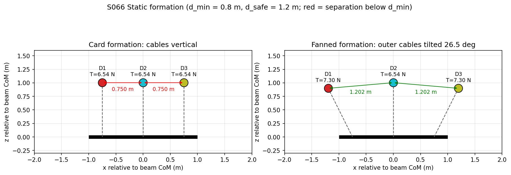
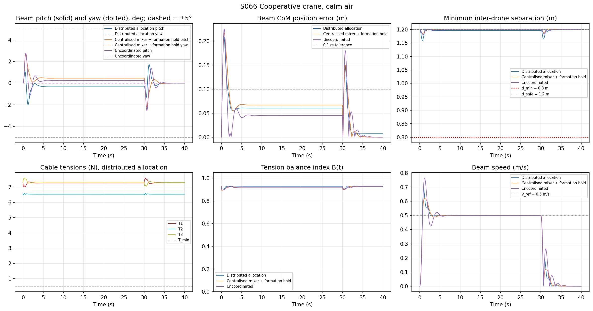
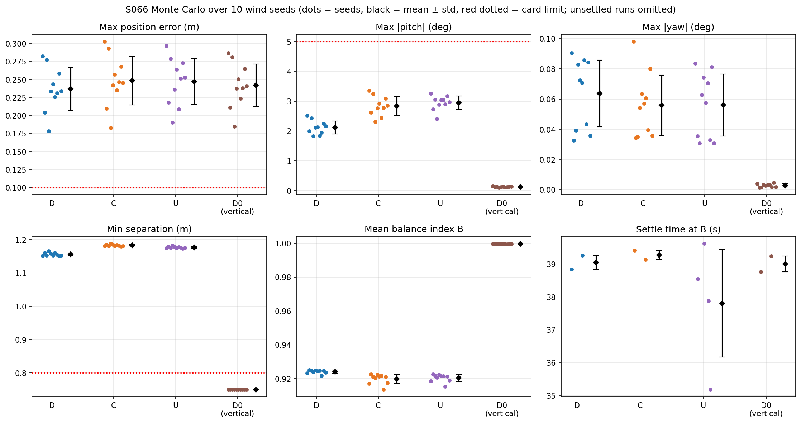
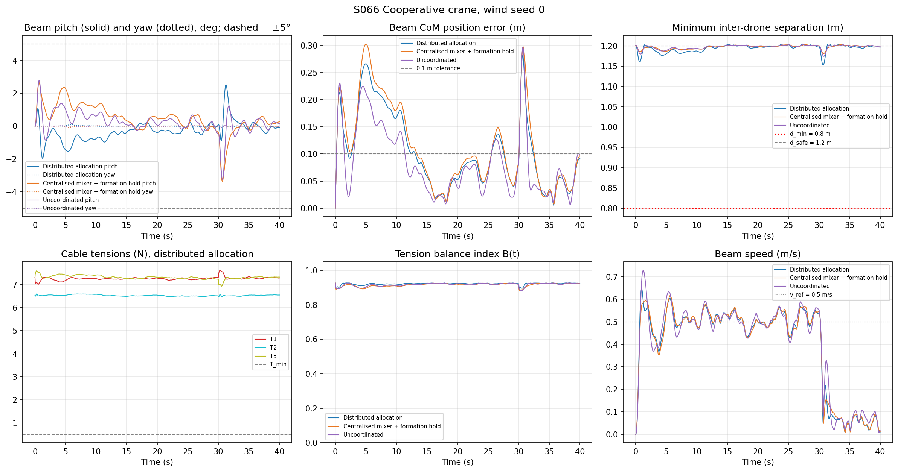
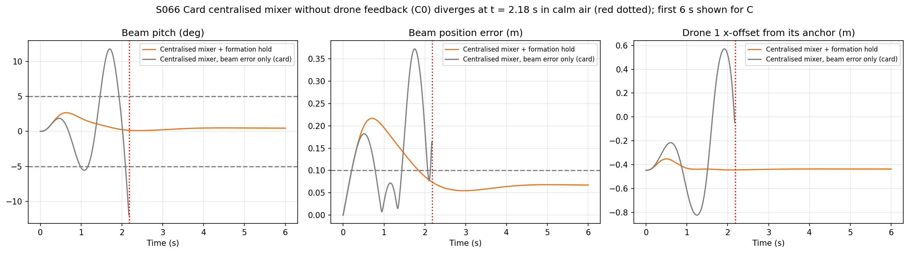
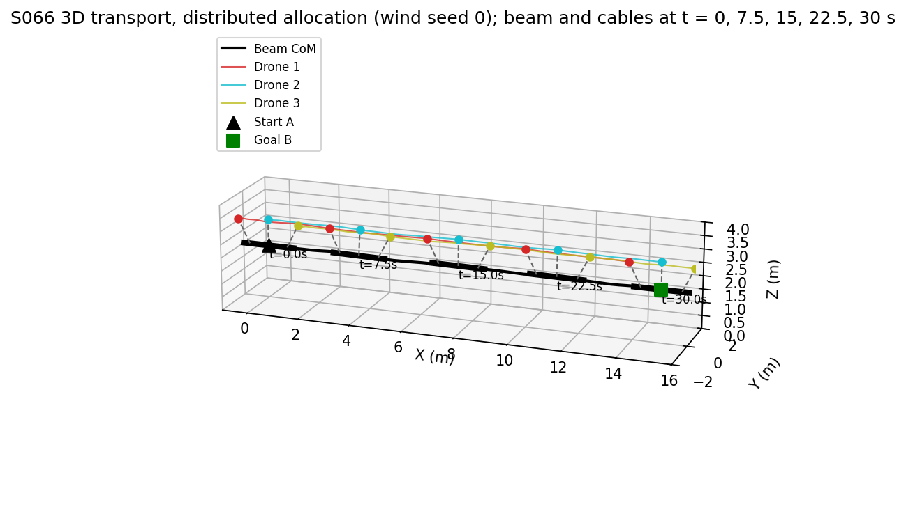
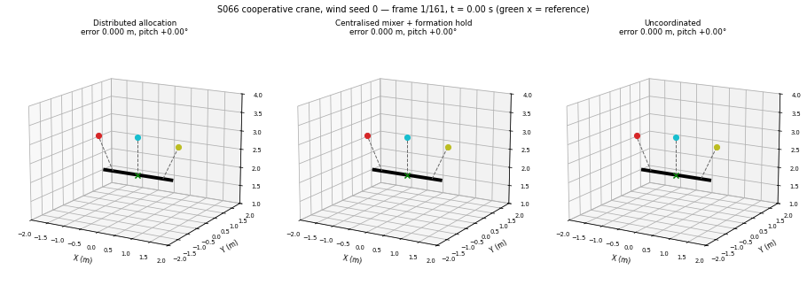

# S066 Cooperative Crane Simulation

**Domain**: Industrial & Agriculture | **Difficulty**: ⭐⭐⭐⭐ | **Status**: ✅ Completed

---

## Problem Definition

**Setup**: Three quadrotors (0.5 kg each) carry a rigid steel beam (2 kg, 2 m) on 1 m cables from A = (0, 0, 2) m to B = (15, 0, 2) m along a straight reference at 0.5 m/s (30 s of cruise, then 10 s of hold at B). The cables are attached at −0.75, 0 and +0.75 m along the beam axis.

**Constraints (card)**: beam pitch within ±5°, inter-drone separation ≥ 0.8 m, beam position error < 0.1 m, cable tension ≥ 0.5 N.

**Comparison strategies** (same plant, same gains, same wind):
1. **D — Distributed tension allocation (proposed)**: a beam-level PD gives a desired wrench; the wrench is split into three minimum-norm cable force vectors with the pseudo-inverse of the 6 × 9 grasp matrix; an axial internal force fans the outer cables out. Each drone runs a local PD that points its cable along its allocated force and feeds the allocated force forward.
2. **C — Centralised mixer**: one controller turns the beam error into a collective force (split equally) and a pitch/yaw torque (fixed differential mixer on the outer drones). There is no tension allocation. Each drone also holds a fixed slot in the beam frame with a PD loop (see C0 below for why).
3. **U — Uncoordinated**: each drone flies its own slot on the reference path with a local PD and a static hover trim. It never measures the beam.

Two ablations: **D0** runs D with the card's vertical cables (drones directly above the anchors), and **C0** is the card's centralised controller exactly as described (beam error only, no drone-level feedback).

---

## Mathematical Model Summary

### Plant

The beam is a 6-DOF rigid body with quaternion attitude:

$$m_L \ddot{\mathbf p}_L = \sum_i T_i \hat n_i + m_L \mathbf g + c_B(\mathbf w - \dot{\mathbf p}_L), \qquad
\mathbf I_L \dot{\boldsymbol\omega} = \mathbf R^\top \sum_i \mathbf r_i \times T_i \hat n_i - \boldsymbol\omega \times \mathbf I_L \boldsymbol\omega$$

with $\mathbf I_L = \mathrm{diag}(10^{-4}, \tfrac23, \tfrac23)$ kg m². Each drone is a point mass whose thrust vector follows its command through a first-order lag ($\tau = 0.05$ s):

$$m_D \ddot{\mathbf p}_i = \mathbf F_i - T_i \hat n_i + m_D \mathbf g + c_D(\mathbf w - \dot{\mathbf p}_i), \qquad \dot{\mathbf F}_i = (\mathbf F_i^{cmd} - \mathbf F_i)/\tau, \quad \|\mathbf F_i\| \le 20 \text{ N}$$

Each cable is a stiff tension-only spring-damper: $T_i = \max(0,\, k_c(\ell_i - l_c) + c_c \dot\ell_i)$ when $\ell_i > l_c$, else 0. The physics runs at 1 ms (10 sub-steps per 10 ms control step). Wind $\mathbf w$ is an Ornstein–Uhlenbeck process (one vector for the whole rig).

### Desired wrench (D and C)

$$\ddot{\mathbf p}^{des} = K_p(\mathbf p^{ref} - \mathbf p_L) + K_d(\dot{\mathbf p}^{ref} - \dot{\mathbf p}_L), \qquad
\dot{\boldsymbol\omega}^{des} = K_{p,\omega}\,(\hat e_b \times \hat e_x) - K_{d,\omega}\,\boldsymbol\omega_\perp$$

$\hat e_b$ is the beam axis; the axis error $\hat e_b \times \hat e_x$ covers pitch and yaw. Rotation about the beam's own axis cannot be controlled or excited, because all anchors lie on that axis. $\mathbf W = [m_L(\ddot{\mathbf p}^{des} - \mathbf g);\ \mathbf I_w \dot{\boldsymbol\omega}^{des} + \boldsymbol\omega \times \mathbf I_w \boldsymbol\omega]$.

### Allocation (D)

Unknowns are the three cable force vectors $\mathbf f_i \in \mathbb R^3$:

$$\begin{pmatrix}\mathbf I & \mathbf I & \mathbf I \\ [\mathbf r_1]_\times & [\mathbf r_2]_\times & [\mathbf r_3]_\times\end{pmatrix}
\begin{pmatrix}\mathbf f_1\\ \mathbf f_2\\ \mathbf f_3\end{pmatrix} = \mathbf W, \qquad
\mathbf f = \mathbf G^+ \mathbf W + \lambda(-\hat e_b,\ \mathbf 0,\ +\hat e_b)$$

$\mathbf G$ is 6 × 9 with rank 5. $\mathbf G^+\mathbf W$ is the minimum $\sum\|\mathbf f_i\|^2$ solution; in hover it gives 6.54 N straight up on every cable (balance index 1). The axial term $\lambda = (m_L g/3)\tan\varphi$ is in the null space of $\mathbf G$ (it stretches the beam without changing the wrench). It tilts the outer cables outward by $\varphi$, so that the drones are $d_{safe}$ apart. Tensions are clamped to $T_{min}$ if needed. Drone command:

$$\mathbf F_i^{cmd} = m_D\big(K_{p,D}(\mathbf a_i + l_c \hat{\mathbf f}_i - \mathbf p_i) + K_{d,D}(\dot{\mathbf a}_i - \dot{\mathbf p}_i) + \mathbf a_{rep,i} - \mathbf g\big) + \mathbf f_i$$

### Centralised mixer (C, C0)

$$\mathbf F_i^{cmd} = F^{trim}_{i,z}\hat z \mp \lambda \hat e_b + \tfrac13 m_{tot}\ddot{\mathbf p}^{des} \mp \frac{(I_{eff}\dot{\boldsymbol\omega}^{des}) \times \hat e_b}{2 \cdot 0.75} + m_D \mathbf a_{rep,i}\ \big[+\, m_D(K_{p,D}\,\Delta\mathbf p^{slot}_i + K_{d,D}\,\Delta\dot{\mathbf p}^{slot}_i)\ \text{for C only}\big]$$

with $m_{tot} = 3.5$ kg, $I_{eff} = I_{\perp} + 2 m_D 0.75^2 = 1.2292$ kg m², and the signs ∓ for drone 1 and ± for drone 3 (zero for drone 2).

### Uncoordinated (U)

$$\mathbf F_i^{cmd} = \mathbf F_i^{trim} + m_D\big(K_{p,D}(\mathbf p^{ref}(t) + \mathbf s_i - \mathbf p_i) + K_{d,D}(\dot{\mathbf p}^{ref} - \dot{\mathbf p}_i) + \mathbf a_{rep,i}\big)$$

### Repulsion and metrics

Repulsion (card): $\mathbf a_{rep,i} = \sum_j k_{rep}\,(d_{safe} - d_{ij})/d_{safe}\,\hat{\mathbf d}_{ij}$ for $d_{ij} < d_{safe}$. Balance index $\mathcal B = 1 - \sum_{i<j}|T_i - T_j| / (3\bar T)$. RMS attitude $\epsilon_{att} = \sqrt{\overline{\theta_{pitch}^2}}$ (roll about the beam axis is identically 0). All metrics are taken over the fixed 40 s horizon.

---

## Key Parameters

| Parameter | Value |
|-----------|-------|
| Drones $N$ / drone mass $m_D$ | 3 / 0.5 kg |
| Beam mass / length / inertia $I_{\perp}$ / axial inertia | 2 kg / 2 m / 2/3 kg m² / 1e-4 kg m² |
| Cable length $l_c$ / anchor offsets | 1 m / −0.75, 0, +0.75 m |
| Cable stiffness / damping (added) | 2000 N/m / 10 N s/m, tension-only |
| Route | A = (0, 0, 2) → B = (15, 0, 2) m at 0.5 m/s (30 s), then 10 s hold; horizon 40 s |
| Control step / physics step | 0.01 s / 0.001 s |
| Thrust lag $\tau$ / max thrust (added) / min upward thrust (added) | 0.05 s / 20 N / 0.1 N |
| $T_{min}$, $d_{min}$, $d_{safe}$, pitch limit, position tolerance, arrival tolerance | 0.5 N, 0.8 m, 1.2 m, 5°, 0.1 m, 0.05 m |
| Beam PD $K_p, K_d$ / attitude PD $K_{p,\omega}, K_{d,\omega}$ | 4.0, 3.0 / 8.0, 4.0 |
| Drone PD $K_{p,D}, K_{d,D}$ / repulsion $k_{rep}$ | 12.0, 5.0 / 0.8 m/s² |
| Fan angle $\varphi$ (outer cables, solved so separation = $d_{safe}$) | 26.45° |
| Axial internal force $\lambda$ | 3.254 N |
| Mixer inertia $I_{eff}$ / total mass $m_{tot}$ | 1.2292 kg m² / 3.5 kg |
| Air drag drone / beam (added) | 0.2 / 0.6 N s/m |
| Wind (added) | OU, std (0.5, 0.5, 0.15) m/s, correlation time 3 s |
| Monte Carlo | 10 wind seeds (0–9) + 1 calm run; the same wind for every strategy |

---

## Implementation

```
src/04_industrial_agriculture/s066_cooperative_crane.py
```

```bash
conda activate drones
python src/04_industrial_agriculture/s066_cooperative_crane.py
```

All 55 runs (5 configurations × 11 wind cases) are integrated together as one NumPy batch. Runtime: 85 s in the first run, and 226 s and 355 s in the two reproducibility runs. All three were measured with about ten other simulations running on the same 12-thread machine. The code asserts the physical invariants at every control step: no drone or anchor below ground, cable stretch < 5 %, thrust ≤ 20 N, drone speed < 5 m/s. Only C0 may stop early; it is frozen at its last valid state once it diverges.

---

## Results

### Formation geometry: the card's layout breaks its own separation limit

With the drones directly above anchors 0.75 m apart, the drones are **0.750 m** apart. That is below $d_{min}$ = 0.8 m before anything moves. Tilting the outer cables outward by 26.45° gives a separation of $d_{safe}$ = 1.2 m. The cost is higher outer-cable tension, 7.305 N instead of 6.540 N, so the static balance index drops from 1.0000 to 0.9277. The static thrust is 11.899 N per outer drone and 11.445 N for the middle drone (limit 20 N). D, C and U all use the fanned formation, so their differences come from the controllers, not the geometry.



### Calm air (deterministic)

| Metric | D distributed | C centralised | U uncoordinated | D0 (vertical cables) |
|---|---:|---:|---:|---:|
| Max position error (m) | 0.2098 | 0.2168 | 0.2252 | 0.2168 |
| Max error during cruise, t = 5–30 s (m) | 0.0609 | 0.0683 | 0.0464 | 0.0577 |
| RMS position error (m) | 0.0628 | 0.0696 | 0.0548 | 0.0608 |
| Max \|pitch\| (°) | **1.9957** | 2.6629 | 2.7772 | 0.1213 |
| RMS attitude $\epsilon_{att}$ (°) | **0.4242** | 0.5794 | 0.5211 | 0.0235 |
| Min separation (m) | 1.1594 | 1.1850 | 1.1792 | **0.7500** (below 0.8 for 40.01 s) |
| Mean balance index $\bar{\mathcal B}$ | 0.9250 | 0.9214 | 0.9218 | 0.9998 |
| Min / max cable tension (N) | 6.4951 / 7.6033 | 6.5283 / 7.7311 | 6.5334 / 7.7207 | 6.4994 / 6.6176 |
| First within 0.05 m of B (s) | 30.03 | 30.04 | 30.00 | 30.02 |
| Settled within 0.05 m of B from (s) | **31.41** | 31.69 | 32.30 | 31.29 |
| Final error at t = 40 s (m) | 0.0074 | 0.0000 | 0.0001 | 0.0073 |



### Monte Carlo, 10 wind seeds (mean ± std, common random numbers)

| Metric | D distributed | C centralised | U uncoordinated | D0 (vertical cables) |
|---|---:|---:|---:|---:|
| Max position error (m) | **0.2370 ± 0.0298** | 0.2484 ± 0.0338 | 0.2471 ± 0.0318 | 0.2421 ± 0.0296 |
| Max error during cruise (m) | 0.1820 ± 0.0416 | 0.1978 ± 0.0484 | **0.1601 ± 0.0339** | 0.1774 ± 0.0396 |
| RMS position error (m) | 0.1019 ± 0.0169 | 0.1100 ± 0.0199 | **0.0880 ± 0.0114** | 0.0993 ± 0.0155 |
| Max \|pitch\| (°) | **2.1244 ± 0.2174** | 2.8418 ± 0.3163 | 2.9487 ± 0.2283 | 0.1285 ± 0.0135 |
| RMS attitude (°) | **0.5250 ± 0.0911** | 0.7486 ± 0.1595 | 0.6179 ± 0.0572 | 0.0299 ± 0.0055 |
| Max \|yaw\| (°) | 0.0638 ± 0.0221 | 0.0559 ± 0.0200 | 0.0561 ± 0.0206 | 0.0029 ± 0.0011 |
| Min separation (m) | 1.1566 ± 0.0046 | 1.1832 ± 0.0024 | 1.1771 ± 0.0028 | 0.7500 ± 0.0000 |
| Mean balance index | **0.9241 ± 0.0010** | 0.9198 ± 0.0028 | 0.9205 ± 0.0021 | 0.9997 ± 0.0001 |
| Min cable tension (N) | 6.4786 ± 0.0093 | 6.4734 ± 0.0128 | 6.4713 ± 0.0135 | 6.4766 ± 0.0118 |
| Thrust impulse $\int \sum\|\mathbf F_i\| dt$ (N s) | 1410.4835 ± 3.0982 | 1410.7353 ± 3.2022 | 1410.8317 ± 3.1993 | 1374.4998 ± 3.2265 |
| Reached within 0.05 m of B | 9/10 | 10/10 | 10/10 | 10/10 |
| Settled within 0.05 m of B by t = 40 s | 2/10 | 2/10 | 4/10 | 2/10 |
| Seeds meeting pitch ≤ 5° / separation ≥ 0.8 m / error < 0.1 m | 10 / 10 / 0 | 10 / 10 / 0 | 10 / 10 / 0 | 10 / 0 / 0 |

Per-seed wins among D / C / U (same wind in each seed):

| Metric | D | C | U |
|---|---:|---:|---:|
| Max position error | 9 | 0 | 1 |
| Max error during cruise | 1 | 0 | 9 |
| RMS position error | 0 | 0 | 10 |
| Max \|pitch\| | 10 | 0 | 0 |
| RMS attitude | 10 | 0 | 0 |
| Max \|yaw\| | 1 | 5 | 4 |
| Min separation (higher is better) | 0 | 10 | 0 |
| Mean balance index (higher is better) | 10 | 0 | 0 |
| Thrust impulse | 10 | 0 | 0 |

No run saturated the 20 N thrust limit, and the $T_{min}$ clamp in the allocation never activated. Wind seed 0 has a mean horizontal speed of 0.661 m/s and a peak of 2.092 m/s.





### The card's centralised controller (C0) is unstable

C0 drives the drones only from the beam error. The beam hangs from the drones like a pendulum, so this is non-collocated feedback through an undamped cable mode, and nothing damps the drone-relative swing. C0 diverged in **11/11** runs: at t = 2.18 s in calm air and at 2.18 ± 0.01 s (2.16–2.20 s) with wind. It is stopped once the beam pitch exceeds 20°, the position error exceeds 1 m or a cable is stretched by more than 4 %. Adding the per-drone slot-holding PD (strategy C) makes it stable. That is why C, not C0, is the centralised baseline above.



### 3D trajectory and animation



The animation shows wind seed 0 with all three strategies side by side, in camera views that follow the beam. It has 161 frames, one every 0.25 s from 0 to 40 s, at 20 fps. The green × marks the reference point.



### Key findings

- **The distributed allocation keeps the beam most level.** Its maximum pitch is 2.12 ± 0.22° against 2.84 ± 0.32° (C) and 2.95 ± 0.23° (U), and it wins 10/10 seeds on both maximum and RMS pitch. In calm air it also settles at B first (31.41 s against 31.69 s and 32.30 s). The pitch excitation comes from the fanned geometry: when the rig accelerates, the front and rear cables tilt by different amounts.
- **The uncoordinated baseline tracks the path best.** Its RMS error is 0.0880 ± 0.0114 m against 0.1019 ± 0.0169 m (D), and it wins 10/10 seeds on RMS error and 9/10 on cruise error. Together the three U drones hold their absolute path points with a stiffness of 18.0 N/m (3 × 0.5 kg × 12), while D's beam loop has $m_L K_p$ = 8.0 N/m. Air drag and wind therefore push the D and C beams further off the path. Over the whole mission D still has the smallest maximum error (9/10 seeds), because it handles the start and stop transients better. The card expected the proposed method to win on tracking; it wins on attitude and balance, not on steady tracking with the card's gains.
- **The 0.1 m tracking constraint is not met by any strategy, even in calm air.** The card's reference starts at 0.5 m/s from rest. A perfect double integrator with the card's PD gains already peaks at 0.1102 m (t = 0.546 s), and the thrust lag and cable dynamics raise this to 0.21–0.23 m. With wind, the cruise error alone is 0.16–0.20 m for all three, because none of the controllers has an integral term.
- **The pitch (≤ 5°) and separation (≥ 0.8 m) constraints hold in every D, C and U run.** The minimum separation is about 1.16–1.18 m. All differences there are a few centimetres, and C's 10/10 wins on separation have no practical meaning.
- **Tension balance hardly separates the strategies.** The balance index is about 0.92 for D, C and U, set mainly by the fanned geometry (static value 0.9277). D's 10/10 wins come from 0.9241 against 0.9198–0.9205. Likewise D's 10/10 wins on thrust impulse come from 1410.48 N s against 1410.74–1410.83 N s.
- **Vertical cables (D0) look better on paper** (pitch 0.13°, balance 0.9997, thrust impulse 1374.50 N s instead of 1410.48 N s), but the drones are 0.75 m apart, below the 0.8 m limit, for the whole mission. The card's repulsion term ($k_{rep}$ = 0.8 m/s²) is far too weak against $K_{p,D}$ = 12 to open the gap.
- **The transport time is not a useful comparison.** The beam first comes within 0.05 m of B at 30.00–30.04 s in calm air for every strategy, which is the reference arrival time.

### Deviations from the scenario card

| Card | Implementation | Reason |
|------|----------------|--------|
| Drones hover 1 m vertically above anchors 0.75 m apart; $d_{min}$ = 0.8 m | D, C and U use a fanned formation (outer cables tilted 26.45° outward, separation = $d_{safe}$); the card geometry is run as ablation D0 | The card geometry puts the drones 0.750 m apart, so it violates $d_{min}$ by construction (verified, D0 is below 0.8 m for the whole 40 s). Card updated. |
| Allocation: 3 tension magnitudes, $\mathbf G \in \mathbb R^{6\times 3}$, $\mathbf G^+ = \mathbf G^\top(\mathbf G\mathbf G^\top)^{-1}$ plus a null-space term | Three cable force **vectors**, $\mathbf G \in \mathbb R^{6\times 9}$ (rank 5), $\mathbf f = \mathbf G^+\mathbf W$ + axial internal force; drones steer their cables along $\mathbf f_i$ | For a 6 × 3 $\mathbf G$, $\mathbf G\mathbf G^\top$ is 6 × 6 with rank 3, so it is singular, and the null space of $\mathbf G$ is empty, so the card's $\boldsymbol\lambda$ term does nothing. The card's code instead solves only the force rows and ignores torque. With cable directions as unknowns, the drones choose them, and the wrench can be met. Card updated. |
| Card code: drones track positions with no coupling to cable tension; centralised = distributed (same code); uncoordinated applies constant tensions | Fully coupled plant: drone thrust, tension-only cables and the beam rigid body interact; three different controllers | In the card's code the beam's motion does not depend on what the drones do, and two of the three strategies are identical, so the comparison would be meaningless. |
| Centralised PID from beam error only | Implemented as C0, which diverges at about 2.2 s in all 11 runs; the reported baseline C adds a per-drone slot-holding PD | An unstable baseline is not a fair comparison. C0 is kept as an ablation to show why drone-level feedback is needed. |
| Cables "assumed taut" (rigid) | Stiff spring-damper, 2000 N/m and 10 N s/m, tension-only; 1 ms physics step | Lets the tensions follow from the dynamics and allows slack (never happened: the lowest tension in any D/C/U/D0 run is 6.452 N). The static outer-cable stretch is 3.65 mm. |
| Attitude constraint on pitch and roll; attitude PD on roll/pitch | Pitch (elevation of the beam axis) and yaw (heading) are controlled through the axis error $\hat e_b \times \hat e_x$; roll about the beam axis is reported as 0 | All anchors lie on the beam axis, so no cable can apply torque about it. Roll is neither controllable nor excited, as the card itself notes ("axial torque is uncontrollable"). |
| No disturbances; RNG seeded but unused | OU wind (std 0.5 m/s) plus linear air drag; 10-seed Monte Carlo with the same wind for every strategy, plus one calm run | Without any randomness every strategy has a single deterministic outcome; wind tests disturbance rejection. |
| No thrust limit | $\|\mathbf F_i\| \le$ 20 N (≈ 4 × drone weight), upward thrust ≥ 0.1 N | Physical limit, asserted; never reached (peak 12.574 N over all D/C/U/D0 runs). |
| Mission ends when the CoM is within 0.05 m of B | Fixed 40 s horizon (30 s cruise + 10 s hold); report first arrival and settle time | The first arrival happens at about 30 s for every strategy (non-discriminative), and stopping there would hide the swing at the stop. |
| Thrust lag on scalar thrust along body z | First-order lag on the whole thrust vector | Point-mass abstraction of the attitude loop with the card's $\tau$. |
| Colours: drones red/green/purple, start A green, goal B blue | Drones red/cyan/olive, start A black, goal B green | Project convention: target = green. |

---

## Extensions

1. **Integral action**: add a beam-position integrator to D and C, and see whether they overtake U on cruise tracking under wind.
2. **Feed-forward acceleration**: use a smooth (trapezoidal) reference and feed $\ddot{\mathbf p}^{ref}$ forward, to test whether the 0.1 m tolerance can be met at the start and stop.
3. **Asymmetric load**: shift the beam CoM; the allocation then has to produce unequal tensions, and the fixed mixer of C does not.
4. **N = 4–6 drones**: an over-actuated rig with per-drone thrust limits in the allocation QP.
5. **Elastic cables and slack recovery**: lower $k_c$ and add gusts strong enough to slacken a cable.

---

## Related Scenarios

- Prerequisites: [S063 Single-Plant Precision Spraying](../../../scenarios/04_industrial_agriculture/S063_precision_spraying.md)
- Follow-ups: [S097 Aerial Puzzle Assembly](../../../scenarios/05_special_entertainment/S097_aerial_puzzle.md)
- Cross-reference: [S026 Cooperative Heavy Lift](../../../scenarios/02_logistics_delivery/S026_cooperative_heavy_lift.md), [S028 Cargo Escort Formation](../../../scenarios/02_logistics_delivery/S028_cargo_escort_formation.md), [S013 Pincer Movement](../../../scenarios/01_pursuit_evasion/S013_pincer_movement.md)
