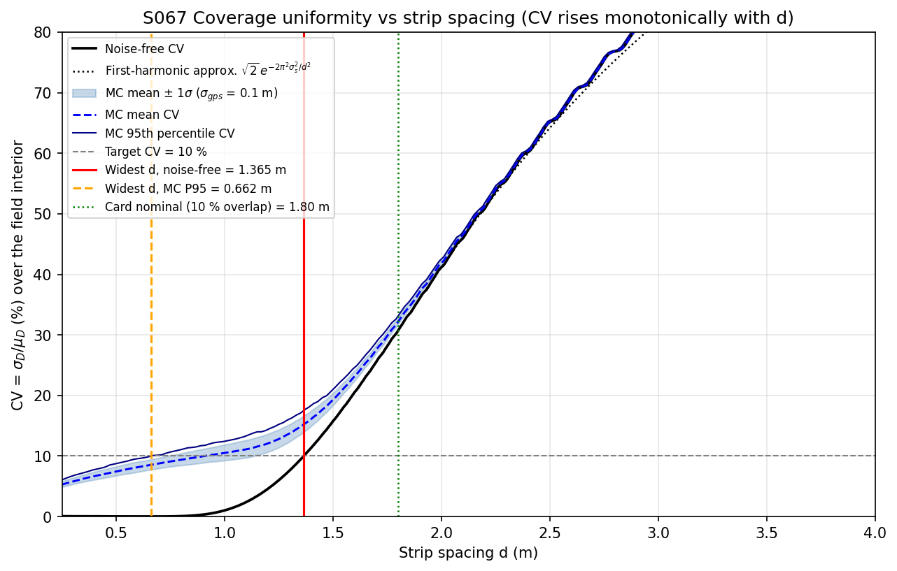
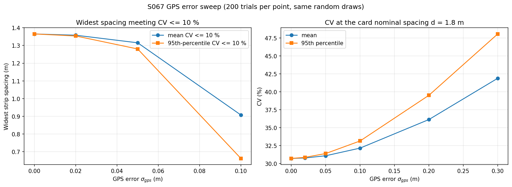
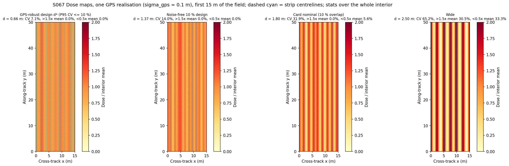
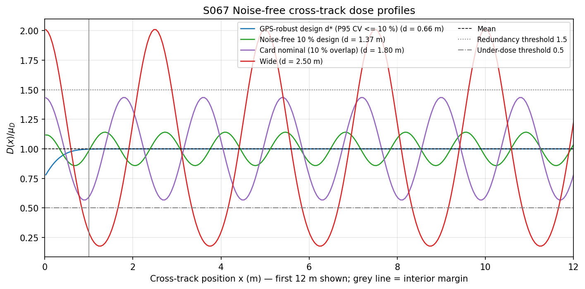
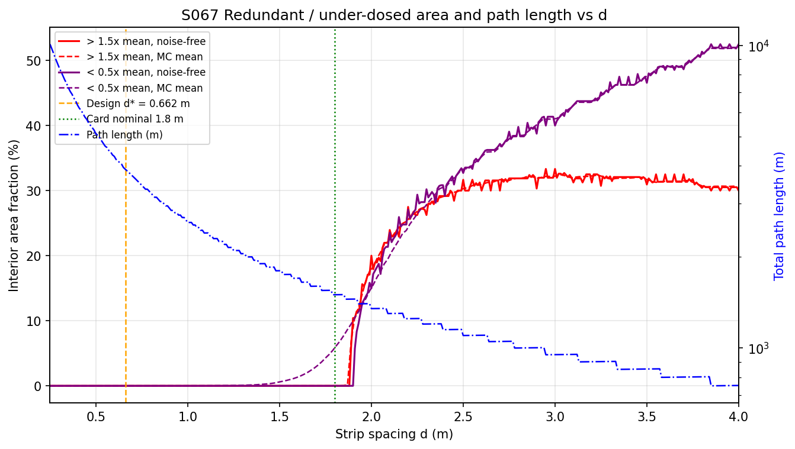
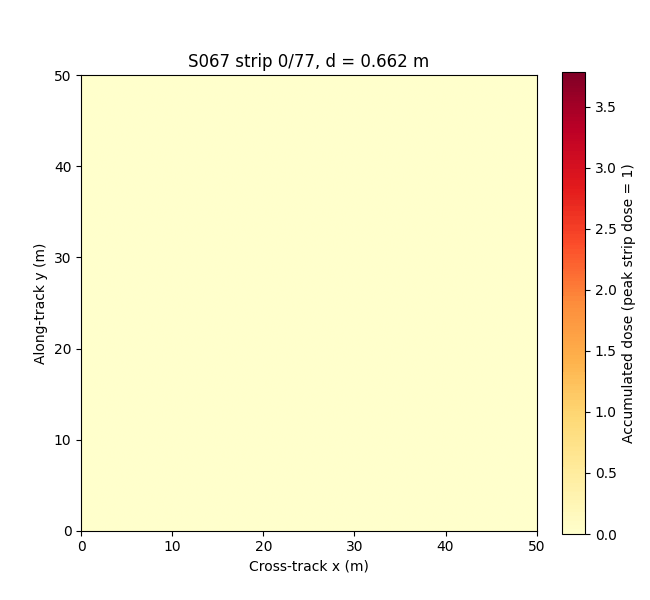

# S067 Spray Coverage Overlap Optimization

**Domain**: Industrial & Agriculture | **Difficulty**: ⭐⭐ | **Status**: ✅ Completed

---

## Problem Definition

**Setup**: A single drone sprays a 50 × 50 m field in parallel strips at 3 m/s. Its boom has a Gaussian cross-track dose profile with an effective width of 2 m ($\sigma_s$ = 0.5 m). Each strip is displaced sideways by a GPS error $\varepsilon_k \sim \mathcal N(0, 0.1^2)$ m, constant along the strip. The design variable is the strip spacing $d$.

**Question (card)**: Which spacing gives the most uniform dose (lowest coefficient of variation, CV)? How does GPS error change that spacing and the achievable CV? What fraction of the field gets more than 1.5 × the mean dose?

**What the script does**:
1. Computes the noise-free CV(d) and checks the card's $\arg\min$ formulation.
2. Re-poses the question as a well-defined design problem: the **widest** spacing (shortest flight) whose CV stays below a target, solved noise-free and under GPS error. The Monte Carlo uses 200 trials, with the same random draws for every $d$ and every $\sigma_{gps}$.
3. Evaluates the card's 10 %-overlap spacing (1.8 m) and the two design spacings: CV, redundant (> 1.5 × mean) and under-dosed (< 0.5 × mean) area, path length and mission time.
4. Sweeps the GPS error from 0 to 0.3 m.

---

## Mathematical Model Summary

Dose across the track (peak strip dose $Q_0 = 1$):

$$D(x) = \sum_{k=0}^{N-1} \exp\!\left(-\frac{(x - k d - \varepsilon_k)^2}{2\sigma_s^2}\right), \qquad N = \left\lceil W/d \right\rceil + 1$$

Uniformity is measured over the interior $x \in [1, 49]$ m (a half-swath margin at each edge, 960 cells of 0.05 m):

$$\text{CV}(d) = \sigma_D / \mu_D$$

Noise-free, the first Fourier harmonic of the periodic comb gives

$$\text{CV}(d) \approx \sqrt2\, \exp\!\left(-\frac{2\pi^2\sigma_s^2}{d^2}\right),$$

which rises monotonically with $d$. There is no interior optimum, so the design problem is

$$d^*(\text{CV}^*) = \max\{d : \text{CV}(d') \le \text{CV}^* \ \ \forall d' \le d\},$$

solved noise-free (by bisection) and under GPS error for the Monte Carlo mean and its 95th percentile (P95). The P95 version means that 95 % of missions meet the target. The design target is $\text{CV}^*$ = 10 %. Path length is $L_{total} = N L + (N - 1)d$, and mission time is $L_{total}/v$.

---

## Key Parameters

| Parameter | Value |
|-----------|-------|
| Field $W \times L$ | 50 × 50 m |
| Spray width $w$ / $\sigma_s = w/4$ | 2.0 m / 0.5 m |
| Card nominal overlap / spacing | 10 % / 1.80 m |
| GPS error $\sigma_{gps}$ | 0.1 m per strip (constant along the strip) |
| Dose grid | 0.05 m |
| Interior margin (added interpretation of "half-strip-width") | 1.0 m each side |
| Cruise speed | 3.0 m/s |
| Monte Carlo trials / seed | 200 / 42 (same standard-normal draws for every $d$ and $\sigma_{gps}$) |
| Spacing search range | 0.25–4.0 m (noise-free curve 376 points; MC grid step 0.02 m) |
| CV targets (added) | 5 %, **10 %** (design), 15 % |
| Redundant / under-dosed thresholds | > 1.5 × mean (card) / < 0.5 × mean (added) |
| GPS sweep (added) | 0, 0.02, 0.05, 0.10, 0.20, 0.30 m |
| Dose kernel truncation (added) | 6 $\sigma_s$ from the displaced strip centre |
| Wide example spacing (added) | 2.5 m |

---

## Implementation

```
src/04_industrial_agriculture/s067_spray_overlap.py
```

```bash
conda activate drones
python src/04_industrial_agriculture/s067_spray_overlap.py
```

Runtime: 36 s and 40 s in the two reproducibility runs (single-threaded BLAS); the first runs, with about ten other simulations on the same machine, took 163–169 s.

---

## Results

### The card's "optimal" spacing does not exist

| Check | Result |
|---|---|
| Noise-free CV strictly increasing for $d \ge$ grid argmin (up to 4 m) | True |
| Largest noise-free CV for $d \le$ argmin | 0.069 % |
| Card $\arg\min$ CV: grid / bounded `minimize_scalar` | 0.680 m / 0.6757 m (CV = 8.17e-03 %) |
| Argmin of the MC mean CV over [0.25, 3.99] m | 0.25 m (the lower bound of the grid) |

Below 0.68 m the noise-free CV is under 0.07 %, which is numerical residue from the field edges and the grid. The minimiser therefore just picks a point inside that flat floor. The card's closed-form spacing of 1.80 m (10 % overlap) gives CV = **30.72 %**. The first-harmonic formula matches the simulation closely:

| d (m) | 1.0 | 1.5 | 1.8 | 2.0 | 3.0 |
|---|---|---|---|---|---|
| Noise-free CV | 1.02 % | 15.78 % | 30.72 % | 41.20 % | 83.25 % |
| First-harmonic approximation | 1.02 % | 15.78 % | 30.84 % | 41.18 % | 81.73 % |



### Widest spacing that meets a CV target

| Target | Noise-free | GPS 0.1 m, MC mean | GPS 0.1 m, MC P95 |
|---|---:|---:|---:|
| CV ≤ 5 % | 1.215 m | not reachable for d ≥ 0.25 m | not reachable |
| **CV ≤ 10 %** | **1.365 m** | **0.907 m** | **0.662 m** |
| CV ≤ 15 % | 1.484 m | 1.357 m | 1.238 m |

### Design points

| | Card nominal | Noise-free 10 % design | GPS-robust 10 % design $d^*$ |
|---|---:|---:|---:|
| Spacing d | 1.800 m | 1.365 m | 0.662 m |
| Overlap of the 2 m swath | 10.0 % | 31.7 % | 66.9 % |
| Strips N | 29 | 38 | 77 |
| Path length / mission time | 1500.4 m / 500.1 s (8.34 min) | 1950.5 m / 650.2 s (10.84 min) | 3900.3 m / 1300.1 s (21.67 min) |
| Noise-free CV | 30.72 % | 10.00 % | 0.01 % |
| CV with GPS (mean ± std, P95) | 32.16 ± 0.54 % (33.15 %) | 15.23 ± 1.34 % (17.53 %) | 8.55 ± 0.84 % (9.98 %) |
| Trials with CV ≤ 10 % (in-sample, the 200 design draws) | 0.0 % | 0.0 % | 95.0 % (by construction) |
| Out-of-sample check (1000 independent trials, seed 4242): pass rate / CV / P95 | — | — | 95.9 % / 8.47 ± 0.87 % / 9.93 % |
| Area > 1.5 × mean, noise-free / GPS mean | 0.00 % / 0.00 % | 0.00 % / 0.00 % | 0.00 % / 0.00 % |
| Area < 0.5 × mean, noise-free / GPS mean | 0.00 % / 5.84 % | 0.00 % / 0.15 % | 0.00 % / 0.00 % |

Compared with the card nominal, the GPS-robust design flies a path 160.0 % longer and takes 800.0 s more.

### GPS error sweep

| $\sigma_{gps}$ | 0 | 0.02 m | 0.05 m | 0.10 m | 0.20 m | 0.30 m |
|---|---|---|---|---|---|---|
| Widest d, mean CV ≤ 10 % | 1.365 m | 1.358 m | 1.315 m | 0.907 m | none ≥ 0.25 m | none ≥ 0.25 m |
| Widest d, P95 CV ≤ 10 % | 1.365 m | 1.354 m | 1.280 m | 0.662 m | none ≥ 0.25 m | none ≥ 0.25 m |
| CV at 1.8 m, mean / P95 | 30.72 / 30.72 % | 30.78 / 30.87 % | 31.09 / 31.40 % | 32.16 / 33.15 % | 36.14 / 39.52 % | 41.89 / 48.06 % |

The left panel omits 0.2 m and 0.3 m because no spacing in the grid meets the target at those errors:



MC CV against spacing at $\sigma_{gps}$ = 0.1 m (mean / P95), showing the GPS floor:

| d (m) | 0.25 | 0.35 | 0.49 | 0.65 | 0.99 | 1.37 | 1.81 | 2.49 |
|---|---|---|---|---|---|---|---|---|
| MC CV | 5.28 / 6.06 % | 6.26 / 7.24 % | 7.37 / 8.66 % | 8.48 / 9.88 % | 10.44 / 12.36 % | 15.36 / 17.66 % | 32.70 / 33.66 % | 64.97 / 65.27 % |
| Noise-free CV | 0.069 % | 0.043 % | 0.019 % | 0.011 % | 0.920 % | 10.196 % | 31.306 % | 64.886 % |

### Dose maps and profiles

The dose maps show four spacings with one GPS realisation. Panel titles give whole-interior statistics; only the first 15 m are drawn so that the strips are visible:







### Animation

The animation shows the dose building up strip by strip at the GPS-robust spacing $d^*$ = 0.662 m, with one GPS realisation. It has 78 frames (empty field plus 77 strips) at 5 fps, and the title shows the interior CV so far:



### Key findings

- **There is no CV-optimal spacing.** CV falls monotonically as the strips get closer, so the card's $\arg\min$ only finds the floor of the discretisation (0.676 m with CV 0.008 %). The card's 10 %-overlap spacing of 1.8 m is far from uniform: CV = 30.72 % noise-free.
- **The useful question is the widest spacing that is uniform enough.** For CV ≤ 10 % this is 1.365 m without GPS error, or 31.7 % overlap of the nominal 2 m swath, not 10 %.
- **GPS error narrows the spacing; it does not widen it.** With 0.1 m strip offsets (20 % of $\sigma_s$), each displaced strip leaves a dose ripple that closer spacing cannot fully average out. Mean CV still falls as the spacing shrinks (8.48 % at 0.65 m, 5.28 % at 0.25 m), but it never drops below about 5 % in the searched range. To keep 95 % of missions at CV ≤ 10 %, the spacing must drop to 0.662 m (77 strips, 21.67 min instead of 8.34 min). That 95 % holds by construction on the design draws. On 1000 independent trials the pass rate is 95.9 % (P95 CV 9.93 %), so the design generalises. At 0.2 m GPS error no spacing down to 0.25 m meets the target. Up to 0.05 m (RTK class) the effect is small (1.365 → 1.280 m).
- **Redundant area points the other way from the card's narrative.** Noise-free, the > 1.5 × mean area is 0 % for every spacing below 1.89 m (the first non-zero value is 6.25 % at 1.89 m). It is 0 % at all three design spacings and appears only for wide spacings (30.5 % in the 2.5 m dose map; this value appears only in that panel's title, not in stdout). With the threshold measured relative to the mean, closer strips cannot create relative hot spots. The cost of close spacing is flight time, plus total chemical if the nozzle flow is not reduced, because the mean dose $\mu_D = \sqrt{2\pi}\,\sigma_s/d$ grows as $1/d$.
- **The card nominal has under-dosed strips once GPS error is included.** 5.84 % of the interior gets less than half the mean dose, against 0.00 % noise-free.

### Deviations from the scenario card

| Card | Implementation | Reason |
|------|----------------|--------|
| $d^* = \arg\min_d \text{CV}(d)$; $d^*_{approx} = w(1-\rho) = 1.80$ m "refined" by the minimiser | Shown to be ill-posed (CV monotone; the argmin sits on the 0.01 % numerical floor). Design spacing = widest $d$ with CV ≤ 10 % (also 5 % and 15 %) | Verified numerically (table above). 1.80 m gives CV = 30.72 %. Card corrected. |
| "How much does GPS error **widen** the optimal $d$" | GPS error **narrows** the usable spacing: 1.365 → 0.662 m (P95) at 0.1 m | Result of the MC with common random numbers. Card note added. |
| Search range $[0.5\sigma_s, 4\sigma_s]$ = 0.25–2 m (text) vs 0.5–4 m (code) | 0.25–4 m | The union of both. |
| $N = \lceil W/d \rceil$ strips | $N = \lceil W/d \rceil + 1$ (strips until one is at or beyond the far edge) | With the card's count the last strip can stop up to $d$ short of the edge, and the interior near $x$ = 49 m is under-dosed by construction. Card updated. |
| Card code computes CV over the whole field; text says interior | Interior $x \in [1, 49]$ m | Follows the card text; edge roll-off is not a spacing effect. |
| Heatmaps at $0.70d^*$, $d^*$, $1.35d^*$; "gaps for under-spacing, hot spots for over-spacing" | Four panels: $d^*$ = 0.662 m, 1.365 m, card 1.8 m, wide 2.5 m | With $d^*$ = 0.662 m all three of the card's spacings look uniform. Gaps and hot spots both come from **wide** spacing; the card text had this backwards. Card corrected. |
| No uniformity target | CV targets 5 / 10 / 15 %, mean and P95 criteria | Needed to turn "most uniform" into a finite spacing. |
| — | Under-dosed area (< 0.5 × mean) added | Shows the gaps that the redundancy metric cannot detect. |
| Dose summed over all grid points for every strip | Kernel truncated 6 $\sigma_s$ from the displaced strip centre (window 5 m) | Speed. The neglected tail is below $e^{-18}$ of the peak. An assert checks that every GPS offset stays inside the window. |
| Animation colour scale `vmax = 0.9 N` | `vmax` = 2 × interior mean of the final dose | The card's scale would leave the image almost blank. |

---

## Extensions

1. **Along-track GPS drift**: model $\varepsilon_k(y)$ as a correlated random process instead of a constant offset per strip.
2. **Flat-top nozzle profile**: a measured boom profile with a steeper edge allows much wider spacing at the same CV.
3. **Cross-wind drift**: a constant lateral offset of every strip by $v_w h/v_{fall}$.
4. **Variable-rate flow**: reduce the nozzle flow as $d$ shrinks to hold $\mu_D$ at the target dose, and add chemical use to the objective.
5. **Double coverage**: two passes at $2d$ with a half-spacing shift, against one pass at $d$, under GPS error.

---

## Related Scenarios

- Prerequisites: [S048 Full-Area Coverage Scan (Lawnmower)](../../../scenarios/03_environmental_sar/S048_lawnmower.md)
- Follow-ups: [S068 Large-Scale Farmland Cooperative Spraying](../../../scenarios/04_industrial_agriculture/S068_large_field_spray.md)
- Cross-reference: [S052 Glacier Melt Area Measurement](../../../scenarios/03_environmental_sar/S052_glacier.md)
