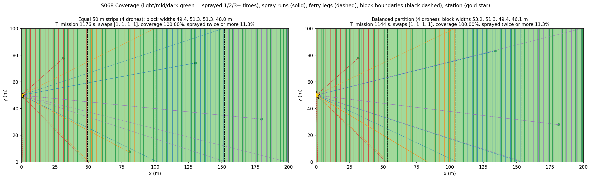
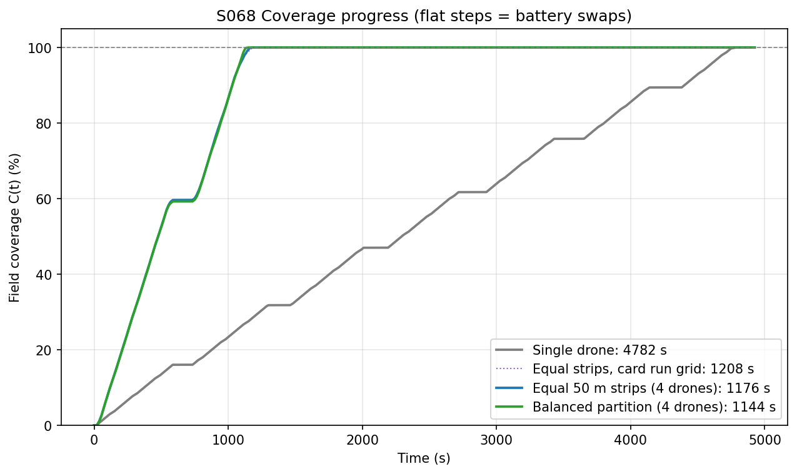
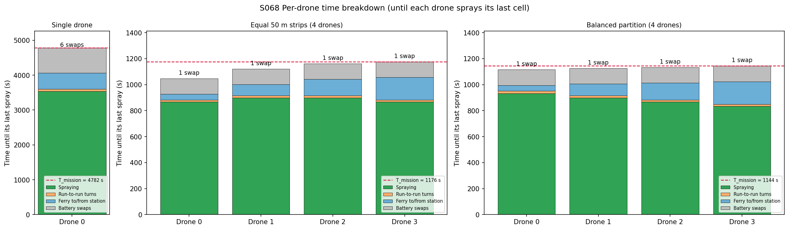
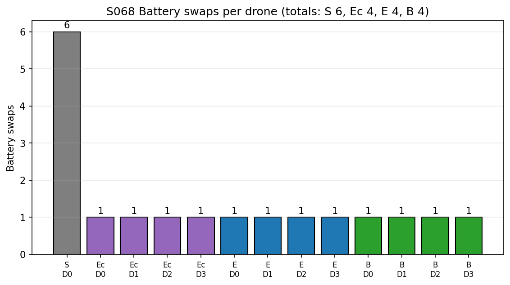
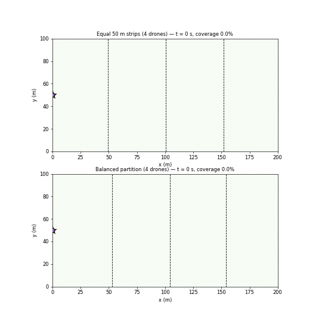

# S068 Large-Scale Farmland Cooperative Spraying

**Domain**: Industrial & Agriculture | **Difficulty**: ⭐⭐⭐ | **Status**: ✅ Completed

---

## Problem Definition

**Setup**: A 200 × 100 m field is sprayed with boustrophedon runs along y (2.0 m swath, 0.1 m overlap, so 1.9 m run spacing) at 3 m/s. One battery lasts 600 s of flight, and a swap at the single station at (0, 50) m takes 120 s. A drone heads home as soon as the time flown on the current battery plus the time to fly home reaches 600 s. After the swap it flies back to the exact point where it stopped and continues.

**Objective (card)**: minimise the mission time (until every cell is sprayed) and the number of battery swaps.

**Strategies**:
1. **S — single drone**: one drone sprays the whole field (card baseline).
2. **E — equal partition**: four drones, each with a block of about 50 m (card strategy). All strategies use the same global run grid of 106 runs; E splits it 26/27/27/26.
3. **B — balanced partition (added)**: four contiguous run blocks chosen by dynamic programming so that the slowest drone finishes as early as possible. Strips far from the station lose more time to ferrying, so they get fewer runs.
4. **Ec — card run grid (reference)**: the card's exact layout, four 50 m strips with 27 runs each and the last run of each strip clamped (108 runs in total).

---

## Mathematical Model Summary

Run positions (global grid): $x_r = \min\big((r + \tfrac12)\,d_{run},\ W - w/2\big)$, $r = 0..105$, with $d_{run} = w - \delta = 1.9$ m.

**Battery trigger (card)**: the drone returns when $t_{used} + \|\mathbf p - \mathbf p_{sta}\|/v \ge T_{bat}$. Along a straight leg $\mathbf p(s)$, the function $g(s) = t_{used} + s/v + \|\mathbf p(s) - \mathbf p_{sta}\|/v$ never decreases with $s$, so the stopping point is found exactly by bisection. The drone lands with $t_{used} = T_{bat}$ (zero reserve, as in the card), and the code asserts that the battery never goes below zero.

**Per-drone time**:

$$T_i = T_{spray,i} + T_{turn,i} + T_{ferry,i} + M_i\,T_{charge}, \qquad T_{mission} = \max_i T_i$$

**Coverage**: a 0.5 m cell is sprayed when its centre comes within $w/2$ = 1 m of the nozzle on a spray run (nozzle off during turns and ferries). $C(t)$ is the fraction of cells whose first-spray time is ≤ t. The mission time is the first-spray time of the last cell.

**Balanced partition**: for every contiguous block of runs $[a, b)$ (13–53 runs) the single-drone finish time $c(a, b)$ is simulated exactly. The dynamic programme $F_k(b) = \min_a \max(F_{k-1}(a),\, c(a, b))$ then gives the optimal cut points for $k = 4$ drones.

---

## Key Parameters

| Parameter | Value |
|-----------|-------|
| Field | 200 × 100 m |
| Drones $N$ | 4 (S: 1) |
| Swath / overlap / run spacing | 2.0 m / 0.1 m / 1.9 m |
| Runs | 106 on the global grid (card per-strip grid: 27 × 4 = 108) |
| Cruise speed | 3.0 m/s |
| Battery $T_{bat}$ / swap $T_{charge}$ | 600 s / 120 s |
| Station | (0, 50) m, unlimited capacity (card) |
| Coverage grid | 0.5 m (400 × 200 cells) |
| Time step | event-based exact; 0.2 s for the coverage curve; GIF every 20 s |
| Safety cutoff | 10 000 s (asserted) |
| DP block sizes (added) | 13–53 runs |

---

## Implementation

```
src/04_industrial_agriculture/s068_large_field_spray.py
```

```bash
conda activate drones
python src/04_industrial_agriculture/s068_large_field_spray.py
```

Runtime: 63 s and 61 s in the two reproducibility runs, with about ten other simulations running on the same machine. The run is deterministic (no random inputs).

---

## Results

| Strategy | $T_{mission}$ (last cell sprayed) | All drones home | Swaps (total) | Coverage | Speed-up vs single |
|---|---:|---:|---:|---:|---:|
| S single drone | 4781.7 s | 4850.1 s | 6 | 100.000 % | — |
| Ec equal strips, card run grid | 1207.7 s | 1276.1 s | 1, 1, 1, 1 (4) | 100.000 % | 3.959× |
| E equal 50 m strips | 1175.9 s | 1244.3 s | 1, 1, 1, 1 (4) | 100.000 % | 4.066× |
| **B balanced partition** | **1144.1 s** | **1212.5 s** | 1, 1, 1, 1 (4) | 100.000 % | **4.180×** |

The pure run-plus-turn time for the whole field is 3599.8 s, so the ideal 4-drone share is 900.0 s.

Per-drone breakdown (time until each drone's last spray):

| | Drone | Runs (x range) | Last spray | Spray | Turns | Ferry | Swaps |
|---|---|---|---:|---:|---:|---:|---:|
| E | 0 | 26 (0.0–49.4 m) | 1047.1 s | 866.7 s | 15.8 s | 67.8 s | 1 |
| E | 1 | 27 (49.4–100.7 m) | 1121.0 s | 900.0 s | 16.5 s | 121.7 s | 1 |
| E | 2 | 27 (100.7–152.0 m) | 1162.5 s | 900.0 s | 16.5 s | 179.0 s | 1 |
| E | 3 | 26 (152.0–199.9 m) | 1176.0 s | 866.7 s | 15.3 s | 242.3 s | 1 |
| B | 0 | 28 (0.0–53.2 m) | 1115.0 s | 933.3 s | 17.1 s | 68.7 s | 1 |
| B | 1 | 27 (53.2–104.5 m) | 1125.8 s | 900.0 s | 16.5 s | 127.7 s | 1 |
| B | 2 | 26 (104.5–153.9 m) | 1133.4 s | 866.7 s | 15.8 s | 184.5 s | 1 |
| B | 3 | 25 (153.9–199.9 m) | 1144.2 s | 833.3 s | 14.7 s | 244.5 s | 1 |

The ferry column covers the flights to and from the station, including the first flight out; the final flight home is excluded. The finish-time spread is 128.9 s for E and 29.1 s for B. The single drone spends 3533.3 s spraying, 66.0 s turning, 530.8 s ferrying and 720 s on its 6 swaps.









The animation compares E (top) and B (bottom) side by side. It has 60 frames, one every 20 s from 0 to 1175.9 s, at 12 fps. Faded markers show drones that are swapping batteries:



### Key findings

- **Four drones are more than 4× faster than one.** The speed-up is 4.066× for E and 4.180× for B. This is not a free lunch: the single drone needs 6 swaps (720 s of idle time) and 530.8 s of ferrying for 3599.8 s of runs, while each of the four drones needs only one swap. One drone's share of the work (about 900 s of runs) takes just over one battery, so splitting the field removes swaps as well as dividing the work.
- **The equal partition is limited by ferry distance.** The station is on the left edge, so drone 3 of E ferries 242.3 s against 67.8 s for drone 0 and finishes 128.9 s after it. Balancing the blocks (28/27/26/25 runs instead of 26/27/27/26) moves work towards the station. That cuts $T_{mission}$ by 31.8 s (2.7 %) and the finish-time spread to 29.1 s, with the same 4 swaps. The gain is modest because the swaps, not the ferries, dominate the overhead.
- **The card's "unlimited station capacity" assumption is binding.** Every drone of E, Ec and B swaps in the same window, 600–720 s: all four start together and drain their batteries at the same rate. With one swap slot, three drones would queue (the card's Extension 2).
- **The card's run grid is slightly wasteful.** Clamping the last run of every 50 m strip gives 108 runs instead of 106, and the mission takes 1207.7 s instead of 1175.9 s (E).
- **Every strategy reaches 100.000 % coverage.** With the 0.5 m cell test, 11.29–13.06 % of the cells count as sprayed twice. The nominal swath overlap is only 5.26 % of the field; the rest comes from cells whose centres lie exactly on a swath edge, plus the extra overlap of Ec's clamped runs.

### Deviations from the scenario card

| Card | Implementation | Reason |
|------|----------------|--------|
| Card pseudocode: after a swap the drone flies to the *next waypoint* (the far end of the interrupted run) and marks coverage along every flown path, ferries included | The exact stopping point is stored; the drone flies back to it with the nozzle off and sprays only on runs | With the card's code the rest of each interrupted run is never sprayed. Running the card's own pseudocode separately (not part of the script; numbers not printed by it) gives 98.65 % coverage, with 1080 cells unsprayed, instead of the 100 % the card expects. Card note added. |
| Trigger checked once per 0.2 s step | Stopping point solved exactly along the leg (bisection) | No step-size overshoot; the battery is asserted ≥ 0. |
| Strategies: equal partition and single drone | Added B (DP-balanced contiguous blocks) and Ec (card's exact per-strip grid) | B answers the card's objective of minimising mission time (the card's Extension 1); Ec shows what the card's own grid costs. |
| Per-strip run grid (27 runs per strip, last run clamped) | Global 1.9 m grid of 106 runs for S, E and B; the card's grid is kept as Ec | Equal work definition for all strategies; the per-strip grid adds 2 runs. |
| Mission time = max of the drones' $t_{total}$ (ends at the last waypoint) | $T_{mission}$ = first-spray time of the last cell; "all drones home" reported as well | Matches the card's text ("until all cells have been sprayed"); a real mission also needs the flight home. |
| Fixed time step $\Delta t$ = 0.2 s | Event-based exact segment times; 0.2 s used only to sample $C(t)$ | Exact times; the outputs are identical at any sampling step. |
| Drone colours red/orange/blue/purple; station gold star | Same | — |

---

## Extensions

1. **Single-slot station**: queue the simultaneous swaps at 600 s and re-optimise the partition with the queueing delay; a staggered start avoids the queue.
2. **Sweep direction**: let the far drones start at the far edge and finish near the station, which shortens their final ferry and the flight home.
3. **Battery reserve**: trigger the return with a 10 % reserve and study how swaps and $T_{mission}$ jump when a block no longer fits in two batteries.
4. **Non-contiguous partitions**: interleave runs between drones to balance both ferry distance and swap count.
5. **Second station**: a station on the right edge removes most of drone 3's ferry time.

---

## Related Scenarios

- Prerequisites: [S063 Single-Plant Precision Spraying](../../../scenarios/04_industrial_agriculture/S063_precision_spraying.md), [S067 Spray Coverage Overlap Optimization](../../../scenarios/04_industrial_agriculture/S067_spray_overlap.md)
- Follow-ups: [S070 Swarm Weeding Task](../../../scenarios/04_industrial_agriculture/S070_swarm_weeding.md)
- Cross-reference: [S048 Full-Area Coverage Scan (Lawnmower)](../../../scenarios/03_environmental_sar/S048_lawnmower.md), [S049 Dynamic Zone Search](../../../scenarios/03_environmental_sar/S049_dynamic_zone.md), [S032 Charging Queue](../../../scenarios/02_logistics_delivery/S032_charging_queue.md)
