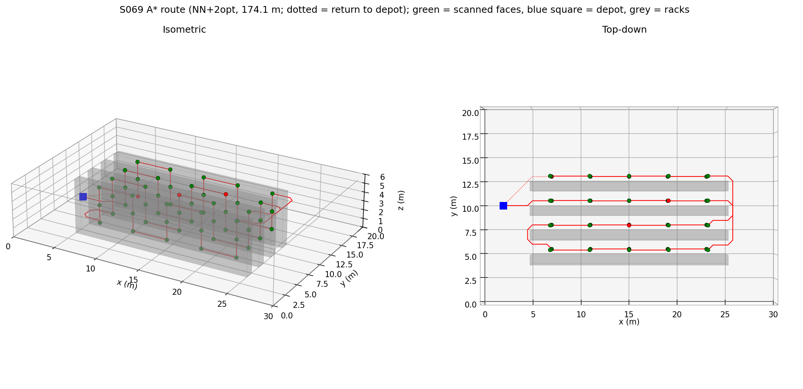
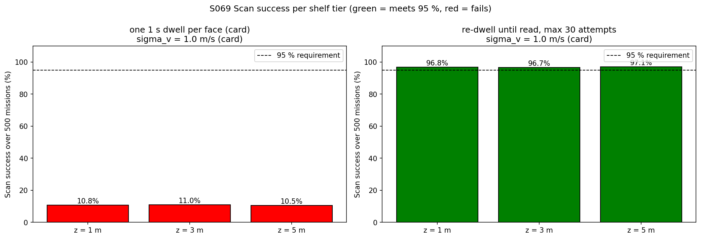
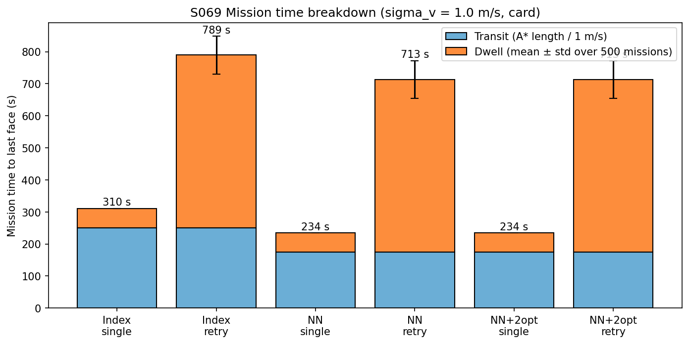
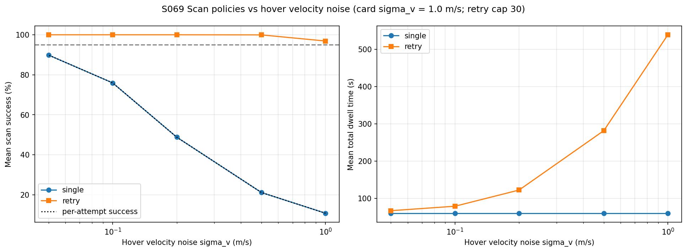
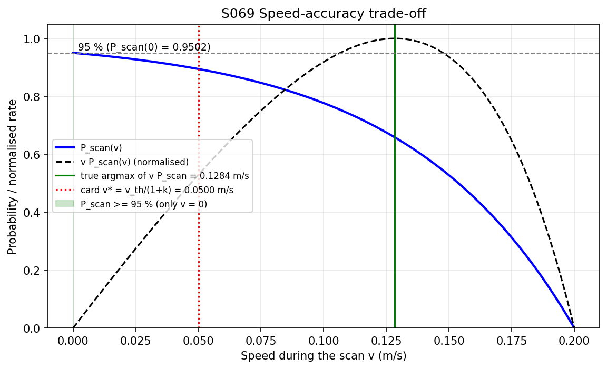
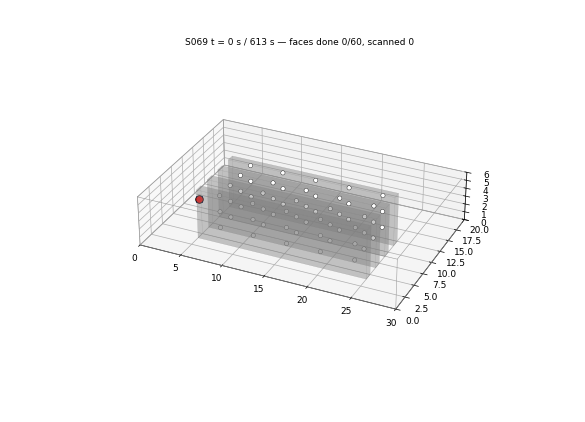

# S069 Automated Warehouse Inventory

**Domain**: Industrial & Agriculture | **Difficulty**: ⭐⭐ | **Status**: ✅ Completed

---

## Problem Definition

**Setup**: One drone inventories a 30 × 20 × 6 m GPS-denied warehouse. Four storage racks (1 m deep, 20 m long, floor to ceiling) are separated by 1.5 m aisles. Each rack has 5 columns, which gives 20 rack columns; with three tiers (z = 1, 3, 5 m) there are **60 shelf faces**. The drone plans collision-free paths with 26-connected A* on a 0.5 m lattice. At each face it hovers 0.5 m in front and dwells 1 s per scan attempt. Hover velocity noise decides whether the barcode/RFID read succeeds.

**Objective (card)**: visit all 60 faces, reach a scan-success rate of at least 95 %, minimise mission time, and never enter an occupied voxel.

**Comparisons**:
1. **Visiting order**: the order in which the faces are listed (Index) as a naive baseline; greedy nearest neighbour on A* costs (NN, card); NN followed by 2-opt.
2. **Scan policy**: one 1 s dwell per face (card) against re-dwelling until the read succeeds, capped at 30 attempts.
3. **Hover velocity noise**: the card's $\sigma_v$ = 1.0 m/s and smaller values (0.5, 0.2, 0.1, 0.05 m/s).

---

## Mathematical Model Summary

**Map**: lattice nodes every 0.5 m (61 × 41 × 13). A node is occupied if it lies within 0.2 m of a rack, on the floor or ceiling, or on a wall: 12614 nodes (38.8 %).

**A\***: 26-neighbourhood, step cost $\Delta\sqrt{|dx|+|dy|+|dz|}$, Euclidean heuristic $h(n) = \|\mathbf p(n) - \mathbf p_{goal}\|$ (admissible and consistent). The 61 × 61 cost matrix (depot plus 60 faces) is computed with Dijkstra from each waypoint. That gives the same optimal lengths, and every flown leg is re-planned with A* and asserted to have the same length.

**Tours**: NN repeatedly picks $\arg\min_w d_{A^*}(w_k, w)$. 2-opt reverses sub-sequences of the open path (fixed start at the depot, free end) while that shortens it.

**Scan model (card)**:

$$P_{scan}(v) = 1 - \exp\!\Big(-k\,\frac{v_{th} - v}{v_{th}}\Big)\ \ (v \le v_{th}),\qquad 0 \text{ otherwise}, \qquad v = |\mathcal N(0, \sigma_v^2)|$$

The card sets $\sigma_v$ = GPS_ERROR / $\Delta t_{ctrl}$ = 0.1 / 0.1 = 1.0 m/s. Each 1 s dwell is one independent attempt. Mission time = A* length / 1 m/s + (number of attempts) × 1 s.

**Speed–accuracy trade-off**: the scan rate per unit time while moving at $v$ is proportional to $v\,P_{scan}(v)$. With $u = v/v_{th}$, its maximum satisfies $e^{k(1-u)} = 1 + k u$, solved with Brent's method.

---

## Key Parameters

| Parameter | Value |
|-----------|-------|
| Warehouse | 30 × 20 × 6 m |
| Lattice resolution / nodes | 0.5 m / 61 × 41 × 13 |
| Racks (added layout) | 4 racks, x = 5–25 m, 1 m deep, y starts 4.0 / 6.5 / 9.0 / 11.5 m, full height; aisles 1.5 m |
| Shelf columns / tiers / faces | 20 (4 racks × 5) / z = 1, 3, 5 m / 60 (the +y face of each rack) |
| Obstacle inflation | 0.2 m |
| Stand-off $d_{scan}$ | 0.5 m |
| Depot (added) | (2, 10, 1) m |
| Cruise speed | 1.0 m/s |
| Dwell per attempt $T_{dwell}$ | 1.0 s |
| $v_{th}$ / $k_{scan}$ | 0.2 m/s / 3.0 |
| Position noise / $\Delta t_{ctrl}$ / $\sigma_v$ | 0.1 m / 0.1 s / 1.0 m/s (card formula) |
| A* connectivity | 26 |
| Requirement | 95 % |
| Monte Carlo (added) | 500 missions, seed 7; the same random draws for every policy and $\sigma_v$ |
| Retry cap (added) | 30 attempts per face |
| $\sigma_v$ sweep (added) | 1.0, 0.5, 0.2, 0.1, 0.05 m/s |

---

## Implementation

```
src/04_industrial_agriculture/s069_warehouse_inventory.py
```

```bash
conda activate drones
python src/04_industrial_agriculture/s069_warehouse_inventory.py
```

Runtime: 140 s and 161 s in the two reproducibility runs, with about ten other simulations running on the same machine. The code asserts that no waypoint or path node is occupied, that A* matches Dijkstra on every leg, and that none of the 30 000 noisy hover positions touches a rack (minimum clearance 0.093 m against the nominal 0.5 m).

---

## Results

### Route

| Order | Path length (transit at 1 m/s) | Mean leg | Longest leg | Return to depot |
|---|---:|---:|---:|---:|
| Index (as listed) | 250.36 m (250.4 s) | 4.17 m | 24.13 m | 23.61 m |
| NN (card) | 174.07 m (174.1 s) | 2.90 m | 11.62 m | 6.24 m |
| NN + 2-opt | 174.07 m (174.1 s) | 2.90 m | 11.62 m | 6.24 m |

NN is 30.5 % shorter than the index order. 2-opt finds no improvement (0.0 %). In this aisle layout NN already sweeps each aisle tier by tier and then moves to the next aisle, so it is 2-opt-optimal.



### Scan success at the card's noise ($\sigma_v$ = 1.0 m/s)

| Policy | Per-attempt success | Scan success (mean ± std) | Missions ≥ 95 % | Faces missed | Attempts per face | Dwell | Mission time (NN + 2-opt) |
|---|---:|---:|---:|---:|---:|---:|---:|
| One dwell (card) | 10.78 % | 10.78 ± 4.10 % | 0.0 % | 53.53 | 1.00 | 60.0 s | 234.1 s |
| Re-dwell until read (cap 30) | 10.78 % | **96.88 ± 2.16 %** | 90.2 % | 1.87 | 8.98 | 539.1 s | 713.1 s |

Per tier (all 500 missions): one dwell gives 10.80 / 11.02 / 10.53 % at z = 1 / 3 / 5 m; re-dwelling gives 96.83 / 96.74 / 97.06 %. The tiers share the same scan model, so the differences are sampling noise.





### Hover-noise sweep

| $\sigma_v$ (m/s) | 1.00 | 0.50 | 0.20 | 0.10 | 0.05 |
|---|---:|---:|---:|---:|---:|
| One dwell: success | 10.78 % | 21.13 % | 48.81 % | 75.95 % | 89.85 % |
| One dwell: missions ≥ 95 % | 0.0 % | 0.0 % | 0.0 % | 0.0 % | 11.2 % |
| Re-dwell: success | 96.88 % | 99.94 % | 100.00 % | 100.00 % | 100.00 % |
| Re-dwell: attempts per face | 8.98 | 4.69 | 2.04 | 1.31 | 1.11 |
| Re-dwell: mission time | 713.1 s | 455.7 s | 296.3 s | 252.9 s | 240.9 s |



### Speed–accuracy trade-off

$P_{scan}(0)$ = 0.9502. The card's optimum $v^* = v_{th}/(1 + k)$ = 0.0500 m/s is wrong; the true maximiser of $v\,P_{scan}(v)$ is **0.1284 m/s**. At the card's value the scan rate is only 0.529 of the maximum.



### Animation

The animation shows mission 0 (re-dwell policy, card noise, NN + 2-opt route). It has 308 frames, one every 2 s of the 613.1 s mission, at 12 fps. Faces turn green when read and red when all 30 attempts fail; mission 0 reads 57/60 faces with 439 s of dwell.



### Key findings

- **The card's 95 % requirement cannot be met with one dwell per face.** Even at zero hover velocity a single attempt succeeds only 95.02 % of the time. With the card's noise ($\sigma_v$ = 1.0 m/s, from GPS_ERROR / $\Delta t_{ctrl}$) one attempt succeeds 10.78 % of the time, so 53.53 of the 60 faces are missed on average.
- **Re-scanning until the read succeeds meets the requirement on average** (96.88 %), but only 90.2 % of missions reach 95 %. It also triples the mission time (713.1 s against 234.1 s), because dwelling (539.1 s) dominates transit (174.1 s).
- **Hover stability matters more than route quality.** Reducing $\sigma_v$ to 0.1 m/s cuts the re-dwell mission to 252.9 s (1.31 attempts per face). The best route ordering only reduces transit from 250.4 s (index order) to 174.1 s.
- **NN is already as good as 2-opt** on this aisle layout, so the card's NN heuristic costs nothing here.
- **The card's speed–accuracy optimum is wrong**: 0.1284 m/s, not 0.05 m/s.

### Deviations from the scenario card

| Card | Implementation | Reason |
|------|----------------|--------|
| "20 columns", "aisles between columns 1.5 m wide"; card code builds 20 one-voxel-thick walls across y | 4 racks along x (1 m deep, 1.5 m aisles), 5 columns each = 20 columns; the +y face of every rack scanned | The card does not specify the geometry, and its code layout gives faces facing ±x with only 1 m between walls. The added layout keeps 20 columns × 3 tiers = 60 faces and the 1.5 m aisles. |
| Voxel cells, waypoints at z = 1, 3, 5 m | Lattice nodes at multiples of 0.5 m (so tiers and stand-off fall exactly on nodes) | Same resolution; no rounding of the targets. |
| A* for every pair (card code: 3540 A* runs) | Dijkstra (scipy) for the cost matrix; A* for every flown leg, asserted equal | Same optimal lengths, much faster. |
| NN only | Also index order (baseline) and NN + 2-opt | Shows what NN gains, and that 2-opt adds nothing here. |
| One dwell, success model as given; requirement 95 % | One-dwell policy plus a re-dwell-until-read policy (cap 30); $\sigma_v$ sweep | With the card's model a single dwell cannot reach 95 % (P_scan(0) = 0.9502); see the card note. |
| $v^* = v_{th}/(1+k)$ = 0.05 m/s | 0.1284 m/s from $e^{k(1-u)} = 1 + k u$ | Derivation error, verified numerically. Card corrected. |
| Scan outcome uses `np.random` without a seed | `default_rng(7)`, 500 missions, common random numbers across policies and $\sigma_v$ | Reproducibility (X1) and fair comparison (X2). |
| "Number of A* re-plans" in the time breakdown | Not shown | The map is static and known, so no re-planning ever happens. |
| Home depot drawn in blue, route in red | Same; faces green (read) / red (failed) | — |

---

## Extensions

1. **Fly-by scanning**: scan while moving at $v^*$ = 0.1284 m/s along each aisle instead of stop-and-dwell, and compare the mission time at equal success.
2. **Attempt-aware routing**: return to failed faces at the end of the tour instead of dwelling in place.
3. **Correlated hover noise**: model the hover velocity as an OU process, so consecutive attempts are not independent.
4. **Multi-drone inventory**: split the aisles between two drones and compare the makespan.
5. **Dynamic obstacles**: forklifts in the aisles force A* re-planning in flight.

---

## Related Scenarios

- Prerequisites: [S065 Building 3D Modeling — Multi-Angle Scan Path](../../../scenarios/04_industrial_agriculture/S065_3d_scan_path.md), [S068 Large-Scale Farmland Cooperative Spraying](../../../scenarios/04_industrial_agriculture/S068_large_field_spray.md)
- Next: [S074 Mine 3D Mapping](../../../scenarios/04_industrial_agriculture/S074_mine_mapping.md), [S075 Port Container Yard Inventory](../../../scenarios/04_industrial_agriculture/S075_container_yard.md)
- Cross-reference: [S043 Confined Space Exploration](../../../scenarios/03_environmental_sar/S043_confined_space.md)
