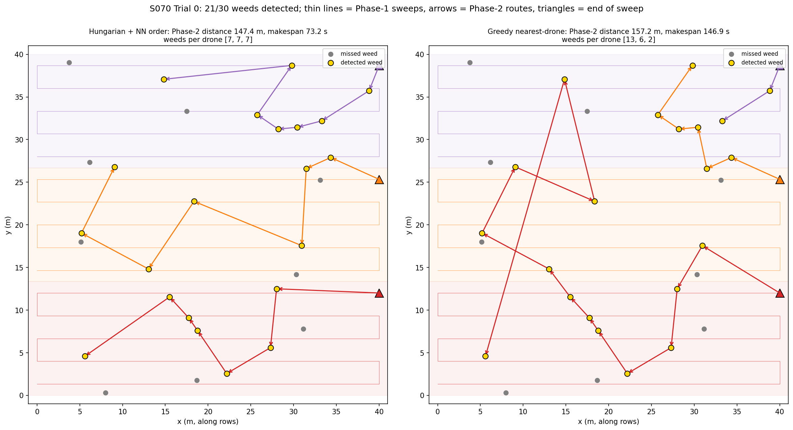
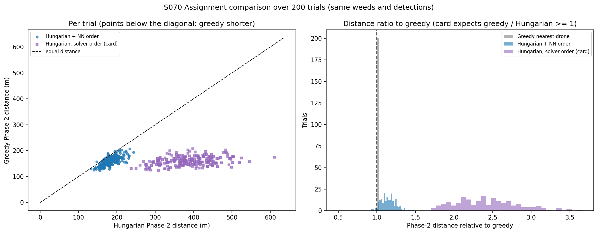
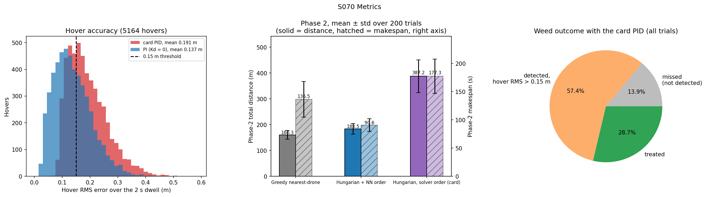
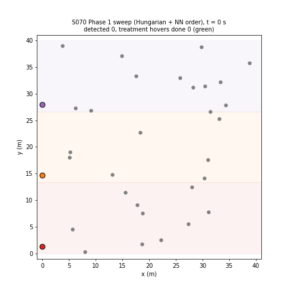

# S070 Swarm Weeding Task

**Domain**: Industrial & Agriculture | **Difficulty**: ⭐⭐⭐ | **Status**: ✅ Completed

---

## Problem Definition

**Setup**: 30 weeds lie at uniformly random positions in a 40 × 40 m field. Three drones work in two phases.
- **Phase 1 (detection)**: each drone sweeps its own 40 × 13.33 m sub-strip in a lawnmower pattern at 1 m/s. A sensor with radius 1.5 m detects each weed it passes over with probability 0.85 per encounter; GPS noise is 0.1 m.
- **Phase 2 (treatment)**: the detected weeds are shared among the drones. Each drone flies to its weeds and hovers 2 s over each under PID control. A treatment succeeds if the hover RMS error is at most 0.15 m.

**Objective (card)**: treat as many weeds as possible (primary) and minimise the Phase-2 travel distance (secondary).

**Assignment strategies** (the same weeds, detections and hover noise in every trial):
1. **Greedy nearest-drone** (card baseline): repeatedly take the closest (drone, weed) pair, give the weed to that drone, and move the drone's notional position to the weed.
2. **Hungarian + NN order**: the card's capacitated Hungarian assignment on end-of-sweep distances (each drone row repeated $K_{max} = \lceil M/N \rceil$ times), after which each drone visits its weeds in nearest-neighbour order.
3. **Hungarian, solver order (card code)**: the same assignment, with each drone visiting its weeds in the order `linear_sum_assignment` returns them.

**Hover controllers**: the card's PID $(K_p, K_i, K_d) = (2, 0.1, 0.5)$, and the same loop without the derivative term (PI).

---

## Mathematical Model Summary

**Sweep**: $n = \lceil L_{strip} / 2r_s \rceil = 5$ passes per strip, evenly spaced at 13.33/5 = 2.67 m (≤ 2 $r_s$, so the strip is fully covered). Each drone flies 210.67 m, so Phase 1 takes 210.67 s.

**Detection** (card text): a pass *encounters* weed $j$ if $|y_j - (y_{pass} + \eta)| \le r_s$, with $\eta \sim \mathcal N(0, 0.1^2)$. Each encounter detects the weed with probability $P_{detect}$ = 0.85, independently. A weed in the overlap of two passes gets two chances.

**Assignment**: $C_{ij} = \|\mathbf p_i^{end} - \mathbf w_j\|$, solved as an LSAP with each drone row repeated $K_{max}$ times, so no drone gets more than $K_{max}$ weeds. Greedy is described above.

**Phase-2 cost**: $D_s = \sum_i \sum_k \|\mathbf p_{i,k-1} - \mathbf w_{i,k}\|$ (sequential route from the end of the sweep). The makespan is $\max_i (D_i / v + n_i T_{treat})$, and the total mission time is Phase 1 + makespan.

**Hover** (card code): starting offset $\mathcal N(0, 0.3^2)$ per axis, noisy measurement $\tilde{\mathbf p} = \mathbf p + \mathcal N(0, 0.1^2)$, $\mathbf e = \mathbf w - \tilde{\mathbf p}$, $\mathbf u = K_p\mathbf e + K_i\sum\mathbf e\,\Delta t + K_d\,\Delta\mathbf e/\Delta t$, $\mathbf p \mathrel{+}= \mathbf u\,\Delta t$ with $\Delta t$ = 0.05 s for 2 s. Success means an RMS error over the dwell ≤ 0.15 m.

---

## Key Parameters

| Parameter | Value |
|-----------|-------|
| Field | 40 × 40 m |
| Drones / weeds | 3 / 30 |
| Sub-strip width | 13.33 m |
| Sensor radius $r_s$ / max pass spacing | 1.5 m / 3.0 m |
| Passes per strip / spacing | 5 / 2.67 m |
| $P_{detect}$ per encounter | 0.85 |
| Speed | 1.0 m/s |
| GPS noise | 0.10 m |
| Treatment hover | 2.0 s, success if RMS ≤ 0.15 m |
| PID gains | (2.0, 0.1, 0.5); PI variant (2.0, 0.1, 0) |
| Hover arrival offset (card code) | 0.3 m std per axis |
| Time step | 0.05 s |
| Monte Carlo (added) | 200 trials, seeds 42–241 |

---

## Implementation

```
src/04_industrial_agriculture/s070_swarm_weeding.py
```

```bash
conda activate drones
python src/04_industrial_agriculture/s070_swarm_weeding.py
```

Runtime: 48 s and 43 s in the two reproducibility runs, with about ten other simulations running on the same machine. The code asserts that every detected weed is assigned exactly once and that the Hungarian load cap holds.

---

## Results

### Phase 1: detection

| Sweep layout | Passes per strip | Unswept band per strip | Weeds detected (mean ± std of 30) |
|---|---:|---:|---:|
| Card formula $\lceil L/2r_s \rceil$ (used) | 5 | 0.000 m (0.0 %) | **25.82 ± 1.87 (86.07 %)** |
| Card code `arange(y0 + 1.5, y1, 3)` | 4 | 1.333 m (10.0 %) | 22.27 ± 2.44 (74.25 %) |

11.25 % of the weeds lie in the overlap of two passes and get two chances; 0.02 % are missed by every pass because of GPS noise at the band edge. The card's code draws a Bernoulli trial every 0.05 s while a weed is in range, which gives a mean detection probability of 1.0000 instead of 0.85. The implementation therefore follows the card text: one draw per encounter.

### Phase 2: assignment (200 trials, the same detections)

| Strategy | Phase-2 distance | Makespan | Max weeds per drone | Total mission (Phase 1 + makespan) |
|---|---:|---:|---:|---:|
| Greedy nearest-drone | **160.3 ± 17.4 m** | 136.5 ± 31.6 s | 16.91 ± 3.74 | 347.2 ± 31.6 s |
| Hungarian + NN order | 183.5 ± 20.5 m | **90.6 ± 11.4 s** | 8.93 ± 0.70 | **301.2 ± 11.4 s** |
| Hungarian, solver order (card code) | 387.2 ± 63.5 m | 177.3 ± 30.6 s | 8.93 ± 0.70 | 388.0 ± 30.6 s |

- $\rho = D_{greedy}/D_{Hungarian+NN}$ = 0.877 ± 0.073; $\rho \ge 1$ in only **8/200** trials. Hungarian + NN has the shorter makespan in **193/200** trials.
- $\rho = D_{greedy}/D_{Hungarian,card}$ = 0.423 ± 0.068; $\rho \ge 1$ in 0/200 trials, with a shorter makespan in 33/200.

Trial 0 (21/30 detected): greedy 157.2 m and 146.9 s; Hungarian + NN 147.4 m and 73.2 s; Hungarian in solver order 269.7 m and 135.4 s.





### Phase 2: hover and treatment

| Controller | Hover RMS over 2 s (mean, 5164 hovers) | Hovers ≤ 0.15 m | Weeds treated per trial |
|---|---:|---:|---:|
| Card PID (2, 0.1, 0.5) | 0.1906 m | 33.33 % | 8.61 ± 2.36 |
| PI (Kd = 0) | 0.1374 m | 61.46 % | 15.87 ± 2.59 |
| Card expectation | 0.06 m | — | 25.4 |

The card PID's RMS over only the last 1 s is 0.1097 m.



### Animation

The animation shows trial 0 with Hungarian + NN order: the sweep (0–210.67 s), then the treatment flights. It has 143 frames, one every 2 s up to t = 283.8 s, at 12 fps. Weeds turn gold when detected and green when their 2 s treatment hover is done (the hover-accuracy outcome is not shown).



### Key findings

- **Detection works as the card text intends (86.07 %) only after fixing the sweep.** The card code's 3 m `arange` leaves 10 % of every strip unswept (74.25 % detected). Its per-time-step Bernoulli makes detection essentially certain (1.0000), which contradicts the stated 0.85.
- **The card's Hungarian does not minimise travel distance.** Its cost only measures the distance from the end of the sweep to each weed, while the drones then fly a sequential route. Greedy, which updates the drone position after every pick, is shorter in all but 8 of 200 trials ($\rho$ = 0.877 ± 0.073). The card's claim $\rho \ge 1$ does not hold. Visiting weeds in the solver's order, as the card code does, more than doubles the distance (387.2 m).
- **Hungarian does win on time.** Its load cap gives each drone at most ⌈M/3⌉ weeds (8.93 for the busiest drone on average), while greedy loads one drone with 16.91 on average. Hungarian + NN therefore finishes earlier (makespan 90.6 s against 136.5 s; total mission 301.2 s against 347.2 s) and has the shorter makespan in 193/200 trials. Shared work needs makespan as the metric, and there the capacity constraint matters more than the cost model.
- **The card's hover accuracy does not hold, so far fewer weeds are treated.** The card's PID differentiates the noisy GPS error, which amplifies noise, and starts 0.3 m off target. Its RMS is 0.1906 m, not 0.06 m, so only 8.61 weeds per trial are treated instead of the expected 25.4. Dropping the derivative term raises this to 15.87. The card's arithmetic $0.85 \times 0.997$ is also off: at $\sigma$ = 0.06 m the Rayleigh probability is 0.9561, not 0.997.

### Deviations from the scenario card

| Card | Implementation | Reason |
|------|----------------|--------|
| Passes: formula $\lceil L/\delta_s \rceil$ (= 5) but code `arange(..., 3.0)` (= 4) | 5 evenly spaced passes (2.67 m); the card-code layout is reported as an ablation | The card code leaves a 1.333 m unswept band per strip; the card text says each weed is covered. Card corrected. |
| Bernoulli draw "per (drone, weed, pass) encounter" (text) vs every 0.05 s step (code) | One draw per pass encounter | The per-step draw makes detection about 100 %, which contradicts $P_{detect}$ = 0.85. Card corrected. |
| Hungarian visits in solver order | Main variant: Hungarian assignment + NN visiting order; the card-code order is kept as a third strategy | Solver order is geometrically arbitrary (387.2 m); NN order gives Hungarian a fair route. |
| $\rho = D_{greedy}/D_{hung} \ge 1$ | Measured 0.877 ± 0.073 (≥ 1 in 8/200 trials) | Card claim does not hold; card note added. |
| Single seed (42) | 200 trials (seeds 42–241) with the same weeds, detections and hover noise for all strategies and controllers | Mean ± std and per-trial win counts (X2). |
| Travel distance only | Also makespan and total mission time | The card's primary objective includes mission time, and makespan separates the methods. |
| $\sigma_{hover}^2 = \sigma^2/(1 + 2K_p/K_d)$ → 0.06 m; $P_{success}$ ≈ 0.847; 25.4 treated | Card PID simulated as written: 0.1906 m, 33.33 % of hovers within 0.15 m, 8.61 treated; PI variant added | Formula not supported by the loop; card arithmetic error (0.9561, not 0.997). Card corrected. |
| Hover target = weed position | Same (the camera re-acquires the weed, so no localisation bias is added) | Matches the card's error definition $\mathbf e = \mathbf w - \tilde{\mathbf p}$. |
| Animation `s070_weeding.gif`, 25 fps, 10-frame "Running Hungarian" pause | `animation.gif`, 12 fps, one frame per 2 s, no pause | Project naming convention and file size. |

---

## Extensions

1. **Route-aware assignment**: a capacitated vehicle routing formulation (or Hungarian followed by 2-opt with weed swaps between drones) to beat greedy on both distance and makespan.
2. **Hover controller tuning**: filtered derivative, or a slower velocity loop with feed-forward arrival, to reach the 0.15 m treatment requirement.
3. **Re-treatment**: hover again when the RMS exceeds 0.15 m, and trade the extra time against the treated fraction.
4. **Second detection sweep**: a perpendicular pass to recover the weeds missed in Phase 1 (13.9 % in the outcome pie chart).
5. **Clustered weeds**: patchy weed distributions, where the card expects Hungarian to gain more.

---

## Related Scenarios

- Prerequisites: [S063 Single-Plant Precision Spraying](../../../scenarios/04_industrial_agriculture/S063_precision_spraying.md), [S067 Spray Coverage Overlap Optimization](../../../scenarios/04_industrial_agriculture/S067_spray_overlap.md), [S068 Large-Scale Farmland Cooperative Spraying](../../../scenarios/04_industrial_agriculture/S068_large_field_spray.md)
- Follow-ups: [S064 Greenhouse Interior Precision Flight](../../../scenarios/04_industrial_agriculture/S064_greenhouse.md)
- Cross-reference: [S018 Multi-Target Intercept](../../../scenarios/01_pursuit_evasion/S018_multi_target_intercept.md), [S040 Fleet Load Balancing](../../../scenarios/02_logistics_delivery/S040_fleet_load_balancing.md), [S042 Missing Person Localization](../../../scenarios/03_environmental_sar/S042_missing_person.md)
