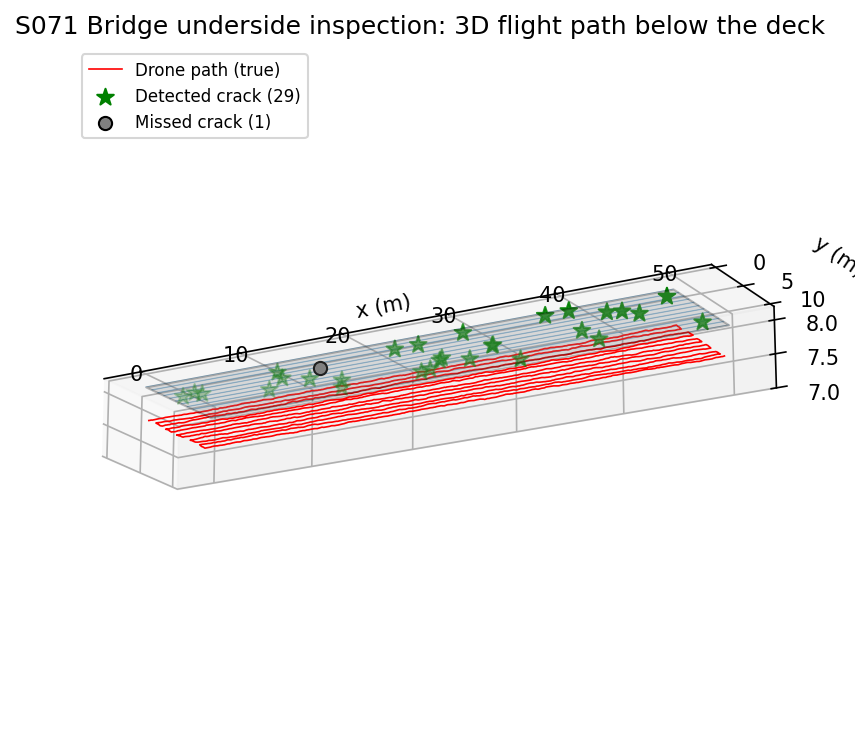
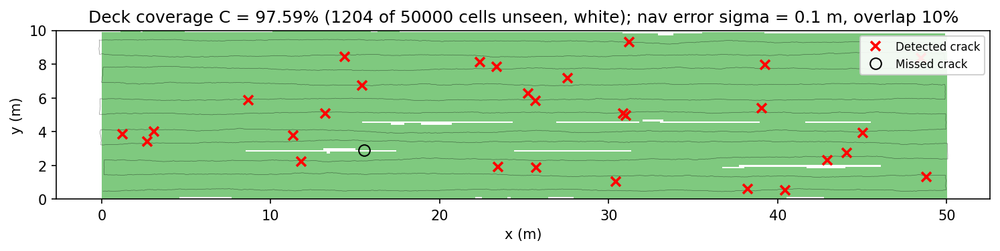
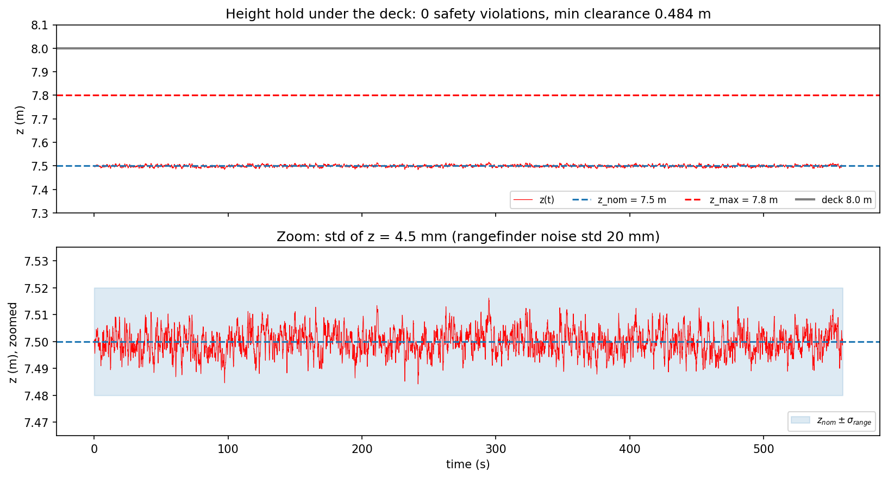
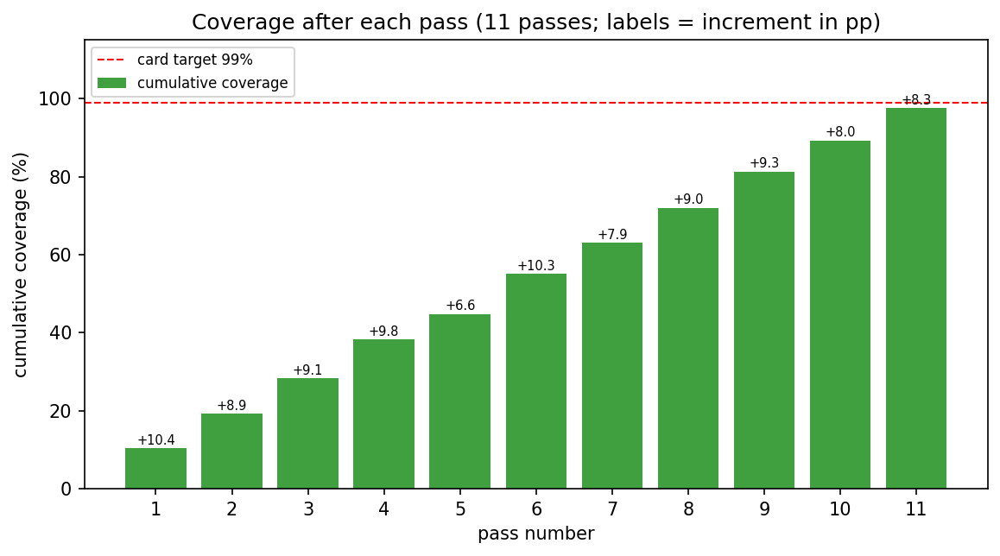
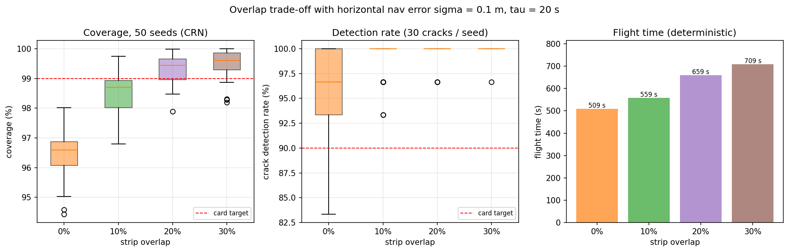
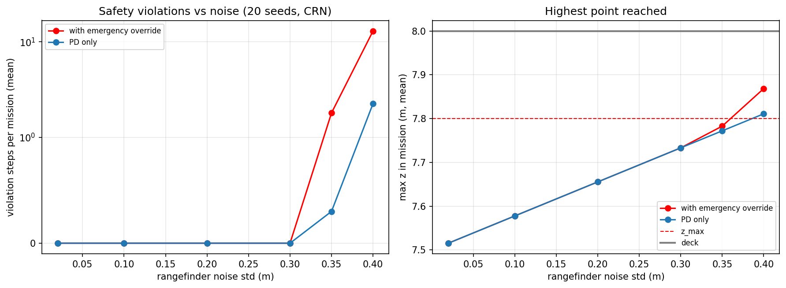
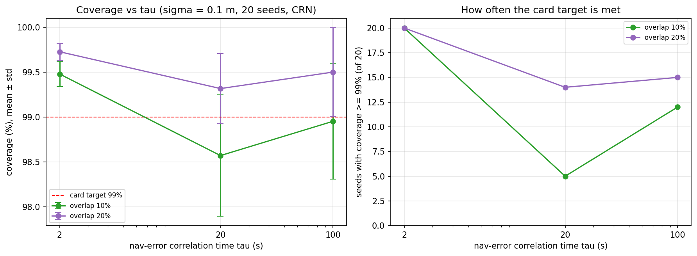
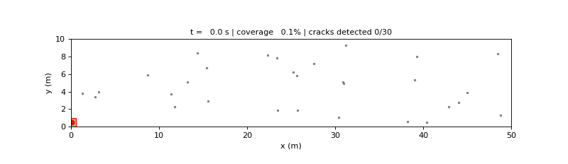

# S071 Bridge Underside Structural Inspection

**Domain**: Industrial & Agriculture | **Difficulty**: ⭐⭐⭐ | **Status**: ✅ Completed

---

## Problem Definition

**Setup**: A bridge deck spans 50 m (x) by 10 m (y); its underside is the plane z = 8 m. A drone flies boustrophedon passes 0.5 m below the deck (z = 7.5 m) at 1 m/s. An upward rangefinder (noise σ = 0.02 m) measures the clearance to the deck, and a PD controller holds the 0.5 m standoff. An upward camera with a 45° half-angle sees a 1 × 1 m square footprint on the deck. Thirty cracks are seeded at random positions on the deck.

**Objective** (card): cover 100 % of the underside, stay below the safety ceiling z_max = 7.8 m (0.2 m below the deck), detect as many cracks as possible, and log each crack's (x, y) position. Card targets: coverage ≥ 99 %, crack detection ≥ 90 %, zero safety violations.

**Questions studied**:
1. **Nominal mission**: the card's plan and seeds, with a 0.1 m horizontal position error (the card's `GPS error` parameter).
2. **Strip overlap**: coverage and detection for 0 %, 10 %, 20 % and 30 % overlap, as a 50-seed Monte Carlo with common random numbers (same cracks, same position-error and noise sequences for every overlap).
3. **Correlation time of the position error**: the overlap result for τ = 2, 20 and 100 s (20 seeds, common random numbers).
4. **Safety margin**: how much rangefinder noise the 0.2 m ceiling margin tolerates, with the card's emergency-descent override, without it (PD only), and two probes: the override plus the PD damping term, and the override triggered by the rangefinder instead of the true height (20 seeds, common random numbers).

---

## Mathematical Model Summary

### Height controller

The height error uses the measured upward range $d_{meas} = (z_{deck} - z) + \eta$, $\eta \sim \mathcal{N}(0, \sigma_{range}^2)$:

$$e_z = d_{meas} - d_{target}, \qquad u_z = K_p\,e_z + K_d\,\dot e_z = K_p\,e_z - K_d\,\dot z$$

with $K_p = \omega_n^2 = 16\ \text{s}^{-2}$ and $K_d = 2\omega_n = 8\ \text{s}^{-1}$ (critically damped, $\omega_n = 4$ rad/s). The vertical axis is a double integrator, $\dot v_z = u_z$, $\dot z = v_z$ (semi-implicit Euler, $\Delta t = 0.05$ s). When $z > z_{max}$ the command is replaced by the card's emergency descent $u_z^{emg} = -K_{emg}(z - z_{max})$, $K_{emg} = 30\ \text{s}^{-2}$. A safety violation is one timestep with $z > z_{max}$.

### Strip geometry

$$h_{strip} = d_{target}\tan 45° = 0.5\ \text{m}, \qquad w_{strip} = 1.0\ \text{m}, \qquad \Delta y = w_{strip}(1 - \rho_{ov}) = 0.9\ \text{m}$$

Edge-aligned plan (used): $y_k = h_{strip} + (k-1)\Delta y$, last pass clamped to $W - h_{strip}$, with

$$N_{pass} = \left\lceil \frac{W - w_{strip}}{\Delta y} \right\rceil + 1 = 11 \quad (\rho_{ov} = 0.1)$$

### Horizontal position error (added)

Without GPS under the deck, the drone's horizontal estimate drifts. The true position is the planned position plus a first-order Gauss–Markov error with stationary standard deviation $\sigma_{nav} = 0.1$ m per axis and correlation time $\tau = 20$ s:

$$\mathbf{e}_{k+1} = \phi\,\mathbf{e}_k + \sigma_{nav}\sqrt{1 - \phi^2}\;\boldsymbol{\xi}_k, \qquad \phi = e^{-\Delta t/\tau}$$

Coverage and detection use the true position. The crack log uses the estimated position (true minus $\mathbf{e}$), so each logged crack is off by $\|\mathbf{e}(t_{det})\|$. The card gives no correlation time; τ = 20 s is our choice, and the sensitivity study below shows that it is close to the worst case for this plan (a pass lasts 50 s).

Because the increments $\boldsymbol\xi_k$ are white, the true path inherits a small step-to-step jitter: in the nominal run the true horizontal speed has mean 1.009 m/s, 99th percentile 1.33 m/s and maximum 1.60 m/s, while the commanded speed is 1.0 m/s. The script asserts that every true step stays within the planned step plus 6 standard deviations of the 2D drift increment (2.20 m/s for τ = 20 s). This jitter is a property of the discrete drift model (a real position loop would smooth it), not a commanded speed.

### Detection and coverage

A crack is inside the footprint when $|x - x_i| \le h_{strip}$ and $|y - y_i| \le h_{strip}$; at each timestep inside, it is detected with probability 0.9. The deck is a 500 × 100 grid of 0.1 m cells; a cell counts as covered when its centre is inside the footprint at some timestep. Coverage $C$ is the covered fraction.

---

## Key Parameters

| Parameter | Value |
|-----------|-------|
| Deck size / height | 50 × 10 m, $z_{deck}$ = 8.0 m |
| Nominal height / standoff | $z_{nom}$ = 7.5 m, $d_{target}$ = 0.5 m |
| Safety ceiling | $z_{max}$ = 7.8 m (0.2 m margin) |
| Rangefinder noise | $\sigma_{range}$ = 0.02 m |
| PD gains | $K_p$ = 16 s⁻², $K_d$ = 8 s⁻¹ |
| Emergency descent gain | $K_{emg}$ = 30 s⁻² |
| Camera FOV half-angle | 45° → $h_{strip}$ = 0.5 m, $w_{strip}$ = 1.0 m |
| Strip overlap (nominal) | 10 % → $\Delta y$ = 0.9 m |
| Passes (edge-aligned) | 11 (card formula: 12) |
| Cruise speed | 1.0 m/s |
| Crack count / radius | 30, U(0.05, 0.20) m (radius is not used by the footprint test) |
| Crack area | x ∈ U(1, 49) m, y ∈ U(0.5, 9.5) m |
| Detection probability per timestep | 0.90 |
| Timestep | 0.05 s |
| Coverage grid | 0.1 m |
| Nominal seeds | cracks 7, noise 42 (card) |
| Horizontal error $\sigma_{nav}$ / $\tau$ (added) | 0.1 m / 20 s |
| Overlap study (added) | ρ ∈ {0, 10, 20, 30} %, 50 seeds (1000–1049) |
| Correlation-time study (added) | τ ∈ {2, 20, 100} s, overlap 10 % and 20 %, 20 seeds (1000–1019) |
| Noise stress test (added) | $\sigma_{range}$ ∈ {0.02, 0.10, 0.20, 0.30, 0.35, 0.40, 0.45} m, 20 seeds (1000–1019); card override, PD only, override + damping, rangefinder-triggered override |

---

## Implementation

```
src/04_industrial_agriculture/s071_bridge_inspection.py   # Main simulation script
```

```bash
conda activate drones
python src/04_industrial_agriculture/s071_bridge_inspection.py
```

Runtime ≈ 2 min (measured while other simulations shared the machine).

---

## Results

### Nominal mission (10 % overlap, $\sigma_{nav}$ = 0.1 m, card seeds)

| Metric | Value | Card target |
|--------|------:|------------:|
| Coverage | 97.59 % (1204 of 50 000 cells unseen) | ≥ 99 % |
| Crack detection | 29/30 = 96.7 % | ≥ 90 % |
| Safety violations | 0 | 0 |
| Highest point / minimum clearance | 7.5161 m / 0.4839 m | ≥ 0.2 m |
| Height std / max deviation | 4.54 mm / 16.1 mm | — |
| Flight time / path length | 559.0 s / 559.0 m | — |
| Logged crack position error | mean 122 mm, max 273 mm | — |
| Largest horizontal error during the flight | 347 mm | — |

Without the horizontal error, the same plan reaches 100.00 % coverage and 100.0 % detection. A crack inside a pass then spends at least 20 timesteps in the footprint, so the chance of missing it is at most $0.1^{20} = 10^{-20}$. The per-timestep detection probability therefore plays no role here: **a crack is detected if and only if it lies in covered area**. The one missed crack, at (15.55, 2.91) m, was never inside the footprint (0 frames); it lies in a gap between passes 3 and 4.

### Strip overlap study (50 seeds, common random numbers)

| Overlap | Passes | Flight time | Coverage mean ± std (min) | Detection mean ± std | Seeds with C ≥ 99 % | Seeds with 100 % detection | Logged crack error |
|---|---:|---:|---|---|---:|---:|---:|
| 0 % | 10 | 509.0 s | 96.47 ± 0.74 % (94.43 %) | 96.1 ± 3.7 % | 0/50 | 17/50 | 123 mm |
| **10 % (card)** | 11 | 559.0 s | 98.51 ± 0.65 % (96.79 %) | 99.3 ± 1.7 % | 11/50 | 41/50 | 125 mm |
| 20 % | 13 | 659.0 s | 99.32 ± 0.46 % (97.89 %) | 99.8 ± 0.8 % | 37/50 | 47/50 | 126 mm |
| 30 % | 14 | 709.0 s | 99.49 ± 0.45 % (98.20 %) | 99.9 ± 0.5 % | 44/50 | 49/50 | 123 mm |

Paired coverage comparison against 10 % overlap (same seed): 0 % loses on all 50 seeds (mean −2.05 pp); 20 % wins 48, loses 2 (+0.80 pp); 30 % wins 48, loses 2 (+0.98 pp).

Share of the unseen cells that lie in the 0.5 m border band along the deck edges (the band is 11.8 % of the deck): 0 % → 17 %, 10 % → 37 %, 20 % → 68 %, 30 % → 90 %. In the nominal run it is 52.4 %.

### Correlation time of the position error (20 seeds, common random numbers)

| τ | Overlap | Coverage mean ± std | Seeds with C ≥ 99 % |
|---:|---:|---|---:|
| 2 s | 10 % | 99.48 ± 0.14 % | 20/20 |
| 2 s | 20 % | 99.73 ± 0.10 % | 20/20 |
| **20 s** | 10 % | 98.57 ± 0.67 % | 5/20 |
| **20 s** | 20 % | 99.32 ± 0.39 % | 14/20 |
| 100 s | 10 % | 98.95 ± 0.64 % | 12/20 |
| 100 s | 20 % | 99.50 ± 0.50 % | 15/20 |

### Safety stress test (20 seeds per noise level, 559 s mission)

Violation steps per mission (mean over 20 seeds), mean highest point, deck strikes, and the paired count against PD only (seeds with more / fewer / equal violation steps). Up to σ = 0.20 m every variant has 0 violations and 0 deck strikes; the rangefinder-triggered probe already reaches a higher mean peak there (7.6852 vs 7.6555 m at 0.20 m).

| $\sigma_{range}$ | Variant | Violation steps | Highest z | Deck strikes | vs PD only: more / fewer / equal |
|---:|---|---:|---:|---:|---|
| 0.30 m | card override | 0.0 | 7.7332 m | 0/20 | 0 / 0 / 20 |
| 0.30 m | PD only | 0.0 | 7.7332 m | 0/20 | — |
| 0.30 m | override + damping | 0.0 | 7.7332 m | 0/20 | 0 / 0 / 20 |
| 0.30 m | rangefinder trigger | 0.2 | 7.7793 m | 0/20 | 3 / 0 / 17 |
| 0.35 m | card override | 1.8 | 7.7828 m | 0/20 | 3 / 0 / 17 |
| 0.35 m | PD only | 0.3 | 7.7721 m | 0/20 | — |
| 0.35 m | override + damping | 6.1 | 7.7744 m | 0/20 | 3 / 0 / 17 |
| 0.35 m | rangefinder trigger | 7.7 | 7.8277 m | 0/20 | 18 / 0 / 2 |
| 0.40 m | card override | 13.0 | 7.8685 m | 1/20 | 15 / 0 / 5 |
| 0.40 m | PD only | 2.2 | 7.8109 m | 0/20 | — |
| 0.40 m | override + damping | 23.9 | 7.8232 m | 0/20 | 15 / 0 / 5 |
| 0.40 m | rangefinder trigger | 37.8 | 7.8854 m | 0/20 | 20 / 0 / 0 |
| 0.45 m | card override | 43.9 | 7.9525 m | 3/20 | 17 / 2 / 1 |
| 0.45 m | PD only | 12.1 | 7.8498 m | 0/20 | — |
| 0.45 m | override + damping | 85.8 | 7.8569 m | 0/20 | 19 / 0 / 1 |
| 0.45 m | rangefinder trigger | 89.8 | 7.9337 m | 0/20 | 20 / 0 / 0 |

The true-height override (card and damped) acts only after the first violation, so these two variants have violations in exactly the seeds where PD only has one; only the number of violation steps, the peak and the deck strikes can differ. The rangefinder-triggered probe can switch on before the true height crosses the ceiling, and it already produces violations at 0.30 m where PD only has none.

**Key findings**:
- **With a 0.1 m position error that drifts on the time scale of a pass (τ = 20 s), coverage misses the card's 99 % target at the card's 10 % overlap.** With a perfect position the plan covers 100 % by construction. With τ = 20 s the nominal mission covers 97.59 % and only 11 of 50 seeds reach 99 %. The 10 % overlap is 0.1 m, the same size as the position error, so two adjacent passes that drift apart leave a gap (the white lines in the coverage map). **This conclusion depends on τ**: with a fast-varying error (τ = 2 s) the drift averages out within a pass and 10 % overlap reaches 99 % in 20/20 seeds (99.48 %); with a slow error (τ = 100 s) adjacent passes drift together and 12/20 seeds reach 99 % (98.95 %). τ = 20 s is close to the worst case here because it is comparable to the 50 s duration of a pass (5/20 seeds in the τ study).
- **Crack detection meets the card's 90 % target** (96.7 % nominal, 99.3 ± 1.7 % over 50 seeds at 10 % overlap). Detection follows coverage exactly, because a covered crack is seen for at least 20 timesteps.
- **For τ = 20 s, 20 % overlap is the knee of the trade-off.** Going from 10 % to 20 % overlap adds 2 passes (559.0 → 659.0 s) and raises mean coverage by 0.80 pp, winning on 48 of 50 seeds; 37/50 seeds then reach 99 %. For τ = 2 s the extra passes are not needed (10 % already gives 20/20 seeds ≥ 99 %); for τ = 100 s even 20 % reaches 99 % in only 15/20 seeds. Going on to 30 % (709.0 s) lifts mean coverage only from 99.32 % to 99.49 %. At 30 % overlap, 90 % of the remaining unseen cells are in the border band: the edge passes are centred exactly 0.5 m from the deck edge, so any outward drift of the drone pulls the footprint off the edge, and more overlap between passes cannot fix that. Pushing the two edge passes outward (or widening their footprint) would be the next step.
- **Height hold is far inside the margin.** With $\sigma_{range}$ = 0.02 m, z has a standard deviation of 4.54 mm and the highest point is 7.5161 m, so the 0.2 m margin is never approached and the violation count is zero for every overlap and seed. This metric only becomes informative under stress: with the card's true-height override or PD only, violations first appear at $\sigma_{range}$ = 0.35 m (mean 1.8 and 0.3 steps), against the card's 0.02 m sensor noise.
- **The card's emergency override makes violations worse, not better.** Under the same noise, the override raises the mean violation count from 0.3 to 1.8 steps at 0.35 m, from 2.2 to 13.0 at 0.40 m and from 12.1 to 43.9 at 0.45 m (more violation steps than PD only in 15 of 20 seeds at 0.40 m and 17 of 20 at 0.45 m), and it causes all deck strikes (1/20 at 0.40 m, 3/20 at 0.45 m; none with PD only). The cause is its restoring gain: without noise and at $\dot z = 0$ the override and the PD law it replaces give equal restoring accelerations only at z = 8.143 m, above the deck; at z = 7.9 m the override gives −3.0 m/s² against −6.4 m/s². So once above the ceiling the drone is pushed back more weakly than by the normal controller. The missing damping term is **not** the cause of the extra violation steps, though it does cause the deck strikes: adding the PD damping $-K_d\dot z$ to the override (probe) removes the deck strikes and lowers the peak (7.8569 vs 7.9525 m at 0.45 m), but slows the return further and roughly doubles the violation steps (23.9 at 0.40 m, 85.8 at 0.45 m). Triggering the override from the rangefinder instead of the true height is worse still (37.8 and 89.8 steps), so our true-height trigger favours the card's override.
- **Crack positions are logged with about 0.12 m error** (mean 122 mm nominal; 123–126 mm in the overlap study), which matches the mean magnitude of a 2D error with σ = 0.1 m per axis (analytic value $0.1\sqrt{\pi/2} \approx 0.125$ m, not printed by the script). The overlap does not change it.

### 3D Flight Path

Red: the true flight path 0.5 m below the translucent grey deck (viewed from below). Faint blue lines on the deck are the strip boundaries. Green stars are detected cracks; the grey circle is the missed crack:



### Coverage Map

Top-down map of the deck. Green cells were seen at least once; white cells were never seen. The thin white lines are gaps between adjacent passes, and the white slivers along y = 0 and y = 10 are the edge losses. Red crosses: detected cracks; the black circle: the missed crack:



### Height Time Series

Top: z(t) with the nominal height (blue dashed), the safety ceiling (red dashed) and the deck (grey). Bottom: zoom around 7.5 m with the ±σ_range band:



### Strip-by-Strip Coverage

Cumulative coverage after each of the 11 passes; labels are the increment of each pass in percentage points. The final bar is 97.59 %, below the 99 % target line:



### Overlap Study

Coverage and detection rate over 50 seeds for each overlap (red dashed: card targets), and the flight time of each plan:



### Safety Sweep

Left: mean violation steps per mission (symmetric log scale). Right: mean highest point reached. Red: the card's override (true height); blue: PD only; orange: override plus damping (probe); purple: override triggered by the rangefinder (probe):



### Correlation-Time Sensitivity

Coverage (left) and the number of seeds reaching 99 % (right) for 10 % and 20 % overlap at τ = 2, 20 and 100 s:



### Animation

Top-down view of the nominal mission (113 frames, one every 5 s of flight). The coverage map fills in green behind the drone (red dot, red square = camera footprint); cracks turn into green stars when detected, with a gold ring on the frame of detection:



### Deviations from the scenario card

| Card | Implementation | Reason |
|------|----------------|--------|
| $N_{pass} = \lceil W/\Delta y \rceil = 12$, $y_k = \Delta y/2 + (k-1)\Delta y$ | 11 edge-aligned passes, $y_k = 0.5 + 0.9(k-1)$ m | The card's 12th pass is at y = 10.35 m, 0.35 m outside the deck, where the upward rangefinder has nothing to range on. Edge-aligned passes give the same 100 % coverage (both printed as 100.00 % without position error) with one pass fewer: 559.0 m instead of 609.9 m. Card updated with a note. |
| Card code `state[5] = uz * DT` | $v_z \mathrel{+}= u_z\,\Delta t$ | $u_z$ is an acceleration; the card's line replaces the velocity by one step's velocity increment instead of integrating it. Card code corrected. |
| Horizontal motion is error-free; "GPS error (horizontal) 0.1 m" is listed but not used | Gauss–Markov horizontal error, σ = 0.1 m per axis, τ = 20 s (added parameter), with τ = 2 and 100 s as sensitivity cases | Without it, coverage is 100 % and detection is 100 % by construction (both printed), so the card's coverage and detection metrics could not discriminate anything. τ is our choice; the card gives none, and the overlap conclusion depends on it. |
| Waypoint follower with a 0.1 m arrival tolerance | Constant-speed sampling of the waypoint polyline | Same path, without the tolerance shortening each pass. |
| Emergency override triggered by $z(t) > z_{max}$ | Same, using the true z; a rangefinder-triggered variant and a damped variant are reported as probes | The card does not say which sensor triggers it; the ideal height reading favours the override (the rangefinder trigger gives more violations). It still does worse than PD only (see findings). |
| Strip chart "12 bars" | 11 bars | One bar per pass of the 11-pass plan. |
| Single nominal run | Nominal run plus a 50-seed overlap study and a 20-seed noise stress test, all with common random numbers | Needed to show whether the card targets hold beyond one seed and whether the zero-violation result has any margin. |
| Crack radius r ∈ U(0.05, 0.20) m | Drawn but not used | The card's footprint test uses the crack centre only; kept as in the card. |
| Animation "flashes" on detection | Gold ring on the frame in which a crack is detected | Same meaning. |

---

## Extensions

1. **GPS-denied lateral drift with visual odometry**: replace the stationary 0.1 m error by a random walk (σ_drift = 0.05 m/√s) and use detected cracks as landmarks to bound the drift.
2. **Edge-pass offset**: shift the two edge passes outward by about 2σ_nav (still under the deck) to remove the border-band loss that dominates at 20–30 % overlap.
3. **Cambered deck**: $z_{deck}(x) = 8.0 + 0.1\sin(\pi x/L)$; the controller must follow a slowly varying ceiling.
4. **Stronger emergency override**: a restoring gain above the PD law's (the probe shows that damping alone does not help), and a trigger with a filtered height estimate.
5. **Size-dependent detection**: detection probability as a function of crack radius (as in S044), with detection rate per size bin.
6. **Two drones**: split the width in two halves to halve the inspection time.

---

## Related Scenarios

- Prerequisites: [S044 Wall Crack Inspection](../../../scenarios/03_environmental_sar/S044_wall_crack.md), [S061 Power Line Inspection](../../../scenarios/04_industrial_agriculture/S061_power_line.md), [S065 Building 3D Modeling — Multi-Angle Scan Path](../../../scenarios/04_industrial_agriculture/S065_3d_scan_path.md)
- Next: [S072 Oil Pipeline Leak Detection](../../../scenarios/04_industrial_agriculture/S072_pipeline_leak.md), [S074 Mine 3D Mapping](../../../scenarios/04_industrial_agriculture/S074_mine_mapping.md)
- Cross-reference: [S067 Spray Coverage Overlap Optimization](../../../scenarios/04_industrial_agriculture/S067_spray_overlap.md), [S064 Greenhouse Interior Precision Flight](../../../scenarios/04_industrial_agriculture/S064_greenhouse.md), [S048 Full-Area Coverage Scan (Lawnmower)](../../../scenarios/03_environmental_sar/S048_lawnmower.md)
