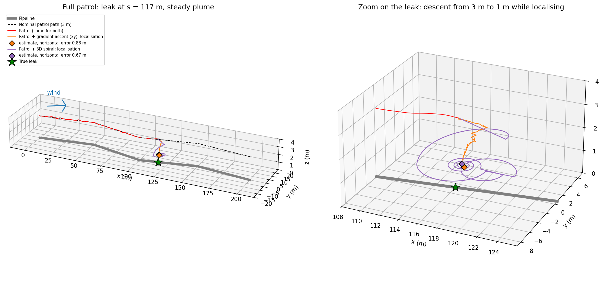
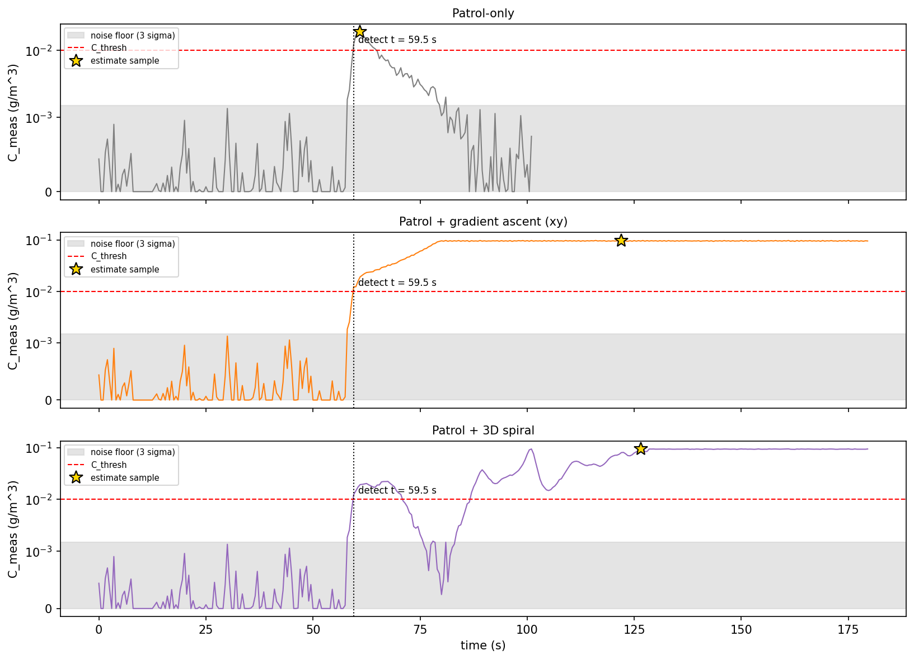
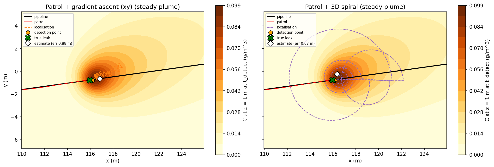
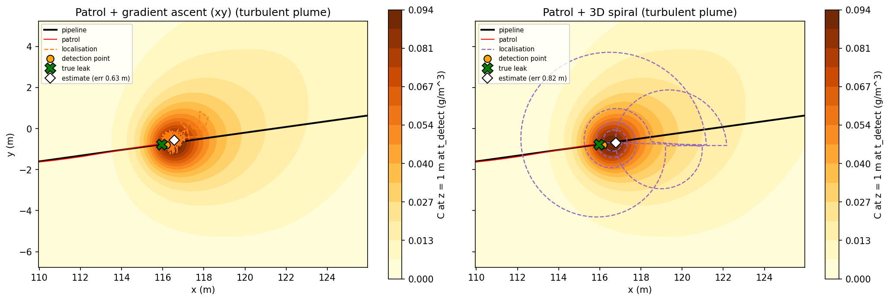
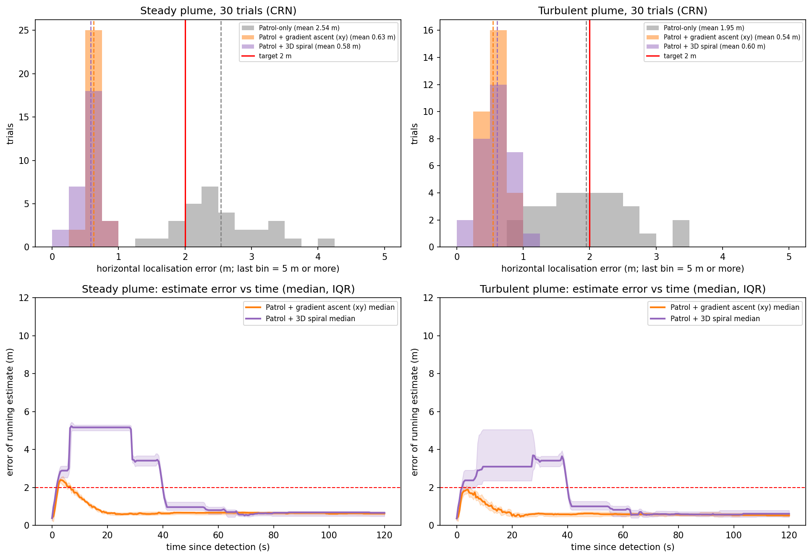
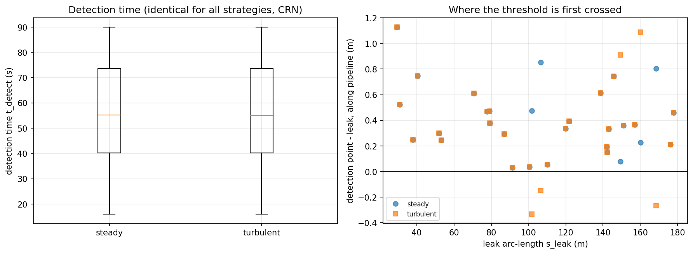
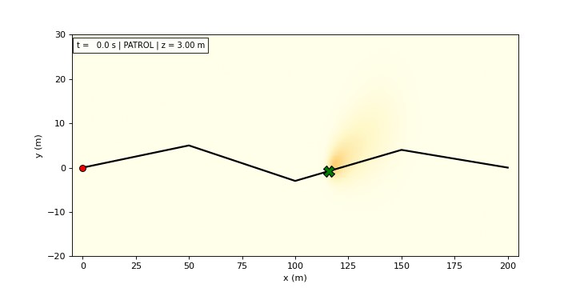

# S072 Oil Pipeline Leak Detection

**Domain**: Industrial & Agriculture | **Difficulty**: ⭐⭐ | **Status**: ✅ Completed

---

## Problem Definition

**Setup**: An oil pipeline lies on the ground (z = 0) as a polyline through five vertices, 201.5 m long. A drone patrols it 3 m above the centreline at 2 m/s, tracking it with three Frenet-frame PID loops (along-track speed, cross-track, vertical) that use GPS positions with 0.1 m noise. A leak somewhere on the pipeline emits a tracer at 1 g/s as discrete Gaussian puffs (0.5 g every 0.5 s) that diffuse ($D$ = 0.5 m²/s) and drift with a steady wind of (0.5, 0.2) m/s. The drone's chemical sensor reads every 0.5 s with noise σ = 5 × 10⁻⁴ g/m³; a reading above 0.01 g/m³ is a detection.

**Objective** (card): detect the leak during the patrol, localise it to within 2 m, and report the detection time, the localisation error and the false-alarm rate over a Monte Carlo of 30 trials.

**Comparison strategies** (card):
1. **Patrol-only**: finish the pass; the estimate is the GPS position of the highest reading of the whole patrol.
2. **Patrol + gradient ascent (xy)**: on detection, descend at 0.1 m/s to 1 m and fly at 1 m/s along the finite-difference concentration gradient (probes at ±0.5 m in x and y).
3. **Patrol + 3D spiral**: on detection, descend at 0.1 m/s to 1 m while flying shrinking circles at 1 m/s around the detection point; after each turn the centre moves to the best reading of that turn.

For strategies 2 and 3 the estimate is the GPS position of the highest reading from detection on (card). Each localisation phase lasts the card's 120 s budget.

**Monte Carlo**: 30 trials with the leak at a random arc length U(20, 180) m. The same random numbers (leak position, puff perturbations, sensor and GPS noise) are used for all three strategies. Two plume conditions: the card's **steady** plume, and a **turbulent** plume in which each puff gets its own constant wind perturbation N(0, 0.3²) m/s per horizontal axis, so the plume meanders.

---

## Mathematical Model Summary

### Patrol controller (Frenet frame)

On segment $i$ with unit tangent $\hat T_i$ and horizontal normal $\hat N_i = \hat T_i \times \hat z$, the measured position $\tilde{\mathbf p} = \mathbf p + \boldsymbol\eta_{GPS}$ gives the errors $e_N = (\tilde{\mathbf p} - \mathbf p_{nom})\cdot\hat N_i$ and $e_B = (\tilde{\mathbf p} - \mathbf p_{nom})\cdot\hat z$. The commanded acceleration is

$$\mathbf a = K_{p,T}(v_{patrol} - \mathbf v\cdot\hat T)\,\hat T - (K_{p,N}e_N + K_{d,N}\,\mathbf v\cdot\hat N + K_{i,N}\textstyle\int e_N)\,\hat N - (K_{p,B}e_B + K_{d,B}v_z)\,\hat z$$

### Puff plume

Puff $j$, released at $t_j$ from the leak $\mathbf r_0$, has centre $\mathbf r_0 + (\mathbf u + \delta\mathbf u_j)(t - t_j)$ ($\delta\mathbf u_j = 0$ in the steady plume) and contributes

$$C_j(\mathbf r, t) = \frac{Q_{puff}}{(4\pi D (t - t_j))^{3/2}} \exp\!\left(-\frac{\|\mathbf r - \mathbf r_j(t)\|^2}{4D(t - t_j)}\right)$$

Puffs are released every 0.5 s starting 60 s before the patrol begins (the leak is already running).

### Sensor and false alarms

$C_{meas} = \max(0, C + \eta)$, $\eta \sim \mathcal N(0, \sigma^2)$. The card's false-alarm probability per reading in clean air is

$$P_{FA} = 1 - \Phi(C_{thresh}/\sigma) = 1 - \Phi(20) = 2.75 \times 10^{-89}$$

### Gradient ascent

$\hat{\mathbf g} = (\hat\nabla_x C, \hat\nabla_y C, 0)/\|\cdot\|$ from central differences with $\delta$ = 0.5 m, updated every 0.5 s; $\mathbf v = v_{ascent}\hat{\mathbf g} - v_z\hat z$ until $z$ = 1 m.

### Spiral

Turn $n$ is a spiral whose radius shrinks from $r_n$ to $0.6\,r_n$ ($r_0$ = 5 m) at 1 m/s. After the turn the centre moves to the best reading of the turn and the drone flies to the start of the next turn. Below $r$ = 0.5 m the drone hovers at the best point.

### Error metric

Horizontal error $\varepsilon_h = \|\hat{\mathbf p}_{leak,xy} - \mathbf p_{leak,xy}\|$ (main metric) and the card's 3D error $\varepsilon = \|\hat{\mathbf p}_{leak} - \mathbf p_{leak}\|$. The 3D error includes the flight height (1 m while localising, 3 m on patrol).

---

## Key Parameters

| Parameter | Value |
|-----------|-------|
| Pipeline | 5 vertices, (0,0) → (50,5) → (100,−3) → (150,4) → (200,0) m; length 201.5 m |
| Nominal leak | arc length 117 m → (115.96, −0.77, 0) m |
| Patrol height / speed | 3.0 m / 2.0 m/s |
| GPS noise | σ = 0.1 m per axis, on the measured position |
| PID gains | along-track $K_p$ = 1.2; cross-track 2.0 / 0.8 / 0.1; vertical 2.5 / 1.0 |
| Puff mass / interval / emission rate | 0.5 g / 0.5 s / 1.0 g/s |
| Diffusion coefficient $D$ | 0.5 m²/s |
| Wind | (0.5, 0.2, 0) m/s |
| Sensor noise / threshold / sample interval | 5 × 10⁻⁴ / 0.01 g/m³ / 0.5 s |
| Gradient probe offset / ascent speed | 0.5 m / 1.0 m/s |
| Descent rate / localisation height / floor | 0.1 m/s / 1.0 m / 0.5 m (asserted) |
| Localisation budget | 120 s |
| Accuracy target | 2 m |
| Timestep | 0.05 s |
| Leak running before the patrol (added) | 60 s |
| Spiral: first radius / shrink per turn / end radius (added) | 5 m / 0.6 / 0.5 m |
| Turbulent plume: per-puff wind perturbation (added) | σ = 0.3 m/s per axis |
| Monte Carlo (added detail) | 30 trials per plume, leak at U(20, 180) m, seeds 2000–2029; nominal seed 42 |

---

## Implementation

```
src/04_industrial_agriculture/s072_pipeline_leak.py   # Main simulation script
```

```bash
conda activate drones
python src/04_industrial_agriculture/s072_pipeline_leak.py
```

Runtime ≈ 2.5 min (measured while other simulations shared the machine).

---

## Results

### Nominal case (leak at s = 117 m, seed 42)

The threshold is first crossed at **t = 59.5 s** at (116.18, −0.79, 3.01) m, 0.22 m past the leak along the pipeline. The patrol is identical for all strategies, so the detection is too.

| Plume | Strategy | Horizontal error | 3D error | Peak reading | Mission time |
|---|---|---:|---:|---:|---:|
| Steady | Patrol-only | 3.37 m | 4.55 m | 0.0187 | 101.4 s |
| Steady | Gradient ascent | 0.88 m | 1.29 m | 0.0975 | 179.5 s |
| Steady | 3D spiral | 0.67 m | 1.18 m | 0.0943 | 179.5 s |
| Turbulent | Patrol-only | 2.32 m | 3.63 m | 0.0155 | 101.4 s |
| Turbulent | Gradient ascent | 0.63 m | 1.27 m | 0.0992 | 179.5 s |
| Turbulent | 3D spiral | 0.82 m | 1.39 m | 0.0953 | 179.5 s |

Peak readings are in g/m³. No false alarms in any nominal run.

### Monte Carlo (30 trials per plume, common random numbers)

| Plume | Strategy | Horizontal error mean ± std (median, max) | Within 2 m | 3D error mean | Time until the estimate stays within 2 m (median, max) |
|---|---|---|---:|---:|---|
| Steady | Patrol-only | 2.54 ± 0.60 m (2.38, 4.00) | 5/30 | 3.95 m | — |
| Steady | Gradient ascent | 0.63 ± 0.10 m (0.63, 0.83) | 30/30 | 1.18 m | 7.5 s, 10.5 s |
| Steady | 3D spiral | 0.58 ± 0.18 m (0.66, 0.82) | 30/30 | 1.16 m | 40.0 s, 41.5 s |
| Turbulent | Patrol-only | 1.95 ± 0.64 m (1.92, 3.39) | 16/30 | 3.60 m | — |
| Turbulent | Gradient ascent | 0.54 ± 0.13 m (0.52, 0.83) | 30/30 | 1.15 m | 5.0 s, 8.0 s |
| Turbulent | 3D spiral | 0.60 ± 0.24 m (0.61, 1.14) | 30/30 | 1.18 m | 40.0 s, 41.5 s |

Paired comparisons (same trial):

| Plume | Gradient vs spiral, final error | Gradient vs spiral, time to 2 m | Gradient vs patrol-only | Spiral vs patrol-only |
|---|---|---|---|---|
| Steady | 15 – 15 | gradient faster in 30 | gradient better in 30 | spiral better in 30 |
| Turbulent | gradient better in 18, spiral in 12 | gradient faster in 30 | gradient better in 30 | spiral better in 29, patrol in 1 |

**Detection**: 30/30 leaks detected in both plumes. Detection times: mean 55.0 s, range 16.0–90.0 s (identical in both plumes, because the first crossing always happens right next to the source, where the young puffs barely feel the turbulence). The detection point lies −0.33 to +1.13 m along the pipeline from the leak (steady: mean +0.40 m; turbulent: mean +0.36 m).

**False alarms**: 0 readings above the threshold in clean air (true concentration below 0.001 g/m³) out of 5148 (steady) and 4876 (turbulent) distinct clean-air readings, consistent with $P_{FA} = 2.75\times10^{-89}$. Each plume has 20 491 distinct readings; the patrol readings up to the detection are identical for the three strategies and are counted once. 13 (steady) and 11 (turbulent) readings crossed the threshold where the true concentration was within 4σ below it; these are noise-shifted crossings at the plume edge, not false alarms.

**Key findings**:
- **The card's 2 m target is met by both localisation strategies in every trial** (30/30 in both plumes), with horizontal errors of about 0.6 m. The 3D error (about 1.2 m) is dominated by the 1 m flight height.
- **Patrol-only does not meet the target**: 5/30 (steady) and 16/30 (turbulent) within 2 m. At 3 m height the highest reading is downwind of the leak, so the estimate is biased downwind by about 2.5 m.
- **The detection point alone is already within 2 m** in 30/30 trials of each plume (mean horizontal error 0.43 m steady, 0.44 m turbulent). With the card's parameters the plume at 3 m height is only just above the threshold directly above the source, so the threshold is first crossed within about 1 m of the leak. In this model the localisation phase does not improve the horizontal error on average (steady plume: 0.43 m at detection, 0.63 m after gradient ascent, 0.58 m after the spiral). Its value is the low-altitude confirmation reading (nominal-case peaks 0.094–0.099 g/m³, against the 0.01 g/m³ threshold), not a better position.
- **The card's expectation that the 3D spiral is more robust in a noisy plume did not hold.** Final errors are a tie in the steady plume (15–15) and slightly favour gradient ascent in the turbulent plume (18–12; means 0.54 vs 0.60 m). Gradient ascent also settles within 2 m much sooner (median 5.0–7.5 s vs 40.0 s, faster in all 30 paired trials of both plumes): the spiral's first 5 m-radius turn, flown while descending, records high readings downwind of the leak, and its estimate only returns after the second re-centring. The turbulence model here (a fixed random velocity per puff) is mild near the source, so this test does not rule out an advantage of the spiral under stronger intermittency.
- **False alarms are impossible at the card's noise level**: the threshold is 20 σ above zero. The false-alarm rate is therefore not a discriminating metric for these strategies.

### 3D Scene

Left: the full patrol (grey pipeline, dashed nominal path at 3 m, red patrol track) with the localisation tracks of the two strategies and the true leak (green star). Right: zoom on the leak showing the descent from 3 m to 1 m, the gradient-ascent track (orange) and the spiral turns (purple):



### Concentration Time Series

Readings of the three strategies in the nominal steady case (symmetric log scale). Grey band: 3σ noise floor; red dashed line: threshold; dotted line: detection; gold star: the reading used as the estimate:



### Plan View

Concentration at z = 1 m at the moment of detection, with the patrol (red), the detection point (orange dot), the localisation track (dashed), the true leak (green X) and the estimate (white diamond). Steady plume:



Turbulent plume (same seed):



### Monte Carlo Statistics

Top: histograms of the horizontal error (dashed lines: means; red line: 2 m target). Bottom: error of the running estimate after detection, median and interquartile range over the 30 trials:



### Detection Statistics

Left: detection time per plume. Right: where the threshold is first crossed, along the pipeline relative to the leak:



### Animation

Top-down view of the nominal steady case (145 frames). During the patrol the whole pipeline is shown with the plume at the drone's height; after detection the view zooms on the leak and shows the gradient-ascent drone (red) and the spiral drone (purple) at the same time; the white diamond is the gradient-ascent estimate:



### Deviations from the scenario card

| Card | Implementation | Reason |
|------|----------------|--------|
| Pipeline length 200 m | 201.5 m | Length of the card's five vertices. Card parameter table corrected. |
| GPS noise added to the true position each step (card code) | Added to the measured position only | Adding it to the true position makes the drone jump randomly by 0.1 m per axis every 0.05 s. Card clarified. |
| Along-track law $a_T = K_{p,T}(v - \dot s) - K_{d,T}\,\dot s$ (code) | $a_T = K_{p,T}(v - \dot s)$; $K_{d,T}$ unused | The extra term settles the patrol speed at $v K_{p,T}/(K_{p,T} + K_{d,T})$ = 1.5 m/s instead of 2 m/s (analytic, not printed). |
| Cross-track derivative by finite difference of the error | $K_{d,N}\,\mathbf v\cdot\hat N$ (velocity feedback) | The finite difference of a measurement with 0.1 m noise every 0.05 s would inject noise of std $\sqrt2 \cdot 0.1/0.05 \approx 2.8$ m/s into the derivative (analytic). |
| Sensor sampled every timestep (code) | Every 0.5 s (card's $\Delta t$) | The card's stated sampling interval. |
| Leak and patrol start together | Leak running 60 s before the patrol | A leak found on patrol has usually been running for a while; with a common start a leak at s = 20 m would have a 10 s-old plume. |
| Descend toward $z_{min}$ = 0.5 m | Descend to 1 m in both localisation strategies; 0.5 m kept as an asserted floor | The strategy descriptions say "descends to z = 1 m". |
| 3D spiral: "inward spiral with decreasing radius" (no parameters) | First radius 5 m, ×0.6 per turn, re-centre on the best reading of each turn, stop below 0.5 m | Added parameters; the card gives no spiral details. |
| "More robust in noisy plume conditions" | Added a turbulent plume (per-puff wind perturbation σ = 0.3 m/s) | The card's plume has no turbulence, so robustness could not be tested otherwise. |
| Localisation error $\varepsilon$ in 3D | Both 3D and horizontal; horizontal is the main metric | The 3D error is bounded below by the flight height, so patrol-only (3 m) could never reach 2 m by construction. |
| Gradient probes at ±0.5 m (four extra readings at once) | Same, read every 0.5 s | Physically this needs a cross of four sensors on 0.5 m booms (or a hovering probe pattern); assumed here as in the card. |
| False alarm "noise alone exceeds threshold" | Counted readings above the threshold where the true concentration is below 0.001 g/m³ | Readings at the plume edge that are pushed over the threshold by noise are reported separately (13 per plume). |
| True leak as a red sphere; detection markers | Leak green, drone tracks red | Project colour convention (target green). |
| GIF `s072_patrol.gif` | `animation.gif` | Project naming convention. |

---

## Extensions

1. **Stronger intermittency**: a filament-based or meandering plume with dropouts, where single readings are unreliable; repeat the gradient vs spiral comparison.
2. **Lower emission or higher threshold**: move the detection point away from the source so that the localisation phase matters.
3. **Multiple leaks** with a priority queue sorted by measured concentration.
4. **Particle-filter source estimate** fusing all readings and the wind (as in S045), instead of the argmax position.
5. **Two drones** patrolling from opposite ends and sharing readings.

---

## Related Scenarios

- Prerequisites: [S045 Chemical Plume Tracing](../../../scenarios/03_environmental_sar/S045_plume_tracing.md), [S056 Nuclear Plant Leak Detection (Radiation Hotspot Localization)](../../../scenarios/03_environmental_sar/S056_radiation.md)
- Cross-reference: [S061 Power Line Inspection](../../../scenarios/04_industrial_agriculture/S061_power_line.md), [S071 Bridge Underside Structural Inspection](../../../scenarios/04_industrial_agriculture/S071_bridge_inspection.md), [S073 Solar Panel Thermal Imaging Inspection](../../../scenarios/04_industrial_agriculture/S073_solar_thermal.md)
