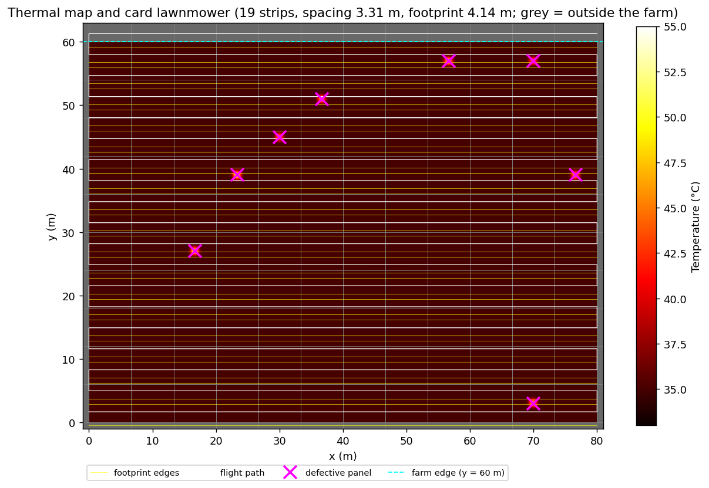
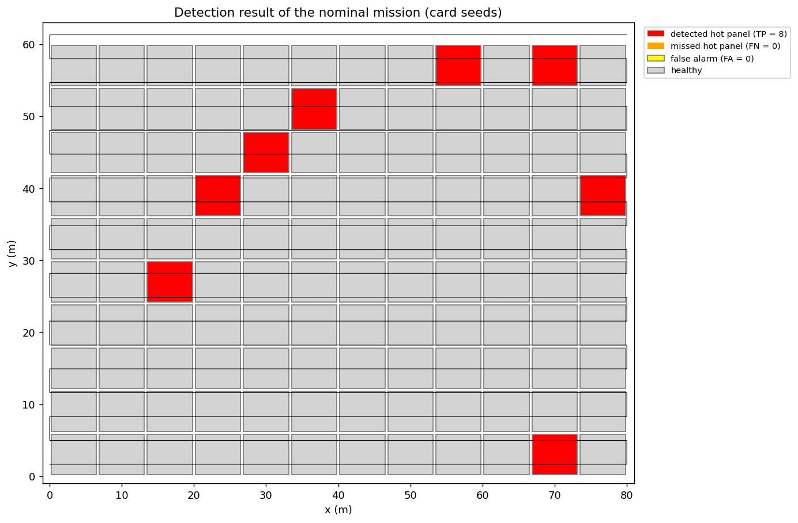
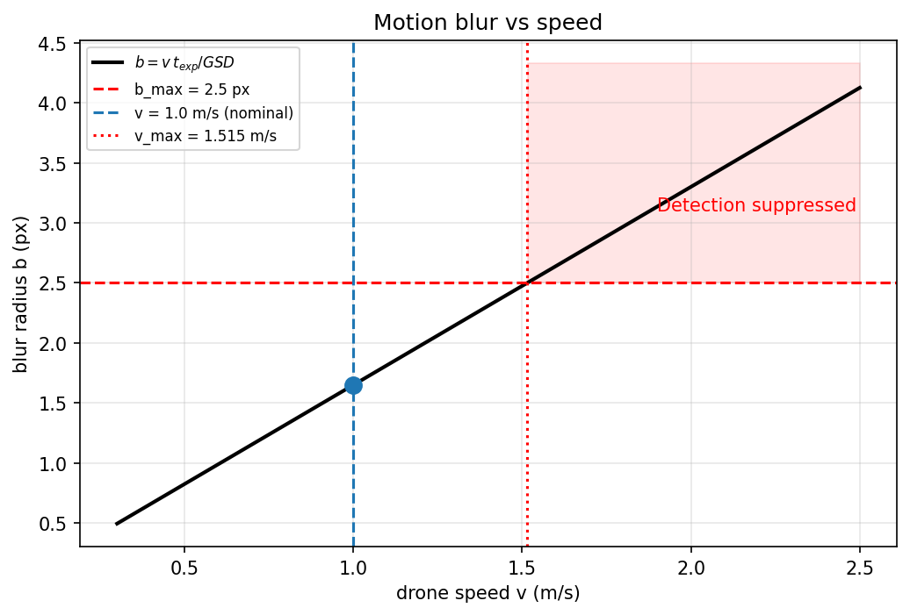
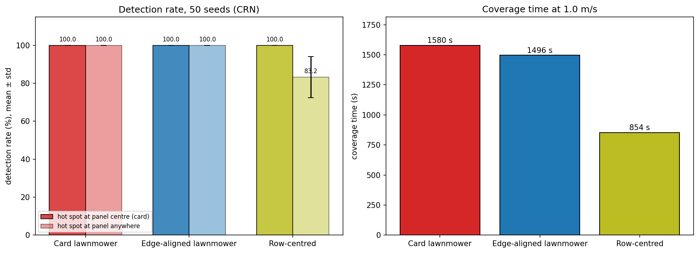
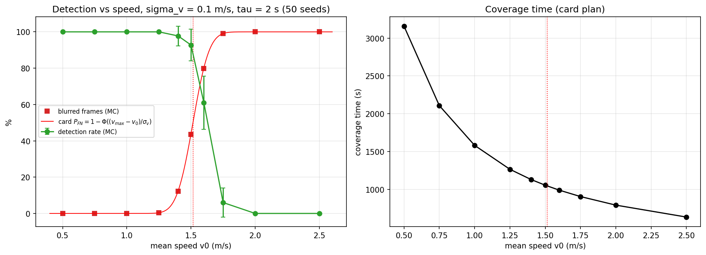
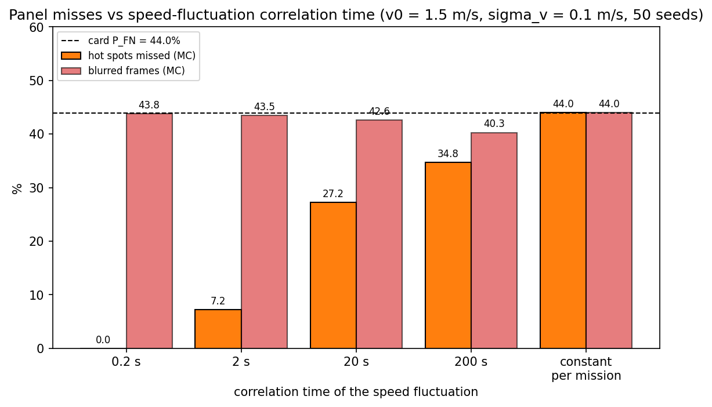
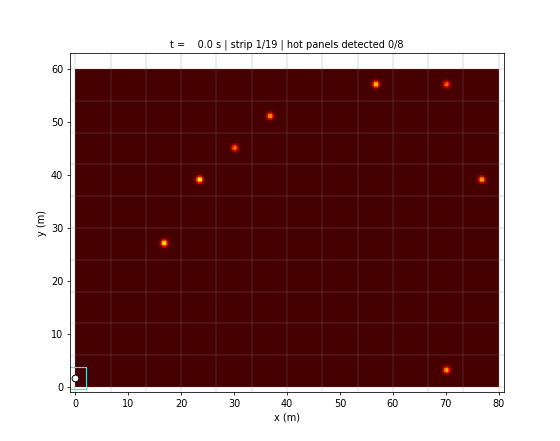

# S073 Solar Panel Thermal Imaging Inspection

**Domain**: Industrial & Agriculture | **Difficulty**: ⭐ | **Status**: ✅ Completed

---

## Problem Definition

**Setup**: A drone inspects an 80 × 60 m solar farm of 120 panels (10 rows × 12 columns, each panel cell 6.67 × 6.0 m) with a nadir thermal camera (45° FOV) at 5 m altitude and 1.0 m/s. It flies a boustrophedon with 20 % cross-track overlap. Eight randomly chosen panels carry a Gaussian hot spot (σ = 0.4 m) 10–20 °C above the 35 °C nominal temperature. A panel is flagged when a frame shows a reading above 35 + 8 °C while the motion blur is below 2.5 px.

**Objective** (card): fly the full lawnmower and report the detection rate, the false-alarm count, the coverage time and the false-negative probability caused by motion blur.

**Questions studied**:
1. **Nominal mission** with the card's plan, seeds and constant 1.0 m/s.
2. **Plan comparison** (50 seeds, common random numbers: same defective panels, ΔT and hot-spot positions for every plan): the card's 19-strip lawnmower, an edge-aligned 18-strip lawnmower, and a 10-strip plan flown along the centre of each panel row. Two hot-spot models: at the panel centre (card) or anywhere on the panel.
3. **Speed sweep** (50 seeds) with wind-induced speed fluctuations (σ_v = 0.1 m/s, the card's P_FN model): detection rate and blurred frames for mean speeds 0.5–2.5 m/s.
4. **Correlation time of the speed fluctuation** (50 seeds, v₀ = 1.5 m/s): from 0.2 s up to one random speed per mission, which is the card's assumption.

---

## Mathematical Model Summary

### Footprint and strips

$$w_{foot} = 2h\tan(\theta_{FOV}/2) = 4.142\ \text{m}, \qquad d = w_{foot}(1 - \rho) = 3.314\ \text{m}$$

| Plan | Strip centres | Strips | Path |
|---|---|---:|---:|
| Card lawnmower | $y_i = (i + \tfrac12)d$ | 19 (y = 1.66 … 61.30 m) | 1579.6 m |
| Edge-aligned lawnmower | $y_i = w_{foot}/2 + i\,d$, last clamped to $W - w_{foot}/2$ | 18 (y = 2.07 … 57.93 m) | 1495.9 m |
| Row-centred | one strip along the centre of each panel row | 10 (y = 3.00 … 57.00 m) | 854.0 m |

The two lawnmowers image 100.0 % of the farm area; the row-centred plan images 69.0 % (exact union of the strip footprints).

### Detection

A hot spot at $(x_h, y_h)$ is in the frame when $|x_d - x_h| \le w_{foot}/2$ and $|y_d - y_h| \le w_{foot}/2$ (square footprint). The frame reading is (card)

$$T_{meas} = T_{nominal} + \Delta T_j\, e^{-\sigma_{GPS}^2/2\sigma_{hot}^2} + \mathcal N(0, \sigma_T^2), \qquad e^{-\sigma_{GPS}^2/2\sigma_{hot}^2} = 0.9692$$

and the panel is detected on the first frame with $T_{meas} > T_{nominal} + 8$ °C and $b < b_{max}$. A healthy panel is a false alarm if a frame with its centre in view reads above the threshold. One frame per timestep (0.1 s).

### Motion blur

$$b = \frac{v\,t_{exp}}{GSD}, \qquad v_{max} = \frac{b_{max}\,GSD}{t_{exp}} = 1.515\ \text{m/s}$$

With a fluctuating speed $v = v_0 + \delta v$, $\delta v \sim \mathcal N(0, \sigma_v^2)$, the card's false-negative probability is the probability that a frame is blurred:

$$P_{FN} = 1 - \Phi\!\left(\frac{v_{max} - v_0}{\sigma_v}\right)$$

In the sweep, $\delta v$ is a first-order Gauss–Markov process with σ_v = 0.1 m/s and correlation time τ_v = 2 s, and the drone advances along the path at the fluctuating speed. The card's formula treats $v$ as a single random value; under that assumption ("constant per mission", τ_v → ∞) a mission is either entirely blurred or not, and $P_{FN}$ is also the per-panel miss probability.

---

## Key Parameters

| Parameter | Value |
|-----------|-------|
| Farm / panels | 80 × 60 m, 10 rows × 12 columns (6.667 × 6.0 m per panel) |
| Defective panels | 8 |
| Altitude / FOV | 5.0 m / 45° → footprint 4.142 m |
| Overlap / strip spacing | 20 % / 3.314 m |
| Nominal speed | 1.0 m/s |
| GPS error (pointing attenuation) | 0.1 m → factor 0.9692 |
| Nominal temperature / hot-spot excess | 35 °C / U(10, 20) °C |
| Detection threshold | 8 °C above nominal |
| Hot-spot spread σ_hot | 0.4 m |
| Thermal noise σ_T | 0.5 °C |
| Exposure / GSD / max blur | 0.033 s / 0.02 m/px / 2.5 px → v_max = 1.515 m/s |
| Speed fluctuation σ_v | 0.1 m/s |
| Timestep (frame interval) | 0.1 s |
| Nominal seeds | defects 42, noise 0 (card) |
| Speed-fluctuation correlation time (added) | 2 s |
| Monte Carlo (added) | 50 seeds (3000–3049) per plan / model / speed |
| Hot spot anywhere on the panel (added) | uniform within the panel, 0.4 m from its edges |
| Speeds swept (added) | 0.5, 0.75, 1.0, 1.25, 1.4, 1.5, 1.6, 1.75, 2.0, 2.5 m/s |
| Correlation times compared (added) | 0.2, 2, 20, 200 s and one speed per mission, at v₀ = 1.5 m/s |

---

## Implementation

```
src/04_industrial_agriculture/s073_solar_thermal.py   # Main simulation script
```

```bash
conda activate drones
python src/04_industrial_agriculture/s073_solar_thermal.py
```

Runtime ≈ 1–2 min (measured while other simulations shared the machine).

---

## Results

### Nominal mission (card plan, card seeds, constant 1.0 m/s)

| Metric | Value |
|---|---|
| Strips / path | 19 / 1579.6 m |
| Coverage time | 1579.7 s (26.33 min) |
| Blur at 1.0 m/s | 1.650 px (limit 2.5 px); blurred frames 0.0 % |
| Defective panels | 10, 50, 75, 83, 88, 101, 116, 118 (ΔT = 11.3, 14.5, 13.7, 19.3, 16.4, 18.2, 14.4, 12.3 °C) |
| Detection rate | 8/8 = 100.0 % |
| False alarms / false negatives | 0 / 0 |
| Frames with each hot spot in view | 41 to 82 |
| Hottest healthy-panel reading | 37.13 °C (threshold 43 °C) |
| Card P_FN at v₀ = 1.0 m/s, σ_v = 0.1 m/s | 1 − Φ(5.15) = 1.29 × 10⁻⁷ |

### Plan comparison (50 seeds, constant 1.0 m/s, common random numbers)

| Hot spot | Plan | Detection mean ± std | Seeds with 8/8 | False alarms | Coverage time |
|---|---|---|---:|---:|---:|
| Panel centre (card) | Card lawnmower | 100.0 ± 0.0 % | 50/50 | 0 | 1579.7 s |
| Panel centre (card) | Edge-aligned lawnmower | 100.0 ± 0.0 % | 50/50 | 0 | 1495.9 s |
| Panel centre (card) | Row-centred | 100.0 ± 0.0 % | 50/50 | 0 | 854.0 s |
| Anywhere on the panel | Card lawnmower | 100.0 ± 0.0 % | 50/50 | 0 | 1579.7 s |
| Anywhere on the panel | Edge-aligned lawnmower | 100.0 ± 0.0 % | 50/50 | 0 | 1495.9 s |
| Anywhere on the panel | Row-centred | 83.2 ± 10.8 % | 7/50 | 0 | 854.0 s |

Paired row-centred vs card lawnmower: hot spot at the centre, 50 ties; hot spot anywhere, the card plan is better in 43 seeds and tied in 7.

### Speed sweep (card plan, hot spots at panel centres, σ_v = 0.1 m/s, 50 seeds)

| v₀ (m/s) | Card P_FN (blurred-frame probability) | Blurred frames (MC) | Detection mean ± std | Seeds with 8/8 | Missed hot spots (all had every frame blurred) | Coverage time |
|---:|---:|---:|---|---:|---:|---:|
| 0.50 | 1.63e-24 | 0.00 % | 100.0 ± 0.0 % | 50/50 | 0 (0.00 %) | 3159.5 s |
| 0.75 | 9.93e-15 | 0.00 % | 100.0 ± 0.0 % | 50/50 | 0 (0.00 %) | 2108.1 s |
| 1.00 | 1.29e-07 | 0.00 % | 100.0 ± 0.0 % | 50/50 | 0 (0.00 %) | 1581.4 s |
| 1.25 | 4.01e-03 | 0.40 % | 100.0 ± 0.0 % | 50/50 | 0 (0.00 %) | 1264.6 s |
| 1.40 | 1.25e-01 | 12.27 % | 97.8 ± 5.4 % | 42/50 | 9 (2.25 %) | 1129.1 s |
| 1.50 | 4.40e-01 | 43.46 % | 92.8 ± 8.7 % | 26/50 | 29 (7.25 %) | 1054.0 s |
| 1.60 | 8.02e-01 | 79.77 % | 61.0 ± 14.7 % | 0/50 | 156 (39.00 %) | 988.2 s |
| 1.75 | 9.91e-01 | 99.10 % | 6.0 ± 8.0 % | 0/50 | 376 (94.00 %) | 903.5 s |
| 2.00 | 1.00e+00 | 100.00 % | 0.0 ± 0.0 % | 0/50 | 400 (100.00 %) | 790.3 s |
| 2.50 | 1.00e+00 | 100.00 % | 0.0 ± 0.0 % | 0/50 | 400 (100.00 %) | 632.3 s |

Missed panels are summed over 50 seeds × 8 panels = 400 hot spots.

**Key findings**:
- **At the card's operating point every metric is fixed by construction**: 8/8 detected, 0 false alarms, 0 false negatives, in all 50 seeds. The weakest possible hot spot reads (10 × 0.9692 − 8) / 0.5 = 3.38 σ above the threshold in every frame and is seen in at least 41 frames, a healthy panel would need a 16 σ noise excursion to be flagged, and at 1.0 m/s the blur (1.650 px) is far below the 2.5 px limit. The card's expectations (no blur misses at 1.0 m/s, P_FN ≈ 0) hold, but they cannot discriminate between plans or settings.
- **The card's lawnmower flies a strip outside the farm.** Its 19th strip is centred at y = 61.30 m. An edge-aligned plan needs 18 strips and saves 83.8 s (5.3 %; 1579.7 → 1495.9 s) with identical detection in every seed.
- **Where the hot spots are decides how sparse the plan may be.** With hot spots at the panel centres (the card's model), one strip along each panel row finds all of them in 854.0 s, 725.7 s (45.9 %) less than the card plan. If a hot spot can be anywhere on the panel, the same plan sees only 69.0 % of the area and detects 83.2 ± 10.8 % (8/8 in only 7 of 50 seeds), while both lawnmowers still detect 100 %. Full-area coverage is only worth its cost when defects are not at known positions.
- **Blur sets a sharp speed limit.** Detection stays at 100 % up to v₀ = 1.25 m/s and collapses between 1.5 and 1.75 m/s (92.8 % → 6.0 %, with τ_v = 2 s). Every miss in the sweep was a hot spot whose frames were all blurred; none was caused by thermal noise.
- **Whether the card's P_FN is also the panel-miss rate depends on how fast the speed fluctuates.** The card formula always predicts the blurred-frame fraction (0.440 at 1.5 m/s; measured 40.30–44.00 % for every correlation time). A panel, however, is missed only if all of its frames are blurred (41–82 frames per hot spot in the nominal run). At v₀ = 1.5 m/s the share of missed hot spots is 0.00 % for τ_v = 0.2 s, 7.25 % for 2 s, 27.25 % for 20 s, 34.75 % for 200 s and 44.00 % with one random speed per mission, which equals the card's P_FN. So under the card's own assumption its formula is the panel-miss probability; it overstates panel misses only when the speed decorrelates within the few seconds a panel is in view. The speed-sweep numbers above use τ_v = 2 s and are therefore the optimistic end.
- **Speed is free up to 1.25 m/s.** Coverage time falls from 1581.4 s at 1.0 m/s to 1264.6 s at 1.25 m/s with 100 % detection; at 1.5 m/s it is 1054.0 s but detection drops to 92.8 %.

### Thermal Map with Flight Path

False-colour thermal map (`hot` colormap), panel grid in grey, defective panels as magenta crosses, the card lawnmower in white and the camera footprint edges in yellow. Grey background is outside the farm; the 19th strip runs there, at y = 61.30 m:



### Detection Results

Panels after the nominal mission: detected hot panels red, missed hot panels orange (none), false alarms yellow (none), healthy panels grey; the flight path in black:



### Blur vs Speed

Blur radius against speed, with the 2.5 px limit, the nominal speed and the critical speed 1.515 m/s:



### Plan Comparison

Left: detection rate per plan for the two hot-spot models (dark: panel centre; light: anywhere). Right: coverage time:



### Speed Sweep

Left: detection rate (green), measured blurred-frame fraction (red squares) and the card's P_FN curve. Right: coverage time:



### Correlation Time of the Speed Fluctuation

Hot spots missed (orange) and blurred frames (red) at v₀ = 1.5 m/s for correlation times from 0.2 s to one random speed per mission; dashed line: the card's P_FN:



### Animation

The nominal mission (133 frames, one every 12 s of flight): the drone (white) with its footprint (cyan) sweeps the thermal map; a detected panel gets a red frame; the title shows the strip and the number of detected panels:



### Deviations from the scenario card

| Card | Implementation | Reason |
|------|----------------|--------|
| In-view test $|x_d - x_p| \le L_{panel}/2$ (3.33 m) along track | $|x_d - x_h| \le w_{foot}/2$ (2.07 m), square footprint | The panel half-length is wider than the image; the card's test counts a panel as seen before it enters the frame. Card annotated. |
| In-view test uses the GPS-noisy position | Uses the true position | The camera images where the drone actually is; GPS noise enters only through the card's pointing attenuation factor (kept). |
| $y_i = (i + \tfrac12)d$, 19 strips | Kept as the card plan; an 18-strip edge-aligned plan added | The 19th strip lies 1.30 m outside the farm. Card annotated. |
| Single nominal run | 50-seed plan comparison, a second hot-spot model, and a 50-seed speed sweep | The nominal metrics are fixed by construction (100 % / 0 / 0) and cannot answer which plan or speed is better. |
| $P_{FN}$ with $v \sim \mathcal N(v_0, \sigma_v^2)$, one value (no time structure) | Gauss–Markov speed fluctuation, correlation time 2 s (added) in the speed sweep; correlation times 0.2 s to "one speed per mission" compared at 1.5 m/s | The card's assumption is the "per mission" case, where its formula gives the panel-miss rate exactly (44.00 %); shorter correlation times lower the panel-miss rate. |
| Row-centred plan, hot spot anywhere on the panel | Added | Not in the card; tests whether full-area coverage is needed. |
| Defective panels shown with magenta crosses; drone white | Same | Card's colours kept (no pursuer/evader roles here). |
| GIF `s073_animation.gif` | `animation.gif` | Project naming convention. |

---

## Extensions

1. **Altitude trade-off**: sweep 3–15 m; a larger footprint needs fewer strips but a coarser GSD lowers the blur limit and the hot-spot contrast.
2. **Adaptive re-scan** of borderline panels at lower speed.
3. **Defect-severity model**: ΔT from a continuous degradation level; choose the threshold that maximises F1.
4. **Several drones** on separate row bands.
5. **Tilted panels**: elliptical footprint projection on 20° panels.

---

## Related Scenarios

- Prerequisites: [S048 Full-Area Coverage Scan (Lawnmower)](../../../scenarios/03_environmental_sar/S048_lawnmower.md), [S052 Glacier Melt Area Measurement](../../../scenarios/03_environmental_sar/S052_glacier.md)
- Follow-ups: [S062 Wind Turbine Blade Inspection](../../../scenarios/04_industrial_agriculture/S062_wind_turbine.md), [S061 Power Line Inspection](../../../scenarios/04_industrial_agriculture/S061_power_line.md)
- Cross-reference: [S067 Spray Coverage Overlap Optimization](../../../scenarios/04_industrial_agriculture/S067_spray_overlap.md), [S072 Oil Pipeline Leak Detection](../../../scenarios/04_industrial_agriculture/S072_pipeline_leak.md), [S071 Bridge Underside Structural Inspection](../../../scenarios/04_industrial_agriculture/S071_bridge_inspection.md)
