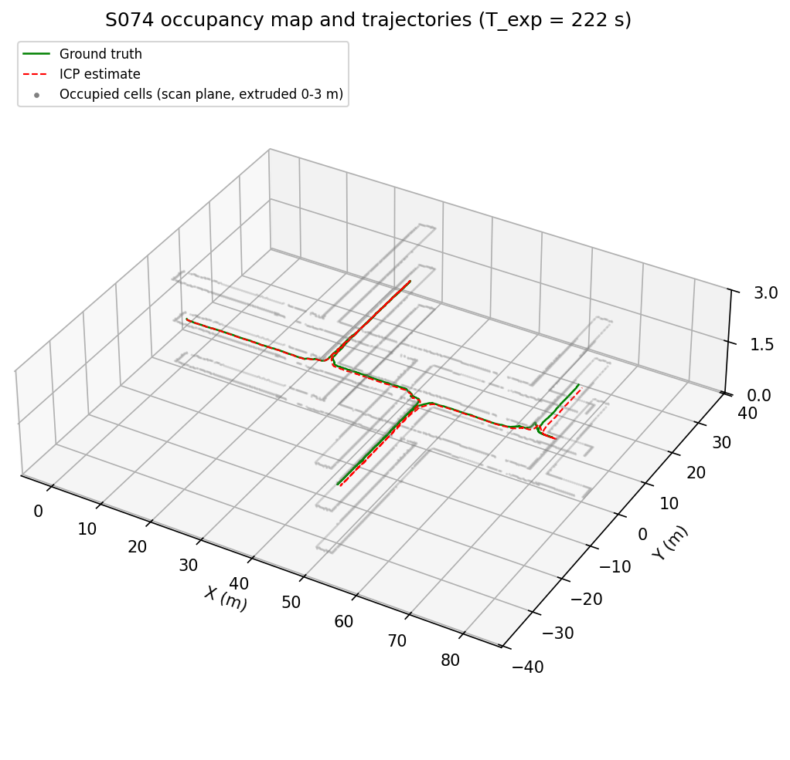
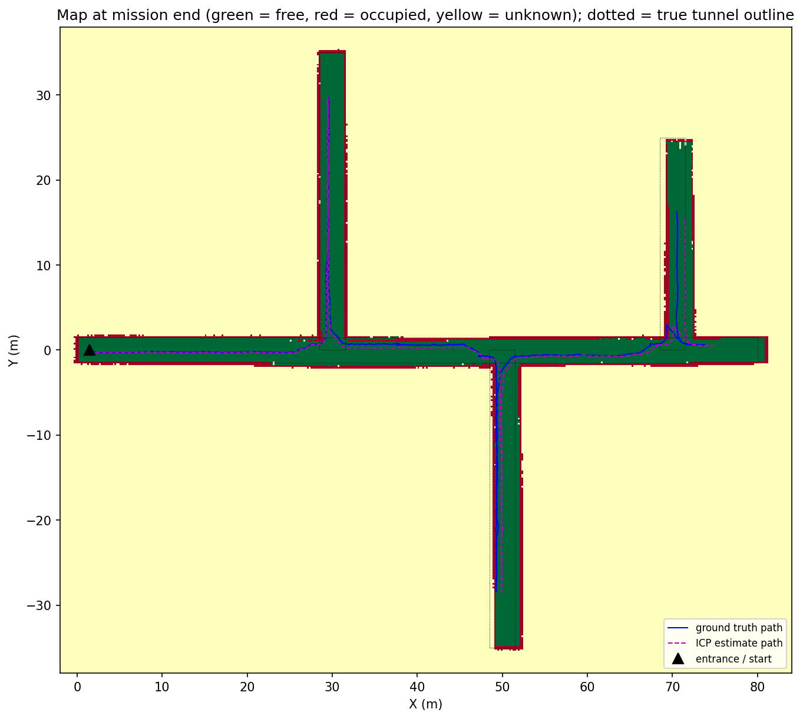
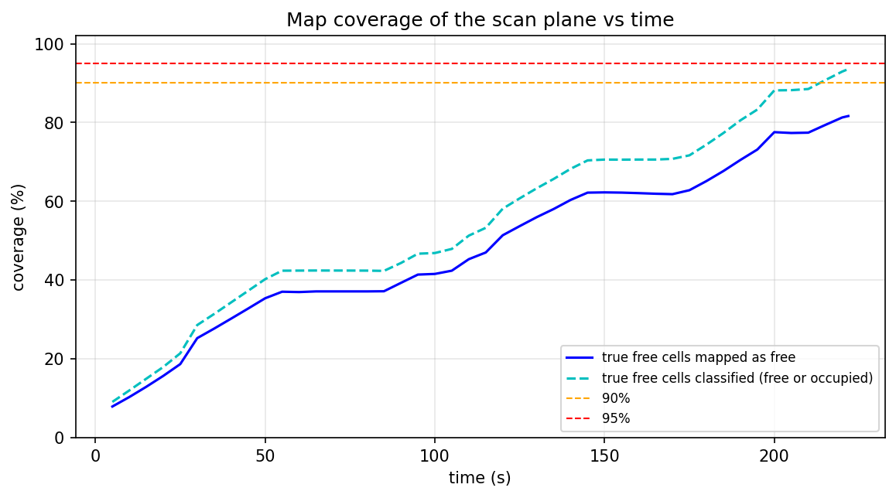
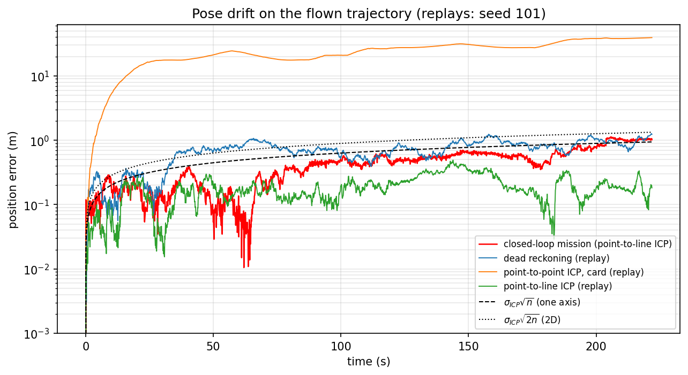
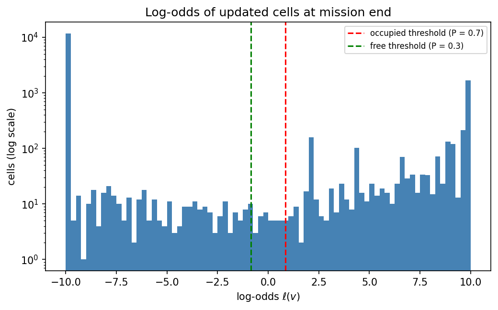
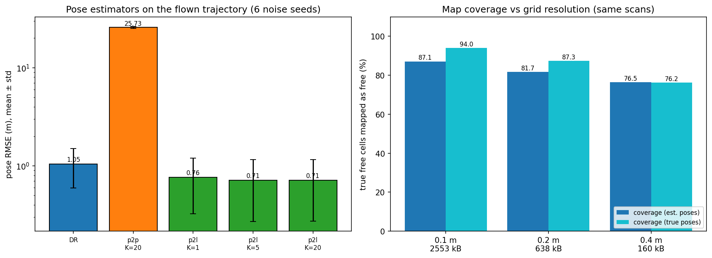
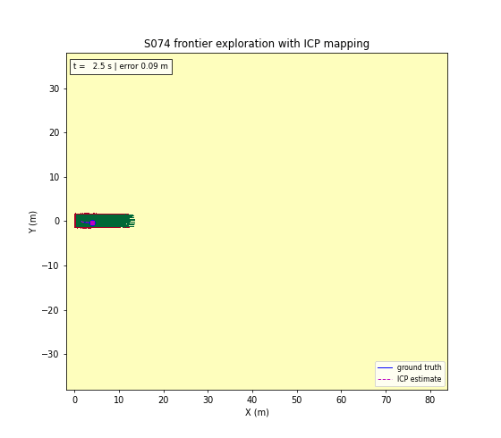

# S074 Mine 3D Mapping

**Domain**: Industrial & Agriculture | **Difficulty**: ⭐⭐⭐⭐ | **Status**: ✅ Completed

---

## Problem Definition

**Setup**: A drone enters an underground mine at (1.5, 0) m. The network is a main corridor 80 m long along +x with three branches: A (+y, 35 m) at x = 30 m, B (−y, 35 m) at x = 50 m and C (+y, 25 m) at x = 70 m, all with a 3 × 3 m cross-section; 175 m of centreline in total. There is no GPS. The drone flies at a constant 1.5 m height with a horizontal 360° LiDAR (180 beams, 10 m range, σ = 0.05 m). It estimates its pose by scan-to-scan ICP seeded with an odometry prior, builds a log-odds occupancy grid (0.2 m cells) and explores by flying to the nearest frontier cluster until no reachable frontier is left.

**Objective** (card): map the network and report map coverage, pose RMSE, exploration time, and the sensitivity of pose drift to the ICP iteration count and the grid resolution.

**What is compared**:
1. **Closed-loop mission** with point-to-line ICP fused with the odometry prior.
2. **Pose estimators on the flown trajectory** (replay with the same scans geometry and fresh noise, 6 seeds, common random numbers): dead reckoning (odometry and gyro only), the card's point-to-point ICP (SVD), and point-to-line ICP with 1, 5 and 20 iterations.
3. **Grid resolution** 0.1 / 0.2 / 0.4 m: the map rebuilt from the same scans, once with the estimated poses and once with the true poses.

---

## Mathematical Model Summary

### Tunnels and LiDAR

A point is free if it lies inside one of the four axis-aligned rectangles (half-width 1.5 m). The x < 0 end is closed rock. Each beam's range is the exact exit distance of the ray from the union of rectangles, plus $\mathcal N(0, 0.05^2)$; beams with no wall within 10 m return nothing.

### Motion and odometry prior

The drone does not yaw (true heading 0). Each 0.1 s step it executes its body-frame velocity command plus process noise, $\Delta\mathbf p = \mathbf v_{body}\Delta t + \mathbf w$, $\mathbf w \sim \mathcal N(0, \sigma_{ICP}^2 I)$ with the card's $\sigma_{ICP}$ = 0.02 m. The odometry prior is the commanded displacement $\mathbf v_{body}\Delta t$ (error $-\mathbf w$) and a gyro yaw increment with noise $\sigma_g$ = 10⁻⁴ rad per step. Dead reckoning integrates only this prior, so its error is a random walk of $\sigma_{ICP}\sqrt n$ per axis, the card's drift model.

### ICP

The current scan $\{\mathbf s_i\}$ is aligned to the previous one $\{\mathbf q_j\}$ in SE(2), starting from the prior $x_0 = (\mathbf t_0, \theta_0)$. Correspondences are nearest neighbours closer than 0.5 m.

- **Point-to-point (card)**: SVD (Kabsch) step with reflection guard, repeated until the mean residual changes by less than $10^{-4}$ m or 20 iterations.
- **Point-to-line (main)**: normals $\mathbf n_j$ from a PCA of the returns within 0.6 m of $\mathbf q_j$ (at least 4); Gauss–Newton on

$$\sum_i \frac{\big(\mathbf n_{j(i)}\cdot(R(\theta)\mathbf s_i + \mathbf t - \mathbf q_{j(i)})\big)^2}{\sigma_{pl}^2} + (x - x_0)^\top P_0^{-1}(x - x_0), \quad \sigma_{pl} = \sqrt2\,\sigma_r,\ P_0 = \mathrm{diag}(\sigma_{ICP}^2, \sigma_{ICP}^2, \sigma_g^2)$$

  In directions the walls do not constrain (along a straight corridor) the prior is kept.

The pose is composed as $\hat{\mathbf p} \leftarrow \hat{\mathbf p} + R(\hat\theta)\mathbf t$, $\hat\theta \leftarrow \hat\theta + \theta$.

### Occupancy grid (card)

Log-odds per 0.2 m cell, $\ell_{occ} = \log 9$ at a return, $\ell_{free} = \log(2/3)$ at samples every 0.2 m along the beam up to the return (beams without return: up to 10 m, no hit), clamped to [−10, 10]. Free if $P < 0.3$, occupied if $P > 0.7$.

### Frontier exploration

Frontier cells are unknown cells next to a free cell, grouped by 8-connectivity; clusters smaller than 8 cells are ignored. A Dijkstra search over free cells (never within 0.4 m of an occupied cell; cost ×5 within 0.6 m) gives the path to the nearest cluster. The drone follows it at 1 m/s with a 0.6 m look-ahead, stops 0.5 m before the goal and replans every 2 s, keeping its current goal while it is still a reachable frontier goal. Frontier cells within 1 m of a reached goal that are still unknown are ignored afterwards (they cannot be seen from the tunnel). A reactive filter on the raw LiDAR returns removes velocity toward any return closer than 0.7 m.

### Metrics

Coverage $\xi$ = share of the true free cells of the scan plane that the map (in its own, drifted frame) classifies as free; also the share classified as free or occupied. Pose RMSE $= \sqrt{\frac1N\sum_k\|\hat{\mathbf p}_k - \mathbf p_k\|^2}$.

---

## Key Parameters

| Parameter | Value |
|-----------|-------|
| Network | main 80 m (+x), branches 35 m (+y, x = 30), 35 m (−y, x = 50), 25 m (+y, x = 70); 175 m total |
| Cross-section | 3 × 3 m (half-width 1.5 m) |
| LiDAR | 180 beams, 360°, 10 m, σ_r = 0.05 m |
| ICP | ≤ 20 iterations, stop at Δ(mean residual) < 10⁻⁴ m |
| Odometry / process noise σ_ICP | 0.02 m per step per axis |
| Grid | 0.2 m, ℓ_occ = 2.20, ℓ_free = −0.41, clamp ±10, thresholds 0.3 / 0.7 |
| Navigation speed / speed limit | 1.0 / 1.5 m/s |
| Timestep | 0.1 s |
| Flight height | 1.5 m (scan plane) |
| Seed | 42 (mission); 101–106 (replays) |
| Gyro noise σ_g (added) | 10⁻⁴ rad per step (about 1°/√h) |
| Correspondence rejection (added) | 0.5 m |
| Normal neighbourhood (added) | 0.6 m, ≥ 4 points |
| Planner clearance hard / soft (added) | 0.4 m / 0.6 m (cost ×5) |
| Min frontier cluster / ignore radius (added) | 8 cells / 1.0 m |
| Look-ahead / replan interval / stop distance | 0.6 m / 2 s / 0.5 m (stop distance from the card) |
| Reactive safety distance / gain (added) | 0.7 m / 1.0 s⁻¹ |
| Drone radius (asserted clearance, added) | 0.25 m |
| Timeout | 1200 s |

---

## Implementation

```
src/04_industrial_agriculture/s074_mine_mapping.py   # Main simulation script
```

```bash
conda activate drones
python src/04_industrial_agriculture/s074_mine_mapping.py
```

Runtime ≈ 2.5–4 min (measured while other simulations shared the machine).

---

## Results

### Closed-loop mission

| Metric | Value | Card expectation |
|---|---:|---:|
| Exploration time $T_{exp}$ | 221.8 s (2218 steps, 213.6 m flown) | 450–600 s |
| End condition | the one remaining frontier cluster was unreachable | no frontiers left |
| Coverage: true free cells mapped free | 81.6 % | ≥ 90 % |
| Coverage: true free cells classified (free or occupied) | 93.6 % | — |
| Pose RMSE | 0.521 m | 0.55–0.70 m |
| Final / maximum position error | 1.020 m / 1.130 m | — |
| Final heading error | +0.60° | — |
| ICP iterations per scan | mean 4.18, max 20 | — |
| Minimum true wall clearance | 0.65 m (asserted ≥ 0.25 m) | — |
| Card drift model at n = 2218 | $\sigma_{ICP}\sqrt n$ = 0.94 m per axis; 1.33 m rms of the 2D error norm | — |

90 % coverage (mapped free) was never reached; 81.6 % at the end. 858 cells near reached goals were set to "ignore". Of the 15 024 updated cells, 77.8 % sit at the −10 clamp and 11.0 % at the +10 clamp.

### Pose estimators on the flown trajectory (6 noise seeds)

| Estimator | Pose RMSE mean ± std | Final error mean ± std | Mean ICP iterations |
|---|---|---|---:|
| Dead reckoning (odometry + gyro) | 1.045 ± 0.450 m | 1.436 ± 0.691 m | — |
| Point-to-point ICP (card), K = 20 | 25.732 ± 0.509 m | 38.902 ± 0.633 m | 7.93 |
| Point-to-line ICP, K = 1 | 0.762 ± 0.437 m | 1.006 ± 0.582 m | 1.00 |
| Point-to-line ICP, K = 5 | 0.714 ± 0.442 m | 0.827 ± 0.621 m | 3.91 |
| Point-to-line ICP, K = 20 | 0.714 ± 0.442 m | 0.827 ± 0.618 m | 4.30 |

Paired RMSE: point-to-line (K = 20) beats dead reckoning in 5/6 seeds and point-to-point in 6/6; point-to-point beats dead reckoning in 0/6.

### Grid resolution (same scans)

| Resolution | Cells (memory) | Est. poses: coverage / walls found / free cells outside the tunnel | True poses: coverage / walls found / outside |
|---|---|---|---|
| 0.1 m | 653 600 (2553 kB) | 87.1 % / 43.1 % / 9.8 % | 94.0 % / 98.5 % / 0.0 % |
| 0.2 m | 163 400 (638 kB) | 81.7 % / 36.2 % / 7.2 % | 87.3 % / 72.4 % / 0.0 % |
| 0.4 m | 40 850 (160 kB) | 76.5 % / 45.3 % / 6.1 % | 76.2 % / 79.6 % / 0.0 % |

"Walls found" is the share of true wall cells (rock cells touching the tunnel) classified occupied; "outside" is the share of cells mapped free that lie outside the tunnels.

**Key findings**:
- **The card's point-to-point ICP fails in mine corridors.** Two effects combine. (1) A straight corridor gives a scan no information about the position along its axis, for any matching method; this is the general along-axis blind spot of LiDAR in tunnels. (2) Point-to-point matching does worse than "no information": the beams leave at fixed angles, so in a straight corridor the returns form the same pattern relative to the drone at every position, and point-to-point correspondences lock that pattern onto itself, which means zero forward motion. The estimate therefore stops instead of following the prior. Its RMSE is 25.732 m against 1.045 m for dead reckoning, worse in all 6 seeds. Point-to-line matching has only effect (1): with the prior it keeps the commanded forward motion where the walls give no information. This is why the closed-loop mission uses point-to-line ICP fused with the odometry prior.
- **Point-to-line ICP with the prior beats dead reckoning, modestly**: RMSE 0.714 vs 1.045 m, lower in 5 of 6 seeds. Walls fix the lateral position and heading, but along a corridor only junctions and end walls fix the forward position, so the along-axis error still grows like the card's $\sigma_{ICP}\sqrt n$ model (pose-drift plot). The closed-loop final 2D error (1.020 m, a single run) lies between the model's per-axis value (0.94 m) and its 2D value (1.33 m, the rms of the error norm for a 2D random walk), consistent with ICP removing most of the lateral component.
- **ICP iterations matter little beyond 5**: K = 1 gives 0.762 m, K = 5 and K = 20 both 0.714 m; the solver converges in about 4 iterations (mean 4.30 with a cap of 20). The card's expected diminishing returns hold, but they set in at K ≈ 5, not 15.
- **The grid resolution does not affect the pose at all** here, because scan-to-scan ICP never uses the map. It affects the map: with true poses, coverage falls from 94.0 % (0.1 m) to 76.2 % (0.4 m) because coarse cells straddle the walls. With estimated poses, drift lowers coverage at 0.1 m (87.1 vs 94.0 %) and 0.2 m (81.7 vs 87.3 %) and puts 6.1–9.8 % of the cells mapped free outside the true tunnels (the map is shifted).
- **Card expectations that did not hold**: coverage 81.6 % instead of ≥ 90 % (93.6 % of the free cells are classified, but drift shifts part of the map out of place); exploration took 221.8 s instead of 450–600 s (the LiDAR sees up to 10 m ahead, so the drone turns back well before the end of each dead end); the log-odds histogram has its peaks at the clamps (−10 and +10), not at −3 and +8, because cells are observed in many scans; the mission did not end with zero frontiers but with one cluster that the drifted map made unreachable. The pose RMSE (0.521 m) is just below the card's 0.55–0.70 m range.
- **The 3D map is a 2D map.** A horizontal LiDAR at constant height only observes the scan plane, so floor and ceiling are never measured. The map and coverage here are for that plane; the 3D figure extrudes it over the 3 m tunnel height.

### 3D Occupancy Map

Occupied cells of the scan plane extruded to 0.3, 1.5 and 2.7 m (grey), ground-truth path (green) and ICP estimate (red, dashed):



### Top-Down Map

Map at mission end (green free, red occupied, yellow unknown) with the true tunnel outline dotted, the true path (blue) and the estimated path (magenta). Branches B and C, mapped later in the mission, are visibly shifted against the dotted true outline because of the accumulated drift:



### Coverage vs Time

The plateaus are the returns from dead ends through already-mapped tunnel:



### Pose Drift

Position error over time (log scale) for the closed-loop mission and, on the same trajectory with replay seed 101, dead reckoning, point-to-point ICP and point-to-line ICP, with the card's $\sigma_{ICP}\sqrt n$ model:



### Log-Odds Histogram



### Sensitivity

Left: pose RMSE per estimator (6 seeds, log scale). Right: coverage vs grid resolution with estimated and true poses:



### Animation

Top-down map growing during the mission (90 frames: t = 0 after the first scan, then one every 2.5 s, and the final map), with the true (blue) and estimated (magenta) paths and the current position error:



### Deviations from the scenario card

| Card | Implementation | Reason |
|------|----------------|--------|
| Total tunnel length 150 m | 175 m | Sum of the branch lengths in the card's own code (80 + 35 + 35 + 25). Card corrected. |
| 3D voxel map, 26-connected frontiers | 2D grid of the scan plane, 8-connected frontiers | A horizontal 2D LiDAR at constant height never observes other layers; a 3D grid would stay unknown above and below the plane. |
| 6-DoF ICP | SE(2) ICP (x, y, yaw) | Planar scans constrain only these three; height is held constant. |
| Point-to-point ICP, no prior | Point-to-line ICP fused with an odometry/gyro prior in the mission; the card's point-to-point ICP (started from the odometry guess, no prior term in its cost) evaluated in replay | Point-to-point ICP locks the fixed beam pattern onto itself in straight corridors and estimates almost no forward motion (RMSE 25.732 m). |
| ICP drift injected as $\mathcal N(0, \sigma_{ICP}^2)$ added to the estimate | $\sigma_{ICP}$ used as motion (process) noise; the prior is the commanded displacement | Same random-walk statistics for dead reckoning, and ICP can correct it where the walls allow. |
| Gyro not specified | Gyro yaw-increment noise 10⁻⁴ rad per step (added) | With a perfect heading prior the yaw estimate would be trivial. A ten times noisier gyro made the heading drift by several degrees and the map break up in a development run (not reproduced by the final script). |
| Max-range beams marked occupied at 10 m (card code) | No-return beams update free cells only | A beam that hits nothing is not evidence of a wall. |
| Fly straight toward the nearest frontier centroid | Dijkstra path over mapped free cells to the nearest reachable frontier goal; goal kept while valid; unobservable frontier cells near reached goals ignored; reactive LiDAR safety filter | A straight line to a centroid in another branch goes through rock; without commitment the drone dithered between clusters, and without the ignore rule it hovered at a junction corner for a large part of the mission. |
| Terminate when no frontier remains | Also terminate when no remaining frontier is reachable | After drift, a frontier can lie behind a mapped wall that is out of place. |
| Coverage over all voxels (card code) | Over the true free cells of the scan plane, measured in the map's own frame | The card's text defines coverage over the reachable voxels; drift shows up as misclassified cells. |
| Sensitivity bar chart with "representative values" (hard-coded) | Values computed by replaying the flown trajectory | The card's chart values were not computed. |
| ICP sweep K ∈ {5, 10, 15, 20} | K ∈ {1, 5, 20} | Convergence takes about 4 iterations, so 10 and 15 add nothing; K = 1 shows the effect of stopping early. |
| GIF `s074_animation.gif`, static final map | `animation.gif`, map snapshots every 2.5 s | Project naming convention; snapshots show the map growing. |

---

## Extensions

1. **Loop closure**: match the scan at a revisited junction against the stored one and correct the pose graph; this would pull the shifted branches back into place.
2. **Scan-to-map ICP**: align each scan to the local map instead of the previous scan to slow the along-axis drift.
3. **Multi-layer LiDAR**: a 16-layer scanner to map floor, ceiling and sloped tunnels in real 3D.
4. **IMU-aided EKF**: fuse a 100 Hz IMU with ICP corrections.
5. **Two drones** from opposite ends with map merging (as in S050).

---

## Related Scenarios

- Prerequisites: [S050 Swarm Cooperative Mapping (Distributed EKF-SLAM)](../../../scenarios/03_environmental_sar/S050_slam.md), [S064 Greenhouse Interior Precision Flight](../../../scenarios/04_industrial_agriculture/S064_greenhouse.md)
- Follow-ups: [S093 Earthquake Rubble Search and Rescue](../../../scenarios/05_special_entertainment/S093_rubble_sar.md)
- Cross-reference: [S008 Stochastic Pursuit — Kalman Filter Tracking](../../../scenarios/01_pursuit_evasion/S008_stochastic_pursuit.md), [S041 Wildfire Boundary Scan](../../../scenarios/03_environmental_sar/S041_wildfire_boundary.md), [S043 Confined Space Exploration](../../../scenarios/03_environmental_sar/S043_confined_space.md)
