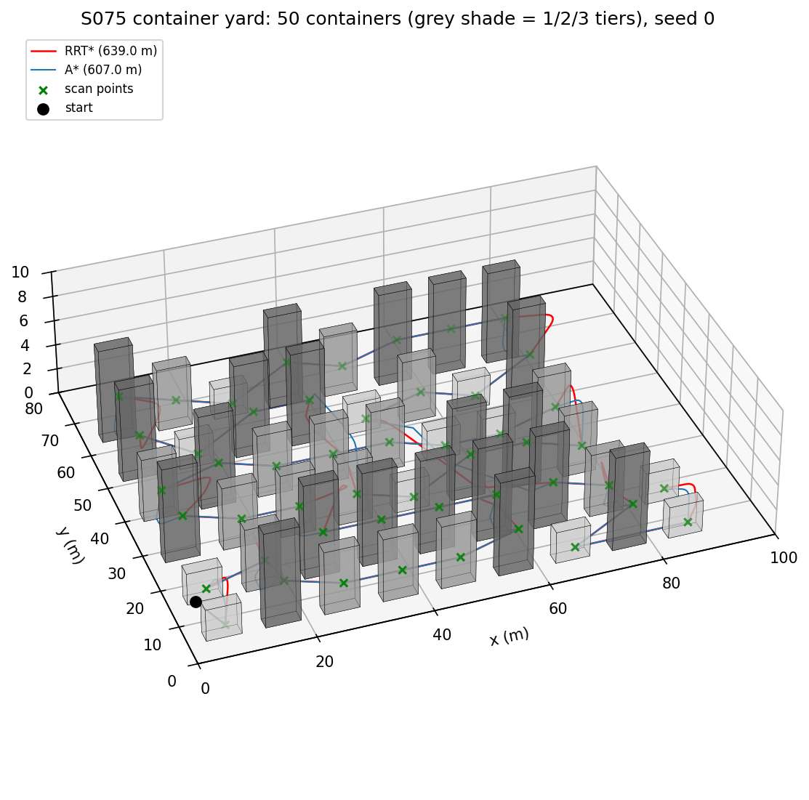
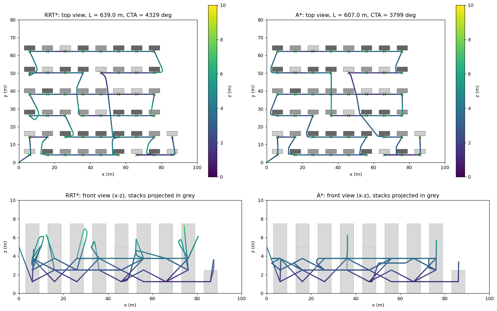
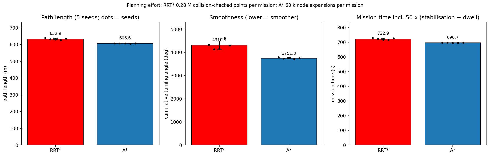
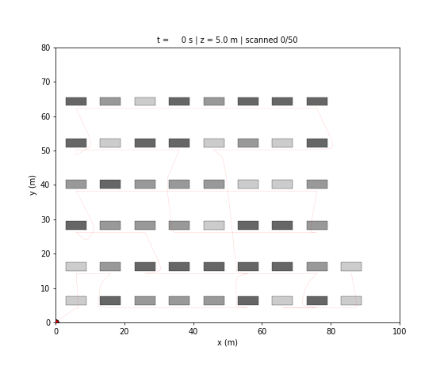

# S075 Port Container Yard Inventory

**Domain**: Industrial & Agriculture | **Difficulty**: ⭐⭐ | **Status**: ✅ Completed

---

## Problem Definition

**Setup**: A 100 × 80 m container yard holds 50 containers (6 × 2.5 m footprint, 2.5 m per tier) in six rows of 9, 9, 8, 8, 8 and 8, with random stacks of 1, 2 or 3 tiers (12 / 17 / 21 stacks; up to 7.5 m high). Rows are separated by 7.5–9.5 m aisles and containers by 4 m gaps. A drone starting at (0, 0, 5) m must read one barcode per container: each scan point is 0.8 m in front of the container's low-y face, at mid-length and mid-stack height (capped at 5 m). The 50 scan points are visited in a nearest-neighbour order. At each one the drone stabilises against its GPS error and dwells 1.5 s.

**Objective** (card): scan all 50 containers without collision and minimise mission time; compare **RRT\*** and **A\*** (3D grid) on path length, smoothness (cumulative turning angle, CTA) and computation.

**Method**: every leg between consecutive scan points is planned separately in the 3D free space (containers inflated by the drone radius, 0.25–9.75 m altitude), then shortcut-pruned and corner-rounded with Bézier curves. The scan points stay on the path. RRT\* is randomised, so the comparison is run for 5 seeds; each seed drives the shortcut smoother of both planners and the GPS stabilisation draws, so both planners see the same random numbers.

---

## Mathematical Model Summary

### Collision model

A configuration is free if it lies in the workspace $[0, 100] \times [0, 80] \times [0.25, 9.75]$ m and outside every container box grown by $r_d$ = 0.25 m. A segment is free if all points sampled every $r_d/2$ = 0.125 m along it are free.

### RRT\* (card, first solution)

Sample $\mathbf q_{rand}$ (the goal with probability 0.05), steer from the nearest node by at most $\eta$ = 2 m, choose the cheapest collision-free parent among the nodes within

$$r = \min\!\left(\gamma_{RRT^*}\left(\frac{\ln|V|}{|V|}\right)^{1/3},\ \eta\right), \qquad \gamma_{RRT^*} = 12$$

rewire the neighbours through the new node when that is cheaper, and stop as soon as the goal is connected (card). Samples are drawn from the bounding box of the leg grown by 8 m (full altitude range); if no path is found in 5000 iterations the box grows to 16 m, then to the whole yard.

### A\* (card)

26-connected search on a 200 × 160 × 20 grid of 0.5 m cells, obstacles inflated by one cell, ground layer blocked, Euclidean edge costs and heuristic. The leg starts and ends at the exact scan points.

### Smoothing (card, per leg)

1. **Shortcut**: 200 tries per leg; pick nodes $i < j-1$ at random and drop the nodes between them if $\overline{\mathbf w_i\mathbf w_j}$ is free.
2. **Bézier corners**: a corner whose interior angle is below 150° is replaced by a cubic Bézier from $\mathbf P_0 = \mathbf w - \alpha(\mathbf w - \mathbf w_{prev})$ to $\mathbf P_3 = \mathbf w + \alpha(\mathbf w_{next} - \mathbf w)$, $\alpha$ = 0.3, with $\mathbf P_1, \mathbf P_2$ two thirds of the way from $\mathbf P_0, \mathbf P_3$ to the corner. The curve is kept only if it is collision-free.

### Mission time (card)

$$T_{mission} = \frac{L_{path}}{v_{scan}} + \sum_{j=1}^{50}\left(\frac{\|\boldsymbol\eta_j\|}{K_{stab}\,v_{scan}} + T_{dwell}\right), \qquad \boldsymbol\eta_j \sim \mathcal N(\mathbf 0, \sigma_{GPS}^2 I_3)$$

$$\text{CTA} = \sum_i \arccos\frac{(\mathbf w_{i+1} - \mathbf w_i)\cdot(\mathbf w_{i+2} - \mathbf w_{i+1})}{\|\mathbf w_{i+1} - \mathbf w_i\|\,\|\mathbf w_{i+2} - \mathbf w_{i+1}\|}$$

---

## Key Parameters

| Parameter | Value |
|-----------|-------|
| Yard / workspace | 100 × 80 m, altitude up to 10 m |
| Containers | 50 (rows of 9, 9, 8, 8, 8, 8), 6 × 2.5 × 2.5 m per tier, 1–3 tiers (layout seed 42) |
| Row origins (y) / aisles | 5, 15, 27, 39, 51, 63 m / 7.5–9.5 m |
| x pitch / gap | 10 m / 4 m, first container at x = 3 m |
| Scan stand-off / height | 0.8 m / min(stack height / 2, 5 m) |
| Drone radius | 0.25 m |
| Speed $v_{scan}$ | 1.0 m/s |
| Dwell / $K_{stab}$ / $\sigma_{GPS}$ | 1.5 s / 0.5 / 0.1 m |
| Start | (0, 0, 5) m |
| RRT\*: η / max iterations / goal bias / γ | 2.0 m / 5000 / 0.05 / 12.0 |
| A\* grid | 0.5 m, 200 × 160 × 20 |
| Shortcut tries / Bézier α / corner threshold | 200 per leg / 0.3 / interior angle < 150° |
| Collision sampling step | 0.125 m ($r_d/2$) |
| RRT\* sampling box margin (added) | 8 m, then 16 m, then whole yard |
| Seeds (added) | 0–4 (RRT\* and smoothing); stabilisation draws 1000–1004 |

---

## Implementation

```
src/04_industrial_agriculture/s075_container_yard.py   # Main simulation script
```

```bash
conda activate drones
python src/04_industrial_agriculture/s075_container_yard.py
```

Runtime ≈ 1 min (measured while other simulations shared the machine).

---

## Results

| Metric (5 seeds) | RRT\* mean ± std | A\* mean ± std |
|---|---:|---:|
| Containers scanned | 50 in every seed | 50 in every seed |
| Raw path length before smoothing | 901.6 ± 25.6 m | 641.2 ± 0.0 m |
| **Path length** | **632.9 ± 4.3 m** | **606.6 ± 0.3 m** |
| **Cumulative turning angle** | **4311 ± 173°** | **3752 ± 27°** |
| Travel time | 632.9 ± 4.3 s | 606.6 ± 0.3 s |
| Stabilisation + dwell | 90.1 ± 0.6 s | 90.1 ± 0.6 s |
| **Total mission time** | **722.9 ± 4.7 s** | **696.7 ± 0.7 s** |
| Highest point | 7.80 ± 0.57 m | 6.16 ± 0.11 m |

Paired over the 5 seeds, RRT\* is shorter in 0/5, smoother in 0/5 and faster in 0/5. The straight-line tour through the 50 scan points (ignoring obstacles) is 567.0 m.

**Computation** (deterministic counts; wall-clock time is machine-dependent and not reported): RRT\* needs on average 46 iterations per leg (maximum 537; no leg needed a larger sampling box) and 0.28 M collision-checked points per mission. A\* expands 60 k grid nodes per mission; its smoothing checks 0.23 M points.

**Stabilisation** (seed 0): mean 0.31 s per stop, maximum 0.52 s.

**Figures** use seed 0: RRT\* 639.0 m, CTA 4329°, mission 729.5 s; A\* 607.0 m, CTA 3799°, mission 697.4 s.

**Key findings**:
- **A\* beats RRT\* on every metric in every seed**: 606.6 vs 632.9 m, 3752 vs 4311° of turning, 696.7 vs 722.9 s. The card expected the opposite (RRT\* shorter and smoother). RRT\* stops at its first solution, which is 901.6 m raw; shortcutting removes most of the detours but not all, and the RRT\* legs keep climbing over stacks (highest point 7.80 m) where the grid search stays in the aisles. A\* is optimal on its grid, so after shortcutting it comes close to the obstacle-free tour (606.6 vs 567.0 m).
- **RRT\* varies between seeds** (path length std 4.3 m, CTA std 173°); A\* differs between seeds only through the random shortcut tries (0.3 m).
- **The card's expected metrics cannot be reproduced.** The card lists 312.4 m (RRT\*) and 358.7 m (A\*), but no collision-free tour can be shorter than the 567.0 m straight-line tour through the same scan points; the card has been annotated.
- **Scanning overhead is small and identical for both planners**: 50 stops cost 90.1 s (1.5 s dwell + 0.31 s mean stabilisation); the planner choice changes only the travel time.
- **Turning angles are large for both planners** (over 3700°): consecutive scan points sit at different heights (1.25, 2.5 or 3.75 m), so the path turns up or down at almost every stop, and the CTA counts those turns as well.

### 3D Yard Overview

Containers shaded by tier count, RRT\* path (red), A\* path (blue), scan points (green crosses), start (black):



### Path Comparison

Top: top views coloured by altitude. Bottom: front views (x–z) with the stacks projected in grey. RRT\* legs that change rows often climb over the stacks; A\* changes rows through the 4 m gaps:



### Planner Metrics

Path length, cumulative turning angle and mission time (bars: mean ± std over 5 seeds; dots: seeds). The title gives the deterministic computation counts:



### Animation

Top-down view of the RRT\* mission, seed 0 (184 frames, one every 4 s): the drone (red) with the trail of its last 30 frames; a green ring marks a dwell, green dots the containers already scanned:



### Deviations from the scenario card

| Card | Implementation | Reason |
|------|----------------|--------|
| 3 m aisles in y; workspace up to 7.5 m (text) | 7.5–9.5 m aisles and 10 m ceiling | The values in the card's own code (row origins, `YARD_Z = 10`); with a 7.5 m ceiling the drone could not pass over a 3-tier stack. Card corrected. |
| A\* grid 200 × 160 × 15 (text) | 200 × 160 × 20 | `YARD_Z / GRID_RES` in the card's code. Card corrected. |
| Expected metrics 312.4 m / 358.7 m, RRT\* better | 632.9 m / 606.6 m, A\* better | The card's values are below the 567.0 m straight-line tour, so they cannot be right. Card annotated. |
| Planning time in seconds | Deterministic counts (iterations, checked points, node expansions) | Wall-clock time changes from run to run and machine to machine, so it cannot be part of a reproducible output. |
| RRT\* samples the whole yard | Samples the leg's bounding box + 8 m (then 16 m, then the whole yard) | With whole-yard sampling, some legs found no path within 5000 iterations in development runs. |
| Shortcut smoothing over the whole concatenated path | Per leg | Shortcutting the whole path deletes scan points; every scan point must stay on the path (asserted). |
| Bézier from $\mathbf w_{i-1}$ to $\mathbf w_{i+1}$ with the card's angle test | Corner rounding between points at α = 0.3 of the adjacent edges; only interior angles < 150°; curve checked for collisions | The card's curves for consecutive corners overlap (the path runs back), its test (`angle < 150°` on the turning angle) rounds almost every node, and nothing checked the curves for collisions. |
| A\* path ends at the goal cell centre | Ends at the exact scan point | The barcode read needs the scan point itself. |
| Cruise at 5 m, climb to stack height + 1 m | Not enforced; both planners use the full 3D free space | Neither planner in the card's code applies the rule. |
| Double-integrator dynamics with GPS noise | Constant-speed path following; GPS enters only through the stabilisation time | As in the card's mission-time formula. |
| Stabilisation "up to 0.8 s" | 0.31 s mean, 0.52 s maximum (seed 0) | Result of the card's formula with σ = 0.1 m. |
| GIF `s075_container_yard.gif` | `animation.gif` | Project naming convention. |

---

## Extensions

1. **Informed RRT\*** or continued rewiring after the first solution, to see how much of the gap to A\* closes.
2. **Better tour**: 2-opt on the 50 scan points, or a row-by-row tour that visits the faces of each aisle in order.
3. **Several drones** with k-means partitioning of the scan points.
4. **Battery limit** with charging stops at a depot.
5. **Wind** and tracking error along the smoothed paths.

---

## Related Scenarios

- Prerequisites: [S043 Confined Space Exploration](../../../scenarios/03_environmental_sar/S043_confined_space.md)
- Cross-reference: [S004 Obstacle-Course Chase](../../../scenarios/01_pursuit_evasion/S004_obstacle_chase.md), [S069 Automated Warehouse Inventory](../../../scenarios/04_industrial_agriculture/S069_warehouse_inventory.md), [S074 Mine 3D Mapping](../../../scenarios/04_industrial_agriculture/S074_mine_mapping.md)
