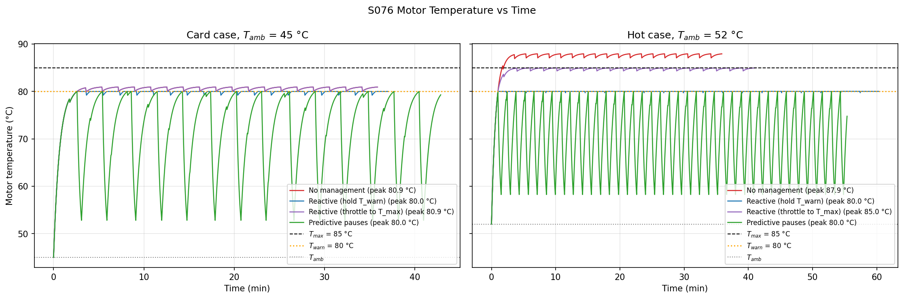
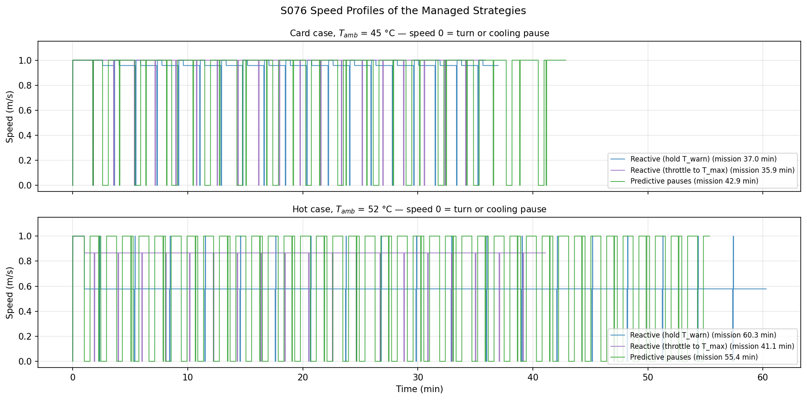
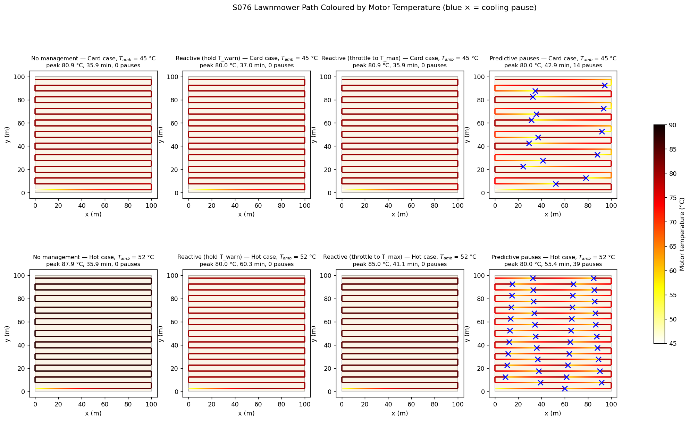
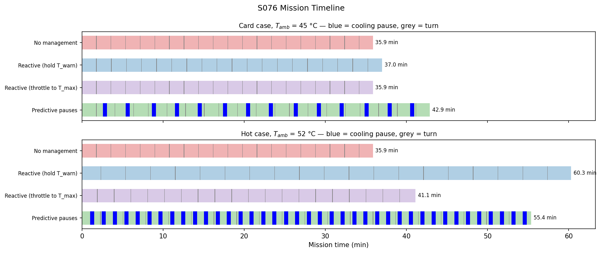
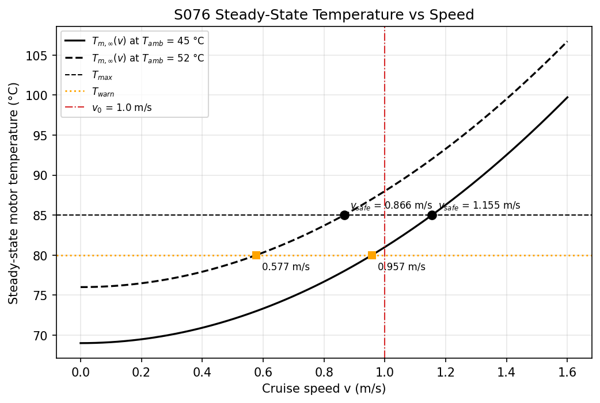
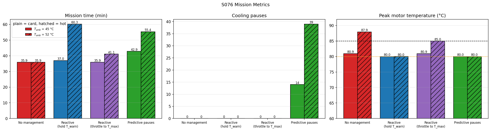
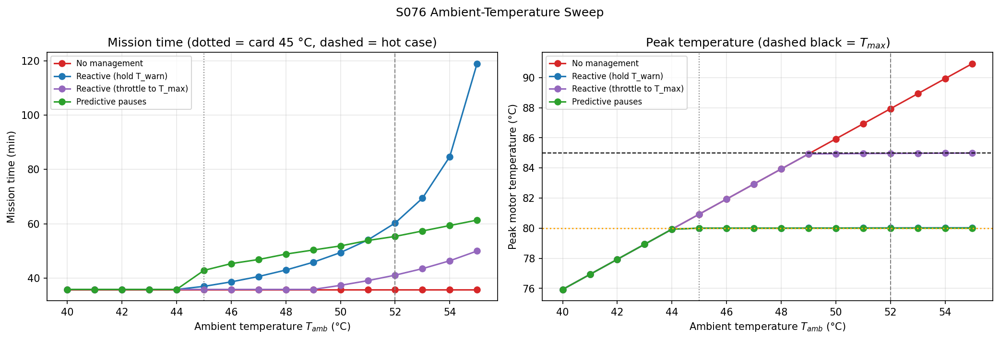
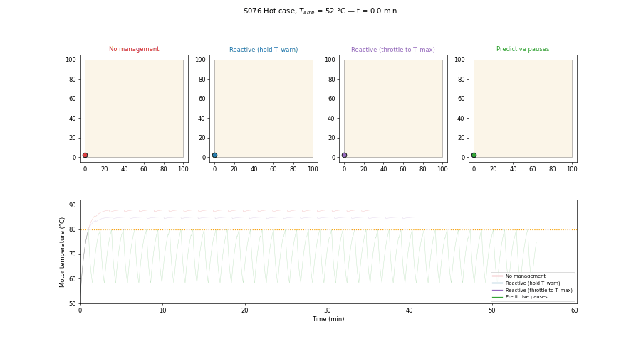

# S076 Extreme Heat Cooling Strategy

**Domain**: Industrial & Agriculture | **Difficulty**: ⭐⭐ | **Status**: ✅ Completed

---

## Problem Definition

**Setup**: A single inspection drone flies a boustrophedon (lawnmower) path over a 100 × 100 m field: 20 strips 5 m apart, 2095 m in total, with nineteen 3 s heading reversals. The ambient temperature is $T_{amb} = 45$ °C. Motor temperature follows a first-order thermal model driven by the speed-dependent motor power. Above $T_{max} = 85$ °C the motor risks thermal shutdown. The drone can slow down or stop for a 30 s shaded cooling pause.

**Objective**: finish the inspection with $T_m(t) \le T_{max}$ at all times and the shortest mission time.

**Comparison Strategies**:
1. **No thermal management**: constant $v_0 = 1.0$ m/s.
2. **Reactive throttle**, implemented in two variants. Both act once $T_m \ge T_{warn} = 80$ °C and take a 30 s cooling pause if $T_m \ge T_{max}$.
   - **Hold $T_{warn}$**: fly at the speed that keeps the current temperature constant, so the motor stays at about 80 °C.
   - **Throttle to $T_{max}$**: fly at $v_{safe}$, the speed whose steady state is $T_{max}$. This uses the 80–85 °C band the card allows the reactive strategy.
3. **Predictive scheduled pauses**: before take-off, compute in closed form where along the path $T_m$ would reach $T_{warn}$, and insert a 30 s cooling pause at each of those points. Speed is always $v_0$.

The card's parameters are run first (card case, 45 °C). Because the card's expected result does not appear at 45 °C (see below), the script also sweeps the ambient temperature from 40 to 55 °C and shows a detailed **hot case** at 52 °C, where unmanaged flight does breach $T_{max}$.

---

## Mathematical Model Summary

### Thermal model

$$\tau \frac{dT_m}{dt} = R_{th}\,P(v) - (T_m - T_{amb}), \qquad P(v) = P_{hover} + k_v v^2, \qquad \tau = R_{th} C_{th} = 40\ \text{s}$$

Power is constant over each time step, so the script uses the exact step solution

$$T_m(t + h) = T_{m,\infty}(v) + \bigl(T_m(t) - T_{m,\infty}(v)\bigr)\,e^{-h/\tau}, \qquad T_{m,\infty}(v) = T_{amb} + R_{th} P(v)$$

During a turn the motor runs at hover power ($T_{m,\infty} = T_{amb} + R_{th}P_{hover}$). During a cooling pause it decays toward $T_{amb}$ with $\tau_{cool} = 20$ s, as in the card.

### Safe speeds

$$v_{safe} = \sqrt{\frac{T_{max} - T_{amb}}{R_{th} k_v} - \frac{P_{hover}}{k_v}} = 1.155\ \text{m/s at } 45\ °\text{C}$$

The speed whose steady state equals $T_{warn}$ is 0.957 m/s at 45 °C. $T_{m,\infty}(v_0) = 81.0$ °C, so at 45 °C the nominal speed is **below** $v_{safe}$. Unmanaged flight breaches $T_{max}$ only for $T_{amb} > 49.0$ °C.

### Reactive law

$$v_{hold}(T_m) = \sqrt{\max\!\left(0,\ \frac{(T_m - T_{amb})/R_{th} - P_{hover}}{k_v}\right)}, \qquad v = \min\bigl(v_0,\ \max(0.05,\ v_{hold})\bigr) \text{ when } T_m \ge T_{warn}$$

$v_{hold}$ is the speed at which $dT_m/dt = 0$, so the motor stays where it is. The second variant uses instead $v = \min(v_0, \max(0.05, v_{safe}(T_{amb})))$ once $T_m \ge T_{warn}$. The temperature then rises asymptotically toward $T_{max}$ without reaching it, so its cooling-pause branch never fires (0 pauses at every ambient temperature in the sweep).

### Predictive schedule

With $T_{m,\infty}(v_0) > T_{warn}$, the time to reach $T_{warn}$ from $T_m$ is $t_w = \tau \ln\frac{T_{m,\infty} - T_m}{T_{m,\infty} - T_{warn}}$. The planner walks the path in closed form, puts a pause at distance $s + v_0 t_w$ whenever that point lies inside the current leg, and then applies the pause cooling $T_m \leftarrow T_{amb} + (T_{warn} - T_{amb})e^{-T_{pause}/\tau_{cool}}$.

### Mission time

$$T_{mission} = t_{cruise} + N_{turn}\,t_{turn} + N_{pause}\,T_{pause}$$

---

## Key Parameters

| Parameter | Value |
|-----------|-------|
| Field / strip spacing / strips | 100 × 100 m / 5 m / 20 |
| Path length / turns | 2095 m / 19 × 3 s |
| Nominal speed $v_0$ | 1.0 m/s |
| Ambient temperature $T_{amb}$ | 45 °C (card case); 52 °C (hot case); sweep 40–55 °C in 1 °C steps |
| $T_{max}$ / $T_{warn}$ | 85 °C / 80 °C |
| Cooling pause $T_{pause}$ | 30 s |
| $R_{th}$ / $C_{th}$ / $\tau$ | 0.8 °C/W / 50 J/°C / 40 s |
| Cooling time constant $\tau_{cool}$ | 20 s |
| $P_{hover}$ / $k_v$ | 30 W / 15 W·s²/m² |
| $P(v_0)$ / $T_{m,\infty}(v_0)$ at 45 °C | 45.0 W / 81.0 °C |
| Turn power | $P_{hover}$ |
| Reactive speed floor | 0.05 m/s |
| Time step $\Delta t$ | 0.1 s |
| GIF | hot case, 30 s of simulated time per frame |

The model is deterministic, so no seeds or Monte Carlo runs are needed: all four strategies fly the same path under the same conditions.

---

## Implementation

```
src/04_industrial_agriculture/s076_thermal_management.py   # Main simulation script
```

```bash
conda activate drones
python src/04_industrial_agriculture/s076_thermal_management.py
```

Runtime ≈ 1.5–2 min (96–119 s measured while other simulations shared the CPU).

---

## Results

### Card case ($T_{amb}$ = 45 °C)

| Strategy | Mission time | Peak $T_m$ | Pauses | Time above $T_{max}$ | Penalty vs no management |
|----------|-------------:|-----------:|-------:|---------------------:|-------------------------:|
| No management | 2152.0 s (35.87 min) | 80.93 °C | 0 | 0.0 s | — |
| Reactive (hold $T_{warn}$) | 2219.6 s (36.99 min) | 80.00 °C | 0 | 0.0 s | +67.6 s |
| **Reactive (throttle to $T_{max}$)** | **2152.0 s (35.87 min)** | 80.93 °C | 0 | 0.0 s | +0.0 s |
| Predictive pauses | 2572.0 s (42.87 min) | 80.00 °C | 14 | 0.0 s | +420.0 s |

### Hot case ($T_{amb}$ = 52 °C)

| Strategy | Mission time | Peak $T_m$ | Pauses | Time above $T_{max}$ | Penalty vs no management |
|----------|-------------:|-----------:|-------:|---------------------:|-------------------------:|
| No management | 2152.0 s (35.87 min) | 87.93 °C | 0 | **2047.8 s** | — |
| Reactive (hold $T_{warn}$) | 3617.3 s (60.29 min) | 80.02 °C | 0 | 0.0 s | +1465.3 s |
| **Reactive (throttle to $T_{max}$)** | **2466.8 s (41.11 min)** | 84.97 °C | 0 | 0.0 s | +314.8 s |
| Predictive pauses | 3322.0 s (55.37 min) | 80.00 °C | 39 | 0.0 s | +1170.0 s |

The managed strategies' peak temperatures are set **by design**: about 80 °C for hold-$T_{warn}$ and predictive, just below 85 °C for throttle-to-$T_{max}$. Peak temperature therefore does not rank them; mission time does. The 85.0 label in the metrics chart is 84.97 °C rounded.

**Key findings**:
- **The card's expected result does not hold at 45 °C.** With the card's parameters, $T_{m,\infty}(v_0) = 81.0$ °C, below $T_{max}$. Unmanaged flight peaks at 80.93 °C and never breaches $T_{max}$. The card's "> 85 °C (violation)" for no management, "3–6 pauses" for reactive and "4–7 pauses" for predictive are not reproduced (0 and 14 pauses). The card's $v_{safe} \approx 0.91$ m/s is also wrong: the correct value is 1.155 m/s. The 0.91 matches the square of the $T_{warn}$ speed (0.917), so a square root was probably dropped. The card has been corrected.
- **At 45 °C, the best reactive throttle does nothing.** $v_{safe}$ = 1.155 m/s is above $v_0$, so throttling to $T_{max}$ never slows the drone and matches unmanaged flight (35.87 min, peak 80.93 °C). Holding 80 °C costs 67.6 s: the drone flies 1521.2 m below $v_0$, taking 1588.8 s. The predictive schedule costs 420.0 s (14 pauses × 30 s), because it cools all the way to 52.8 °C every time and then reheats.
- **Throttling to $T_{max}$ is the fastest safe strategy at every ambient temperature tested.** At 52 °C, where unmanaged flight spends 2047.8 s above $T_{max}$, it takes 41.11 min with a peak of 84.97 °C. Predictive takes 55.37 min and hold-$T_{warn}$ 60.29 min. Over the whole 40–55 °C sweep it never exceeds $T_{max}$ (maximum peak 84.99 °C, 0.0 s above), never pauses, and predictive is never faster than it. At 55 °C it needs 50.00 min against 61.37 min for predictive.
- **Predictive beats only the conservative reactive variant.** Predictive is faster than hold-$T_{warn}$ from 51 to 55 °C (e.g. 55.37 vs 60.29 min at 52 °C). That crossover is a property of the hold-at-80 °C law, not of reactive control in general. Holding 80 °C at 52 °C forces 0.577 m/s, because even hovering heats the motor toward 76 °C. Holding it at 55 °C takes 118.95 min, because $v_{hold}$ approaches zero as $T_{amb} + R_{th}P_{hover}$ approaches $T_{warn}$ (56 °C). Below 45 °C, none of the strategies needs to act, and all take 35.87 min.
- **What the predictive schedule buys**: it keeps the motor at or below 80 °C, i.e. a 5 °C margin below the limit, at a cost in mission time: 42.87 vs 35.87 min at 45 °C and 55.37 vs 41.11 min at 52 °C against throttling to $T_{max}$.
- **The card's literal reactive formula chatters.** $v_{safe}(T_m) = \sqrt{\max(0, (T_{max} - T_m)/(R_{th}k_v) - P_{hover}/k_v)}$ is zero for every $T_m \ge 61$ °C, so in the warning zone it always commands the 0.05 m/s floor. Run literally at 45 °C, it makes 2804 speed switches between 1.0 and 0.05 m/s and takes 2285.2 s (38.09 min), 65.6 s longer than the corrected $v_{hold}$ law. It slows down too much because $P(v)$ is convex in $v$: alternating fast and slow heats the motor more than a steady speed with the same average.
- **Caveat on the pause model**: the card treats a shaded pause as cooling toward $T_{amb}$, i.e. little or no motor heat while paused. If the drone kept hovering during the pause, it would cool only toward $T_{amb} + R_{th}P_{hover}$, and the predictive schedule would lose much of its advantage in the hot case.

| $T_{amb}$ (°C) | 40–44 | 45 | 46 | 47 | 48 | 49 | 50 | 51 | 52 | 53 | 54 | 55 |
|---|---|---|---|---|---|---|---|---|---|---|---|---|
| No management (min) | 35.87 | 35.87 | 35.87 | 35.87 | 35.87 | 35.87 | 35.87 | 35.87 | 35.87 | 35.87 | 35.87 | 35.87 |
| No-management peak (°C) | 75.9–79.9 | 80.9 | 81.9 | 82.9 | 83.9 | 84.9 | **85.9** | **86.9** | **87.9** | **88.9** | **89.9** | **90.9** |
| Reactive, hold $T_{warn}$ (min) | 35.87 | 36.99 | 38.64 | 40.62 | 43.00 | 45.86 | 49.43 | 54.05 | 60.29 | 69.42 | 84.70 | 118.95 |
| Reactive, throttle to $T_{max}$ (min) | **35.87** | **35.87** | **35.87** | **35.87** | **35.87** | **35.87** | **37.37** | **39.09** | **41.11** | **43.51** | **46.40** | **50.00** |
| Reactive, throttle to $T_{max}$, peak (°C) | 75.93–79.93 | 80.93 | 81.93 | 82.93 | 83.93 | 84.93 | 84.95 | 84.96 | 84.97 | 84.98 | 84.98 | 84.99 |
| Predictive (min) | 35.87 | 42.87 | 45.37 | 46.87 | 48.87 | 50.37 | 51.87 | 53.87 | 55.37 | 57.37 | 59.37 | 61.37 |
| Predictive pauses | 0 | 14 | 19 | 22 | 26 | 29 | 32 | 36 | 39 | 43 | 47 | 51 |

Bold peaks are breaches of $T_{max}$. Bold mission times mark the fastest strategy that never exceeds $T_{max}$. Both reactive variants pause 0 times at every ambient temperature.

### Motor Temperature

Left: card case. Unmanaged flight and throttle-to-$T_{max}$ settle just above $T_{warn}$; hold-$T_{warn}$ stays at 80 °C; the predictive schedule saw-tooths between 52.8 and 80 °C. Right: hot case. Unmanaged flight stays above $T_{max}$ for most of the mission, and throttle-to-$T_{max}$ creeps up to just below it:



### Speed Profiles

Speed 0 is a turn or a cooling pause. At 45 °C hold-$T_{warn}$ drops to 0.957 m/s once per strip, while throttle-to-$T_{max}$ never slows. At 52 °C hold-$T_{warn}$ flies at 0.577 m/s for almost the whole mission and throttle-to-$T_{max}$ at 0.866 m/s:



### Flight Paths

Path coloured by motor temperature; blue × marks a cooling pause:



### Mission Timeline

Blue = cooling pause, grey = turn:



### Steady-State Temperature vs Speed

Black dots: $v_{safe}$ (steady state = $T_{max}$). Orange squares: the speed whose steady state is $T_{warn}$. $v_0 = 1.0$ m/s lies between them at 45 °C and above both at 52 °C:



### Mission Metrics



### Ambient-Temperature Sweep



### Animation

Hot case (52 °C): the four drones fly in parallel panels, with trails coloured by motor temperature and the temperature traces below (122 frames):



### Deviations from the scenario card

| Card | Implementation | Reason |
|------|----------------|--------|
| $v_{safe} \approx 0.91$ m/s; "$v_0$ marginally above the safe continuous-cruise speed" | $v_{safe} = 1.155$ m/s; $v_0$ is below it at 45 °C | Computed from the card's own formula and parameters. 0.91 matches the square (0.917) of the speed that holds $T_{warn}$. Card corrected. |
| Expected: no management > 85 °C; reactive 3–6 pauses; predictive 4–7 pauses; no management ≈ 34 min | 80.93 °C, 0 pauses, 14 pauses, 35.87 min | Reported as is. $T_{m,\infty}(v_0) = 81$ °C cannot exceed 85 °C. The path is 2095 m at 1 m/s plus 57 s of turns, so it cannot take 34 min. Card table annotated with the simulated values. |
| Reactive speed $v_{safe}(T_m)$ with $(T_{max} - T_m)$ in the numerator | Two variants: $v_{hold}(T_m)$ (hold the current temperature, i.e. about 80 °C) and $v_{safe}(T_{amb})$ (steady state at $T_{max}$) | The card's expression is identically 0 above 61 °C, so in the warning zone it always commands the 0.05 m/s floor. The literal version is still run and reported (2804 switches, 38.09 min). The $T_{max}$ variant uses the 80–85 °C band that the card's reactive strategy is allowed; the hold variant alone made reactive control look worse than it is. Card annotated. |
| Single case at 45 °C | Plus a 52 °C hot case and a 40–55 °C sweep | At 45 °C no strategy is needed to protect $T_{max}$. The sweep shows where management matters, instead of tuning one parameter until the card's result appears. |
| Explicit Euler, $\Delta t = 0.1$ s | Exact exponential step | Same model without integration error. The predictive planner (closed form) and the executed flight agree exactly, so the predictive peak is 80.00 °C. |
| Turn heating at $v_0$ power in the card's code (`thermal_step_cruise(t_m, v_nominal)`) | Turn at $P_{turn} = P_{hover}$ | The card defines $P_{TURN} = P_{HOVER}$; the code did not use it. |
| Pause cooling to $T_{amb}$ | Same | Kept as in the card; the caveat is listed under Key findings. |
| Card code's clock for reactive speed (`clock += step / v`, temperature advanced by a full `DT`) | Temperature and clock both advance by the actual step duration | Keeps time and heating consistent when the last step of a leg is shorter. |
| Two animation GIFs (reactive, predictive) | One `animation.gif` with all four strategies (hot case) | One GIF per scenario; the hot case is where the strategies differ visibly. |

---

## Extensions

1. **Diurnal ambient profile**: a sinusoidal $T_{amb}(t)$; schedule the mission and its pauses to use the cooler morning window.
2. **Optimal mixed policy**: combine throttling and pauses, and choose the pause threshold and length to minimise mission time; at 45 °C the optimum is no management at all, and up to 55 °C throttling to $T_{max}$ beats the fixed 30 s pauses.
3. **Hover-power pauses**: cool toward $T_{amb} + R_{th}P_{hover}$ when no shade or landing spot is available, and repeat the crossover analysis.
4. **Four-motor model**: four motors with different $R_{th}$ and $C_{th}$; throttle on the hottest one.
5. **MPC**: minimise remaining mission time subject to $T_m \le T_{max}$ over a receding horizon.

---

## Related Scenarios

- Prerequisites: [S073 Solar Panel Thermal Imaging Inspection](../../../scenarios/04_industrial_agriculture/S073_solar_thermal.md), [S067 Spray Coverage Overlap Optimization](../../../scenarios/04_industrial_agriculture/S067_spray_overlap.md)
- Cross-reference: [S048 Full-Area Coverage Scan (Lawnmower)](../../../scenarios/03_environmental_sar/S048_lawnmower.md)
- Follow-ups: [S077 Precision Pollination Flight Pattern](../../../scenarios/04_industrial_agriculture/S077_pollination.md)
