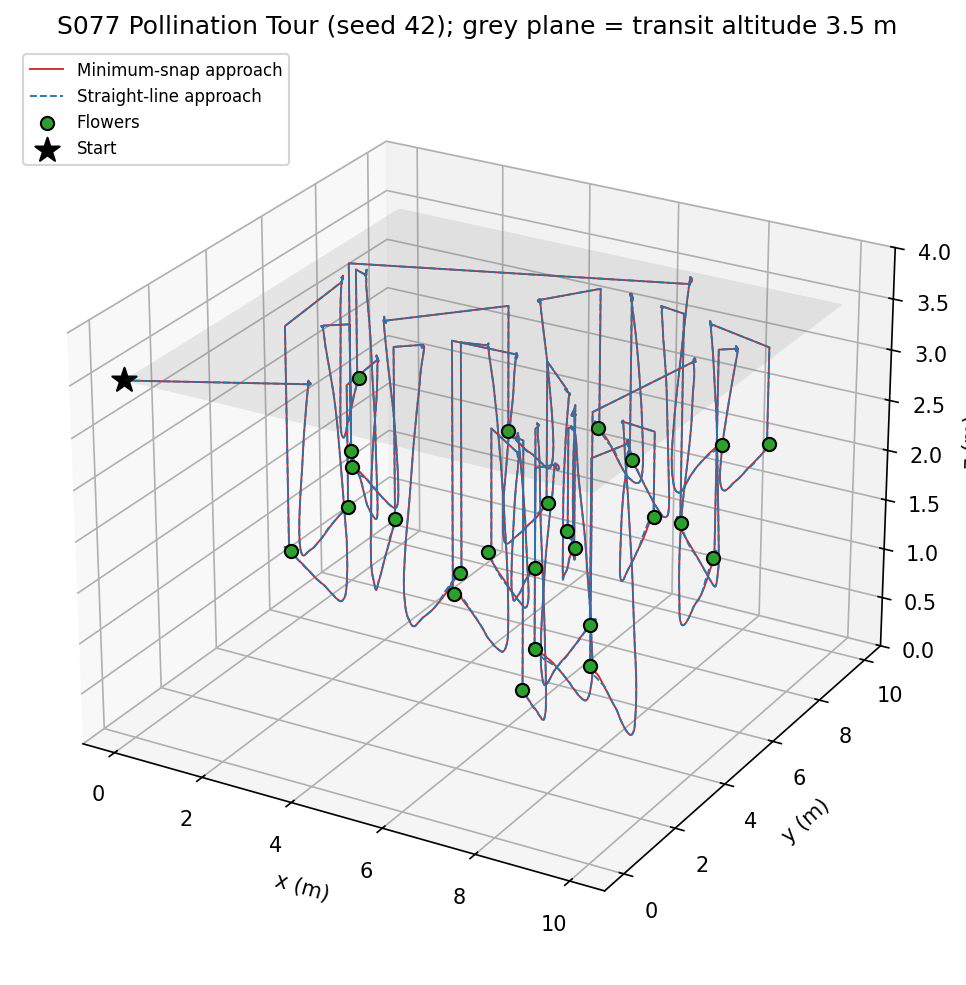
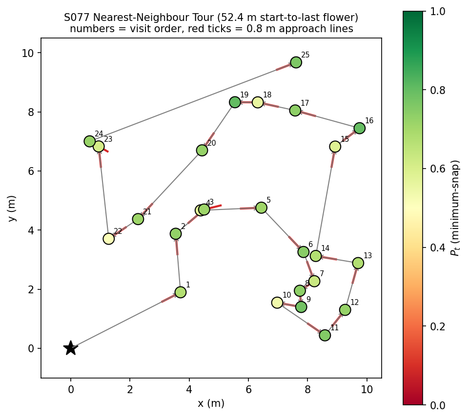
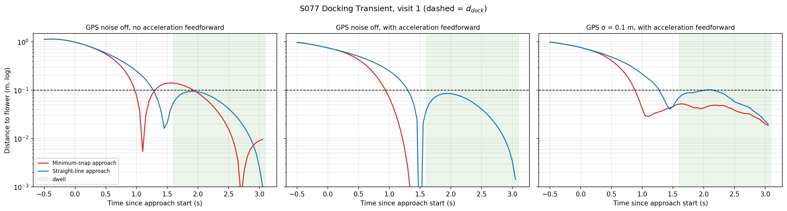
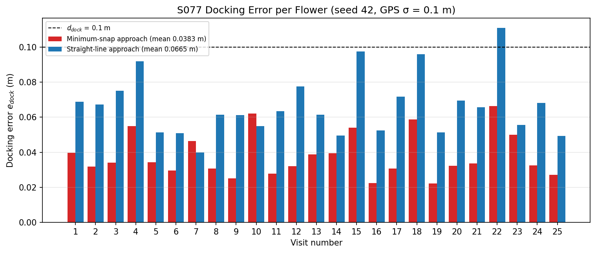
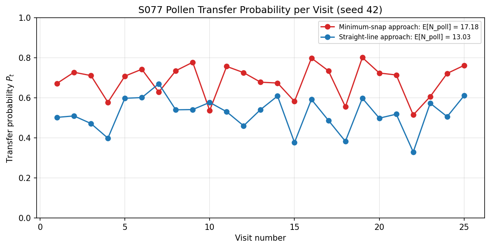
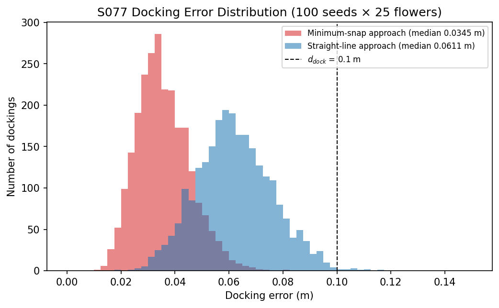
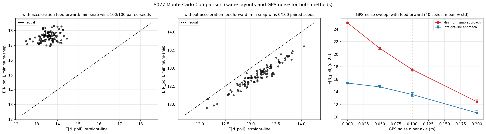
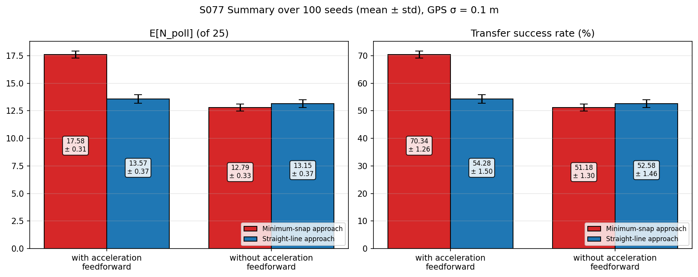
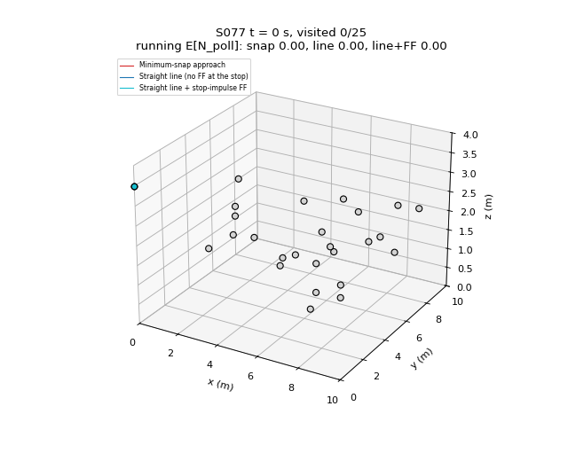

# S077 Precision Pollination Flight Pattern

**Domain**: Industrial & Agriculture | **Difficulty**: ⭐⭐⭐ | **Status**: ✅ Completed

---

## Problem Definition

**Setup**: A drone with a vibrating pollen applicator must visit $F = 25$ flowers placed uniformly at random in a 10 × 10 m orchard, at heights between 1 and 3 m. The visit order is a nearest-neighbour TSP tour from the start point (0, 0, 3.5) m. At each flower the drone:

1. climbs vertically to the 3.5 m transit altitude and flies over the approach point;
2. descends onto a 30° approach line that ends 0.8 m from the flower, below it and on the side facing the previous flower, arriving at 0.5 m/s along the line;
3. approaches the flower, rising at 30° like a bee;
4. docks for 1.5 s while the applicator vibrates.

GPS noise is $\sigma_{GPS} = 0.1$ m per axis. Pollen transfer succeeds with probability $P_t = e^{-e_{dock}/\sigma_{dock}}$, where $\sigma_{dock} = 0.1$ m.

**Comparison strategies** (identical except for the approach reference):
1. **Minimum-snap approach**: a degree-7 polynomial from the approach point (velocity 0.5 m/s along the approach line) to the flower (at rest, zero acceleration and jerk).
2. **Straight-line approach**: constant 0.5 m/s along the line; the reference stops abruptly at the flower.

**Objective**: maximise $E[N_{poll}] = \sum_i P_t^{(i)}$.

---

## Mathematical Model Summary

### Approach direction (30° elevation)

$$\hat{\mathbf{d}}_i = (\cos 30°\cos\varphi_i,\ \cos 30°\sin\varphi_i,\ \sin 30°), \qquad \mathbf{p}_{start}^{(i)} = \mathbf{p}_i^{flower} - d_{standoff}\,\hat{\mathbf{d}}_i$$

$\varphi_i$ is the horizontal bearing from the previous flower (or the start point) to flower $i$.

### Minimum-snap segment

Each axis is a degree-7 polynomial $p(t) = \sum_{k=0}^{7} c_k t^k$. The 8 coefficients follow from $\mathbf{A}_{bc}\mathbf{c} = \mathbf{b}_{bc}$, with position, velocity, acceleration and jerk fixed at both ends:

| End | Position | Velocity | Acceleration | Jerk |
|---|---|---|---|---|
| $t = 0$ | $\mathbf{p}_{start}$ | $v_{approach}\hat{\mathbf{d}}$ | 0 | 0 |
| $t = T_{seg}$ | $\mathbf{p}^{flower}$ | 0 | 0 | 0 |

$T_{seg} = d_{standoff}/v_{approach} = 1.6$ s for **both** methods. The minimum-snap reference therefore has to speed up to 0.830 m/s in the middle, because it starts at 0.5 m/s and ends at rest. Its snap cost $J = \int (p^{(4)})^2 dt$, from the card's $\mathbf{Q}$ matrix, averages 617.98 m²/s⁷ for seed 42. The climb, transit and descent legs are rest-to-rest degree-7 polynomials (peak speed 1.5 m/s). The descent leg ends with velocity $v_{approach}\hat{\mathbf{d}}$, so both approach references start from a moving drone that is consistent with them.

### Drone and tracking loop

The drone is a 3D point mass with a first-order velocity response and a P position loop on GPS measurements $\tilde{\mathbf{p}} = \mathbf{p} + \boldsymbol{\eta}$, $\boldsymbol{\eta} \sim \mathcal{N}(0, \sigma_{GPS}^2 I)$, drawn every 0.05 s:

$$\mathbf{v}_{cmd} = \mathbf{v}_{ref} + \tau_v\,\mathbf{a}_{ref} + K_p(\mathbf{p}_{ref} - \tilde{\mathbf{p}}), \qquad \tau_v \dot{\mathbf{v}} = \mathbf{v}_{cmd} - \mathbf{v}, \qquad |\mathbf{v}_{cmd}| \le 3\ \text{m/s}$$

The term $\tau_v\mathbf{a}_{ref}$ is **acceleration feedforward**. It is exactly what the first-order lag needs to follow a smooth reference. The straight-line reference has $\mathbf{a}_{ref} = 0$, plus an unrepresentable impulse when it stops. Results are reported with and without this term.

### Docking error and transfer probability

$$e_{dock}^{(i)} = \frac{1}{N_{dwell}}\sum_{k=1}^{N_{dwell}} \bigl\|\mathbf{p}(t_k) - \mathbf{p}_i^{flower}\bigr\|, \qquad P_t^{(i)} = e^{-e_{dock}^{(i)}/\sigma_{dock}}, \qquad E[N_{poll}] = \sum_i P_t^{(i)}$$

Here $\mathbf{p}$ is the **true** position. Overshoot is the largest distance past the flower along $\hat{\mathbf{d}}$ during the dwell.

---

## Key Parameters

| Parameter | Value |
|-----------|-------|
| Flowers $F$ / orchard | 25 / 10 × 10 m, $z \in [1, 3]$ m |
| Start point / transit altitude | (0, 0, 3.5) m / 3.5 m |
| Approach elevation / standoff | 30° / 0.8 m |
| Approach entry speed $v_{approach}$ / duration $T_{seg}$ | 0.5 m/s / 1.6 s |
| Transit speed (peak) | 1.5 m/s |
| Dwell $T_{dwell}$ | 1.5 s |
| $d_{dock} = \sigma_{dock}$ | 0.1 m |
| GPS noise $\sigma_{GPS}$ | 0.1 m per axis, white, every step |
| Time step $\Delta t$ | 0.05 s |
| Velocity time constant $\tau_v$ (added) | 0.3 s |
| Position gain $K_p$ (added) | 2.0 s⁻¹ |
| Speed limit (added) | 3 m/s |
| Hover above the approach point before the descent (added) | ≥ 1.0 s (docking window 8.35 s) |
| Seed of the example run | 42 |
| Monte Carlo | 100 seeds (layout + GPS noise), shared by both methods |
| GPS-noise sweep | σ = 0, 0.05, 0.1, 0.2 m; 40 seeds each |

---

## Implementation

```
src/04_industrial_agriculture/s077_pollination.py   # Main simulation script
```

```bash
conda activate drones
python src/04_industrial_agriculture/s077_pollination.py
```

Runtime ≈ 2 min (102–119 s measured while other simulations shared the CPU). All docking windows of all seeds are flown in one vectorised loop. The climb and transit legs are not scored and are flown kinematically on their references.

---

## Results

### Monte Carlo, 100 seeds, GPS σ = 0.1 m

| Tracking loop | Method | $E[N_{poll}]$ | Success rate | Mean $e_{dock}$ | Mean overshoot | Min-snap wins (paired) |
|---|---|---:|---:|---:|---:|---:|
| With acceleration feedforward | **Minimum-snap** | **17.58 ± 0.31** | **70.3 %** | **0.0357 m** | 0.0221 m | **100/100** |
| With acceleration feedforward | Straight-line | 13.57 ± 0.37 | 54.3 % | 0.0621 m | 0.0885 m | — |
| Without feedforward | Minimum-snap | 12.79 ± 0.33 | 51.2 % | 0.0678 m | 0.1362 m | 0/100 |
| Without feedforward | **Straight-line** | **13.15 ± 0.37** | **52.6 %** | **0.0653 m** | 0.0951 m | — |

The paired difference (min-snap − straight) is +4.015 ± 0.411 flowers with feedforward and −0.351 ± 0.109 without it.

### Single run, seed 42

| Case | Min-snap $E[N_{poll}]$ / mean $e_{dock}$ | Straight-line $E[N_{poll}]$ / mean $e_{dock}$ |
|---|---|---|
| GPS noise off, no feedforward | 15.06 / 0.0507 m | 14.94 / 0.0515 m |
| GPS noise off, feedforward | **24.99 / 0.0000 m** | 15.39 / 0.0485 m |
| GPS σ = 0.1 m, feedforward | **17.18 / 0.0383 m** | 13.03 / 0.0665 m |

The tour is 52.43 m long and the mission takes 311.95 s with **either** method. Mission time is identical by construction (same leg durations), so it is not a comparison metric.

**Key findings**:
- **Minimum-snap wins only when the controller uses its smoothness.** With acceleration feedforward, the noise-free drone follows the polynomial almost exactly: overshoot 0.0001 m and speed 0.001 m/s when the dwell starts. That gives 24.99 of 25 flowers. The straight-line reference stops abruptly while the lagging drone still moves at 0.423 m/s, so the drone overshoots by 0.0856 m and $E[N_{poll}]$ falls to 15.39. With GPS noise, min-snap wins all 100 paired seeds (+4.0 flowers).
- **Without feedforward, minimum-snap is slightly worse.** It must reach 0.830 m/s mid-segment to cover 0.8 m in 1.6 s from a 0.5 m/s start, and then brake to zero. The lagging drone overshoots by 0.1362 m, more than the straight line's 0.0951 m, and min-snap loses all 100 paired seeds by 0.35 flowers. The card's claim that min-snap reduces overshoot only holds together with derivative feedforward.
- **GPS noise sets the ceiling.** In the noise sweep with feedforward, min-snap falls from 24.99 (σ = 0) to 20.92, 17.55 and 12.43 flowers. Straight-line falls from 15.39 to 14.79, 13.58 and 10.65. Min-snap wins 40/40 at every σ, but the gap shrinks as noise dominates.
- **Card expectations**: min-snap meets all three targets: mean $e_{dock}$ 0.036 m (< 0.12), success rate 70.3 % (> 35 %), $E[N_{poll}]$ 17.58 (> 9). The straight-line targets do not hold: 0.062 m (card 0.15–0.25), 54.3 % (card < 25 %), 13.57 (card < 7). In this model the P loop filters the white GPS noise, so the true docking error stays well below $\sigma_{GPS}$. The card's own error model (error = the GPS sample itself) gives $E\|\eta\| = 0.1596$ m and $P_t = 0.203$ for **both** methods, so it cannot separate them.
- The descent curls under the approach point to join the 30° line. The lowest altitude flown in seed 42 is 0.48 m; the lowest approach point is 0.61 m.

### 3D Tour



### TSP Tour Map

Flowers coloured by the min-snap $P_t$; red ticks are the 0.8 m approach lines:



### Docking Transient (visit 1)

Distance to the flower (log scale) from 0.5 s before the approach until the end of the dwell. Left: without feedforward, both methods overshoot during the dwell, and min-snap more. Middle: with feedforward, min-snap converges (the curve drops below the axis), while the straight line still overshoots to about 0.09 m. Right: with GPS noise:



### Docking Error per Flower (seed 42)



### Transfer Probability per Visit (seed 42)



### Docking Error Distribution (100 seeds, with feedforward)



### Monte Carlo

Paired seeds with and without feedforward, and the GPS-noise sweep:



### Summary



### Animation

Seed 42: both drones fly the tour; flowers turn green once visited, and the running $E[N_{poll}]$ of each method is shown in the title (157 frames, 2 s per frame):



### Deviations from the scenario card

| Card | Implementation | Reason |
|------|----------------|--------|
| $\hat{\mathbf{d}} = (0.5\cos\varphi, 0.5\sin\varphi, \sqrt{3}/2)$ described as a 30° elevation | $(\cos 30°\cos\varphi, \cos 30°\sin\varphi, \sin 30°)$ | The card's vector has a 60.0° elevation (printed by the script). Card formula and code corrected. |
| Docking error = mean $\|\eta\|$ of the GPS noise added to the commanded flower position | True distance of a point mass with a first-order velocity response ($\tau_v$ = 0.3 s) tracking the reference with a P loop ($K_p$ = 2 s⁻¹) on GPS measurements | The card's error is the same noise for both methods ($P_t$ = 0.203 each), so it cannot compare them. The card's role description already asks for "point-mass dynamics with first-order velocity response". |
| Tracking controller not specified | Velocity feedforward, with and without acceleration feedforward | The result reverses between the two (see Key findings), so both are reported. |
| Straight-line is "faster per visit" | Both take $T_{seg}$ = 1.6 s (card's own rule $T_{seg} = \max(d/v_{approach}, 0.5)$) | Mission time is identical; reported but not used as a comparison. |
| Expected straight-line $e_{dock}$ 0.15–0.25 m, rate < 25 %, $E[N]$ < 7 | 0.062 m, 54.3 %, 13.57 | Reported as is (X6); card annotated. |
| Linear descent from the via point at $v_{approach}$; drone at rest at the approach point while the min-snap reference starts at 0.5 m/s | Degree-7 descent ending with velocity $v_{approach}\hat{\mathbf{d}}$ | Gives both references a consistent initial state; the card's version starts every approach with a 0.5 m/s velocity jump. |
| Departure "vertically upward"; card code flew straight from the flower to the next via point | Vertical climb to 3.5 m, then transit | Follows the card's problem statement. |
| Transit legs part of the simulated flight | Climb and transit flown kinematically on smooth references; each docking window (hover ≥ 1 s at the via point, descent, approach, dwell) flown dynamically | Docking is the only scored part. The fixed-length windows let all seeds run in one vectorised loop. |
| Single run with seed 42 | Seed 42 for the figures, plus 100-seed Monte Carlo and a 4-level GPS-noise sweep with common random numbers | Results depend on random noise (X2). |
| Added parameters | $\tau_v$ = 0.3 s, $K_p$ = 2 s⁻¹, $v_{max}$ = 3 m/s, via-point hover ≥ 1 s | Needed for the dynamic model; not in the card. |

---

## Extensions

1. **Coloured GPS noise**: model GPS error as a slowly varying bias plus white noise; a bias cannot be averaged out during the dwell.
2. **Dwell-time optimisation**: shorten $T_{dwell}$ once $e_{dock}$ settles, to trade transfer probability for tour time.
3. **Time-optimal min-snap**: choose $T_{seg}$ per flower to minimise time subject to the drone's acceleration limit, which makes the method comparison a speed/accuracy trade-off.
4. **2-opt tour**: replace nearest neighbour; the docking result does not change, but the tour length does.
5. **Wind gusts during the dwell** with a PI position loop.

---

## Related Scenarios

- Prerequisites: [S063 Single-Plant Precision Spraying](../../../scenarios/04_industrial_agriculture/S063_precision_spraying.md), [S064 Greenhouse Interior Precision Flight](../../../scenarios/04_industrial_agriculture/S064_greenhouse.md)
- Cross-reference: [S001 Basic Intercept](../../../scenarios/01_pursuit_evasion/S001_basic_intercept.md), [S021 Point Delivery](../../../scenarios/02_logistics_delivery/S021_point_delivery.md)
- Follow-ups: [S078 Harvester Cooperative Guidance](../../../scenarios/04_industrial_agriculture/S078_harvester_guidance.md)
