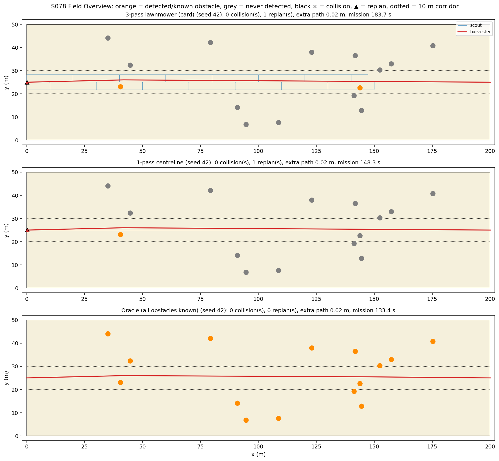
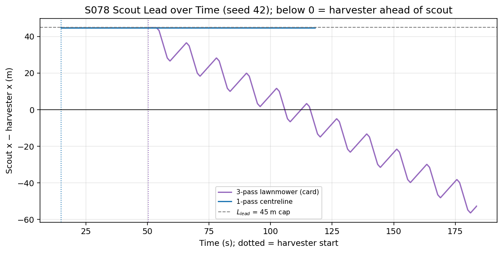
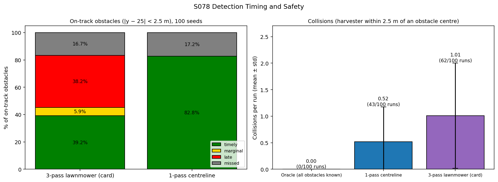
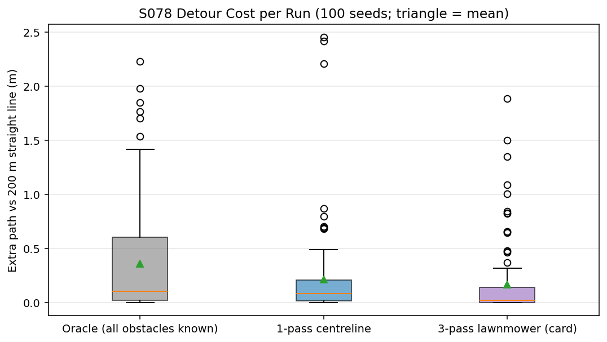
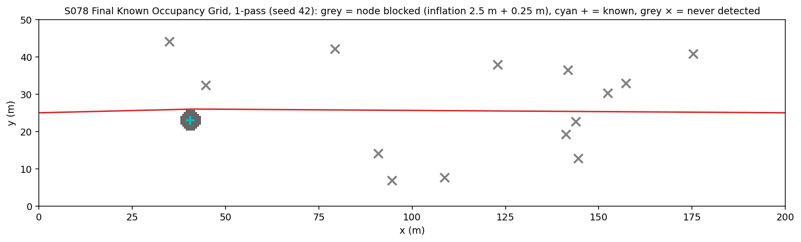
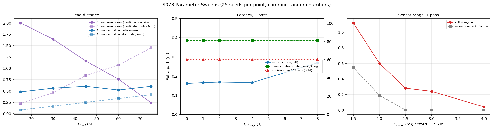
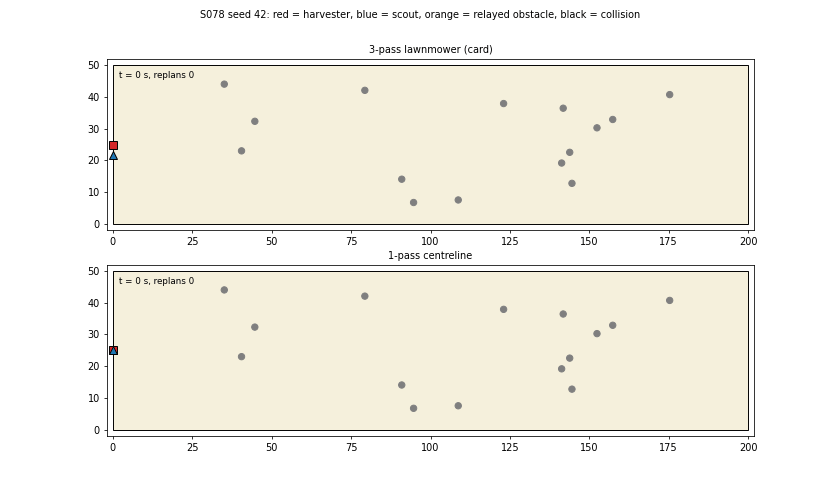

# S078 Harvester Cooperative Guidance

**Domain**: Industrial & Agriculture | **Difficulty**: ⭐⭐ | **Status**: ✅ Completed

---

## Problem Definition

**Setup**: An autonomous harvester crosses a 200 × 50 m field along the centreline $y = 25$ m at 1.5 m/s, from (0, 25) to the exit at (200, 25). Fifteen obstacles of radius 1 m (rocks, waterlogged patches) are placed uniformly in $x \in [20, 180]$, $y \in [5, 45]$ m, unknown to both agents. A scout drone (3 m/s) flies ahead, never more than $L_{lead} = 45$ m ahead of the harvester, and scans a corridor around the planned track. An obstacle is detected when the drone's GPS position (σ = 0.1 m) is within $r_{sensor} - \sigma_{GPS} = 1.9$ m of it. The detection reaches the harvester after a 2 s radio latency. The harvester then replans with A* on a 0.5 m grid, with each known obstacle inflated by $r_{obs} + r_{harvester} = 2.5$ m.

**Question (card)**: how do lead distance, sensor range and latency determine (1) the fraction of obstacles detected before the harvester reaches them, (2) the number of replans and (3) the detour cost?

**Configurations compared**:
1. **3-pass lawnmower (card)**: three strips at $-3.3$, 0 and $+3.3$ m from the track, flown as 10 m boustrophedon blocks across the 10 m corridor.
2. **1-pass centreline**: a single pass along the track.
3. **Oracle**: every obstacle known at the start (no scout); this is the reference for the minimum detour.

Sweeps cover $L_{lead}$ (both patterns), $T_{latency}$ and $r_{sensor}$ (1-pass).

---

## Mathematical Model Summary

### Scout coverage rate

Per 10 m block, the 3-pass pattern flies $3 \times 10 + 2 \times 3.3 = 36.6$ m, so the scout can advance at most

$$v_{adv} = v_{drone} \cdot \frac{200}{732} = 0.820\ \text{m/s} < v_{harvester} = 1.5\ \text{m/s}$$

In area terms, the sensor sweeps $2(r_{sensor} - \sigma_{GPS})\,v_{drone} = 11.4$ m²/s, while the 10 m corridor needs $10 \times 1.5 = 15.0$ m²/s. No pattern can fully scan the corridor ahead of the harvester. The 1-pass route keeps up easily (3.000 m/s), but it covers only $\pm 1.90$ m. Obstacles that touch the straight track lie within $\pm 2.5$ m.

### Scout lead and start

The scout flies its route at 3 m/s but holds position whenever its next step would take it more than $L_{lead}$ ahead of the harvester in $x$. The harvester waits at the start until the scout is $L_{lead}$ ahead. The resulting start delay is part of the mission time.

### Timing classes

When a detection reaches the harvester, the signed time until the harvester reaches the obstacle's inflated disc is

$$\Delta t_{ttc} = \frac{x_{obs} - r_{inflate} - x_{harvester}}{v_{harvester}}$$

The detection is **timely** if $\Delta t_{ttc} > 5$ s, **marginal** if $0 < \Delta t_{ttc} \le 5$ s and **late** if $\Delta t_{ttc} \le 0$. An obstacle that is never detected is **missed**. These classes are reported for **on-track** obstacles ($|y_{obs} - 25| < 2.5$ m), the ones the straight route would hit.

### Replanning

A detection triggers a replan only if its inflated disc (2.5 m + 0.05 m margin) intersects the remaining planned path. The planner is 8-connected A* on lattice nodes 0.5 m apart, with an octile heuristic and nodes blocked within 2.5 m + 0.25 m (half a cell) of a known obstacle. The goal is (200, 25). The grid path is then shortened by greedy line-of-sight shortcutting, which checks exact segment-to-disc distances. If the harvester is already inside an inflated disc (late detection), the planner only allows moves that increase its clearance.

### Collision and detour

A collision is counted for each obstacle whose centre comes within $r_{obs} + r_{harvester} = 2.5$ m of the harvester centre. Extra path = driven length − 200 m.

---

## Key Parameters

| Parameter | Value |
|-----------|-------|
| Field | 200 × 50 m; track $y = 25$ m; exit (200, 25) |
| Harvester speed / half-width | 1.5 m/s / 1.5 m |
| Drone speed | 3.0 m/s |
| Lead distance $L_{lead}$ | 45 m (sweep 15, 30, 45, 60, 75 m) |
| Corridor width / strip spacing | 10 m / 3.3 m (3-pass) |
| Lawnmower block length (added) | 10 m |
| Sensor radius $r_{sensor}$ | 2.0 m (sweep 1.5, 2.0, 2.5, 3.0, 4.0 m); detection radius $r_{sensor} - \sigma_{GPS}$ |
| Obstacles | 15, radius 1.0 m, $x \in [20, 180]$, $y \in [5, 45]$ m |
| Inflation $r_{inflate}$ | 2.5 m (+0.25 m on grid nodes, +0.05 m on smoothed segments, added) |
| Latency $T_{latency}$ | 2 s (sweep 0, 1, 2, 4, 8 s) |
| GPS noise | 0.1 m per axis on the drone position |
| A* grid | 0.5 m, 401 × 101 nodes, 8-connected |
| Timely threshold $T_{replan}$ | 5 s |
| Time step | 0.1 s |
| Monte Carlo | 100 seeds; sweeps 25 seeds per point. Each seed fixes the obstacle layout and the GPS-noise samples for every configuration (common random numbers). Sweep points equal to the card values reuse the first 25 main runs. |
| Example seed | 42 |

---

## Implementation

```
src/04_industrial_agriculture/s078_harvester_guidance.py   # Main simulation script
```

```bash
conda activate drones
python src/04_industrial_agriculture/s078_harvester_guidance.py
```

Runtime ≈ 3 min (180–182 s measured while other simulations shared the CPU).

---

## Results

### Monte Carlo, 100 seeds (186 on-track obstacles in total)

| Configuration | Collisions / run | Runs with a collision | On-track: timely / marginal / late / missed | Replans / run | Obstacles detected / run | Extra path | Start delay | Mission time |
|---|---:|---:|---|---:|---:|---:|---:|---:|
| 3-pass lawnmower (card) | 1.01 ± 0.99 | 62/100 | 39.2 % / 5.9 % / 38.2 % / 16.7 % | 0.98 | 3.24 / 15 | 0.17 ± 0.34 m | 50.3 s | 183.8 s |
| **1-pass centreline** | **0.52 ± 0.66** | **43/100** | **82.8 % / 0.0 % / 0.0 % / 17.2 %** | 1.39 | 1.54 / 15 | 0.21 ± 0.42 m | 14.9 s | 148.4 s |
| Oracle | 0.00 ± 0.00 | 0/100 | — | 0.00 (planned once at the start) | all known | 0.36 ± 0.50 m | 0.0 s | 133.6 s |

Paired by seed, 1-pass has fewer collisions than 3-pass in 44 seeds, the same number in 46 and more in 10. The 3-pass scout's lead shrinks to −56.2 m on average, meaning the harvester ends up 56 m **ahead** of its scout. The 1-pass scout keeps 44.6 m.

**Key findings**:
- **The card's 3-pass pattern cannot keep ahead of the harvester.** Its route is 732 m per 200 m of corridor, so its maximum advance speed is 0.820 m/s against the harvester's 1.5 m/s. The scout starts with its 45 m lead (after a 50.3 s head start), loses ground with every block (sawtooth in the lead plot) and is overtaken roughly halfway along the field (read from the lead plot). From then on, every detection comes after the harvester has passed. 38.2 % of on-track obstacles are reported late, and 90 of the 101 collisions are with on-track obstacles.
- **A narrower scan that keeps its lead is safer.** The 1-pass scout holds its 44.6 m lead, and every on-track obstacle it detects is reported in time (82.8 % timely, 0 late). It misses the 17.2 % whose centres lie 1.9–2.5 m from the track, outside its scan band, which the harvester then grazes. It has 52 collisions in total, 23 of them with on-track obstacles. The others occur during detours, when the harvester swings out of the scanned band and meets an obstacle no scout looked at. The oracle has none.
- **Lead distance: a trade-off for 3-pass, irrelevant for 1-pass.** For 3-pass, raising $L_{lead}$ from 15 to 75 m cuts collisions from 2.00 to 0.24 per run, because a longer head start delays the overtaking. But the start delay grows from 13.7 to 86.9 s. At 75 m the 3-pass is the safest configuration tested (0.24 vs 0.60 for 1-pass at 75 m), at the cost of an 86.9 s start delay (24.9 s for 1-pass at the same lead). For 1-pass, collisions stay between 0.48 and 0.60 for every lead. Its failures come from the scan width, not from timing.
- **Latency hardly matters at this lead.** With 1-pass, latencies of 0, 1, 2, 4 and 8 s give the same 81.1 % timely detections and 0.60 collisions per run. The extra path changes by +0.004, +0.007, +0.005 and +0.108 m (paired against 0 s). With a 45 m (30 s) lead, the relay delay is a small fraction of the warning time. The card's $\Delta x_{latency} = 3$ m is the distance the harvester covers during the delay, not a detour cost.
- **Sensor range is the main safety knob for the 1-pass scout.** Collisions per run are 1.12, 0.60, 0.28, 0.24 and 0.04 for $r_{sensor}$ = 1.5, 2.0, 2.5, 3.0 and 4.0 m. Missed on-track obstacles fall from 54.7 % (1.5 m) and 18.9 % (2.0 m) to 0 % at 2.5 m and above. At 2.5 m the detection radius is 2.4 m, slightly less than the 2.5 m on-track band, so the 0 % there (53 on-track obstacles over 25 seeds) is partly luck; full coverage of the band is guaranteed only from $r_{sensor} - \sigma_{GPS} \ge 2.5$ m, i.e. $r_{sensor} \ge 2.6$ m. The remaining collisions at 2.5–3 m happen during detours.
- **Replanning events (card output 2).** The 3-pass scout detects more obstacles per run (3.24 vs 1.54 of 15), but triggers fewer replans (0.98 vs 1.39 per run). A replan happens only when a relayed obstacle blocks the remaining path. The wide scan mostly finds obstacles beside the track, and its late on-track detections arrive after the harvester has passed. The oracle plans once at the start and never replans.
- **Detour cost is not a useful comparison metric here.** Extra path is below 0.5 m on average for every configuration, and the oracle has the largest (0.36 m) because it is the only one that avoids every obstacle. Scouts that miss obstacles drive straight through them, which makes their path shorter. Collisions and detection timing are the meaningful metrics.

### Field Overview (seed 42)

Seed 42 has 2 on-track obstacles and no collision in any configuration:



### Scout Lead over Time (seed 42)



### Detection Timing and Collisions (100 seeds)



### Detour Cost (100 seeds)



### Final Occupancy Grid (seed 42, 1-pass)



### Parameter Sweeps



### Animation

Seed 42, both scan patterns: the harvester (red square) and scout (blue triangle). Obstacles turn orange when the relayed detection arrives (75 frames, 2.5 s per frame):



### Deviations from the scenario card

| Card | Implementation | Reason |
|------|----------------|--------|
| Strip centres $y_{track} + (i-1)w_{scan} - w_{scan}/2$ | $y_{track} + (i-1)w_{scan}$ ($-3.3$, 0, $+3.3$ m) | The card's formula is asymmetric about the track. Card corrected. |
| 3-pass lawnmower as the single scout pattern | Card's 3-pass plus a 1-pass centreline and an oracle | The 3-pass pattern is kinematically unable to keep ahead (0.820 m/s maximum advance). The comparison shows what that costs. |
| TTC from Euclidean distance | Signed along-track gap to the inflated disc | A Euclidean distance is never negative, so "late" could never occur. Card annotated. |
| Card code moves the harvester straight (`p_harvester[0] += v dt`), ignoring the A* path | Harvester follows its latest A* path at 1.5 m/s | Otherwise replanning has no effect. |
| A* 4-connected with Manhattan heuristic | 8-connected with octile heuristic, then line-of-sight shortcutting | A 4-connected staircase path overstates the detour of a ground vehicle; the shortened path is close to the true shortest path. |
| Scout starts at $x = L_{lead}$; harvester starts at once | Scout starts with the harvester at $x = 0$; harvester waits until the scout is $L_{lead}$ ahead | Starting the scout at 45 m leaves obstacles at $x \in [20, 45)$ m unscanned by construction. The start delay is reported. |
| Replan on every relayed message | Replan only if the new inflated disc intersects the remaining path; every message is still counted and classified | Obstacles off the path do not change the plan. |
| Loop back to the near boundary at the far end | Not implemented | The mission ends when the harvester exits. |
| Latency penalty from a counterfactual A* run $T_{latency}$ earlier | Paired latency sweep (0–8 s, same seeds) | Compares complete missions instead of single replans. |
| Detection with radius $r_{sensor} - \sigma_{GPS}$ on the noisy drone position | Same; relayed obstacle position is exact | As in the card's code. |
| Single run with seed 42 | Seed 42 for the figures, plus 100-seed Monte Carlo and 25-seed sweeps with common random numbers | Results depend on the random layout (X2). |
| Collisions not defined | Harvester centre within 2.5 m of an obstacle centre | Same inflation radius the planner uses. |

---

## Extensions

1. **Speed coupling**: slow the harvester whenever the scout's lead drops below the distance needed for a timely replan; this removes late detections for the 3-pass pattern at the cost of mission time.
2. **Adaptive scan width**: one centreline pass normally, plus side passes only where the planned path leaves the scanned band (during detours).
3. **Two scouts** covering $\pm 2.5$ m bands in parallel, to fill the area-rate gap (11.4 vs 15.0 m²/s).
4. **Obstacle position error**: relay the drone's noisy estimate and size the inflation margin from the GPS covariance.
5. **3D terrain**: link to [S065 Building 3D Modeling — Multi-Angle Scan Path](../../../scenarios/04_industrial_agriculture/S065_3d_scan_path.md) for DEM-following flight.

---

## Related Scenarios

- Prerequisites: [S068 Large-Scale Farmland Cooperative Spraying](../../../scenarios/04_industrial_agriculture/S068_large_field_spray.md)
- Cross-reference: [S048 Full-Area Coverage Scan (Lawnmower)](../../../scenarios/03_environmental_sar/S048_lawnmower.md), [S042 Missing Person Localization](../../../scenarios/03_environmental_sar/S042_missing_person.md)
- Follow-ups: [S079 Offshore Wind Farm Installation Assistance](../../../scenarios/04_industrial_agriculture/S079_offshore_wind.md)
