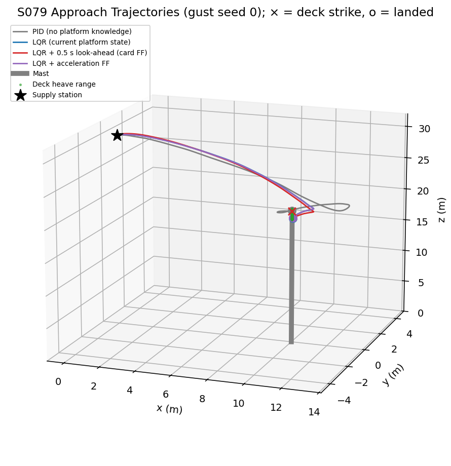
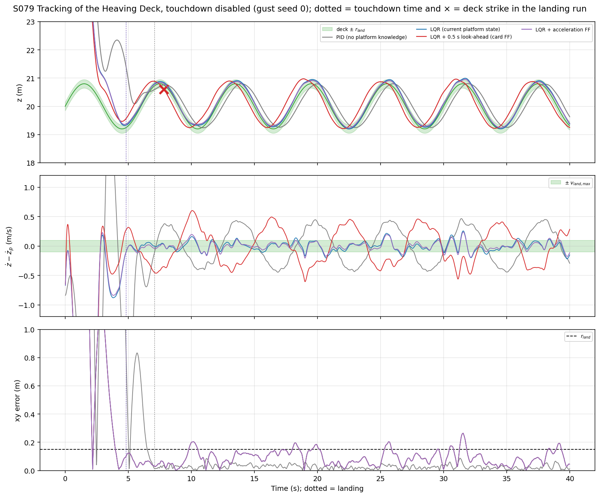
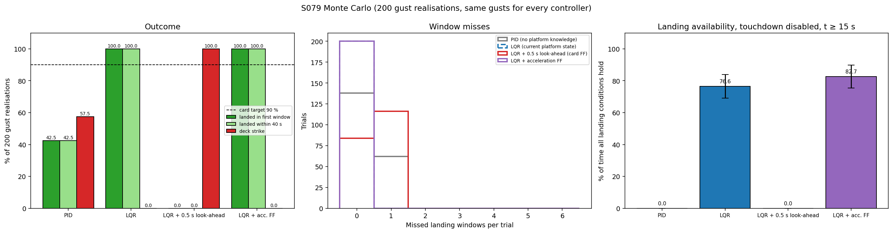
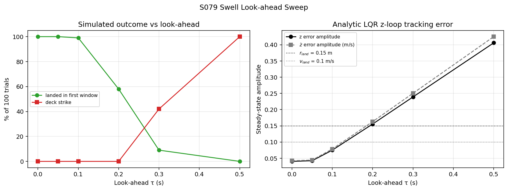
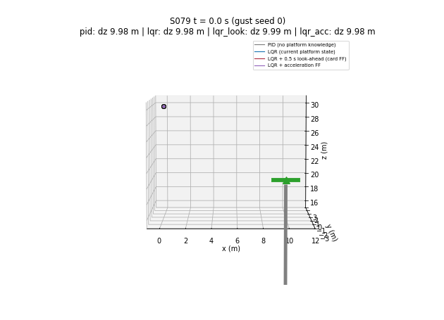

# S079 Offshore Wind Farm Installation Assistance

**Domain**: Industrial & Agriculture | **Difficulty**: ⭐⭐⭐ | **Status**: ✅ Completed

---

## Problem Definition

**Setup**: A delivery drone carries a component from a supply station at (0, 0, 30) m to the top of an installation mast at (10, 0) m. The mast's deck heaves with the swell:

$$z_p(t) = 20 + 0.8\sin(2\pi t/6)\ \text{m}$$

Its peak speed is 0.838 m/s and its peak acceleration 0.877 m/s². Horizontal gusts of $\sigma_w = 0.05$ m/s are added to the drone's horizontal velocity every 0.02 s step. A touchdown succeeds when, inside a 3 s landing window, the horizontal error and $|z - z_p|$ are both ≤ 0.15 m and the relative vertical speed $|\dot z - \dot z_p|$ is ≤ 0.1 m/s.

**Controllers compared** (same gust realisations for all):
1. **PID**: cascaded position PID on the error to the current deck position, with derivative on the measured velocity, so it does not know the deck motion.
2. **LQR**: tracks the current deck position **and velocity** (the card's "LQR without feedforward").
3. **LQR + 0.5 s look-ahead** (card's proposed method): the reference is the deck state 0.5 s ahead.
4. **LQR + acceleration feedforward** (added): LQR reference as in 2, plus thrust feedforward $m\ddot z_p(t)$.

---

## Mathematical Model Summary

### Drone model

The card's 10-state linearised quadrotor: state $(p_x, p_y, p_z, v_x, v_y, v_z, \phi, \theta, \dot\phi, \dot\theta)$, inputs (thrust deviation from hover, $\tau_\phi$, $\tau_\theta$). It uses $\dot v_x = g\theta$, $\dot v_y = -g\phi$, $\dot v_z = T/m$, $\ddot\phi = \tau_\phi/I_{xx}$ and $\ddot\theta = \tau_\theta/I_{yy}$. The model is discretised exactly (zero-order hold) at 50 Hz. Attitude is clipped at ±0.4 rad and total thrust to $[0, 2mg]$.

### Discrete LQR

$$K = (R\Delta t + B_d^\top P B_d)^{-1} B_d^\top P A_d, \qquad P = \text{DARE}(A_d, B_d, Q\Delta t, R\Delta t), \qquad \mathbf{u} = -K(\mathbf{x} - \mathbf{x}_{ref})$$

With the card's $Q = \text{diag}(20, 20, 50, 3, 3, 8, 5, 5, 1, 1)$ and $R = \text{diag}(0.1, 1, 1)$, the continuous-time gain applied at 50 Hz is unstable (spectral radius 1.1772 with the exact plant; 0.9995 with Euler integration, marginal). The discrete gain gives 0.9504. The $z$-loop gains are $k_z = 20.00$ and $k_{v_z} = 10.20$; the continuous values are 22.36 and 11.17.

### Why a look-ahead hurts

The reference is $\mathbf{x}_{ref} = (10, 0, z_p(t+\tau) + h, 0, 0, \dot z_p(t+\tau), 0, 0, 0, 0)$. Because the $z$ loop also tracks the deck velocity, its closed-loop transfer from the deck to the drone is

$$H(s) = \frac{k_z + k_{v_z}s}{s^2 + k_{v_z}s + k_z}\,e^{s\tau}$$

and the steady-state error amplitude is $A_{swell}|H(i\omega) - 1|$:

| Look-ahead τ (s) | 0 | 0.05 | 0.10 | 0.20 | 0.30 | 0.50 |
|---|---|---|---|---|---|---|
| $z$ error amplitude (m) | 0.040 | 0.042 | 0.075 | 0.156 | 0.239 | **0.406** |
| $\dot z$ error amplitude (m/s) | 0.042 | 0.044 | 0.079 | 0.163 | 0.250 | **0.425** |

The loop has almost no lag to cancel, so a 0.5 s look-ahead makes the drone **lead** the deck by about 0.5 s. The PID loop, which ignores the deck velocity, has an error amplitude of 0.402 m (0.420 m/s).

### Approach and landing logic (added)

- **Glide slope**: the reference height is $z_p + 1.0 \cdot d_{xy}$, where $d_{xy}$ is the horizontal distance to the target. The drone approaches from above and descends onto the deck as it centres over it. This applies to every controller.
- **Arming**: the landing window logic is armed once the drone is within 1 m of the target. A window opens at the first time $|\Delta\dot z| \le 0.1$ m/s and lasts 3 s. Touchdown happens at the first instant all three conditions hold; otherwise the window counts as a miss.
- **Deck strike**: a deck strike ends the trial as a failure. It happens when the drone is within 1 m horizontally of the target and more than $r_{land}$ below the deck.

---

## Key Parameters

| Parameter | Value |
|-----------|-------|
| Swell amplitude / period | 0.8 m / 6 s |
| Mast height / target | 20 m / (10, 0) m |
| Start | (0, 0, 30) m |
| $r_{land}$ / $v_{land,max}$ / window | 0.15 m / 0.1 m/s / 3 s |
| Look-ahead τ | 0.5 s (sweep 0, 0.05, 0.1, 0.2, 0.3, 0.5 s) |
| Gust σ_w | 0.05 m/s per 0.02 s step, horizontal |
| Mass / $I_{xx} = I_{yy}$ | 1.0 kg / 0.01 kg·m² |
| LQR $Q$ / $R$ | diag(20, 20, 50, 3, 3, 8, 5, 5, 1, 1) / diag(0.1, 1, 1), discrete-time |
| Attitude clip / thrust range | ±0.4 rad / [0, 2mg] |
| Time step / horizon | 0.02 s / 40 s |
| Monte Carlo | 200 gust realisations (seeds 0–199), shared by all controllers; look-ahead sweep 100 |
| PID (added) | outer $k_p$ = 22.36, $k_i$ = 2.0 (integrator clamp ±0.5 m·s), $k_d$ = 11.17 on velocity; inner attitude PD 400 s⁻², 40 s⁻¹ |
| Glide slope / arming radius / deck radius (added) | 1.0 m per m / 1.0 m / 1.0 m |
| Landing-availability window (added) | track-only runs, $t \ge 15$ s |

---

## Implementation

```
src/04_industrial_agriculture/s079_offshore_wind.py   # Main simulation script
```

```bash
conda activate drones
python src/04_industrial_agriculture/s079_offshore_wind.py
```

Runtime ≈ 15–50 s (14–50 s measured, depending on how many other simulations shared the CPU). All trials of one controller run in a single vectorised loop.

---

## Results

### Monte Carlo, 200 gust realisations

| Controller | Landed in first window | Landed by 40 s | Deck strike | Window misses | Landing time | Touchdown xy / z / $\lvert\Delta\dot z\rvert$ |
|---|---:|---:|---:|---:|---:|---|
| PID | 42.5 % | 42.5 % | 57.5 % | 0.31 ± 0.46 | 7.42 ± 0.22 s | 0.045 m / 0.076 m / 0.090 m/s |
| **LQR** | **100.0 %** | **100.0 %** | 0.0 % | 0.00 | 5.50 ± 0.36 s | 0.083 m / 0.083 m / 0.089 m/s |
| LQR + 0.5 s look-ahead (card FF) | **0.0 %** | 0.0 % | **100.0 %** | 0.58 ± 0.49 | — | — |
| **LQR + acceleration FF** | **100.0 %** | **100.0 %** | 0.0 % | 0.00 | 5.62 ± 0.41 s | 0.078 m / 0.103 m / 0.091 m/s |

LQR and LQR + acceleration FF both land in all 200 trials (paired: both 200, neither alone 0), so landing success **cannot** separate them. To compare them, the touchdown is disabled and each controller keeps tracking the deck for 40 s. The measure is how often all three landing conditions hold from $t \ge 15$ s:

| Controller | Time with landing conditions met | RMS $\lvert z - z_p\rvert$ | RMS $\lvert\Delta\dot z\rvert$ |
|---|---:|---:|---:|
| PID | 0.0 ± 0.0 % | 0.290 m | 0.293 m/s |
| LQR | 76.6 ± 7.4 % | 0.092 m | 0.072 m/s |
| LQR + 0.5 s look-ahead | 0.0 ± 0.0 % | 0.298 m | 0.307 m/s |
| **LQR + acceleration FF** | **82.7 ± 7.2 %** | **0.088 m** | **0.066 m/s** |

Acceleration FF beats plain LQR in 192 of 200 paired trials, ties in 1 and loses in 7. The RMS $z$ error includes the glide-slope offset (1 m per m of horizontal gust error), so it is larger than the 0.040 m swell-tracking amplitude.

**Key findings**:
- **The card's expectation is reversed.** The card expects LQR + look-ahead to land in ≥ 90 % of trials and plain LQR in ≤ 60 %. The simulation gives 0 % for LQR + look-ahead (100 % deck strikes) and 100 % for plain LQR. The look-ahead shifts the reference 0.5 s into the future, but the LQR loop tracks the deck's position and velocity with almost no lag. The drone then rises and sinks about 0.5 s ahead of the deck (0.406 m error amplitude), and the deck meets it from below.
- **Look-ahead sweep**: landing in the first window drops from 100 % at τ = 0 and 0.05 s to 99 % at 0.1 s, 58 % at 0.2 s, 9 % at 0.3 s and 0 % at 0.5 s. Deck strikes start at 0.3 s (42 %) and reach 100 % at 0.5 s. This matches the analytic error amplitudes, which cross $r_{land}$ = 0.15 m at about τ = 0.2 s.
- **Feedforward of the swell rate is what matters.** Plain LQR already has velocity feedforward ($\dot z_p$ in the reference). Adding acceleration feedforward $m\ddot z_p$ raises the time with landing conditions met from 76.6 % to 82.7 %. The rest is limited by the horizontal gusts, which feedforward cannot predict.
- **PID without deck knowledge fails often.** Its $z$ error amplitude is 0.402 m. It lands only when it happens to cross the deck gently near a crest (42.5 %) and strikes the deck in 57.5 % of trials. In track-only runs it never meets the landing conditions after 15 s. Its 42.5 % depends on the added glide slope: without it, PID lands in 0.0 % of trials and strikes the deck in 100.0 % (ablation below).
- **Card code issues, verified numerically**: the card's thrust law lacks gravity compensation (steady sag $mg/k_z$ = 0.439 m), and its continuous LQR gain is unstable at 50 Hz on the exact plant (spectral radius 1.1772). Both are fixed and the card is annotated.

### 3D Approach Trajectories (gust seed 0)



### Vertical Tracking (gust seed 0, touchdown disabled)

Altitude, relative vertical speed and horizontal error over 40 s. Dotted lines mark the touchdown time and × marks the deck strike in the landing run:



### Monte Carlo

Left: outcomes. Middle: missed windows (LQR, dashed, coincides with acceleration FF at 0). Right: landing availability in track-only runs:



### Look-ahead Sweep



### Animation

Side-on 3D view, gust seed 0. The green deck heaves; each controller's drone approaches until it lands or strikes the deck (41 frames, 0.2 s per frame):



### Deviations from the scenario card

| Card | Implementation | Reason |
|------|----------------|--------|
| Continuous-time LQR gain, Euler integration at 50 Hz | Discrete-time LQR (DARE with $Q\Delta t$, $R\Delta t$) on the exact ZOH plant | The continuous gain is unstable on the exact plant at 50 Hz (1.1772) and only marginally stable with Euler (0.9995). Card annotated. |
| `az = u[0]/MASS - G` (no hover thrust) | $u_0$ is the thrust deviation from $mg$ | Otherwise the drone sags 0.439 m. Card annotated. |
| Two controllers in the card's code (LQR+FF, LQR); PID listed but not specified | Four: PID (specified here), LQR, LQR + look-ahead, LQR + acceleration FF | The card lists PID. Acceleration FF is the standard model-based feedforward and shows what feedforward can achieve here. |
| Window opens at the first $\lvert\Delta\dot z\rvert \le v_{land}$ anywhere | Armed within 1 m of the target | Otherwise a window can open and be "missed" while the drone is still in transit. |
| Reference = deck point from the start | Glide slope $z_p + 1.0\,d_{xy}$ | Without it, the drone descends to deck height while still several metres from the mast and approaches the deck sideways. Printed ablation without the glide slope (200 trials), first-window landing / deck strike: PID 0.0 % / 100.0 % (vs 42.5 % / 57.5 % with it), LQR 100.0 % / 0.0 %, LQR + look-ahead 0.0 % / 100.0 %, LQR + acceleration FF 99.5 % / 0.0 %. The three LQR variants barely change; PID's partial success needs the glide slope. |
| No deck collision | Deck strike if more than $r_{land}$ below the deck within 1 m horizontally | A drone below the moving deck has hit it. |
| Expected MC success ≥ 90 % (LQR+FF), ≤ 60 % (LQR) | 0.0 % and 100.0 % | Reported as is (X6); verified analytically and with a look-ahead sweep (X7). Card annotated. |
| Card targets for seed 0 (LQR+FF lands, 0 misses, peak $\lvert\Delta\dot z\rvert$ < 0.5 m/s) | LQR+FF strikes the deck at seed 0 | Follows from the look-ahead error above. |
| Single success metric | Success, deck strikes, misses, plus landing availability in track-only runs | Success is 100 % for two controllers, so it cannot rank them (X3). |
| Added parameters | Glide slope 1.0, arming radius 1 m, deck radius 1 m, PID gains, integrator clamp 0.5, thrust range [0, 2mg], availability window $t \ge 15$ s | Needed for a complete, fair simulation; not in the card. |

---

## Extensions

1. **Irregular sea**: JONSWAP spectrum instead of one sinusoid; acceleration feedforward then needs a short-horizon wave predictor.
2. **Estimated swell**: estimate amplitude, period and phase online from a drone-to-deck rangefinder; measure the landing availability lost during convergence.
3. **Commit-to-land logic**: descend only after a predicted calm interval, rather than accepting the first instant that meets the tolerances.
4. **Gust rejection**: add a disturbance observer for the horizontal channel, which now limits availability.
5. **Optimal look-ahead**: tune τ to the actual closed-loop delay (here about 0 s) instead of a fixed 0.5 s.

---

## Related Scenarios

- Prerequisites: [S062 Wind Turbine Blade Inspection](../../../scenarios/04_industrial_agriculture/S062_wind_turbine.md), [S066 Cooperative Crane Simulation](../../../scenarios/04_industrial_agriculture/S066_cooperative_crane.md)
- Cross-reference: [S058 Typhoon Eye Probing](../../../scenarios/03_environmental_sar/S058_typhoon.md), [S023 Moving Landing Pad](../../../scenarios/02_logistics_delivery/S023_moving_landing_pad.md)
- Follow-ups: [S095 Water Surface Landing Simulation](../../../scenarios/05_special_entertainment/S095_water_landing.md)
