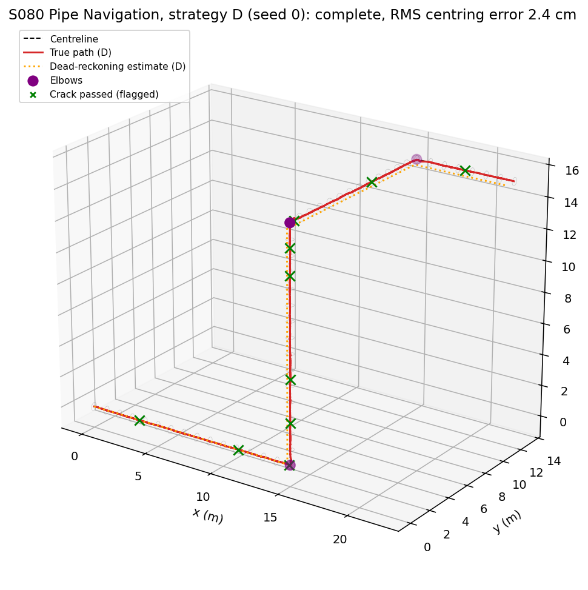
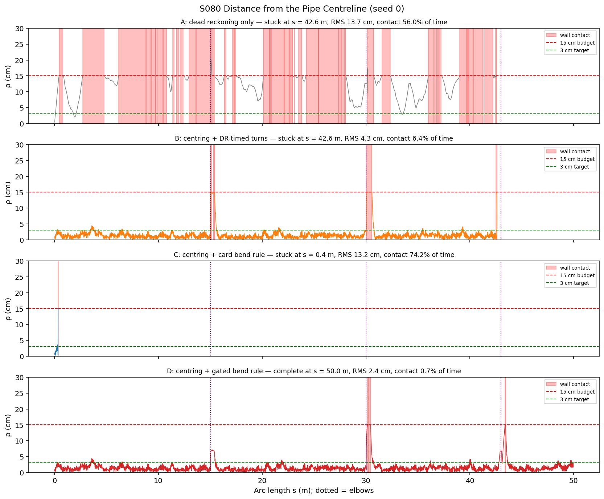
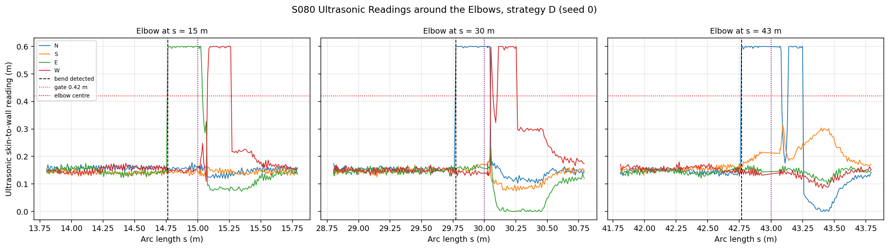
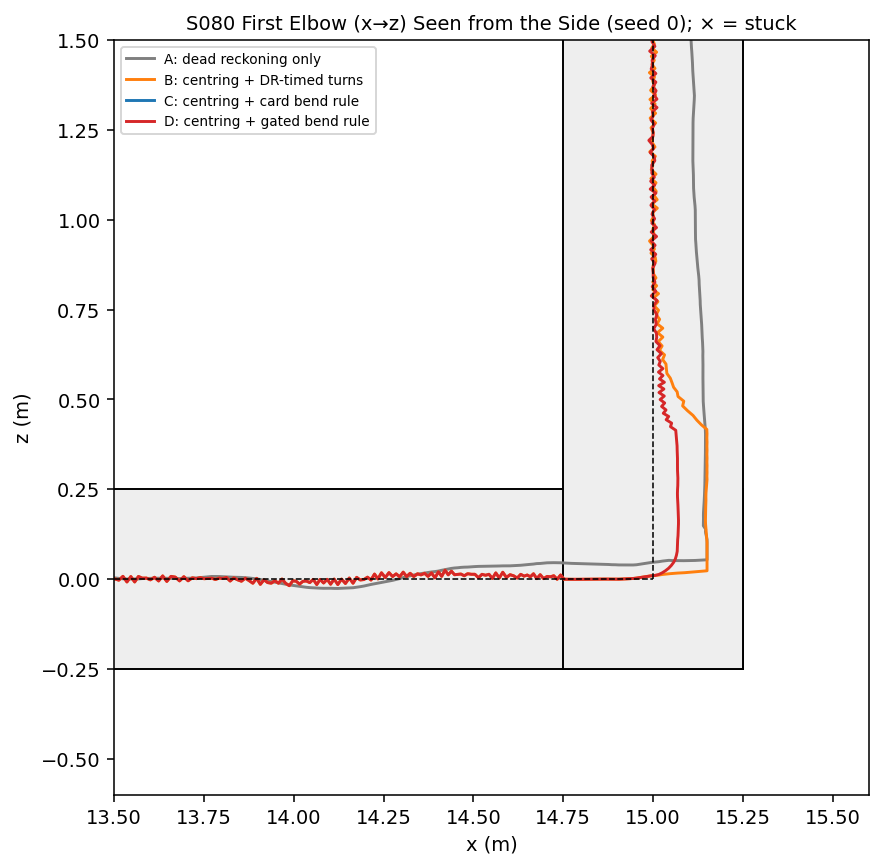
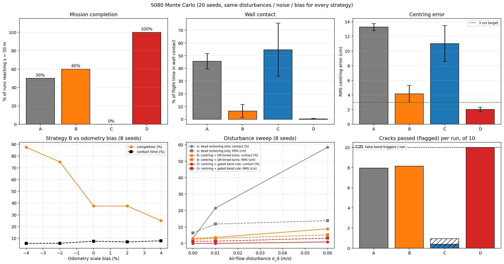
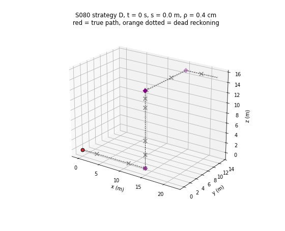

# S080 Underground Pipe CCTV Replacement

**Domain**: Industrial & Agriculture | **Difficulty**: ⭐⭐⭐⭐ | **Status**: ✅ Completed

---

## Problem Definition

**Setup**: A micro-drone (body diameter 0.20 m) replaces a CCTV crawler in a 50 m sewer pipe with an inner diameter of 0.50 m. The pipe has three 90° mitre elbows at arc lengths 15, 30 and 43 m. Its legs run +x (0–15 m), +z (15–30 m), +y (30–43 m) and +x (43–50 m). GPS is denied. The drone advances at 0.2 m/s and carries four body-frame ultrasonic rangers (N, S, E, W) with σ = 5 mm noise, plus a forward camera that flags ten seeded crack patches. A slowly varying air flow in the pipe pushes the drone around. Its centre must stay within 0.15 m of the centreline, otherwise the body touches the wall.

**Objective (card)**: traverse the full pipe without wall contact (coverage ≥ 95 %), keep the RMS centring error ≤ 3 cm, and flag the cracks.

**Strategies compared** (same disturbance, sensor noise, speed bias and cracks for every strategy of a seed):
- **A: dead reckoning only.** No ultrasonic feedback. The drone follows the pipe map and turns when its dead-reckoned arc length reaches an elbow.
- **B: ultrasonic PD centring + DR-timed turns.** Card centring, but the map turns are triggered by dead reckoning.
- **C: ultrasonic PD centring + the card's bend rule.** Turn at once toward the larger reading when $|d_k - d_{opp}| > 6$ cm.
- **D: ultrasonic PD centring + gated bend rule.** A bend is detected only when a reading is longer than any straight pipe allows (> 0.42 m). The drone then advances one pipe radius (0.25 m) to the elbow centre and blends the heading over 0.5 s.

---

## Mathematical Model Summary

### Pipe and drone

The pipe interior is the union of four cylinders of radius $R = 0.25$ m around the legs. Each cylinder extends one radius past its elbow, which forms a mitre-like corner box. The drone centre must stay where the whole body fits inside one of them: radial offset $\le R - r_{drone} = 0.15$ m and at least $r_{drone}$ from the end walls. Kinematics follow the card, plus a disturbance:

$$\dot{\mathbf{p}} = v\,\hat{\mathbf{h}} + u_x\hat{\mathbf{e}}_x + u_y\hat{\mathbf{e}}_y + \mathbf{w}(t), \qquad \mathbf{w}_{k+1} = \phi\,\mathbf{w}_k + \sigma_d\sqrt{1-\phi^2}\,\boldsymbol{\xi}_k,\quad \phi = e^{-\Delta t/\tau_d}$$

$\mathbf{w}$ is an Ornstein–Uhlenbeck air-flow disturbance (3D, $\sigma_d$ = 0.03 m/s, $\tau_d$ = 2 s). If a step would put the body through the wall, the drone is placed at the nearest allowed point (it slides along the wall). That step counts as **wall contact** ($\rho > 0.15$ m in the card's terms). A run is **stuck** if the arc length gains less than 5 cm in 10 s.

### Ultrasonic readings

Each sensor ray is cast from the drone centre along $\pm\hat{\mathbf{e}}_y$ (N/S) and $\pm\hat{\mathbf{e}}_x$ (E/W), and its exit from the union of cylinders is found exactly (ray–cylinder intersection, iterated across cylinders):

$$d_k = \min\bigl(t_{exit} - r_{drone} + \eta_k,\ 0.6\ \text{m}\bigr), \qquad \eta_k \sim \mathcal{N}(0, 0.005^2)$$

A centred drone reads 0.150 m. In a straight leg a reading can never exceed $2R - r_{drone} = 0.40$ m. Looking into an elbow opening, it saturates at 0.600 m.

### Centring (card PD)

$$e_y = d_N - d_S,\quad e_x = d_E - d_W,\qquad u = \text{clip}(K_p e + K_d \dot e,\ \pm 0.3\ \text{m/s}),\quad K_p = 2.0,\ K_d = 0.4$$

In B and D, an axis with a reading above 0.42 m is not centred, because that "wall" is an opening; centring on it pulls the drone into the elbow early. The card's C uses the raw rule.

### Bend rules

- **C (card)**: trigger when $|d_k - d_{opp}| > 0.06$ m; turn at once toward the larger reading.
- **D (gated)**: trigger when $\max_k d_k > 0.42$ m. Advance 0.25 m, then SLERP the heading to $\hat{\mathbf{n}}_{bend}$ over 0.5 s, and keep the axis along the bend out of the centring loop until the turn ends.
- **A, B (map)**: turn to the next mapped heading when the dead-reckoned arc length reaches the elbow, $\hat s_{k+1} = \hat s_k + v(1 + b)\Delta t + \eta_v\Delta t$. Here $b$ is a speed-calibration bias, $\mathcal{N}(0, 2\%)$ per seed. As in the card, dead reckoning integrates the **commanded** speed, so it misses the air-flow disturbance.

The new heading is $\hat{\mathbf{h}}_{new} = \hat{\mathbf{n}}_{bend}$. The card's $\hat{\mathbf{h}} \times \hat{\mathbf{n}}_{bend}$ gives (0, −1, 0) for $+x \to +z$.

### Metrics

- RMS centring error $\bar e_{ctr} = \sqrt{\overline{\rho^2}}$, with $\rho$ the distance to the centreline polyline.
- Contact time fraction and contact events.
- Completion (reaching $s$ = 50 m).
- Cracks flagged, using the card's model: a crack within 0.3 m of the drone's arc length is flagged because its intensity $U(20, 60)$ is always below the threshold 80.

---

## Key Parameters

| Parameter | Value |
|-----------|-------|
| Pipe inner diameter / length | 0.50 m / 50 m |
| Elbows (arc length, turn) | 15 m (+x→+z), 30 m (+z→+y), 43 m (+y→+x) |
| Drone diameter / lateral budget | 0.20 m / 0.15 m |
| Advance speed $v$ | 0.20 m/s |
| Ultrasonic noise $\sigma_{wall}$ | 0.005 m; saturation 0.6 m (added) |
| $K_p$ / $K_d$ | 2.0 / 0.40; command limit ±0.3 m/s (added) |
| Card bend threshold $\Delta d_{bend}$ | 0.06 m |
| Gate / turn delay / refractory distance / settle distance (added) | 0.42 m / 0.25 m / 1.0 m / 0.3 m |
| Heading blend $t_{blend}$ | 0.5 s |
| Odometry noise $\sigma_v$ | 0.002 m/s |
| Speed-calibration bias $b$ (added) | $\mathcal{N}(0, 2\%)$ per seed; sweep −4, −2, 0, +2, +4 % |
| Air-flow disturbance (added) | OU, $\sigma_d$ = 0.03 m/s, $\tau_d$ = 2 s; sweep 0, 0.01, 0.06 m/s |
| Cracks | 10, $s \sim U(2, 48)$ m, intensity $U(20, 60)$, threshold 80, range 0.3 m |
| Time step / time limit / stuck rule | 0.05 s / 400 s / < 5 cm progress in 10 s |
| Monte Carlo | 20 seeds; sweeps 8 seeds per point. Each seed fixes the disturbance, sensor noise, odometry noise, bias and cracks for every strategy. |
| Example seed | 0 (bias +0.25 %) |

---

## Implementation

```
src/04_industrial_agriculture/s080_underground_pipe.py   # Main simulation script
```

```bash
conda activate drones
python src/04_industrial_agriculture/s080_underground_pipe.py
```

Runtime ≈ 3 min (170–182 s measured while other simulations shared the CPU).

---

## Results

### Monte Carlo, 20 seeds

| Strategy | Completed | Stuck | Mean $s$ reached | Contact time | Contact events | RMS centring error | Cracks flagged | False bend triggers |
|---|---:|---:|---:|---:|---:|---:|---:|---:|
| A: dead reckoning only | 50 % | 50 % | 38.7 m | 45.60 ± 6.01 % | 42.9 | 13.28 ± 0.49 cm | 8.0 / 10 | 0.00 |
| B: centring + DR-timed turns | 60 % | 40 % | 39.4 m | 6.51 ± 5.13 % | 2.8 | 4.16 ± 1.17 cm | 8.2 / 10 | 0.00 |
| C: centring + card bend rule | 0 % | 100 % | 3.0 m | 54.67 ± 20.79 % | 1.0 | 11.03 ± 2.46 cm | 0.4 / 10 | 0.95 |
| **D: centring + gated bend rule** | **100 %** | **0 %** | **50.0 m** | **0.27 ± 0.42 %** | 0.8 | **2.02 ± 0.30 cm** | **10.0 / 10** | 0.00 |

Paired by seed, D and B both complete 12 runs, only D completes 8, and only B completes 0.

### Example run, seed 0

| Strategy | Outcome | RMS ρ | Contact time (events) | Cracks | Final DR position error |
|---|---|---:|---:|---:|---:|
| A | stuck at s = 42.61 m after 223.6 s | 13.68 cm | 56.0 % (53) | 9/10 | 1.79 m |
| B | stuck at s = 42.62 m after 223.6 s | 4.27 cm | 6.4 % (5) | 9/10 | 1.79 m |
| C | stuck at s = 0.36 m after 11.8 s (false trigger) | 13.18 cm | 74.2 % (1) | 0/10 | 1.88 m |
| **D** | **complete, 244.7 s** | **2.36 cm** | 0.7 % (3) | **10/10** | 0.69 m |

**Key findings**:
- **Only the gated, sensor-based bend rule (D) is reliable.** It completed all 20 runs with an RMS centring error of 2.02 cm, meeting the card's 3 cm target, and flagged every crack. It is not contact-free, though. Contact lasts 0.27 % of the flight time (0.8 events per run), mostly just after the second and third elbows, where the drone exits the turn up to 15 cm off-centre (seed 0 centring plot). So the card's "zero wall contacts" target is not met.
- **The card's own bend rule (C) fails at once.** With 5 mm sensor noise and the card's PD gains, the drone often wanders 2–3 cm off-centre (seed 0 centring plot), and $|d_N - d_S| > 6$ cm fires in the straight pipe: 0.95 false triggers per run. The drone then turns into the wall and sticks, at a mean of 3.0 m. A real elbow would also be taken one radius (0.25 m) too early, because the asymmetry appears as soon as the opening comes into view.
- **Dead-reckoned turn timing (A, B) is the weak link without wall sensing.** Integrating the commanded speed ignores the air-flow disturbance and the speed bias. At seed 0, both A and B turned early at the third elbow (DR error 1.79 m at the end) and stuck at s ≈ 42.6 m. Centring (B) cuts contact time from 45.60 % to 6.51 % and the RMS error from 13.28 to 4.16 cm, but it cannot fix where the drone turns.
- **Late turns are recoverable, early turns are not.** For B, completion is 88 % with a −4 % bias, 75 % at −2 %, 38 % at 0 % and +2 %, and 25 % at +4 %. A negative bias makes dead reckoning underestimate the distance, so the drone reaches the elbow's end wall first. It slides there until dead reckoning catches up, then turns into the new leg. An early turn sends it into the side wall of the old leg, where it sticks. Even with zero bias, only 38 % of B runs complete, because the air flow alone shifts the dead-reckoned elbow positions.
- **Disturbance sweep.** With no air flow (σ_d = 0), A and B still fail 25 % of runs (75 % complete), only from the random speed bias. D completes 100 % at every disturbance level tested (0, 0.01, 0.06 m/s), with RMS 1.26, 1.32 and 3.19 cm and at most 0.90 % contact time. A's contact time rises from 3.06 % to 58.50 % as the air flow grows.
- **Crack detection is fixed by construction in the card's model.** Every crack the drone passes is flagged (intensity 20–60 < 80), so the crack count only measures how far the drone gets. It is not compared as a detection-quality metric.

### 3D Pipe Path (strategy D, seed 0)

Red: true path. Orange dotted: dead-reckoning estimate, which drifts 0.69 m by the end. Purple: elbows. Green ×: cracks passed:



### Centring Error (seed 0)

ρ against arc length for each strategy; red bands are wall contact:



### Ultrasonic Readings around the Elbows (strategy D, seed 0)

The reading toward the opening jumps from 0.15 m to saturation (0.6 m) one pipe radius before the elbow centre. The dashed line marks where the gated rule fires:



### First Elbow Seen from the Side (seed 0)

A and B turn at the dead-reckoned elbow; D turns at the elbow centre found by the sensors. C is not visible because it stuck at s = 0.36 m:



### Monte Carlo and Sweeps



### Animation

Strategy D, seed 0, 3D view: the true path in red and dead reckoning in orange. Cracks turn green when passed (197 frames, 1.25 s per frame):



### Deviations from the scenario card

| Card | Implementation | Reason |
|------|----------------|--------|
| Single navigation method; the card's code feeds the controller constant readings (placeholder) | Readings ray-cast against the real pipe and elbows; four strategies A–D compared | The card's code never senses the pipe, so it cannot test centring or bend detection. Comparing strategies answers whether the card's method works. |
| Bend rule $\lvert d_k - d_{opp}\rvert > 0.06$ m, turn at once (C, kept) | Added D: gate 0.42 m, 0.25 m delay, refractory 1 m | C false-triggers 0.95 times per run and completes 0 %. Card annotated. |
| $\hat{\mathbf{h}}_{new} = \hat{\mathbf{h}} \times \hat{\mathbf{n}}_{bend}$ | $\hat{\mathbf{h}}_{new} = \hat{\mathbf{n}}_{bend}$ | The cross product gives (0, −1, 0) for a +x→+z bend (printed by the script). Card corrected. |
| $d_k^{true} = r_{clear} - \delta_k$ | Skin distance $R - r_{drone} - \delta_k$ (by ray casting) | The card's formula gives 0.25 m for a centred drone, contradicting its own 0.15 m. Card corrected. |
| $\sigma_{DR} = \sigma_v\sqrt{t}$ = 0.032 m at 250 s | Noise-only error $\sigma_v\sqrt{\Delta t\,t}$ = 0.0071 m; the dominant DR error is commanded-vs-actual speed (bias, disturbance) | Dimensionally corrected; final DR errors of 0.69–1.88 m at seed 0. Card annotated. |
| Planar DR $(\cos\hat\theta, \sin\hat\theta, 0)$ | DR along the 3D heading | The pipe has a vertical leg. |
| No disturbance other than 0.002 m/s velocity noise | OU air flow ($\sigma_d$ = 0.03 m/s, $\tau_d$ = 2 s), speed bias $\mathcal{N}(0, 2\%)$; both swept | Without them, every strategy trivially succeeds. The sweeps show how the ranking depends on them (D is unaffected). |
| Card code clamps the drone to the budget and keeps going | Same clamp (sliding along the wall), plus stuck detection | An early turn drives the drone into a side wall it cannot leave. |
| Elbow planes ['xz', 'xy', 'xz'] | ['xz', 'yz', 'xy'] | Matches the card's own leg headings. Card corrected. |
| Crack detection by frame intensity | Card model kept (always flagged when within 0.3 m) | Reported as "cracks passed", not as detection quality. |
| "Wall contact count (target = 0)" | Contact time fraction and contact events | D has 0.8 contact events per run, so the target is not met; reported. |
| Single run | Seed 0 for the figures; 20-seed Monte Carlo and 8-seed sweeps with common random numbers | X2. |

---

## Extensions

1. **Rounded elbows** with a bend radius, where the opening appears gradually and the gate must be tuned.
2. **Turn-exit centring**: reduce contact after the turn by blending the lateral reference instead of switching it.
3. **Ultrasonic odometry**: estimate arc length from the elbow detections (known 15 / 15 / 13 / 7 m legs) to reset dead reckoning.
4. **Image-based crack detection** with a rendered wall texture, so detection depends on the drone's offset and speed.
5. **Partial blockage**: stop when all four readings drop below 8 cm.

---

## Related Scenarios

- Prerequisites: [S064 Greenhouse Interior Precision Flight](../../../scenarios/04_industrial_agriculture/S064_greenhouse.md), [S074 Mine 3D Mapping](../../../scenarios/04_industrial_agriculture/S074_mine_mapping.md)
- Cross-reference: [S071 Bridge Underside Structural Inspection](../../../scenarios/04_industrial_agriculture/S071_bridge_inspection.md), [S069 Automated Warehouse Inventory](../../../scenarios/04_industrial_agriculture/S069_warehouse_inventory.md), [S008 Stochastic Pursuit — Kalman Filter Tracking](../../../scenarios/01_pursuit_evasion/S008_stochastic_pursuit.md)
