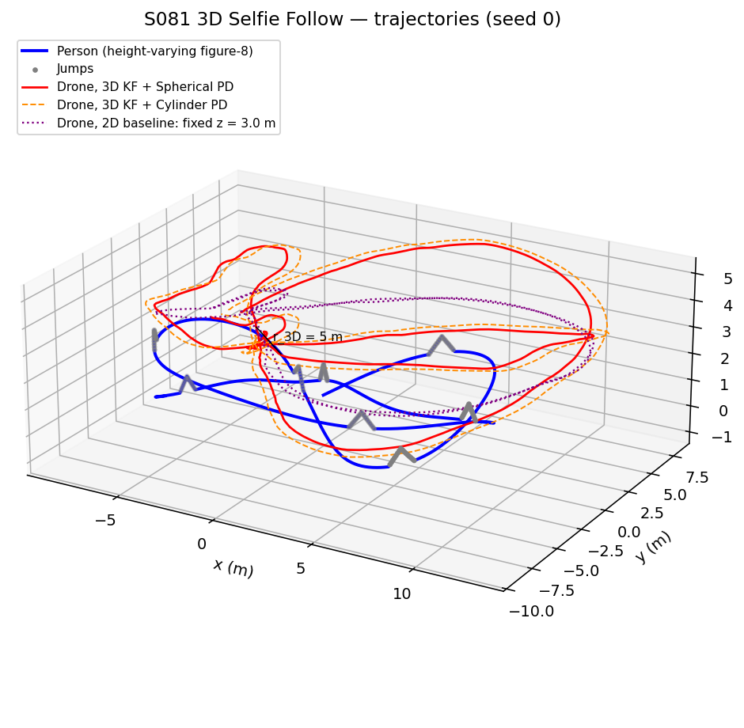
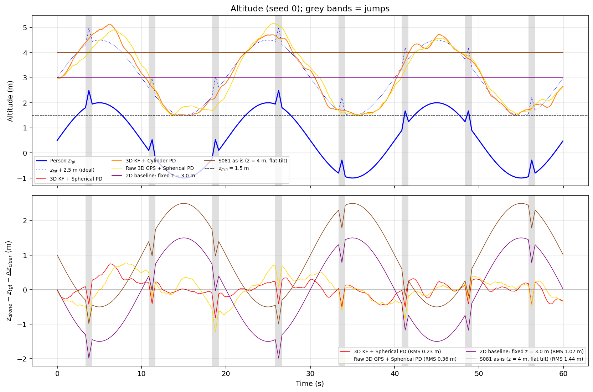
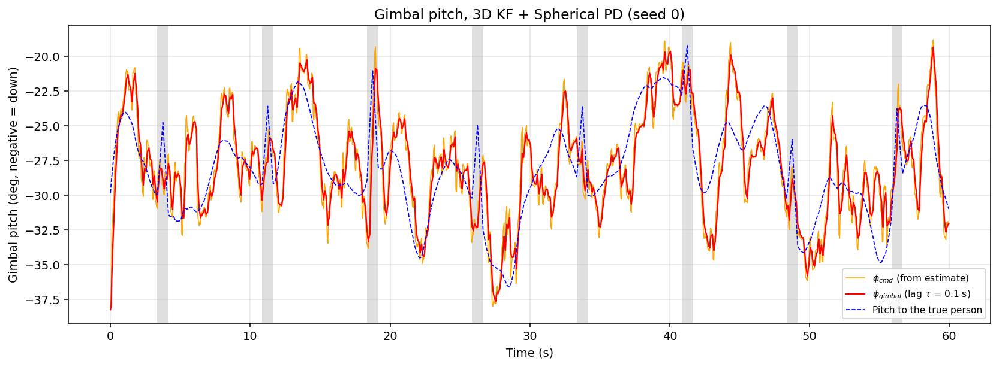
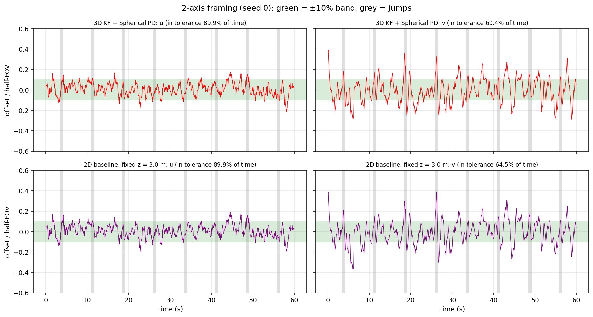
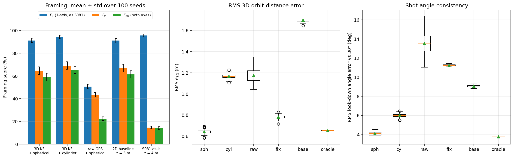
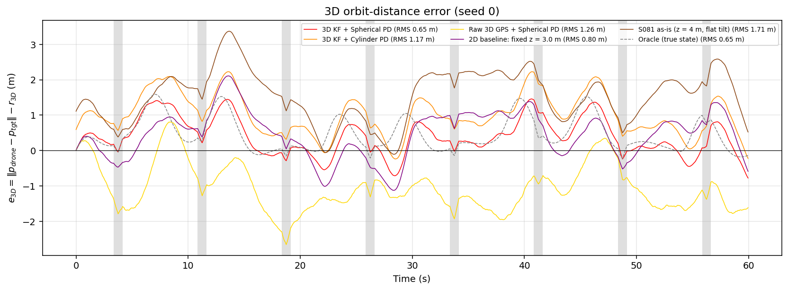
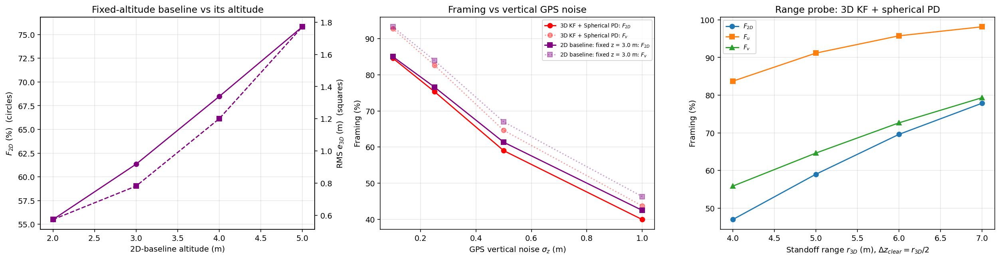
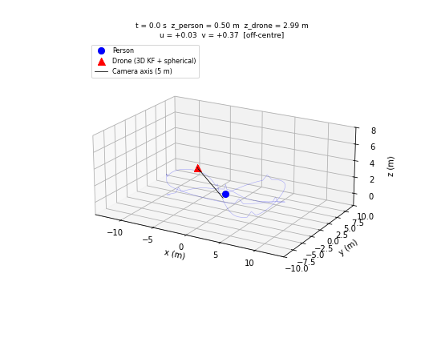

# S081 3D Upgrade — Selfie Follow Mode

**Domain**: Special Ops & Entertainment | **Difficulty**: ⭐⭐⭐ | **Status**: ✅ Completed
**Based on**: [S081 Selfie Follow Mode](../../s081_selfie_follow/README.md) (2D version)

---

## Problem Definition

**Setup**: The S081 person walks the same figure-8 ($R = 8$ m, exactly 1.5 m/s by arc-length parameterisation), but now over ground that rises and falls: $z_{tgt}(t) = 0.5 + 1.5\sin(2\pi t/20)$ m plus eight 0.6 m / 0.8 s triangular jumps (every 7.5 s from $t = 3.75$ s). The person's altitude spans −1.00 to 2.49 m (z is measured from a reference plane; the path dips below it), with vertical speeds up to 1.95 m/s. GPS reports all three coordinates at 10 Hz ($\sigma_{xy} = 0.3$ m, $\sigma_z = 0.5$ m).

The drone must keep a 3D standoff of $r_{3D} = 5$ m at a vertical clearance of 2.5 m (a 30° look-down angle) and a bearing of 135° behind-left of the person's heading, inside $z \in [1.5, 8]$ m. Its **altitude is now a controlled state**: $z_d = \text{clip}(\hat z_{tgt} + 2.5, 1.5, 8)$ is tracked by a separate vertical PD. A gimbal tilts the camera toward the estimate (first-order lag, $\tau = 0.1$ s), and the person must be centred on **both** image axes ($|u| \le 0.1$ and $|v| \le 0.1$ of the half field of view, i.e. within 3.0° horizontally and 2.25° vertically).

**Strategies** (same GPS noise per seed for every strategy, 100 seeds):

| Key | Estimator | Horizontal standoff | Altitude | Source |
|---|---|---|---|---|
| `sph` | 6-state KF | spherical, $r_{xy} = \sqrt{5^2 - 2.5^2} = 4.330$ m | tracks $\hat z + 2.5$ | card 1 (nominal) |
| `cyl` | 6-state KF | cylindrical, $r_{xy} = 5$ m | tracks $\hat z + 2.5$ | card 2 |
| `raw` | raw 3D fixes, one-step finite-difference velocity | spherical | tracks $\hat z + 2.5$ | card 3 |
| `fix` | 6-state KF, gimbal on $\hat z$ | spherical | **held at 3.0 m** ($= h_{base} + \Delta z_{clear}$) | added: 2D baseline (X5) |
| `base` | S081 exactly: horizontal KF, no $z$ estimate | 5 m | held at 4 m; gimbal aimed at the flat-ground height $h_{base}$ | added: S081 as built |
| `oracle` | true 3D state | spherical | tracks $z_{tgt} + 2.5$ | added: controller floor |

The horizontal channel is identical to S081 (same PD, same 6 m/s² / 10 m/s limits). Because the KF axes are independent (diagonal $Q$ and $R$), the 6-state KF gives exactly the S081 horizontal estimate: run on the same xy noise, the 2D script's KF and the `base` strategy differ by 0.0e+00 m in estimate and drone path (printed and asserted). `sph` and `fix` fly the **same horizontal path** on every seed (asserted) — the only difference between them is whether altitude is controlled.

---

## Mathematical Model

**Person**: $x = R\sin s$, $y = \tfrac R2 \sin 2s$ with arc length $= v t$ (from S081); $z_{tgt} = h_{base} + \Delta h\sin(2\pi t/T_{elev}) + \sum_i \Delta h_{jump}\Lambda\bigl((t - t_i)/(T_{jump}/2)\bigr)$.

**6-state KF**: $\mathbf{x} = [x, y, z, v_x, v_y, v_z]$, constant velocity, $Q = \mathrm{diag}(q^2\Delta t^3/3,\; q^2\Delta t)$ per axis with $q_{xy} = 0.5$, $q_z = 0.8$ m/s², $R_{gps} = \mathrm{diag}(0.3^2, 0.3^2, 0.5^2)$.

**Set-point**: $\mathbf{p}_d = [\hat x + r_{xy}\cos(\hat\theta + \varphi),\; \hat y + r_{xy}\sin(\hat\theta + \varphi),\; \text{clip}(\hat z + \Delta z_{clear}, z_{min}, z_{max})]$, $\hat\theta = \text{atan2}(\hat v_y, \hat v_x)$.

**Control**: horizontal $\mathbf{a}_{xy} = \text{sat}_{6}\bigl(K_p\mathbf{e}_{xy} + K_d(\dot{\mathbf{p}}_{d,xy} - \mathbf{v}_{xy})\bigr)$ (S081); vertical $a_z = \text{sat}_{4}\bigl(K_{p,z}e_z + K_{d,z}(\dot z_d - v_z)\bigr)$ with $|v_z| \le 3$ m/s and a braking envelope $|v_z| \le \sqrt{a_{z,max}\,d}$ toward the altitude bound at distance $d$; $\dot{\mathbf v} = \mathbf a - c_{drag}\mathbf v$.

**Camera**: yaw $\psi = \text{atan2}(\hat y - y, \hat x - x)$ (instant, as in S081); pitch command $\phi_{cmd} = \text{atan2}(\hat z - z, d_{h})$, gimbal $\phi \leftarrow \phi + (1 - e^{-\Delta t/\tau})(\phi_{cmd} - \phi)$. With look vector $\hat{\mathbf l}(\psi, \phi)$, right $\hat{\mathbf n}_r = [\sin\psi, -\cos\psi, 0]$, up $\hat{\mathbf n}_u = \hat{\mathbf n}_r \times \hat{\mathbf l}$ and $\boldsymbol\delta = \mathbf p_{tgt} - \mathbf p_{drone}$ (true person):

$$u = \frac{\text{atan2}(\boldsymbol\delta\cdot\hat{\mathbf n}_r,\ \boldsymbol\delta\cdot\hat{\mathbf l})}{30°},\quad v = \frac{\text{atan2}(\boldsymbol\delta\cdot\hat{\mathbf n}_u,\ \boldsymbol\delta\cdot\hat{\mathbf l})}{22.5°},\quad F_{2D} = \overline{\mathbf 1[|u| \le 0.1 \wedge |v| \le 0.1]}$$

**Geometry metrics**: $e_{3D} = \|\mathbf p_{drone} - \mathbf p_{tgt}\| - 5$; vertical clearance error $z_{drone} - z_{tgt} - 2.5$; look-down angle error $\text{atan2}(z_{drone} - z_{tgt}, d_h) - 30°$.

---

## Key Parameters

| Parameter | Value | Source |
|---|---|---|
| Figure-8 $R$ / speed | 8.0 m / 1.5 m/s | card |
| $h_{base}$ / $\Delta h$ / $T_{elev}$ | 0.5 m / 1.5 m / 20 s | card |
| Jump amplitude / duration | 0.6 m / 0.8 s | card |
| Jump times | 3.75 + 7.5 k s, k = 0…7 | added (card: "occasionally") |
| GPS $\sigma_{xy}$ / $\sigma_z$ / rate | 0.3 m / 0.5 m / 10 Hz | card |
| $r_{3D}$ / $\Delta z_{clear}$ / $r_{xy}$ | 5.0 / 2.5 / 4.330 m | card |
| Bearing $\varphi$ | 135° | card |
| Altitude bounds | 1.5 – 8.0 m | card |
| FOV h / v, tolerance | 60° / 45°, ±10 % | card |
| KF $q_{xy}$ / $q_z$ | 0.5 / 0.8 m/s² | card |
| $K_p$ / $K_d$ / $K_{p,z}$ / $K_{d,z}$ | 1.5 / 0.8 / 1.0 / 0.5 | card |
| $c_{drag}$ / $\tau_{gimbal}$ | 0.3 s⁻¹ / 0.1 s | card |
| $\Delta t$ / $T$ | 0.05 s / 60 s | card |
| Horizontal $a_{max}$ / $v_{max}$ | 6 m/s² / 10 m/s | added in S081 |
| Vertical $a_{z,max}$ / $v_{z,max}$ | 4 m/s² / 3 m/s | added (swept 2, 4, 8, ∞) |
| 2D-baseline altitude | 3.0 m | added (swept 2, 3, 4, 5 m) |
| S081 as-is | z = 4 m, r = 5 m | S081 |
| Monte Carlo | 100 seeds, seed $s$ noise from `default_rng(2026 + s)` | added |
| Sweeps | $\sigma_z$ = 0.1, 0.25, 0.5, 1.0 m; $r_{3D}$ = 4, 5, 6, 7 m; no-jump and $\tau = 0$ ablations | added |

---

## Implementation

```
src/05_special_entertainment/3d/s081_3d_selfie_follow.py
```

```bash
conda activate drones
python src/05_special_entertainment/3d/s081_3d_selfie_follow.py
```

The script imports the figure-8 and limits from the 2D script. Runtime ≈ 40 s (all 100 seeds vectorised). Two single-threaded runs and one default-threading run printed byte-identical output and produced byte-identical PNGs and GIF. The script also checks that a seed's result does not depend on which batch it runs in.

---

## Results

100 seeds, mean ± std:

| Strategy | $F_{2D}$ | $F_u$ | $F_v$ | RMS $e_{3D}$ | Max $e_{3D}$ | RMS clearance error | RMS look-down error |
|---|---:|---:|---:|---:|---:|---:|---:|
| **3D KF + Spherical PD** | 59.0 ± 3.3 % | 91.2 ± 1.9 % | 64.6 ± 3.4 % | **0.641 ± 0.020 m** | 1.49 ± 0.09 m | **0.245 ± 0.019 m** | **4.07 ± 0.21°** |
| 3D KF + Cylinder PD | **65.2 ± 3.2 %** | 94.3 ± 1.5 % | 69.1 ± 3.3 % | 1.166 ± 0.020 m | 2.22 ± 0.09 m | 0.245 ± 0.019 m | 5.98 ± 0.18° |
| Raw 3D GPS + Spherical PD | 22.4 ± 1.6 % | 50.7 ± 1.8 % | 43.4 ± 1.9 % | 1.174 ± 0.061 m | 2.42 ± 0.24 m | 0.379 ± 0.039 m | 13.52 ± 1.12° |
| 2D baseline: fixed z = 3.0 m | 61.3 ± 3.3 % | 91.1 ± 1.9 % | 67.0 ± 3.3 % | 0.782 ± 0.017 m | 1.95 ± 0.11 m | 1.067 m | 11.23 ± 0.08° |
| S081 as-is (z = 4 m, flat tilt) | 14.0 ± 1.3 % | 95.5 ± 1.3 % | 14.6 ± 1.1 % | 1.697 ± 0.016 m | 3.17 ± 0.12 m | 1.440 m | 9.06 ± 0.10° |
| Oracle (true state) | 100.0 % | 100.0 % | 100.0 % | 0.653 m | 1.59 m | 0.185 m | 3.76° |

Estimate errors: KF xy RMSE 0.229 m and z RMSE 0.253 m; raw GPS 0.427 / 0.498 m. The person never left the image (|u| or |v| > 1) in any strategy.

**Per-seed comparison against the nominal (`sph`)**:

| vs | Higher $F_{2D}$ | Mean $\Delta F_{2D}$ (sph − other) | Lower RMS $e_{3D}$ | Mean $\Delta$ RMS $e_{3D}$ | Lower look-down error |
|---|---|---|---|---|---|
| cyl | 0/100 | −6.2 pp | 100/100 | −0.525 m | 100/100 |
| raw | 100/100 | +36.6 pp | 100/100 | −0.533 m | 100/100 |
| **fix (2D baseline)** | **6/100** | **−2.3 pp** | 100/100 | −0.141 m | 100/100 |
| base (S081 as-is) | 100/100 | +45.0 pp | 100/100 | −1.056 m | 100/100 |

Seed 0 (figures): sph 54.5 % / 0.651 m, cyl 61.6 % / 1.172 m, raw 22.0 % / 1.259 m, fix 58.7 % / 0.801 m, base 12.1 % / 1.709 m, oracle 100.0 % / 0.653 m ($F_{2D}$ / RMS $e_{3D}$).

**Key findings**

- **Controlling altitude buys shot geometry, not framing.** Against the 2D baseline that flies the identical horizontal path at a fixed 3.0 m, altitude tracking cuts the RMS clearance error from 1.067 m to 0.245 m and the RMS look-down-angle error from 11.23° to 4.07°, and lowers RMS $e_{3D}$ by 0.141 m, on 100/100 seeds each. But its two-axis framing score is **lower** (59.0 % vs 61.3 %, −2.3 pp, higher on only 6/100 seeds). The card's premise that the 3D controller improves framing does not hold here.
- **Why framing does not improve (ablation).** With the gimbal lag removed ($\tau = 0$), the $F_v$ gap between fixed altitude and altitude tracking shrinks from +2.3 pp (fixed higher in 93/100 seeds) to +0.7 pp (71/100), so most of the gap depends on the gimbal lag. The lag helps both drones by filtering estimate noise, but helps the fixed-altitude drone more ($F_v$ 64.2 → 67.0 %) than the tracking drone (63.5 → 64.6 %). A likely mechanism, not probed separately, is that the tracking drone moves up and down with the noisy $\hat z$, so its lagged camera pitch also trails the drone's own motion. The remaining +0.7 pp was not probed.
- **Framing is mainly set by range, which the geometric metrics penalise.** A larger distance makes the same position error a smaller angle. The range probe on `sph` (keeping the 30° look-down) gives $F_{2D}$ = 47.0 / 59.0 / 69.6 / 77.9 % at $r_{3D}$ = 4 / 5 / 6 / 7 m. The same effect explains why the **cylinder strategy frames better than the spherical one** (65.2 vs 59.0 %, 0/100 seeds for sph): it is $\sqrt{5^2 + 2.5^2} - 5 = 0.590$ m farther away by construction. The card expected the opposite order (71.2 % vs 58.6 %). The fixed-altitude sweep shows the same trade: at z = 5 m the 2D baseline frames 75.8 % but its RMS $e_{3D}$ is 1.771 m and its look-down error 14.98°.
- **$e_{3D}$ alone does not discriminate.** A fixed 2.0 m altitude has a lower RMS $e_{3D}$ (0.574 m) than altitude tracking (0.641 m), because the PD controller's horizontal orbit bias (oracle mean $e_{3D}$ +0.453 m, the effect analysed in S081) is partly cancelled by flying lower. That baseline's look-down error is 17.86°, though, and its $F_{2D}$ is lower (55.5 %, sph higher on 99/100). The clearance and look-down-angle errors are the metrics that measure what altitude control is for.
- **The ranking holds across vertical GPS noise.** Fixed altitude frames slightly better at every $\sigma_z$ (gap −0.4, −1.3, −2.3, −2.5 pp for $\sigma_z$ = 0.1, 0.25, 0.5, 1.0 m; sph higher in 35, 12, 6, 0/100 seeds), while altitude tracking keeps RMS $e_{3D}$ at 0.633–0.660 m against 0.782 m.
- **Raw GPS is the worst 3D strategy**, as in S081: 22.4 % $F_{2D}$, its drone sits 1.000 m too close on average (min 3D distance 1.88 m), and it saturates the horizontal limit 74.08 % and the vertical limit 27.07 % of the time.
- **S081 as built fails the vertical requirement.** Aiming the camera at flat ground while the person's altitude spans −1.00 to 2.49 m gives $F_v$ = 14.6 % ($F_{2D}$ 14.0 %) although $F_u$ is 95.5 %. Adding the vertical requirement costs every strategy: $F_{2D}/F_u$ = 0.647 (sph), 0.692 (cyl), 0.443 (raw), 0.674 (fix), 0.147 (base).
- **Jumps** cost 2.8 pp of $F_{2D}$ for sph (61.8 % without jumps vs 59.0 %, higher without jumps on 96/100 seeds) and 3.0 pp for fix (64.3 vs 61.3 %, 97/100), and raise the RMS clearance error of the tracking drone from 0.208 to 0.245 m.
- **The added vertical limit does not drive the results**: $a_{z,max}$ = 2 / 4 / 8 m/s² / unlimited gives $F_{2D}$ 59.2 / 59.0 / 59.0 / 59.0 % and RMS $e_{3D}$ 0.643 / 0.641 / 0.641 / 0.641 m.
- **Card expectations**: sph 71.2 % / 0.38 m / 1.45 m, cyl 58.6 % / 0.52 m / 2.11 m, raw 39.4 % / 1.04 m / 3.67 m. Obtained (not tuned): 59.0 % / 0.641 m / 1.49 m, 65.2 % / 1.166 m / 2.22 m, 22.4 % / 1.174 m / 2.42 m. The 0.38 m orbit error is below the oracle's 0.653 m, so it is not reachable with the card's PD gains.

**Physical checks** (asserted every step for every seed): $\|\mathbf a_{xy}\| \le 6$ m/s², $|a_z| \le a_{z,max}$, $\|\mathbf v_{xy}\| \le 10$ m/s, $|v_z| \le 3$ m/s, $1.5 \le z \le 8$ m, step length ≤ $\sqrt{10^2 + 3^2}\,\Delta t$. Peaks (sph): 6.00 / 4.00 m/s², 5.00 / 1.54 m/s. The set-point was clipped at the 1.5 m floor 6.96 % of the time (the dip bottom puts $\hat z + 2.5$ at the floor), and the braking envelope acted on 0.66 % of steps. The minimum 3D distance to the person was 3.88 m (sph) and 3.25 m (fix).

### 3D trajectories

Person (blue, jumps in grey), altitude-tracking drone (red), cylinder (orange dashed) and the 2D baseline at 3.0 m (purple dotted), seed 0:



### Altitude

Top: person altitude, the ideal $z_{tgt} + 2.5$ m and every drone (sph and cyl have the same altitude law and overlap). Bottom: clearance error; the fixed-altitude drones swing by ±1.5 m with the terrain, the tracking drones stay near zero except for dips at the jumps:



### Gimbal pitch

Commanded pitch (from the estimate), lagged gimbal pitch and the pitch that would point at the true person (sph, seed 0). The gimbal follows the noisy command closely; the error to the true pitch comes mostly from the vertical estimate (removing the lag lowers $F_v$ from 64.6 to 63.5 %):



### Two-axis framing

$u$ and $v$ over time for altitude tracking (top) and the 2D baseline (bottom), seed 0, with the ±10 % band. $v$ is the harder axis for both:



### Scores

Left: $F_u$, $F_v$ and $F_{2D}$ for each strategy. Middle: RMS $e_{3D}$. Right: RMS look-down angle error (100 seeds):



### 3D orbit error

$e_{3D}(t)$ for every strategy (seed 0); the cylinder curve lies above the spherical one throughout (geometric offset 0.590 m), and raw GPS sits inside the sphere:



### Sensitivity

Left: the 2D baseline's $F_{2D}$ and RMS $e_{3D}$ against its altitude. Middle: framing against $\sigma_z$ for altitude tracking and the 2D baseline. Right: range probe for altitude tracking:



### Animation

Altitude-tracking drone (red), person (blue) and the camera axis (5 m black line), with both altitudes and $u$, $v$ in the title. 201 frames at 10 fps (one frame every 0.3 s):



### Deviations from the scenario card

| Card | Implementation | Reason |
|---|---|---|
| "the orbit PD controller applies the same gains to all three axes but the z-error is always zero" | S081 has no vertical channel; card corrected | X7: checked against `s081_selfie_follow.py` (2D state only) |
| $x = R\sin(2\pi\omega t)$, $y = \tfrac R2\sin(4\pi\omega t)$ | arc-length parameterisation at exactly 1.5 m/s (from S081); card corrected | the $\omega$ form averages 2.91 m/s (S081 deviation) |
| Look direction $\hat{\mathbf l} = \boldsymbol\delta/\|\boldsymbol\delta\|$ with $\boldsymbol\delta = \hat{\mathbf p}_{tgt} - \mathbf p_{drone}$ | camera axis from yaw toward the estimate and the lagged gimbal pitch; offsets measured to the true person with atan2; card corrected | with the card's formula $u = v = 0$ for every strategy ($F_{2D} = 100\,\%$ by construction) |
| $e_{3D}$ measured to $\hat{\mathbf p}_{tgt}$ | measured to the true person; card corrected | as in S081; the estimate-based metric would reward following one's own noise |
| "occasionally jumps" | 8 jumps every 7.5 s from 3.75 s; no-jump ablation | not specified; the ablation shows the jumps cost 2.8 pp (sph) and 3.0 pp (fix) of $F_{2D}$ |
| No vertical acceleration / speed limit | $a_{z,max}$ = 4 m/s², $v_{z,max}$ = 3 m/s, braking envelope at the altitude bounds | physical sanity and the "saturation logic" of the card; swept, results unchanged |
| Gimbal lag explicit Euler | exact first-order discretisation $1 - e^{-\Delta t/\tau}$ | $\Delta t/\tau = 0.5$; same time constant |
| Three strategies | added 2D baseline (fixed z = 3.0 m), S081 as-is and the oracle | X5 requires the 2D baseline; the oracle gives the controller floor |
| Single run | 100 seeds with common random numbers, per-seed win counts, sweeps of every added parameter | results depend on the noise |
| Expected sph 71.2 % > cyl 58.6 % framing | cyl 65.2 % > sph 59.0 % | not tuned; framing grows with range (range probe); card note added |
| $z_{tgt}$ range not stated | −1.00 to 2.49 m in this run (at most 2.6 m); card note added | the dip puts $\hat z + 2.5$ at $z_{min}$, so clipping is active 6.96 % of the time |

---

## Extensions

1. **Smooth the altitude set-point** (low-pass $\hat z$ before adding 2.5 m) so the drone stops chasing vertical-estimate noise; this targets the gimbal-lag gap that makes altitude tracking frame worse than fixed altitude.
2. **Feed-forward the drone's own vertical velocity into the gimbal** ($\dot\phi_{ff}$ from $v_z$) so the lag only acts on the estimate.
3. **Range-adaptive standoff**: trade framing against subject size by choosing $r_{3D}$ from the current estimate covariance.
4. **Barometer + GPS fusion** for $z$: lower $\sigma_z$ is the strongest lever on $F_v$ (92.8 % at 0.1 m vs 64.6 % at 0.5 m).
5. **Terrain under the drone**: replace the flat 1.5 m floor with a DEM so the dip bottom does not force clipping.

---

## Related Scenarios

- Original 2D version: [S081 Selfie Follow Mode](../../../../scenarios/05_special_entertainment/S081_selfie_follow.md)
- 3D card: [S081 3D Upgrade — Selfie Follow Mode](../../../../scenarios/05_special_entertainment/3d/S081_3d_selfie_follow.md)
- Kalman filter tracking: [S008 Stochastic Pursuit — Kalman Filter Tracking](../../../../scenarios/01_pursuit_evasion/S008_stochastic_pursuit.md), [S003 Low-Altitude Tracking](../../../../scenarios/01_pursuit_evasion/S003_low_altitude_tracking.md)
- Cinematic control: [S086 Cooperative Multi-Angle Filming](../../../../scenarios/05_special_entertainment/S086_multi_angle_cinema.md), [S092 Movie Car Chase Scene](../../../../scenarios/05_special_entertainment/S092_movie_chase.md), [S094 Aerial Ball Catching](../../../../scenarios/05_special_entertainment/S094_ball_catching.md)
