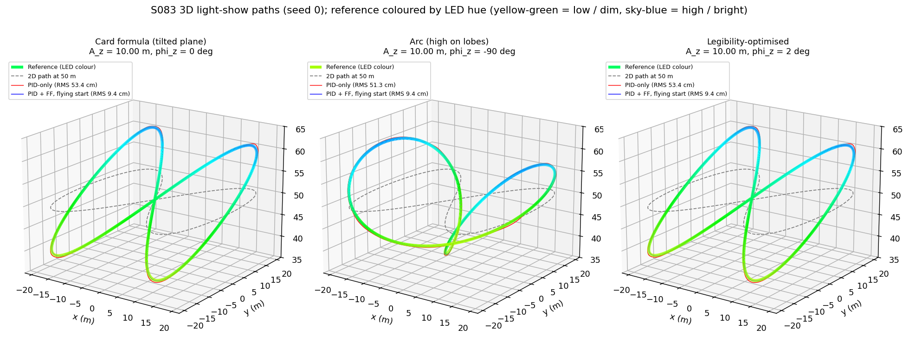
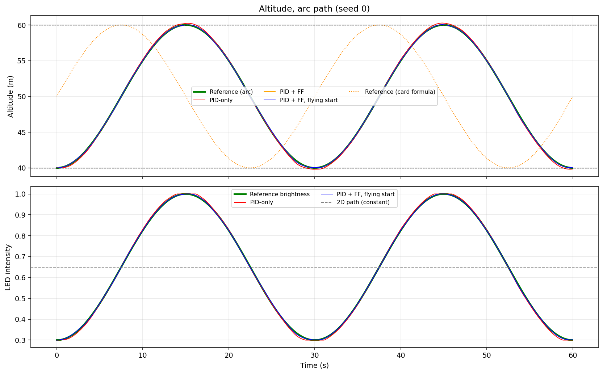
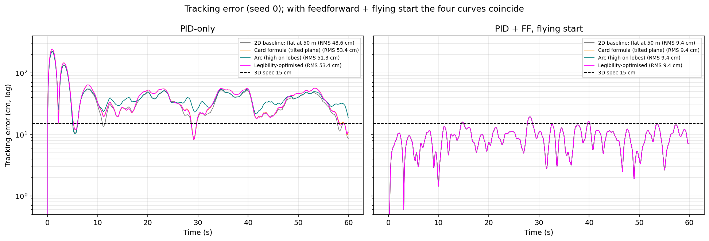
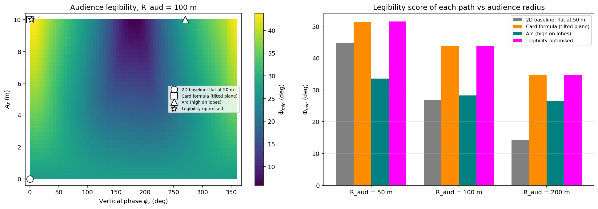
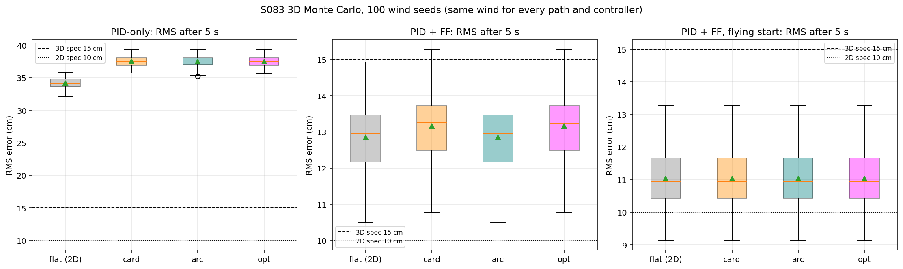
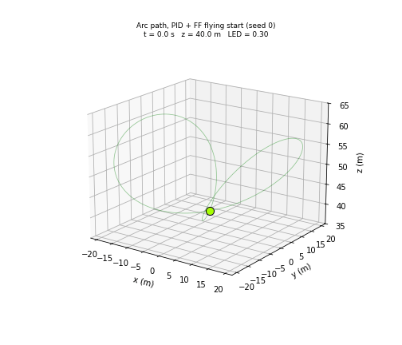

# S083 3D Upgrade — Light Show Single Drone Test

**Domain**: Special Ops & Entertainment | **Difficulty**: ⭐⭐⭐ | **Status**: ✅ Completed
**Based on**: [S083 Light Show Single-Drone Test](../../s083_light_show_single/README.md) (2D version)

---

## Problem Definition

**Setup**: The S083 show drone (200-waypoint not-a-knot cubic spline, PID $K_p/K_i/K_d$ = 2.0/0.1/0.8, point mass, white Gaussian wind $\sigma_w = 0.5$ m/s² per axis re-sampled every 0.05 s, `odeint` per step) flew a figure-8 at a constant 50 m. Here altitude becomes part of the choreography:

$$\mathbf p_{ref}(\tau) = \bigl(20\sin 2\pi\tau,\; 20\sin 4\pi\tau,\; 50 + A_z\sin(4\pi\tau + \phi_z)\bigr),\qquad \tau = t/60$$

and the LED brightness follows the altitude, $\ell = \text{clip}(0.3 + 0.7\,(z - 40)/20,\ 0.3,\ 1.0)$, with hue $30° + 170°\,\ell$. A ground audience of 36 seats on a 100 m semicircle scores how legible the choreography is: for each path segment, the smallest angle between the motion direction and any observer's line of sight, averaged over the path ($\bar\Phi_{min}$).

**Paths** (all fly the same horizontal figure-8):

| Key | $A_z$, $\phi_z$ | Shape | Source |
|---|---|---|---|
| `flat` | 0 | the S083 path at 50 m | 2D baseline (X5) |
| `card` | 10 m, 0° | the card's formula: $z = 50 + y/2$, a **planar** figure-8 tilted 26.6° | card |
| `arc` | 10 m, −90° | $z = 40 + x^2/20$: high on the outer lobes, 40 m at the crossing — the shape the card describes in words | added (card text) |
| `opt` | 10.00 m, 2.4° | maximum $\bar\Phi_{min}$ (41 × 72 grid, then gradient ascent) | card |

**Controllers** (from S083): PID-only (card), PID + feedforward of the spline acceleration (card), and PID + FF with a flying start (added in S083: the drone starts at the reference velocity, removing the launch transient). Every path and controller sees the same wind on each of 100 seeds.

---

## Mathematical Model

**Reference**: 200 waypoints at $\tau_k = k/200$, closed not-a-knot spline $\mathbf s(t)$ (as S083); $\mathbf v_{ref} = \mathbf s'$, $\mathbf a_{ff} = \mathbf s''$, now with $s_z'' \neq 0$.

**Control and dynamics** (S083 code, unchanged): $\mathbf a = K_p\mathbf e + K_i\int\mathbf e + K_d(\mathbf v_{ref} - \mathbf v) + [\mathbf a_{ff}]$, $\dot{\mathbf v} = \mathbf a + \mathbf w$, wind held for 0.05 s, $\int\mathbf e$ part of the ODE state.

**Why the vertical axis matters for PID-only**: the error transfer from the reference is $1 - H(s)$ with $H = (K_d s^2 + K_p s + K_i)/(s^3 + K_d s^2 + K_p s + K_i)$. The altitude oscillates at $\omega = 4\pi/60$ rad/s, so PID-only lags it by $|1 - H(j\omega)|\,A_z$.

**Why it does not matter with feedforward**: with $\mathbf a_{ff} = \mathbf s''$ the error obeys $\ddot{\mathbf e} = -K_p\mathbf e - K_i\!\int\!\mathbf e - K_d\dot{\mathbf e} - \mathbf w$, which does not contain the reference. With a flying start ($\mathbf e(0) = \dot{\mathbf e}(0) = 0$) the error is the same for every path; from rest it differs only through $\dot{\mathbf e}(0) = \mathbf s'(0)$.

**Legibility** (card): $\Phi_{jk} = \arcsin\|\hat{\mathbf d}_k \times \hat{\mathbf r}_{jk}\|$, $\bar\Phi_{min} = \frac{1}{199}\sum_k \min_j \Phi_{jk}$, observers $\mathbf q_j = (R\cos\phi_j, R\sin\phi_j, 0)$, $\phi_j = \pi j/35$.

---

## Key Parameters

| Parameter | Value | Source |
|---|---|---|
| $z_c$, band, $A_z$ | 50 m, 40–60 m, 10 m | card |
| $A_x = A_y$ | 20 m | card |
| $T$, waypoints, $\Delta t$ | 60 s, 200, 0.05 s | card |
| $\sigma_w$ | 0.5 m/s² per axis (card writes m/s) | card / S083 |
| $K_p$, $K_i$, $K_d$ | 2.0, 0.1, 0.8 | card |
| RMS spec | 0.15 m (3D card); 0.10 m (2D) also reported | card |
| Path-completion threshold | 0.5 m | card |
| LED $[\ell_{min}, \ell_{max}]$, hue | [0.3, 1.0], 30°–200° | card |
| Audience | 36 seats, $R_{aud}$ = 100 m (swept 50, 100, 200 m) | card (+ sweep) |
| Soft altitude bounds | 35–65 m (asserted) | card |
| Legibility search | $A_z \in [0, 10]$ m (41 values), $\phi_z$ every 5° (72), then finite-difference gradient ascent (≤ 200 steps, backtracking) | added |
| Monte Carlo | 100 seeds, wind of seed $s$ from `default_rng(8300 + s)` | added |
| Metrics after | 5 s (S083's settling cut) | S083 |
| PID-only lag probe | wind-free, $A_z$ = 0, 2.5, 5, 7.5, 10 m | added |

---

## Implementation

```
src/05_special_entertainment/3d/s083_3d_light_show.py
```

```bash
conda activate drones
python src/05_special_entertainment/3d/s083_3d_light_show.py
```

The script calls the S083 simulator (`simulate` in the 2D script) on the 3D references, so the controller, integrator and its assertions are exactly those of S083. Runtime ≈ 2 min (12 batches of 100 seeds). Two single-threaded runs and one default-threading run printed byte-identical output and produced byte-identical PNGs and GIF. `odeint` controls its step on the whole 100-seed batch, so a seed re-run alone differs from the batch by at most 2.0e-06 m (printed); the wind itself is drawn per seed.

---

## Results

### Path geometry

| Path | Altitude | Altitude at the crossing | Max speed | Max $\lvert a_{ref}\rvert$ | Max $\lvert a_{z,ref}\rvert$ |
|---|---|---|---|---|---|
| flat (2D) | 50.00 m | 50.00 m | 4.68 m/s | 0.891 m/s² | 0.000 m/s² |
| card | 40.00–60.00 m | 50.00 m | 5.13 m/s | 0.993 m/s² | 0.439 m/s² |
| arc | 40.00–60.00 m | 40.00 m | 4.68 m/s | 0.891 m/s² | 0.440 m/s² |
| opt | 40.00–60.00 m | 50.42 m | 5.13 m/s | 0.993 m/s² | 0.439 m/s² |

The card formula is exactly planar (max $|z - (50 + y/2)|$ = 0.00e+00 m, tilt 26.6°), and the arc lies on $z = 40 + x^2/20$ (max deviation 7.11e-15 m).

### Audience legibility ($R_{aud}$ = 100 m)

| Path | $\bar\Phi_{min}$ | Worst segment | Segments below 5° | Gain over flat |
|---|---|---|---|---|
| flat (2D) | 26.85° | 22.51° | 0 | — |
| card (tilted plane) | 43.75° | 20.47° | 0 | +16.91° |
| arc (high on lobes) | 28.22° | 0.77° | 16 | +1.38° |
| **opt** | **43.84°** | 22.27° | 0 | **+17.00°** |

Grid best: $A_z$ = 10.00 m, $\phi_z$ = 0° (43.75°); gradient ascent from it and from the card's start (10 m, 0°) both end at $A_z$ = 10.00 m, $\phi_z$ = 2.4° (43.84°).

Audience-radius sweep:

| $R_{aud}$ | flat | card | arc | opt | Best grid point for that radius |
|---|---|---|---|---|---|
| 50 m | 44.71° | 51.31° | 33.55° | 51.52° | $A_z$ = 8.00 m, $\phi_z$ = 5°: 51.92° |
| 100 m | 26.85° | 43.75° | 28.22° | 43.84° | $A_z$ = 10.00 m, $\phi_z$ = 0°: 43.75° |
| 200 m | 14.17° | 34.72° | 26.44° | 34.69° | $A_z$ = 10.00 m, $\phi_z$ = 0°: 34.72° |

### Tracking (100 seeds, mean ± std)

| Path | Controller | RMS, full 60 s | Max, full 60 s | RMS after 5 s | z / xy RMS after 5 s | Seeds ≤ 15 cm / ≤ 10 cm | LED RMS error |
|---|---|---:|---:|---:|---:|---:|---:|
| flat (2D) | PID-only | 48.88 ± 0.78 cm | 223.91 ± 3.97 cm | 34.16 ± 0.78 cm | 6.40 / 33.55 cm | 0 / 0 | 0.0022 |
| flat (2D) | PID + FF | 36.51 ± 0.83 cm | 225.75 ± 4.02 cm | 12.85 ± 0.91 cm | 6.40 / 11.11 cm | 0 / 0 | 0.0022 |
| flat (2D) | PID + FF, flying start | 10.88 ± 0.77 cm | 22.71 ± 2.71 cm | 11.02 ± 0.81 cm | 6.40 / 8.94 cm | 100 / 11 | 0.0022 |
| card | PID-only | 53.62 ± 0.71 cm | 245.03 ± 3.68 cm | 37.51 ± 0.80 cm | 16.76 / 33.55 cm | 0 / 0 | 0.0075 |
| card | PID + FF | 39.66 ± 0.73 cm | 247.11 ± 3.72 cm | 13.16 ± 0.91 cm | 7.00 / 11.11 cm | 0 / 0 | 0.0058 |
| card | PID + FF, flying start | 10.88 ± 0.77 cm | 22.71 ± 2.71 cm | 11.02 ± 0.81 cm | 6.40 / 8.94 cm | 100 / 11 | 0.0022 |
| arc | PID-only | 51.32 ± 0.80 cm | 224.26 ± 3.95 cm | 37.45 ± 0.81 cm | 16.63 / 33.55 cm | 0 / 0 | 0.0053 |
| arc | PID + FF | 36.51 ± 0.83 cm | 225.75 ± 4.02 cm | 12.85 ± 0.91 cm | 6.40 / 11.11 cm | 0 / 0 | 0.0022 |
| arc | PID + FF, flying start | 10.88 ± 0.77 cm | 22.71 ± 2.71 cm | 11.02 ± 0.81 cm | 6.40 / 8.94 cm | 100 / 11 | 0.0022 |
| opt | PID-only | 53.60 ± 0.71 cm | 244.78 ± 3.68 cm | 37.49 ± 0.80 cm | 16.72 / 33.55 cm | 0 / 0 | 0.0075 |
| opt | PID + FF | 39.66 ± 0.73 cm | 247.07 ± 3.72 cm | 13.16 ± 0.91 cm | 7.00 / 11.11 cm | 0 / 0 | 0.0058 |
| opt | PID + FF, flying start | 10.88 ± 0.77 cm | 22.71 ± 2.71 cm | 11.02 ± 0.81 cm | 6.40 / 8.94 cm | 100 / 11 | 0.0022 |

**Per seed against the flat 2D path** (same controller, same wind):

| Path | PID-only | PID + FF (from rest) | PID + FF, flying start |
|---|---|---|---|
| card | worse in 100/100, +4.74 cm RMS (+3.35 cm after 5 s) | worse in 100/100, +3.16 cm (+3.16e-01 cm after 5 s) | identical: max error difference 1.33e-04 cm over all steps and seeds |
| arc | worse in 100/100, +2.43 cm (+3.29 cm after 5 s) | identical: max difference 6.17e-04 cm | identical: 1.20e-04 cm |
| opt | worse in 100/100, +4.72 cm (+3.33 cm after 5 s) | worse in 100/100, +3.15 cm (+3.15e-01 cm after 5 s) | identical: 1.34e-04 cm |

The "identical" cases differ only at solver tolerance (mean RMS differences of order 1e-05 cm, printed).

### Wind-free PID-only lag probe

| $A_z$ | RMS after 5 s (card phase / arc phase) | z part (card / arc) | Analytic RMS of the vertical lag |
|---|---|---|---|
| 0 m | 32.19 / 32.19 cm | 0.00 / 0.00 cm | 0.00 cm |
| 2.5 m | 32.43 / 32.42 cm | 3.91 / 3.86 cm | 3.92 cm |
| 5 m | 33.13 / 33.11 cm | 7.82 / 7.72 cm | 7.83 cm |
| 7.5 m | 34.27 / 34.21 cm | 11.74 / 11.57 cm | 11.75 cm |
| 10 m | 35.79 / 35.70 cm | 15.65 / 15.43 cm | 15.66 cm |

**Key findings**

- **Altitude changes what the audience sees, a lot.** Tilting the figure-8 by the card's formula raises the legibility score from 26.85° (flat 2D path) to 43.75°, and the optimiser adds almost nothing (43.84° at $\phi_z$ = 2.4°). The mechanism is the tilt toward the audience: the same plane tilted the other way ($\phi_z$ = 180°, high side away from the seats) scores only 5.90°, and the intermediate phases 90° and 270° score 27.05° and 28.22°. All four values are printed by the probe.
- **The shape the card describes in words is a poor choice.** Climbing on the outer lobes (`arc`) gains only +1.38° and has 16 segments that some seat sees moving almost along its line of sight (worst 0.77°). At $R_{aud}$ = 50 m it is worse than the flat path (33.55° vs 44.71°).
- **The legibility gain grows with audience distance**: card − flat is +6.60°, +16.91° and +20.56° at $R_{aud}$ = 50, 100 and 200 m. A plausible reason (not probed further): a flat path seen from far away is almost edge-on, the tilted plane is not. The optimum stays at full amplitude ($A_z$ = 10 m, $\phi_z \approx 0°$) except at 50 m ($A_z$ = 8.00 m, 51.92°).
- **With feedforward and a flying start, the 3D path costs nothing in tracking.** All four paths give the same error to within 1.34e-04 cm on every seed (RMS 10.88 ± 0.77 cm). The error equation above contains no reference term, so this holds by construction for a linear point mass with exact feedforward. The card's premise that the vertical axis makes tracking harder and justifies relaxing the spec from 0.10 to 0.15 m does not hold for this controller: it passes 0.15 m on 100/100 seeds and 0.10 m on 11/100 seeds **on every path, including the flat one**.
- **Without feedforward, the vertical arcs add a lag that matches theory.** PID-only on the card path has 37.51 cm RMS after 5 s vs 34.16 cm flat (worse on 100/100 seeds); the whole difference is vertical (z part 16.76 vs 6.40 cm; xy part 33.55 cm on both). The wind-free probe gives 15.65 cm vertical RMS at $A_z$ = 10 m against the analytic $|1 - H(j\omega)|A_z/\sqrt2$ = 15.66 cm.
- **The launch matters more on the card path than on the arc.** From rest, PID + FF on the card path is worse than flat on 100/100 seeds (+3.16 cm), because the card path starts with a 2.09 m/s climb (its maximum speed is 5.13 vs 4.68 m/s) that the resting drone must catch up with. The arc starts at the bottom of its altitude swing with no vertical velocity (start $v_z$ 0.00 m/s), so its error is the same as the flat path's.
- **LED brightness tracks the altitude closely**: the RMS brightness error is 0.0022 (on the 0.3–1.0 scale) with feedforward and a flying start on every path, and at most 0.0075 for PID-only. On the flat path the brightness is constant; on the 3D paths it spans the full 0.3–1.0.
- **Physical checks** (asserted): the drone stays within 39.55–60.44 m on every run (soft bounds 35–65 m never reached), never moves more than 0.5 m per step, and the commanded acceleration stays below 15 m/s² (peak 6.10 m/s², card path PID-only).

### 3D trajectories

The three 3D paths (reference coloured by LED hue), with the flat 2D path dashed and the PID-only (red) and PID + FF flying-start (blue) drones of seed 0:



### Altitude and LED brightness

Arc path, seed 0: altitude of the reference and the three controllers (the card-formula reference dotted for comparison), and the LED brightness that follows from it. PID-only overshoots at the top and bottom of each swing:



### Tracking error

Seed 0, log scale. Left: PID-only, where the 3D paths sit above the flat path after the launch. Right: PID + FF with a flying start, where the four curves lie on top of each other:



### Audience legibility

Left: $\bar\Phi_{min}$ over amplitude and phase ($R_{aud}$ = 100 m), with the four paths marked; the dark band near 180° is the plane tilted away from the audience. Right: the four paths at three audience radii:



### Monte Carlo

RMS after 5 s for each path and controller over 100 seeds:



### Animation

Arc path with PID + FF and a flying start: the drone's marker colour and size follow the LED brightness; altitude and brightness in the title. 201 frames at 20 fps (one frame every 0.3 s):



### Deviations from the scenario card

| Card | Implementation | Reason |
|---|---|---|
| "climbs to 60 m on each outer lobe and descends to 40 m at the central crossing", "saddle-shaped" | the card formula is run as written (planar, tilted 26.6°, crossing at 50 m); the described shape is run as the `arc` path ($\phi_z$ = −90°); card corrected | X7: $\sin 4\pi\tau$ is shared with $y$, so $z = 50 + y/2$ (verified numerically, deviation 0.00e+00 m) |
| $\sigma_w$ = 0.5 m/s | 0.5 m/s² | added to $\dot{\mathbf v}$; corrected as in S083; card corrected |
| Hue 30° (orange) to 200° | 81°–200° in practice | $\ell \ge 0.3$, so hue $\ge 30 + 170 \cdot 0.3$; card note added |
| 3D spec relaxed to 0.15 m "because the path now uses the vertical axis" | both 0.15 m and 0.10 m reported | with feedforward the error is path-independent; the flat path passes 0.15 m equally; card note added |
| Soft saturation of $a_{cmd,z}$ near 35 / 65 m | asserted instead | the drone stays within 39.55–60.44 m; the saturation would never act |
| Two controllers from rest | plus the S083 flying start | from rest, the launch dominates the card's metrics (as in S083) |
| Gradient ascent on $(A_z, \phi_z)$ | 41 × 72 grid, then finite-difference gradient ascent with backtracking; also from the card start | $\bar\Phi_{min}$ is a mean of minima (non-smooth); the grid guards against local maxima |
| Single run | 100 seeds with the same wind for every path and controller | X2 |
| Separate "LED profile" and "tracking error" figures | LED brightness shares a figure with altitude | same content |

---

## Extensions

1. **Tilt the plane toward a measured audience**: the legibility gain comes from facing the seats; with a non-uniform audience the best tilt direction changes.
2. **Combine tilt and lobes**: allow a second vertical harmonic ($\sin 2\pi\tau$ term) so altitude can carry both a tilt and lobe accents.
3. **Thrust-limited vertical axis**: a real multirotor climbs and descends asymmetrically; with a vertical acceleration limit the feedforward path-independence breaks.
4. **Coloured wind (Dryden)**: test whether the feedforward result survives disturbances with energy near the $4\pi/60$ rad/s altitude frequency.
5. **Brightness perception**: model apparent brightness with range (inverse square) so the LED map compensates for the drone moving toward or away from the audience.

---

## Related Scenarios

- Original 2D version: [S083 Light Show Single-Drone Test](../../../../scenarios/05_special_entertainment/S083_light_show_single.md)
- 3D card: [S083 3D Upgrade — Light Show Single Drone Test](../../../../scenarios/05_special_entertainment/3d/S083_3d_light_show.md)
- Multi-drone follow-ups: [S085 Drone Light Matrix Positioning](../../../../scenarios/05_special_entertainment/S085_light_matrix.md), [S088 Formation Geometric Shape Morphing](../../../../scenarios/05_special_entertainment/S088_formation_morphing.md)
- PID + feedforward under wind: [S063 Single-Plant Precision Spraying](../../../../scenarios/04_industrial_agriculture/S063_precision_spraying.md)
