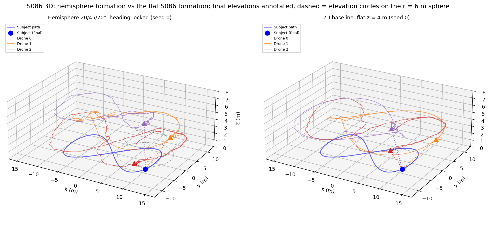
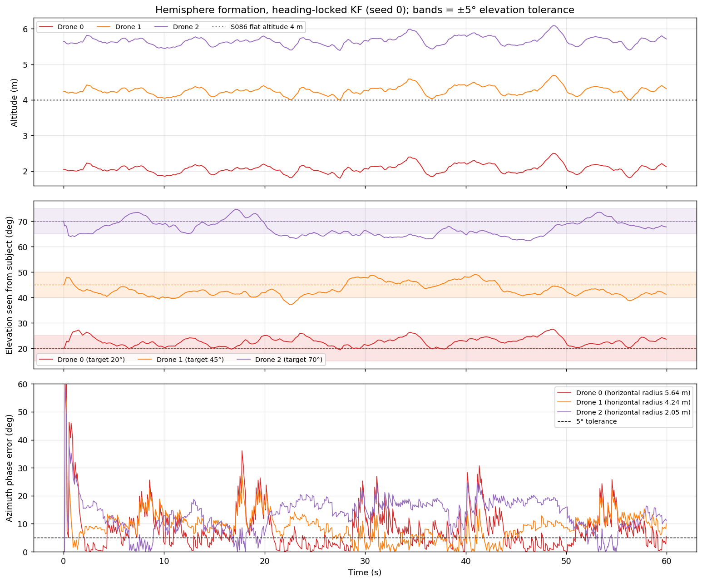
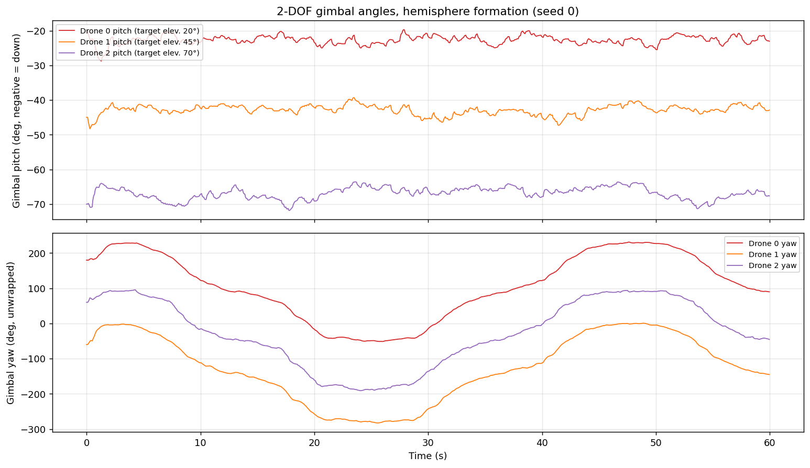
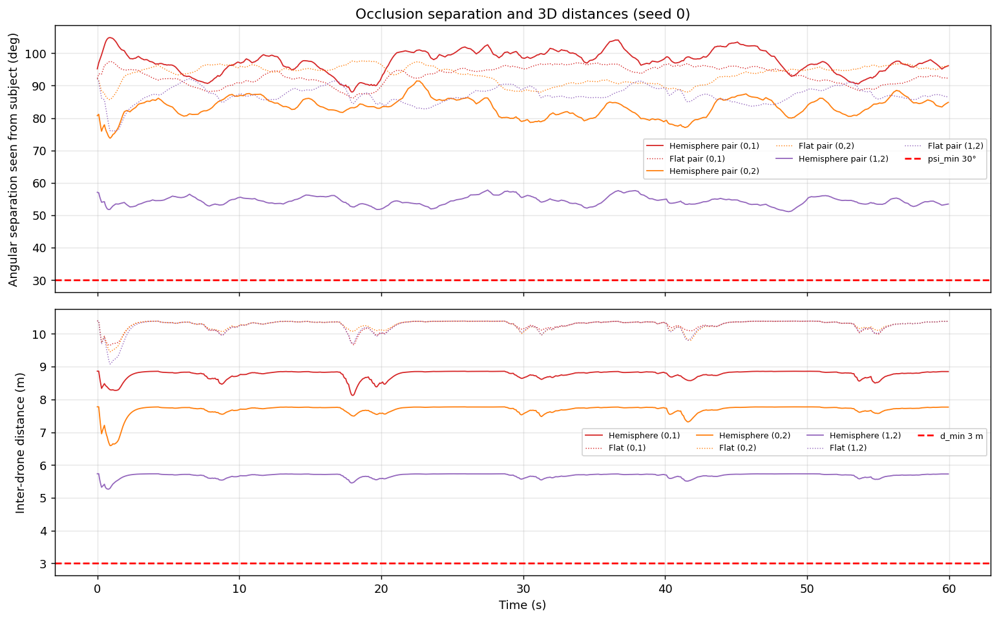
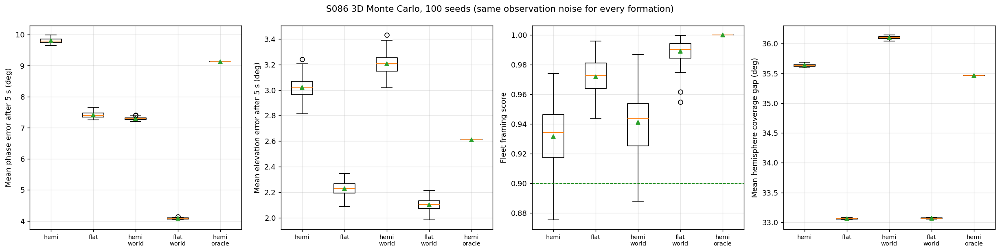
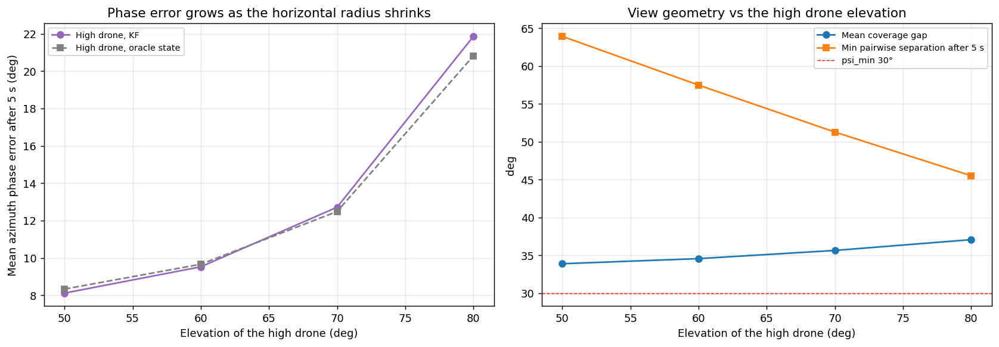
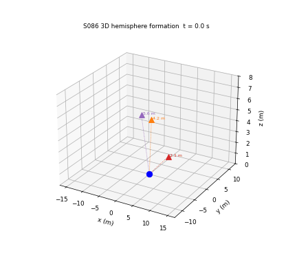

# S086 3D Upgrade — Multi-Angle Cinematography

**Domain**: Special Ops & Entertainment | **Difficulty**: ⭐⭐⭐ | **Status**: ✅ Completed
**Based on**: [S086 Cooperative Multi-Angle Filming](../../s086_multi_angle_cinema/README.md) (2D version)

---

## Problem Definition

**Setup**: As in S086, three camera drones film a subject walking a figure-8 ($a$ = 10 m, $b$ = 6 m, RMS speed 1.5 m/s, $z$ = 0). A shared constant-velocity Kalman filter fuses 5 Hz position fixes ($\sigma$ = 0.3 m, now in 3D), the formation rotates with the estimated heading (drones 120° apart in azimuth), and each drone tracks its set-point with a proportional velocity command ($K_p$ = 2, $\|\mathbf u\| \le$ 4 m/s). S086 flew all three drones at 4 m on a 6 m horizontal circle, so every camera saw the subject from the same 33.7° elevation. Here **altitude becomes part of the formation plan**: drone $k$ sits on a sphere of radius $r$ = 6 m around the estimated subject at its own elevation $\theta_k$ = 20°, 45°, 70° (low, mid, high angle). Each camera has a 2-DOF gimbal (pitch and yaw, first-order lag 0.1 s) aimed at the estimate, and an elevation-repulsion law should keep any two cameras at least $\psi_{min}$ = 30° apart as seen from the subject.

**Formations** (100 seeds; every formation sees the same observation noise on a given seed):

| Key | Geometry | Formation azimuth | Source |
|---|---|---|---|
| hemi | sphere $r$ = 6 m, $\theta$ = 20/45/70° | heading-locked | card |
| flat | $z$ = 4 m, horizontal radius 6 m (range 7.21 m, 33.7°) | heading-locked | 2D baseline (S086 as built) |
| flat_r6 | flat ring at 6 m range (33.7°, $z$ = 3.33 m) | heading-locked | added range probe |
| hemi_world / flat_world | as above | world-fixed (S086's added baseline) | added |
| hemi_oracle | hemisphere, true subject state | heading-locked | added (controller-only error) |
| stress / stress_norep / stress_sym | $\theta$ = 60/70/80°, card repulsion / none / symmetric | heading-locked | added probes of the repulsion law |

---

## Mathematical Model

**KF** (6 states, discrete Wiener acceleration model, as the card): $\mathbf s = (x, y, z, \dot x, \dot y, \dot z)$, $\sigma_a$ = 0.8 m/s², $R = 0.3^2 I_3$, updates every 0.2 s, velocity initialised at 0.

**Set-points**: $\mathbf p_k^{des} = \hat{\mathbf q} + r\,(\cos\theta_k\cos\varphi_k,\ \cos\theta_k\sin\varphi_k,\ \sin\theta_k)$ with $\varphi_k = \text{atan2}(\hat{\dot y}, \hat{\dot x}) + 2\pi k/3$ (heading-locked) or $2\pi k/3$ (world-fixed); $z$ clipped to [0.5, 8] m. Controller $\dot{\mathbf p}_k = \text{sat}_{4}\bigl(K_p(\mathbf p_k^{des} - \mathbf p_k)\bigr)$.

**Gimbal**: $\beta_{cmd} = \text{atan2}(\delta_y, \delta_x)$, $\alpha_{cmd} = \text{atan2}(\delta_z, \|\delta_{xy}\|)$ with $\boldsymbol\delta = \hat{\mathbf q} - \mathbf p_k$; both follow a first-order lag $1 - e^{-\Delta t/\tau_g}$ per step. The pointing error $\varepsilon_k$ is the angle between the lagged boresight and the **true** subject; the image offset $\tan\varepsilon_k/\tan 30°$ must be ≤ 0.15 (framing).

**Repulsion** (card): if $\psi_{ij} < 30°$, $\theta_j \leftarrow \theta_j + K_{rep}(\psi_{min} - \psi_{ij})\,\text{sign}(\theta_j - \theta_i)$, clamped to [10°, 80°]. The symmetric variant also moves $\theta_i$ the other way.

**Metrics** (after the 5 s KF start-up unless noted): azimuth phase error, elevation error (seen from the true subject), pointing error, framing, pairwise separation $\psi_{ij}$, 3D inter-drone distance, and a **hemisphere coverage gap**: for 2 000 equal-area directions on the subject's upper hemisphere, the angle to the nearest camera direction (mean and worst), evaluated every 0.5 s.

---

## Key Parameters

| Parameter | Value | Source |
|---|---|---|
| Drones / sphere radius | 3 / 6.0 m | card |
| Elevations | 20°, 45°, 70° | card |
| Subject | $a$ = 10 m, $b$ = 6 m, $\omega$ = 0.1358 rad/s (RMS 1.5 m/s), $z$ = 0 | card (ω corrected as in S086) |
| Altitude bounds | 0.5–8.0 m | card |
| $\psi_{min}$ / $K_{rep}$ / clamp | 30° / 0.5 / [10°, 80°] | card |
| $d_{min}$ | 3.0 m | card |
| Phase / elevation tolerance | 5° / ±5° | card |
| Framing threshold / gimbal half-FOV | 0.15 / 30° | card |
| Gimbal lag $\tau_g$ | 0.1 s | card |
| KF $\sigma_a$ / $\sigma_{obs}$ / interval | 0.8 m/s² / 0.3 m / 0.2 s | card |
| $K_p$ / $v_{max}$ / $\Delta t$ / $T$ | 2.0 / 4.0 m/s / 0.05 s / 60 s | card |
| 2D baseline | $z$ = 4 m, horizontal radius 6 m | S086 |
| Monte Carlo | 100 seeds, noise of seed $s$ from `default_rng(8600 + s)` | added |
| High-drone elevation sweep | 50°, 60°, 70°, 80° (KF 100 seeds; oracle seed 0) | added |
| Stress elevations | 60°, 70°, 80° | added |
| Coverage directions | 2 000 (Fibonacci, equal area), every 10th step | added |

---

## Implementation

```
src/05_special_entertainment/3d/s086_3d_multi_angle_cinema.py
```

```bash
conda activate drones
python src/05_special_entertainment/3d/s086_3d_multi_angle_cinema.py
```

The subject path and the S086 parameters are imported from the 2D script. All 100 seeds run as one vectorised batch per formation; the script checks that a seed's result does not depend on the batch. Runtime ≈ 1 min. Two single-threaded runs and one default-threading run printed byte-identical output and produced byte-identical PNGs and GIF.

---

## Results

### Ideal geometry (printed)

| Pair | Hemisphere separation / distance | Flat separation / distance | Stress 60/70/80° separation / distance |
|---|---|---|---|
| (0, 1) | 95.2° / 8.86 m | 92.2° / 8.65 m | 43.3° / 4.42 m |
| (0, 2) | 80.8° / 7.77 m | 92.2° / 8.65 m | 36.0° / 3.70 m |
| (1, 2) | 57.1° / 5.73 m | 92.2° / 8.65 m | 26.4° / 2.74 m |

The card's distance formula gives the same 8.86 / 7.77 / 5.73 m. Ideal hemisphere altitudes are 2.05, 4.24 and 5.64 m, at horizontal radii 5.64, 4.24 and 2.05 m.

### Monte Carlo (100 seeds; phase / elevation / pointing errors after 5 s)

| Formation | Phase error | Within 5° | Elevation error | Within ±5° | Pointing error | Framing | Min $\psi$ (all / after 5 s) | Min distance (all / after 5 s) | Coverage gap mean / worst |
|---|---:|---:|---:|---:|---:|---:|---:|---:|---:|
| **Hemisphere 20/45/70°** | 9.80 ± 0.08° | 24.7 % | 3.02 ± 0.08° | 85.4 % | 2.71° | 0.932 ± 0.019 | 34.2° / 49.8° | 3.37 / 5.29 m | 35.6° / 76.9° |
| 2D baseline: flat $z$ = 4 m | 7.41 ± 0.09° | 35.7 % | 2.23 ± 0.05° | 95.5 % | 2.27° | 0.972 ± 0.012 | 63.3° / 79.3° | 7.39 / 9.16 m | 33.1° / 68.5° |
| Flat at 6 m range | 7.76 ± 0.06° | 32.6 % | 2.66 ± 0.06° | 90.1 % | 2.67° | 0.930 ± 0.018 | 61.6° / 80.0° | 5.84 / 7.66 m | 33.1° / 69.3° |
| Hemisphere, world-fixed | 7.29 ± 0.04° | 39.4 % | 3.21 ± 0.08° | 76.5 % | 2.71° | 0.941 ± 0.019 | 51.5° / 51.5° | 5.73 / 5.73 m | 36.1° / 78.7° |
| Flat, world-fixed | 4.08 ± 0.02° | 66.9 % | 2.10 ± 0.05° | 98.2 % | 2.10° | 0.989 ± 0.007 | 82.2° / 82.2° | 10.39 / 10.39 m | 33.1° / 68.6° |
| Hemisphere, oracle state | 9.12° | 33.2 % | 2.61° | 97.0 % | 0.66° | 1.000 | 52.8° / 54.0° | 5.31 / 5.61 m | 35.5° / 76.0° |

Per drone (phase / elevation error after 5 s): hemisphere 7.76 / 2.50°, 8.92 / 2.90°, **12.72** / 3.66° (drones 0, 1, 2); flat 7.76 / 3.21°, 7.79 / 1.83°, 6.69 / 1.64°; hemisphere with oracle state 5.55 / 2.50°, 9.32 / 2.08°, 12.49 / 3.25°.

**Per seed, hemisphere vs the 2D baseline** (same noise): the hemisphere has a lower phase error in 0/100 seeds, higher framing in 0/100 (mean difference −0.040), a smaller mean coverage gap in 0/100 (+2.6° on average) and a smaller worst gap in 0/100 (+8.4°), and a larger minimum separation in 0/100. World-fixed: hemisphere 7.29° vs flat 4.08° phase error, framing 0.941 vs 0.989 (0/100 seeds in favour of the hemisphere on either).

### Probes

**Range probe (framing).** A flat ring at the hemisphere's 6 m range frames 0.930, the hemisphere 0.932, the S086 ring at 7.21 m 0.972; the hemisphere frames better than the 6 m flat ring in 63/100 seeds (1 tie).

**Static coverage of ideal formations** (mean / worst gap): flat 33.7° ring 32.9° / 64.2°; hemisphere 20/45/70° 35.8° / 75.8°; equal 45° ring 33.3° / 68.1°. The best equal elevation (1° grid) is 38° (mean gap 32.8°); the best of a 5° grid over all three elevations is (40, 35, 40)° with the same 32.8°.

**High-drone elevation sweep** (20/45/$x$°):

| $x$ | Horizontal radius | High-drone phase error (KF / oracle) | Elevation error | Framing | Min $\psi$ after 5 s | Coverage gap mean / worst | Min distance |
|---|---|---|---|---|---|---|---|
| 50° | 3.86 m | 8.12° / 8.34° | 2.83° | 0.930 | 63.9° | 33.9° / 70.9° | 4.58 m |
| 60° | 3.00 m | 9.53° / 9.67° | 3.25° | 0.931 | 57.5° | 34.6° / 73.2° | 4.05 m |
| 70° | 2.05 m | 12.72° / 12.49° | 3.66° | 0.932 | 51.3° | 35.6° / 76.9° | 3.37 m |
| 80° | 1.04 m | 21.87° / 20.82° | 4.22° | 0.932 | 45.5° | 37.1° / 82.5° | 3.27 m |

**Repulsion stress test** (60/70/80°): the (1, 2) pair sits at 25.6° on average after 5 s, below $\psi_{min}$. The card's law is active on 100.00 % of steps but changes nothing measurable: against no repulsion the largest per-seed difference is 5.68e-07° in phase error, 2.78e-04 in framing and 4.56e-03 m in minimum distance (start-up only), because it pushes only the higher drone up and that drone is already at the 80° clamp. The symmetric variant (lower drone pushed down as well) raises the (1, 2) separation to 27.0°, still below 30°: one pair is below $\psi_{min}$ for the whole run (33.33 % of pair-time) in all three versions. The stress formation also breaks $d_{min}$ = 3 m (closest pair after 5 s 2.53 m, 2.70 m with symmetric repulsion; ideal 2.74 m).

**Key findings**

- **The hemisphere delivers three distinct vertical perspectives, and the elevations hold reasonably well.** The cameras stay at their 20°, 45° and 70° targets with a mean elevation error of 3.02° (within ±5° 85.4 % of the time); the gimbal pitches settle near −22°, −43° and −67° (read from the figure, not printed). This is the card's goal and the flat formation cannot provide it.
- **Every other measured quality gets worse than in the flat S086 formation, on every seed.** Phase error 9.80° vs 7.41°, framing 0.932 vs 0.972, closest pair 5.29 m vs 9.16 m after start-up (3.37 m vs 7.39 m including it), minimum view separation 49.8° vs 79.3°. The card's expectations of ≤ 3° elevation error, ≥ 5 m minimum distance and ≤ 2° pointing error are narrowly missed (3.02°, 3.37 m including start-up, 2.71°); framing ≥ 0.90 is met (0.932).
- **The high camera's phase error comes from its small orbit radius (sweep + oracle).** At 70° the high drone circles only 2.05 m from the subject, so the same position lag of the P controller is a larger azimuth angle: its phase error is 12.72° against 7.76° for the low drone, and it grows to 21.87° at 80° (1.04 m radius). The oracle runs give almost the same values (12.49°, 20.82°), so this is controller lag, not KF noise.
- **The framing loss is a range effect (probe).** A flat ring flown at the hemisphere's 6 m range frames 0.930, the same as the hemisphere (0.932; the hemisphere is ahead on 63/100 seeds); the S086 ring frames 0.972 only because it is 7.21 m away.
- **The hemisphere does not cover the viewing hemisphere better.** Measured as the angle from any viewing direction to the nearest camera, the 20/45/70° arrangement leaves larger gaps (mean 35.6°, worst 76.9°) than the flat ring (33.1° / 68.5°), on every seed. With 120° azimuth spacing, the best three-camera coverage on a 5° grid is close to a ring at 35–40°. Elevation diversity and uniform coverage are different goals; the card's expected output treats them as the same.
- **The occlusion-repulsion law never acts in the card's configuration.** The ideal separations are 95.2°, 80.8° and 57.1°, and the repulsion was active on 0.00 % of steps. In the stress test it acts on every step but cannot help: see the stress-test line above.
- **Card expectations**: mean elevation error ≤ 3° (3.02°, not met by a small margin), minimum separation ≥ 28° (34.2° including start-up, met), minimum 3D distance ≥ 5 m (3.37 m including start-up, 5.29 m after it), pointing ≤ 2° (2.71°, not met; the oracle reaches 0.66°), framing ≥ 0.90 (0.932, met).
- **The KF is shared, so its error is the same for every formation**: position RMSE 0.358 m.

**Physical checks** (asserted every step for every seed): commanded speed ≤ 4 m/s and altitude within 0.5–8 m.

### Hemisphere vs flat formation

Seed 0, final elevations annotated; dashed circles are the 20°, 45° and 70° elevation circles on the 6 m sphere around the final subject position:



### Altitude, elevation and phase error

Hemisphere formation, seed 0: three altitude bands, elevation angles against their ±5° tolerance bands, and the azimuth phase error of each drone (the high drone, purple, has the largest):



### Gimbal angles

Pitch (about −22°, −43° and −67°, read from the figure) and unwrapped yaw of each camera, seed 0:



### Occlusion separation and inter-drone distance

Pairwise separation seen from the subject and 3D distances, hemisphere (solid) and flat (dotted), seed 0. The hemisphere's closest pair is (1, 2), the 45° and 70° drones:



### Monte Carlo

Phase error, elevation error, framing and mean coverage gap over 100 seeds:



### Elevation sweep

Left: phase error of the high drone against its elevation, with the KF and with the true subject state. Right: mean coverage gap and minimum pairwise separation:



### Animation

Rotating view of the hemisphere formation following the subject (seed 0), with the drones' altitudes labelled and dotted sight lines. 121 frames at 10 fps, one frame every 0.5 s:



### Deviations from the scenario card

| Card | Implementation | Reason |
|---|---|---|
| $\omega$ = 0.18 rad/s | 0.1358 rad/s; card corrected | 0.18 rad/s gives 1.99 m/s RMS, not 1.5 m/s (S086 correction) |
| $\varepsilon_k$ measured against $\hat{\mathbf q} - \mathbf p_k$ (the estimate) | measured against the true subject; card corrected | the gimbal points at the estimate, so the card's metric only scores servo lag |
| Gimbal half-FOV 30° | used as written; S086's 18.4° also printed (hemisphere 0.578, flat 0.711) | the two framing scores are not comparable; card note added |
| "the repulsion controller should keep all curves above the threshold" | it never activates for 20/45/70°; tested on a 60/70/80° stress case with and without repulsion and with a symmetric variant; card note added | X7: ideal separations ≥ 57.1° |
| Extension 3 "extend the 3D KF with a z-velocity state" | the 6-state KF already has it; wording corrected | card self-consistency |
| Single formation | added the S086 flat formation (2D baseline), a flat ring at the same 6 m range, world-fixed versions, an oracle, and the stress probes | X5 baseline and direct probes of the explanations |
| Phase error over the whole run | reported after the 5 s KF start-up (S086's convention); minimum distance and separation reported both with and without the start-up | the KF starts with zero velocity, so the heading is undefined for the first fixes |
| Animation 20 fps | 10 fps, one frame every 0.5 s | GIF size below 3 MB |
| Separate sync / separation figure | phase error is in the altitude/elevation figure, distances in the occlusion figure | same content |

---

## Extensions

1. **Coverage-optimal elevations**: optimise the three elevations (and azimuth offsets, not only 120°) for the coverage gap; the grid suggests a ring at 35–40° when azimuths are fixed.
2. **Radius-scaled gains**: give the high drone a larger $K_p$ (or a feed-forward of the set-point velocity) so its azimuth error does not grow as $1/(r\cos\theta)$.
3. **Working repulsion**: move the lower drone down when the upper one is at the clamp, or repel in azimuth.
4. **Subject on stairs**: use the KF's $\dot z$ state with a subject whose altitude changes, and measure how fast the formation follows.
5. **Collision-aware elevation choice**: the (1, 2) pair is the closest (5.73 m ideal); add $d_{min}$ as a constraint when choosing elevations.

---

## Related Scenarios

- Original 2D version: [S086 Cooperative Multi-Angle Filming](../../../../scenarios/05_special_entertainment/S086_multi_angle_cinema.md)
- 3D card: [S086 3D Upgrade — Multi-Angle Cinematography](../../../../scenarios/05_special_entertainment/3d/S086_3d_multi_angle_cinema.md)
- Domain 3D variants: [S081 3D Upgrade — Selfie Follow Mode](../../../../scenarios/05_special_entertainment/3d/S081_3d_selfie_follow.md), [S085 3D Upgrade — Light Matrix Positioning](../../../../scenarios/05_special_entertainment/3d/S085_3d_light_matrix.md)
- Shared 3D estimation: [S046 Multi-Drone 3D Trilateration](../../../../scenarios/03_environmental_sar/S046_trilateration.md)
- Multi-drone timing: [S098 Swarm Synchronized Dance](../../../../scenarios/05_special_entertainment/S098_synchronized_dance.md)
