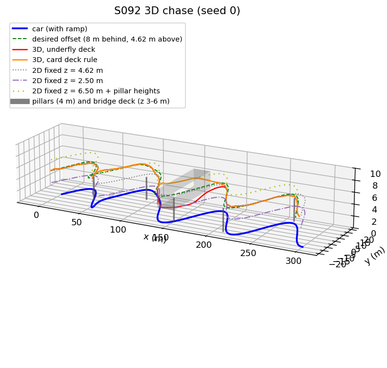
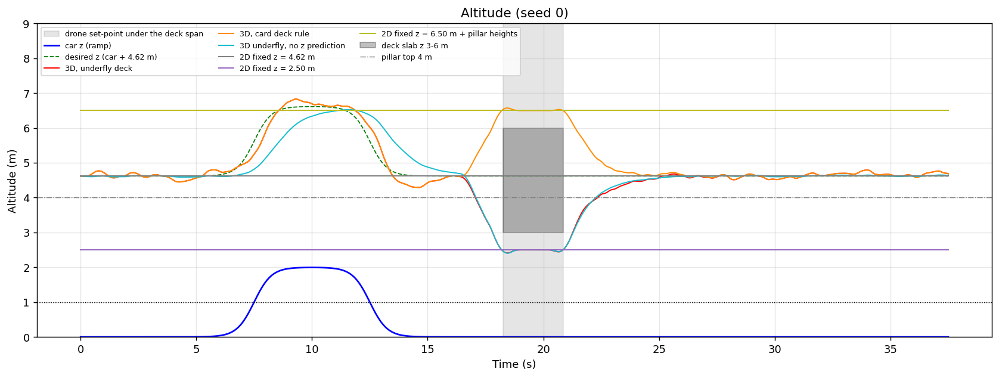
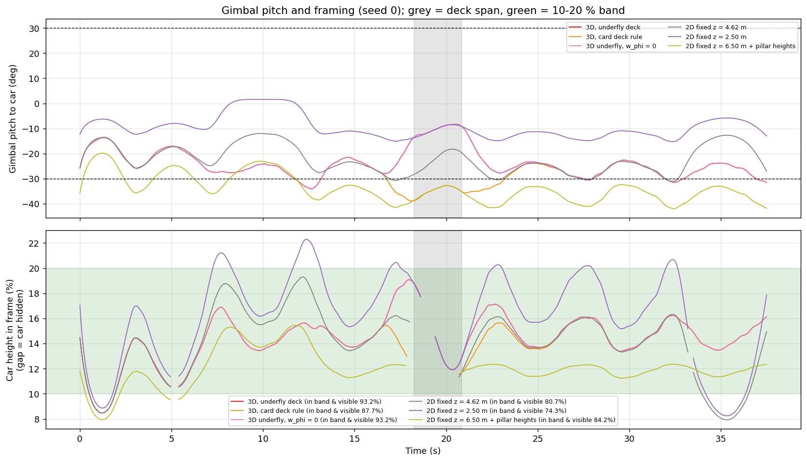
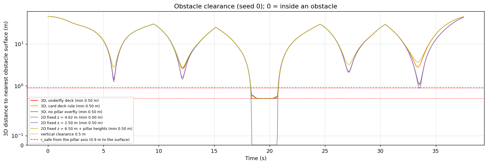
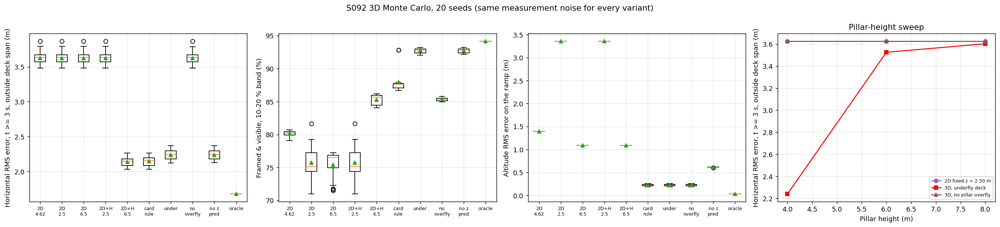
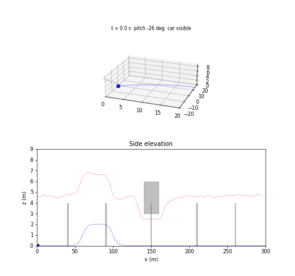

# S092 3D Upgrade — Movie Chase Scene

**Domain**: Special Ops & Entertainment | **Difficulty**: ⭐⭐⭐⭐ | **Status**: ✅ Completed
**Based on**: [S092 Movie Car Chase Scene](../../s092_movie_chase/README.md) (2D version)

---

## Problem Definition

**Setup**: The S092 camera drone films a stunt car on a winding road ($x = 8t$, $y = 15\sin(2\pi x/80)$, 300 m, 37.5 s). It filters 20 Hz car fixes with a Kalman filter and plans with the S092 model predictive controller (10 steps of 0.2 s, position + velocity tracking, pillar half-planes at every 0.05 s of the horizon, soft constraints with slack, pillars moved onto the camera path). In S092 the drone flew at a fixed altitude and the pillars were treated as infinitely tall. Here the world is three-dimensional and **altitude becomes a planned state**:

- the car drives over a 2 m ramp (logistic rise centred at $x$ = 60 m, descent at 100 m), measured by a barometer ($\sigma_z$ = 0.1 m) and tracked by a 6-state KF;
- the five pillars have a finite height (card: 4 m; 6 m and 8 m also run), so the drone may fly **over** a pillar ($z \ge H + 0.5$ m) instead of around it — the MPC enumerates the around/over choice for each nearby pillar and keeps the cheaper plan;
- a bridge deck (slab $x$ 140–160 m, $|y| \le$ 20 m, $z$ 3–6 m) crosses the road; the car passes under it, and a drone at the nominal height would fly into it. The drone must **underfly** ($z \le$ 2.5 m, the car stays in view) or **overfly** ($z \ge$ 6.5 m, the deck hides the car). The card's rule picks the mode with the smaller altitude change;
- the desired camera position is 8 m behind and **4.62 m** above the car (the card's 5 m gives a 32.0° gimbal pitch, outside its own ±30° envelope; its adjustment rule gives $8\tan 30°$ = 4.619 m);
- the MPC gets a linearised gimbal-pitch-rate penalty ($w_\phi$ = 2) and separate vertical limits ($|v_z| \le$ 4 m/s, $|a_z| \le$ 3 m/s²).

**Variants** (20 seeds; every variant sees the same measurement noise on a given seed):

| Variant | Altitude | Pillars | Deck | Source |
|---|---|---|---|---|
| 2D baseline | fixed 2.0, 2.5, 3.0, 4.62, 6.5, 7.0 or 8.0 m (S092 plan, horizontal KF) | always around (infinitely tall, as S092) | unknown | X5 baseline (altitude swept) |
| 2D + pillar heights | same fixed altitudes | passes over a pillar when the fixed altitude is ≥ $H$ + 0.5 m, otherwise around | unknown | added: same pillar information as 3D |
| 3D, card deck rule | tracks car $z$ + 4.62 m | MPC chooses around / over | card rule (smaller $\lvert\Delta z\rvert$) | card |
| **3D, underfly deck** | as above | MPC chooses | always under | added |
| 3D, no pillar overfly | as above | always around | under | added ablation |
| 3D underfly, $w_\phi$ = 0 | as above | MPC chooses | under | added ablation |
| 3D underfly, no z prediction | car altitude held at its estimate over the horizon | MPC chooses | under | added ablation |
| 3D underfly, oracle | true future reference | MPC chooses | under | added reference |

---

## Mathematical Model

**Car**: $z_{car}(x) = h_{ramp}\bigl[\sigma((x - s_1)/w) - \sigma((x - s_2)/w)\bigr]$, $h_{ramp}$ = 2 m, $w$ = 3 m (5–95 % rise over 17.67 m of road, maximum 1.995 m).

**KF**: 6-state constant velocity, $Q = q\,[\tfrac{\Delta t^3}{3}I, \tfrac{\Delta t^2}{2}I; \tfrac{\Delta t^2}{2}I, \Delta t I]$, $q$ = 1 m²/s³, $R = \text{diag}(0.3^2, 0.3^2, 0.1^2)$, 20 Hz. The reference over the horizon is the constant-velocity prediction $\hat{\mathbf p}(\tau) = \hat{\mathbf p} + \tau\hat{\mathbf v}$, offset 8 m behind along $\hat\psi$ and 4.62 m up.

**MPC** (condensed QP in the accelerations, as S092): $J = \sum_i \|\mathbf p_i - \mathbf p_{d,i}\|^2_{Q} + Q_v\|\mathbf v_i - \mathbf v_{d,i}\|^2 + R\|\mathbf u_i\|^2 + P_f\|\mathbf p_N - \mathbf p_{d,N}\|^2 + w_\phi\sum_i(\phi_{i+1} - \phi_i)^2/\Delta t^2 + \text{slack}$, with $\phi_i$ linearised about the reference. Limits $|v_{x,y}| \le 12$, $|u_{x,y}| \le 6$, $|v_z| \le 4$, $|u_z| \le 3$, $1 \le z \le 12$ m. Soft obstacle constraints at every 0.05 s instant: pillar "around" $\hat{\mathbf n}^\top(\mathbf p_{xy} - \mathbf o) \ge r_{safe}$ (normal from the previous plan); pillar "over" $z \ge H + 0.5$ at instants within 2.5 m horizontally of the pillar; deck "under" $z \le 2.5$ / "over" $z \ge 6.5$ at instants within the deck span ± 1.5 m. Every around/over combination of the nearby pillars is solved and the lowest objective kept.

**Metrics**: tracking error to the nominal desired point; RMS after 3 s outside the deck span (where the nominal point lies inside the deck) split into horizontal and vertical parts; framing $f = 2\arctan(h/2d)\cos\phi/\text{FoV}$ to the car's centre, counted only when the line of sight is not blocked by the deck or a pillar (10–20 % band, as S092); gimbal pitch $\phi$ to the car's centre; 3D distance to the nearest obstacle surface along the integrated path (10 points per 0.05 s).

---

## Key Parameters

| Parameter | Value | Source |
|---|---|---|
| Road, car speed | $x = 8t$, $A$ = 15 m, $L$ = 80 m, 300 m | card / S092 |
| Ramp | 2 m, $w$ = 3 m, centres at $x$ = 60 m and 100 m | card (positions added) |
| Offset | 8 m behind, 4.62 m above (card 5 m) | card's gimbal rule |
| Pillars | 5, radius 0.6 m, height 4 m (swept 6, 8 m), 0.5 m from the camera path | card / S092 layout |
| $r_{safe}$ / vertical clearance | 1.5 m / 0.5 m | card |
| Deck | $x$ 140–160 m, $y$ ±20 m, $z$ 3–6 m | card (slab interpretation) |
| Altitude bounds | 1–12 m | card |
| KF | $\sigma_{xy}$ 0.3 m, $\sigma_z$ 0.1 m, $q$ = 1 m²/s³, 20 Hz | card |
| MPC | $N$ = 10, 0.2 s, $Q$ = 10, $R$ = 0.1, $P_f$ = 20, $Q_v$ = 10 | card / S092 |
| $w_\phi$ | 2 (swept 0, 2, 200, 2000) | card (+ sweep) |
| Limits | $v_{xy}$ 12, $a_{xy}$ 6, $v_z$ 4 m/s, $a_z$ 3 m/s² | card |
| Gimbal envelope / rate | ±30°, 30 °/s | card |
| Camera FoV / car height | 60° / 1.5 m | card |
| Framing band | 10–20 % (card 20–40 % also computed) | S092 correction |
| Overfly rows / deck margin | within 2.5 m of a pillar / deck span ± 1.5 m | added |
| Seeds | 20, noise of seed $s$ from `default_rng(9200 + s)` | added (S092 used 10) |
| 2D baseline altitudes | 2.0, 2.5, 3.0, 4.62, 6.5, 7.0, 8.0 m, each with and without pillar-height knowledge | added (X5) |

---

## Implementation

```
src/05_special_entertainment/3d/s092_3d_movie_chase.py
```

```bash
conda activate drones
python src/05_special_entertainment/3d/s092_3d_movie_chase.py
```

The QP solver, the condensed-MPC matrices, the road and the pillar layout are imported from the S092 script. 600 runs go through a process pool of 4 workers; results are collected in job order. Runtime about 4–6 min depending on machine load (264–350 s measured for this 600-run version; the earlier 400-run version took 147–260 s). Two single-threaded runs and one default-threading run printed byte-identical output and produced byte-identical PNGs and GIF.

---

## Results

### Main comparison (20 seeds, mean ± std)

"2D" = the S092 strategy at a fixed altitude, pillars treated as infinitely tall. "2D + H" = the same fixed altitude, but the planner knows the pillar heights and may pass over a pillar when the fixed altitude is already ≥ $H$ + 0.5 m (the same information the 3D variants have).

| Variant | RMS error | RMS, $t \ge 3$ s, outside deck | horizontal / vertical part | Within 1 m | Framed and visible | Visible (in deck span) | Gimbal within ±30° | Ramp altitude RMS |
|---|---:|---:|---:|---:|---:|---:|---:|---:|
| 2D, 2.0 m | 4.852 ± 0.065 m | 4.710 ± 0.074 m | 3.626 / 3.005 m | 0.0 % | 70.3 % | 96.0 % (70.4 %) | 100.0 % | 3.845 m |
| **2D, 2.5 m** (best feasible, S092 strategy) | 4.572 ± 0.069 m | 4.416 ± 0.079 m | 3.626 / 2.520 m | 0.0 % | 75.7 % | 96.0 % (70.4 %) | **100.0 %** | 3.357 m |
| 2D, 3.0 m | 4.332 ± 0.073 m | 4.161 ± 0.083 m | 3.626 / 2.042 m | 0.0 % | 77.4 % | 91.9 % (12.8 %) | 100.0 % | 2.874 m |
| 2D, 4.62 m | 3.910 ± 0.081 m | 3.698 ± 0.094 m | 3.626 / 0.730 m | 10.6 % | 80.1 % | 90.9 % (6.6 %) | 94.3 % | 1.394 m |
| 2D, 6.5 m | 4.222 ± 0.075 m | 4.005 ± 0.087 m | 3.626 / 1.701 m | 2.7 % | 75.4 % | 91.3 % (9.4 %) | 36.9 % | 1.089 m |
| 2D, 7.0 m | 4.437 ± 0.071 m | 4.226 ± 0.082 m | 3.626 / 2.170 m | 1.9 % | 72.0 % | 91.5 % (11.3 %) | 29.9 % | 1.475 m |
| 2D, 8.0 m | 4.992 ± 0.063 m | 4.795 ± 0.072 m | 3.626 / 3.138 m | 0.0 % | 18.3 % | 91.5 % (13.2 %) | 12.2 % | 2.378 m |
| 2D + H, 4.62 m | 2.731 ± 0.037 m | 2.260 ± 0.060 m | 2.139 / 0.730 m | 17.1 % | 87.6 % | 91.3 % (5.8 %) | 91.6 % | 1.394 m |
| **2D + H, 6.5 m** (best feasible with pillar heights) | 3.162 ± 0.032 m | 2.733 ± 0.050 m | **2.139** / 1.701 m | 3.4 % | 85.3 % | 91.2 % (8.2 %) | 20.6 % | 1.089 m |
| 2D + H, 7.0 m | 3.444 ± 0.029 m | 3.047 ± 0.044 m | 2.139 / 2.170 m | 3.0 % | 83.6 % | 91.3 % (10.4 %) | 15.9 % | 1.475 m |
| 2D + H, 8.0 m | 4.134 ± 0.024 m | 3.798 ± 0.036 m | 2.139 / 3.138 m | 0.0 % | 18.5 % | 91.5 % (13.2 %) | 4.3 % | 2.378 m |
| 3D, card deck rule | 2.737 ± 0.060 m | 2.186 ± 0.066 m | 2.149 / 0.402 m | 17.0 % | 87.9 % | 91.7 % (14.4 %) | 76.1 % | 0.223 m |
| **3D, underfly deck** | 2.900 ± 0.041 m | 2.283 ± 0.063 m | 2.239 / 0.444 m | 17.1 % | **92.7 %** | 96.5 % (**70.5 %**) | 91.7 % | 0.223 m |
| 3D, no pillar overfly | 3.914 ± 0.080 m | 3.653 ± 0.094 m | 3.626 / 0.444 m | 13.3 % | 85.3 % | 96.2 % (70.4 %) | 94.2 % | 0.224 m |
| 3D underfly, $w_\phi$ = 0 | 2.900 ± 0.041 m | 2.283 ± 0.063 m | 2.239 / 0.444 m | 17.1 % | 92.7 % | 96.5 % (70.5 %) | 91.8 % | 0.223 m |
| 3D underfly, no z prediction | 2.912 ± 0.041 m | 2.302 ± 0.062 m | 2.239 / 0.533 m | 17.0 % | 92.7 % | 96.5 % (70.5 %) | 89.9 % | 0.612 m |
| 3D underfly, oracle | 2.450 m | 1.721 m | 1.676 / 0.394 m | 40.7 % | 94.1 % | 98.0 % (83.0 %) | 100.0 % | 0.028 m |

The vertical part and the ramp altitude error of every fixed-altitude variant are poor by construction (the set-point is car + 4.62 m and a fixed altitude cannot follow the ramp), so the horizontal part, framing, visibility and the gimbal envelope are the fair comparisons. 2D + H at 2.0, 2.5 and 3.0 m is identical to 2D (it cannot pass over a 4 m pillar from below), so those rows are omitted here.

### 2D baseline altitude sweep (X5)

| Fixed altitude | Fine-path points inside the deck (2D / 2D + H) | Min 3D clearance to any surface | Visible in deck span (2D / 2D + H) | Gimbal within ±30° (2D / 2D + H) | Horizontal RMS (2D / 2D + H) | Framed and visible (2D / 2D + H) | |
|---|---:|---:|---:|---:|---:|---:|---|
| 2.0 m | 0 / 0 | 0.857 m | 70.4 / 70.4 % | 100.0 / 100.0 % | 3.626 / 3.626 m | 70.3 / 70.3 % | feasible |
| **2.5 m** | 0 / 0 | 0.500 m | 70.4 / 70.4 % | 100.0 / 100.0 % | 3.626 / 3.626 m | 75.7 / 75.7 % | feasible, best framing (2D) |
| 3.0 m | 9232 / 9232 | 0.000 m | 12.8 / 12.8 % | 100.0 / 100.0 % | 3.626 / 3.626 m | 77.4 / 77.4 % | inside the deck |
| 4.62 m | 9232 / 9316 | 0.000 m | 6.6 / 5.8 % | 94.3 / 91.6 % | 3.626 / 2.139 m | 80.1 / 87.6 % | inside the deck |
| **6.5 m** | 0 / 0 | 0.500 m | 9.4 / 8.2 % | 36.9 / 20.6 % | 3.626 / 2.139 m | 75.4 / 85.3 % | feasible, best framing (2D + H) |
| 7.0 m | 0 / 0 | 1.000 m | 11.3 / 10.4 % | 29.9 / 15.9 % | 3.626 / 2.139 m | 72.0 / 83.6 % | feasible |
| 8.0 m | 0 / 0 | 2.000 m | 13.2 / 13.2 % | 12.2 / 4.3 % | 3.626 / 2.139 m | 18.3 / 18.5 % | feasible |

**Paired per seed, 3D underfly against each variant** (20 seeds; two-sided sign test, ties excluded; every 20/20 or 0/20 count without ties has p = 1.91e-06):

| vs | Lower horizontal RMS | Higher framing | Higher deck-span visibility | Higher gimbal-in-envelope | Lower ramp altitude RMS |
|---|---|---|---|---|---|
| 2D, 2.5 m | 20/20, −1.386 m | 20/20, +17.0 pp | 1/20 (19 ties, p = 1), +0.1 pp | **0/20, −8.3 pp** | n/a (fixed altitude) |
| 2D, 6.5 m | 20/20, −1.386 m | 20/20, +17.3 pp | 20/20, +61.0 pp | 20/20, +54.8 pp | n/a |
| 2D + H, 6.5 m | **0/20, +0.100 m** | **20/20, +7.4 pp** | 20/20, +62.3 pp | 20/20, +71.1 pp | n/a |
| 2D + H, 4.62 m (hits the deck) | 0/20, +0.100 m | 20/20, +5.2 pp | 20/20, +64.7 pp | 11/20 (p = 0.824), +0.1 pp | n/a |
| 3D, card deck rule | 0/20 (2 ties, p = 7.63e-06), +0.090 m | 18/20 (2 ties, p = 7.63e-06), +4.8 pp | 18/20 (2 ties), +56.0 pp | 18/20 (2 ties), +15.6 pp | 0/20 (20 ties, p = 1) |
| 3D, no pillar overfly | 20/20, −1.386 m | 20/20, +7.4 pp | 1/20 (19 ties, p = 1), +0.1 pp | 0/20 (1 tie, p = 3.81e-06), −2.5 pp | 14/20 (p = 0.115), −0.001 m |
| 3D, no z prediction | 6/20 (p = 0.115), +0.000 m | 0/20 (19 ties, p = 1) | 0/20 (20 ties, p = 1) | 18/20 (p = 0.000402), +1.8 pp | 20/20, −0.389 m |

**Safety** (over all seeds; every variant asserted never inside a pillar, 3D variants also never inside the deck). Pillar clearances from the pillar **axis** and from its **surface** (axis − 0.6 m):

| Variant | Min 3D clearance to any surface | Min horizontal pillar clearance below the top, axis / surface | Min height above a pillar top (within $r_{safe}$ of the axis) | Fine-path points inside pillar / deck | Max $\lvert v_{xy}\rvert_\infty$ / $\lvert v_z\rvert$ | Altitude range |
|---|---|---|---|---|---|---|
| 2D, 4.62 m | **0.000 m** | — (never below a top) | 0.619 m | 0 / **9232** | 12.00 / 0.00 m/s | 4.62 m |
| 2D, 2.5 m | 0.500 m | 1.457 / 0.857 m | — | 0 / 0 | 12.00 / 0.00 m/s | 2.50 m |
| 2D + H, 6.5 m | 0.500 m | — (never below a top) | 2.500 m | 0 / 0 | 12.00 / 0.00 m/s | 6.50 m |
| 3D, card deck rule | 0.500 m | 1.502 / 0.902 m | 0.537 m | 0 / 0 | 12.00 / 2.15 m/s | 2.40–6.97 m |
| 3D, underfly deck | 0.500 m | 1.488 / 0.888 m | 0.537 m | 0 / 0 | 12.00 / 2.15 m/s | 2.40–6.97 m |
| 3D, no pillar overfly | 0.500 m | 1.488 / 0.888 m | 0.514 m | 0 / 0 | 12.00 / 2.15 m/s | 2.40–6.97 m |
| 3D underfly, oracle | 0.500 m | 2.212 / 1.612 m | 0.613 m | 0 / 0 | 12.00 / 1.89 m/s | 2.41–6.63 m |

MPC: 3760 solves per variant, none failed to converge; slack was active in 103 solves for the 2D variants that go around the pillars and in 20 for 3D underfly. 2D + H at 6.5 m passed over a pillar in 951 planning cycles; 3D underfly chose overfly in 791 cycles and underflew the deck in 470. The card rule is re-evaluated every cycle: it overflew the deck in 423 cycles and underflew in 47.

**Gimbal pitch rate** after 3 s (RMS / max, °/s): 2D 2.5 m 3.34 / 11.55; 2D 4.62 m 5.03 / 14.25; 2D 6.5 m 6.03 / 17.40; 2D + H 6.5 m 4.47 / 10.20; card rule 4.25 / 12.09; underfly 4.73 / 14.72; no overfly 5.41 / 15.29; $w_\phi$ = 0 4.73 / 14.72; oracle 3.72 / 11.81. Whole-run maxima (start-up): 32.1 °/s (2D 4.62 m, oracle), 32.2 °/s (other 3D variants), 16.9 °/s (2D 2.5 m), 39.3–41.5 °/s (2D at 6.5–8 m). The card's "rate ≤ 30 °/s" fraction is 99.6–100.0 % for every variant, so it does not discriminate.

**$w_\phi$ sweep** (3D underfly; pitch-rate RMS after 3 s / RMS outside deck / framed): 0: 4.733 °/s / 2.283 m / 92.7 %; 2 (card): 4.732 / 2.283 / 92.7 %; 200: 4.629 / 2.294 / 92.6 %; 2000: 4.168 / 2.349 / 90.8 %.

**Pillar-height sweep** (RMS outside deck, horizontal part in brackets):

| Pillar height | 2D, 2.5 m | 3D underfly (overfly allowed) | 3D, no pillar overfly | Overfly vs no overfly (horizontal) |
|---|---|---|---|---|
| 4 m (card) | 4.416 m (3.626) | 2.283 m (2.239) | 3.653 m (3.626) | −1.386 m, better on 20/20 (p = 1.91e-06) |
| 6 m | 4.416 m (3.626) | 3.554 m (3.526) | 3.653 m (3.626) | −0.100 m, better on 19/20 (p = 4.01e-05) |
| 8 m | 4.416 m (3.626) | 3.632 m (3.603) | 3.653 m (3.626) | −0.023 m, better on 17/20 (p = 0.00258) |

**Card targets** (3D underfly / 3D card rule / best feasible 2D at 2.5 m / best feasible 2D + H at 6.5 m):

| Target | 3D underfly | 3D card rule | 2D, 2.5 m | 2D + H, 6.5 m |
|---|---|---|---|---|
| Framing ≥ 0.75 | met (92.7 %) | met (87.9 %) | met (75.7 %) | met (85.3 %) |
| RMS ≤ 2.0 m | **not met** (2.900 m) | **not met** (2.737 m) | **not met** (4.572 m) | **not met** (3.162 m) |
| Clearance ≥ 1.5 m from every obstacle surface | **not met** (0.500 m) | **not met** (0.500 m) | **not met** (0.500 m) | **not met** (0.500 m) |
| Gimbal within ±30° ≥ 95 % | **not met** (91.7 %) | **not met** (76.1 %) | **met** (100.0 %) | **not met** (20.6 %) |
| $\lvert v_{xy}\rvert_\infty \le$ 12 m/s, $\lvert v_z\rvert \le$ 4 m/s | met | met | met | met |

**Key findings**

- **Altitude planning is not needed for safety.** A fixed altitude is feasible either below the deck (2.0 m, 2.5 m) or above it (6.5, 7.0, 8.0 m); only altitudes that cross the slab (3.0 m, 4.62 m) fly into it (9232 fine-path points over 20 seeds). Each fixed choice gives something up: below the deck the camera is low but keeps the gimbal in its envelope (100.0 %); above it the deck hides the car (9.4 % visible in the deck span at 6.5 m) and the pitch leaves the ±30° envelope most of the time (36.9 %).
- **The horizontal-tracking gain comes from knowing the pillar heights, not from altitude planning.** Given the same pillar-height knowledge, a drone fixed at 6.5 m simply passes over the 4 m pillars and reaches a horizontal RMS of 2.139 m, better than 3D underfly (2.239 m) on 20/20 seeds by 0.100 m. Every 2D variant without that knowledge has 3.626 m, the same as the 3D variant that is not allowed to overfly.
- **What altitude planning buys is the shot.** Against the best fixed altitude with equal information (2D + H at 6.5 m), 3D underfly frames +7.4 pp better (92.7 vs 85.3 %), sees the car in the deck span +62.3 pp more often (70.5 vs 8.2 %) and keeps the gimbal in its envelope +71.1 pp more often (91.7 vs 20.6 %), all on 20/20 seeds. Against the best fixed altitude of the S092 strategy (2.5 m) it frames +17.0 pp better (20/20), with the same deck-span visibility (70.5 vs 70.4 %), but it meets the gimbal envelope less often (91.7 vs 100.0 %, worse on 20/20); 2.5 m is the only variant that meets the card's gimbal target.
- **Underflying the deck beats the card's mode rule for the shot.** The card rule overflies in most cycles (423 of 470) and the deck then hides the car: visible 14.4 % of the deck span vs 70.5 %. Underfly frames better on 18/20 seeds (+4.8 pp, p = 7.63e-06) and keeps the gimbal in the envelope better (+15.6 pp). The card rule tracks slightly better horizontally (0.090 m, 18/20 seeds with 2 ties), possibly because its altitude change is smaller (1.88 vs 2.12 m); this was not probed.
- **The overfly benefit depends on the pillar height the card chose.** At 4 m (below the 4.62 m camera height) overflying costs no climb and removes the detour (−1.386 m, 20/20). With 6 m or 8 m pillars the drone must climb to $H$ + 0.5 m and the gain shrinks to −0.100 m (19/20) and −0.023 m (17/20).
- **The 6-state KF anticipates the ramp**: the altitude error on the ramp falls from 0.612 m to 0.223 m with vertical prediction (20/20 seeds).
- **The gimbal-rate penalty at the card's weight has no effect**: pitch-rate RMS 4.732 °/s with $w_\phi$ = 2 vs 4.733 °/s without it. Only $w_\phi$ = 2000 lowers it noticeably (4.168 °/s), at an RMS of 2.349 m instead of 2.283 m and framing of 90.8 % instead of 92.7 %.
- **Card targets**: see the table above. RMS ≤ 2.0 m and clearance ≥ 1.5 m from every surface are missed by every variant. Even measured from the pillar axis, 3D underfly misses 1.5 m (1.488 m, the S092 soft constraint giving way by about a centimetre); only the card-rule variant keeps it from the axis (1.502 m). From the pillar surface every variant is below 1.5 m, and the card's own 0.5 m vertical clearance puts every feasible variant 0.500 m from the deck.
- **Seed count**: 20 seeds. Every win count quoted in the key findings has a two-sided sign-test p ≤ 0.00258. The paired table also shows rows that are not significant: the ablation rows with p = 0.115, the 11/20 row with p = 0.824, and rows that are all or nearly all ties (p = 1).


### 3D trajectory

Seed 0: car with the ramp (blue), desired offset (green dashed), underfly (red), card rule (orange, over the deck), the 2D baseline at 4.62 m (grey dotted, through the deck) and at 2.5 m (purple dash-dot, under the deck), and 2D + pillar heights at 6.5 m (olive, sparse dots, over the deck); pillars and deck in grey:



### Altitude

Seed 0: car altitude (ramp), desired altitude, the drone altitude of six variants, and the deck slab during its span. The underfly drone drops to 2.5 m, the card rule climbs to 6.5 m, the fixed-altitude baselines stay at 4.62 m (inside the slab), 2.5 m and 6.5 m; without z prediction the climb onto the ramp lags:



### Gimbal pitch and framing

Seed 0. Top: pitch to the car's centre with the ±30° envelope. Bottom: car height in the frame; gaps are times when the car is hidden:



### Obstacle clearance

Seed 0: 3D distance to the nearest obstacle surface along the integrated path; the 2D baseline at 4.62 m reaches 0 (inside the deck), the one at 2.5 m does not:



### Monte Carlo

Horizontal RMS outside the deck span, framing, ramp altitude error (20 seeds), and the pillar-height sweep:



### Animation

Seed 0, 3D underfly. Top: 3D view following the car (sight line black when the car is visible, red when hidden). Bottom: side elevation with the deck and pillars. 189 frames at 10 fps (one frame every 0.2 s):



### Deviations from the scenario card

| Card | Implementation | Reason |
|---|---|---|
| $\mathbf d_{offset} = (0, -8, 5)$ in the Frenet frame | 8 m behind in the yaw frame, height 4.62 m; card corrected | (0, −8) is to the side (S092 correction); the Frenet normal of the sine road flips at every inflection, so the "up" axis would flip; 5 m violates the card's own ±30° envelope (32.0°) |
| Pillar height 4 m | 4 m, plus 6 m and 8 m | at 4 m the pillars are below the 4.62 m camera height, so overflying needs no climb; the sweep shows the result depends on this |
| Deck box $[0, z_{deck}]$, "car passes beneath" | slab $z$ 3–6 m; card corrected | a box from the ground would block the car |
| Ramp position not given | centres at $x$ = 60 m and 100 m | added |
| Overfly "when the horizontal corridor is tighter than $r_{safe}$" | the MPC solves every around/over combination of the nearby pillars and keeps the cheapest | a corridor test is not defined for single pillars |
| Deck mode by smaller $\lvert\Delta z\rvert$ | run as the card rule and as forced underfly | the card rule loses the shot |
| $f_{height} = \theta/(\text{FoV}\cos\phi)$, band 20–40 % | $\theta\cos\phi/\text{FoV}$, 10–20 %, only when visible; card corrected | foreshortening makes a vertical object smaller; 20–40 % is unreachable (S092) |
| Clearance ≥ 1.5 m from every surface | reported as **not met**; pillar clearance given from the axis and from the surface, vertical clearances above tops / below the deck reported separately | the MPC keeps 1.5 m from the pillar axis (S092) and the card's own vertical clearance is 0.5 m |
| Pitch to the car's ground point | pitch to the car's centre (0.75 m) | at the ground point the nominal camera sits exactly on the ±30° limit, so the in-envelope fraction would flip with noise; nominal pitch to the centre is 25.8° |
| Gimbal-rate cost on the nonlinear pitch | linearised about the reference | keeps the QP convex |
| Velocity-reference weight not in the card cost | $Q_v$ = 10 (S092) | S092 showed the card cost lags badly |
| Single run | 20 seeds, same noise for every variant, sign tests; sweeps of pillar height, $w_\phi$ and the 2D baseline altitude (with and without pillar-height knowledge) | X2, X5, added-parameter sweeps, equal information |

---

## Extensions

1. **Occlusion-aware underflight**: add a visibility cost; the car is visible only 70.5 % of the deck passage even when underflying (the causes — the pier at $x$ ≈ 150 m or the descent near the deck edges — were not separated).
2. **Mode choice by shot value**: choose under/over by predicted visibility and framing, not by $|\Delta z|$.
3. **Taller pillars**: with 6–8 m pillars, a lateral offset of the desired shot near each pillar may beat both climbing and detouring.
4. **Rotor–deck interaction**: underflight 0.5 m below a deck changes thrust (ceiling effect); model it before trusting the 0.5 m margin.
5. **Gimbal smoothing outside the MPC**: since $w_\phi$ needs to be ~1000× the card value to matter, smooth the camera with its own controller instead.

---

## Related Scenarios

- Original 2D version: [S092 Movie Car Chase Scene](../../../../scenarios/05_special_entertainment/S092_movie_chase.md)
- 3D card: [S092 3D Upgrade — Movie Chase Scene](../../../../scenarios/05_special_entertainment/3d/S092_3d_movie_chase.md)
- 3D pursuit reference: [S003 Low-Altitude Tracking](../../../../scenarios/01_pursuit_evasion/S003_low_altitude_tracking.md)
- Gimbal / framing: [S081 Selfie Follow Mode](../../../../scenarios/05_special_entertainment/S081_selfie_follow.md), [S086 Cooperative Multi-Angle Filming](../../../../scenarios/05_special_entertainment/S086_multi_angle_cinema.md)
- Obstacle-course pursuit: [S004 Obstacle-Course Chase](../../../../scenarios/01_pursuit_evasion/S004_obstacle_chase.md)
