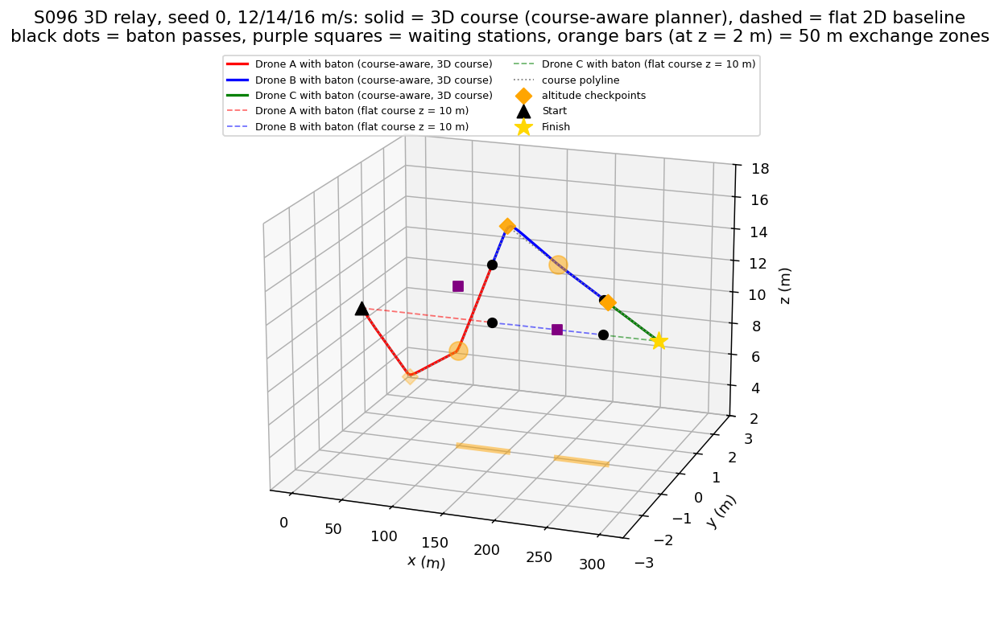
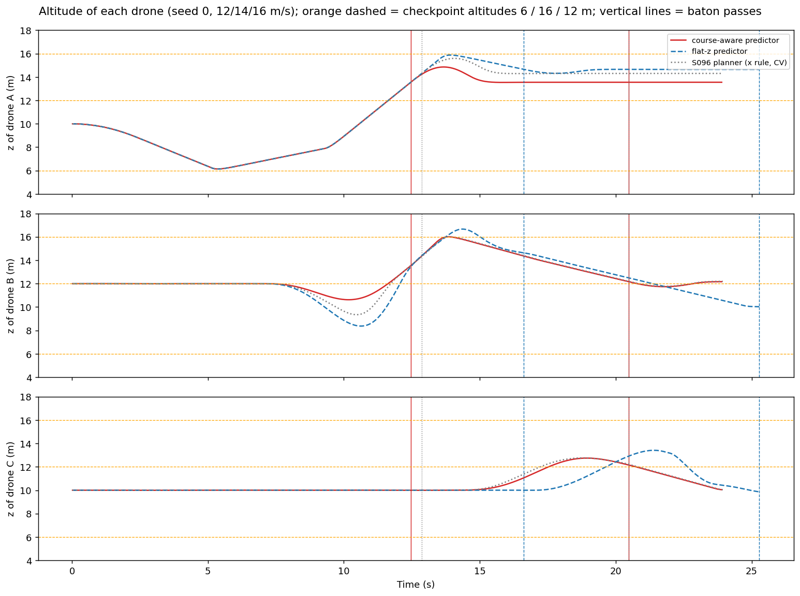
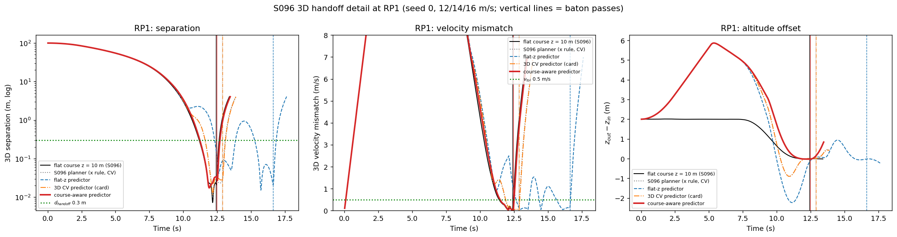
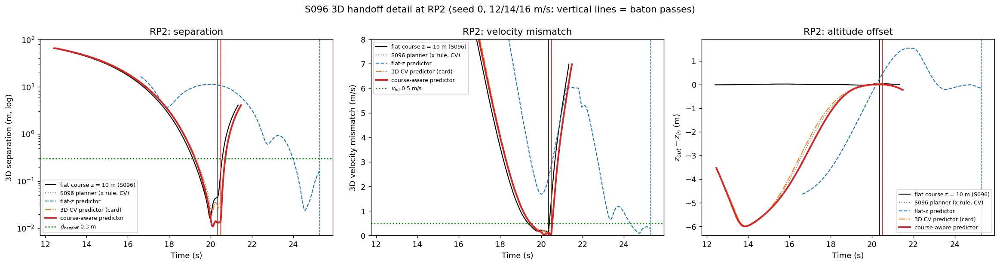
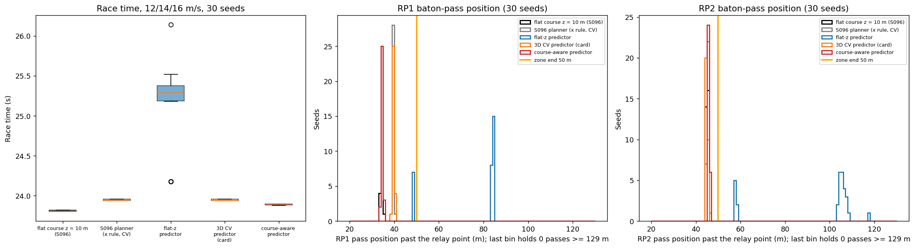
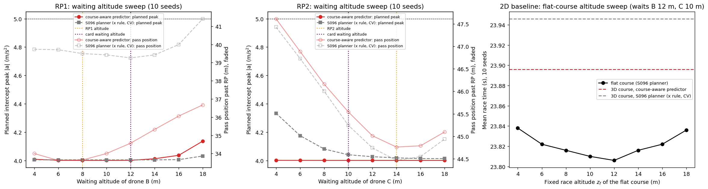
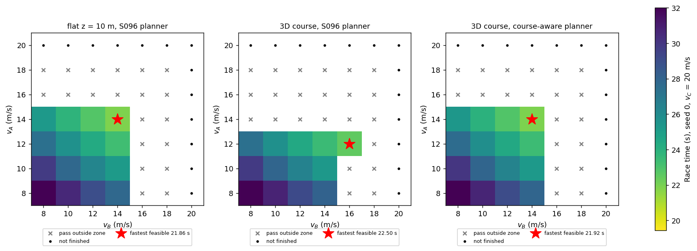
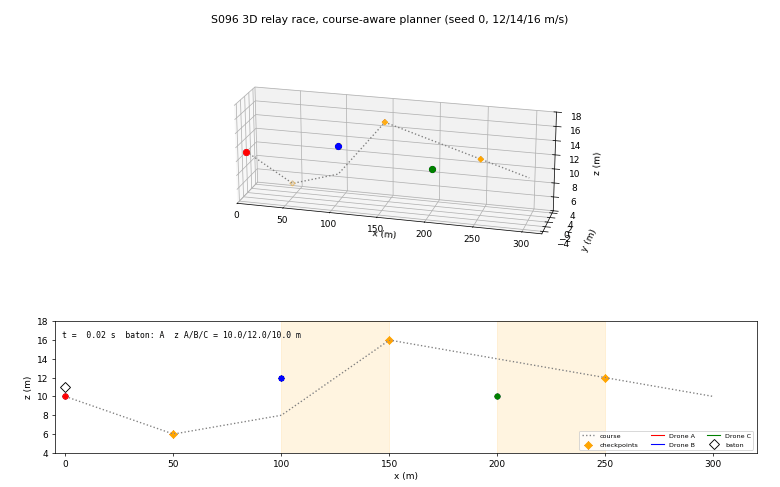

# S096 3D Upgrade — Drone Relay Race

**Domain**: Special Ops & Entertainment | **Difficulty**: ⭐⭐⭐⭐ | **Status**: ✅ Completed

---

## Problem Definition

**Setup**: the S096 relay (three point-mass drones, three legs of about 100 m, baton pass when two drones stay within $d_{handoff} = 0.3$ m and $v_{tol} = 0.5$ m/s for $T_{handoff} = 1$ s) is moved onto the 3D card course:

$$(0,0,10) \to (50,0,6) \to \text{RP1 } (100,0,8) \to (150,0,16) \to \text{RP2 } (200,0,14) \to (250,0,12) \to (300,0,10).$$

The baton holder follows the waypoints with the card's 3D velocity director (switch radius 3 m) and keeps following the course after it passes a relay point. The RP1 exchange therefore happens on the climb towards (150, 0, 16) m (slope 0.16, $v_z$ = +1.90 m/s at 12 m/s), and the RP2 exchange on the gentle descent towards (250, 0, 12) m. Drone B waits at (100, 0, 12) m, 4 m above RP1, and drone C at (200, 0, 10) m, 4 m below RP2 (card). The 50 m exchange zone of S096 is kept.

**What is 3D here**: altitude is a controlled state of every drone (waypoint tracking in z, a 3D minimum-snap intercept that must end at the incoming drone's altitude and vertical speed), and the outgoing drone's waiting altitude is a planned choice. The study asks whether the vertical part of the prediction matters for the hand-off, and what the altitude profile costs against a flat race.

**Planners for the outgoing drone** (same disturbances and sensor noise per seed, CRN; same KF, launch acceleration $a_L$ = 4 m/s², 10 Hz replanning and formation PD as S096):

| Key | Planner | Launch rule | Predicted rendezvous state |
|---|---|---|---|
| `base` | S096 planner unchanged (**2D baseline**) | x-gap ≤ $v_x T/2$, $T = 1.875\,v_x/a_L$ | constant-velocity (CV) prediction of the KF state |
| `flatz` | 2D planner with a z-stabiliser (card's "flat-z assumption") | horizontal gap along the horizontal KF velocity | horizontal CV; altitude held at the current estimate, $v_z^* = 0$ |
| `cv3d` | card | gap and speed along the 3D KF velocity | 3D CV prediction (uses $\hat v_z$) |
| `course` | added; **uses the known course polyline, which the other planners do not have** | as `cv3d` | KF speed propagated along the course polyline |

**2D baseline on a flat course**: the S096 planner and the S096 cruise law at a fixed race altitude $z_f$, with the same waiting stations (B 12 m, C 10 m), swept over $z_f$ = 4–18 m.

---

## Mathematical Model Summary

**Course**: leg lengths 100.20 m, 100.68 m and 100.08 m (total 300.96 m, +0.32 % over 300 m). The card's Leg 1 value (≈ 100.3 m) was corrected. Segment slopes and vertical speeds:

| Segment | Slope dz/dx | $v_z$ at 12 / 14 / 16 m/s |
|---|---:|---|
| (0,10) → (50,6) | −0.080 | −0.96 / −1.12 / −1.28 m/s |
| (50,6) → RP1 | +0.040 | +0.48 / +0.56 / +0.64 m/s |
| RP1 → (150,16) | +0.160 | +1.90 / +2.21 / +2.53 m/s |
| (150,16) → RP2 → (250,12) → finish | −0.040 | −0.48 / −0.56 / −0.64 m/s |

**Cruise**: $\mathbf v_{des} = v_i\,(\mathbf w - \mathbf p)/\|\mathbf w - \mathbf p\|$, $\mathbf u = 5(\mathbf v_{des} - \mathbf v)$, waypoint switch at 3 m, plus the soft altitude bound $u_{z} \mathrel{+}= 10\,(2.5 - z)$ below 2.5 m and $10\,(19.5 - z)$ above 19.5 m (card, sign corrected). The bound was never active (0 drone-steps).

**Intercept**: as in S096, a degree-7 minimum-snap polynomial per axis from the outgoing drone's state to the predicted incoming position and velocity after $\tau$, launched when the gap is $vT/2$ with $T = 1.875\,v/a_L$, replanned every 0.1 s from the current reference acceleration and jerk, followed by the formation PD $\mathbf u = 8(\hat{\mathbf p}_{in} - \mathbf p) + 4(\hat{\mathbf v}_{in} - \mathbf v)$ after $t^*$.

**Why the vertical prediction matters**: a planned rendezvous that is $\Delta z$ off in altitude, or that ends with the wrong vertical speed, has to be corrected by the replanning in the time left. The card's example: $\tau = 3$ s × $\delta v_z$ = 0.5 m/s = 1.5 m vertical miss.

**Reproduction check**: on the flat course at 10 m with the S096 stations (12 m, 12 m), the `base` planner reproduces the S096 script exactly (race 23.82 s; identical: True).

---

## Key Parameters

| Parameter | Value |
|-----------|-------|
| Course waypoints | (0,0,10), (50,0,6), (100,0,8), (150,0,16), (200,0,14), (250,0,12), (300,0,10) m (card) |
| Waiting stations | B (100, 0, 12) m, C (200, 0, 10) m (card) |
| Altitude bounds / bound gain / band | 2–20 m / 10 / 0.5 m (card) |
| Waypoint switch radius | 3 m (card) |
| $d_{handoff}$ / $v_{tol}$ / $T_{handoff}$ | 0.3 m / 0.5 m/s / 1 s (card) |
| Card cruise speeds $v_A, v_B, v_C$ | 12, 14, 16 m/s |
| $a_{max}$ / speed limit | 5 m/s² / 20 m/s |
| Disturbance $\sigma_d$ | 0.1 m/s² |
| KF $\sigma_a$ / $\sigma_{obs}$ / rate | 0.5 m/s² / 0.05 m / 50 Hz |
| Cruise gain / tracking and formation PD | 5 / $K_p = 8$, $K_d = 4$ (S096) |
| Launch peak acceleration $a_L$ (S096, added) | 4 m/s² (sensitivity 3, 4, 5 m/s²) |
| Replanning period (S096, added) | 0.1 s |
| Exchange zone (S096, added) | 50 m past each relay point (sensitivity 40, 50, 55, 60 m) |
| Speed grid (S096, added) | $v_A, v_B \in \{8, 10, \ldots, 20\}$ m/s, $v_C$ = 20 m/s, seed 0 |
| Waiting-altitude sweep (added) | 4, 6, …, 18 m for B and for C, 10 seeds |
| Flat-course altitude sweep (added) | $z_f$ = 4, 6, …, 18 m, 10 seeds |
| Monte Carlo | 30 seeds (sweeps 10 seeds) |
| $\Delta t$ / $T_{max}$ | 0.02 s / 120 s |
| Course extension past the finish (added) | level, 3 km (only reached by drones that are past the finish line) |

---

## Implementation

```
src/05_special_entertainment/3d/s096_3d_relay_race.py   # imports the S096 KF, min-snap and integrator
```

```bash
conda activate drones
python src/05_special_entertainment/3d/s096_3d_relay_race.py
```

Runtime: about 3 min (167–184 s over three runs; other simulations were running on the machine at the same time). Stdout and every output file are byte-identical across two single-threaded runs and one run with default threading. The script asserts that the speed stays at or below 20 m/s, that nothing moves more than $v_{max}\Delta t$ in one step, that every altitude stays above 0, and that the flat baseline reproduces S096 exactly.

---

## Results

### Seed 0, card speeds 12 / 14 / 16 m/s

| Planner | Race | RP1 pass | RP2 pass | Launch-time z error of the planned rendezvous (RP1 / RP2) |
|---|---:|---|---|---|
| Flat course 10 m (S096) | 23.80 s | +34.5 m, 0.04 s after $t^*$ | +45.1 m, 0.07 s before | −0.10 / −0.01 m |
| `base` on 3D | 23.94 s | +39.3 m at z 14.30 m, 0.50 s after $t^*$; max commanded 5.05 m/s² | +45.3 m | −3.91 / +11.42 m |
| `flatz` on 3D | 25.28 s, zone **missed** | +84.2 m, 4.26 s after $t^*$; max commanded 40.26 m/s² | +104.9 m (x = 304.9 m, past the finish) | −6.70 / +2.97 m |
| `cv3d` on 3D | 23.94 s | +39.5 m, 0.51 s after $t^*$ | +45.2 m | −3.95 / +12.47 m |
| **`course` on 3D** | **23.90 s** | **+34.6 m** at z 13.55 m, 0.09 s after $t^*$; max commanded 4.01 m/s² | +46.0 m | −0.01 / +0.03 m |

Commanded accelerations above 5 m/s² are clipped to $a_{max}$; the "max commanded" values show how hard the replanned intercept asks. On the 3D course, the baton holder flies 12.16–16.00 m (B) and 10.05–12.14 m (C). The highest altitude of each leg minus the altitude where it ends: leg 1 +5.55 m, leg 2 +2.00 m, leg 3 +2.14 m (card target ≥ 2 m).

### Monte Carlo (30 seeds, card speeds)

| Planner | Both passes in zone | Race time | RP1 pass (late vs $t^*$) | RP2 pass (late vs $t^*$) | $\lvert dp\rvert$ / $\lvert dv\rvert$ max at the passes (RP1; RP2) |
|---|---:|---|---|---|---|
| Flat course 10 m (S096) | 30/30 | 23.81 ± 0.01 s | +34.3 ± 0.3 m (+0.04 s) | +45.0 ± 0.3 m (−0.08 s) | — |
| `base` (2D planner) | 30/30 | 23.95 ± 0.01 s | +39.5 ± 0.3 m (+0.51 s) | +45.4 ± 0.4 m (−0.05 s) | 0.059 m, 0.121 m/s; 0.052 m, 0.136 m/s |
| `flatz` | **0/30** | 25.09 ± 0.53 s | +75.8 ± 15.1 m (+3.55 s) | +94.8 ± 20.7 m (+2.89 s) | 0.081 m, 0.495 m/s; 0.223 m, 0.383 m/s |
| `cv3d` (card) | 30/30 | 23.95 ± 0.01 s | +39.6 ± 0.3 m (+0.50 s) | +44.9 ± 0.4 m (−0.02 s) | 0.060 m, 0.121 m/s; 0.055 m, 0.099 m/s |
| **`course`** | 30/30 | **23.89 ± 0.01 s** | **+34.6 ± 0.3 m** (+0.08 s) | +45.6 ± 0.3 m (−0.04 s) | 0.073 m, 0.060 m/s; 0.042 m, 0.090 m/s |

With `flatz`, the second pass lands past the 300 m finish in 23/30 seeds; the race then ends at the pass and leg 3 is never flown, so its race time is flattered (none of the other planners does this). Most of the RP2 figure is a cascade from the late RP1 pass: B gets the baton late, so C's launch gap shrinks from 45.4 m (`cv3d`) to 22.2 m. With the CV planner at RP1 and flat-z only at RP2 (ablation below), RP2 still fails on its own: +57.8 m, 0/30 in the zone, but no pass beyond the finish. The altitude-bound term was active in 0 drone-steps.

**Paired comparisons (30 seeds, CRN)**:

| Comparison | Faster in | Race-time difference | RP1 pass difference |
|---|---:|---|---|
| `course` − flat 2D baseline | 0/30 | +0.088 s (+0.060 … +0.100) | +0.3 m |
| `course` − `base` (S096 planner on 3D) | 30/30 | −0.054 s (−0.080 … −0.040) | −4.8 m (closer in 30/30) |
| `cv3d` − `flatz` | 30/30 | −1.146 s (−2.200 … −0.220) | −36.2 m (closer in 30/30) |
| `course` − `cv3d` | 30/30 | −0.052 s (−0.060 … −0.040) | −5.0 m (closer in 30/30) |

Mean race time against the flat baseline: `base` +0.60 %, `flatz` +5.40 %, `cv3d` +0.59 %, `course` +0.37 % (card target: ≤ +10 %).

**Where the vertical error comes from (direct probe)**. Every replan of one intercept targets the same meeting time $t^*$, so the altitude error of the planned meeting point can be read out against the time left when it was planned (mean over 30 seeds):

| Planner, relay | 5 s before $t^*$ | 4 s | 3 s | 2 s | 1 s |
|---|---:|---:|---:|---:|---:|
| `cv3d` RP1 | −4.00 m | −4.10 m | −4.08 m | −0.44 m | +0.01 m |
| `cv3d` RP2 | −0.65 m | −0.23 m | −0.21 m | +0.01 m | −0.00 m |
| `flatz` RP1 | −6.41 m | −5.94 m | −5.48 m | −3.90 m | −1.93 m |
| `flatz` RP2 | +2.85 m | +2.27 m | +1.68 m | +1.12 m | +0.56 m |
| `course` RP1 | −0.04 m | −0.04 m | −0.04 m | −0.04 m | −0.04 m |
| `course` RP2 | −0.00 m | +0.00 m | −0.00 m | +0.00 m | +0.00 m |

- At RP1 the incoming drone climbs at 0.04 when the intercept starts and turns to 0.16 at the relay point, part-way through the intercept. The constant-velocity prediction misses the turn: its planned meeting point is about 4 m too low until 3 s before $t^*$, and the error collapses only between 3 s and 2 s before $t^*$. The pass completes 0.50 s after $t^*$ and 5.0 m further down the zone than with the course-aware planner (30/30 seeds). The altitude error alone is **not** the cause; see the ablation below.
- At RP2 the CV launch-time error is even larger (+12.47 m), because B has just turned at (150, 0, 16) and its KF still carries the climb rate. But by 5 s before $t^*$ the error is down to −0.65 m, so the late part of the intercept is clean and the pass is on time.
- With the altitude held (`flatz`), the planned point is always 1–6 m off and ends with $v_z^* = 0$. The planned end vertical speed is 1.88 m/s off at RP1 (mean over seeds), far above $v_{tol}$ = 0.5 m/s, so the pass only completes in the formation-hold phase, 3.55 s late on average.

**Ablation: which part of the predicted state matters** (30 seeds, card speeds, same seeds). `zfix` takes the CV prediction but replaces the planned altitude with the course altitude; `vzfix` keeps the CV altitude but uses the course's vertical speed; `flatz_rp2` uses the CV planner at RP1 and the flat-z planner only at RP2:

| Planner | Both in zone | Race | RP1 pass (late) | RP2 pass (late) | RP2 launch gap | 2nd pass past finish |
|---|---:|---:|---|---|---:|---:|
| `cv3d` (card) | 30/30 | 23.95 s | +39.6 m (+0.50 s) | +44.9 m (−0.02 s) | 45.4 m | 0/30 |
| `zfix`: course altitude, CV $v_z$ | 30/30 | 23.95 s | +39.9 m (+0.53 s) | +44.9 m (−0.03 s) | 45.2 m | 0/30 |
| `vzfix`: CV altitude, course $v_z$ | 27/30 | 24.14 s | +48.9 m (+1.29 s), 27/30 in zone | +51.1 m (+0.27 s) | 39.9 m | 3/30 |
| `course`: both | 30/30 | 23.89 s | +34.6 m (+0.08 s) | +45.6 m (−0.04 s) | 45.4 m | 0/30 |
| `flatz` at both relays | 0/30 | 25.09 s | +75.8 m (+3.55 s), 7/30 in zone | +94.8 m (+2.89 s) | 22.2 m | 23/30 |
| `flatz_rp2`: CV at RP1, flat-z at RP2 | 0/30 | 24.06 s | +39.6 m (+0.50 s) | +57.8 m (+0.84 s), 0/30 in zone | 44.4 m | 0/30 |

Correcting the planned altitude alone (`zfix`) changes nothing, and correcting only the vertical speed (`vzfix`) makes RP1 worse: a planned end state whose altitude and vertical speed do not belong to the same trajectory forces a harder correction. Only the consistent course state (altitude and vertical speed together) brings the RP1 pass forward to +34.6 m. So the CV planner's late RP1 pass is caused by its state prediction as a whole, altitude and vertical speed together, missing the slope change, not by the 4 m altitude error on its own.

**Launch-acceleration and zone-length sensitivity** (10 seeds; seeds with both passes inside a zone of L = 40 / 50 / 55 / 60 m):

| $a_L$ | flat | `base` | `flatz` | `cv3d` | `course` |
|---|---|---|---|---|---|
| 3 m/s² | 23.96 s; 0 / 0 / 10 / 10 | 24.10 s; 0 / 10 / 10 / 10 | 26.33 s; 0 / 0 / 0 / 0 | 24.10 s; 0 / 10 / 10 / 10 | 24.05 s; 0 / 0 / 10 / 10 |
| 4 m/s² | 23.81 s; 0 / 10 / 10 / 10 | 23.95 s; 0 / 10 / 10 / 10 | 25.16 s; 0 / 0 / 0 / 2 | 23.94 s; 0 / 10 / 10 / 10 | 23.90 s; 0 / 10 / 10 / 10 |
| 5 m/s² | 23.70 s; 8 / 10 / 10 / 10 | 23.87 s; 3 / 10 / 10 / 10 | 24.04 s; 0 / 10 / 10 / 10 | 23.87 s; 3 / 10 / 10 / 10 | 23.79 s; 7 / 10 / 10 / 10 |

Each cell gives the mean race time, then the zone counts. The ranking `course` < `cv3d` ≈ `base` < `flatz` in race time holds at every $a_L$. The zone verdict does not: at $a_L$ = 3 m/s² the course-aware RP2 pass lands at +52.4 m and misses the 50 m zone, while the CV planners land at +49.1–49.3 m. At $a_L$ = 5 m/s² the flat-z planner fits the 50 m zone in 10/10 seeds (RP1 +44.1 m, RP2 +48.5 m). So "flat-z fails the zone" is specific to $a_L \le 4$ m/s².

### Waiting altitude (the planned altitude decision)

Each outgoing drone's waiting altitude was swept over 4–18 m (10 seeds, the other drone at its card altitude):

| Planner, relay | Race time over the sweep | Pass position over the sweep | Planned intercept peak | Max commanded acceleration |
|---|---|---|---|---|
| `course` RP1 (B) | 23.882–23.918 s | +33.62 … +36.68 m | 4.000–4.137 m/s² | 4.01–4.17 m/s² |
| `course` RP2 (C) | 23.884–23.910 s | +44.76 … +47.62 m | 4.000–4.001 m/s² | 4.07–4.08 m/s² |
| `base` RP1 (B) | 23.946–23.974 s | +39.26 … +41.42 m | 4.004–4.031 m/s² | **4.02 → 7.16 m/s²** (saturated 0 → 19.7 % of intercept steps) |
| `base` RP2 (C) | 23.938–23.966 s | +44.46 … +47.43 m | 4.013–4.333 m/s² | 4.15–4.20 m/s² |

Moving the wait from the card altitude to the relay-point altitude changes the course-aware race by −0.014 s (RP1) and −0.012 s (RP2). The waiting altitude barely matters. To first order, the vertical offset adds a rest-to-rest component to the intercept whose acceleration is zero at mid-intercept, where the horizontal rest-to-$v$ component peaks. The planned peak therefore stays at 4.000–4.012 m/s² within ±6 m of the relay altitude and grows only for B at 16–18 m. The one place where the wait matters is the S096 planner at RP1: a high wait combined with its 4 m altitude misprediction pushes the commanded acceleration to 7.16 m/s² (19.7 % saturated) at 18 m.

### 2D baseline: flat-course altitude sweep

| $z_f$ | 4 m | 6 m | 8 m | 10 m | 12 m | 14 m | 16 m | 18 m |
|---|---:|---:|---:|---:|---:|---:|---:|---:|
| Race time (10 seeds) | 23.838 s | 23.822 s | 23.816 s | 23.810 s | 23.806 s | 23.816 s | 23.822 s | 23.836 s |

All 80 flat races keep both passes in the zone. The best fixed altitude (12 m, 23.806 s) beats the 3D course-aware race on the same 10 seeds (23.896 s) by 0.090 s. The fixed altitude itself only matters through the vertical offset to the waiting stations (spread 0.032 s).

### Speed optimisation (seed 0, $v_C$ = 20 m/s, 50 m zone)

| Configuration | Feasible cells | Fastest feasible | L = 40 / 55 / 60 m |
|---|---:|---|---|
| Flat 10 m, S096 planner | 16/49 | (14, 14) → 21.86 s | (12, 12) 24.34 s / (14, 16) 20.96 s / (16, 14) 20.68 s |
| 3D course, S096 planner | 13/49 | (12, 16) → 22.50 s | (12, 12) 24.44 s / (12, 16) 22.50 s / (12, 16) 22.50 s |
| 3D course, course-aware | 16/49 | (14, 14) → 21.92 s | (12, 12) 24.44 s / (14, 16) 21.06 s / (14, 16) 21.06 s |

Monte Carlo (30 seeds) at each optimum: flat 21.84 ± 0.01 s (30/30 in zone); 3D S096 planner at (12, 16) 22.52 ± 0.01 s, but **only 10/30 seeds in zone** (RP2 +50.4 ± 0.8 m), so its seed-0 optimum is marginal; 3D course-aware at (14, 14) 21.92 ± 0.01 s (30/30). Course-aware is 0.597 s faster than the S096 planner at their optima (30/30 seeds) and 0.082 s slower than the flat optimum (30/30).

Per-leg times (seed 0; start → pass 1 → pass 2 → finish): flat card speeds 12.40 / 7.94 / 3.46 s (23.80 s); 3D fixed speed 12.46 / 8.02 / 3.42 s (23.90 s); 3D optimised 11.80 / 7.24 / 2.88 s (21.92 s); flat optimised 11.74 / 7.20 / 2.92 s (21.86 s).

**Key findings**:

- **The card's claim that the vertical prediction is load-bearing holds.** Holding the predicted altitude (`flatz`, a 2D planner with a z-stabiliser) keeps both passes inside the 50 m zone in 0/30 seeds (passes 3.55 s and 2.89 s after the planned meeting time), and in 23/30 seeds the second pass lands past the finish. Much of the RP2 damage is a cascade from the late RP1 pass (C's launch gap shrinks to 22.2 m), but flat-z fails RP2 on its own too: with the CV planner at RP1, the RP2 pass is at +57.8 m, outside the zone in 30/30 seeds. Using the KF's $\hat v_z$ (`cv3d`) restores 30/30. This holds for $a_L$ = 3 and 4 m/s²; at $a_L$ = 5 m/s² the flat-z planner also fits the zone.
- **A constant-velocity prediction is not enough on a course that turns at the relay point.** At RP1 the course steepens from 0.04 to 0.16 part-way through the intercept. The CV planners (`base`, `cv3d`) predict a meeting state (altitude and vertical speed) that misses the turn, pass 0.5 s late and 5 m further down the zone. The ablation shows that fixing only the altitude (`zfix`, +39.9 m) or only the vertical speed (`vzfix`, +48.9 m) does not help; only the consistent course state does. Propagating the KF speed along the known course (`course`, which has more information: the course polyline) removes the error (−0.04 m) and is faster than `base` and `cv3d` in 30/30 seeds. At the speed optimum this matters: the S096 planner's best feasible speeds (12, 16) are 0.6 s slower and stay inside the zone in only 10/30 seeds.
- **The 3D course costs little time**: +0.37 % (0.088 s) for the course-aware planner against the flat S096 race, far inside the card's ≤ 10 % target, and +0.082 s at the respective speed optima. The extra path length is 0.32 %.
- **The planned waiting altitude hardly matters** (≤ 0.04 s over 4–18 m for the course-aware planner). The card's mismatched waits (B 4 m above, C 4 m below) cost 0.012–0.014 s against waiting at the relay altitude.
- **Hand-off accuracy is never the issue**: $\lvert dp\rvert \le 0.223$ m and $\lvert dv\rvert \le 0.495$ m/s at every pass, including `flatz`. The planners differ in *when and where* the pass completes, not in whether it does.

### 3D Trajectories

Seed 0, card speeds. Solid = 3D course with the course-aware planner (each drone drawn while it holds the baton), dashed = flat 2D baseline at 10 m. Orange diamonds = altitude checkpoints, purple squares = waiting stations, black dots = baton passes, orange bars (drawn at z = 2 m) = exchange zones.



### Altitude

Altitude of each drone for the course-aware, flat-z and S096 planners (seed 0). With the flat-z planner, B overshoots above the 16 m checkpoint and the passes come much later (dashed vertical lines). Every planner first moves B down from its 12 m wait and then up the climb: a rest-to-$v$ intercept that must end with $v_z$ = +1.90 m/s needs a vertical displacement of $v_z T/2$, more than the distance from the 12 m wait up to the meeting point, so the polynomial first dips (read from the figure).



### Hand-off detail

3D separation, 3D velocity mismatch and altitude offset at each relay point (seed 0). The green dotted lines are the hand-off tolerances.





### Monte Carlo

Race times and pass positions (30 seeds). The histogram bins run to 130 m and the last bin would collect any pass at 129 m or beyond; there are none (printed), so no flat-z pass is cut off.



### Waiting-altitude and flat-altitude sweeps

Left and centre: planned intercept peak (solid) and pass position (faded) against the waiting altitude of B and C. Right: the flat 2D baseline against its fixed altitude, with the 3D course times as horizontal lines.



### Speed optimisation



### Animation

Course-aware planner, seed 0: 3D view and side elevation (x–z) with the exchange zones; the white diamond is the baton. 121 frames at 20 fps (every 10th of 1195 samples).



### Deviations from the scenario card

| Card | Implementation | Reason |
|------|----------------|--------|
| "S096 rendezvous and min-snap are computed entirely in the horizontal plane"; mismatched waiting altitude is new | Card corrected: the S096 KF is 6-state 3D, the min-snap is planned in 3D, and B and C already wait 2 m above the race. What S096 does in the plane is the launch rule (x-gap, $v_x$) and the course | Checked against `s096_relay_race.py` (X7) |
| $L_{leg,1} \approx 100.3$ m | 100.20 m (printed); card corrected | $\sqrt{50^2+4^2} + \sqrt{50^2+2^2}$ = 50.16 + 50.04 |
| Altitude bound $K_{bound}(z_{min} - z)$ inside the band | $K_{bound}(z_{min} + 0.5 - z)$ (and mirrored at the top); card corrected | The card's form is negative inside the band and pushes towards the bound. It was never active here |
| Behaviour after the relay point not specified | The baton holder keeps following the course (towards the next leg's checkpoint) until the pass | The course continues; this is what makes the RP1 exchange happen on the 0.16 climb |
| "Flat-course baseline" at 10 m | Flat baseline with the S096 planner and cruise law, swept over $z_f$ = 4–18 m with the card's waiting stations | Fair 2D baseline (X5); the flat race reproduces S096 exactly with the S096 stations |
| One 3D planner with "full 3D intercept" | `cv3d` (card) plus the S096 planner, a flat-z planner (card's ablation), a course-aware planner that also knows the course polyline (added) and three ablations (`zfix`, `vzfix`, `flatz_rp2`) | Tests the card's $v_z$ claim directly and separates the launch rule from the predictor |
| Per-leg speed optimisation "jointly over horizontal and vertical components"; $T_{total} = \sum L_i/v_i + 2T_{handoff}$ | S096 grid search over $(v_A, v_B)$ with the 50 m zone; race time = time at which C, holding the baton, reaches 300 m | Legs overlap during the passes (S096) |
| Launch rule not specified for 3D | Gap and speed along the predicted velocity, armed only while the incoming drone moves forward ($\hat v_x$ > 1 m/s, as S096) | The 3D projection alone launched on the noisy first KF velocity estimates (during development, one seed drove B into the ground before this guard) |
| Waiting altitudes fixed (12 / 10 m) | Kept, plus a sweep of 4–18 m for each outgoing drone | The planned altitude decision; the result is that it barely matters |
| — | Course extended level for 3 km past the finish | Unfinished grid races keep flying; the extension is never used before the finish line |

---

## Extensions

1. **Course-aware prediction with uncertainty**: propagate the KF covariance along the course polyline and launch on a chance constraint for the zone.
2. **Altitude-shear wind** (card extension 2): with a power-law wind profile, the waiting altitude and the course altitude change the effective head wind.
3. **Optimal altitude profile** (card extension 1): optimise the checkpoint altitudes for race time with the zone constraint.
4. **Barometric altitude noise** (card extension 5): $\sigma_{obs,z}$ = 0.2 m makes $\hat v_z$ noisier; check how much the course-aware advantage shrinks.
5. **Physical baton exchange**: a vertical offset during the pass, so that the drones do not need to fly within 0.3 m of each other.

---

## Related Scenarios

- Original 2D version: [S096 Drone Relay Race](../../../../scenarios/05_special_entertainment/S096_relay_race.md)
- 3D card: [S096 3D Upgrade — Drone Relay Race](../../../../scenarios/05_special_entertainment/3d/S096_3d_relay_race.md)
- Velocity-matched rendezvous: [S023 Moving Landing Pad](../../../../scenarios/02_logistics_delivery/S023_moving_landing_pad.md)
- Racing: [S082 FPV Racing Circuit](../../../../scenarios/05_special_entertainment/S082_fpv_racing.md)
- Follow-up: [S099 Cross-Obstacle Relay Pass](../../../../scenarios/05_special_entertainment/S099_obstacle_relay.md)
