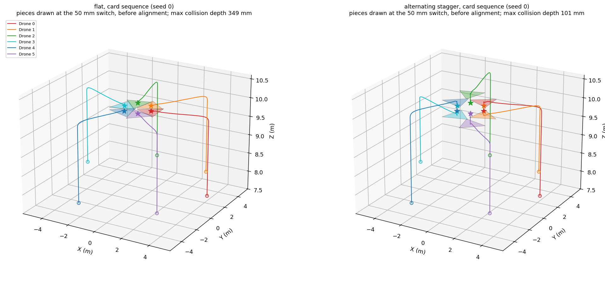
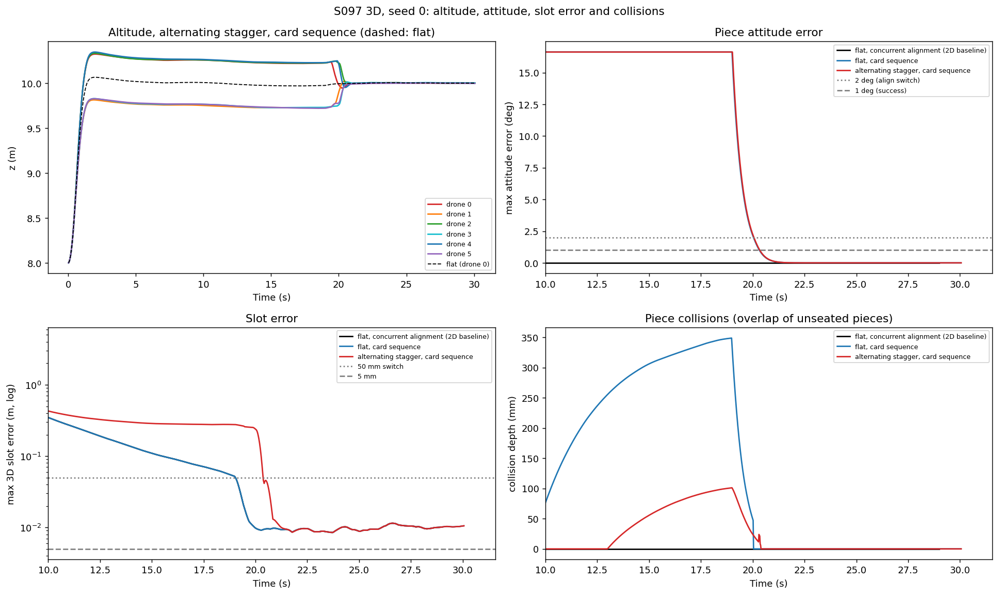
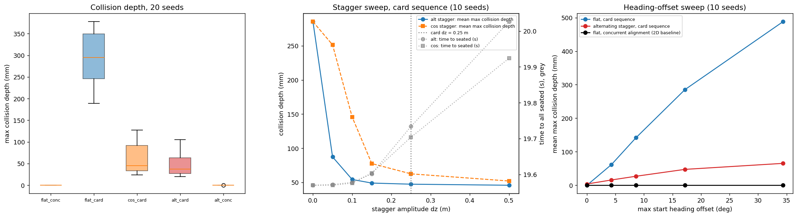
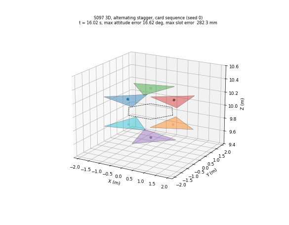

# S097 3D Upgrade — Aerial Puzzle Assembly

**Domain**: Special Ops & Entertainment | **Difficulty**: ⭐⭐⭐⭐ | **Status**: ✅ Completed

---

## Problem Definition

**Setup**: the fixed S097 assembly is kept: six 0.5 kg drones each carry an equilateral-triangle piece (side 1.7321 m, S097's zero-clearance tiling; the 3D card specifies half-side 0.35 m, i.e. side 0.7 m, see the piece-size sweep) that tiles a hexagon with slot radius 1 m at $z_{asm}$ = 10 m. The drones start on a 5 m staging circle at 8 m with ±0.3 rad angular jitter, run error consensus over a ring graph with the card gains, switch to impedance fitting when every drone measures itself within 50 mm of its target, and hold for 10 s (the last 8 s scored). OU wind, an RTK-like position bias (5 mm), 1 mm relative sensing and the S097 edge-contact springs are unchanged.

The 3D card adds two things:

1. **Piece attitude.** Each piece must reach the slot attitude $\mathbf R_k^* = \mathbf R_z(2\pi k/6)\,\mathbf R_y(\theta_k^*)$ with the card's tilt $\theta_k^* = 5°\sin(2\pi k/6)$, i.e. +0, +4.33, +4.33, +0, −4.33, −4.33°. A quadrotor cannot hold a roll or pitch while hovering, so the piece is assumed to hang on a 2-axis gimbal (card corrected). Alignment uses the card's kinematic law $\boldsymbol\omega = K_\omega\theta_{err}\hat{\mathbf n}$ ($K_\omega$ = 2), then the card's rotational impedance ($K_r$ = 3, $B_r$ = 1.5, $I_{eff}$ = 0.2) during the fit.
2. **Layered approach.** Drone $k$ climbs to $z_{asm} + \Delta z_k$, runs the consensus there, and inserts vertically into the slot plane during the fit. The card's stated purpose is to avoid collisions between pieces at the slot boundaries.

**Mission sequences**:
- **card**: the piece attitude stays at its random start heading (the card's "random heading offsets", here the S097 jitter) during ascent and consensus. At the 50 mm switch each piece rotates in place with its translation frozen until its attitude error is at most 2°, then the 6-DOF fit starts.
- **concurrent**: the attitude is aligned from t = 0 while the drones climb and converge, as the S097 yaw does; the fit starts at the switch.

**Variants** (same wind, bias, noise and start jitter per seed; CRN):

| Key | Stagger | Sequence | Role |
|---|---|---|---|
| `flat_conc` | none | concurrent | **2D baseline**: S097 at a fixed altitude, plus attitude |
| `flat_card` | none | card | card sequence without layering |
| `cos_card` | card formula $0.25\cos(2\pi k/6)$ m | card | the card as written |
| `alt_card` | alternating $0.25(-1)^k$ m | card | the card's stated intent (corrected formula) |
| `alt_conc` | alternating | concurrent | layering without the in-place alignment |

**Collision diagnostic (added)**: each piece is a thin panel (20 mm). Two pieces interfere when their vertical extents overlap and their footprints overlap; the depth is the separating-axis penetration of the two triangles. Overlap between two pieces that are both *seated* (within 50 mm of the slot and within 2° of the slot attitude) is the edge contact that S097 models with springs. Any other overlap is counted as a **collision**. No impact forces are modelled, so collisions are a diagnostic only. The split depends on the seated thresholds: the excluded seated overlap reaches 53.8 mm in the Monte Carlo (`flat_card`), the same size as the counted `alt_card` collisions. The script therefore also prints the overlap with the exclusion removed ("any overlap"): it does not change the depth of any card-sequence variant, and with S097's zero-clearance pieces no variant is free of overlap (the tiled pieces overlap by 1.43 mm even exactly at their slots).

---

## Mathematical Model Summary

**Consensus** (S097, on slot errors; the card's absolute-position consensus has a shrunken fixed point, card corrected):

$$\mathbf u_k = K_{p}\bigl(-\varepsilon(\mathbf L\mathbf e)_k - \boldsymbol\alpha\odot\hat{\mathbf e}_k\bigr) - K_d\mathbf v_k, \qquad \mathbf e_k = \mathbf p_k - \mathbf p_k^{app},\ \boldsymbol\alpha = (0.10, 0.10, 0.15).$$

**Fit** (S097): $m\ddot{\mathbf p}_k = K_{imp}(\mathbf p_k^{tgt} - \hat{\mathbf p}_k) - B_{imp}\dot{\mathbf p}_k - K_{rel}(\mathbf L\mathbf e)_k + \mathbf F_{contact}$, with $\mathbf p^{tgt} = \mathbf p^{app}$ while a piece aligns (card sequence) and $\mathbf p^*$ afterwards.

**Attitude**: world-frame error vector $\theta_{err}\hat{\mathbf n} = \log(\mathbf R^*\mathbf R^\top)$, update $\mathbf R \leftarrow \exp(\boldsymbol\omega\Delta t)\,\mathbf R$; rotational impedance $I_{eff}\dot{\boldsymbol\omega} = K_r\theta_{err}\hat{\mathbf n} - B_r\boldsymbol\omega$ ($\omega_n$ = 3.873 rad/s, $\zeta$ = 0.968, not the card's 1.0).

**Card checks (printed)**:
- The card's stagger $0.25\cos(2\pi k/6)$ gives +0.250, +0.125, −0.125, −0.250, −0.125, +0.125 m. It does not alternate, and four of the six neighbour pairs are only 0.125 m apart, while a tilted piece spans 0.133 m vertically (0.020 m untilted). The alternating form gives 0.500 m between all neighbours.
- $\varepsilon_{6DOF}$: the card's weight $K_t/K_r$ = 2.667 1/m² does not give a length. The implementation uses $K_r/K_t$ = 0.375 m²/rad², so 1° counts as 10.69 mm.
- At their slots, the tiled pieces overlap by at most 1.43 mm (they share edges).

**Reproduction**: `flat_conc` with $\alpha_z$ = 0.10 reproduces the S097 consensus strategy exactly at seed 0 (switch 19.40 s, worst slot error over the hold 11.45 mm in both). The attitude does not feed back into the translation.

---

## Key Parameters

| Parameter | Value |
|-----------|-------|
| Drones / mass / piece side | 6 / 0.5 kg / 1.7321 m (S097 tiling; card 0.7 m; sweep 0.7, 1.2, 1.5, 1.55, 1.6, 1.65, 1.7, 1.7321 m) |
| Slot radius / assembly altitude / staging | 1.0 m / 10 m / 5 m at 8 m, ±0.3 rad jitter (S097) |
| Consensus $\varepsilon$, $\alpha_{xy}$, $\alpha_z$ | 0.05, 0.10, 0.15 (card) |
| Consensus tracking / ascent PD | 10, 5 / 8, 4 (S097) |
| Impedance $K_{imp}$, $B_{imp}$, coupling $K_{rel}$ | 8 N/m, 4 N·s/m, 4 N/m (S097) |
| Edge contact $k_c$, $b_c$ | 50 N/m, 5 N·s/m (S097) |
| Stagger $\delta_z$ | 0.25 m (card); sweep 0, 0.05, 0.10, 0.15, 0.25, 0.50 m |
| Tilt $\theta_{tilt}$ | 5° (card) |
| Alignment $K_\omega$ / switch / success | 2 rad/s per rad / 2° / 1° (card) |
| Rotational impedance $K_r$, $B_r$, $I_{eff}$ | 3 N·m/rad, 1.5 N·m·s/rad, 0.2 kg·m² (card) |
| $\delta_{switch}$ / $\delta_{fit}$ / $d_{min}$ | 50 mm / 5 mm / 0.3 m |
| Wind / bias / relative noise | OU 0.03 + 0.01 m/s², τ 3 s / OU 5 mm, τ 10 s / 1 mm (S097) |
| Panel thickness (added) | 20 mm |
| Heading-offset sweep (added) | 0, 0.25, 0.5, 1, 2 × the S097 jitter (max 0–34.4°) |
| Assembly-altitude sweep of the 2D baseline (added) | 8, 10, 12, 15 m |
| Hold / scored window / time limit | 10 s / last 8 s / 90 s (+30 s for the card sequence) |
| $\Delta t$ / Monte Carlo | 0.02 s / 20 seeds (sweeps 10), 4 worker processes |

---

## Implementation

```
src/05_special_entertainment/3d/s097_3d_aerial_puzzle.py   # imports the S097 constants, OU and wind models
```

```bash
conda activate drones
python src/05_special_entertainment/3d/s097_3d_aerial_puzzle.py
```

Runtime: 3.3–3.7 min (200–223 s over three runs, with a pool of 4 worker processes; other simulations were running on the machine at the same time). Stdout and every output file are byte-identical across two single-threaded runs and one run with default threading. The script asserts that every altitude stays above 0, every speed below 10 m/s, every attitude matrix stays a rotation ($|\det - 1| < 10^{-6}$), and that the flat baseline reproduces S097.

---

## Results

### Seed 0

| Variant | Switch | All seated (50 mm, 1°) | Collision depth | Collision time | Seated overlap |
|---|---:|---:|---:|---:|---:|
| `flat_conc` (2D baseline) | 18.98 s | **19.04 s** | **0.0 mm** | 0.00 s | 1.6 mm |
| `flat_card` | 18.98 s | 20.32 s | 348.7 mm | 10.76 s | 45.0 mm |
| `cos_card` | 19.00 s | 20.52 s | 62.6 mm | 6.14 s | 15.3 mm |
| `alt_card` | 19.00 s | 20.38 s | 101.1 mm | 7.40 s | 19.9 mm |
| `alt_conc` | 19.00 s | 19.38 s | 0.0 mm | 0.00 s | 1.6 mm |

Over the scored hold all five reach the same slot error (11.45 mm), edge gap (7.55 mm) and contact force (0.028 N); the attitude error is 0.000° (concurrent) or 0.004° (card sequence).

### Monte Carlo (20 seeds)

| Variant | All seated | Collision depth | Collision-free seeds | Collision time | Hold slot error | Hold edge gap | $\varepsilon_{6DOF}$ |
|---|---:|---|---:|---:|---:|---:|---:|
| `flat_conc` (2D baseline) | **17.81 ± 1.27 s** | 0.0 ± 0.0 mm | **20/20** | 0.00 s | 10.78 ± 1.79 mm | 5.67 ± 2.08 mm | 10.78 mm |
| `flat_card` | 19.07 ± 1.27 s | 293.9 ± 57.1 mm (max 377.7) | 0/20 | 9.53 s | 10.84 ± 1.77 mm | 5.79 ± 2.03 mm | 10.84 mm |
| `cos_card` | 19.21 ± 1.26 s | 60.7 ± 34.6 mm (max 127.1) | 0/20 | 1.72 s | 10.83 ± 1.77 mm | 5.79 ± 2.03 mm | 10.83 mm |
| `alt_card` | 19.23 ± 1.23 s | 49.3 ± 27.7 mm (max 105.3) | 0/20 | 3.55 s | 10.83 ± 1.78 mm | 5.83 ± 1.97 mm | 10.83 mm |
| `alt_conc` | 18.18 ± 1.23 s | 0.0 ± 0.0 mm | 19/20 (none above 1 mm) | 0.00 s | 10.78 ± 1.80 mm | 5.67 ± 2.08 mm | 10.78 mm |

Paired against the 2D baseline (20 seeds): `flat_card` seats later in 20/20 seeds by +1.26 s, `cos_card` by +1.40 s, `alt_card` by +1.42 s, `alt_conc` by +0.36 s (+0.24 … +0.80 s). Layering cuts the card-sequence collision depth in 20/20 seeds (`alt_card` against `flat_card`) and costs +0.16 s. The hold slot error and edge gap differ by at most +0.06 mm and +0.16 mm between variants. Maximum contact force 0.083 N everywhere; minimum drone separation ≥ 0.989 m against $d_{min}$ = 0.3 m.

**Where the deepest collision of each seed happens** (printed per seed):

| Variant | Consensus approach | In-place alignment | Fit / insertion | Adjacent pair / non-adjacent pair |
|---|---:|---:|---:|---|
| `flat_card` | 20 | 0 | 0 | 20 / 0 |
| `cos_card` | 3 | 9 | 8 | 17 / 3 |
| `alt_card` | 12 | 0 | 8 | 8 / 12 |
| `alt_conc` | 0 | 0 | 1 | 1 / 0 |

- Without layering, the pieces already collide while they converge with their start headings, before any in-place rotation (20/20 seeds).
- With the alternating stagger, adjacent pieces are 0.5 m apart vertically, but the three pieces of each layer still meet near the centre: in 12/20 seeds the deepest collision is between two non-adjacent pieces of the same layer. The rest happen during the vertical insertion. They are **not** caused by the residual attitude error at the 2° alignment switch: tightening the switch to 0.5° and 0.2° leaves `alt_card` at 0/10 collision-free (mean depth 47.4 → 44.1 → 43.7 mm). A hypothesis consistent with the piece-size sweep below: with zero-clearance edges, any lateral error of an inserting piece is an overlap with its neighbour.
- With the card's cos stagger, most deepest collisions are between neighbours (17/20), because four neighbour pairs are only 0.125 m apart.

### Stagger sweep (card sequence, 10 seeds)

| $\delta_z$ | Alternating: depth mean (max; adjacent max) | Alternating: all seated | Cos (card): depth mean (max) | Cos: all seated |
|---|---|---:|---|---:|
| 0 m | 285.4 mm (376.3; 376.3) | 19.57 s | 285.4 mm (376.3) | 19.57 s |
| 0.05 m | 87.3 mm (127.6; 127.6) | 19.57 s | 251.5 mm (325.5) | 19.57 s |
| 0.10 m | 54.3 mm (101.2; 48.8) | 19.58 s | 145.7 mm (227.5) | 19.58 s |
| 0.15 m | 49.0 mm (101.2; 34.6) | 19.60 s | 77.6 mm (135.2) | 19.60 s |
| 0.25 m (card) | 47.4 mm (101.1; 25.9) | 19.73 s | 62.5 mm (125.5) | 19.70 s |
| 0.50 m | 45.8 mm (100.8; 17.9) | 20.03 s | 52.1 mm (108.3) | 19.92 s |

No stagger makes any seed collision-free (0/10 at every value). Beyond 0.15 m the alternating stagger only shrinks the adjacent-pair collisions (34.6 → 17.9 mm); the same-layer collisions (about 100 mm) remain, while the time to all seated grows from 19.57 s (no stagger) to 19.73 s (0.25 m) and 20.03 s (0.5 m).

### Heading-offset sweep (10 seeds)

| Max start heading offset | `flat_card` depth (collision-free) | `alt_card` depth (collision-free) | `flat_conc` depth (collision-free) |
|---|---|---|---|
| 0° | 0.1 mm (9/10) | 3.8 mm (0/10) | 0.0 mm (10/10) |
| 4.3° | 61.7 mm (0/10) | 15.8 mm (0/10) | 0.0 mm (10/10) |
| 8.6° | 141.7 mm (0/10) | 26.9 mm (0/10) | 0.0 mm (10/10) |
| 17.2° (S097) | 285.4 mm (0/10) | 47.4 mm (0/10) | 0.0 mm (10/10) |
| 34.4° | 488.0 mm (0/10) | 65.3 mm (0/10) | 0.0 mm (10/10) |

The concurrent 2D baseline seats in 18.30 s at every offset; the card sequence grows from 18.95 to 19.90 s (flat) and 19.23 to 20.07 s (alternating).

Without heading offsets layering makes things slightly worse: `flat_card` is collision-free in 9/10 seeds (0.1 mm), `alt_card` in 0/10 (3.8 mm). The flat pieces close in horizontally from outside, so their shared edges stay open until they are seated; the layered pieces drop into a zero-clearance gap from above and below. This is the same insertion effect as above and, like it, a hypothesis; the piece-size sweep is consistent with it (with 47.4 mm or more of clearance the layered `alt_card` is collision-free in at least 9/10 seeds).

### Piece size and clearance (10 seeds)

The 3D card specifies a piece half-side of 0.35 m (side 0.7 m); S097 uses side 1.7321 m, the only size whose six pieces tile the hexagon with zero clearance. With side $s$ the edge clearance at the slots is $(1.7321 - s)/\sqrt3$ (the S097 edge-contact springs act only once that clearance is used up):

| Side (clearance) | `flat_conc` | `flat_card` | `cos_card` | `alt_card` | `alt_conc` |
|---|---|---|---|---|---|
| 0.7 m, card (595.9 mm) | 0.0 (0.0) mm, 10/10 | 0.0 (0.0) mm, 10/10 | 0.0 (0.0) mm, 10/10 | 0.0 (0.0) mm, 10/10 | 0.0 (0.0) mm, 10/10 |
| 1.2 m (307.2 mm) | 0.0 (0.0) mm, 10/10 | 0.0 (0.0) mm, 10/10 | 0.0 (0.0) mm, 10/10 | 0.0 (0.0) mm, 10/10 | 0.0 (0.0) mm, 10/10 |
| 1.5 m (134.0 mm) | 0.0 (0.0) mm, 10/10 | **112.0 (192.4) mm, 0/10** | 0.0 (0.0) mm, 10/10 | **0.0 (0.0) mm, 10/10** | 0.0 (0.0) mm, 10/10 |
| 1.55 m (105.1 mm) | 0.0 (0.0) mm, 10/10 | **149.4 (232.1) mm, 0/10** | 0.5 (4.8) mm, 9/10 | **0.0 (0.0) mm, 10/10** | 0.0 (0.0) mm, 10/10 |
| 1.6 m (76.2 mm) | 0.0 (0.0) mm, 10/10 | **186.7 (271.7) mm, 0/10** | 7.1 (38.0) mm, 7/10 | **0.0 (0.0) mm, 10/10** | 0.0 (0.0) mm, 10/10 |
| 1.65 m (47.4 mm) | 0.0 (0.0) mm, 10/10 | **224.1 (311.3) mm, 0/10** | 20.2 (71.1) mm, 5/10 | **3.7 (36.7) mm, 9/10** | 0.0 (0.0) mm, 10/10 |
| 1.7 m (18.5 mm) | 0.0 (0.0) mm, 10/10 | 261.5 (350.9) mm, 0/10 | 41.8 (104.3) mm, 0/10 | 23.1 (75.9) mm, 0/10 | 0.0 (0.0) mm, 10/10 |
| 1.7321 m, S097 (0.0 mm) | 0.0 (0.0) mm, 10/10 | 285.4 (376.3) mm, 0/10 | 62.5 (125.5) mm, 0/10 | 47.4 (101.1) mm, 0/10 | 0.0 (0.0) mm, 9/10 |

Each cell: mean (max) deepest collision, collision-free seeds. Three regimes:

- **Large clearance (side 0.7 m, the card's piece, and 1.2 m; 307.2 mm or more):** no variant collides in any seed, with or without layering; with the seated exclusion removed every run is free of any overlap (printed). Layering is not needed.
- **Moderate clearance (side 1.5–1.65 m; 47.4–134.0 mm):** the flat card sequence collides in every seed (112.0–224.1 mm mean), while the alternating stagger is collision-free in 10/10 seeds from 76.2 mm of clearance up and in 9/10 at 47.4 mm. Here altitude layering removes the collisions, which is the card's claim. The card's own cos stagger helps less (5/10 to 10/10 collision-free).
- **Small or zero clearance (side 1.7 m and S097's 1.7321 m; 18.5 mm and 0):** every card-sequence variant collides in every seed; layering only reduces the depth (285.4 → 47.4 mm at zero clearance).

The concurrent sequence (attitude aligned in transit) is collision-free at every piece size, flat or layered (`alt_conc` 9/10 at zero clearance, none above 1 mm). The times to all seated do not depend on the piece size (18.30 s concurrent flat, 19.57 s card-sequence flat, 19.73 s alternating).

**Card cos stagger with the concurrent sequence** (10 seeds, S097 pieces): collision-free in 5/10 seeds, mean 0.70 mm, max 2.8 mm. Its 0.125 m neighbour spacing lets inserting neighbours touch even when the attitude is aligned in transit.

### 2D baseline at other fixed altitudes

`flat_conc` with the slots at 8, 10, 12 and 15 m (10 seeds): all seated at 17.05, 18.30, 18.54 and 19.01 s, collision-free in 10/10 each, hold slot error 10.64–11.15 mm, edge gap 5.88–5.96 mm. The assembly altitude only changes the ascent from the 8 m staging altitude (0.00–1.89 s).

**Key findings**:

- **Whether layering matters depends on the clearance between pieces.** With the card's own piece (side 0.7 m, 595.9 mm clearance) and with a 1.2 m piece, no variant collides in any seed, so layering has nothing to remove. At moderate clearance (47.4–134.0 mm, side 1.5–1.65 m) the flat card sequence collides in every seed and the alternating stagger removes the collisions (10/10 collision-free from 76.2 mm up, 9/10 at 47.4 mm): there the card's claim holds. At 18.5 mm and at S097's zero clearance, layering only reduces the collisions.
- **With zero-clearance pieces, the card's claim that layering removes collisions does not hold under the card's own sequence.** Layering reduces them: the alternating stagger cuts the deepest collision from 293.9 to 49.3 mm (smaller in 20/20 seeds). But no stagger from 0.05 to 0.5 m gives a collision-free seed: pieces of the same layer still meet near the hexagon centre, and pieces collide during the vertical insertion (not because of the 2° alignment switch; see the switch probe).
- **The card's own stagger formula is worse than its intent**: $0.25\cos(2\pi k/6)$ leaves four neighbour pairs 0.125 m apart, less than the 0.133 m vertical extent of a tilted piece, and its deepest collisions are mostly between neighbours (17/20). Card corrected to $(-1)^k$.
- **The collisions come from the card's sequence; a 2D sequence avoids them at every piece size.** The 2D baseline aligns the attitude while the drones converge (as S097's yaw does). It is collision-free in 20/20 seeds and at every heading offset up to 34.4°, and it seats fastest (17.81 s, 1.26–1.42 s ahead of the card sequences in 20/20 seeds). Layering on top of concurrent alignment (`alt_conc`) adds nothing but 0.36 s of vertical insertion.
- **Under the card's sequence, altitude layering is a real fix only at moderate clearance.** At 47.4–134.0 mm of clearance it removes the flat card sequence's collisions; at zero clearance it cuts the mean deepest collision from 293.9 to 49.3 mm (20 seeds) but does not remove it; at large clearance there is nothing to remove. The concurrent sequence is collision-free at every piece size without altitude, and layering on top of it only costs time. The final accuracy (slot error 10.8 mm, edge gap 5.7–5.8 mm, attitude ≤ 0.004°) is set by the S097 bias and wind and does not depend on the variant (≤ 0.16 mm differences).
- The card's success target for attitude (≤ 1°) is met by every variant; the 5 mm slot target is missed by every variant for the same reason as in S097 (5 mm RTK-class bias).

### 3D Trajectories

Seed 0, card sequence: flat (left) and alternating stagger (right). The pieces are drawn at the 50 mm switch, with their start headings, before the in-place alignment. Circles mark the starts, stars the slots.



### Altitude, attitude, slot error and collisions

Seed 0. Top left: altitudes of the alternating-stagger drones (dashed: flat). Top right: largest attitude error. Bottom left: largest 3D slot error. Bottom right: deepest collision at each instant.



### Collision sweeps

Left: collision depth for the five variants (20 seeds). Centre: stagger sweep, with the time to all seated in grey. Right: heading-offset sweep.



### Animation

Alternating stagger with the card sequence, seed 0, from 3 s before the switch to the end of the hold: the pieces arrive at their layers with their start headings, rotate in place and insert vertically. 60 frames at 16 fps (every 12th sample from 800 to 1502).



### Deviations from the scenario card

| Card | Implementation | Reason |
|------|----------------|--------|
| Piece half-side $a$ = 0.35 m (side 0.7 m), $m_p$ = 0.05 kg | Main runs with S097's side 1.7321 m; sweep over 0.7 (card), 1.2, 1.5, 1.55, 1.6, 1.65, 1.7 and 1.7321 m; piece mass not added to the 0.5 kg drone | The S097 slots (1 m centroid radius) tile only with side 1.7321 m. The collision result depends on the clearance: at 0.7 and 1.2 m nothing collides, at 1.5–1.65 m layering removes the flat card sequence's collisions, at 1.7 and 1.7321 m layering only reduces them (all printed). The card's $\omega_n$ and $\zeta$ use $m_D$ alone |
| Roll, pitch and yaw of the piece independently controlled on a quadrotor | 2-axis gimbal assumed; card corrected | A hovering quadrotor's tilt sets its horizontal acceleration |
| $\Delta z_k = \delta_z\cos(2\pi k/N)$, "even from above, odd from below" | Both run: the card formula (`cos_card`) and $\delta_z(-1)^k$ (`alt_card`, `alt_conc`); card corrected to $(-1)^k$ | The cos form does not alternate; four neighbour pairs are 0.125 m apart (printed) |
| Consensus on absolute 3D positions | Consensus on slot errors (S097) | The absolute law has a shrunken fixed point (S097) |
| $\zeta_r$ = 1.0 | 0.968 (printed); card corrected | $1.5/(2\sqrt{3 \times 0.2})$ |
| $\varepsilon_{6DOF}$ weight $K_t/K_r$ | $K_r/K_t$; card corrected | The card's weight does not give metres |
| Collision avoidance claimed, no collision model | Panel interference diagnostic (separating axes, 20 mm panels), split into seated contact and collisions | Needed to test the card's claim; no impact forces |
| Only the card's sequence | Card sequence and a concurrent sequence (S097 behaviour) | Fair 2D baseline (X5): the 2D version has the same attitude information and aligns during transit |
| No disturbances | S097 wind, bias and relative noise kept | Same conditions as the fixed S097 |
| Card loop until $\varepsilon \le 5$ mm | 10 s hold after the last piece starts its fit, scored over the last 8 s (S097) | With noise, stopping at the threshold makes the final error equal to the threshold (X3) |
| — | Sweeps of stagger, heading offset and assembly altitude | The conclusions depend on these added parameters |

---

## Extensions

1. **Sequenced insertion**: insert the three pieces of one layer first and the other three second; check whether the same-layer collisions near the centre disappear.
2. **Attitude-aware consensus**: include the piece corners, not only the centroids, in the consensus error so that collisions are prevented, not just measured.
3. **Contact dynamics**: replace the diagnostic with a contact model for tilted panels and measure impact forces.
4. **Gimbal limits**: add rate and angle limits to the gimbal and see when concurrent alignment is no longer possible.
5. **Two stacked hexagons** (card extension 6): the inter-layer clearance becomes a real constraint.

---

## Related Scenarios

- Original 2D version: [S097 Aerial Puzzle Assembly](../../../../scenarios/05_special_entertainment/S097_aerial_puzzle.md)
- 3D card: [S097 3D Upgrade — Aerial Puzzle Assembly](../../../../scenarios/05_special_entertainment/3d/S097_3d_aerial_puzzle.md)
- Formation in 3D: [S085 3D Upgrade — Light Matrix Positioning](../../../../scenarios/05_special_entertainment/3d/S085_3d_light_matrix.md)
- Formation morphing: [S088 Formation Geometric Shape Morphing](../../../../scenarios/05_special_entertainment/S088_formation_morphing.md)
- Compliant manipulation: [S066 Cooperative Crane Simulation](../../../../scenarios/04_industrial_agriculture/S066_cooperative_crane.md)
