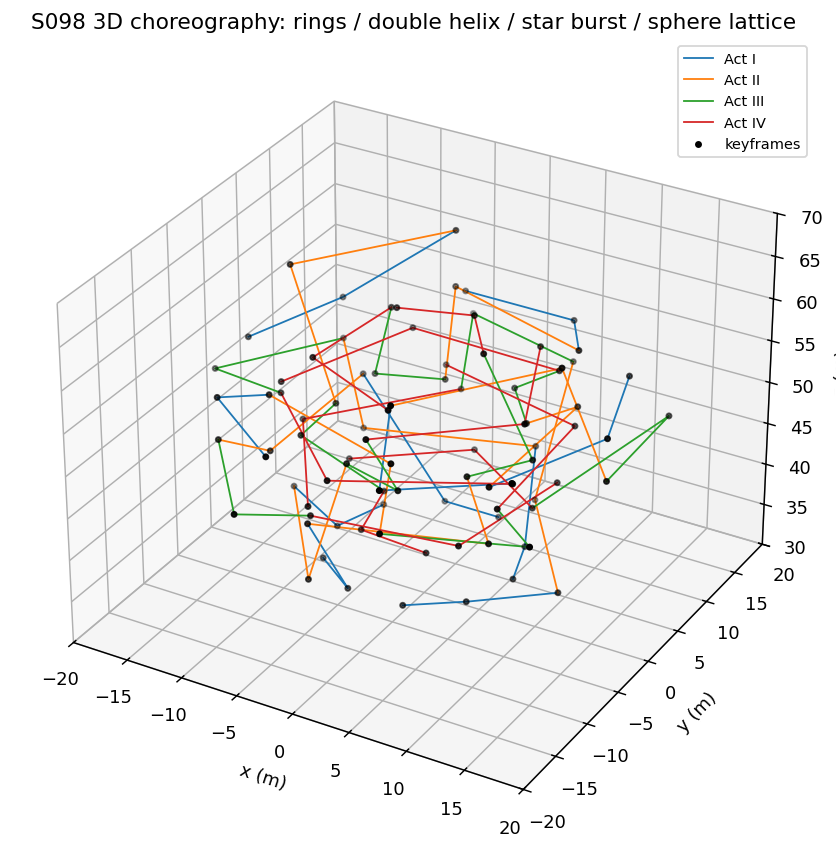
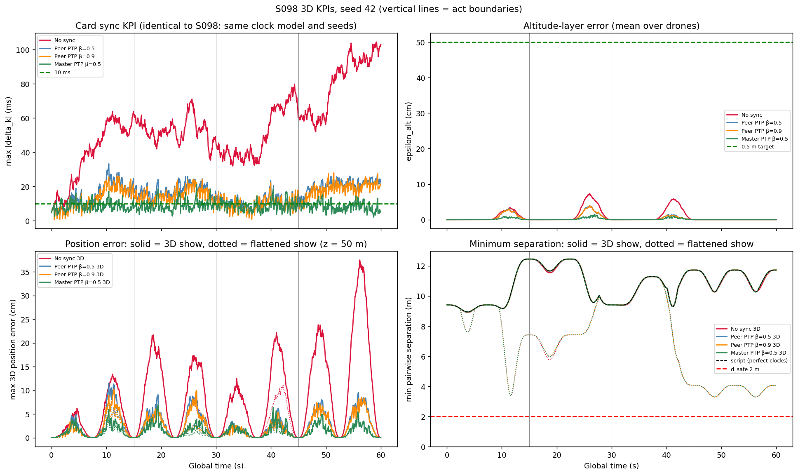
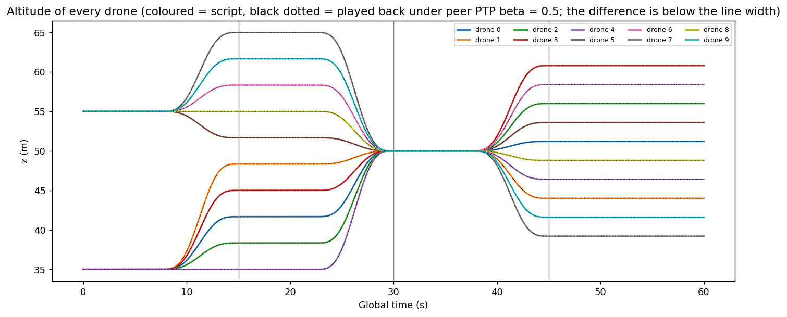
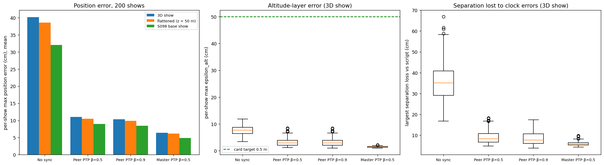
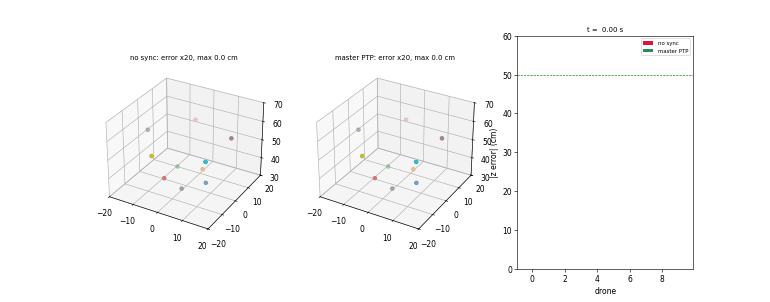

# S098 3D Upgrade — Swarm Synchronized Dance

**Domain**: Special Ops & Entertainment | **Difficulty**: ⭐⭐⭐⭐ | **Status**: ✅ Completed

---

## Problem Definition

**What S098 studies, and what the 3D card changes.** S098 is a clock-synchronisation study: ten drones play a scripted dance at their own drifting local clocks, and four strategies (no sync, peer PTP β = 0.5 and 0.9, master-referenced PTP) keep the clocks together. The 3D card keeps that clock model and changes the *choreography*: four acts with deliberate altitude layers, minimum-snap segments, an altitude-layer KPI and a collision-avoidance layer.

**The card's 3D claims do not touch what S098 studies.** The clock offsets $\delta_k(t)$ depend only on the drift, the jitter and the PTP law, not on where the drones fly. This script calls the S098 clock functions with the S098 seeds, and the offsets are the same arrays as in S098 for every strategy (printed: identical, and the per-show maximum sync KPI equals S098 in 200/200 shows for every strategy). Altitude can only change how a given clock offset turns into a position error, an altitude error or a loss of separation. Those are the card's 3D claims, and they are what this variant tests.

**Choreography (card acts; positions added)**: 60 s, nine keyframes per drone (act boundaries and midpoints):

| Act | Time | Formation (keyframes) |
|---|---|---|
| I | 0–15 s | inner ring r = 8 m at 35 m, outer ring r = 16 m at 55 m, counter-rotating by 36° |
| II | 15–30 s | double helix, r = 12 m, ten levels from 35 to 65 m, rotated by 72° |
| III | 30–45 s | flat star burst at 50 m (radii 8 / 16 m, then × 1.2 and rotated) |
| IV | 45–60 s | 10-point Fibonacci sphere, r = 12 m around (0, 0, 50) m, rotated about z |

Between formations the slots are assigned with the Hungarian method (minimum sum of squared moves); within an act the slots rotate with the assignment kept.

**Playback**: drone $k$ flies $\mathbf p_k^{cmd}(t + \delta_k)$ plus the card's collision-avoidance layer. **Strategies**: the four S098 strategies with the same 200 shows (seeds 1000–1199) and demo seed 42 (CRN).

**2D baseline (same seeds, same clock offsets)**: the same choreography flattened to a fixed altitude $z_f$ (xy paths unchanged), swept over 30, 50 and 70 m, and the S098 base show itself (two rings at 50 m ± 5 m).

---

## Mathematical Model Summary

**Clocks** (S098, unchanged): $\delta_k$ is a random walk with variance (5 ms)² per 0.5 s, $\mathcal U(-5, 5)$ ms initial offsets, PTP every 0.5 s with 1 ms timestamp jitter, $\hat\delta_k \leftarrow (1-\beta)\hat\delta_k + \beta\Delta_k$, $\delta_k \leftarrow \delta_k + \hat\delta_k$ (sign as fixed in S098; card corrected).

**Minimum-snap segments** (card): degree 7 per axis with position fixed and zero velocity, acceleration and jerk at both keyframes. The eight conditions fix all eight coefficients (the 8 × 8 solve matches the closed form to 2.58e-13 m), so nothing is left to minimise:

$$q(\tau) = q_0 + (q_1 - q_0)\,(35\tau^4 - 84\tau^5 + 70\tau^6 - 20\tau^7), \qquad \max|\dot q| = 2.1875\,|q_1 - q_0|/T.$$

Every drone stops at every keyframe.

**Error mapping**: to first order a clock offset moves a drone along its own path, $\mathbf p_k^{actual} - \mathbf p_k^{ideal} \approx \dot{\mathbf p}_k\,\delta_k$, so the altitude error is $|\dot z_k|\,|\delta_k|$ and the separation of a pair can change by at most $|\dot{\mathbf p}_k\delta_k - \dot{\mathbf p}_j\delta_j|$.

**KPIs**: the S098 sync KPI $\max_k|\delta_k|$; the card's altitude-layer error $\varepsilon_{alt} = \frac1N\sum_k|z_k - z_k^{ideal}|$ (target < 0.5 m); the 3D position error and the S098 visual fidelity $V$ (fastest-drone normaliser); the minimum pairwise separation against $d_{safe}$ = 2 m; the largest separation loss against the script.

**Collision-avoidance layer** (card, corrected): inside $d_{safe}$ each drone gets $\Delta\mathbf v^{rep} = v_{rep}(d_{safe} - d)/d\;\mathbf r$, $v_{rep}$ = 0.5 m/s. The card blends the *position* back to the reference, $\mathbf p \leftarrow (1-\alpha)\mathbf p^{cmd} + \alpha(\mathbf p + \Delta\mathbf v\Delta t)$ with $\alpha = e^{-\Delta t/t_{rec}}$, every step. That is a 0.2 s lag of the whole choreography: with perfect clocks it alone gives a 79.0 cm position error. The implementation filters only the repulsion offset, $\mathbf o \leftarrow \alpha\mathbf o + \Delta\mathbf v\Delta t$, $\mathbf p = \mathbf p^{cmd} + \mathbf o$ (0.0 cm with perfect clocks).

**Scripts** (printed, 10 ms grid):

| Show | Max speed | Max $\lvert v_z\rvert$ | Scripted min separation | z range |
|---|---:|---:|---:|---|
| 3D show | 4.53 m/s | 4.38 m/s | 8.94 m (t = 3.75 s) | 35.0–65.0 m |
| Flattened (z = 50 m) | 4.11 m/s | 0.00 m/s | 3.30 m (t = 56.25 s) | 50 m |
| S098 base show | 4.07 m/s | 0.53 m/s | 6.53 m | 45.0–55.0 m |

Per act (3D): max speed 4.43 / 4.53 / 4.09 / 4.09 m/s, max $|v_z|$ 3.89 / 4.38 / 3.15 / 0.00 m/s, scripted minimum separation 8.94 / 9.40 / 9.29 / 10.27 m. The second half of each act (midpoint keyframe to the next act's first keyframe) is the transition into the next formation, so Act III's vertical speed comes from the move into the sphere, and Act IV, where the sphere only rotates about the vertical axis, has none.

---

## Key Parameters

| Parameter | Value |
|-----------|-------|
| Drones / show / volume | 10 / 60 s / x, y within ±19.2 m, z 35–65 m (card volume ±20 m × 30–70 m) |
| $\Delta t_{sim}$ / $\Delta t_{ptp}$ | 0.05 s / 0.5 s (S098, card) |
| Drift / initial offsets / timestamp jitter | 5 ms per 0.5 s / U(−5, 5) ms / 1 ms (S098) |
| PTP gains | β = 0.5, 0.9 (card); master PTP β = 0.5 (S098) |
| Keyframes / polynomial | 9 per drone / degree 7, zero v, a, j at keyframes (card) |
| Ring radii / helix radius / sphere radius | 8, 16 m / 12 m / 12 m (card values; helix radius added) |
| Layer altitudes | 35 / 55 m (Act I), 35–65 m (Act II), 50 m (Act III), 50 ± 12 m (Act IV) |
| Star-burst factor (added) | 1.2 |
| $d_{safe}$ / $v_{rep}$ / $t_{rec}$ | 2.0 m / 0.5 m/s / 0.2 s (card) |
| $\varepsilon_{alt}$ target / sync target / $V$ threshold | 0.5 m / 10 ms / 90 % (card) |
| Monte Carlo | 200 shows, seeds 1000–1199; demo seed 42 (S098) |
| Flattened-show altitude sweep (added) | $z_f$ = 30, 50, 70 m, 50 shows |

---

## Implementation

```
src/05_special_entertainment/3d/s098_3d_synchronized_dance.py   # imports the S098 clock model and metrics
```

```bash
conda activate drones
python src/05_special_entertainment/3d/s098_3d_synchronized_dance.py
```

Runtime: 2.5–3.7 min (153–221 s over three runs; other simulations were running on the machine at the same time). Stdout and every output file are byte-identical across two single-threaded runs and one run with default threading. Asserted in every run: finite positions, nobody below 25 m, and every played-back position step bounded by the script's top speed times (Δt + |clock step|) plus the largest possible repulsion step.

---

## Results

### Seed 42

| Strategy | Max sync KPI | Max position error 3D / flat | Max $\varepsilon_{alt}$ (worst drone) | Mean V 3D / flat | Min separation 3D (script) | Separation loss 3D / flat |
|---|---:|---:|---|---:|---:|---:|
| No sync | 104.3 ms | 37.5 / 37.5 cm | 7.3 cm (20.6 cm) | 96.61 / 96.47 % | 8.909 m (8.944) | 29.1 / 43.3 cm |
| Peer PTP β=0.5 | 33.2 ms | 11.5 / 9.6 cm | 4.0 cm (9.9 cm) | 98.66 / 98.55 % | 8.930 m | 8.6 / 8.7 cm |
| Peer PTP β=0.9 | 28.0 ms | 10.3 / 8.5 cm | 3.9 cm (9.7 cm) | 98.69 / 98.58 % | 8.931 m | 7.8 / 6.3 cm |
| **Master PTP β=0.5** | **21.2 ms** | **6.9 / 6.9 cm** | **1.5 cm** (4.3 cm) | **99.49 / 99.46 %** | 8.931 m | 7.0 / 8.1 cm |

No strategy comes within 2 m of another drone (violation time 0.00 s everywhere) and the repulsion layer never acts. With the card's literal recovery blend instead, no sync gives a 104.7 cm position error, $\varepsilon_{alt}$ 45.9 cm and mean $V$ 69.13 %.

### Monte Carlo (200 shows)

| Strategy | Per-show max position error, 3D / flat / S098 show | Max $\varepsilon_{alt}$ (worst show) | Shows with $\varepsilon_{alt}$ < 0.5 m throughout | Mean V / min V (3D) | Min separation (script 8.944 m) | Separation loss max (mean) |
|---|---|---|---:|---|---:|---|
| No sync | 40.2 / 38.5 / 32.0 cm | 7.7 cm (11.9 cm) | 200/200 | 95.87 % / 85.1 % | 8.872 m | 66.9 cm (36.2) |
| Peer PTP β=0.5 | 11.0 / 10.5 / 8.9 cm | 3.2 cm (8.5 cm) | 200/200 | 98.62 % / 91.9 % | 8.921 m | 18.3 cm (9.2) |
| Peer PTP β=0.9 | 10.4 / 9.9 / 8.5 cm | 3.1 cm (8.5 cm) | 200/200 | 98.66 % / 91.9 % | 8.925 m | 17.4 cm (8.7) |
| **Master PTP β=0.5** | **6.4 / 6.1 / 4.9 cm** | **1.4 cm** (2.2 cm) | 200/200 | **99.49 % / 98.2 %** | 8.919 m | **9.8 cm** (5.9) |

The sync KPI itself is S098's: per-show maximum 120.8 (no sync), 33.5, 31.3 and 20.2 ms (master). The worst single-drone altitude error over all shows is 49.1 cm (no sync), 17.4, 18.0 and 7.9 cm. No show has a separation violation and the repulsion layer never acts (0 pair-steps) for any strategy. Master PTP has a smaller $\varepsilon_{alt}$ than no sync in 200/200 shows.

**3D against the flattened show** (per show, same clock offsets): the 3D show's maximum position error is on average 1.053× (no sync), 1.060×, 1.058× and 1.044× (master) that of the flattened show, from 1.000 to at most 1.656×; it is larger in only 49, 73, 73 and 56 of 200 shows. Against the S098 base show it is larger in 164, 175, 175 and 183 of 200 shows.

**Flattened show (2D baseline)**: minimum separation 2.979 m (no sync; script 3.295 m) and 3.265–3.274 m with PTP, separation loss up to 97.5 cm (no sync), 18.3, 17.5 and 11.5 cm, no violation. The fixed altitude makes no difference: at $z_f$ = 30, 50 and 70 m (50 shows), no sync gives 38.36 cm and master 5.94 cm maximum position error, and the minimum separation is 3.055 m and 3.272 m at every altitude.

**Key findings**:

- **The clock-sync result of S098 is unchanged by altitude, by construction.** The offsets are the same arrays; the card's sync expectations (PTP < 10 ms, β = 0.9 < 8 ms) still fail exactly as in S098 (20.2–33.5 ms per-show maximum).
- **The card's altitude-layer claim does not hold**: it expects no sync to breach $\varepsilon_{alt}$ = 0.5 m during the Act II and IV transitions (about 2 m). The measured maximum is 7.7 cm on average and 11.9 cm in the worst of 200 shows, so every strategy meets the target in every show. A 120 ms offset at a vertical speed of at most 4.38 m/s cannot produce a 2 m error. The card's expected no-sync numbers (≈ 2 m altitude error, ≈ 70 % fidelity) are close to what its own recovery blend gives (45.9 cm, 69.13 %); that blend is a lag of the whole show, not a clock effect.
- **The card's separation claim does not hold either**: it expects no-sync violations of $d_{safe}$ during Act II. Clock errors cost at most 66.9 cm of separation (no sync) and 9.8–18.3 cm with PTP, against scripted minimum separations of 8.944 m (3D show) and 3.295 m (flattened). No show violates 2 m and the repulsion layer never acts, so it is untested here. A violation would need a script whose minimum separation exceeds $d_{safe}$ by less than these separation losses.
- **Altitude makes clock errors only slightly more costly**: the maximum position error is 1.044–1.060× that of the same paths flown flat (mean over shows) (larger in 49–73 of 200 shows), because the 3D show's peak speed is 4.53 m/s against 4.11 m/s. That ratio is set by the choreography's speeds, which are an added design choice, not a property of altitude.
- **Altitude layering is what keeps the show far from collisions**, independently of the clocks: the 3D show's closest approach is 8.94 m, the same paths flattened come within 3.30 m.

### Choreography

The 3D paths coloured by act; black dots are the keyframes. The segments are straight lines because every axis of a segment follows the same smoothstep.



### KPIs over the show (seed 42)

Top left: sync KPI. Top right: altitude-layer error against the 0.5 m target. Bottom left: largest 3D position error (dotted: flattened show). Bottom right: minimum separation (dotted: flattened show).



### Altitude time series

Script (coloured) and played-back altitude under peer PTP β = 0.5 (black dotted).



### Monte Carlo

Left: per-show maximum position error, 3D / flattened / S098 base show. Centre: altitude-layer error against the card target. Right: separation lost to clock errors.



### Animation

No sync (left) and master PTP (right), seed 42: grey = script, coloured = played back, black lines = error × 20. Right panel: altitude error per drone. 151 frames at 10 fps, i.e. 2× real time (every 8th of 1201 samples).



### Deviations from the scenario card

| Card | Implementation | Reason |
|------|----------------|--------|
| "Minimum-snap trajectories (4th-order polynomial)" | Degree 7 (the card's own model); card corrected | Internal inconsistency |
| Minimum-snap "LP formulation" | Closed-form degree-7 smoothstep, checked against the 8 × 8 solve (2.58e-13 m) | Eight boundary conditions leave nothing to minimise |
| Recovery blend applied to the position every step | Blend applied to the repulsion offset only; card corrected; the literal form is printed once | The literal form lags the whole show by 0.2 s (79.0 cm error with perfect clocks) |
| $\delta_k \leftarrow \delta_k - \hat\delta_k$ | $+\hat\delta_k$ (S098); card corrected | The literal sign diverges (S098) |
| Keyframe positions not given | Formations above, Hungarian slot assignment between formations | Added; the scripted minimum separation (8.94 m) is printed |
| Volume 30–70 m | 35–65 m used | Inside the card volume |
| Three strategies | The four S098 strategies, including master PTP | Same comparison as the fixed S098 |
| Expected: no-sync ε_alt ≈ 2 m, separation < 1 m, V ≈ 70 %; PTP < 10 ms | Not reproduced; see the key findings | Reported as measured (X6) |
| — | Flattened-show baseline with an altitude sweep, and the S098 base show on the same seeds | Fair 2D baseline (X5) |

---

## Extensions

1. **Tight choreography**: script a crossing with a margin of 0.5 m above $d_{safe}$ and measure how often clock errors cause violations with and without PTP.
2. **Speed-aware sync**: shorten the PTP interval during the fastest vertical transitions, where an offset costs the most altitude error.
3. **Barometric altitude noise**: add altimeter noise and drift, which (unlike the clock error) does depend on altitude.
4. **Altitude-dependent wind** (card extension 4) with a tracking controller instead of kinematic playback.
5. **Fault-tolerant re-choreography** (card extension 3).

---

## Related Scenarios

- Original 2D version: [S098 Swarm Synchronized Dance](../../../../scenarios/05_special_entertainment/S098_synchronized_dance.md)
- 3D card: [S098 3D Upgrade — Swarm Synchronized Dance](../../../../scenarios/05_special_entertainment/3d/S098_3d_synchronized_dance.md)
- Formation in 3D: [S085 3D Upgrade — Light Matrix Positioning](../../../../scenarios/05_special_entertainment/3d/S085_3d_light_matrix.md)
- Collision avoidance at scale: [S089 Large-Scale Swarm Collision Avoidance Test](../../../../scenarios/05_special_entertainment/S089_collision_avoidance.md)
- Formation morphing: [S088 Formation Geometric Shape Morphing](../../../../scenarios/05_special_entertainment/S088_formation_morphing.md)
