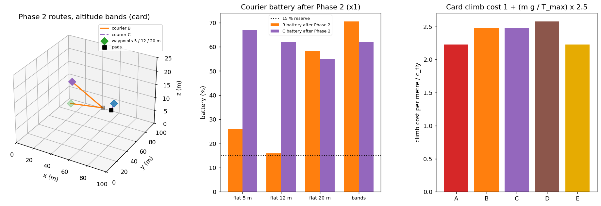
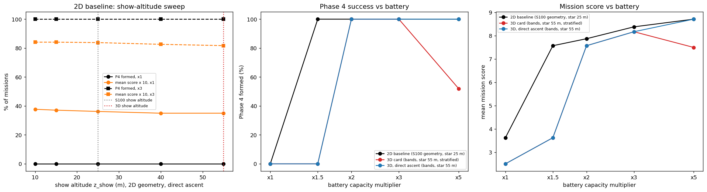
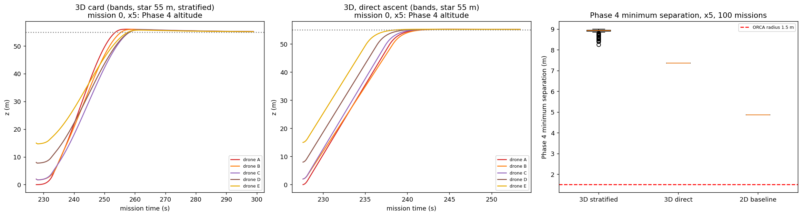
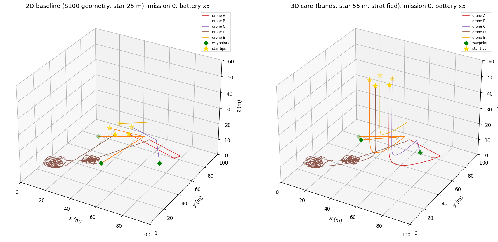
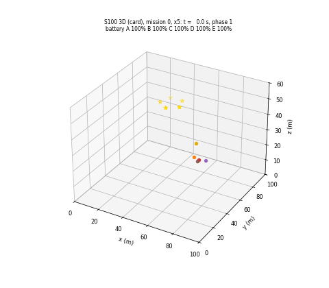

# S100 3D Upgrade — Grand Challenge: Multi-Domain Integration

**Domain**: Special Ops & Entertainment | **Difficulty**: ⭐⭐⭐⭐⭐ | **Status**: ✅ Completed

---

## Problem Definition

**Setup**: the fixed S100 mission is kept: five drones, four phases under one sequencer on Drone E, 300 s budget (loop stops at 330 s), one battery model $\max(c_{hover}, c_{fly}\|\mathbf v\|)$ for every drone in every phase, a landing failsafe ($E < c_{fly}z + 3$ %), 80 m multi-hop links, and the card score $S = 2s_1 + n_{deliv} + 3s_3 + 2s_4 - 0.05\max(0, t_{end} - 300)$.

| Phase | S100 | 3D variant |
|---|---|---|
| 1 Ball catching (A) | S094 predictive catch point, window 0.3–4 m | unchanged (S100) |
| 2 Logistics (B, C) | waypoints (20,70,5), (75,60,5), (40,40,5) m; NN split by distance; battery trigger | waypoints in three altitude bands **5 / 12 / 20 m** (card); card climb cost; NN split on the card's energy cost; trigger includes the climb |
| 3 Search (D) | Bayesian search at 8 m | unchanged (S100); the scout's battery trigger includes the climb to the star |
| 4 Formation (all) | star at 25 m, Hungarian + PID (anti-windup) + ORCA-lite, ε 0.15 m, $r_{safe}$ 1.2 m | star at **55 m** in a 60 m arena; card's **altitude-stratified ascent**; ε 0.20 m, $r_{safe}$ 1.5 m (card) |

**Card energy model (used everywhere in the 3D variant)**: each metre climbed costs an extra $c_{climb,i} = c_{fly}(m_i g/T_{max,i})\gamma_{climb}$ with $\gamma_{climb}$ = 2.5 and the card's heterogeneous masses and thrusts. Climbing therefore costs 2.226 (A, E), 2.471 (B, C) and 2.577 (D) × $c_{fly}$ per metre; descents cost $c_{fly}$ per metre, as before.

**What is 3D here**: altitude decides whether the battery lasts. The waypoint altitude (Phase 2), the show altitude and the ascent profile (Phase 4) are planned altitude choices, and the climb cost makes each of them cost energy.

**Variants** (100 missions, common random numbers: the throws, mocap noise, survivor positions and sensor draws depend only on the seed):

| Key | Configuration |
|---|---|
| **2D baseline** | S100 geometry (waypoints at 5 m, star at 25 m, direct ascent) with the same energy model and card tolerances; show altitude swept over 10, 15, 25, 40, 55 m |
| **3D card** | bands 5 / 12 / 20 m, star at 55 m, stratified ascent |
| **3D direct** | as 3D card, but the S100 direct PID ascent |

Each is run at battery capacity ×1 (the card's), ×1.5, ×2, ×3 and ×5. The exact S100 configuration is also run through this script's mission loop and reproduces S100 mission by mission.

---

## Mathematical Model Summary

**Battery**: $\dot E = -\frac1\kappa\bigl[\max(c_{hover}, c_{fly}\|\mathbf v\|) + c_{climb,i}\max(0, v_z)\bigr]$ while airborne, $c_{fly}$ = 0.004 m⁻¹, $c_{hover}$ = 0.003 s⁻¹, κ = capacity multiplier. Every step asserts $E \ge 0$. Phase 1 (the catcher's 2 ms track at ≤ 4 m) is charged as in S100.

**Phase 2 trigger** (card, with the climb): $E - c_{fly}\,2d_{out} - c_{hover}\tau_{deliver} - c_{climb}\max(0, z_{wp} - z_{pad}) \ge 0.15$. **Scout trigger**: $E_D - c_{fly}(d_{far} + z_{show}) - c_{climb,D}\max(0, z_{show} - z_D) < 0.15$ ends the search.

**Stratified ascent** (card, corrected): drone $k$ tracks $z_k(t) = z_k^{start} + (z_{show} - z_k^{start})\,\Phi(t/\tau_k)$ with $\Phi(\xi) = 3\xi^2 - 2\xi^3$ and

$$\tau_k = 1.5\,\frac{|z_{show} - z_k^{start}|}{v_{z,max}} + 3k\ \text{s}, \qquad v_{z,max} = 3\ \text{m/s}.$$

The smoothstep's peak slope is 1.5, so the card's $\tau = |\Delta z|/v_{z,max}$ would climb at 1.5 × 3 = 4.5 m/s (printed); the factor 1.5 keeps the peak at 3 m/s. The horizontal goal is the star tip from the start; the S100 PID (gains 1.2 / 0.05 / 0.4, anti-windup) tracks the moving goal.

**Card checks (printed)**:
- Energy for courier B (×1) to climb from 2 m: to 25 m 22.7 % with the climb cost (9.2 % without), landing reserve 13.0 %; to 55 m 52.4 % (21.2 %), reserve 25.0 %; to 60 m 57.3 % (23.2 %), reserve 27.0 %.
- Card show altitude 60 m = the 60 m arena ceiling. With the ceiling lifted, the formation overshoots to 60.260 m (direct) and 61.109 m (stratified), above 60 m in 100/100 missions. As S100 did with its 50 m show in a 30 m arena, the show is put 5 m below the ceiling: 55 m (card corrected).
- Catcher A: $T/m$ = 20.0 m/s², 17.4 m/s² horizontally, 10.2 m/s² upwards (card values confirmed).
- Phase 3 sensor model $|\mathbf x - \mathbf p_D| \le r_s + \kappa|\Delta z|$: the horizontal footprint radius is 3.00 m at $\Delta z = 0$, at most 3.27 m at $\Delta z$ = 1.43 m, and zero beyond 4.99 m. Flying higher shrinks it, against the card's claim, and a scout at 8 m would not see a survivor on the ground (card note added).
- Thrust-to-weight: A, E 2.04; B, C 1.70; D 1.59. The card's thrust-ratio allocation rule uses an undefined $\tau_{climb,max}$ and cannot separate the two identical couriers.

**Reproduction**: the S100 configuration (waypoints at 5 m, star 25 m, no climb cost, ε 0.15 m, $r_{safe}$ 1.2 m) through this script's loop gives the same scores and phase end times as the S100 loop in all 100 missions (score 3.74 ± 0.82 at ×1; this is the S100 code on these 100 missions; the S100 README reports 3.81 ± 0.92 over its 200 missions).

---

## Key Parameters

| Parameter | Value |
|-----------|-------|
| Arena / budget / loop end / tick | 100 × 100 × 60 m (card) / 300 s / 330 s / 0.1 s |
| Masses / max thrust (card) | A 0.8 kg, 16 N; B, C 1.2 kg, 20 N; D 0.9 kg, 14 N; E 0.8 kg, 16 N |
| Climb factor $\gamma_{climb}$ | 2.5 (card) |
| Waypoints (3D) | (20, 70, 5), (75, 60, 12), (40, 40, 20) m (card) |
| Show altitude (3D) / star radius | 55 m (card 60 m, corrected) / 8 m |
| Stratified ascent | $v_{z,max}$ 3 m/s, stagger 3 s, $\tau_k$ = 1.5 Δz / $v_{z,max}$ + 3k s (card, corrected) |
| Formation tolerance / ORCA radius | 0.20 m / 1.5 m (card) |
| $c_{fly}$ / $c_{hover}$ / reserve / failsafe margin | 0.004 m⁻¹ / 0.003 s⁻¹ / 15 % / 3 % (S100) |
| Capacity multipliers (added, as S100) | ×1, 1.5, 2, 3, 5 |
| Show-altitude sweep (added) | 10, 15, 25, 40, 55 m (2D geometry, ×1 and ×3) |
| Factorial (added) | star 10, 25, 40, 55 m × 2D waypoints / bands × ×1.25, 1.5, 1.75; direct ascent; first 50 missions |
| Phases 1 and 3, speeds, PID gains, communication | as S100 |
| Monte Carlo | 100 missions, seeds 0–99 (S100: 200; reduced for runtime) |

---

## Implementation

```
src/05_special_entertainment/3d/s100_3d_grand_challenge.py   # imports S100 (and through it S094); copies the S100 mission loop with the 3D changes marked
```

```bash
conda activate drones
python src/05_special_entertainment/3d/s100_3d_grand_challenge.py
```

Runtime: 6.1–6.9 min (411, 383 and 368 s over three runs; other simulations were running on the machine at the same time). The Monte Carlo was cut from 200 to 100 missions, and the factorial to 50 missions per cell, to stay below 8 min. Stdout and every output file are byte-identical across two single-threaded runs and one run with default threading. The asserts of S100 are kept (speed ≤ 8 m/s, acceleration ≤ 10 m/s², inside the arena including the 60 m ceiling, battery ≥ 0), plus the reproduction of S100.

---

## Results

### Phase 2 on its own (×1, deterministic)

| Waypoint altitudes | Split (B / C) | Delivered | B / C battery after Phase 2 | Phase 2 ends |
|---|---|---:|---|---:|
| all at 5 m (S100) | WP1, WP3 / WP2 | 3/3 | 25.9 / 67.0 % | 45.9 s |
| all at 12 m | WP1, WP3 / WP2 | 3/3 | 16.0 / 61.9 % | 46.7 s |
| all at 20 m | WP1, WP3 / WP2 | 2/3 (B aborts) | 58.2 / 55.0 % | 22.4 s |
| **bands 5 / 12 / 20 m (card)** | WP1, WP3 / WP2 | **2/3 (B aborts WP3 at 20 m)** | 70.5 / 61.9 % | 20.8 s |

The card's energy-cost split equals the distance split here (both couriers have the same mass and thrust). With the climb cost, B's battery trigger refuses the 20 m delivery, so with the card's battery the 3D mission can never deliver all three packages.

### Missions (100 missions)

| Variant | Battery | P1 | P2 3/3 | P3 | P4 formed | Perfect | Score | First failsafe landing |
|---|---|---:|---:|---:|---:|---:|---|---|
| 2D baseline | ×1 | 100 % | 100 % | 4.0 % | 0 % | 0 | 3.62 ± 0.59 | B in 100 |
| 2D baseline | ×1.5 | 100 % | 100 % | 19.0 % | **100 %** | 19 | 7.57 ± 1.18 | none |
| 2D baseline | ×2 | 100 % | 100 % | 29.0 % | 100 % | 29 | 7.87 ± 1.37 | none |
| 2D baseline | ×3 | 100 % | 100 % | 46.0 % | 100 % | 46 | 8.38 ± 1.50 | none |
| 2D baseline | ×5 | 100 % | 100 % | 57.0 % | 100 % | 57 | 8.71 ± 1.49 | none |
| 3D card | ×1 | 100 % | 0 % | 0.0 % | 0 % | 0 | 2.50 ± 0.00 | B in 100 |
| 3D card | ×1.5 | 100 % | 100 % | 4.0 % | **0 %** | 0 | 3.62 ± 0.59 | B in 100 |
| 3D card | ×2 | 100 % | 100 % | 19.0 % | 100 % | 19 | 7.57 ± 1.18 | none |
| 3D card | ×3 | 100 % | 100 % | 39.0 % | 100 % | 39 | 8.17 ± 1.47 | none |
| 3D card | ×5 | 100 % | 100 % | 57.0 % | **52 %** | 52 | **7.50 ± 2.71** | none |
| 3D direct | ×1 | 100 % | 0 % | 0.0 % | 0 % | 0 | 2.50 ± 0.00 | C in 100 |
| 3D direct | ×1.5 | 100 % | 100 % | 4.0 % | 0 % | 0 | 3.62 ± 0.59 | B in 100 |
| 3D direct | ×2 | 100 % | 100 % | 19.0 % | 100 % | 19 | 7.57 ± 1.18 | none |
| 3D direct | ×3 | 100 % | 100 % | 39.0 % | 100 % | 39 | 8.17 ± 1.47 | none |
| 3D direct | ×5 | 100 % | 100 % | 57.0 % | 100 % | 57 | 8.71 ± 1.49 | none |

Paired per mission: 3D card against the 2D baseline is worse in 100/100 missions at ×1 and ×1.5 (sign test p = 1.58e-30), in 10/100 at ×2 (90 ties), 7/100 at ×3 (93 ties) and 48/100 at ×5 (52 ties); never better. Stratified against direct ascent: all ties up to ×3, direct better in 48/100 at ×5 (p = 7.11e-15).

### 2D baseline: show-altitude sweep

| Show altitude | ×1: P4 / P3 / score | ×1: B battery at Phase 4 start → end | ×3: P4 / P3 / score | ×3: B at Phase 4 start → end |
|---|---|---|---|---|
| 10 m | 0 % / 9.0 % / 3.77 ± 0.86 | 25.94 → 1.44 % | 100 % / 47.0 % / 8.41 ± 1.50 | 75.31 → 66.57 % |
| 15 m | 0 % / 7.0 % / 3.71 ± 0.77 | 25.94 → 1.06 % | 100 % / 47.0 % / 8.41 ± 1.50 | 75.31 → 65.39 % |
| 25 m (S100) | 0 % / 4.0 % / 3.62 ± 0.59 | 25.94 → 1.14 % | 100 % / 46.0 % / 8.38 ± 1.50 | 75.31 → 62.90 % |
| 40 m | 0 % / 0.0 % / 3.50 ± 0.00 | 25.94 → 1.07 % | 100 % / 42.0 % / 8.26 ± 1.49 | 75.31 → 58.82 % |
| 55 m | 0 % / 0.0 % / 3.50 ± 0.00 | 25.94 → 0.61 % | 100 % / 39.0 % / 8.17 ± 1.47 | 75.31 → 54.46 % |

With the climb cost, no fixed show altitude, not even 10 m, lets courier B (25.94 % after Phase 2) reach its tip and still keep its landing reserve at ×1; at ×3 every altitude works. The altitude still changes the result through the search: the scout's trigger reserves the climb to the star, so a higher show leaves less time to search (P3 at ×3: 47.0 % at 10 m, 39.0 % at 55 m; at ×1: 9.0 % to 0.0 %).

### Show altitude × waypoint geometry × battery (where the threshold comes from)

The table above compares a 25 m star (2D baseline) with a 55 m star (3D), so its ×1.5 against ×2 contrast mixes two altitude changes. This factorial separates them (direct ascent, the first 50 of the 100 missions, same seeds; 50 missions per cell to keep the runtime below 8 min). Each cell gives Phase 4 formed / 50 and the mean score; Phase 2 delivered all three packages in every cell:

| Waypoints, battery | Star 10 m | Star 25 m | Star 40 m | Star 55 m |
|---|---|---|---|---|
| 2D (all 5 m), ×1.25 | 50/50, 7.60 | 0/50, 3.98 | 0/50, 3.62 | 0/50, 3.50 |
| 2D (all 5 m), ×1.5 | 50/50, 7.90 | 50/50, 7.78 | 50/50, 7.60 | 0/50, 3.62 |
| 2D (all 5 m), ×1.75 | 50/50, 8.08 | 50/50, 7.90 | 50/50, 7.78 | 50/50, 7.60 |
| bands 5/12/20 m, ×1.25 | 50/50, 7.60 | 0/50, 3.98 | 0/50, 3.62 | 0/50, 3.50 |
| bands 5/12/20 m, ×1.5 | 50/50, 7.90 | 50/50, 7.78 | **0/50**, 4.10 | 0/50, 3.62 |
| bands 5/12/20 m, ×1.75 | 50/50, 8.08 | 50/50, 7.90 | 50/50, 7.78 | **0/50**, 4.10 |

Lowest battery multiplier (of ×1.25, ×1.5, ×1.75) at which every formation completes: 2D waypoints ×1.25 / ×1.5 / ×1.5 / ×1.75 for a 10 / 25 / 40 / 55 m star; bands ×1.25 / ×1.5 / ×1.75 / more than ×1.75.

- The show altitude sets most of the battery requirement: with the 2D waypoints it rises from ×1.25 (10 m) to ×1.75 (55 m).
- The altitude bands make no difference for a star at 10 or 25 m (identical cells), but at 40 and 55 m they push the requirement up by one step (×1.5 → ×1.75 at 40 m, ×1.75 → above ×1.75 at 55 m). At ×1 they also cost a package (B aborts the 20 m waypoint, see Phase 2).

### Phase 4: stratified against direct ascent

| Variant (Phase 4) | Battery | Formed | Duration | Min separation (mean) | ORCA ticks | Peak $\lvert v_z\rvert$ | Peak altitude |
|---|---|---:|---|---|---:|---:|---:|
| 2D baseline (25 m) | ×3 | 100/100 | 22.67 ± 0.31 s | 4.87 m (4.87) | 0 | 5.54 m/s | 25.25 m |
| 2D baseline (25 m) | ×5 | 100/100 | 22.68 ± 0.31 s | 4.87 m (4.87) | 0 | 5.25 m/s | 25.23 m |
| 3D card, stratified | ×3 | 100/100 | 71.30 ± 0.00 s | 8.25 m (8.86) | 0 | 3.32 m/s | 56.05 m |
| 3D card, stratified | ×5 | 52/100 | 71.30 ± 0.00 s | 8.25 m (8.86) | 0 | 3.32 m/s | 56.05 m |
| 3D direct | ×3 | 100/100 | 25.80 ± 0.39 s | 7.36 m (7.36) | 0 | 5.92 m/s | 55.27 m |
| 3D direct | ×5 | 100/100 | 25.80 ± 0.40 s | 7.36 m (7.36) | 0 | 5.93 m/s | 55.27 m |

At ×5 the stratified ascent gives a larger minimum separation in 100/100 missions (+1.51 m on average), but no variant ever comes near the 1.5 m ORCA radius. It takes 45.50 s longer than the direct ascent (44.50–45.90 s), although its climb profiles end 32.50 ± 0.02 s after Phase 4 starts.

**Probe — why the stratified ascent is slow** (×5, PD instead of PID, $K_i$ = 0): stratified 32.80 ± 0.00 s, formed 100/100, peak altitude 55.00 m, score 8.71 ± 1.49; direct 14.73 ± 0.08 s, 100/100. Without the integral term the stratified formation converges at 32.80 s, right after its profiles end (32.50 s). With the card's PID, the integral builds up while the drones lag the climbing goal, the drones overshoot to 56.05 m against the 55 m show plane, and the formation converges only at 71.30 s. At ×5, when Phase 3 runs long, this pushes Phase 4 past the 300 s deadline in 48 missions.

**Key findings**:

- **Altitude decides the battery outcome, and most of it is the show altitude.** With the card's climb cost, the 2D baseline (25 m star) forms the star from ×1.5 on, while both 3D variants (55 m star, bands) need ×2 (0/100 at ×1.5, courier B lands on its failsafe in all 100). The factorial shows that this gap comes mainly from the higher star: with the 2D waypoints alone, a 55 m star already needs ×1.75. The bands add one more step only for high stars (40 and 55 m), and at ×1 they make the 3D mission fail Phase 2 as well (B cannot afford the 20 m waypoint): 2.50 in every mission, against 3.62 for the 2D baseline and 3.74 for the S100 code on the same 100 missions.
- **Lowering the show does not rescue the card's battery (×1), but it lowers the battery needed.** At ×1 the 2D baseline fails Phase 4 at every fixed show altitude from 10 to 55 m, because B arrives with 25.94 % and the climb cost plus the reserve exceed it; a 10 m star already works at ×1.25. At ×3 every altitude works and a higher show mainly costs search time (P3 47.0 → 39.0 % from 10 to 55 m).
- **The card's stratified ascent solves a problem that does not occur here.** The Hungarian assignment already keeps the drones 7.36 m apart in the direct ascent (4.87 m in the 2D baseline); ORCA never acts. Stratification raises the separation to 8.25 m but, combined with the card's PID, makes Phase 4 take 71.3 s instead of 25.8 s, and at ×5 only 52/100 formations finish by 300 s (score 7.50 against 8.71). The PD probe shows that the integral term, not the profile itself, causes the delay.
- **The card's 60 m show altitude does not fit its own 60 m arena** (overshoot above 60 m in 100/100 missions); 55 m was used.
- **Phases 1 and 3 are as in S100**: Phase 1 succeeds in 100/100 missions (catcher battery 16.08 % used); Phase 3 success depends on the battery and the show altitude through the scout's trigger.

### Phase 2 with altitude bands

Left: the card's routes in 3D (B solid, C dashed). Centre: courier battery after Phase 2 for flat waypoint altitudes and the bands (×1; "bands" and "flat 20 m" are high because B aborted a trip). Right: climb cost per metre for each drone.



### Altitude and battery

Left: 2D baseline against the show altitude (×1 and ×3). Centre and right: Phase 4 success and mission score against battery capacity.



### Phase 4 ascent

Mission 0 at ×5: stratified (left) and direct (centre) climbs; right: Phase 4 minimum separation over 100 missions at ×5.



### Whole mission in 3D

Mission 0 at ×5: 2D baseline (left) and 3D card (right).



### Animation

3D card, mission 0 at ×5, one frame per 1.5 s of mission time with the battery of each drone. 201 frames at 15 fps (every 15th tick up to tick 2989).



### Deviations from the scenario card

| Card | Implementation | Reason |
|------|----------------|--------|
| Show altitude 60 m in a 60 m arena | 55 m; card corrected | The overshoot leaves the arena (above 60 m in 100/100 missions, printed) |
| $\tau_k = \lvert\Delta z\rvert/v_{z,max} + k\,\delta t$ | $1.5\,\lvert\Delta z\rvert/v_{z,max} + k\,\delta t$; card corrected | The smoothstep's peak slope 1.5 gives 4.5 m/s otherwise |
| Phase 1: 10 m mast, wind on the ball, tilt-aware cup, altitude-choosing catch planner | Not implemented; Phase 1 is S100's (S094) | Scope and runtime: the 3D catching model (wind, tilt-aware cup, thrust-limited catcher) is the subject of the S094 3D upgrade, and the S100 run is already close to the 8 min limit. Its effect on this mission is therefore not tested here; the card's harder Phase 1 could lower P1 below the 100/100 of S100's Phase 1 |
| Phase 3: volumetric 3D belief and altitude-optimised scout | Not implemented; Phase 3 is S100's at 8 m | The card's sensor model is not a cone: its footprint shrinks with height and vanishes beyond 4.99 m (printed), so the claimed trade-off does not exist; card note added |
| Heterogeneous battery capacities (Wh) and max speeds | Not used; masses and thrusts are used through the climb cost | The card gives no consumption in Wh; the normalised S100 battery (×1 = card) keeps the comparison with S100; S100's operating speeds are within the card's maxima |
| Thrust-ratio task allocation | Not used | $\tau_{climb,max}$ undefined; both couriers identical (1.70); card note added |
| Vertical PID gain $K_p^z = K_p m_k/m_{min}$ | Not used | Velocity-commanded model; gravity is handled by the inner loop |
| E's figure-eight orbit at 15–20 m | Station-keeping at 15 m (S100) | Orbit not specified |
| Climb energy for Phase 2 only | Charged for every drone in every 10 Hz phase, and in the courier and scout triggers | One battery model for the whole mission (S100 principle) |
| 3D TSP | Energy-cost nearest-neighbour split (card); it equals the distance split here | One package per trip from each courier's pad (S100) |
| 200 missions (S100) | 100 missions; 50 per cell in the show-altitude × geometry × battery factorial | Runtime target < 8 min |
| — | 2D baseline with the same energy model and tolerances, show-altitude sweep, capacity sweep, PD probe | Fair 2D baseline (X5); added-parameter sweeps; causal probe for the Phase 4 delay |

---

## Extensions

1. **Energy-aware altitude planning**: choose the show altitude and the star-tip assignment so that the drone with the least battery climbs the least.
2. **Phase 1 in 3D**: plug in the S094 3D catcher (wind, tilt-aware cup) once it exists.
3. **A real sensor cone** for Phase 3 (footprint growing with height, detection probability falling with range) and an altitude-choosing scout.
4. **Feed-forward on the climb profile**: give the PID the profile's vertical velocity so the integral does not wind up during the stratified ascent.
5. **Heterogeneous batteries in Wh** with a power model, so that the card's fleet table enters through capacity as well as climb cost.

---

## Related Scenarios

- Original 2D version: [S100 Ultimate Grand Challenge — Multi-Domain Integration](../../../../scenarios/05_special_entertainment/S100_grand_challenge.md)
- 3D card: [S100 3D Upgrade — Grand Challenge: Multi-Domain Integration](../../../../scenarios/05_special_entertainment/3d/S100_3d_grand_challenge.md)
- Phase 1 module: [S094 Aerial Ball Catching](../../../../scenarios/05_special_entertainment/S094_ball_catching.md)
- Phase 3 module: [S042 Missing Person Localization](../../../../scenarios/03_environmental_sar/S042_missing_person.md)
- Phase 4 modules: [S085 Drone Light Matrix Positioning](../../../../scenarios/05_special_entertainment/S085_light_matrix.md), [S088 Formation Geometric Shape Morphing](../../../../scenarios/05_special_entertainment/S088_formation_morphing.md)
